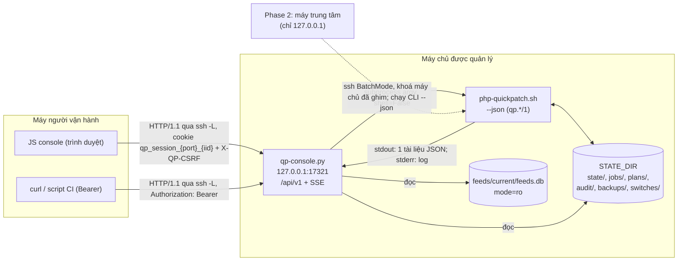

# Thiết kế hợp đồng API — php-quickpatch v2

## Lịch sử sửa đổi (Revision History)
| Phiên bản | Ngày | Người thực hiện | Tóm tắt thay đổi |
| :--- | :--- | :--- | :--- |
| 1.0.0 | 2026-10-22 | BA Agent | Khởi tạo bộ thiết kế API theo skill `/api-design` (template 37, rules 10, 03): quy chuẩn chung, danh mục 57 endpoint `/api/v1` (Phase 1: 44, Phase 2: 13), luồng SSE log job, hợp đồng `--json` của CLI (`scan`, `assess`, `plan`, `fix`, `migrate`, `feeds status`), giao thức SSH controller → host của Phase 2 |
| 1.0.1 | 2026-10-22 | BA Agent | §2.1 thêm dòng "Tên resource": quy tắc danh từ số nhiều (rules/10 §1), bí danh `current`, 6 ngoại lệ tài nguyên đơn có chủ đích (`overview`, `environment`, `fleet-summary`, `runtimes/{id}/assessment`, `jobs/{id}/log`, `plans/{id}/compatibility`) kèm 3 tiêu chí; §6.2 thêm mục 13 ghi lý do giữ tên theo registry SRS |
| 1.0.2 | 2026-10-22 | BA Agent | Sửa theo review, đồng bộ với business-rules.md 1.0.1 (§6 mục 2, 4, 5, 7), error-matrix.md 1.1.0, spec.md 1.1.0 và functional-requirements.md 1.0.1: (1) `BR-AUTH-003`: luôn so token trước, token đúng luôn được cấp phiên, chỉ token sai từ lần thứ 5 trong 60 s nhận 429 (§2.4, §2.6, §2.11, thêm điểm kiểm §5.4); (2) `BR-AUTH-004`: cookie `qp_session_<port>_<iid>`, `Max-Age=43200`, console chỉ đọc cookie đúng tên của phiên `serve` (§1.5, §2.3–§2.6, thêm điểm kiểm §5.4); (3) `BR-JOB-008`: timeout động của `plan create`, `migrate switch` và cách xử lý khi hết timeout (§2.12, §2.13.2); (4) `BR-CON-005`: bỏ ngoại lệ dry-run của `feeds_import`, thêm luồng 2 bước của `POST /api/v1/feed-snapshots` (§2.13.3, §3.1 #20), §2.8 mục 5 và §6.2 mục 1, 4, 6 ghi "đã quyết"; (5) bỏ nhãn "mã đề xuất"/(ĐX) của `ERR-JOB-429-02`, `ERR-UPG-409-03`, `ERR-FLT-422-03` (§2.11, §3.1 #34), thay bảng §6.1 bằng liên kết error-matrix.md §3.3, §3.11, §3.13; (6) §2.14 bỏ nhãn ĐX, dẫn chiếu spec.md §3.3.4 nhóm `control`; (7) §6.2 mục 10: chờ `CR-FR-01` (`FR-UPG-ACK-001`, endpoint #58 dự kiến) |

## Metadata
- **Template**: `_templates/37-api-design.md` (BA-Kit v1.0); skill `skills/api-design/SKILL.md`.
- **Quy chuẩn áp dụng**: rules/10 (hợp đồng API), rules/03 (mã lỗi), rules/11 (ma trận lỗi), rules/16 (ngôn từ định lượng), rules/18 (frontmatter), rules/19 (phiên bản tài liệu).
- **Nguồn sự thật**: mọi mã `FR-*`, `BR-*`, `ERR-*`, `NFR-*`, `UC-*`, `SCR-*` và danh mục method/path lấy từ SRS (`DOC-SRS-QP-001` §3.3.3 và 4 file chi tiết). Tài liệu này **không** định nghĩa lại yêu cầu; nó chốt hình dạng request/response, header, cổng kiểm tra, giới hạn và timeout.
- **Trạng thái**: Draft — chờ Dev và kỹ sư bảo mật rà soát. Quyết định thiết kế chưa có trong SRS được gắn nhãn **(ĐX)** và tổng hợp ở §6.
- **Phiên bản API**: `v1` (đường dẫn `/api/v1`); hợp đồng CLI: `qp.<lệnh>/1`, `schema_version` `1.0.0`.

---

## 1. Thông tin tổng quan (Overview)

### 1.1 Mục đích
Tài liệu là hợp đồng tích hợp giữa 4 thành phần: (1) JS của console chạy trong trình duyệt; (2) `qp-console.py` (Python ≥ 3.6 thư viện chuẩn, chỉ bind `127.0.0.1`); (3) CLI `php-quickpatch.sh` (Bash ≥ 4.3) mà console gọi bằng `subprocess` và đọc đầu ra `--json`; (4) Phase 2: máy trung tâm gọi CLI trên nhiều máy chủ qua SSH. Người đọc: Dev (cài đặt router, validator, job runner, client JS), QA (thiết kế test case API, fuzz tham số), kỹ sư bảo mật (rà soát cổng Host/CSRF/CSP), người tích hợp CI (`UC-CLI-001`).

### 1.2 Phạm vi
| Trong phạm vi | Ngoài phạm vi |
| :--- | :--- |
| 44 endpoint Phase 1 + 3 route ngoài API (`GET /`, `GET /login`, `GET /static/{file}`) | TLS của console (kênh mã hoá là SSH tunnel, `C-SRS-03`) |
| Luồng SSE `GET /api/v1/jobs/{job_id}/events` | CORS: console không phát header `Access-Control-Allow-*` (`BR-CON-004`) |
| Hợp đồng `--json` của 6 lệnh CLI mà console đọc | Webhook/callback đi vào hoặc đi ra ở Phase 1 (§4.1) |
| 13 endpoint Phase 2 + giao thức SSH controller → host (chỉ đặc tả, `C-SRS-06`) | Mã nguồn triển khai Phase 2 |

### 1.3 Bộ tài liệu (tách file do giới hạn 800 dòng)
| File | Mã tài liệu | Nội dung |
| :--- | :--- | :--- |
| `api-spec.md` (tài liệu này) | DOC-API-QP-001 | Quy chuẩn chung, cổng kiểm tra, envelope, giới hạn, timeout, mô hình job, danh mục 57 endpoint, webhook, ma trận kiểm tra |
| [api-spec-core.md](api-spec-core.md) | DOC-API-QP-002 | Phiên, tổng quan, môi trường, runtime, đánh giá, advisory, site, dự án, container, findings, nguồn dữ liệu, snapshot (20 endpoint) + route tĩnh |
| [api-spec-plans.md](api-spec-plans.md) | DOC-API-QP-003 | Kế hoạch, checklist, tương thích, miễn trừ, audit, báo cáo (13 endpoint) |
| [api-spec-jobs.md](api-spec-jobs.md) | DOC-API-QP-004 | Job, danh sách trắng hành động, log, SSE, huỷ, backup manifest, lượt chuyển site, rollback (11 endpoint) |
| [api-spec-cli-json.md](api-spec-cli-json.md) | DOC-API-QP-005 | Hợp đồng `--json` của CLI: envelope, `schema_version`, `preview` dry-run, schema `qp.scan/1`, `qp.assess/1`, `qp.plan/1`, `qp.fix/1`, `qp.migrate/1`, `qp.feeds.status/1` |
| [api-spec-phase2.md](api-spec-phase2.md) | DOC-API-QP-006 | 13 endpoint Phase 2, tài khoản/vai trò, giao thức SSH controller → host |

### 1.4 Thuật ngữ bổ sung
Thuật ngữ đã định nghĩa ở SRS (`STATE_DIR`, `runtime_id`, `plan_id`, `job_id`, job đọc/ghi, dry-run hợp lệ, envelope JSON, SSE) không lặp lại ([spec.md §1.3](../srs/spec.md)).

| Thuật ngữ | Định nghĩa |
| :--- | :--- |
| Endpoint đọc | `GET` không đổi trạng thái; dữ liệu đọc từ `STATE_DIR` hoặc `feeds.db` (chỉ đọc), hoặc từ 1 lệnh CLI chỉ đọc chạy đồng bộ |
| Endpoint điều khiển | `POST`/`PATCH`/`DELETE` đổi dữ liệu trong `STATE_DIR` (kế hoạch, cấu hình URL health check) bằng 1 lệnh CLI chạy đồng bộ, hoặc đổi phiên/trạng thái job trong console; không đổi gói/dịch vụ/site; trả 200/201 (riêng huỷ job trả 202 khi đã gửi tín hiệu) |
| Endpoint tạo job | `POST` tạo job qua `FR-JOB-RUN-001`; trả **202** + `job_id`; kết quả đọc qua `GET /api/v1/jobs/{job_id}` hoặc SSE |
| `preview` | Đối tượng xem trước do CLI trả trong `result.preview` của lệnh `--dry-run` (4 mục `NFR-USE-006`), hiển thị ở SCR-011 ([api-spec-cli-json.md §4](api-spec-cli-json.md)) |
| `request_id` | 16 ký tự hex ngẫu nhiên gán cho mỗi request, trả ở `meta.request_id` và header `X-QP-Request-Id`; là "mã tham chiếu log" của `ERR-CON-500-01` (`BR-CON-009`) |
| `object_key` | Khoá đối tượng của job để chống trùng (`ERR-JOB-409-01`): `runtime_id`, `site_id`, `plan_id`+`chk_id`, `run_id` hoặc `host` (§2.13.4) |
| (ĐX) | Đề xuất của bước thiết kế API, chưa có trong SRS, chờ duyệt (§6) |

### 1.5 Kiến trúc tích hợp (DIAG-CTX-QP-001, rút gọn cho API)


---

## 2. Quy chuẩn chung của API console (Quy chuẩn áp dụng)

### 2.1 Giao thức, định dạng và định danh
| Hạng mục | Quy định | Căn cứ |
| :--- | :--- | :--- |
| Base URL | `http://127.0.0.1:<port>/api/v1`; `<port>` mặc định 17321, `--port` trong 1024–32767; truy cập qua `ssh -N -L <port>:127.0.0.1:<port> <user>@<host>` | `BR-CON-001`, `BR-CON-002`, `A-SRS-01` |
| Tên resource | Tập hợp dùng danh từ số nhiều, kebab-case (`/runtimes`, `/checklist-items`, `/compatibility-waivers`, `/jobs/{job_id}/events`); phần tử hiện hành của tập hợp dùng bí danh `current` (`/sessions/current`). **Ngoại lệ có chủ đích** — 6 tài nguyên đơn (singleton) dùng danh từ số ít: `/overview`, `/environment` (1 bản/máy chủ), `/fleet-summary` (1 bản/máy trung tâm, Phase 2), `/runtimes/{runtime_id}/assessment`, `/jobs/{job_id}/log`, `/plans/{plan_id}/compatibility` (đúng 1 bản/tài nguyên cha). Tiêu chí ngoại lệ: (a) không có định danh riêng, (b) không được tạo/xoá, (c) chỉ hỗ trợ `GET`; tên số nhiều sẽ ngụ ý tập hợp có `/{id}` không tồn tại. Đường dẫn giữ đúng registry spec §3.3.3 (nguồn sự thật); endpoint mới phải dùng số nhiều, trừ khi thoả cả 3 tiêu chí (a)–(c) (ĐX, §6.2 mục 13) | rules/10 §1, spec §3.3.3 |
| Giao thức | HTTP/1.1, keep-alive; không TLS (lưu lượng không rời loopback); không HTTP/2 | `C-SRS-03` |
| Phương thức hỗ trợ | `GET`, `POST`, `PATCH`, `DELETE`; mọi phương thức khác (gồm `OPTIONS`, `PUT`, `HEAD`) → 405 `ERR-CON-405-01` kèm header `Allow` | rules/10 §1, `FR-CON-API-001` |
| Kiểu nội dung | Request ghi: `application/json; charset=utf-8` (ngoại lệ duy nhất: `POST /api/v1/feed-snapshots`, §2.8); response: `application/json; charset=utf-8`, SSE: `text/event-stream; charset=utf-8`; header `Accept` không thay đổi kiểu phản hồi | `FR-CON-API-001`, `BR-CON-004` |
| JSON | RFC 8259, UTF-8 không BOM; tên trường `snake_case`; trường không có giá trị trả `null` (không bỏ trường); request có trường không khai báo → 422 `ERR-CON-422-01` (kiểm nghiêm ngặt) (ĐX) | rules/10 §2 |
| Thời gian | Dấu thời gian: ISO-8601 UTC độ phân giải 1 ms, hậu tố `Z` (`2026-10-22T10:30:00.123Z`); ngày: `YYYY-MM-DD`; khoảng thời gian: số nguyên giây (`*_s`), giờ (`*_h`) hoặc ngày (`*_days`) | `FR-JOB-AUD-001` |
| Ngôn ngữ thông điệp | `error.message` theo `Accept-Language` (`vi` mặc định, `en`); `error.code` và `error.localization_key` không đổi theo ngôn ngữ | `BR-CLI-006`, `NFR-USE-005` |
| Phiên bản | Thêm trường/endpoint giữ `/api/v1`; đổi tên, xoá, đổi kiểu trường → `/api/v2` và giữ `/api/v1` ≥ 2 bản minor kế tiếp (ĐX, đồng dạng `BR-CLI-001`) | `BR-CLI-001`, `BR-FEED-059` |

Định danh trong đường dẫn và tham số (regex kiểm ở cổng G5; sai → 422 `ERR-CON-422-01`):

| Định danh | Regex | Nguồn |
| :--- | :--- | :--- |
| `runtime_id` | `^(php\|node):[0-9a-f]{12}$` | `BR-CON-008` |
| `site_id` | `^(app:pm2:[A-Za-z0-9_.-]{1,100}\|app:[A-Za-z0-9@_.-]{1,200}\|svc:[a-z0-9_.-]{1,100}/[a-z0-9_.-]{1,100}\|[a-z0-9.-]{1,253})$` (trong đường dẫn: mã hoá phần trăm cho `:` và `/`) | `BR-CON-008` |
| `plan_id` | `^PLN-[0-9]{8}-[0-9]{6}-[0-9a-f]{4}$` | `BR-CON-008` |
| `chk_id` | `^CHK-(PHP\|NODE)-[0-9]{3}-[0-9]{2}(-[0-9]{2})?$` | `BR-CON-008` |
| `job_id` | `^JOB-[0-9]{8}-[0-9]{6}-[0-9a-f]{4}$` | spec §1.3 |
| `run_id` | `^[0-9]{8}-[0-9]{6}$` | `BR-CON-008` |
| Nhánh PHP / dòng Node.js | `^[4-9]\.[0-9]$` / `^[0-9]{1,2}$` | `BR-CON-008` |
| `report_id` | `^RPT-[0-9]{8}-[0-9]{6}-[0-9a-f]{4}$` (ĐX, cùng mẫu `job_id`) | — |
| `adv_id` | `^[A-Z][A-Z0-9]{1,9}-[A-Za-z0-9_.:-]{1,80}$` (CVE, GHSA, MAL, mã OSV distro) (ĐX) | `FR-FEED-NORM-001` |
| `project_id` | `^[0-9a-f]{12}$` | `FR-SCAN-PRJ-001` |
| `src_id` | `^SRC-0(0[1-9]\|1[0-7])$` | DOC-SRS-QP-FEED-001 |
| `hit_id` | `^H-[0-9a-f]{12}$` = 12 hex đầu SHA-1 của `site_id` + `file` + `line` + `rule_id` (ĐX) | `FR-CMPT-RES-001` |
| `<text>` (lý do) | 20–500 ký tự, không ký tự điều khiển (U+0000–U+001F, U+007F) | spec §3.3.4 |

### 2.2 Phân loại endpoint
| Nhóm | HTTP thành công | Gọi CLI | Cổng áp dụng (§2.5) | Ví dụ |
| :--- | :---: | :--- | :--- | :--- |
| Công khai | 200 | Không | G1, G2 | `GET /`, `GET /login`, `GET /static/{file}`, `POST /api/v1/sessions` |
| Đọc | 200 | Không, trừ `GET /api/v1/feeds` gọi `feeds status --json` đồng bộ, timeout 10 s (ĐX) | G1–G3 | `GET /api/v1/runtimes` |
| Điều khiển | 200 / 201 | Có, đồng bộ, argv cố định, timeout 30 s (ĐX, §2.14) | G1–G5 | `PATCH /api/v1/plans/{plan_id}` |
| Tạo job | 202 + `Location` | Có, tiến trình con theo hàng đợi | G1–G5, J, D | `POST /api/v1/jobs` |
| SSE | 200 `text/event-stream` hoặc 204 | Không (đọc `output.log`) | G1–G3, giới hạn luồng | `GET /api/v1/jobs/{job_id}/events` |
| Tải file | 200 nhị phân | Không | G1–G3 | `GET /api/v1/reports/{report_id}?download=1` |

### 2.3 Header của request
| Header | Bắt buộc | Áp dụng | Giá trị / ràng buộc | Lỗi |
| :--- | :--- | :--- | :--- | :--- |
| `Host` | Có | Mọi request | Đúng 1 header, thuộc danh sách §2.7 | `ERR-CON-400-01`, `ERR-CON-421-01` |
| `Cookie: qp_session_<port>_<iid>=<id>` | Một trong 2 cách xác thực | Mọi endpoint không công khai | Tên cookie: `<port>` = cổng `serve` lắng nghe, `<iid>` = 8 ký tự hex sinh mỗi lần `serve` khởi động (`secrets.token_hex(4)`); giá trị 43 ký tự base64url. Console chỉ đọc cookie mang tên của chính phiên `serve`, bỏ qua cookie tên khác và không ghi giá trị cookie vào log | `ERR-AUTH-401-01`, `ERR-AUTH-401-02` |
| `Authorization: Bearer <token>` | Một trong 2 cách xác thực | Client không phải trình duyệt | Token in ra khi `serve` (43 ký tự) | `ERR-AUTH-401-01` |
| `X-QP-CSRF` | Có khi ghi bằng cookie | `POST`/`PATCH`/`DELETE` | `csrf_token` nhận lúc đăng nhập (43 ký tự base64url) | `ERR-AUTH-403-01` |
| `Origin` | Có khi ghi bằng cookie | `POST`/`PATCH`/`DELETE` | `http://127.0.0.1:<port>` hoặc `http://localhost:<port>` (gồm cổng khai báo) | `ERR-AUTH-403-02` |
| `Content-Type` | Có khi có body | Request ghi | `application/json` (`charset=utf-8` nếu có); `application/gzip` cho upload snapshot | `ERR-CON-415-01` |
| `Content-Length` | Có khi có body | Request ghi | ≤ 65.536 (≤ 20.971.520 cho upload snapshot); không hỗ trợ `Transfer-Encoding: chunked` → 400 (ĐX) | `ERR-CON-413-01`, `ERR-CON-400-01` |
| `Accept-Language` | Không | Mọi request | `vi` (mặc định) hoặc `en` | — |
| `Last-Event-ID` | Không | SSE | Số nguyên ≥ 0 (byte offset) | `ERR-CON-422-01` |
| `X-QP-Snapshot-SHA256` | Có | `POST /api/v1/feed-snapshots` | 64 ký tự hex thường | `ERR-CON-422-01` |

Không chấp nhận token qua query string (`BR-AUTH-005`): request có tham số `token`, `t` hoặc `access_token` → 401 `ERR-AUTH-401-01`; log ghi đường dẫn đã bỏ query (`BR-SEC-006`).

### 2.4 Header của response
| Header | Giá trị | Áp dụng | Căn cứ |
| :--- | :--- | :--- | :--- |
| `Content-Security-Policy` | `default-src 'none'; script-src 'self'; style-src 'self'; img-src 'self' data:; font-src 'self'; connect-src 'self'; form-action 'self'; frame-ancestors 'none'; base-uri 'none'` | Mọi phản hồi | `BR-CON-007` |
| `X-Content-Type-Options` | `nosniff` | Mọi phản hồi | `BR-CON-007` |
| `Referrer-Policy` | `no-referrer` | Mọi phản hồi | `BR-CON-007` |
| `X-Frame-Options` | `DENY` | Mọi phản hồi | `BR-CON-007` |
| `Cross-Origin-Opener-Policy` / `Cross-Origin-Resource-Policy` | `same-origin` / `same-origin` | Mọi phản hồi | `BR-CON-007` |
| `Cache-Control` | `no-store` | API, SSE, tải file | `BR-CON-007` |
| `X-QP-Request-Id` | Bằng `meta.request_id` | Mọi phản hồi API | `BR-CON-009` |
| `Set-Cookie` | `qp_session_<port>_<iid>=<id>; HttpOnly; SameSite=Strict; Path=/; Max-Age=43200` (43.200 s = thời hạn tuyệt đối 12 giờ tính từ lúc đăng nhập; không `Domain`, không `Secure` vì kênh là `http://127.0.0.1` sau SSH tunnel). Tên cookie khác nhau theo cổng và theo lần khởi động `serve` nên 2 console mở qua 2 cổng cục bộ không ghi đè cookie của nhau (cookie không cách ly theo cổng, RFC 6265 §8.5) | `POST /api/v1/sessions`; xoá bằng `qp_session_<port>_<iid>=; Max-Age=0; HttpOnly; SameSite=Strict; Path=/` ở `DELETE /api/v1/sessions/current` | `BR-AUTH-004` |
| `Location` | `/api/v1/jobs/{job_id}` | Mọi phản hồi 202 | RFC 9110 §15.3.3 |
| `Retry-After` | Số giây còn lại (1–60) của cửa sổ 60 s tính từ lần token sai thứ 5; chỉ gửi kèm phản hồi token sai, token đúng không bị chặn | 429 `ERR-AUTH-429-01` | RFC 6585 §4, `BR-AUTH-003` |
| `Allow` | Danh sách phương thức của đường dẫn | 405 | `ERR-CON-405-01` |
| `Content-Disposition` | `attachment; filename="<report_id>.<ext>"` | Tải file báo cáo | (ĐX) |

Giá trị header phản hồi không chứa CR/LF (`BR-CON-009`): mọi giá trị ghép từ dữ liệu (tên file, `job_id`) lọc ký tự U+0000–U+001F trước khi gọi `send_header()`.

### 2.5 Chuỗi cổng kiểm tra
Mọi request đi qua các cổng theo thứ tự cố định; cổng đầu tiên không đạt quyết định mã lỗi. Thứ tự này bảo đảm Host được kiểm trước định tuyến và trước xác thực (`BR-CON-003`).

| Thứ tự | Cổng | Kiểm tra | HTTP | Mã ERR |
| :---: | :--- | :--- | :---: | :--- |
| 1 | G1 — Host | Có đúng 1 header `Host`, request-target dạng origin-form (`/…`); `Host` khớp §2.7 | 400 / 421 | `ERR-CON-400-01`, `ERR-CON-421-01` |
| 2 | G2 — Kích thước, định tuyến, phương thức | Header ≤ 8 KiB, body ≤ 64 KiB (snapshot ≤ 20 MiB); đường dẫn có trong bảng định tuyến; phương thức hợp lệ; console đang dừng | 413 / 404 / 405 / 503 | `ERR-CON-413-01`, `ERR-CON-404-01`, `ERR-CON-405-01`, `ERR-CON-503-01` |
| 3 | G3 — Xác thực | Cookie `qp_session_<port>_<iid>` đúng tên của phiên `serve` hiện tại và hợp lệ, hoặc `Authorization: Bearer`; cookie tên khác (console khác, lần `serve` trước) bị bỏ qua; không có token trong query | 401 | `ERR-AUTH-401-01`, `ERR-AUTH-401-02` |
| 4 | G4 — CSRF | Request ghi xác thực bằng cookie: `X-QP-CSRF`, `Origin`, `Content-Type` | 403 / 415 | `ERR-AUTH-403-01`, `ERR-AUTH-403-02`, `ERR-CON-415-01` |
| 5 | G5 — Tham số | JSON hợp lệ, trường đúng kiểu, regex/enum, không giá trị bắt đầu bằng `-`, `action` thuộc danh sách trắng | 422 | `ERR-CON-422-01` |
| 6 | J — Hàng đợi | Giới hạn đồng thời, hàng đợi, trùng `object_key`, quyền tiến trình `serve` | 409 / 429 / 403 | `ERR-JOB-409-01`, `ERR-JOB-429-01`, `ERR-CLI-403-01` |
| 7 | D — Dry-run | Job ghi có dry-run hợp lệ; xác nhận kép khi cần | 428 | `ERR-JOB-428-01` |

Cổng G1 và G2 áp cho cả `GET /`, `GET /static/*` và SSE (`NFR-SEC-004`). Log của request bị từ chối ghi `request_id`, phương thức, đường dẫn đã bỏ query, mã ERR; không ghi `Cookie`, `Authorization`, `X-QP-CSRF` (`FR-CON-AUTH-005`, `BR-SEC-006`).

### 2.6 Xác thực và phiên
| Hạng mục | Quy định | Căn cứ |
| :--- | :--- | :--- |
| Token `serve` | `secrets.token_urlsafe(32)` (256 bit, 43 ký tự); console chỉ giữ SHA-256 trong bộ nhớ; in 1 lần ra terminal dạng `http://127.0.0.1:<port>/#t=<token>` | `BR-AUTH-001`, `BR-AUTH-006` |
| Đăng nhập | `POST /api/v1/sessions` `{"token": "..."}` → so `sha256(token)` bằng `hmac.compare_digest`; thành công trả `csrf_token` trong body + cookie `qp_session_<port>_<iid>` (§2.4) | `FR-CON-AUTH-003`, `BR-AUTH-002`, `BR-AUTH-004` |
| Giới hạn thử sai | Luôn so token trước (`BR-AUTH-002`). Token đúng → 200 và cấp phiên kể cả trong thời gian giới hạn (vẫn áp tối đa 5 phiên, `ERR-AUTH-409-01`). Token sai: lần sai thứ 1–4 trong 60 s → 401 `ERR-AUTH-401-01`; lần sai thứ 5 và mọi lần sai trong 60 s kể từ lần đó → 429 `ERR-AUTH-429-01` kèm `Retry-After` (1–60 s). Máy chủ không chèn trễ (`sleep`); lần sai ghi audit gộp ≤ 1 bản ghi/phút; 50 lần sai trong 1 phiên `serve` → cảnh báo trên terminal. Nhờ đó tiến trình cục bộ khác (`A-SRS-02`) gửi token sai liên tục không khoá được đăng nhập của người vận hành | `BR-AUTH-003` |
| Thời hạn phiên | Hết hạn sau 30 phút không có request nào do client gửi (kể cả lúc mở luồng SSE) hoặc 12 giờ từ lúc đăng nhập; heartbeat SSE do máy chủ gửi không làm mới mốc 30 phút (ĐX, theo `Q-ST-12`) | `BR-AUTH-004` |
| Số phiên | Tối đa 5 phiên hiệu lực; phiên thứ 6 → 409 `ERR-AUTH-409-01` | `BR-AUTH-004` |
| Bearer | `Authorization: Bearer <token serve>`; không tạo phiên, không cần CSRF; request mang **cả** cookie và Bearer được xử lý như request cookie (vẫn kiểm G4) để không bỏ qua CSRF (ĐX) | `BR-AUTH-005`, `BR-CON-004` |
| Lưu trữ phía trình duyệt | JS giữ `csrf_token` trong biến bộ nhớ; không ghi `localStorage`/`sessionStorage`; tải lại trang → gọi `GET /api/v1/sessions/current` để nhận lại `csrf_token` (ĐX, [api-spec-core.md §2.2](api-spec-core.md)) | `BR-AUTH-005` |
| Dừng `serve` | Huỷ mọi phiên; request trong lúc dừng → 503 `ERR-CON-503-01`; lần khởi động sau sinh `<iid>` mới nên cookie cũ không còn được đọc | `FR-CON-AUTH-004`, `BR-AUTH-004` |
| Phase 2 | Đăng nhập bằng tài khoản `{username, password}` trên máy trung tâm, vai trò Viewer/Operator/Admin | [api-spec-phase2.md §2](api-spec-phase2.md) |

### 2.7 Chống DNS rebinding — kiểm tra Host
Danh sách cho phép = { `127.0.0.1:<port>`, `localhost:<port>` } ∪ { `127.0.0.1:<p>`, `localhost:<p>` với mỗi `<p>` khai báo bằng `--allow-local-port`, tối đa 3 cổng } (`BR-CON-003`, `A-SRS-01`).

| Tình huống | Kết quả |
| :--- | :--- |
| Thiếu `Host`, có ≥ 2 header `Host`, hoặc request-target dạng absolute-form (`GET http://x/…`) | 400 `ERR-CON-400-01` |
| `Host` khớp chính xác (không phân biệt hoa thường) 1 phần tử của danh sách | Đi tiếp |
| `Host: attacker.example:17321` (DNS rebinding), `Host: 127.0.0.1` (thiếu cổng), `Host: localhost.:17321` (dấu chấm cuối), `Host: [::1]:17321` (Phase 1 không bind IPv6), cổng cục bộ của tunnel chưa khai báo | 421 `ERR-CON-421-01`; body hướng dẫn mở `http://127.0.0.1:{port}` |

### 2.8 Chống CSRF
1. Áp cho `POST`, `PATCH`, `DELETE` xác thực bằng cookie (gồm `DELETE /api/v1/sessions/current`). Thiếu hoặc sai `X-QP-CSRF` (so SHA-256 bằng `hmac.compare_digest`) → 403 `ERR-AUTH-403-01`; `Origin` thiếu hoặc khác danh sách `http://127.0.0.1:<port>`, `http://localhost:<port>` (gồm cổng khai báo) → 403 `ERR-AUTH-403-02`; `Content-Type` khác quy định → 415 `ERR-CON-415-01` (`BR-CON-004`).
2. `POST /api/v1/sessions` (chưa có phiên) vẫn bắt buộc `Content-Type: application/json`; nếu có `Origin` thì `Origin` phải thuộc danh sách (ĐX, chống đăng nhập chéo nguồn).
3. Không trả `Access-Control-Allow-*`; `OPTIONS` → 405. `application/json`, `application/gzip` và header `X-QP-CSRF` không thuộc nhóm CORS-safelisted của Fetch Standard, nên trình duyệt buộc preflight cho request chéo nguồn và preflight thất bại.
4. `GET` không bao giờ đổi trạng thái (`NFR-SEC-005`); nút "Đăng xuất", "Huỷ job" dùng `DELETE`/`POST`.
5. Ngoại lệ `Content-Type` theo `BR-CON-004` 1.0.1 (ngoại lệ 2): `POST /api/v1/feed-snapshots` nhận thân nhị phân `application/gzip` để không phải mã hoá base64 tệp 20 MiB (base64 tăng 33%, vượt 20 MiB). Các kiểm tra `X-QP-CSRF` và `Origin` giữ nguyên. Ngoại lệ này chỉ áp cho `Content-Type`, không miễn dry-run (`BR-CON-005`, §2.13.3).

### 2.9 Envelope phản hồi (rules/10)
Mọi phản hồi API (trừ SSE, tải file, 204) có đúng 5 trường cấp cao nhất (`FR-CON-API-001`):

| Trường | Kiểu | Thành công | Lỗi | Ghi chú |
| :--- | :--- | :--- | :--- | :--- |
| `success` | boolean | `true` | `false` | |
| `data` | object \| null | Dữ liệu; danh sách đặt trong `data.items` | `null` | |
| `error` | object \| null | `null` | Đối tượng lỗi | |
| `meta` | object | Luôn có `request_id`; danh sách có `page`, `limit`, `total`; dữ liệu suy ra từ bundle có `feed`; dữ liệu suy ra từ scan có `scan` | Luôn có `request_id` | |
| `timestamp` | string | Thời điểm tạo phản hồi (UTC, ms) | Như trên | |

Đối tượng `meta.feed` (`FR-FEED-AGE-001`): `{bundle_id, freshness: FRESH|AGING|STALE|EXPIRED|null, data_age_h, stale_sources: [{src_id, age_h, last_error}]}`. Đối tượng `meta.scan`: `{generated_at, scan_age_h, scan_fingerprint}` hoặc `null` khi chưa có `state/last-scan.json`.

Đối tượng `error` (`FR-CON-API-001`): `{code, http, message, localization_key, details}`. `http` luôn bằng 3 chữ số giữa của `code` và bằng mã HTTP của phản hồi; mỗi phản hồi có đúng 1 mã ERR; lỗi phụ do CLI trả đặt trong `details.cli_errors[]`. Khoá `details` dùng chung: `field`, `constraint`, `retry_after_s`, `job_id`, `phase`, `allowed_methods`, `limit_bytes`, `cli_errors[]` (`{code, message}`), `resource`.

Ví dụ thành công (danh sách):
```json
{
  "success": true,
  "data": {"items": [{"runtime_id": "php:3f9a0c1d2e4b", "kind": "php", "version": "8.2.34", "state": "vulnerable"}]},
  "error": null,
  "meta": {"request_id": "9c1e4f7a2b3d5e60", "page": 1, "limit": 20, "total": 4,
           "feed": {"bundle_id": "b-20261022T093000Z-3f2a9c1e", "freshness": "AGING", "data_age_h": 12, "stale_sources": []},
           "scan": {"generated_at": "2026-10-22T10:05:11.402Z", "scan_age_h": 0, "scan_fingerprint": "5d0c…"}},
  "timestamp": "2026-10-22T10:30:00.123Z"
}
```
Ví dụ lỗi:
```json
{
  "success": false,
  "data": null,
  "error": {"code": "ERR-CON-421-01", "http": 421, "message": "Địa chỉ truy cập không hợp lệ. Mở console qua http://127.0.0.1:17321.",
            "localization_key": "con.host.misdirected", "details": {"resource": "host"}},
  "meta": {"request_id": "4ab09e6d1c2f3a87"},
  "timestamp": "2026-10-22T10:30:00.456Z"
}
```
`ERR-CON-500-01` không kèm stack trace; `details` chỉ có `request_id` để tra log (`BR-CON-009`).

### 2.10 Phân trang, lọc và sắp xếp
- Tham số `page` (≥ 1, mặc định 1) và `limit` (1–200, mặc định 20) cho mọi endpoint danh sách; ngoài khoảng → 422 `ERR-CON-422-01` (`FR-CON-API-001`). `meta.total` = tổng bản ghi sau lọc.
- Bộ lọc là tham số query khai báo riêng từng endpoint; giá trị liệt kê nhiều phần tử dùng dấu phẩy (`state=vulnerable,eol`); tham số không khai báo → 422.
- Thứ tự sắp xếp cố định theo từng endpoint (ghi ở mô tả endpoint); không có tham số `sort` ở v1 (ĐX).

### 2.11 Giới hạn kích thước, tốc độ và đồng thời
| Giới hạn | Giá trị | Khi vượt | Căn cứ |
| :--- | :--- | :--- | :--- |
| Body JSON của request | ≤ 64 KiB (65.536 byte) | 413 `ERR-CON-413-01`, đóng kết nối sau phản hồi | `BR-CON-009` |
| Body upload snapshot | ≤ 20 MiB (20.971.520 byte) | 413 `ERR-CON-413-01` | `FR-CON-FEED-002`, `BR-CON-009` |
| Tổng header + dòng request | ≤ 8 KiB (8.192 byte) | 413 `ERR-CON-413-01` | `BR-CON-009` |
| Chuỗi văn bản (`reason`, `evidence`) | Lý do 20–500 ký tự; bằng chứng mục `MANUAL` 10–500 ký tự | 422 `ERR-PLAN-422-01` (dưới ngưỡng), 422 `ERR-CON-422-01` (quá 500) | `BR-PLAN-005`, spec §3.3.4 |
| Phần tử mảng trong request | `sites[]` ≤ 200; `hc_urls[]` ≤ 10; `hit_ids[]` ≤ 200; `sources[]` ≤ 17 (ĐX) | 422 | `BR-HC-002`, `NFR-ENV-07` |
| Phần tử mỗi trang | ≤ 200 | 422 | `FR-CON-API-001` |
| Đọc log mỗi lần | `max_bytes` ≤ 256 KiB (262.144 byte), mặc định 64 KiB (ĐX) | 422 | `FR-JOB-LOG-001` |
| Đăng nhập sai | Token sai thứ 5 trở đi trong 60 s → 429 kèm `Retry-After`; token đúng luôn được cấp phiên (vẫn áp giới hạn 5 phiên); máy chủ không `sleep` | 429 `ERR-AUTH-429-01` (chỉ cho token sai) | `BR-AUTH-003` |
| Phiên hiệu lực | ≤ 5 | 409 `ERR-AUTH-409-01` | `BR-AUTH-004` |
| Luồng SSE | ≤ 3 mỗi phiên, ≤ 10 toàn console | 429 `ERR-JOB-429-02` ([error-matrix.md §3.3](../srs/error-matrix.md)) | `BR-JOB-007` |
| Job đồng thời | 1 `write` + 2 `read` + 1 `data` ở `RUNNING` | Job chờ ở `QUEUED` | `BR-JOB-001` |
| Hàng đợi | ≤ 20 job `QUEUED` | 429 `ERR-JOB-429-01` | `BR-JOB-001` |
| Log job | ≤ 20 MiB/job, vượt → `truncated=true` | — | `BR-JOB-006` |
| File báo cáo HTML | ≤ 5 MiB | Job `FAILED` | `BR-RPT-001` |

### 2.12 Timeout và chỉ tiêu thời gian
| Hạng mục | Giá trị | Khi vượt | Căn cứ |
| :--- | :--- | :--- | :--- |
| Đọc request | 30 s không nhận được byte nào (timeout socket mỗi lần đọc); tổng thời gian nhận upload snapshot ≤ 600 s (ĐX: 20 MiB qua tunnel 1 Mbit/s cần khoảng 168 s) | Đóng kết nối, không phản hồi | `BR-CON-009` |
| Kết nối keep-alive rảnh | 30 s (ĐX) | Đóng kết nối | — |
| Lệnh CLI đọc đồng bộ (`feeds status --json`) | 10 s (ĐX) | 504 `ERR-JOB-504-01`, `details.sync=true` | — |
| Lệnh CLI điều khiển đồng bộ (§2.14) | 30 s (ĐX) | 504 `ERR-JOB-504-01`, `details.sync=true`; SIGTERM, SIGKILL sau 10 s | — |
| Timeout job | `scan`/`assess` 1.800 s; `plan create` = 600 s + 1.800 s × số site được quét tương thích (mỗi site giới hạn theo `BR-CMPT-005`; vd 10 site → 18.600 s); `fix` 3.600 s; `migrate install` 3.600 s; `migrate switch` = 600 s + `hc.baseline_rounds` × `hc.baseline_interval_s` + cửa sổ theo dõi hiệu lực (`hc.window_s`, hoặc `hc.skip_window_s` khi `hc_mode=skip`) — mặc định 600 + 5 × 10 + 600 = 1.250 s, tối đa 600 + 10 × 60 + 3.600 = 4.800 s; `migrate rollback` 300 s; `feeds update` 960 s; khác 600 s. Console tính timeout động lúc job chuyển sang `RUNNING`, từ số site trong `params.sites` (hoặc số site dùng runtime trong `state/last-scan.json` khi không truyền `sites`) và cấu hình `hc.*` hiệu lực của site (ĐX về nguồn số liệu) | Job `FAILED`, `ERR-JOB-504-01`; xử lý theo `phase` ở dòng dưới | `BR-JOB-008` |
| Hết timeout job `write` | `phase` thuộc vùng tới hạn (`MANIFEST_WRITTEN`, `CHANGING`, `VERIFYING` — `BR-JOB-004`) → hoãn tín hiệu tới khi rời vùng tới hạn, tối đa thêm 600 s (đề xuất của `BR-JOB-008`); `phase = HC_RUNNING` → SIGTERM, CLI dừng health check, rollback site R1–R7 với `rollback_reason = TIMEOUT` (đề xuất của `BR-JOB-008`) rồi mới thoát, console chờ tối đa 300 s trước SIGKILL; phase khác → SIGTERM nhóm tiến trình, SIGKILL sau 10 s | Job `FAILED`, `ERR-JOB-504-01`; `result` của CLI (nếu có) giữ kết quả rollback | `BR-JOB-008`, `BR-JOB-004` |
| Hiệu lực dry-run | ≤ 15 phút từ `created_at` của job dry-run | 428 `ERR-JOB-428-01` | `BR-CON-005` |
| Chờ khoá `STATE_DIR/.lock` do CLI ngoài giữ | Thử lại mỗi 5 s, tối đa 30 phút | Job `FAILED`, `ERR-JOB-409-02` | `FR-JOB-RUN-002` |
| Huỷ job | SIGTERM nhóm tiến trình, SIGKILL sau 10 s | — | `BR-JOB-004` |
| Phiên | 30 phút không hoạt động / 12 giờ tuyệt đối | 401 `ERR-AUTH-401-02` | `BR-AUTH-004` |
| SSE | `retry: 2000` (ms); heartbeat 15 s; console đọc `output.log` mỗi 500 ms (ĐX) để đạt độ trễ ≤ 2 s | — | `BR-JOB-007`, `NFR-PERF-003` |
| Thời gian phản hồi | `GET` P95 ≤ 500 ms (5 phiên × 2 request/s); tạo job/ghi P95 ≤ 1.500 ms tới khi trả `job_id` | — | `NFR-PERF-001`, `NFR-PERF-002` |
| Phase 2 SSH | Kết nối 10 s; lệnh từ xa theo `BR-JOB-008` | `ERR-FLT-504-01` | `BR-FLT-002`, `BR-FLT-004` |

### 2.13 Mô hình job bất đồng bộ

#### 2.13.1 Tạo job và đọc kết quả
1. Client gọi endpoint tạo job (`POST /api/v1/jobs` hoặc endpoint mặt tiền: `POST /api/v1/plans`, `…/checklist-items/{chk_id}/runs`, `/rollbacks`, `/reports`, `/audit-verifications`, `/feed-snapshots`).
2. Console qua cổng G1–G5, J, D; ghi `jobs/<job_id>/job.json`; trả **202** `{"job_id", "state", "kind", "dry_run", "links": {"self", "events", "log"}}` và `Location: /api/v1/jobs/{job_id}`.
3. Client theo dõi bằng SSE `GET /api/v1/jobs/{job_id}/events` (trình duyệt) hoặc gọi `GET /api/v1/jobs/{job_id}` mỗi 2 s (client CI) (ĐX).
4. Khi job kết thúc, `GET /api/v1/jobs/{job_id}` trả `result` = envelope `--json` của CLI ([api-spec-cli-json.md](api-spec-cli-json.md)).

#### 2.13.2 Trạng thái, loại và ánh xạ mã thoát
| `state` | Điều kiện | `error.code` của job |
| :--- | :--- | :--- |
| `QUEUED` | Chờ chỗ chạy hoặc chờ khoá | — |
| `RUNNING` | Tiến trình CLI đang chạy; `phase` ∈ {`null`, `MANIFEST_WRITTEN`, `CHANGING`, `VERIFYING`, `HC_RUNNING`} với job `write` | — |
| `SUCCEEDED` | Mã thoát 0 | — |
| `SUCCEEDED_WITH_ISSUES` | Mã thoát 1 | — (vấn đề nằm ở `result.issues[]`, `result.errors[]`) |
| `FAILED` | Mã thoát 2; quá timeout; chờ khoá quá 30 phút | `ERR-JOB-500-01`, `ERR-JOB-504-01`, `ERR-JOB-409-02` |
| `CANCELLED` | Huỷ ở `QUEUED` hoặc ngoài vùng tới hạn | — |
| `INTERRUPTED` | Mất tiến trình (console/máy khởi động lại) | `ERR-JOB-500-02` |

Loại job theo `BR-JOB-003`: `read` (gồm mọi job `dry_run=true`), `write`, `data` (`feeds update`). Ánh xạ mã thoát theo `BR-JOB-008`, `BR-CLI-004`; sơ đồ: DIAG-STATE-QP-JOB-001. Job quá timeout (§2.12) luôn kết thúc ở `FAILED` với `ERR-JOB-504-01`, kể cả khi CLI đã rollback site thành công trong `HC_RUNNING` (kết quả rollback nằm ở `result` của CLI).

#### 2.13.3 Giao thức dry-run → xác nhận (`BR-CON-005`, `FR-CON-SAFE-001`)
| Bước | Request | Kiểm tra của console |
| :---: | :--- | :--- |
| 1 | `POST /api/v1/jobs` `{"action": "fix", "params": {...}, "dry_run": true}` | G1–G5, J; job `read`; CLI chạy với `--dry-run` |
| 2 | `GET /api/v1/jobs/{dry_job_id}` khi `state` kết thúc | Trả `result.preview` (4 mục `NFR-USE-006`) và `result.fingerprint` (`bundle_id`, `scan_fingerprint`) cho SCR-011 |
| 3 | `POST /api/v1/jobs` `{"action": "fix", "params": {...}, "dry_run": false, "confirm_dry_run_job_id": "<dry_job_id>", "confirm_retype": "<chuỗi>"}` | Cổng D: (a) job dry-run tồn tại, cùng `action`; (b) `params` sau chuẩn hoá giống hệt; (c) cùng phiên (hoặc cùng Bearer); (d) `created_at` ≤ 15 phút; (e) `state` = `SUCCEEDED`, hoặc `SUCCEEDED_WITH_ISSUES` có `result.preview` và `result.errors[]` rỗng (ĐX, §6.2 mục 3); (f) `bundle_id` và `scan_fingerprint` hiện tại bằng giá trị lúc dry-run; (g) `confirm_retype` đúng khi hành động cần xác nhận kép. Không đạt → 428 `ERR-JOB-428-01`, `details.constraint` ∈ {`missing`, `action_mismatch`, `params_mismatch`, `other_session`, `expired`, `not_succeeded`, `fingerprint_changed`, `retype_required`, `retype_mismatch`} |

Chuẩn hoá `params` (để so sánh bước 3 với bước 1): điền giá trị mặc định, sắp mảng enum theo thứ tự chữ cái và bỏ trùng, bỏ khoá có giá trị `false`/`null`, sắp khoá theo chữ cái, mã hoá JSON không khoảng trắng (ĐX). Ngoại lệ không cần dry-run theo `BR-CON-005` 1.0.1: (1) rollback do health check tự kích hoạt (trong CLI); (2) huỷ job; (3) thao tác điều khiển đồng bộ của §2.14 (không tạo job). `feeds_import` **không** thuộc ngoại lệ.

Dry-run của `feeds_import` qua `POST /api/v1/feed-snapshots` (`BR-CON-005`, thân nhị phân nên cờ đặt ở query cùng `force`, [core §6.2](api-spec-core.md)):

| Bước | Request | Kiểm tra của console |
| :---: | :--- | :--- |
| 1 | `POST /api/v1/feed-snapshots?dry_run=true[&force=true]` + thân `application/gzip` + `X-QP-Snapshot-SHA256` | G1–G5, J; nhận file vào `STATE_DIR/work/upload-<job_id>.tar.gz`, SHA-256 nội dung khác header → 422 `ERR-FEED-422-02`; tạo job `read` `feeds import <file> --sha256 <hex> --yes --json --dry-run [--force]` (kiểm SHA-256, `SHA256SUMS`, tar, schema, `generated_at`; không thay `current/`); `params` lưu trong job = `{"sha256": "<hex>", "force": <bool>}` |
| 2 | `GET /api/v1/jobs/{dry_job_id}` | `result.preview` cho SCR-011 như bước 2 ở trên |
| 3 | `POST /api/v1/feed-snapshots?confirm_dry_run_job_id=<dry_job_id>[&force=true]` + tải lại cùng file + `X-QP-Snapshot-SHA256` | Cổng D (a)–(f) như trên, trong đó (b) = SHA-256 của nội dung nhận lần này và giá trị `force` bằng `params` của job dry-run; thiếu `confirm_dry_run_job_id` hoặc không khớp → 428 `ERR-JOB-428-01` (`details.constraint` ∈ {`missing`, `params_mismatch`, …}), xoá file vừa nhận, không tạo job; khớp → job `write` `feeds import <file> --sha256 <hex> --yes --json [--force]` |

File tạm của mỗi job (dry-run và ghi) bị xoá khi job đó kết thúc; bước 3 luôn tải lại file, không dùng lại file của job dry-run.

Xác nhận kép (`BR-CON-006`): `confirm_retype` phải bằng `site_id` (hành động trên 1 site) hoặc nhánh đích/`runtime_id` (hành động toàn máy chủ) với: `migrate_remove_old` (gõ `runtime_id`), `migrate_switch` có `no_auto_rollback=true` (gõ `site_id`), `plan_run_item` của mục bước 1 PB-006 chuyển `mod_php` → PHP-FPM (gõ nhánh PHP hiện tại), `feeds update --accept-shrink` (chưa có trong danh sách trắng, §6.2 mục 5).

#### 2.13.4 Chống trùng và quyền
- `object_key` theo `action`: `scan`/`fix`/`feeds_*`/`audit_verify` → `host`; `assess`/`plan_create`/`migrate_remove_old` → `runtime_id`; `migrate_install` → `runtime`+`target`; `migrate_switch`/`migrate_healthcheck`/`migrate_rollback` → `site_id`; `plan_run_item` → `plan_id`+`chk_id`; `rollback_run` → `run_id`; `report` → không chống trùng. Giá trị trả trong `data.object_key`: `host`, `runtime:<runtime_id>`, `install:<runtime>/<target>`, `site:<site_id>`, `plan:<plan_id>/<chk_id>`, `run:<run_id>`. Job cùng `action` + cùng `object_key` (không xét `dry_run`) đang `QUEUED`/`RUNNING` → 409 `ERR-JOB-409-01` kèm `details.job_id`.
- Quyền theo tiến trình `serve` (`BR-CON-010`): hành động cần root (`migrate_install`, `migrate_switch` trừ PB-016/PB-018 của chính user, `migrate_rollback`, `migrate_remove_old`, `feeds_schedule` cấp hệ thống) khi `serve` không root → 403 `ERR-CLI-403-01` ngay ở cổng J, không tạo tiến trình (ĐX: kiểm trước thay vì để CLI thoát 2). `fix` khi không root vẫn được tạo; CLI ghi issue "needs root" như v0.1 (`BR-CLI-005`).

### 2.14 Thao tác điều khiển đồng bộ
Các endpoint dưới đây đổi dữ liệu kế hoạch/cấu hình nhưng không đổi gói, dịch vụ hay site; console gọi CLI đồng bộ với argv cố định, `shell=False`, timeout 30 s, không qua hàng đợi job; CLI ghi audit (`BR-AUD-001`); không cần dry-run (`BR-CON-005` ngoại lệ 3). Nguồn của các hành động là nhóm `control` trong danh sách trắng `BR-CON-008` ở [spec.md §3.3.4](../srs/spec.md) (bản 1.1.0, `CR-SRS-10`); bảng dưới chỉ ánh xạ hành động → endpoint. Hành động `switch_ack` (`migrate ack <run_id> --reason <text> --json`) có trong spec §3.3.4 nhưng đang chờ PO duyệt `CR-FR-01`, được đưa vào bảng này cùng endpoint #58 khi duyệt (§6.2 mục 10).

| Hành động | argv (sau đường dẫn script) | Endpoint |
| :--- | :--- | :--- |
| `plan_approve` | `plan approve <plan_id> --json` | `PATCH /api/v1/plans/{plan_id}` `{"status": "approved"}` |
| `plan_cancel` | `plan cancel <plan_id> --json` | `PATCH …` `{"status": "cancelled"}` |
| `plan_complete` | `plan complete <plan_id> --json` | `PATCH …` `{"status": "completed"}` |
| `plan_close_rolled_back` | `plan close <plan_id> --reason <text> --json` | `PATCH …` `{"status": "rolled_back", "reason"}` |
| `plan_set_canary` | `plan canary <plan_id> <site_id> --json` | `PATCH …` `{"canary_site_id"}` |
| `plan_item_set` | `plan item <plan_id> <chk_id> --set <start\|done\|fail\|skip\|waive> [--reason <text>] [--evidence <evidence>] --json` | `PATCH /api/v1/plans/{plan_id}/checklist-items/{chk_id}` |
| `plan_waive_hits` | `plan waive <plan_id> --site <site_id> --hits <hit_id,…> --reason <text> --json` | `POST /api/v1/plans/{plan_id}/compatibility-waivers` |
| `site_set_hc_urls` | `migrate hc-urls <site_id> [--set <url>]… --json` (0–10 lần `--set`; 0 = xoá URL khai báo) | `PATCH /api/v1/sites/{site_id}` |

Ánh xạ kết quả: mã thoát 0 hoặc 1 → 200/201 với dữ liệu mới (cảnh báo trong `data.warnings[]`); mã thoát 2 → HTTP = 3 chữ số giữa của `errors[0].code` trong envelope CLI, `error.code` = mã đó, các mã còn lại ở `details.cli_errors[]`; mã thoát 2 không có mã ERR → 500 `ERR-CON-500-01`. Khoá: CLI lấy khoá của kế hoạch (đề xuất `plans/<plan_id>/.lock`, `flock -x`, chờ ≤ 5 s) thay cho `STATE_DIR/.lock` để thao tác checklist không bị chặn suốt 3.600 s khi 1 job `write` đang chạy (ĐX); khoá bận → 423 `ERR-CLI-423-01`.

### 2.15 Mã trạng thái HTTP sử dụng
| HTTP | Ý nghĩa trong API | Nguồn định nghĩa |
| :---: | :--- | :--- |
| 200 | Đọc thành công; thao tác điều khiển thành công; mở luồng SSE | RFC 9110 §15.3.1 |
| 201 | Tạo miễn trừ (#29); Phase 2: tạo server (#46), tạo tài khoản (#56). `POST /api/v1/sessions` trả 200 theo DIAG-SEQ-QP-AUTH-002 | RFC 9110 §15.3.2 |
| 202 | Đã nhận job ("accepted for processing, but the processing has not been completed") | RFC 9110 §15.3.3 |
| 204 | SSE: job đã kết thúc và client đã nhận hết log → trình duyệt ngừng tự nối lại | WHATWG HTML §9.2 |
| 400 / 401 / 403 / 404 / 405 | Sai cú pháp/Host thiếu; chưa xác thực; CSRF/Origin/quyền; không tồn tại; sai phương thức | RFC 9110 §15.5 |
| 409 | Xung đột trạng thái (trùng job, kế hoạch đang chạy, cổng bận) | RFC 9110 §15.5.10 |
| 410 | Log job hoặc kế hoạch không còn dùng được ("no longer available") | RFC 9110 §15.5.11 |
| 412 | Tiền điều kiện nghiệp vụ không đạt (`ERR-PLAN-412-01`, `ERR-SCN-412-01`, `ERR-SCN-412-02`, `ERR-SCN-412-03`) | RFC 9110 §15.5.13 |
| 413 | Body/header quá lớn ("Content Too Large") | RFC 9110 §15.5.14 |
| 415 | Sai `Content-Type` | RFC 9110 §15.5.16 |
| 421 | Host ngoài danh sách cho phép (DNS rebinding) | RFC 9110 §15.5.20 |
| 422 | Tham số sai regex/enum/độ dài | RFC 9110 §15.5.21 |
| 423 / 424 / 507 | Tài nguyên bị khoá; phụ thuộc thất bại; thiếu dung lượng | RFC 4918 §11.3, §11.4, §11.5 |
| 428 | Thiếu dry-run hợp lệ ("requires the request to be conditional") | RFC 6585 §3 |
| 429 | Quá giới hạn tốc độ/hàng đợi/luồng SSE | RFC 6585 §4 |
| 500 / 502 / 503 / 504 | Lỗi nội bộ hoặc job thất bại; nguồn/panel trả lỗi; console đang dừng hoặc nguồn không truy cập được; quá timeout | RFC 9110 §15.6 |

Mã HTTP do mã ERR quyết định (rules/03); các mã 412, 424, 507 của module `SCN`, `ENV`, `HC`, `PTCH` chủ yếu xuất hiện trong `result.errors[]` của job, không làm đổi mã HTTP của `GET /api/v1/jobs/{job_id}` (luôn 200).

### 2.16 Mã lỗi dùng chung cho mọi endpoint
Bảng lỗi của từng endpoint ở các file chi tiết chỉ liệt kê mã **riêng**; các mã sau áp cho mọi endpoint theo cổng §2.5 và không lặp lại:

| Nhóm endpoint | Mã ERR áp dụng chung |
| :--- | :--- |
| Mọi request (kể cả công khai, SSE) | `ERR-CON-400-01`, `ERR-CON-421-01`, `ERR-CON-413-01`, `ERR-CON-404-01`, `ERR-CON-405-01`, `ERR-CON-500-01`, `ERR-CON-503-01` |
| Mọi endpoint không công khai | `ERR-AUTH-401-01`, `ERR-AUTH-401-02` |
| Mọi request ghi (`POST`/`PATCH`/`DELETE`) | `ERR-AUTH-403-01`, `ERR-AUTH-403-02`, `ERR-CON-415-01`, `ERR-CON-422-01` |
| Endpoint đọc có tham số query/đường dẫn | `ERR-CON-422-01` |
| Endpoint tạo job | `ERR-JOB-409-01`, `ERR-JOB-429-01`, `ERR-CLI-403-01` (cổng J) |
| Endpoint tạo job ghi | `ERR-JOB-428-01` (cổng D) |

Ví dụ 404 cho tài nguyên không có mã riêng (site, lượt chạy): `ERR-CON-404-01` với `details.resource` ∈ {`site`, `backup_run`, `switch`, `advisory`, `report`, `route`}.

---

## 3. Danh mục endpoint (Nội dung đặc tả)
Cột "Nhóm": Đ = đọc, ĐK = điều khiển đồng bộ, J = tạo job (202; `r`/`w` = loại `read`/`write`), S = SSE, T = tải file, C = công khai. Cột "Lỗi riêng" chỉ ghi mã ngoài §2.16 và trả trực tiếp ở HTTP; mã lỗi phát sinh trong lúc job chạy ghi ở file chi tiết (mục "Lỗi trong kết quả job"). Phase 2: quyền theo vai trò V = Viewer, O = Operator, A = Admin (`BR-FLT-008`).

### 3.1 Phase 1 — 44 endpoint
| # | Method | Path | Nhóm | FR | Lỗi riêng | Chi tiết |
| :---: | :--- | :--- | :---: | :--- | :--- | :--- |
| 1 | `POST` | `/api/v1/sessions` | C | `FR-CON-AUTH-003` | `ERR-AUTH-401-01`, `ERR-AUTH-409-01`, `ERR-AUTH-429-01` | [core §2.1](api-spec-core.md) |
| 2 | `GET` | `/api/v1/sessions/current` | Đ | `FR-CON-AUTH-004`, `FR-CON-SAFE-001` | — | [core §2.2](api-spec-core.md) |
| 3 | `DELETE` | `/api/v1/sessions/current` | ĐK | `FR-CON-AUTH-004` | — | [core §2.3](api-spec-core.md) |
| 4 | `GET` | `/api/v1/overview` | Đ | `FR-CON-OVW-001`, `FR-ASMT-RANK-001`, `FR-PLAN-DL-001` | — | [core §3.1](api-spec-core.md) |
| 5 | `GET` | `/api/v1/environment` | Đ | `FR-SCAN-ENV-001`, `FR-SCN-ENV-001` | — | [core §3.2](api-spec-core.md) |
| 6 | `GET` | `/api/v1/runtimes` | Đ | `FR-SCAN-RT-001`, `FR-SCAN-RT-002`, `FR-SCN-LIFE-001` | — | [core §4.1](api-spec-core.md) |
| 7 | `GET` | `/api/v1/runtimes/{runtime_id}` | Đ | `FR-SCN-CLS-001`, `FR-SCN-CLS-002`, `FR-SCN-LOCK-001` | `ERR-ASMT-404-01` | [core §4.2](api-spec-core.md) |
| 8 | `GET` | `/api/v1/runtimes/{runtime_id}/assessment` | Đ | `FR-ASMT-CUR-001`, `FR-ASMT-CMP-001`, `FR-ASMT-RISK-001`, `FR-ASMT-RISK-002` | `ERR-ASMT-404-01` | [core §4.3](api-spec-core.md) |
| 9 | `GET` | `/api/v1/runtimes/{runtime_id}/candidates` | Đ | `FR-ASMT-CAND-001`, `FR-ASMT-CAND-002` | `ERR-ASMT-404-01` | [core §4.4](api-spec-core.md) |
| 10 | `GET` | `/api/v1/advisories` | Đ | `FR-ASMT-CUR-001`, `FR-FEED-NORM-001` | `ERR-ASMT-404-01` | [core §4.5](api-spec-core.md) |
| 11 | `GET` | `/api/v1/advisories/{adv_id}` | Đ | `FR-FEED-NORM-001` | `ERR-CON-404-01` | [core §4.6](api-spec-core.md) |
| 12 | `GET` | `/api/v1/sites` | Đ | `FR-SCAN-MAP-001`, `FR-SCAN-DRF-001`, `FR-CON-SITE-001` | — | [core §5.1](api-spec-core.md) |
| 13 | `GET` | `/api/v1/sites/{site_id}` | Đ | `FR-CON-SITE-001`, `FR-CMPT-RES-001` | `ERR-CON-404-01` | [core §5.2](api-spec-core.md) |
| 14 | `PATCH` | `/api/v1/sites/{site_id}` | ĐK | `FR-CON-SITE-001`, `FR-UPG-HC-001` | `ERR-CON-404-01`, `ERR-HC-422-02`, `ERR-CLI-423-01`, `ERR-JOB-504-01` | [core §5.3](api-spec-core.md) |
| 15 | `GET` | `/api/v1/projects` | Đ | `FR-SCAN-PRJ-001` | — | [core §5.4](api-spec-core.md) |
| 16 | `GET` | `/api/v1/containers` | Đ | `FR-SCAN-PRJ-002` | — | [core §5.5](api-spec-core.md) |
| 17 | `GET` | `/api/v1/dependency-findings` | Đ | `FR-ASMT-DEP-001`, `FR-ASMT-DEP-002`, `FR-CON-DEP-001` | — | [core §5.6](api-spec-core.md) |
| 18 | `GET` | `/api/v1/webshell-findings` | Đ | `FR-SCAN-WSH-001` | — | [core §5.7](api-spec-core.md) |
| 19 | `GET` | `/api/v1/feeds` | Đ | `FR-FEED-CMD-002`, `FR-CON-FEED-001` | `ERR-JOB-504-01` | [core §6.1](api-spec-core.md) |
| 20 | `POST` | `/api/v1/feed-snapshots` | J-r/w | `FR-CON-FEED-002`, `FR-FEED-SNAP-003` | `ERR-FEED-422-02`, `ERR-FEED-507-01` | [core §6.2](api-spec-core.md) |
| 21 | `GET` | `/api/v1/plans` | Đ | `FR-PLAN-STS-001` | — | [plans §2.1](api-spec-plans.md) |
| 22 | `POST` | `/api/v1/plans` | J-r | `FR-PLAN-TGT-001`, `FR-PLAN-GEN-001`, `FR-CON-PLAN-001` | `ERR-ASMT-404-01` | [plans §2.2](api-spec-plans.md) |
| 23 | `GET` | `/api/v1/plans/{plan_id}` | Đ | `FR-PLAN-GEN-001`, `FR-PLAN-GEN-002`, `FR-PLAN-DEP-001`, `FR-PLAN-DL-001` | `ERR-PLAN-404-01` | [plans §2.3](api-spec-plans.md) |
| 24 | `PATCH` | `/api/v1/plans/{plan_id}` | ĐK | `FR-PLAN-STS-001`, `FR-PLAN-GEN-002` | `ERR-PLAN-404-01`, `ERR-PLAN-409-02`, `ERR-PLAN-410-01`, `ERR-PLAN-412-01`, `ERR-PLAN-422-01`, `ERR-CLI-403-01`, `ERR-CLI-423-01`, `ERR-JOB-504-01` | [plans §2.4](api-spec-plans.md) |
| 25 | `GET` | `/api/v1/plans/{plan_id}/checklist-items` | Đ | `FR-PLAN-CHK-001`, `FR-SCN-CHK-001` | `ERR-PLAN-404-01` | [plans §3.1](api-spec-plans.md) |
| 26 | `PATCH` | `/api/v1/plans/{plan_id}/checklist-items/{chk_id}` | ĐK | `FR-PLAN-CHK-001`, `FR-CON-PLAN-002` | `ERR-PLAN-404-01`, `ERR-PLAN-409-02`, `ERR-PLAN-422-01`, `ERR-SCN-424-01`, `ERR-CLI-423-01`, `ERR-JOB-504-01` | [plans §3.2](api-spec-plans.md) |
| 27 | `POST` | `/api/v1/plans/{plan_id}/checklist-items/{chk_id}/runs` | J-r/w | `FR-PLAN-CHK-002` | `ERR-PLAN-404-01`, `ERR-PLAN-409-02`, `ERR-PLAN-410-01` | [plans §3.3](api-spec-plans.md) |
| 28 | `GET` | `/api/v1/plans/{plan_id}/compatibility` | Đ | `FR-CMPT-RES-001`, `FR-CMPT-CODE-001`, `FR-CMPT-COMP-001` | `ERR-PLAN-404-01` | [plans §4.1](api-spec-plans.md) |
| 29 | `POST` | `/api/v1/plans/{plan_id}/compatibility-waivers` | ĐK | `FR-CMPT-RES-001` | `ERR-PLAN-404-01`, `ERR-PLAN-409-02`, `ERR-PLAN-422-01`, `ERR-CLI-423-01`, `ERR-JOB-504-01` | [plans §4.2](api-spec-plans.md) |
| 30 | `GET` | `/api/v1/jobs` | Đ | `FR-JOB-RUN-001`, `FR-CON-JOB-001` | — | [jobs §3.1](api-spec-jobs.md) |
| 31 | `POST` | `/api/v1/jobs` | J-r/w | `FR-JOB-RUN-001`, `FR-CON-SAFE-001`, `FR-CON-SAFE-003` | (cổng J, D) | [jobs §3.2](api-spec-jobs.md) |
| 32 | `GET` | `/api/v1/jobs/{job_id}` | Đ | `FR-JOB-RUN-001`, `FR-JOB-LOG-001` | `ERR-JOB-404-01` | [jobs §3.3](api-spec-jobs.md) |
| 33 | `GET` | `/api/v1/jobs/{job_id}/log` | Đ | `FR-JOB-LOG-001` | `ERR-JOB-404-01`, `ERR-JOB-410-01` | [jobs §3.4](api-spec-jobs.md) |
| 34 | `GET` | `/api/v1/jobs/{job_id}/events` | S | `FR-JOB-LOG-002` | `ERR-JOB-404-01`, `ERR-JOB-410-01`, `ERR-JOB-429-02` | [jobs §4](api-spec-jobs.md) |
| 35 | `POST` | `/api/v1/jobs/{job_id}/cancellations` | ĐK (202) | `FR-JOB-RUN-003`, `FR-CON-JOB-002` | `ERR-JOB-404-01`, `ERR-JOB-423-01` | [jobs §3.5](api-spec-jobs.md) |
| 36 | `GET` | `/api/v1/backup-runs` | Đ | `FR-PTCH-RBK-001`, `FR-CON-RBK-001` | — | [jobs §5.1](api-spec-jobs.md) |
| 37 | `GET` | `/api/v1/backup-runs/{run_id}` | Đ | `FR-PTCH-RBK-001` | `ERR-PTCH-404-01` | [jobs §5.2](api-spec-jobs.md) |
| 38 | `GET` | `/api/v1/switches` | Đ | `FR-UPG-SWT-001`, `FR-CON-RBK-001` | — | [jobs §5.3](api-spec-jobs.md) |
| 39 | `GET` | `/api/v1/switches/{run_id}` | Đ | `FR-UPG-HC-006` | `ERR-CON-404-01` | [jobs §5.4](api-spec-jobs.md) |
| 40 | `POST` | `/api/v1/rollbacks` | J-r/w | `FR-PTCH-RBK-002`, `FR-UPG-RBK-001`, `FR-CON-RBK-001` | `ERR-PTCH-404-01`, `ERR-CON-404-01` | [jobs §5.5](api-spec-jobs.md) |
| 41 | `GET` | `/api/v1/audit-events` | Đ | `FR-JOB-AUD-003` | — | [plans §5.1](api-spec-plans.md) |
| 42 | `POST` | `/api/v1/audit-verifications` | J-r | `FR-JOB-AUD-002` | — | [plans §5.2](api-spec-plans.md) |
| 43 | `POST` | `/api/v1/reports` | J-r | `FR-RPT-ASMT-001`, `FR-RPT-AUD-001` | `ERR-RPT-422-01` | [plans §6.1](api-spec-plans.md) |
| 44 | `GET` | `/api/v1/reports/{report_id}` | Đ / T | `FR-RPT-ASMT-001`, `FR-RPT-AUD-001` | `ERR-CON-404-01` | [plans §6.2](api-spec-plans.md) |

Route ngoài API (không envelope, công khai, vẫn qua G1–G2): `GET /` và `GET /login` (trang HTML tĩnh của SCR-001/khung ứng dụng), `GET /static/{file}` (chỉ file trong bảng ánh xạ cố định, không ghép đường dẫn từ URL; không có → 404 `ERR-CON-404-01`) — `FR-CON-SAFE-002`, chi tiết [core §7](api-spec-core.md).

### 3.2 Phase 2 — 13 endpoint (máy trung tâm, chỉ đặc tả)
| # | Method | Path | Nhóm | Vai trò tối thiểu | FR | Lỗi riêng | Chi tiết |
| :---: | :--- | :--- | :---: | :---: | :--- | :--- | :--- |
| 45 | `GET` | `/api/v1/servers` | Đ | V | `FR-FLT-INV-001` | — | [phase2 §3.1](api-spec-phase2.md) |
| 46 | `POST` | `/api/v1/servers` | ĐK (201) | A | `FR-FLT-INV-001` | `ERR-FLT-403-02`, `ERR-FLT-422-01` | [phase2 §3.2](api-spec-phase2.md) |
| 47 | `PATCH` | `/api/v1/servers/{server_id}` | ĐK | A | `FR-FLT-INV-001` | `ERR-FLT-403-02`, `ERR-FLT-404-01`, `ERR-FLT-422-01` | [phase2 §3.3](api-spec-phase2.md) |
| 48 | `DELETE` | `/api/v1/servers/{server_id}` | ĐK | A | `FR-FLT-INV-001` | `ERR-FLT-403-02`, `ERR-FLT-404-01` | [phase2 §3.4](api-spec-phase2.md) |
| 49 | `POST` | `/api/v1/servers/{server_id}/connection-checks` | ĐK | A | `FR-FLT-INV-002` | `ERR-FLT-403-02`, `ERR-FLT-404-01` | [phase2 §3.5](api-spec-phase2.md) |
| 50 | `GET` | `/api/v1/servers/{server_id}/results` | Đ | V | `FR-FLT-DASH-002` | `ERR-FLT-404-01` | [phase2 §3.6](api-spec-phase2.md) |
| 51 | `GET` | `/api/v1/fleet-summary` | Đ | V | `FR-FLT-DASH-001` | — | [phase2 §3.7](api-spec-phase2.md) |
| 52 | `POST` | `/api/v1/fleet-runs` | J | O | `FR-FLT-EXEC-001`, `FR-FLT-EXEC-002` | `ERR-FLT-403-02`, `ERR-FLT-404-01` | [phase2 §3.8](api-spec-phase2.md) |
| 53 | `GET` | `/api/v1/fleet-runs/{fleet_run_id}` | Đ | V | `FR-FLT-EXEC-002` | `ERR-CON-404-01` | [phase2 §3.9](api-spec-phase2.md) |
| 54 | `POST` | `/api/v1/feed-distributions` | J | O | `FR-FLT-FEED-001` | `ERR-FLT-403-02`, `ERR-FLT-404-01` | [phase2 §3.10](api-spec-phase2.md) |
| 55 | `GET` | `/api/v1/users` | Đ | A | `FR-FLT-RBAC-001` | `ERR-FLT-403-02` | [phase2 §3.11](api-spec-phase2.md) |
| 56 | `POST` | `/api/v1/users` | ĐK (201) | A | `FR-FLT-RBAC-001` | `ERR-FLT-403-02` | [phase2 §3.12](api-spec-phase2.md) |
| 57 | `GET` | `/api/v1/fleet-audit-events` | Đ | V | `FR-FLT-AUD-001` | — | [phase2 §3.13](api-spec-phase2.md) |

---

## 4. Webhook và callback

### 4.1 Phase 1: không có webhook
- **Không có webhook đi vào**: console chỉ bind `127.0.0.1` (`BR-CON-001`), không có endpoint công khai nào nhận sự kiện từ hệ thống ngoài; 4 endpoint công khai chỉ phục vụ trang tĩnh và đăng nhập.
- **Không có callback đi ra**: console và CLI không gọi URL do người dùng khai báo khi job kết thúc. Kết nối ra ngoài duy nhất là CLI gọi nguồn dữ liệu `SRC-001..016` qua HTTPS (`NFR-FEED-004`) và Packagist/npm registry khi lập kế hoạch (`BR-DATA-003`).
- **Thông báo thời gian thực** cho trình duyệt dùng SSE trong cùng phiên (`FR-JOB-LOG-002`); client CI dùng mã thoát và `--json` của CLI hoặc gọi `GET /api/v1/jobs/{job_id}` theo chu kỳ (§2.13.1).
- **Thay cho xác thực chữ ký webhook**, chuỗi tin cậy là: token 256 bit + kiểm Host + CSRF cho request vào console (§2.5–§2.8); SHA-256 bắt buộc cho snapshot nhập (`BR-FEED-010`, `BR-FEED-055`) và cho mọi file thực thi tải về (`BR-SEC-005`); chuỗi hash audit (`BR-AUD-003`) cho bằng chứng thay đổi.

### 4.2 Phase 2: mô hình kéo qua SSH, không webhook
Máy trung tâm chủ động mở SSH tới từng máy chủ, đẩy gói CLI, chạy lệnh `--json` và thu kết quả; máy chủ được quản lý không bao giờ gọi về máy trung tâm, máy trung tâm không mở cổng nhận kết nối (vẫn chỉ `127.0.0.1`, `C-SRS-06`). Xác thực 2 chiều thay chữ ký: khoá máy chủ SSH được ghim (`StrictHostKeyChecking=yes`, `BR-FLT-002`) + khoá SSH của máy trung tâm + SHA-256 gói CLI (`BR-FLT-003`) + kiểm schema JSON trả về (`ERR-FLT-422-02`). Đặc tả giao thức: [api-spec-phase2.md §4](api-spec-phase2.md).

### 4.3 Nhu cầu webhook trong tương lai
Gửi thông báo ra ngoài (Slack, e-mail, webhook HTTP) không có trong PRD/SRS; nếu cần phải đi qua change request (rules/15) vì mở kết nối ra ngoài mới và cần quản lý bí mật ký (`BR-SEC-006`).

---

## 5. Ma trận kiểm tra

### 5.1 Độ phủ hợp đồng
| Tiêu chí | Kết quả | Ghi chú |
| :--- | :--- | :--- |
| Endpoint trong registry SRS (spec §3.3.3) có đặc tả chi tiết | 57/57 | §3.1 (44), §3.2 (13) |
| Endpoint có ≥ 1 FR truy vết | 57/57 | Cột FR §3 |
| Endpoint có bảng lỗi riêng hoặc dẫn chiếu mã dùng chung §2.16 | 57/57 | File chi tiết |
| Màn hình Phase 1 có API cung cấp dữ liệu | 11/11 (`SCR-001..011`) | §5.2 |
| Use case của SRS có ánh xạ API hoặc ghi rõ "không qua API" | 35/35 | §5.3 |
| Lệnh CLI mà console đọc `--json` có schema `schema_version` | 6/6 (`scan`, `assess`, `plan`, `fix`, `migrate`, `feeds status`) | [api-spec-cli-json.md](api-spec-cli-json.md) |
| Hành động danh sách trắng `BR-CON-008` có lược đồ `params` | 16/16 | [api-spec-jobs.md §2](api-spec-jobs.md) |

### 5.2 Ánh xạ màn hình → API
| Màn hình | API chính |
| :--- | :--- |
| `SCR-001` | `POST /api/v1/sessions`, `GET`/`DELETE /api/v1/sessions/current` |
| `SCR-002` | `GET /api/v1/overview`, `POST /api/v1/jobs` (`scan`, `feeds_update`) |
| `SCR-003` | `GET /api/v1/runtimes/{runtime_id}`, `…/assessment`, `…/candidates`, `GET /api/v1/advisories`, `POST /api/v1/jobs` (`assess`, `fix`) |
| `SCR-004` | `GET`/`POST /api/v1/plans`, `GET`/`PATCH /api/v1/plans/{plan_id}`, `…/checklist-items`, `…/runs`, `…/compatibility`, `…/compatibility-waivers` |
| `SCR-005` | `GET /api/v1/dependency-findings`, `GET /api/v1/projects`, `POST /api/v1/jobs` (`fix` với `path`) |
| `SCR-006` | `GET /api/v1/jobs`, `GET /api/v1/jobs/{job_id}`, `…/log`, `…/events`, `…/cancellations`, `GET /api/v1/switches/{run_id}` |
| `SCR-007` | `GET /api/v1/backup-runs`, `…/{run_id}`, `GET /api/v1/switches`, `POST /api/v1/rollbacks` |
| `SCR-008` | `GET /api/v1/feeds`, `POST /api/v1/feed-snapshots`, `POST /api/v1/jobs` (`feeds_update`, `feeds_schedule`) |
| `SCR-009` | `GET /api/v1/sites`, `GET`/`PATCH /api/v1/sites/{site_id}`, `POST /api/v1/jobs` (`migrate_switch`, `migrate_healthcheck`) |
| `SCR-010` | `GET /api/v1/audit-events`, `POST /api/v1/audit-verifications`, `POST /api/v1/reports`, `GET /api/v1/reports/{report_id}` |
| `SCR-011` | `GET /api/v1/jobs/{job_id}` (`result.preview`), `POST /api/v1/jobs` (`confirm_dry_run_job_id`, `confirm_retype`) |
| `SCR-020..022` | Endpoint #45–#57 |

### 5.3 Ánh xạ use case → API
| Use case | API / giao diện tích hợp |
| :--- | :--- |
| `UC-SCAN-001` | `POST /api/v1/jobs` (`scan`); `GET /api/v1/environment`, `/runtimes`, `/sites`, `/projects`, `/containers`, `/webshell-findings`; `qp.scan/1` |
| `UC-FEED-001` | `POST /api/v1/jobs` (`feeds_update`), `GET /api/v1/feeds` |
| `UC-FEED-002` | `POST /api/v1/jobs` (`feeds_schedule`) để cài lịch; lần chạy theo lịch là CLI `feeds update --quiet` (không qua API) |
| `UC-FEED-003` | `GET /api/v1/feeds` (`qp.feeds.status/1`); `feeds verify` chỉ có ở CLI |
| `UC-FEED-004` | `POST /api/v1/feed-snapshots`; `feeds export` chỉ có ở CLI |
| `UC-FEED-005` | Không có API (pipeline phát hành `SYS-05`) |
| `UC-ASMT-001` | `POST /api/v1/jobs` (`assess`); `GET /api/v1/runtimes/{runtime_id}/assessment`, `…/candidates`, `/advisories`, `/advisories/{adv_id}`; `qp.assess/1` |
| `UC-ASMT-002` | `GET /api/v1/dependency-findings`, `/projects` |
| `UC-PLAN-001` | `GET …/candidates`, `POST /api/v1/plans`, `GET /api/v1/plans/{plan_id}`, `…/compatibility`; `qp.plan/1` |
| `UC-PLAN-002` | `PATCH /api/v1/plans/{plan_id}` |
| `UC-PLAN-003` | `GET …/checklist-items`, `PATCH …/checklist-items/{chk_id}`, `POST …/runs`, `POST …/compatibility-waivers` |
| `UC-PTCH-001` | `POST /api/v1/jobs` (`fix`, dry-run → xác nhận), `GET /api/v1/jobs/{job_id}`; `qp.fix/1` |
| `UC-PTCH-002`, `UC-PTCH-003` | `POST /api/v1/jobs` (`fix` với `only` = `composer`/`npm`/`wp` + `path`, hoặc `docker`) |
| `UC-PTCH-004` | `GET /api/v1/backup-runs`, `…/{run_id}`, `POST /api/v1/rollbacks` (`kind=run`) |
| `UC-UPG-001`, `UC-UPG-005` | `POST …/checklist-items/{chk_id}/runs` hoặc `POST /api/v1/jobs` (`migrate_install`); `qp.migrate/1` |
| `UC-UPG-002` | `POST /api/v1/jobs` (`migrate_healthcheck`, `migrate_switch`), `GET`/`PATCH /api/v1/sites/{site_id}`, `GET /api/v1/switches/{run_id}` |
| `UC-UPG-003` | `POST …/runs` của mục bước 1 PB-006 với `confirm_retype` |
| `UC-UPG-004` | `GET /api/v1/switches`, `POST /api/v1/rollbacks` (`kind=site`) |
| `UC-UPG-006` | `POST /api/v1/jobs` (`migrate_switch` với `site_id` dạng `svc:`) |
| `UC-UPG-007` | `POST /api/v1/jobs` (`migrate_remove_old`, xác nhận kép) |
| `UC-CON-001` | `POST`/`GET`/`DELETE /api/v1/sessions…`, `GET /`, `GET /login`, `GET /static/{file}` |
| `UC-CON-002` | `GET /api/v1/overview` |
| `UC-CON-003` | `POST /api/v1/jobs` (`dry_run=true`) → `GET /api/v1/jobs/{job_id}` (`result.preview`) → `POST /api/v1/jobs` (`confirm_dry_run_job_id`) |
| `UC-JOB-001` | `GET /api/v1/jobs`, `…/{job_id}`, `…/log`, `…/events` |
| `UC-JOB-002` | `POST /api/v1/jobs/{job_id}/cancellations` |
| `UC-JOB-003` | `GET /api/v1/audit-events`, `POST /api/v1/audit-verifications` |
| `UC-CLI-001` | Hợp đồng `--json` ([api-spec-cli-json.md](api-spec-cli-json.md)); API qua `Authorization: Bearer` |
| `UC-RPT-001`, `UC-RPT-002` | `POST /api/v1/reports` (`assess`/`evidence`), `GET /api/v1/reports/{report_id}` |
| `UC-FLT-001` | #45–#49, #55–#56 |
| `UC-FLT-002` | #52, #53 + giao thức SSH ([api-spec-phase2.md §4](api-spec-phase2.md)) |
| `UC-FLT-003` | #50, #51, #57 |
| `UC-FLT-004` | #54 |

### 5.4 Điểm kiểm thử bắt buộc của hợp đồng
| Điểm kiểm | Cách kiểm | Tiêu chí đạt | NFR / BR |
| :--- | :--- | :--- | :--- |
| Xác thực | Gọi 43 endpoint Phase 1 không công khai (44 trừ `POST /api/v1/sessions`) không có cookie/Bearer | 100% trả 401 `ERR-AUTH-401-01` | `NFR-SEC-003` |
| Giới hạn thử sai không chặn token đúng | Gửi 5 token sai trong 60 s tới `POST /api/v1/sessions`, rồi ngay sau đó gửi token đúng; gửi thêm 1 token sai | Lần sai 1–4 → 401; lần sai 5 → 429 có `Retry-After` 1–60; token đúng → 200 kèm `Set-Cookie`; token sai tiếp theo → 429; thời gian phản hồi mỗi lần ≤ 500 ms (không `sleep`) | `BR-AUTH-003`, `NFR-PERF-001` |
| Cookie theo cổng | Chạy 2 `serve` (2 máy chủ, cùng cổng 17321, qua 2 cổng tunnel cục bộ đã khai báo `--allow-local-port`) trên 1 trình duyệt; đăng nhập console A rồi console B; gọi `GET /api/v1/sessions/current` trên A và B | 2 cookie tên khác nhau (`<iid>` khác); A và B đều trả 200, 0 phản hồi 401; `Set-Cookie` có `Max-Age=43200`; đăng xuất B không làm A trả 401 | `BR-AUTH-004`, `NFR-SEC-003` |
| Host | `curl -H 'Host: attacker.example:17321'` tới 44 endpoint Phase 1 + `/`, `/login`, `/static/<file>`, SSE | 100% trả 421 | `NFR-SEC-004` |
| CSRF | Mọi `POST`/`PATCH`/`DELETE` bằng cookie: bỏ `X-QP-CSRF`; sai `Origin`; `Content-Type: text/plain` | 100% trả 403/403/415, 0 job được tạo | `NFR-SEC-005` |
| Header bảo mật | Kiểm header §2.4 trên mọi phản hồi | 8/8 header có mặt | `NFR-SEC-006` |
| Fuzz tham số | 1.000 giá trị/tham số (`;`, `$(...)`, `` ` ``, `--option`, `../`, xuống dòng) cho `POST /api/v1/jobs` | 100% trả 422, 0 tiến trình con | `NFR-SEC-008` |
| Envelope | Kiểm mọi phản hồi JSON theo §2.9 | 5/5 trường cấp cao nhất; `error.http` = HTTP | `FR-CON-API-001` |
| Giới hạn | Body 65.537 byte; header 8.193 byte; upload 20.971.521 byte | 413 | `BR-CON-009` |
| Hiệu năng | 5 phiên × 2 request/s trong 10 phút | `GET` P95 ≤ 500 ms; tạo job P95 ≤ 1.500 ms | `NFR-PERF-001`, `NFR-PERF-002` |
| SSE | Ghi 1 dòng vào `output.log`, đo thời điểm sự kiện tới trình duyệt | P95 ≤ 2 s; nối lại bằng `Last-Event-ID` không mất/không lặp dòng | `NFR-PERF-003`, `BR-JOB-007` |
| JSON CLI | Đầu ra mẫu 6 lệnh kiểm bằng JSON Schema 2020-12 | 100% hợp lệ | `NFR-CMP-004` |

### 5.5 Tiêu chí nghiệm thu của skill `/api-design`
- [x] Tiếng Việt chuyên nghiệp IT BA; tên trường, header, lệnh giữ tiếng Anh.
- [x] Không dùng từ định tính: mọi giới hạn ghi bằng byte, giây, số lần, số phần tử (rules/16).
- [x] Mã FR/BR/ERR/NFR/UC/SCR lấy từ registry SRS; tài liệu không định nghĩa mã ERR mới (§6.1).
- [x] Lưu tại `docs/php-quickpatch/api/api-spec.md` và các file tách liên kết.

---

## 6. Quyết định thiết kế, mã dùng và câu hỏi mở

### 6.1 Mã do bước thiết kế API dùng thêm — đã đăng ký trong SRS
Tài liệu này không định nghĩa mã ERR mới. 3 mã trước đây ghi "đề xuất" (DOC-SRS-QP-FLOW-001 §6.3) đã có định nghĩa chuẩn (HTTP, điều kiện, localization key, thông báo VI/EN, mức độ) trong ma trận lỗi từ bản 1.0.1; tra cứu tại nguồn, không chép lại:

| Mã | Định nghĩa chuẩn | Dùng tại |
| :--- | :--- | :--- |
| `ERR-JOB-429-02` | [error-matrix.md §3.3](../srs/error-matrix.md) (`JOB`) | §2.11, §3.1 #34, [jobs §4](api-spec-jobs.md) |
| `ERR-UPG-409-03` | [error-matrix.md §3.11](../srs/error-matrix.md) (`UPG`) | [jobs §2](api-spec-jobs.md), [cli-json §9](api-spec-cli-json.md) |
| `ERR-FLT-422-03` | [error-matrix.md §3.13](../srs/error-matrix.md) (`FLT`) | [phase2 §4](api-spec-phase2.md) |
| `DOC-API-QP-001..006` | Mã tài liệu, [spec.md §1.3.1](../srs/spec.md) (bảng mã tài liệu) | Frontmatter rule 18 |

`ERR-UPG-409-04` (xác nhận lượt chuyển sai trạng thái) ở [error-matrix.md §3.11](../srs/error-matrix.md) vẫn là mã đề xuất chờ PO duyệt `CR-FR-01`; tài liệu này chưa dùng mã đó ở endpoint nào (§6.2 mục 10).

### 6.2 Điểm SRS chưa quy định hoặc mâu thuẫn — cách thiết kế API xử lý
| STT | Vấn đề | Căn cứ | Cách API xử lý (ĐX) | Người quyết định |
| :---: | :--- | :--- | :--- | :--- |
| 1 | `feeds_import` là job `write` nhưng danh sách trắng không có `--dry-run`, trái `BR-CON-005` | `BR-JOB-003`, spec §3.3.4, `FR-CON-FEED-002` | **Đã quyết theo `BR-CON-005` 1.0.1**: bắt buộc dry-run cho `feeds_import`; spec 1.1.0 §3.3.4 đã thêm `--dry-run` vào argv. `POST /api/v1/feed-snapshots` chạy 2 bước (`dry_run=true`, rồi `confirm_dry_run_job_id`), console so SHA-256 nội dung và `force` với job dry-run, lệch hoặc thiếu → 428 `ERR-JOB-428-01` (§2.13.3) | Đã đóng (PO + Dev, business-rules.md §6 mục 2) |
| 2 | `GET …/assessment` tự tính hay đọc kết quả job | DOC-SRS-QP-FLOW-001 §6.2 mục 2 | Đọc `result.json` của job `assess` mới nhất; `meta.outdated=true` khi `bundle_id` khác bundle hiện tại | Dev |
| 3 | Dry-run `fix` trên runtime chưa vá thường kết thúc mã thoát 1 (v0.1 trả 1 khi còn issue) nên không bao giờ đạt "SUCCEEDED" của `BR-CON-005` | `php-quickpatch.sh` dòng 878, `BR-CLI-004` | Chấp nhận `SUCCEEDED_WITH_ISSUES` khi có `result.preview` và `result.errors[]` rỗng (§2.13.3 điều kiện e) | PO + Dev |
| 4 | Danh sách trắng thiếu hành động điều khiển (duyệt, huỷ, hoàn tất, đóng kế hoạch, đổi canary, đặt trạng thái mục, miễn trừ, sửa `hc_url`); CLI chưa có lệnh con `plan complete`, `plan close`, `plan canary`, `plan waive`, `migrate hc-urls` | spec §3.3.4, `FR-CLI-CMD-002`, `FR-CLI-CMD-003` | **Đã quyết**: spec.md 1.1.0 §3.3.4 thêm nhóm `control` (8 hành động, `CR-SRS-10`), §3.3.2 thêm lệnh con; `BR-CON-005` 1.0.1 ngoại lệ 3 miễn dry-run cho thao tác điều khiển. §2.14 chỉ còn ánh xạ hành động → endpoint | Đã đóng (BA + Dev) |
| 5 | `BR-CON-006` nhắc `feeds update --accept-shrink` và `hc_mode=skip` nhưng danh sách trắng và API không có tham số tương ứng | `BR-CON-006`, spec §3.3.4 | Không mở qua console ở v1; chỉ dùng từ CLI. Nếu cần trên console: thêm `accept_shrink` vào `feeds_update` và `hc_mode` vào `PATCH /api/v1/sites/{site_id}`, cả 2 cần `confirm_retype` | PO |
| 6 | Upload snapshot 20 MiB không thể đi kèm `Content-Type: application/json` của `BR-CON-004` mà không tăng 33% do base64 | `BR-CON-004`, `FR-CON-FEED-002` | **Đã quyết theo `BR-CON-004` 1.0.1** (ngoại lệ 2): nhận `application/gzip` + header `X-QP-Snapshot-SHA256`, vẫn bắt buộc `X-QP-CSRF` và `Origin` (§2.8 mục 5) | Đã đóng (kỹ sư bảo mật) |
| 7 | `NFR-PERF-007`: 500 KB tài nguyên tĩnh qua tunnel 1 Mbit/s cần khoảng 4 s (500 × 8 / 1.000), vượt mục tiêu 2 s ở lần tải đầu | `NFR-PERF-007` | Tài nguyên tĩnh trả `Content-Encoding: gzip` khi client gửi `Accept-Encoding: gzip` (module `gzip` thư viện chuẩn), `ETag` = 16 hex đầu SHA-256 nội dung, `Cache-Control: no-cache` để trình duyệt kiểm lại bằng 304; tỉ lệ nén chưa đo | Dev + QA |
| 8 | Tải file báo cáo không phải JSON, trái "chỉ `application/json`" của `FR-CON-API-001` | `FR-CON-API-001`, `BR-RPT-001` | `GET /api/v1/reports/{report_id}` mặc định trả JSON siêu dữ liệu; `?download=1` trả file với `Content-Disposition: attachment` và `nosniff` | Dev |
| 9 | Thao tác checklist bị chặn suốt thời gian 1 job `write` giữ `STATE_DIR/.lock` (tới 3.600 s) | `BR-JOB-002` | Khoá theo kế hoạch cho thao tác điều khiển (§2.14) | Dev |
| 10 | Chưa có cơ chế xác nhận "đã xử lý" sau lượt `ROLLED_BACK`/`HC_FAILED_KEPT`/`ROLLBACK_FAILED` (`Q-ST-07`) | `BR-UPG-003`, states.md `T-SW-19`, `FR-UPG-ACK-001`, `CR-FR-01` | **Chờ `CR-FR-01`** (functional-requirements.md 1.0.1 §15.2; spec.md 1.1.0 §3.3.3, §3.3.4 ghi "đề xuất"). Khi PO duyệt: thêm endpoint #58 `POST /api/v1/switches/{run_id}/acknowledgements` vào §3.1 (nhóm ĐK, đồng bộ, không cần dry-run, qua G1–G5; FR `FR-UPG-ACK-001`, `FR-CON-RBK-001`, `FR-CON-SITE-001`), body `{"reason": "<20–500 ký tự, không ký tự điều khiển>"}`, hành động `switch_ack` = `migrate ack <run_id> --reason <text> --json` vào §2.14; lỗi riêng: `ERR-UPG-409-04` (lượt không ở `ROLLED_BACK`/`HC_FAILED_KEPT`/`ROLLBACK_FAILED` hoặc đã xác nhận), `ERR-CON-404-01` (`details.resource=switch`, `run_id` không có), `ERR-CON-422-01` (lý do sai độ dài) theo `FR-UPG-ACK-001`; đặc tả chi tiết ở api-spec-jobs.md; tổng endpoint 58 (Phase 1: 45). Tới khi duyệt: API trả `ERR-UPG-409-03`/`ERR-UPG-423-01` trong kết quả job chuyển site | PO (duyệt `CR-FR-01`) + BA |
| 11 | Chu kỳ cập nhật trạng thái đợt chạy Phase 2 | DOC-SRS-QP-FLOW-001 §6.2 mục 9 | Client gọi `GET /api/v1/fleet-runs/{fleet_run_id}` mỗi 5 s | PO + Dev |
| 12 | Lệnh dry-run và xác nhận của `serve` không root: SRS chỉ quy định nút vô hiệu trên giao diện | `BR-CON-010` | Cổng J trả 403 `ERR-CLI-403-01` cho hành động cần root (§2.13.4) | Dev |
| 13 | 6 đường dẫn tài nguyên đơn trong registry dùng danh từ số ít, lệch quy tắc "danh từ số nhiều"; SRS không ghi đây là ngoại lệ | rules/10 §1, spec §3.3.3 | Giữ nguyên tên theo registry; ghi ngoại lệ và 3 tiêu chí ở §2.1 dòng "Tên resource". Không đổi sang dạng `/overviews/current` vì phải sửa registry SRS, sơ đồ tuần tự (`flows.md`, `flows-console-fleet.md`) và ánh xạ màn hình mà không thêm chức năng nào | BA + Dev |

### 6.3 Câu hỏi mở
| Mã | Câu hỏi | Đề xuất | Người quyết định |
| :--- | :--- | :--- | :--- |
| `Q-API-01` | Timeout lệnh CLI đồng bộ: 10 s (đọc) và 30 s (điều khiển) có phù hợp máy chủ 2 vCPU/2 GB? | Giữ; QA đo P95 của `feeds status --json` và `plan approve` trên máy đo chuẩn | QA + Dev |
| `Q-API-02` | Có cần endpoint đổi `hc_mode` trên console? | Không ở v1 (§6.2 mục 5) | PO |
| `Q-API-03` | Từ chối trường lạ trong body (kiểm nghiêm ngặt) có làm khó client CI khi API thêm trường mới? | Chỉ áp cho request; response luôn có thể thêm trường (client phải bỏ qua trường lạ) | Dev |
| `Q-API-04` | Mã lỗi riêng cho "fleet run không tồn tại" và "username đã tồn tại" (Phase 2)? | Dùng `ERR-CON-404-01` (`details.resource=fleet_run`) và `ERR-CON-422-01` (`details.constraint=duplicate`) tới khi triển khai Phase 2 | BA |

---

## 7. Tài liệu tham chiếu (References)
Truy cập ngày 2026-10-22 (UTC).

| Nguồn | URL / đường dẫn | Dùng cho | Trạng thái |
| :--- | :--- | :--- | :--- |
| SRS php-quickpatch v2 | `docs/php-quickpatch/srs/spec.md` §3.3.2–§3.3.4, `functional-requirements.md` §9–§11, `business-rules.md`, `error-matrix.md`, `nfr.md`, `states.md` | Registry API, danh sách trắng, FR/BR/ERR/NFR, máy trạng thái job/lượt chuyển | Đã đọc |
| Bản SRS dùng cho bản 1.0.2 | [spec.md](../srs/spec.md) 1.1.0 §1.3.1, §3.3.3, §3.3.4; [business-rules.md](../srs/business-rules.md) 1.0.1 `BR-AUTH-003`, `BR-AUTH-004`, `BR-CON-004`, `BR-CON-005`, `BR-JOB-004`, `BR-JOB-008`, §5, §6 mục 2, 4, 5, 7; [error-matrix.md](../srs/error-matrix.md) 1.1.0 §3.3, §3.11, §3.13; [functional-requirements.md](../srs/functional-requirements.md) 1.0.1 `FR-UPG-ACK-001`, §15.2 `CR-FR-01` | Giới hạn thử sai, tên cookie, timeout động, dry-run `feeds_import`, nhóm `control`, 3 mã đã đăng ký, endpoint xác nhận lượt chuyển chờ duyệt | Đã đối chiếu 2026-10-22 |
| RFC 6265 HTTP State Management | https://www.rfc-editor.org/rfc/rfc6265.html | §8.5 "Cookies do not provide isolation by port"; §4.1.2.2 `Max-Age` = "number of seconds until the cookie expires", không có `Max-Age`/`Expires` → giữ tới hết phiên trình duyệt; §5.2.2 `Max-Age` ≤ 0 → hết hạn ngay | Kiểm chứng (WebFetch) |
| Sơ đồ tuần tự | `docs/php-quickpatch/srs/flows.md`, `flows-upgrade.md`, `flows-console-fleet.md` | Thứ tự cổng G1–G5/J/D, request mẫu, 3 mã đề xuất | Đã đọc |
| php-quickpatch v0.1.0 | `/home/user/php-quickpatch/php-quickpatch.sh` | Mã thoát 0/1/2 (dòng 878: `(( ISSUES == 0 ))`), định dạng manifest (`copy`, `created`, `untar`, `composer-install`, `npm-ci`, `note`), `STATE_DIR`, `flock -n 9` | Đã đọc |
| RFC 9110 HTTP Semantics | https://www.rfc-editor.org/rfc/rfc9110.html | 202 §15.3.3 ("accepted for processing, but the processing has not been completed"), 410 §15.5.11, 413 "Content Too Large" §15.5.14, 415 §15.5.16, 421 §15.5.20, Retry-After §10.2.3 | Kiểm chứng (WebFetch) |
| RFC 6585 | https://www.rfc-editor.org/rfc/rfc6585.html | 428 "requires the request to be conditional"; 429 "MAY include a Retry-After header" | Kiểm chứng (WebFetch) |
| RFC 4918 | https://www.rfc-editor.org/rfc/rfc4918.html | 423 Locked §11.3, 424 Failed Dependency §11.4, 507 Insufficient Storage §11.5 | Kiểm chứng (WebFetch) |
| WHATWG HTML — Server-sent events | https://html.spec.whatwg.org/multipage/server-sent-events.html | Dòng `:` là comment, gửi khoảng 15 s; `retry` (ms); `Last-Event-ID`; 204 dừng nối lại; status ≠ 200 hoặc `Content-Type` ≠ `text/event-stream` → "fail the connection", không nối lại; `EventSourceInit` chỉ có `withCredentials` | Kiểm chứng (WebFetch) |
| WHATWG Fetch Standard | https://fetch.spec.whatwg.org/ | `Content-Type` CORS-safelisted chỉ gồm `application/x-www-form-urlencoded`, `multipart/form-data`, `text/plain`; header không safelisted (vd `X-QP-CSRF`) là "unsafe" | Kiểm chứng (WebFetch); điều kiện preflight suy ra từ quy tắc header, phần preflight chưa đọc hết |
| JSON Schema 2020-12 | https://json-schema.org/draft/2020-12 | Meta-schema `https://json-schema.org/draft/2020-12/schema` | Kiểm chứng (WebFetch) |
| OpenSSH `ssh_config(5)`, `ssh(1)` | https://man.openbsd.org/ssh_config, https://man.openbsd.org/ssh | `BatchMode`, `StrictHostKeyChecking=yes` ("refuses to connect to hosts whose host key has changed"), `ConnectTimeout`, `ServerAliveInterval`, `ServerAliveCountMax` (mặc định 3), `IdentitiesOnly`; `ssh` thoát 255 khi lỗi | Kiểm chứng (WebFetch, bản OpenBSD; bản OpenSSH portable trên Linux chưa đối chiếu) |
| OWASP Password Storage Cheat Sheet | https://cheatsheetseries.owasp.org/cheatsheets/Password_Storage_Cheat_Sheet.html | scrypt tối thiểu N=2^17, r=8, p=1 (Phase 2) | Kiểm chứng (WebFetch) |
| Python `hashlib` | https://docs.python.org/3/library/hashlib.html | `hashlib.scrypt(password, *, salt, n, r, p, maxmem=0, dklen=64)`, thêm từ 3.6; `maxmem` mặc định của OpenSSL 1.1.0 là 32 MiB | Kiểm chứng (WebFetch) |
| OpenBA-Kit | `luongkam/openba-kit/skills/api-design/SKILL.md`, `_templates/37-api-design.md`, `rules/03, 10, 11, 16, 18, 19` | Khung, quy ước mã, envelope | Đã áp dụng |
