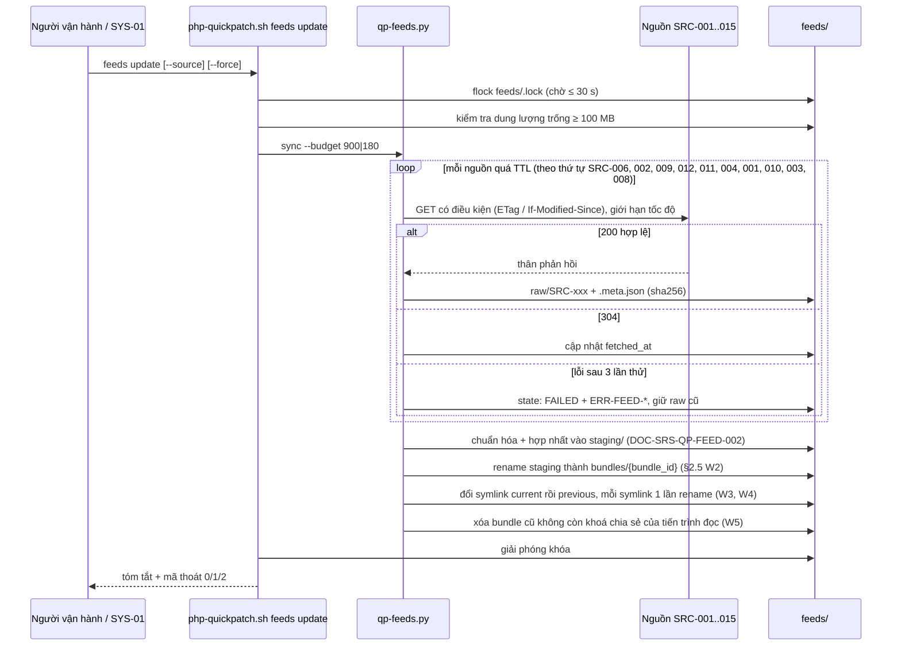

# Đặc tả lớp dữ liệu online — Thư mục cache, bundle, snapshot offline và lệnh `feeds`

## Lịch sử sửa đổi (Revision History)
| Phiên bản | Ngày | Người thực hiện | Tóm tắt thay đổi |
| :--- | :--- | :--- | :--- |
| 1.0.0 | 2026-10-22 | BA Agent | Khởi tạo: cấu trúc `/var/lib/php-quickpatch/feeds/`, định dạng bundle TSV/SQLite, snapshot offline + SHA256, lịch đồng bộ, nhóm lệnh `feeds`, `BR-FEED-050..059` |
| 1.0.1 | 2026-10-22 | BA Agent | Sửa theo review: §6.1–§6.3 thêm `--dry-run`, `--yes` cho `feeds import`, `feeds schedule install\|remove` (`FR-CLI-SAFE-001`, `BR-CLI-003`) và `--json` cho mọi lệnh `feeds` (`FR-CLI-JSON-001`); đổi bundle nguyên tử bằng thư mục `bundles/<bundle_id>/` + symlink `current`/`previous` đổi bằng 1 lần `rename(2)`, tiến trình đọc resolve `current` 1 lần mỗi lượt và giữ khoá chia sẻ, chỉ xoá bundle không còn tiến trình đọc (§2.2, §2.3, mục mới §2.5, §3.3, §3.4, §4.1, §4.5, §5.1, `FR-FEED-CACH-002`, `BR-FEED-051`); §7 cập nhật `FR-FEED-SNAP-003`, `FR-FEED-SCHD-001`, `FR-FEED-CMD-003..006` (cờ, schema `qp.feeds.<lệnh con>/1`, `BR-CLI-003`, `ERR-CLI-428-01`), §8 `BR-FEED-055`; §9 thêm nguồn kiểm chứng |
| 1.0.2 | 2026-10-22 | BA Agent | Sửa theo review (bản 1.0.1 đã có cho vòng review trước nên đánh số 1.0.2): §2.1 bỏ dự phòng `${TMPDIR:-/tmp}/php-quickpatch-$EUID` cho mọi người dùng, trỏ quy trình chọn và kiểm tra `STATE_DIR` của spec.md §2.1 bước 1–5 (`CR-SRS-13`): root không có dự phòng → `ERR-CLI-412-01` (`reason=create_failed`); không root dự phòng ứng viên đạt kiểm tra hoặc `mktemp -d "…-$EUID.XXXXXX"` (mode `0700`); đường dẫn không đạt `lstat`/chủ sở hữu/quyền → `ERR-CLI-412-01`; §8 `BR-FEED-050` trỏ spec.md §2.1. §7 đổi tên `FR-FEED-CMD-001..006` sang dạng động từ + tân ngữ (rule 01 §2), khớp bí danh của bảng chỉ mục FR. §8 thêm cột "Phạm vi áp dụng" cho `BR-FEED-050..059` (rule 02 §2, business-rules.md §6 mục 1); ghi chú mã lỗi `ERR-CLI-*` và tài liệu cần đồng bộ; §9 thêm nguồn |

## 1. Giới thiệu (Introduction)
- **Mục đích**: đặc tả nơi lưu và định dạng dữ liệu của module `FEED`, snapshot offline đóng gói kèm tool, và giao diện dòng lệnh để đồng bộ, xem trạng thái, kiểm tra, xuất/nhập dữ liệu.
- **Phạm vi**: máy chủ được quản lý (Phase 1). Phase 2 (`FEAT-123`) dùng lại định dạng snapshot ở §4 để máy trung tâm đẩy dữ liệu tới server không ra Internet.
- **Tài liệu liên quan**: [data-sources.md](data-sources.md) (DOC-SRS-QP-FEED-001 — nguồn, TTL, `BR-FEED-001..016`, ma trận lỗi `ERR-FEED-*`), [data-sources-merge-risk.md](data-sources-merge-risk.md) (DOC-SRS-QP-FEED-002 — mô hình dữ liệu, hợp nhất, điểm rủi ro).

## 2. Cấu trúc thư mục cache

### 2.1 Vị trí gốc (`BR-FEED-050`)
`STATE_DIR` được chọn và kiểm tra theo [spec.md §2.1](spec.md) "Chọn và kiểm tra an toàn `STATE_DIR`" bước 1–5 (DOC-SRS-QP-001 1.1.0, `CR-SRS-13`). CLI Bash, `qp-feeds.py` và `qp-console.py` dùng chung quy trình đó trước lần đọc/ghi đầu tiên trong `STATE_DIR` (trước khi lấy `STATE_DIR/.lock` hay `feeds/.lock`); bảng dưới chỉ thêm thư mục `feeds/` và file cấu hình có key, không định nghĩa lại quy trình. Khác v0.1 (dòng 851–852: `mkdir -p`, dự phòng `${TMPDIR:-/tmp}/php-quickpatch-$EUID` cho cả root, không kiểm symlink/chủ sở hữu/quyền).

| Điều kiện | `STATE_DIR` | Thư mục feeds | File cấu hình có key |
| :--- | :--- | :--- | :--- |
| Chạy bằng root | `/var/lib/php-quickpatch` (chưa có → `mkdir -m 0750`, không `-p`) | `/var/lib/php-quickpatch/feeds/` (quyền `0755`, chủ `root`) | `/etc/php-quickpatch/feeds.conf` (`0600`, chủ `root`) |
| Không phải root, `HOME` khác rỗng | `$HOME/.php-quickpatch` (chưa có → `mkdir -m 0700`, không `-p`) | `$HOME/.php-quickpatch/feeds/` (`0700`) | `$HOME/.config/php-quickpatch/feeds.conf` (`0600`) |
| Đường dẫn chính (root hoặc không root) đã tồn tại nhưng không đạt kiểm tra bước 2 | Không dùng, không chuyển sang dự phòng: thoát 2, `ERR-CLI-412-01` (`reason=symlink\|not_dir\|owner\|mode`) | Không tạo, không đọc | Không đọc |
| Root, không tạo được `/var/lib/php-quickpatch` (vd root FS chỉ đọc) | **Không có dự phòng**: thoát 2, `ERR-CLI-412-01` (`reason=create_failed`) | Không tạo | Không đọc |
| Không phải root: `HOME` rỗng, không tạo được `$HOME/.php-quickpatch`, hoặc thư mục đó đạt bước 2 nhưng chủ sở hữu không có quyền ghi | Dự phòng (spec.md §2.1 bước 4): thư mục có mtime mới nhất trong các ứng viên `${TMPDIR:-/tmp}/php-quickpatch-$EUID` (tên v0.1, để `rollback` lượt cũ) và `${TMPDIR:-/tmp}/php-quickpatch-$EUID.*` đạt bước 2 (ứng viên không đạt bị bỏ qua, 1 dòng cảnh báo kèm `reason`, không xoá); không có ứng viên đạt → `mktemp -d "${TMPDIR:-/tmp}/php-quickpatch-$EUID.XXXXXX"` (tạo nguyên tử, mode `0700`); `mktemp` thất bại → thoát 2, `ERR-CLI-412-01` (`reason=create_failed`) | `<STATE_DIR>/feeds/` (`0700`) | Không đọc file; chỉ biến môi trường `QP_*` |

Kiểm tra bước 2 (dùng `lstat`, không theo symlink; Bash `[ -d "$p" ] && [ ! -L "$p" ]` + `stat -c '%u %a'`, Python `os.lstat`): (a) thư mục thật, không phải symlink; (b) `st_uid` = `EUID`; (c) group/other không có quyền ghi, `mode & 0022 = 0`. Ngoài bước 5 của spec.md §2.1 (`backups/<run_id>/` và `manifest` trước `rollback`), tài liệu này không thêm kiểm tra riêng cho `feeds/`: khi `STATE_DIR` đạt (b) và (c), chỉ chủ sở hữu và root tạo được mục con trực tiếp trong `STATE_DIR`. Chạy thử 2026-10-22 (GNU coreutils 9.4): `mktemp -d ".../php-quickpatch-$EUID.XXXXXX"` tạo thư mục mode `700`, chủ = `EUID`.

### 2.2 Cây thư mục
```text
/var/lib/php-quickpatch/feeds/
├── .lock                         # flock của feeds update (BR-FEED-015)
├── sources.conf                  # danh sách SRC: URL, TTL, enabled — không chứa key (0644)
├── raw/                          # phản hồi gốc mới nhất của từng nguồn
│   ├── SRC-001/
│   │   ├── php.json              # thân phản hồi (nén gzip nếu > 1 MB: *.json.gz)
│   │   ├── php.json.meta.json    # url, http_status, etag, last_modified, accept_encoding,
│   │   │                         # fetched_at, bytes, sha256, duration_ms
│   │   └── rejected/             # ≤ 3 phản hồi bị từ chối gần nhất (BR-FEED-007)
│   ├── SRC-004/
│   │   ├── php-q1/page-0000.json.gz ... page-NNNN.json.gz   # theo cửa sổ lastMod
│   │   ├── php-q2/…, node-q1/…, wordpress-q1/…
│   │   └── cursor.json           # last_lastmod theo từng truy vấn (BR-FEED-002)
│   ├── SRC-006/known_exploited_vulnerabilities.json.gz (+ .meta.json)
│   └── SRC-0NN/…
├── cache/                        # dữ liệu tra theo nhu cầu, riêng của máy chủ
│   ├── osv/<sha256-lockfile>.json            # SRC-007, TTL 6 giờ
│   ├── osv-distro/<ecosystem>/<pkg>@<ver>.json  # SRC-014, TTL 6 giờ
│   ├── cve/<CVE-ID>.json                     # SRC-005, TTL 24 giờ
│   └── tracker/<ubuntu|redhat>/<CVE-ID>.json # SRC-015, TTL 24 giờ
├── staging/                      # bundle đang dựng, chỉ tồn tại khi giữ .lock (xóa khi lỗi)
├── bundles/                      # mỗi bundle 1 thư mục bất biến, tên = bundle_id (§2.5)
│   ├── b-20261022T093000Z-3f2a9c1e/   # bundle mà current trỏ tới
│   │   ├── .lock                 # file rỗng: khoá chia sẻ của tiến trình đọc (§2.5); không có trong SHA256SUMS
│   │   ├── manifest.json
│   │   ├── SHA256SUMS
│   │   ├── lifecycle.tsv  releases.tsv  min_patched.tsv  advisories.tsv
│   │   ├── affected.tsv   aliases.tsv   kev.tsv          exposure.tsv
│   │   ├── framework_php.tsv
│   │   └── feeds.db              # SQLite, cùng bundle_id
│   └── b-20261022T033000Z-9d41e7a2/   # bundle liền trước, previous trỏ tới
├── current -> bundles/b-20261022T093000Z-3f2a9c1e   # symlink tương đối; scan/fix/console chỉ đọc qua đây
├── previous -> bundles/b-20261022T033000Z-9d41e7a2  # symlink bundle liền trước (so sánh thay đổi, khôi phục)
├── snapshots/imported/           # ≤ 3 snapshot đã nhập: <generated_at>-<sha256[0:8]>.tar.gz
└── state/
    ├── sync-status.json          # trạng thái từng nguồn (đầu vào của feeds status)
    └── last-sync.log             # log đồng bộ, xoay vòng 5 file × 1 MB
```
`current` và `previous` là symlink nên đường dẫn `feeds/current/<file>` trong các tài liệu khác vẫn trỏ đúng bundle hiện hành; tiến trình đọc phải resolve `current` đúng 1 lần mỗi lượt theo §2.5, không mở lại file qua `current/` giữa lượt. `bundle_id` trong cây là minh họa.

Snapshot đóng gói kèm tool nằm ngoài `STATE_DIR`, chỉ đọc: `<thư mục script>/share/php-quickpatch/feeds-snapshot.tar.gz`, nếu không có thì `/usr/local/share/php-quickpatch/feeds-snapshot.tar.gz`.

### 2.3 Dung lượng và lưu giữ (`BR-FEED-052`)
| Thành phần | Ước lượng (đo/ước tính 2026-10-22) | Giới hạn | Quy tắc dọn |
| :--- | :--- | :--- | :--- |
| `raw/SRC-004` | Giải nén: PHP 6,26 MB (đo), WordPress 3,13 MB (đo), Node.js ≈ 1,6 MB (ước tính 188 CVE × 8,35 KB); nén gzip: PHP 0,55 MB, WordPress 0,33 MB (đo) | ≤ 20 MB | Giữ trang của cửa sổ đồng bộ gần nhất; gộp vào `feeds.db` sau chuẩn hóa |
| `raw/` nguồn khác | ≈ 3,5 MB (KEV 1,8 MB, ChangeLog 0,75 MB, Node.js index 0,34 MB…) | ≤ 10 MB | Ghi đè khi lấy mới |
| `bundles/` | Ước tính ≤ 6 MB mỗi bundle | ≤ 15 MB | Giữ bundle mà `current` và `previous` trỏ tới; bundle khác xóa ở bước W5 §2.5 khi không còn tiến trình đọc |
| `cache/` | Phụ thuộc số lockfile/gói | ≤ 10 MB | Xóa mục quá 7 ngày |
| `snapshots/imported/` | ≤ 3 MB mỗi gói (`standard`) | ≤ 15 MB | Giữ 3 gói mới nhất |
| `state/last-sync.log` | — | 5 × 1 MB | Xoay vòng |
| **Tổng** | | **≤ 60 MB** (`NFR-FEED-005`) | Dung lượng trống < 100 MB → `ERR-FEED-507-01` |

### 2.4 File cấu hình
`sources.conf` (không chứa bí mật, có thể sửa để trỏ tới bản sao nội bộ — URL phải là HTTPS theo `BR-FEED-016`):
```ini
# php-quickpatch feeds — sources.conf (schema 1)
[SRC-004]
enabled = 1
ttl_hours = 6
url = https://services.nvd.nist.gov/rest/json/cves/2.0
page_size = 200
[SRC-013]
enabled = 0          # Wordfence/WPScan/Patchstack: cần key trong feeds.conf
```
`feeds.conf` (quyền bắt buộc `0600`, `BR-FEED-011`):
```ini
NVD_API_KEY=
GITHUB_TOKEN=
WORDFENCE_API_KEY=
WPSCAN_API_TOKEN=
PATCHSTACK_API_KEY=
SYNC_INTERVAL_HOURS=6
```
Biến môi trường ghi đè cùng tên có tiền tố `QP_` (vd `QP_NVD_API_KEY`). File có quyền rộng hơn `0600` → bỏ qua toàn bộ key trong file, in cảnh báo 1 lần mỗi lượt chạy.

### 2.5 Đổi bundle nguyên tử và tiến trình đọc (`BR-FEED-051`)
Lý do: đổi tên 2 thư mục (`current/` → `previous/`, `staging/` → `current/`) cần 2 lời gọi `rename(2)`, giữa 2 lời gọi `current/` không tồn tại; `rename(2)` cũng không đè được thư mục không rỗng (`ENOTEMPTY`). `scan` không lấy `feeds/.lock` (`BR-FEED-015`) và đọc nhiều file TSV trong suốt lượt chạy (mục tiêu ≤ 60 s P95, `NFR-PERF-004`), nên phải đọc trọn 1 bundle bất biến.

**Bên ghi** — `feeds update`, `feeds import`, dựng bundle từ snapshot đóng gói (§4.5); mọi bước chạy khi giữ `feeds/.lock` (`BR-FEED-015`):

| Bước | Thao tác | Ghi chú |
| :--- | :--- | :--- |
| W1 | Dựng bundle trong `staging/`; tạo file rỗng `.lock`; kiểm `SHA256SUMS` và đủ 9 file TSV + `feeds.db` | Lỗi → xóa `staging/`, `current` giữ nguyên |
| W2 | `rename(staging, bundles/<bundle_id>)` | Đích chưa tồn tại vì `bundle_id` duy nhất; đã tồn tại → xóa `staging/`, `ERR-FEED-422-02` |
| W3 | Tạo symlink tạm `.current.new` → `bundles/<bundle_id>` rồi đổi tên đè lên `current`: Python `os.replace(".current.new", "current")`; Bash `ln -s "bundles/$id" .current.new && mv -T .current.new current` | 1 lời gọi `rename(2)`: mọi tiến trình resolve `current` thấy bundle cũ hoặc bundle mới, không có thời điểm `current` không tồn tại |
| W4 | Như W3 với `.previous.new` → bundle cũ, đè lên `previous` | Giữa W3 và W4, `previous` còn trỏ bundle cũ hơn; không ảnh hưởng tiến trình đọc |
| W5 | Với mỗi thư mục trong `bundles/` không phải đích của `current` hoặc `previous`: `flock -n -x <thư mục>/.lock`; lấy được → `rm -rf` thư mục khi còn giữ khoá; không lấy được → bỏ qua, thử lại ở lần `feeds update`/`feeds import` kế tiếp | Không xóa bundle còn tiến trình đọc |

Không dùng `ln -sfn` để đổi `current`: tính nguyên tử phụ thuộc phiên bản coreutils (coreutils 9.4 dùng tên tạm + `renameat`, theo `strace` 2026-10-22; bản cũ hơn chưa kiểm chứng).

**Bên đọc**:

| Bên đọc | Quy tắc |
| :--- | :--- |
| CLI Bash (`scan`, `fix`, `assess`, `plan`, `report`, …) | Đầu mỗi lượt: `QP_FEEDS_BUNDLE=$(readlink -f "$FEEDS_DIR/current")` đúng 1 lần; mở `"$QP_FEEDS_BUNDLE/.lock"` chỉ đọc và `flock -s` trên fd giữ tới hết lượt; mọi phép tra §3.4 dùng `"$QP_FEEDS_BUNDLE/<file>"`; xuất `QP_FEEDS_BUNDLE` cho tiến trình `qp-feeds.py` con. Không mở được `.lock` (bundle vừa bị dọn) → resolve lại, tối đa 3 lần; vẫn lỗi → xử lý như không có bundle (§4.5 bước 2–3) |
| `qp-feeds.py` | Dùng `QP_FEEDS_BUNDLE` khi có; không có → `os.path.realpath("<feeds>/current")` 1 lần + `fcntl.flock(fd, LOCK_SH)` trên `.lock` |
| Console `qp-console.py` | Resolve `current` bằng `os.path.realpath()`, lấy khoá chia sẻ `.lock`, `ATTACH 'file:<đường dẫn bundle>/feeds.db?mode=ro'`; `bundle_id` dùng cho `meta.feed` và mọi bảng so sánh lấy từ `manifest.json` của chính bundle đang `ATTACH`, không đọc lại qua `current/` (`BR-ASMT-003`). Đầu mỗi request đọc dữ liệu feed và ít nhất 60 s/lần: so `os.path.realpath(current)` với bundle đang `ATTACH`; khác → sau khi request đang dùng bundle cũ kết thúc thì `DETACH`, nhả khoá, resolve và `ATTACH` lại |

Tiến trình đọc chết → kernel nhả `flock`, bundle được dọn ở W5 lần kế tiếp. Chạy thử 2026-10-22 (GNU coreutils 9.4, util-linux 2.39.3, Python 3): `os.rename("staging", "current")` khi `current/` không rỗng → `[Errno 39] Directory not empty`; `mv -T .current.tmp current` → `strace` cho `renameat(".current.tmp", "current") = 0`; fd mở trước khi đổi symlink vẫn đọc file của bundle cũ; `flock -n -x` trả mã 1 khi 1 tiến trình giữ `flock -s`, trả 0 sau khi tiến trình đó thoát. BusyBox `mv` có `-T` theo mã nguồn `coreutils/mv.c` (đọc 2026-10-22); chưa chạy thử trên Alpine 3.22–3.24.

Tài liệu cần cập nhật theo mục này (ngoài phạm vi sửa của bản 1.0.1): data-sources.md §2.2 nguyên tắc 4; erd.md §2.1 dòng `feeds.db` và §2.4 quy tắc 2; erd-feeds-files.md §8 dòng bundle; erd-console-db.md §11 (`feed_bundle`); flows.md (DIAG-SEQ-QP-FEED-002, -003: "rename current → previous"); states.md `T-FD-02`, `T-FD-08`.

## 3. Định dạng bundle chuẩn hóa (`feeds/current/`)

### 3.1 `manifest.json`
```json
{
  "schema": "qp.feeds.bundle/1",
  "bundle_id": "b-20261022T093000Z-3f2a9c1e",
  "generated_at": "2026-10-22T09:30:00Z",
  "generator": "qp-feeds.py 2.0.0",
  "base": {"type": "snapshot", "generated_at": "2026-10-20T06:00:00Z", "sha256": "…"},
  "sources": [
    {"src_id": "SRC-004", "status": "OK", "last_ok_at": "2026-10-22T09:24:51Z",
     "source_updated_at": "2026-10-21T17:18:24Z", "records": 1537, "data_origin": "PRIMARY"},
    {"src_id": "SRC-008", "status": "FAILED", "last_ok_at": null, "last_error": "ERR-FEED-503-01",
     "data_origin": "CROSS:SRC-003"}
  ],
  "coverage": {"php_branches": 19, "node_branches": 30, "advisories": 1537, "kev": 1754},
  "files": [{"path": "advisories.tsv", "bytes": 412345, "sha256": "…"}]
}
```
Các giá trị trong ví dụ là minh họa (mã băm rút gọn bằng `…`). Riêng `coverage` tính theo dữ liệu ngày 2026-10-22: `php_branches` = 18 nhánh `SRC-001` + PHP 4.4; `node_branches` = 26 dòng `SRC-001` + `v0.8`, `v0.10`, `v0.12`, `v27` của `SRC-010`.

### 3.2 File TSV (Bash đọc bằng `awk -F'\t'`)
Quy ước: UTF-8, phân tách bằng tab, dòng đầu là tên cột bắt đầu bằng `#`, giá trị rỗng = không có dữ liệu, tab/xuống dòng trong văn bản thay bằng dấu cách, ngày ISO-8601.

| File | Cột (theo thứ tự) | Ví dụ dòng (2026-10-22) |
| :--- | :--- | :--- |
| `lifecycle.tsv` | `product branch ga_date lts_start active_support_end eol_date prerelease_date php_net_supported origin` | `php 8.2 2022-12-08 - 2024-12-31 2026-12-31 - 1 SRC-001` |
| `releases.tsv` | `product branch version release_date is_security wp_status abi_modules` | `php 8.4 8.4.27 2026-10-21 1 - -` |
| `min_patched.tsv` | `product branch min_patched_sec min_patched_all latest driver_ids` | `php 8.4 8.4.27 8.4.27 8.4.27 CVE-2026-109618,CVE-2026-109619` |
| `advisories.tsv` | `adv_id kind status product cvss_rep severity in_kev kev_due published_at modified_at summary` | `CVE-2026-109618 VULN PUBLISHED php 9.8 critical 0 - 2026-10-21 2026-10-21 PHP uses longjmp() for out-of-memory…` |
| `affected.tsv` | `adv_id product origin v_start start_incl v_end end_incl v_exact platform unbounded assessed` | `CVE-2026-109618 php NVD_CPE 8.4.0 1 8.4.27 0 - any 0 1` |
| `aliases.tsv` | `adv_id alias_id` | `CVE-2026-109618 GHSA-w8hw-w9fx-j79w` |
| `kev.tsv` | `cve_id date_added due_date ransomware` | `CVE-2026-63030 2026-07-21 2026-07-24 Unknown` |
| `exposure.tsv` | `product version n_crit n_high n_med n_low cvss_max n_kev adv_ids` — tính sẵn cho mọi phiên bản upstream có trong `releases.tsv` | `php 8.2.34 2 0 0 0 9.8 0 CVE-2026-109618,CVE-2026-109619` |
| `framework_php.tsv` | `framework cycle php_min php_max eol_date` | `laravel 13 8.3 8.5 2028-03-17` |

### 3.3 `feeds.db` (SQLite)
Chứa đủ các bảng của DOC-SRS-QP-FEED-002 §2.2 (`feed_source`, `feed_fetch`, `lifecycle_branch`, `release`, `advisory`, `advisory_alias`, `advisory_score`, `affected_range`, `kev_entry`, `fix_evidence`, `distro_fix`, `min_patched`, `risk_assessment`) và bảng `meta(key, value)` với `bundle_id`, `schema`. Console Python mở ở chế độ chỉ đọc (`file:<đường dẫn bundle đã resolve>/feeds.db?mode=ro`, §2.5).

### 3.4 Cách CLI Bash dùng bundle (thay mảng ghi cứng v0.1)
| Hàm v0.1 | Phép tra v2 |
| :--- | :--- |
| `fixed_for "$branch" "${PHP_FIXED[@]}"` | `awk -F'\t' -v p=php -v b="$branch" '$1==p && $2==b {print $3}' "$QP_FEEDS_BUNDLE/min_patched.tsv"` (đường dẫn đã resolve 1 lần đầu lượt, §2.5) |
| `php_state` nhánh mới hơn dữ liệu → `unknown` | Nhánh không có trong `lifecycle.tsv` → `UNKNOWN` (`ERR-SCN-422-01`); nhánh có nhưng `min_patched_sec` rỗng → không có CVE xét vá |
| `pkg_has_cves $owner "${PHP_CVES[@]}"` | Danh sách CVE = cột `driver_ids` của nhánh; có Python → `qp-feeds.py backport --pkg … --json` (DOC-SRS-QP-FEED-002 §7); không Python → `SRC-016` như v0.1 |
| `issue critical "…PHP2Shell RCE"` | Mức `critical`/`high` lấy từ điểm rủi ro: có Python → `qp-feeds.py risk`; không Python → `awk` tính công thức DOC-SRS-QP-FEED-002 §8.2 từ `exposure.tsv` + `lifecycle.tsv` (không trừ CVE đã backport trừ khi `SRC-016` xác nhận) |
| Dòng mitigation `php_mitigation_ini` theo `PHP_CVES` | Dòng chú thích liệt kê `driver_ids`; nội dung ini theo bộ luật mitigation trong snapshot (`FEAT-061`) |

### 3.5 Hiển thị tuổi dữ liệu trên kết quả `scan`
Đầu ra văn bản (thêm 1 dòng dưới mục "Environment" của v0.1):
```text
  [i] Dữ liệu CVE/vòng đời: bundle b-20261022T093000Z-3f2a9c1e — dữ liệu cũ 12 giờ (nguồn cũ nhất: SRC-004 NVD, lỗi ERR-FEED-429-01)
```
Mức `STALE` đổi `[i]` thành `[WARN]` và thêm "Kết quả có thể thiếu CVE công bố sau {ngày}" (`ERR-FEED-412-01`). Trong `scan --json`:
```json
"data": {"bundle_id": "b-20261022T093000Z-3f2a9c1e", "freshness": "AGING", "data_age_h": 12,
         "stale_sources": [{"src_id": "SRC-004", "age_h": 12, "last_error": "ERR-FEED-429-01"}]}
```

## 4. Snapshot offline

### 4.1 Định dạng gói
Tên: `feeds-snapshot-<YYYYMMDDTHHMMSSZ>-<variant>.tar.gz` (bản đóng gói kèm tool đổi tên thành `feeds-snapshot.tar.gz`).
```text
feeds-snapshot-20261020T060000Z-standard.tar.gz
├── manifest.json        # như §3.1, thêm "variant", "tool_version_min", "built_by": "release-pipeline"
├── SHA256SUMS           # sha256 của mọi file trong bundle/ (định dạng `sha256sum`)
└── bundle/              # đúng cấu trúc feeds/current/ (§3), không có cache/ của máy chủ, không có .lock
```
Snapshot chỉ chứa dữ liệu công khai: không chứa `cache/` (kết quả OSV theo lockfile, `distro_fix` của máy chủ), không chứa key, không chứa đường dẫn site (`BR-FEED-056`).

### 4.2 Dựng snapshot trong pipeline phát hành (`SYS-05`, `FR-FEED-SNAP-004`)
1. Chạy `qp-feeds.py build-snapshot --variant standard` trên máy build có mạng: đồng bộ đầy đủ mọi nguồn `SRC-001..012` (dùng `GET /api/v1/products/full` cho `SRC-001`, API key NVD của pipeline).
2. Kiểm tra cổng phát hành (`BR-FEED-058`): mọi nguồn P0 (`SRC-001`, `002`, `004`, `006`, `009`, `010`, `011`, `012`) ở trạng thái `OK`; `coverage` đạt `KR5.1` (PHP 4.4 + 5.0–8.5; Node.js 4–26); test hồi quy DOC-SRS-QP-FEED-002 §6.5 khớp.
3. Ghi `sha256sum feeds-snapshot.tar.gz` vào hằng `QP_SNAPSHOT_SHA256` trong `php-quickpatch.sh` và vào ghi chú phát hành.
4. Không phát hành nếu `generated_at` cũ hơn 7 ngày so với ngày phát hành (`KR5.2`).

### 4.3 Kiểm tra toàn vẹn (`BR-FEED-010`, `BR-FEED-055`)
| Tình huống | Kiểm tra | Lỗi |
| :--- | :--- | :--- |
| Dùng snapshot đóng gói | `sha256sum` cả gói = `QP_SNAPSHOT_SHA256`; giải nén vào `staging/`; mọi dòng `SHA256SUMS` khớp | `ERR-FEED-422-02` (Critical) — không dùng snapshot, tool tiếp tục với cache nếu có |
| Nhập snapshot (`feeds import`) | Bắt buộc `--sha256 HEX` do người vận hành lấy từ nguồn phát hành; khớp cả gói; khớp `SHA256SUMS`; `schema` cùng major; `generated_at` ≤ hiện tại + 1 giờ; không cũ hơn `current/` | `ERR-FEED-422-02`; `ERR-FEED-409-02` (cũ hơn, trừ `--force`) |
| Kiểm định kỳ (`feeds verify`) | So `current/SHA256SUMS` với file thực tế; so `.meta.json.sha256` với file raw | `ERR-FEED-422-02` → tự dựng lại bundle từ raw |
| Giải nén | Từ chối đường dẫn tuyệt đối, `..`, symlink, hardlink, thiết bị trong tar; tổng dung lượng giải nén ≤ 50 MB | `ERR-FEED-422-02` |

### 4.4 Biến thể
| Biến thể | Nội dung | Kích thước mục tiêu | Dùng khi |
| :--- | :--- | :--- | :--- |
| `standard` | Bundle chuẩn hóa `SRC-001..012`, KEV, `exposure.tsv` | ≤ 3 MB nén | Đóng gói kèm mọi bản phát hành |
| `full` | `standard` + `osv/Packagist-all.zip` (10,99 MB, `SRC-007` bản xuất toàn bộ) | ≤ 15 MB nén | Server không ra Internet cần quét `composer.lock`; npm không hỗ trợ offline (bản xuất 219 MB) |

### 4.5 Thứ tự chọn dữ liệu khi khởi động (`BR-FEED-053`, `BR-FEED-054`)
1. Có `current/` hợp lệ → dùng; nếu snapshot đóng gói có `generated_at` mới hơn `current/` (vd sau khi nâng cấp tool) → dựng bundle mới từ snapshot rồi chạy đồng bộ tăng dần.
2. Không có `current/` → giải nén snapshot đóng gói vào `staging/` rồi đổi `current` theo §2.5 (giữ `feeds/.lock`, ≤ 10 s), sau đó `feeds update` tăng dần từ `generated_at − 1 ngày` (`BR-FEED-002`).
3. Không có snapshot hợp lệ và không có mạng → mọi runtime nhận `UNKNOWN`, `scan` trả mã thoát 2 kèm `ERR-FEED-503-01`.

## 5. Đồng bộ

### 5.1 Trình tự một lần `feeds update` (DIAG-SEQ-QP-FEED-001)

Thứ tự nguồn đặt nguồn nhỏ và quyết định cờ KEV/bản vá trước, NVD (chậm nhất) sau, để khi vượt ngân sách thời gian thì dữ liệu ảnh hưởng `min_patched` đã được cập nhật.

### 5.2 Lịch đồng bộ (`FEAT-018`, `BR-FEED-057`)
| Môi trường | Cài đặt bởi `feeds schedule install` | Ghi chú |
| :--- | :--- | :--- |
| Có systemd | `/etc/systemd/system/php-quickpatch-feeds.service` (`ExecStart=<script> feeds update --quiet`) + `.timer` với `OnCalendar=*-*-* 00/6:MM:00`, `RandomizedDelaySec=900`, `Persistent=true` | `MM` = phút ngẫu nhiên 0–59 chọn lúc cài, tránh dồn request vào phút 00 |
| Không systemd | Dòng cron trong `/etc/cron.d/php-quickpatch-feeds`: `MM */6 * * * root <script> feeds update --quiet # php-quickpatch-feeds` | Non-root: `crontab -l` của người dùng, cùng dấu đánh dấu |
| Đã có lịch | Phát hiện qua tên unit hoặc dấu `# php-quickpatch-feeds` → cập nhật tại chỗ, không tạo bản thứ 2 | |
| Chu kỳ | `--interval-hours N`, N ∈ {1, 2, 3, 4, 6, 8, 12, 24}; mặc định 6 (`Q-08`); N < 6 cảnh báo về hạn mức NVD khi không có API key | |

## 6. Lệnh CLI nhóm `feeds`

### 6.1 Cú pháp
```text
php-quickpatch.sh feeds update   [--source SRC-NNN[,SRC-NNN…]] [--force] [--accept-shrink]
                                 [--budget SEC] [--quiet] [--json]
php-quickpatch.sh feeds status   [--json]
php-quickpatch.sh feeds verify   [--snapshot FILE] [--json]
php-quickpatch.sh feeds export   --out FILE [--variant standard|full] [--raw] [--json]
php-quickpatch.sh feeds import   FILE --sha256 HEX [--force] [--dry-run] [--yes] [--json]
php-quickpatch.sh feeds schedule install [--interval-hours N] [--dry-run] [--yes] [--json]
php-quickpatch.sh feeds schedule remove  [--dry-run] [--yes] [--json]
php-quickpatch.sh feeds schedule show    [--json]

Lệnh ghi (FR-CLI-SAFE-001, BR-CLI-003): feeds import, feeds schedule install|remove.

Bí danh tương thích PRD (FEAT-102): `sync` = `feeds update`; `snapshot export|import` = `feeds export|import`.
`scan|fix --offline` (v0.1): không gọi feeds update, dùng current/ rồi snapshot.
```

### 6.2 Tham số
| Tham số | Áp dụng | Ý nghĩa | Giá trị mặc định / ràng buộc |
| :--- | :--- | :--- | :--- |
| `--source` | `update` | Chỉ đồng bộ các nguồn liệt kê | Mọi nguồn bật; mã sai → mã thoát 2 |
| `--force` | `update`, `import` | `update`: bỏ qua TTL; `import`: cho nhập snapshot cũ hơn `current/` | Tắt |
| `--accept-shrink` | `update` | Chấp nhận phản hồi vi phạm `BR-FEED-009`; bắt buộc đi cùng `--force`; ghi audit | Tắt |
| `--budget` | `update` | Ngân sách thời gian (giây) | 900 (đầy đủ) / 180 (tăng dần); 60–3.600 |
| `--quiet` | `update` | Chỉ in khi có lỗi (dùng cho lịch) | Tắt |
| `--json` | Mọi lệnh `feeds` (`update`, `status`, `verify`, `export`, `import`, `schedule install\|remove\|show`) | stdout chứa đúng 1 envelope `FR-CLI-JSON-001`, `schema` = `qp.feeds.<lệnh con>/1` (vd `qp.feeds.import/1`); nội dung riêng của `feeds status` theo §6.4 | Tắt |
| `--dry-run` | `import`, `schedule install`, `schedule remove` | `import`: kiểm toàn bộ §4.3 (SHA-256 cả gói, tar an toàn, `SHA256SUMS`, `schema`, `generated_at`, so với `current`) bằng cách giải nén vào thư mục tạm `STATE_DIR/work/dryrun-<pid>/`, xóa thư mục này khi lệnh kết thúc kể cả khi lỗi; không lấy `feeds/.lock`, không đổi `staging/`, `bundles/`, `current`, `previous`, `snapshots/imported/`. `schedule`: in nội dung unit/dòng cron và lệnh `systemctl`/`crontab` sẽ chạy, không ghi file, không gọi lệnh. Envelope có `dry_run: true`; mã thoát như lệnh thật (§6.3) | Tắt |
| `--yes` | `import`, `schedule install`, `schedule remove` | Bỏ hỏi xác nhận `y/N`; có TTY và thiếu `--yes` → hỏi; không TTY và thiếu `--yes` → mã thoát 2, `ERR-CLI-428-01` (`BR-CLI-003`); console luôn truyền `--yes` (spec §3.3.4) | Tắt |
| `--out` | `export` | Đường dẫn file đầu ra | Bắt buộc; không ghi đè file đã có |
| `--variant` | `export` | `standard` hoặc `full` | `standard` |
| `--raw` | `export` | Thêm `raw/` (không gồm `cache/`) để chuẩn hóa ở máy có Python (`BR-FEED-012`) | Tắt |
| `--sha256` | `import` | SHA256 kỳ vọng của gói | Bắt buộc, 64 ký tự hex |
| `--interval-hours` | `schedule install` | Chu kỳ | 6 |

### 6.3 Mã thoát (giữ quy ước v0.1)
| Mã | `feeds update` | `feeds status` | `feeds verify` / `import` / `export` / `schedule` |
| :---: | :--- | :--- | :--- |
| 0 | Mọi nguồn bật đều `OK` | Độ tươi `FRESH` hoặc `AGING` | Thành công; với `--dry-run`: mọi kiểm tra đạt |
| 1 | ≥ 1 nguồn lỗi, đã dùng dự phòng (`DEGRADED`) | Độ tươi `STALE` | Cảnh báo (vd dọn file thừa) |
| 2 | Lỗi tham số; không lấy được khóa; không có dữ liệu dùng được | Độ tươi `EXPIRED` hoặc không có bundle | Lỗi toàn vẹn hoặc tham số; lệnh ghi không TTY thiếu `--yes` (`ERR-CLI-428-01`) |

### 6.4 Đầu ra `feeds status`
Văn bản:
```text
Bundle b-20261022T093000Z-3f2a9c1e | tạo 2026-10-22 09:30 UTC | nền: snapshot 2026-10-20 06:00 UTC
SRC      Nguồn                    Trạng thái  Lấy thành công (UTC)  Tuổi   TTL   Bản ghi  Lỗi cuối
SRC-001  endoflife.date           OK          2026-10-22 09:22      0 h    24 h  8 sp     -
SRC-004  NVD CVE API 2.0          DEGRADED    2026-10-21 21:10      12 h   6 h   1.537    ERR-FEED-429-01
SRC-006  CISA KEV                 OK          2026-10-22 09:23      0 h    6 h   1.754    -
SRC-008  GitHub Advisories        FAILED      -                     -      6 h   -        ERR-FEED-503-01 (dùng SRC-003)
SRC-013  WordPress DB (key)       DISABLED    -                     -      24 h  -        -
Độ tươi: AGING — dữ liệu cũ 12 giờ (nguồn cũ nhất: SRC-004). Lịch đồng bộ: systemd timer mỗi 6 giờ, lần tới 2026-10-22 12:17 UTC
```
JSON (`schema: "qp.feeds.status/1"`, `BR-FEED-059`):
```json
{"schema": "qp.feeds.status/1", "bundle_id": "b-20261022T093000Z-3f2a9c1e",
 "generated_at": "2026-10-22T09:30:00Z", "freshness": "AGING", "data_age_h": 12,
 "sources": [{"src_id": "SRC-004", "name": "NVD CVE API 2.0", "status": "DEGRADED",
              "last_ok_at": "2026-10-21T21:10:04Z", "age_h": 12, "ttl_h": 6, "records": 1537,
              "last_error": "ERR-FEED-429-01", "data_origin": "CACHE"}],
 "schedule": {"type": "systemd", "interval_h": 6, "next_run": "2026-10-22T12:17:00Z"},
 "snapshot": {"packaged_generated_at": "2026-10-20T06:00:00Z", "sha256_ok": true}}
```

## 7. Yêu cầu chức năng
| Mã FR | Tên yêu cầu | Ưu tiên | Input | Processing Logic | Output | BR tham chiếu | Mã lỗi |
| :--- | :--- | :---: | :--- | :--- | :--- | :--- | :--- |
| `FR-FEED-CACH-001` | Lưu phản hồi gốc kèm meta | P0 | Phản hồi HTTP | Ghi tạm rồi `rename`; tính SHA256; nén gzip khi > 1 MB; lưu ETag kèm `Accept-Encoding` | `raw/SRC-xxx/*` + `.meta.json` | `BR-FEED-007`, `BR-FEED-011` | `ERR-FEED-507-01` |
| `FR-FEED-CACH-002` | Dựng và thay bundle nguyên tử | P0 | `raw/`, bundle cũ | Giữ `feeds/.lock`; chuẩn hóa vào `staging/`; kiểm `SHA256SUMS`; `rename staging → bundles/<bundle_id>`; đổi symlink `current` rồi `previous`, mỗi symlink 1 lần `rename(2)`; xóa bundle không còn khoá chia sẻ của tiến trình đọc (§2.5 W1–W5) | `current` trỏ bundle mới, `bundle_id` mới | `BR-FEED-051`, `BR-FEED-015` | `ERR-FEED-422-02` |
| `FR-FEED-CACH-003` | Dọn dẹp theo giới hạn dung lượng | P1 | Cây `feeds/` | Áp §2.3 sau mỗi lần đồng bộ | `feeds/` ≤ 60 MB | `BR-FEED-052` | — |
| `FR-FEED-SNAP-001` | Dùng snapshot đóng gói | P0 | `feeds-snapshot.tar.gz`, `QP_SNAPSHOT_SHA256` | §4.3, §4.5 | `current/` từ snapshot | `BR-FEED-010`, `BR-FEED-053`, `BR-FEED-054` | `ERR-FEED-422-02` |
| `FR-FEED-SNAP-002` | Xuất snapshot | P0 | `current/` | Đóng gói §4.1, loại dữ liệu riêng của máy | File `.tar.gz` + in SHA256 | `BR-FEED-056` | — |
| `FR-FEED-SNAP-003` | Nhập snapshot | P0 | File, `--sha256`, `--dry-run`, `--yes` | §4.3; `--dry-run` chỉ kiểm, 0 thay đổi (§6.2); dựng và đổi bundle theo §2.5; ghi audit | `current` trỏ bundle mới | `BR-FEED-055`, `BR-CLI-003` | `ERR-FEED-422-02`, `ERR-FEED-409-02`, `ERR-CLI-428-01` |
| `FR-FEED-SNAP-004` | Dựng snapshot khi phát hành | P0 | Mạng tới mọi nguồn | §4.2 | Gói + `QP_SNAPSHOT_SHA256` | `BR-FEED-058` | — |
| `FR-FEED-SCHD-001` | Cài/gỡ/xem lịch đồng bộ | P1 | `--interval-hours`, `--dry-run`, `--yes` | §5.2; không cài trùng; `install`/`remove` là lệnh ghi (§6.2) | Unit systemd hoặc dòng cron | `BR-FEED-057`, `BR-CLI-003` | `ERR-CLI-428-01` |
| `FR-FEED-CMD-001` | Cung cấp lệnh `feeds update` (bí danh `sync`) | P0 | §6.2 | `FR-FEED-SYNC-001` (DOC-SRS-QP-FEED-001) | Tóm tắt văn bản/JSON, mã thoát §6.3 | `BR-FEED-001..015` | Mọi `ERR-FEED-*` |
| `FR-FEED-CMD-002` | Cung cấp lệnh `feeds status` | P0 | `state/sync-status.json`, `manifest.json` | Tính tuổi từng nguồn; phân mức `BR-FEED-005` | §6.4 | `BR-FEED-005`, `BR-FEED-059` | — |
| `FR-FEED-CMD-003` | Cung cấp lệnh `feeds verify` | P1 | `current/`, `raw/` hoặc `--snapshot`, `--json` | §4.3 dòng 3 | Báo cáo khớp/lệch, `qp.feeds.verify/1` | `BR-FEED-010` | `ERR-FEED-422-02` |
| `FR-FEED-CMD-004` | Cung cấp lệnh `feeds export` (bí danh `snapshot export`) | P0 | §6.2 | `FR-FEED-SNAP-002` | File snapshot, `qp.feeds.export/1` | `BR-FEED-056` | — |
| `FR-FEED-CMD-005` | Cung cấp lệnh `feeds import` (bí danh `snapshot import`) | P0 | §6.2 | `FR-FEED-SNAP-003`; `--dry-run`, `--yes` theo `FR-CLI-SAFE-001` | Bundle mới, `qp.feeds.import/1` | `BR-FEED-055`, `BR-CLI-003` | `ERR-FEED-422-02`, `ERR-FEED-409-02`, `ERR-CLI-428-01` |
| `FR-FEED-CMD-006` | Cung cấp lệnh `feeds schedule` | P1 | §6.2 | `FR-FEED-SCHD-001`; `install`/`remove` có `--dry-run`, `--yes` theo `FR-CLI-SAFE-001` | Trạng thái lịch, `qp.feeds.schedule/1` | `BR-FEED-057`, `BR-CLI-003` | `ERR-CLI-428-01` |

## 8. Quy tắc nghiệp vụ (cache, snapshot, CLI)
Cột "Phạm vi áp dụng" ghi theo mẫu `Module / Kênh / Actor` của [business-rules.md §1](business-rules.md); actor theo [spec.md §2.3](spec.md).

| Mã BR | Tên quy tắc | Phạm vi áp dụng | KHI (WHEN) | THÌ (THEN) | NGOẠI LỆ (UNLESS) |
| :--- | :--- | :--- | :--- | :--- | :--- |
| `BR-FEED-050` | Vị trí thư mục | FEED, CLI / CLI (mọi lệnh), `qp-feeds.py`, console (`qp-console.py`), lịch đồng bộ / PER-01..04, SYS-01 | Tool khởi động, trước lần đọc/ghi đầu tiên trong `STATE_DIR` | Chọn và kiểm tra `STATE_DIR` theo [spec.md §2.1](spec.md) bước 1–5 (thư mục thật không symlink, `st_uid` = `EUID`, `mode & 0022 = 0`); root không có dự phòng; đường dẫn chính không đạt hoặc không tạo được thư mục → thoát 2, `ERR-CLI-412-01`; thư mục `feeds/` và file cấu hình có key theo §2.1 | Người dùng không root không dùng được `$HOME/.php-quickpatch` → dự phòng `${TMPDIR:-/tmp}/php-quickpatch-$EUID[.XXXXXX]` đạt kiểm tra hoặc tạo bằng `mktemp -d` (§2.1 dòng cuối) |
| `BR-FEED-051` | Thay bundle nguyên tử | FEED / CLI (ghi: `feeds update`, `feeds import`, dựng từ snapshot đóng gói; đọc: `scan`, `fix`, `assess`, `plan`, `report`), `qp-feeds.py`, console (`qp-console.py`, job `feeds_update`, `feeds_import`), lịch đồng bộ / PER-01..03, SYS-01 | Dựng bundle xong (`feeds update`, `feeds import`, snapshot đóng gói) | Khi giữ `feeds/.lock`: chỉ chuyển `staging/` thành `bundles/<bundle_id>/` khi qua kiểm `SHA256SUMS` và có đủ 9 file TSV + `feeds.db`; đổi symlink `current` bằng đúng 1 lần `rename(2)` (không xóa/đổi tên thư mục bundle đang dùng); tiến trình đọc resolve `current` 1 lần mỗi lượt và giữ khoá chia sẻ `<bundle>/.lock` tới hết lượt; chỉ xóa bundle không phải đích của `current`/`previous` và không còn khoá chia sẻ (§2.5) | Lỗi giữa chừng → xóa `staging/`, `current` giữ nguyên |
| `BR-FEED-052` | Lưu giữ | FEED / CLI (`feeds update`), console SCR-008 (job `feeds_update`), lịch đồng bộ / PER-01, PER-02, SYS-01 | Sau mỗi `feeds update` | Áp giới hạn §2.3; `feed_fetch` giữ 30 ngày | — |
| `BR-FEED-053` | Khởi tạo lần đầu | FEED, SCAN / CLI (lượt chạy đầu của `scan`, `fix`, `feeds update`), console (`qp-console.py`) / PER-01..03 | Không có `current/` | Dựng từ snapshot đóng gói trước, rồi đồng bộ tăng dần | Snapshot lỗi toàn vẹn → đồng bộ đầy đủ nếu có mạng |
| `BR-FEED-054` | Snapshot mới hơn dữ liệu hiện có | FEED / CLI (lượt chạy đầu sau khi nâng cấp tool), console (`qp-console.py`) / PER-01..03 | `generated_at(snapshot đóng gói) > generated_at(current/)` | Dựng lại bundle từ snapshot rồi đồng bộ tăng dần | — |
| `BR-FEED-055` | Nhập snapshot | FEED / CLI (`feeds import`, bí danh `snapshot import`), console SCR-008 (job `feeds_import`, `FR-CON-FEED-002`); Phase 2 phân phối snapshot (`BR-FLT-007`) / PER-01, PER-02; SYS-04 (Phase 2) | `feeds import` | Kiểm §4.3; ghi audit (người chạy, SHA256, `generated_at`); `--dry-run` chỉ kiểm, 0 thay đổi (`BR-CLI-003`) | `--force` cho phép snapshot cũ hơn |
| `BR-FEED-056` | Không xuất dữ liệu riêng | FEED / CLI (`feeds export`, bí danh `snapshot export`), pipeline phát hành (`qp-feeds.py build-snapshot`) / PER-01, PER-02, SYS-05 | `feeds export` | Loại `cache/`, `distro_fix` của máy, mọi key, đường dẫn site; chỉ giữ dữ liệu công khai từ nguồn | — |
| `BR-FEED-057` | Một lịch đồng bộ | FEED / CLI (`feeds schedule install`), console (job `feeds_schedule`) / PER-01, PER-02; SYS-01 (lịch được cài) | `feeds schedule install` | Tối đa 1 unit/dòng cron mang dấu `php-quickpatch-feeds`; phút chạy ngẫu nhiên cố định theo máy | — |
| `BR-FEED-058` | Cổng phát hành snapshot | FEED / pipeline phát hành (`qp-feeds.py build-snapshot`, §4.2) / SYS-05 | Pipeline phát hành | Chặn phát hành khi snapshot > 7 ngày, nguồn P0 không `OK`, `KR5.1` không đạt, hoặc test §6.5 (DOC-SRS-QP-FEED-002) sai | PO duyệt ngoại lệ bằng văn bản cho bản vá khẩn |
| `BR-FEED-059` | Tương thích ngược schema JSON | FEED, CLI / CLI (`--json` của mọi lệnh `feeds`), API (`GET /api/v1/feeds`), console SCR-008 / PER-03 (CI), PER-04 | Thay đổi đầu ra `--json` | Thêm trường không đổi `schema`; đổi/xóa trường → tăng major (`qp.feeds.status/2`) | — |

Mã lỗi `ERR-FEED-*` dùng trong tài liệu này được định nghĩa tập trung tại DOC-SRS-QP-FEED-001 §7; `ERR-CLI-412-01`, `ERR-CLI-428-01` tại [error-matrix.md](error-matrix.md) (DOC-SRS-QP-ERR-001) §3.5 (`ERR-CLI-412-01` có nguồn gốc ở [spec.md §3.5](spec.md)).

Tài liệu cần đồng bộ theo bản 1.0.2 (ngoài phạm vi sửa của bản này): [functional-requirements.md §14](functional-requirements.md) và [rtm.md](../test/rtm.md) đổi tên `FR-FEED-CMD-001..006` theo §7 (`CR-FR-06`); [business-rules.md §2, §6 mục 1](business-rules.md) đánh dấu `BR-FEED-050..059` đã có cột "Phạm vi áp dụng"; `CR-SRS-13` của [spec.md §4.3](spec.md) đánh dấu phần DOC-SRS-QP-FEED-003 §2.1 đã xử lý.

## 9. Tài liệu tham chiếu
| Nguồn | Dùng cho |
| :--- | :--- |
| `/home/user/php-quickpatch/php-quickpatch.sh` v0.1.0 | `STATE_DIR` (dòng 851–852: `mkdir -p`, dự phòng `${TMPDIR:-/tmp}/php-quickpatch-$EUID` cho cả root — đọc lại 2026-10-22), `fetch`, `fixed_for`, `php_state`, `pkg_has_cves`, quy ước mã thoát 0/1/2 |
| DOC-SRS-QP-001 ([spec.md](spec.md)) 1.1.0 §1.3 (`STATE_DIR`), §2.1 "Chọn và kiểm tra an toàn `STATE_DIR`" bước 1–5, §3.5 (`ERR-CLI-412-01`), §4.3 (`CR-SRS-13`); DOC-SRS-QP-ERR-001 ([error-matrix.md](error-matrix.md)) §3.5 | Vị trí và kiểm tra `STATE_DIR` (§2.1, `BR-FEED-050`) |
| GNU coreutils 9.4 `mktemp -d` — chạy thử 2026-10-22 | Thư mục dự phòng mode `700`, chủ = `EUID` (§2.1) — kiểm chứng |
| OpenBA-Kit rules/01 §2 (tên FR dạng động từ + tân ngữ), rules/02 §2 (Phạm vi áp dụng của BR); DOC-SRS-QP-FR-001 §14 (`CR-FR-06`); DOC-SRS-QP-BR-001 §1, §6 mục 1 | Tên `FR-FEED-CMD-001..006` (§7), cột "Phạm vi áp dụng" (§8) |
| DOC-SRS-QP-FEED-001 §3, §5, §7 | TTL, chính sách gọi nguồn, `BR-FEED-001..016`, `ERR-FEED-*` |
| DOC-SRS-QP-FEED-002 §2, §6.5, §8 | Bảng dữ liệu, test hồi quy, công thức điểm rủi ro |
| DOC-PRD-QP-001 | `FEAT-016..018`, `FEAT-102`, `FEAT-123`, `KR5.1..5.3`, `Q-08` |
| DOC-SRS-QP-FR-001 (`FR-CLI-SAFE-001`, `FR-CLI-JSON-001`), DOC-SRS-QP-BR-001 (`BR-CLI-003`), spec §3.3.4 (argv `feeds_import`, `feeds_schedule`, `feeds_verify`, `CR-SRS-10`) | Cờ `--dry-run`, `--yes`, `--json` của lệnh `feeds` (§6) |
| Linux man-pages `rename(2)` — https://man7.org/linux/man-pages/man2/rename.2.html (đọc 2026-10-22): "If newpath already exists, it will be atomically replaced…"; "if newpath refers to a symbolic link, the link will be overwritten"; `ENOTEMPTY or EEXIST`: "newpath is a nonempty directory" | Đổi symlink `current` nguyên tử (§2.5) — kiểm chứng |
| Chạy thử 2026-10-22: GNU coreutils 9.4 (`mv -T`, `ln -sfn` qua `strace` 6.8), util-linux 2.39.3 (`flock -s`/`-n -x`), Python 3 (`os.rename`, `os.replace`) | §2.5 — kiểm chứng |
| BusyBox `coreutils/mv.c` — https://raw.githubusercontent.com/mirror/busybox/master/coreutils/mv.c (đọc 2026-10-22): usage `[-finT] SOURCE DEST` | `mv -T` trên Alpine — kiểm chứng mã nguồn, chưa chạy thử trên Alpine 3.22–3.24 |
| OSV bản xuất toàn bộ — https://osv-vulnerabilities.storage.googleapis.com/Packagist/all.zip (HEAD 2026-10-22: 10.988.996 B; npm 218.843.332 B) | Biến thể snapshot `full` |
