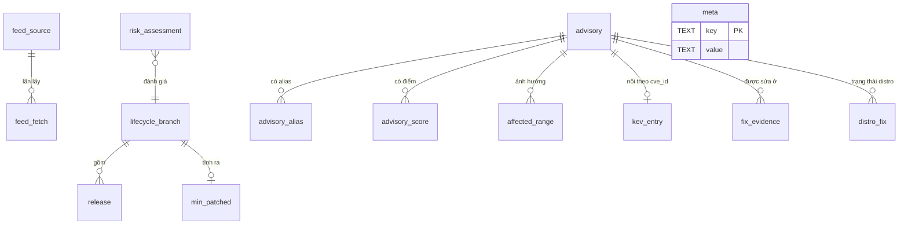

# Đặc tả lớp dữ liệu online — Mô hình chuẩn hóa, hợp nhất, vá tối thiểu, backport, điểm rủi ro

## Lịch sử sửa đổi (Revision History)
| Phiên bản | Ngày | Người thực hiện | Tóm tắt thay đổi |
| :--- | :--- | :--- | :--- |
| 1.0.0 | 2026-10-22 | BA Agent | Khởi tạo: mô hình dữ liệu chuẩn hóa, quy tắc hợp nhất `BR-FEED-020..031`, thuật toán phiên bản vá tối thiểu, phát hiện backport, điểm rủi ro `BR-FEED-040..044`; ví dụ tính trên dữ liệu thật lấy ngày 2026-10-22 |
| 1.0.1 | 2026-10-22 | BA Agent | §2.2 theo rules/09: tách 7 bảng gộp (`advisory_alias`, `advisory_score`, `kev_entry`, `fix_evidence`, `distro_fix`, `min_patched`, `risk_assessment`) thành 1 bảng đặc tả/bảng vật lý; tách cột ghép `product, version` (`fix_evidence`) và `product, branch` (`min_patched`) thành cột riêng; thêm đặc tả bảng `meta`; ghi `FK → advisory` cho `adv_id` của `advisory_alias`, `advisory_score`, `affected_range`, `fix_evidence`, `distro_fix`, `FK → lifecycle_branch` cho `release`, `min_patched`; điền toàn bộ ô Ràng buộc và Diễn giải nghiệp vụ; §2.1 thêm thực thể `meta` |
| 1.0.2 | 2026-10-22 | BA Agent | Sửa theo review: (1) §4.2 và §8.4 thêm cột "Phạm vi áp dụng" (`Module / Kênh / Actor`) sau "Tên quy tắc" cho 17 quy tắc `BR-FEED-020..031`, `BR-FEED-040..044` theo rule 02 §2 và business-rules.md §6 mục 1, thay phạm vi mặc định ở business-rules.md §2; (2) §8.2 quy định tính điểm rủi ro bằng số nguyên phần mười (`R10`) và làm tròn nửa lên bằng chia nguyên `(R10 + 5) div 10` cho cả Bash và Python, cấm `printf "%.0f"` của awk và `round()` của Python (làm tròn nửa về số chẵn: 20,5 → 20, 36,5 → 36), thêm §8.2.1 ca kiểm thử làm tròn `R_raw` = 20,5 → 21 và 36,5 → 37; §2.2 `cvss_rep`, `base_score` ghi rõ đúng 1 chữ số thập phân, `components` ghi cách xuất số thập phân; `BR-FEED-040` THÌ trỏ quy định số nguyên. Không đổi kết quả 11 ví dụ §8.5 (đã tính lại bằng phép số nguyên). Đánh số 1.0.2 vì 1.0.1 đã dùng cho lần sửa theo rules/09 |

## 1. Giới thiệu (Introduction)

### 1.1 Mục đích
Đặc tả phần xử lý sau khi dữ liệu đã được tải về (DOC-SRS-QP-FEED-001): cấu trúc dữ liệu chuẩn hóa, cách ánh xạ từng trường nguồn, cách chọn giá trị khi các nguồn mâu thuẫn, cách tính phiên bản vá tối thiểu theo nhánh, cách xác định bản vá backport của distro và điểm rủi ro 0–100 cho một phiên bản runtime.

### 1.2 Phạm vi
- Trong phạm vi: runtime PHP, Node.js; WordPress core (dùng cùng thuật toán); advisory thư viện Composer/npm chỉ ở mức chuẩn hóa alias (§4).
- Ngoài phạm vi: cách lấy dữ liệu, TTL, fallback (DOC-SRS-QP-FEED-001); thư mục cache, snapshot, CLI (DOC-SRS-QP-FEED-003); quy tắc chọn nhánh đích (`BR-SCN-005`, `BR-SCN-006`).

### 1.3 Định nghĩa bổ sung
| Thuật ngữ | Định nghĩa |
| :--- | :--- |
| Điểm CVSS đại diện (`cvss_rep`) | 1 điểm cơ sở 0,0–10,0 chọn cho mỗi advisory theo `BR-FEED-028` |
| Mức độ (`severity`) | Phân nhóm từ `cvss_rep` theo dải CVSS v3: `critical` ≥ 9,0; `high` 7,0–8,9; `medium` 4,0–6,9; `low` 0,1–3,9; `none` = 0 |
| Tập CVE xét vá (`S_sec`) | CVE áp dụng cho nhánh có `cvss_rep` ≥ 7,0 hoặc có trong KEV (`BR-SCN-004`) |
| Advisory tạm | Bản ghi `QP-SR-{product}-{version}` sinh từ tín hiệu bản bảo mật khi nguồn CVE chưa có dữ liệu (`BR-FEED-024`) |
| `assessed` | Cờ cho biết nhánh có được CNA/nguồn đánh giá với CVE đó hay không (`BR-FEED-029`) |

## 2. Mô hình dữ liệu chuẩn hóa (Data Dictionary)

### 2.1 Sơ đồ quan hệ (DIAG-ERD-QP-FEED-001)


### 2.2 Bảng dữ liệu
Kiểu dữ liệu ghi theo SQLite (`feeds.db`); cột tương ứng trong TSV xem DOC-SRS-QP-FEED-003 §3. Mỗi bảng vật lý có 1 bảng đặc tả riêng, mỗi cột vật lý 1 dòng (rules/09). Khóa ngoại ghi `FK → <bảng đích>`; khóa ngoại gồm nhiều cột được ghi ở từng cột thành phần. Ngày dạng `YYYY-MM-DD`; thời điểm dạng ISO-8601 UTC `YYYY-MM-DDThh:mm:ssZ` (20 ký tự).

**`feed_source`** — cấu hình và trạng thái mỗi nguồn (1 dòng/nguồn)
| Tên trường (Logical) | Tên cột (Physical) | Kiểu dữ liệu | Độ dài | Cho phép Null? | Khóa | Ràng buộc / Giá trị mặc định | Diễn giải nghiệp vụ |
| :--- | :--- | :--- | :--- | :--- | :--- | :--- | :--- |
| Mã nguồn | src_id | TEXT | 7 | Không | PK | Regex `^SRC-\d{3}$` | `SRC-001`..`SRC-017`, danh mục nguồn ở DOC-SRS-QP-FEED-001 §3 |
| TTL | ttl_hours | INTEGER | - | Không | - | 6 hoặc 24 (DOC-SRS-QP-FEED-001 §3.1) | Số giờ tối đa giữa 2 lần lấy; quá TTL thì `feeds update` lấy lại (`BR-FEED-001`) |
| Bật | enabled | INTEGER | - | Không | - | 0/1; `SRC-013` mặc định 0 | 1 = nguồn tham gia `feeds update`; `SRC-013` cần API key nên chỉ bật khi có key (`FR-FEED-WCVE-002`, `BR-FEED-011`) |
| Lần lấy thành công cuối | last_ok_at | TEXT | 20 | Có | - | ISO-8601 UTC; `null` = chưa lấy thành công lần nào | Dùng tính `data_age_h` (`FR-FEED-AGE-001`) |
| Thời điểm nguồn cập nhật | source_updated_at | TEXT | 20 | Có | - | ISO-8601 UTC | Mốc dữ liệu phía nguồn: `dateReleased` (KEV), `generated_at` (endoflife.date), `lastModified` lớn nhất (NVD) |
| Trạng thái | status | TEXT | 16 | Không | - | `OK`, `DEGRADED`, `FAILED`, `DISABLED` | Trạng thái sau lần đồng bộ gần nhất, hiển thị ở `feeds status` và SCR-008 |
| Lỗi cuối | last_error | TEXT | 64 | Có | - | Mã `ERR-FEED-*`; `null` khi lần lấy gần nhất thành công | Lý do lỗi hiển thị cạnh trạng thái `DEGRADED`/`FAILED` |

**`feed_fetch`** — nhật ký từng request (giữ 30 ngày)
| Tên trường (Logical) | Tên cột (Physical) | Kiểu dữ liệu | Độ dài | Cho phép Null? | Khóa | Ràng buộc / Giá trị mặc định | Diễn giải nghiệp vụ |
| :--- | :--- | :--- | :--- | :--- | :--- | :--- | :--- |
| Mã lần lấy | fetch_id | INTEGER | - | Không | PK | Tự tăng | Định danh 1 request HTTP |
| Mã nguồn | src_id | TEXT | 7 | Không | FK → feed_source | Phải tồn tại trong `feed_source.src_id` | Nguồn đã gửi request |
| URL | url | TEXT | 2048 | Không | - | Không chứa key/token (`BR-FEED-011`) | URL đã gọi, dùng tái hiện request khi điều tra lỗi |
| Mã HTTP | http_status | INTEGER | - | Có | - | 100–599; `null` khi lỗi mạng (DNS, TLS, kết nối) | Căn cứ chọn mã `ERR-FEED-*` (vd 429 → `ERR-FEED-429-01`) |
| Byte nhận | bytes | INTEGER | - | Có | - | ≥ 0; `null` khi không nhận được thân phản hồi | Theo dõi dung lượng tải và phát hiện phản hồi bị cắt (`ERR-FEED-502-01`) |
| SHA256 thân | body_sha256 | TEXT | 64 | Có | - | Hex chữ thường, 64 ký tự; `null` khi không có thân | Toàn vẹn raw; đối chiếu `.meta.json` khi chạy `feeds verify` |
| Thời gian | duration_ms | INTEGER | - | Không | - | ≥ 0 | Thời gian từ khi gửi tới khi nhận hết phản hồi hoặc lỗi; đối chiếu timeout `BR-FEED-003` |
| Thời điểm | fetched_at | TEXT | 20 | Không | - | ISO-8601 UTC | Thời điểm gửi request; dòng có `fetched_at` cũ hơn 30 ngày bị xóa |

**`lifecycle_branch`** — vòng đời mỗi nhánh
| Tên trường (Logical) | Tên cột (Physical) | Kiểu dữ liệu | Độ dài | Cho phép Null? | Khóa | Ràng buộc / Giá trị mặc định | Diễn giải nghiệp vụ |
| :--- | :--- | :--- | :--- | :--- | :--- | :--- | :--- |
| Sản phẩm | product | TEXT | 16 | Không | PK | `php`, `node`, `wordpress`, `laravel`, `symfony`, `drupal`, `magento`, `composer` | Runtime, CMS hoặc framework có dữ liệu vòng đời |
| Nhánh | branch | TEXT | 8 | Không | PK | PHP `X.Y`, Node.js `N` hoặc `0.N`, WordPress `X.Y` | Nhánh phát hành; khóa chính gồm (`product`, `branch`) |
| Ngày GA | ga_date | TEXT | 10 | Có | - | `YYYY-MM-DD` | Ngày phát hành bản GA đầu tiên của nhánh |
| Bắt đầu LTS | lts_start | TEXT | 10 | Có | - | `YYYY-MM-DD`; `null` khi nhánh không có LTS | Node.js: trước ngày này nhánh ở `CURRENT`, không được chọn làm đích production (`BR-SCN-007`) |
| Hết hỗ trợ chủ động | active_support_end | TEXT | 10 | Có | - | `YYYY-MM-DD`; PHP `support`/`eoasFrom`; Node.js `maintenance` | Sau ngày này nhánh chỉ nhận bản sửa bảo mật: PHP `SECURITY_ONLY`, Node.js `MAINTENANCE_LTS` (DOC-SRS-QP-SCN-000 §2.1) |
| Ngày EOL | eol_date | TEXT | 10 | Có | - | `YYYY-MM-DD`; `null` = chưa công bố | Mốc trạng thái `EOL` và đầu vào `d` của điểm rủi ro (§8.1) |
| Ngày pre-release | prerelease_date | TEXT | 10 | Có | - | `YYYY-MM-DD`; Node.js `alpha` | Nhánh chỉ có trong nguồn pre-release → `PRE_RELEASE` (DOC-SRS-QP-SCN-000 §2.1), không được chọn làm đích production (`BR-SCN-007`) |
| php.net còn hỗ trợ | php_net_supported | INTEGER | - | Có | - | 0/1 từ `supported_versions`; `null` khi `product ≠ php` | Đối chiếu `BR-FEED-020` |
| Bản mới nhất (tham khảo) | latest_hint | TEXT | 32 | Có | - | `latest.name` của `SRC-001` | Chỉ hiển thị khi nguồn bản phát hành lỗi (`BR-DATA-002`) |
| Nguồn | origin | TEXT | 16 | Không | - | `SRC-001`, `SRC-003`, `SRC-010`, `STATIC` | Nguồn của giá trị vòng đời được chọn theo §4.1; `STATIC` = bản ghi tĩnh (`FR-FEED-EOL-002`) |

**`release`** — bản phát hành
| Tên trường (Logical) | Tên cột (Physical) | Kiểu dữ liệu | Độ dài | Cho phép Null? | Khóa | Ràng buộc / Giá trị mặc định | Diễn giải nghiệp vụ |
| :--- | :--- | :--- | :--- | :--- | :--- | :--- | :--- |
| Sản phẩm | product | TEXT | 16 | Không | PK, FK → lifecycle_branch | `php`, `node`, `wordpress` | Sản phẩm của bản phát hành |
| Phiên bản | version | TEXT | 32 | Không | PK | Không tiền tố `v` (vd `8.4.27`, `22.23.4`, `6.9.10`) | Bản cụ thể; dùng so khớp dải (§5) và tính `min_patched` (§6) |
| Nhánh | branch | TEXT | 8 | Không | FK → lifecycle_branch | Cặp (`product`, `branch`) phải tồn tại trong `lifecycle_branch` | Nhánh chứa bản; `latest(B)` lấy trong các bản của nhánh |
| Ngày phát hành | release_date | TEXT | 10 | Có | - | `YYYY-MM-DD`; ngày `DD Mon YYYY`/`DD Month YYYY` của `SRC-002` được chuyển sang ISO (§3) | Ngày nguồn công bố bản phát hành |
| Bản bảo mật | is_security | INTEGER | - | Không | - | 0/1 (`tags` chứa `"security"`; Node.js `security: true`) | 1 kích hoạt advisory tạm `BR-FEED-024` |
| Trạng thái WordPress | wp_status | TEXT | 8 | Có | - | `latest`, `outdated`, `insecure`; `null` khi `product ≠ wordpress` | Trạng thái theo `SRC-012`; đầu vào `min_patched` WordPress (`BR-FEED-025`) |
| ABI Node.js | abi_modules | INTEGER | - | Có | - | `modules` của `SRC-009`; `null` khi `product ≠ node` | Số `NODE_MODULE_VERSION`; khác giữa bản hiện tại và bản đích → native addon phải build lại (`BR-SCN-006` (d), `BR-SCN-022`) |
| Tên mã LTS | lts_codename | TEXT | 16 | Có | - | `lts` của `SRC-009` khi khác `false` (vd `Krypton`) | Hiển thị LTS (`FEAT-030`) |

**`advisory`** — lỗ hổng sau khử trùng lặp
| Tên trường (Logical) | Tên cột (Physical) | Kiểu dữ liệu | Độ dài | Cho phép Null? | Khóa | Ràng buộc / Giá trị mặc định | Diễn giải nghiệp vụ |
| :--- | :--- | :--- | :--- | :--- | :--- | :--- | :--- |
| Mã chuẩn | adv_id | TEXT | 32 | Không | PK | CVE nếu có; nếu không: GHSA → OSV id → `QP-SR-…` (`BR-FEED-023`) | Định danh duy nhất 1 lỗ hổng sau khử trùng lặp; mã cũ khi đổi sang CVE được giữ ở `advisory_alias` |
| Loại | kind | TEXT | 12 | Không | - | `VULN`, `MALWARE`, `SEC_RELEASE` | `VULN` = lỗ hổng; `MALWARE` = package mã độc `MAL-*` (`BR-SEC-004`); `SEC_RELEASE` = advisory tạm (`BR-FEED-024`) |
| Trạng thái | status | TEXT | 20 | Không | - | `PUBLISHED`, `AWAITING_ANALYSIS`, `PENDING_NVD`, `RESERVED`, `REJECTED`, `WITHDRAWN` | `REJECTED`/`WITHDRAWN` bị loại khỏi mọi phép tính và giữ 90 ngày (`BR-FEED-031`) |
| Ngày công bố | published_at | TEXT | 20 | Có | - | ISO-8601 UTC | Ngày nguồn công bố advisory; cột "ngày công bố" trên SCR-003 (`FR-CON-ASMT-001`) |
| Sửa đổi cuối | modified_at | TEXT | 20 | Không | - | ISO-8601 UTC | Mốc sửa đổi cuối của nguồn; dùng đồng bộ tăng dần (`BR-FEED-002`) |
| Tóm tắt | summary | TEXT | 500 | Có | - | Tiếng Anh nguyên văn, cắt 500 ký tự | Mô tả ngắn hiển thị ở danh sách CVE và findings |
| CWE | cwe_ids | TEXT | 128 | Có | - | Danh sách `CWE-<số>` phân tách dấu phẩy | Loại điểm yếu, hiển thị tham khảo |
| Điểm đại diện | cvss_rep | REAL | - | Có | - | 0,0–10,0, đúng 1 chữ số thập phân (FIRST CVSS v2.0/v3.1/v4.0 làm tròn điểm tới 1 chữ số thập phân; TSV ghi dạng `X.Y`, vd `9.8`, `10.0`) (`BR-FEED-028`); `null` khi chưa nguồn nào chấm điểm hoặc ghi mức độ chữ | Đầu vào `severity` (§1.3), tập `S_sec` và `cvss_max` (§8.1) |
| Nguồn điểm | cvss_rep_src | TEXT | 24 | Có | - | vd `NVD:3.1:Primary`, `PROXY:high` | Truy vết điểm đại diện lấy từ dòng nào của `advisory_score` hoặc từ proxy `BR-FEED-043` |
| Trong KEV | in_kev | INTEGER | - | Không | - | 0/1, mặc định 0; 1 khi `adv_id` có trong `kev_entry.cve_id` | KEV ưu tiên cao nhất (`BR-SEC-001`); đầu vào `N_kev`, `S_kev` (§8.2) |
| Gợi ý mitigation | workaround | TEXT | 1000 | Có | - | `containers.cna.workarounds` (`SRC-005`) | Gợi ý giảm thiểu khi chưa vá được (`FEAT-061`) |

**`advisory_alias`** — mã khác của cùng advisory
| Tên trường (Logical) | Tên cột (Physical) | Kiểu dữ liệu | Độ dài | Cho phép Null? | Khóa | Ràng buộc / Giá trị mặc định | Diễn giải nghiệp vụ |
| :--- | :--- | :--- | :--- | :--- | :--- | :--- | :--- |
| Mã chuẩn | adv_id | TEXT | 32 | Không | PK, FK → advisory | Phải tồn tại trong `advisory.adv_id`; cập nhật theo khi `adv_id` đổi sang CVE (`BR-FEED-023`) | Advisory chuẩn mà alias trỏ tới |
| Mã khác | alias_id | TEXT | 48 | Không | PK | `GHSA-…`, `UBUNTU-CVE-…`, `DEBIAN-CVE-…`, `RHSA-…`, `ALSA-…`, `RLSA-…`, `MAL-…`, `NODEWG-…`, `QP-SR-…`; khác `adv_id` | Mã của cùng lỗ hổng ở nguồn khác; dùng gộp bản ghi (`BR-FEED-023`) và tra bản ghi distro (§7 bước 2) |

**`advisory_score`** — điểm theo từng nguồn và phiên bản CVSS
| Tên trường (Logical) | Tên cột (Physical) | Kiểu dữ liệu | Độ dài | Cho phép Null? | Khóa | Ràng buộc / Giá trị mặc định | Diễn giải nghiệp vụ |
| :--- | :--- | :--- | :--- | :--- | :--- | :--- | :--- |
| Mã chuẩn | adv_id | TEXT | 32 | Không | PK, FK → advisory | Phải tồn tại trong `advisory.adv_id` | Advisory được chấm điểm |
| Nguồn điểm | source | TEXT | 32 | Không | PK | `NVD`, `CNA:<email>`, `GHSA`, `OSV`, `NODE_WG`, `UBUNTU` | Tổ chức chấm điểm; quyết định thứ tự chọn `cvss_rep` (`BR-FEED-028`) |
| Phiên bản CVSS | cvss_version | TEXT | 4 | Không | PK | `2.0`, `3.0`, `3.1`, `4.0`, `NONE` | `NONE` = nguồn chỉ có mức độ chữ, dùng điểm thay thế `BR-FEED-043` |
| Loại | type | TEXT | 10 | Có | - | `Primary`, `Secondary`; `null` khi nguồn không phân loại | NVD `Primary` v3.1/v3.0 được ưu tiên 1 khi chọn `cvss_rep` (`BR-FEED-028`) |
| Điểm | base_score | REAL | - | Có | - | 0,0–10,0, đúng 1 chữ số thập phân; `null` khi `cvss_version = NONE` | Điểm cơ sở, ứng viên của `cvss_rep` |
| Vector | vector | TEXT | 160 | Có | - | Chuỗi vector nguyên văn của nguồn, vd `CVSS:3.1/AV:N/AC:L/PR:N/UI:N/S:U/C:H/I:H/A:H` | Truy vết và hiển thị chi tiết điểm |
| Mức độ chữ | severity_text | TEXT | 10 | Có | - | Chữ thường: `critical`, `high`, `medium`, `low`, `unknown`; GHSA `moderate` → `medium`, Ubuntu `negligible` → `low`, giá trị khác → `unknown` | Đầu vào điểm thay thế `BR-FEED-043` khi `base_score` = `null` |

**`affected_range`** — dải phiên bản bị ảnh hưởng
| Tên trường (Logical) | Tên cột (Physical) | Kiểu dữ liệu | Độ dài | Cho phép Null? | Khóa | Ràng buộc / Giá trị mặc định | Diễn giải nghiệp vụ |
| :--- | :--- | :--- | :--- | :--- | :--- | :--- | :--- |
| Mã dòng | range_id | INTEGER | - | Không | PK | Tự tăng | Định danh 1 dải của 1 advisory |
| Mã chuẩn | adv_id | TEXT | 32 | Không | FK → advisory | Phải tồn tại trong `advisory.adv_id` | Advisory có dải này; 1 advisory có nhiều dải (theo nhánh, theo nguồn) |
| Sản phẩm | product | TEXT | 32 | Không | - | `php`, `node`, `wordpress`, `npm:<name>`, `composer:<name>` | Sản phẩm bị ảnh hưởng, khớp với runtime/package đang quét |
| Nguồn dải | origin | TEXT | 12 | Không | - | `NVD_CPE`, `CNA`, `GHSA`, `OSV`, `NODE_WG`, `SEC_RELEASE` | Chọn dải theo thứ tự `BR-FEED-022` |
| Cận dưới | v_start | TEXT | 32 | Có | - | Phiên bản; `null` = không có cận dưới hoặc dòng dùng `v_exact` | Bản đầu tiên bị ảnh hưởng |
| Bao gồm cận dưới | start_incl | INTEGER | - | Không | - | 0/1, mặc định 1 | 1 = `versionStartIncluding`/`introduced`; 0 = `versionStartExcluding` |
| Cận trên | v_end | TEXT | 32 | Có | - | Phiên bản; `null` = không có cận trên hoặc dòng dùng `v_exact` | Mốc kết thúc dải bị ảnh hưởng |
| Bao gồm cận trên | end_incl | INTEGER | - | Không | - | 0/1 | 1 = `versionEndIncluding`/`lessThanOrEqual`/`last_affected`; 0 = `versionEndExcluding`/`lessThan`/`fixed` |
| Phiên bản đơn | v_exact | TEXT | 32 | Có | - | Khi CPE ghi phiên bản cụ thể | Chỉ đúng phiên bản này bị ảnh hưởng (§5.1) |
| Nền tảng | platform | TEXT | 16 | Không | - | `any`, `windows`, `macos` | Dải `windows`/`macos` bị loại khi máy chủ là Linux (`BR-FEED-022`) |
| Không giới hạn | unbounded | INTEGER | - | Không | - | 0/1; 1 khi CPE `*` không có cận | Dải không xác định được phiên bản: liệt kê riêng, không tính khi so khớp (§5.1) |
| Bản sửa trong nhánh | fixed_in_branch | TEXT | 32 | Có | - | Phiên bản có trong `release` hoặc `PENDING_RELEASE` (`BR-FEED-027`); cận trên loại trừ nếu cùng nhánh | Bản nhỏ nhất của nhánh đã sửa advisory; đầu vào `fixed(c, B)` (§6) |

**`kev_entry`** — danh mục CISA KEV
| Tên trường (Logical) | Tên cột (Physical) | Kiểu dữ liệu | Độ dài | Cho phép Null? | Khóa | Ràng buộc / Giá trị mặc định | Diễn giải nghiệp vụ |
| :--- | :--- | :--- | :--- | :--- | :--- | :--- | :--- |
| CVE | cve_id | TEXT | 20 | Không | PK | Regex `^CVE-\d{4}-\d{4,}$` | `cveID` của `SRC-006`. Bảng giữ toàn bộ danh mục KEV (mọi sản phẩm) nên không khai báo FK; nối logic với `advisory.adv_id` để đặt `in_kev = 1` (quan hệ "nối theo cve_id" ở §2.1) |
| Ngày thêm | date_added | TEXT | 10 | Không | - | `YYYY-MM-DD` | `dateAdded`: ngày CISA đưa CVE vào KEV |
| Hạn xử lý | due_date | TEXT | 10 | Có | - | `YYYY-MM-DD` | `dueDate`: hạn khắc phục CISA đặt cho cơ quan liên bang Mỹ; chỉ hiển thị tham khảo |
| Ransomware | ransomware | TEXT | 8 | Có | - | `Known`, `Unknown` | `knownRansomwareCampaignUse`: CISA đã ghi nhận chiến dịch ransomware khai thác CVE hay chưa |

**`fix_evidence`** — bản có mục sửa trong ChangeLog/NEWS của php.net (`SRC-003`)
| Tên trường (Logical) | Tên cột (Physical) | Kiểu dữ liệu | Độ dài | Cho phép Null? | Khóa | Ràng buộc / Giá trị mặc định | Diễn giải nghiệp vụ |
| :--- | :--- | :--- | :--- | :--- | :--- | :--- | :--- |
| Mã chuẩn | adv_id | TEXT | 32 | Không | PK, FK → advisory | Phải tồn tại trong `advisory.adv_id` | Advisory được sửa |
| Sản phẩm | product | TEXT | 16 | Không | PK | `php` (`SRC-003` chỉ có PHP) | Sản phẩm của bản sửa |
| Phiên bản sửa | version | TEXT | 32 | Không | PK | `X.Y.Z` có mục sửa trong ChangeLog/NEWS | 1 ứng viên phiên bản sửa của `BR-FEED-027` (§4.3) |

**`distro_fix`** — trạng thái vá CVE trong gói distro của máy chủ (dữ liệu riêng của máy, loại khỏi snapshot theo `BR-FEED-056`)
| Tên trường (Logical) | Tên cột (Physical) | Kiểu dữ liệu | Độ dài | Cho phép Null? | Khóa | Ràng buộc / Giá trị mặc định | Diễn giải nghiệp vụ |
| :--- | :--- | :--- | :--- | :--- | :--- | :--- | :--- |
| Ecosystem | ecosystem | TEXT | 24 | Không | PK | Giá trị của bảng ánh xạ ecosystem `SRC-014` (DOC-SRS-QP-FEED-001), vd `Ubuntu:24.04:LTS`, `Debian:12`, `AlmaLinux:9` | Bản phát hành distro của máy chủ, suy từ `/etc/os-release` |
| Gói nguồn | src_package | TEXT | 64 | Không | PK | Tên gói nguồn: dpkg `${source:Package}`, rpm theo `%{SOURCERPM}`, apk `origin` | Gói nguồn chứa binary runtime (vd `php8.3`) |
| Mã chuẩn | adv_id | TEXT | 32 | Không | PK, FK → advisory | Phải tồn tại trong `advisory.adv_id` | CVE được xét ở §7 |
| Bản sửa | fixed_version | TEXT | 64 | Có | - | Phiên bản gói đầy đủ, vd `8.3.6-0ubuntu0.24.04.13`; `null` = chưa có bản sửa | Bản gói cần cài để nhận bản vá; so sánh bằng `dpkg --compare-versions`/`rpmvercmp` chỉ để hiển thị (§5.3) |
| Trạng thái | state | TEXT | 16 | Không | - | `FIXED`, `UNFIXED`, `NOT_AFFECTED`, `UNKNOWN` | Kết quả backport của CVE (`BR-FEED-026`); `UNKNOWN` tính như chưa vá (`BR-SCN-015`) |
| Nguồn | origin | TEXT | 16 | Không | - | `OSV`, `UBUNTU_API`, `REDHAT_API`, `LOCAL_CHANGELOG` | Bước của §7 cho kết quả (bước 1–2 `OSV`; bước 3 `UBUNTU_API`/`REDHAT_API`; bước 4 `LOCAL_CHANGELOG`), dùng truy vết |

**`min_patched`** — phiên bản vá tối thiểu mỗi nhánh (§6)
| Tên trường (Logical) | Tên cột (Physical) | Kiểu dữ liệu | Độ dài | Cho phép Null? | Khóa | Ràng buộc / Giá trị mặc định | Diễn giải nghiệp vụ |
| :--- | :--- | :--- | :--- | :--- | :--- | :--- | :--- |
| Sản phẩm | product | TEXT | 16 | Không | PK, FK → lifecycle_branch | `php`, `node`, `wordpress` | Sản phẩm được tính vá tối thiểu |
| Nhánh | branch | TEXT | 8 | Không | PK, FK → lifecycle_branch | Cặp (`product`, `branch`) phải tồn tại trong `lifecycle_branch` | Nhánh `B` của §6; CLI tra qua `min_patched.tsv` thay `fixed_for` của v0.1 |
| Vá tối thiểu (bảo mật) | min_patched_sec | TEXT | 32 | Có | - | Theo `S_sec`: phiên bản thuộc `B`; `NONE` = có CVE chưa có bản sửa trong nhánh; `PENDING_RELEASE` = bản sửa chưa phát hành (§6.1) | Thay `PHP_FIXED`/`NODE_FIXED`/`WP_FIXED`; quyết định trạng thái `vulnerable` và ngưỡng backport (§7 bước 0) |
| Vá tối thiểu (mọi CVE) | min_patched_all | TEXT | 32 | Có | - | Như `min_patched_sec` nhưng tính trên mọi CVE áp dụng (`BR-FEED-030`) | Hiển thị tham khảo |
| Bản mới nhất | latest | TEXT | 32 | Có | - | Theo §4.1 dòng "Bản mới nhất mỗi nhánh" (`SRC-002`/`SRC-009`/`SRC-012`) | Bản đề xuất mặc định `latest(B)` (`BR-SCN-004`) |
| CVE quyết định | driver_ids | TEXT | 256 | Có | - | Danh sách `adv_id` phân tách dấu phẩy, mỗi mã có bản sửa bằng `min_patched_sec` | Giải thích trên console vì sao cần bản `min_patched_sec` |

**`risk_assessment`** — điểm rủi ro (§8)
| Tên trường (Logical) | Tên cột (Physical) | Kiểu dữ liệu | Độ dài | Cho phép Null? | Khóa | Ràng buộc / Giá trị mặc định | Diễn giải nghiệp vụ |
| :--- | :--- | :--- | :--- | :--- | :--- | :--- | :--- |
| Đối tượng | subject | TEXT | 128 | Không | PK | `product@version[#pkg-version]`, vd `php@8.3.6#8.3.6-0ubuntu0.24.04.13` | Đối tượng `X` của §8.1; `product` và nhánh suy từ `version` nối logic với `lifecycle_branch` (quan hệ "đánh giá" ở §2.1, không có cột FK riêng) |
| Điểm | score | INTEGER | - | Không | - | 0–100 | Điểm `R` (`BR-FEED-040`, `BR-FEED-041`) |
| Mức | level | TEXT | 12 | Không | - | `LOW`, `MEDIUM`, `HIGH`, `CRITICAL` | Mức theo §8.3 (`BR-FEED-042`), quyết định thời hạn xử lý |
| Thành phần | components | TEXT | 256 | Không | - | JSON `{cvss,count,kev,life,eol,floor}`; 5 thành phần đầu là số thập phân 1 chữ số xuất từ số nguyên phần mười của §8.2 (vd `S_cvss10 = 392` → `39.2`), `floor` là số nguyên | Giá trị `S_cvss`, `S_cnt`, `S_kev`, `S_life`, `S_eol` và điểm sàn, dùng giải thích điểm trên console |
| Bundle | bundle_id | TEXT | 40 | Không | - | Bằng `meta.value` của dòng `key = bundle_id` trong cùng `feeds.db` | Tái lập kết quả; so sánh hiện tại/ứng viên phải cùng bundle (`BR-ASMT-003`, `BR-FEED-044`) |

**`meta`** — thuộc tính của bundle (khóa–giá trị)
| Tên trường (Logical) | Tên cột (Physical) | Kiểu dữ liệu | Độ dài | Cho phép Null? | Khóa | Ràng buộc / Giá trị mặc định | Diễn giải nghiệp vụ |
| :--- | :--- | :--- | :--- | :--- | :--- | :--- | :--- |
| Khóa | key | TEXT | 32 | Không | PK | Bắt buộc có 2 dòng `bundle_id`, `schema` | Tên thuộc tính của bundle |
| Giá trị | value | TEXT | 256 | Không | - | `bundle_id`: bằng `bundle_id` của `manifest.json` cùng bundle (vd `b-20261022T093000Z-3f2a9c1e`); `schema`: bằng `schema` của `manifest.json` (`qp.feeds.bundle/1`) | `bundle_id` định danh bundle, được đọc khi nhập snapshot để báo `bundle_id` mới (DOC-SRS-QP-FEED-003 §3.1; DIAG-SEQ-QP-FEED-003 ở flows.md §2.2); `schema` cho biết major lược đồ bundle, nhập snapshot chỉ nhận cùng major |

## 3. Ánh xạ trường nguồn → mô hình
| Nguồn | Trường nguồn | Bảng.cột | Chuyển đổi |
| :--- | :--- | :--- | :--- |
| `SRC-001` | `releases[].name` | `lifecycle_branch.branch` | Giữ nguyên chuỗi |
| `SRC-001` | `releaseDate`, `eoasFrom`, `eolFrom`, `ltsFrom` | `ga_date`, `active_support_end`, `eol_date`, `lts_start` | `null` giữ `null` |
| `SRC-001` (API cũ) | `support`/`eol`: `true`, `false` hoặc ngày | `active_support_end`/`eol_date` | `BR-FEED-021` |
| `SRC-001` (API cũ) | `supportedPhpVersions` / `supportedPHPVersions` | `framework_php_support(min,max)` | `"7.2.24 - 8.5"` → min `7.2.24`, max `8.5` |
| `SRC-002` | khóa phiên bản, `date`, `tags[]` | `release.version`, `release_date`, `is_security` | Ngày `DD Mon YYYY`/`DD Month YYYY` → ISO; `is_security = "security" ∈ tags` |
| `SRC-002` | `supported_versions[]` | `lifecycle_branch.php_net_supported` | 1 cho nhánh có trong danh sách, 0 cho nhánh khác ≥ 5.0 |
| `SRC-003` | Khối `id="X.Y.Z"` / tiêu đề `DD Mon YYYY, PHP X.Y.Z` của NEWS chứa `GHSA-…`, `CVE-…` | `fix_evidence(adv_id, php, X.Y.Z)`, `advisory_alias` | GHSA và CVE cùng dòng NEWS → cùng advisory |
| `SRC-004` | `cve.id`, `published`, `lastModified`, `vulnStatus` | `advisory.adv_id`, `published_at`, `modified_at`, `status` | `Analyzed`/`Modified` → `PUBLISHED`; `Awaiting Analysis`/`Received`/`Undergoing Analysis` → `AWAITING_ANALYSIS`; `Rejected` → `REJECTED` |
| `SRC-004` | `metrics.cvssMetric*[]` | `advisory_score` | 1 dòng/nguồn/phiên bản CVSS |
| `SRC-004` | `configurations[].nodes[].cpeMatch[]` | `affected_range` (`origin=NVD_CPE`) | §5.1 |
| `SRC-004` | `affected[].affectedData[].versions[]` | `affected_range` (`origin=CNA`) | §5.2 |
| `SRC-004` | `references[].url` khớp `/security/advisories/(GHSA-[\w-]+)` | `advisory_alias` | |
| `SRC-005` | `containers.cna.affected`, `metrics`, `workarounds` | `affected_range` (`CNA`), `advisory_score`, `advisory.workaround` | `state=REJECTED` → `REJECTED` |
| `SRC-006` | `cveID`, `dateAdded`, `dueDate`, `knownRansomwareCampaignUse` | `kev_entry`; `advisory.in_kev = 1` | Nối theo `cve_id` |
| `SRC-007` | `id`, `aliases[]`, `affected[].ranges[].events[]`, `severity[]`, `database_specific.severity` | `advisory`, `advisory_alias`, `affected_range` (`OSV`), `advisory_score` (`OSV`) | `MAL-*` → `kind=MALWARE` |
| `SRC-008` | `ghsa_id`, `cve_id`, `cvss_severities`, `vulnerabilities[].patched_versions` | `advisory_alias`, `advisory_score` (`GHSA`), `affected_range` (`GHSA`) | |
| `SRC-009` | `version`, `date`, `security`, `lts`, `modules` | `release` (`node`) | Bỏ tiền tố `v` |
| `SRC-010` | `start`, `lts`, `maintenance`, `end`, `alpha` | `lifecycle_branch` (`node`) | Khóa `v24` → nhánh `24`; `v0.12` → `0.12` |
| `SRC-011` | `cve[]`, `vulnerable`, `patched`, `severity`, `affectedEnvironments` | `advisory`, `affected_range` (`NODE_WG`), `advisory_score` (`NODE_WG`, `cvss_version=NONE`) | §5.4; `win32` → `platform=windows` |
| `SRC-012` | phiên bản → trạng thái | `release.wp_status` | |
| `SRC-014` | `id`, `upstream[]`/`aliases[]`, `affected[].ranges[].events.fixed` | `distro_fix`, `advisory_alias` | `UBUNTU-CVE-2026-109618` → alias của `CVE-2026-109618` |
| `SRC-015` | Ubuntu `statuses[].status`; Red Hat `package_state[].fix_state` | `distro_fix.state` | Ubuntu `released`→`FIXED`, `needed`/`deferred`/`pending`→`UNFIXED`, `not-affected`→`NOT_AFFECTED`, `DNE`→`UNKNOWN`; Red Hat `Not affected`→`NOT_AFFECTED`, `Affected`/`Fix deferred`→`UNFIXED`, `affected_release` có gói → `FIXED` |
| `SRC-016` | Chuỗi CVE trong changelog | `distro_fix` (`LOCAL_CHANGELOG`, `FIXED`) | Không có → không tạo dòng |

## 4. Quy tắc hợp nhất (Merge Rules)

### 4.1 Ma trận ưu tiên nguồn theo thuộc tính
Số nhỏ = ưu tiên cao; "—" = không dùng. Khi nguồn ưu tiên 1 thiếu giá trị thì xét nguồn kế tiếp.

| Thuộc tính | PHP | Node.js | WordPress core |
| :--- | :--- | :--- | :--- |
| Ngày GA, hết hỗ trợ chủ động, EOL | 1 `SRC-001`; 2 `SRC-003` (`eol.php`); 3 `STATIC` | 1 `SRC-010`; 2 `SRC-001` | 1 `SRC-001` |
| Nhánh còn được hỗ trợ (cờ) | 1 `SRC-002` `supported_versions`; 2 `SRC-001` | 1 `SRC-010`; 2 `SRC-001` | 1 `SRC-012` (§6.4) |
| Bản mới nhất mỗi nhánh | 1 `SRC-002`; 2 tag `php-src`; 3 `SRC-001` (`BR-DATA-002`) | 1 `SRC-009`; 2 `SRC-001` | 1 `SRC-012`; 2 `SRC-001` |
| Danh sách CVE | Hợp của `SRC-004` Q1+Q2, `SRC-005`, `SRC-003`, `SRC-008` | Hợp của `SRC-011`, `SRC-004`, `SRC-005`, advisory tạm | Hợp của `SRC-004`, `SRC-013` (nếu bật) |
| Dải ảnh hưởng | §4.2 `BR-FEED-027` | 1 `SRC-011`; 2 `SRC-004` | 1 `SRC-004`; 2 `SRC-012` |
| Điểm CVSS | `BR-FEED-028` | `BR-FEED-028` | `BR-FEED-028` |
| Cờ KEV | 1 `SRC-006` | 1 `SRC-006` | 1 `SRC-006` |
| Trạng thái vá trong gói distro | `BR-FEED-026` | `BR-FEED-026` | — |

### 4.2 Quy tắc nghiệp vụ hợp nhất
Cột "Phạm vi áp dụng" ghi theo mẫu `Module / Kênh / Actor` của [business-rules.md §1](business-rules.md); actor theo [spec.md §2.3](spec.md). Quy tắc chạy lúc chuẩn hóa (`qp-feeds.py`) áp dụng ở mọi đường dựng bundle: `feeds update` (thủ công, job `feeds_update` trên SCR-008, lịch đồng bộ `SYS-01`) và pipeline phát hành `qp-feeds.py build-snapshot` (`SYS-05`, DOC-SRS-QP-FEED-003 §4.2).

| Mã BR | Tên quy tắc | Phạm vi áp dụng | KHI (WHEN) | THÌ (THEN) | NGOẠI LỆ (UNLESS) |
| :--- | :--- | :--- | :--- | :--- | :--- |
| `BR-FEED-020` | Ưu tiên nguồn vòng đời | FEED, SCN / CLI (`feeds update`; đọc kết quả: `scan`, `assess`, `plan`), console SCR-008 (job `feeds_update`), lịch đồng bộ, pipeline phát hành / PER-01, PER-02, SYS-01, SYS-05 | Hai nguồn có giá trị khác nhau cho cùng thuộc tính vòng đời | Chọn theo §4.1; nếu ngày lệch > 3 ngày ghi `ERR-FEED-409-01` (vd Node.js 26: 2027-10-20 vs 2027-10-27). PHP: nhánh có `eol_date` < hôm nay nhưng `php_net_supported = 1` → coi là còn hỗ trợ tới khi php.net gỡ khỏi `supported_versions` | — |
| `BR-FEED-021` | Chuẩn hóa kiểu hỗn hợp | FEED (`SRC-001`) / CLI (`feeds update`), console SCR-008 (job `feeds_update`), lịch đồng bộ, pipeline phát hành / PER-01, PER-02, SYS-01, SYS-05 | Trường vòng đời nhận `true`/`false`/ngày | `eol=false` → `eol_date = null` (chưa công bố); `eol=true` không có ngày → `eol_date = latestReleaseDate` của nhánh và đánh dấu `approx`; `support=true` → `active_support_end = null`; `support=false` → bằng `ga_date`; chuỗi ngày không theo ISO → parse theo `%d %b %Y`, `%d %B %Y`, lỗi → `ERR-FEED-422-01` | — |
| `BR-FEED-022` | So khớp dải phiên bản | FEED, SCAN, ASMT, PTCH / CLI (`feeds update` khi tính `min_patched`, `scan`, `fix`, `assess`, `report assess`), console SCR-002, SCR-003, SCR-005, API (`/api/v1/runtimes/{runtime_id}/assessment`, `/api/v1/advisories`, `/api/v1/dependency-findings`), báo cáo / PER-01..04 | Đánh giá 1 phiên bản với 1 advisory | Theo §5: (1) có `configurations` NVD → dùng `NVD_CPE`; (2) không có → dùng `CNA`; (3) Node.js → `NODE_WG` trước, `NVD_CPE` sau; (4) Composer/npm → `OSV`; loại dải `platform ≠ any` khi server là Linux; dải `unbounded` và CPE giá trị `-` không khớp phiên bản nào | — |
| `BR-FEED-023` | Khử trùng lặp, mã chuẩn | FEED, ASMT / CLI (`feeds update`, tra OSV trong `scan`/`assess`), console SCR-003, SCR-005, API (`/api/v1/advisories`), lịch đồng bộ, pipeline phát hành / PER-01..04, SYS-01, SYS-05 | Hai bản ghi từ các nguồn chia sẻ ít nhất 1 mã (`aliases`, `upstream`, `cve_id`, GHSA trong URL/NEWS) | Gộp thành 1 `advisory`; `adv_id` = mã CVE nếu có, nếu không theo thứ tự GHSA → OSV id → `QP-SR-…`; khi CVE xuất hiện sau, đổi `adv_id` sang CVE và giữ mã cũ trong `advisory_alias` | `MAL-*` không gộp với CVE (là mã độc, không phải lỗ hổng) |
| `BR-FEED-024` | Tín hiệu bản bảo mật | FEED, ASMT (PHP, Node.js, WordPress core) / CLI (`feeds update`; hiển thị: `scan`, `assess`), console SCR-003, lịch đồng bộ / PER-01..04, SYS-01 | `release.is_security = 1` cho bản `r` của nhánh `B`, và sau 6 giờ kể từ khi phát hiện chưa có advisory nào (từ `SRC-004/005/011`) có `fixed_in_branch = r` | Tạo advisory tạm `QP-SR-{product}-{r}` (`kind=SEC_RELEASE`, `cvss_rep = 7,5` theo `BR-FEED-043`, dải `< r` trong nhánh `B`); hiển thị "Bản bảo mật {r} chưa có chi tiết CVE"; tự xóa khi có advisory thật với `fixed_in_branch = r` | PHP: tag rỗng `[""]` không kích hoạt |
| `BR-FEED-025` | `min_patched` WordPress | FEED, PTCH (WordPress core) / CLI (`feeds update`; đọc kết quả: `scan`, `fix`), console SCR-005, lịch đồng bộ, pipeline phát hành / PER-01..03, SYS-01, SYS-05 | Có dữ liệu `SRC-012` | `min_patched_sec(branch)` = phiên bản nhỏ nhất của nhánh có `wp_status ≠ insecure`; không có → `NONE` (nhánh không còn bản vá) | `SRC-012` lỗi → tính theo §6.2 từ `SRC-004` |
| `BR-FEED-026` | Chuỗi quyết định backport | FEED, SCAN, ASMT, PTCH (runtime cài từ gói distro) / CLI (`scan`, `fix`, `assess`), console SCR-002, SCR-003, API (`/api/v1/runtimes`, `/api/v1/runtimes/{runtime_id}/assessment`) / PER-01, PER-02, PER-04 | Binary runtime thuộc gói distro (`pkg_owner` v0.1) | §7; kết quả mỗi CVE: `FIXED`, `UNFIXED`, `NOT_AFFECTED`, `UNKNOWN`; `UNKNOWN` tính như chưa vá khi tính điểm (`BR-SCN-015`) và hiển thị nhãn "chưa xác định" | — |
| `BR-FEED-027` | Phiên bản sửa khi các nguồn mâu thuẫn | FEED / CLI (`feeds update`; hiển thị `ERR-FEED-409-01`: `feeds status`), console SCR-008, lịch đồng bộ, pipeline phát hành / PER-01, PER-02, PER-04, SYS-01, SYS-05 | 1 CVE có ≥ 2 giá trị phiên bản sửa trong cùng nhánh (NVD `versionEndExcluding`, CNA `lessThan`, GHSA `patched_versions`, `fix_evidence` của `SRC-003`) | `fixed_in_branch` = **giá trị lớn nhất** (ít khả năng bỏ sót bản còn lỗi); ghi mọi giá trị vào log và `ERR-FEED-409-01` khi lệch; giá trị được chọn phải tồn tại trong `release`, nếu chưa phát hành → `fixed_in_branch = PENDING_RELEASE` | `versionEndIncluding = X` → sửa ở bản patch kế tiếp có trong `release` |
| `BR-FEED-028` | Điểm CVSS đại diện | FEED, ASMT / CLI (`feeds update`; đọc kết quả: `scan`, `assess`, `report assess`), console SCR-003, SCR-005, API (`/api/v1/advisories`), báo cáo / PER-01..04, SYS-01, SYS-05 | Advisory có ≥ 1 điểm | Thứ tự: (1) NVD `Primary` v3.1/v3.0; (2) điểm lớn nhất trong các nguồn `Secondary`/CNA/GHSA v3.x; (3) điểm lớn nhất v4.0; (4) NVD v2.0; (5) proxy theo mức độ chữ (`BR-FEED-043`) | — |
| `BR-FEED-029` | Nhánh không được đánh giá | FEED, ASMT (nhánh EOL) / CLI (`scan`, `assess`, `report assess`), console SCR-003, API (`/api/v1/runtimes/{runtime_id}/assessment`), báo cáo / PER-01..04 | CNA liệt kê dải chỉ cho một số nhánh với `defaultStatus = unaffected`, phiên bản xét thuộc nhánh EOL không có trong danh sách | Không suy ra "không bị ảnh hưởng"; dùng `NVD_CPE` nếu có; nếu cả 2 không khớp → `assessed = false`, không tính vào số CVE nhưng hiển thị "Nhánh EOL — nguồn không còn đánh giá CVE mới" | — |
| `BR-FEED-030` | Định nghĩa vá tối thiểu | FEED, SCN, PTCH / CLI (`feeds update`; đọc kết quả: `scan`, `fix`, `assess`), console SCR-003, lịch đồng bộ, pipeline phát hành / PER-01..03, SYS-01, SYS-05 | Tính `min_patched` cho nhánh `B` | §6; `min_patched_sec` dùng tập `S_sec`; `min_patched_all` dùng mọi CVE áp dụng | — |
| `BR-FEED-031` | Thu hồi advisory | FEED, ASMT / CLI (`feeds update`, `scan`, `assess`), console SCR-003, API (`/api/v1/advisories`), lịch đồng bộ / PER-01..04, SYS-01 | Nguồn trả `Rejected`, `REJECTED`, `withdrawn` | Đặt `status`, loại khỏi mọi phép tính; giữ bản ghi 90 ngày để giải thích thay đổi kết quả | — |

### 4.3 Ví dụ mâu thuẫn thật về phiên bản sửa (php.net vs NVD vs CNA, dữ liệu 2026-10-22)
Quét 765 CVE PHP (749 Q1 + 16 Q2) tìm CVE có cả `versionEndExcluding` (NVD) và `lessThan` (CNA) cho cùng nhánh nhưng khác giá trị: 7 cặp. Đối chiếu với mục sửa trong `ChangeLog-8.php` (`SRC-003`):

| CVE | Nhánh | NVD `versionEndExcluding` | CNA `lessThan` | php.net ChangeLog (bản có mục sửa) | Kết quả `BR-FEED-027` (giá trị lớn nhất) |
| :--- | :---: | :---: | :---: | :---: | :---: |
| CVE-2023-3823 | 8.2 | 8.2.9 | 8.2.8 | 8.2.9 | 8.2.9 |
| CVE-2023-3824 | 8.2 | 8.2.9 | 8.2.8 | 8.2.9 | 8.2.9 |
| CVE-2024-8929 | 8.2 | 8.2.26 | 8.2.24 | 8.2.26 | 8.2.26 |
| CVE-2025-1861 | 8.1 / 8.2 / 8.3 | 8.1.31 / 8.2.26 / 8.3.14 | 8.1.32 / 8.2.28 / 8.3.19 | 8.1.32 / 8.2.28 / 8.3.19 | 8.1.32 / 8.2.28 / 8.3.19 |
| CVE-2026-7258 | 8.2 | 8.2.21 | 8.2.31 | 8.2.31 | 8.2.31 |

Trong cả 7 cặp, quy tắc "lấy giá trị lớn nhất" trùng với bản có mục sửa trên php.net; nếu chỉ dùng NVD sẽ báo sai 4 cặp là đã vá (vd PHP 8.2.26 với CVE-2025-1861), nếu chỉ dùng CNA sẽ báo sai 3 cặp.

## 5. Thuật toán so khớp dải phiên bản

### 5.1 Cấu hình CPE của NVD (`origin = NVD_CPE`)
```text
affected(cve, ver, os="linux"):
  for cfg in cve.configurations:
    if cfg.operator == "AND":                       # vd CVE-2024-4577
      prod_hit = any(match(m, ver) for n in cfg.nodes for m in n.cpeMatch if m.vulnerable)
      plat_ok  = false nếu có node chỉ gồm cpeMatch vulnerable=false và mọi CPE trong node đó
                 là cpe:2.3:o:microsoft:* hoặc cpe:2.3:o:apple:* (nền tảng khác Linux); ngược lại true
      if prod_hit and plat_ok: return true
    else:
      if any(match(m, ver) for n in cfg.nodes for m in n.cpeMatch if m.vulnerable): return true
  return false

match(m, ver):
  vendor:product phải đúng sản phẩm (php:php, nodejs:node.js, wordpress:wordpress)
  v = trường version của CPE (vị trí 6)
  v == "-"                           → false            # NA, 2 CVE PHP năm 2007
  v == "*" và không có versionStart*/End* → false, đánh dấu unbounded   # 1 CVE PHP
  v là số cụ thể                      → ver == v
  ngược lại kiểm tra lần lượt StartIncluding (≥), StartExcluding (>), EndIncluding (≤), EndExcluding (<)
```
So sánh phiên bản: tách các nhóm chữ số, so theo từng phần tử số nguyên, phần thiếu = 0 (giống `sort -V` của v0.1 với chuỗi chỉ gồm số và dấu chấm).

### 5.2 Dữ liệu CNA (`origin = CNA`)
`versions[]` mỗi phần tử: `version` (vd `8.4.*` hoặc `8.4.0`), `lessThan` hoặc `lessThanOrEqual`, `status`. Phiên bản `ver` bị ảnh hưởng khi tồn tại phần tử `status = affected` thỏa: `version` dạng `X.Y.*` thì `ver` cùng tiền tố `X.Y.` và `ver < lessThan` (hoặc `≤ lessThanOrEqual`); `version` cụ thể thì `version ≤ ver < lessThan`. Không phần tử nào khớp và `defaultStatus = unaffected` → áp `BR-FEED-029`.

### 5.3 OSV (`origin = OSV`, Composer/npm và distro)
Theo đặc tả OSV: duyệt `ranges[].events` theo thứ tự; `introduced` mở khoảng (bao gồm), `fixed` đóng (loại trừ), `last_affected` đóng (bao gồm); `introduced: "0"` = trước mọi phiên bản; phiên bản có trong `versions[]` luôn bị ảnh hưởng. Composer/npm: tool dùng kết quả querybatch (máy chủ OSV đánh giá), chỉ tự đánh giá dải khi làm việc offline từ cache chi tiết advisory. Distro: luôn dùng kết quả máy chủ OSV (§7 bước 1–2); so sánh phiên bản distro (`dpkg --compare-versions`, `rpmvercmp`) chỉ dùng để hiển thị bản sửa cho người vận hành, không dùng so sánh số đơn giản.

### 5.4 Semver của Node.js Security WG (`origin = NODE_WG`)
Biểu thức gồm các nhánh nối bằng `||`; mỗi nhánh là các điều kiện cách nhau bởi khoảng trắng (AND): `^A.B.C` (≥ A.B.C, cùng major), `~A.B.C` (≥ A.B.C, cùng major.minor), `>=`, `<=`, `>`, `<`, `=`, dạng `N.x`/`N.N.x`, `*`. Bị ảnh hưởng ⇔ khớp `vulnerable` **và** không khớp `patched`. Đã kiểm thử trên 194 bản ghi ngày 2026-10-22: 22.12.0 → 40 bản ghi (13 high, 17 medium, 10 low); 20.11.0 → 37; 18.19.0 → 12; 22.23.3, 24.22.1, 26.12.1 → 0 (đợt 2026-10-21 chưa có trong nguồn, xử lý bằng `BR-FEED-024`).

## 6. Phiên bản vá tối thiểu theo nhánh

### 6.1 Định nghĩa
Với nhánh `B` và tập CVE `S` (mặc định `S_sec`):
- `fixed(c, B)` = phiên bản nhỏ nhất thuộc `B` không còn bị `c` ảnh hưởng, lấy theo `BR-FEED-027`.
- `min_patched(B, S)` = `max{ fixed(c, B) | c ∈ S, c ảnh hưởng ít nhất 1 phiên bản của B }`.
- Nếu tồn tại `c ∈ S` ảnh hưởng `B` mà không có `fixed(c, B)` (nhánh EOL hoặc chưa phát hành bản sửa) → `min_patched = NONE` (cần nâng nhánh) hoặc `PENDING_RELEASE`.
- Bản đề xuất mặc định vẫn là `latest(B)` (`BR-SCN-004`); `min_patched` dùng để quyết định trạng thái `vulnerable` và ngưỡng cho backport.

### 6.2 Thuật toán PHP / WordPress dự phòng
```text
for B in nhánh có trong lifecycle_branch:
  cands = []
  for c in advisories áp dụng sản phẩm, c.status ∉ {REJECTED, WITHDRAWN}, c ∈ S:
    vers = phiên bản của B trong release, sắp tăng dần
    if không có v ∈ vers mà affected(c, v): continue
    f = phiên bản nhỏ nhất trong vers lớn hơn mọi v bị ảnh hưởng và chính f không bị ảnh hưởng
    f = max(f, các ứng viên fixed khác theo BR-FEED-027)
    if f không tồn tại: return NONE (hoặc PENDING_RELEASE nếu dải nguồn nêu bản chưa phát hành)
    cands.append(f)
  min_patched(B) = max(cands) nếu có, ngược lại = phiên bản GA đầu tiên của B
```

### 6.3 Node.js
Như §6.2 với dải `NODE_WG`, cộng advisory tạm của `BR-FEED-024` (dải `< r`). Ví dụ 2026-10-22, nhánh 22: các CVE đợt 2026-07 cho `fixed = 22.23.2` (`patched: ^22.23.2`); advisory tạm `QP-SR-node-22.23.4` (do `SRC-009` gắn `security: true` cho 22.23.4) → `min_patched(22) = 22.23.4`.

### 6.4 WordPress
`BR-FEED-025`. Dữ liệu 2026-10-22: nhánh 7.1 → 7.1.3; 7.0 → 7.0.7; 6.9 → 6.9.10; 4.7–6.8 → bản cuối của mỗi nhánh; 4.1–4.6 → `NONE` (mọi bản đều `insecure`).

### 6.5 Kiểm thử hồi quy với dữ liệu ghi cứng của v0.1
Chạy thuật toán trên bundle ngày 2026-10-22 phải cho kết quả sau (QA dùng làm test case):

| Biến v0.1 | Giá trị v0.1 | Kết quả thuật toán v2 | CVE quyết định | Ghi chú |
| :--- | :--- | :--- | :--- | :--- |
| `PHP_FIXED` | 8.2.35 8.3.36 8.4.27 8.5.12 | 8.2.35, 8.3.36, 8.4.27, 8.5.12 | CVE-2026-109618, CVE-2026-109619 | NVD, CNA, `NEWS` (`22 Oct 2026, PHP 8.4.27`) cùng giá trị → không có mâu thuẫn |
| `NODE_FIXED` | 22.23.4 24.22.1 26.12.1 | 22.23.4, 24.22.1, 26.12.1 | `QP-SR-node-22.23.4`, `-24.22.1`, `-26.12.1` | Sẽ đổi thành CVE thật khi `SRC-011` cập nhật |
| `WP_FIXED` | 6.9.5 7.0.2 | 6.9.10, 7.0.7 (và 7.1.3 cho nhánh 7.1) | `SRC-012` | Khác v0.1: 7.0.2 còn CVE-2026-87902 (KEV) |

## 7. Phát hiện bản vá backport (distro)
Áp dụng khi `pkg_owner` (v0.1) trả gói dpkg/rpm/apk. Kết quả thay hàm `pkg_has_cves` và giữ các trạng thái v0.1 `ok`, `ok-backport`, `vulnerable`, `eol`, `unknown`.

| Bước | Điều kiện | Hành động | Kết quả cho CVE `c` |
| :--- | :--- | :--- | :--- |
| 0 | Phiên bản upstream (`php_version`/`node --version`) ≥ `min_patched_sec` | Không cần xét backport | `ok` |
| 1 | Ecosystem có trong bảng ánh xạ `SRC-014` | Querybatch (gói nguồn, phiên bản đầy đủ) → tập `U` (alias CVE của các advisory trả về) | `c ∈ U` → `UNFIXED` |
| 2 | `c ∉ U` | `GET /v1/vulns/{PREFIX}-{c}` (`UBUNTU-CVE-…`, `DEBIAN-CVE-…`) hoặc tra alias đã cache | Bản ghi có mục `affected` cho đúng (ecosystem, gói nguồn) → `FIXED` (hoặc `NOT_AFFECTED`): kết quả querybatch do máy chủ OSV đánh giá là căn cứ, tool không tự so lại dải phiên bản distro (vd `UBUNTU-CVE-2024-8926` có dải `introduced: 0` không có `fixed` nhưng OSV không trả nó cho bản `…24.04.13`); không có bản ghi hoặc không có mục cho gói → bước 3 |
| 3 | Ubuntu hoặc RHEL-family | `SRC-015` theo CVE | Ánh xạ trạng thái §3; 404/504 → bước 4 |
| 4 | Gói dpkg/rpm | `SRC-016` changelog chứa `c` | Có → `FIXED`; không → `UNKNOWN` |
| 5 | Tổng hợp | Mọi `c ∈ S_sec` là `FIXED`/`NOT_AFFECTED` | `ok-backport` (`BR-SEC-002`); có `UNFIXED` → `vulnerable`; chỉ còn `UNKNOWN` → `vulnerable` kèm nhãn "chưa xác định" |

Ví dụ thật (2026-10-22): `php8.3 8.3.6-0ubuntu0.24.04.13` trên Ubuntu 24.04. Upstream 8.3.6 khớp 48 CVE (§8.5).
- Bước 1: querybatch trả `U = {CVE-2026-17545}` (CVSS v4.0 6,9) → `UNFIXED`.
- Bước 2: 45 CVE có bản ghi `UBUNTU-CVE-…` với mục `Ubuntu:24.04:LTS`/`php8.3` và không nằm trong `U` → `FIXED` (gồm CVE-2026-109618: `fixed = 8.3.6-0ubuntu0.24.04.13`); 2 CVE không có mục phù hợp (CVE-2024-2408: bản ghi không có mục `php8.3` 24.04; CVE-2024-5585: không có bản ghi) → bước 3.
- Bước 3: Ubuntu CVE API trả `not-affected` cho cả 2 (CVE-2024-5585 ghi "windows-specific") → `NOT_AFFECTED`.
- Kết quả: `S_sec` không còn CVE `UNFIXED`/`UNKNOWN` → `ok-backport` (khớp hành vi v0.1 ghi ở DOC-BRS-QP-001 §4 mục 5); điểm rủi ro vẫn tính 1 CVE medium còn lại (§8.5 ví dụ 6).

## 8. Điểm rủi ro 0–100 cho một phiên bản runtime

### 8.1 Đầu vào
Với đối tượng `X = (product, version, [gói distro])` tại ngày đánh giá `T` (UTC):
- `U(X)` = tập advisory áp dụng cho `X` còn chưa vá: so khớp §5, loại `REJECTED`/`WITHDRAWN`/`assessed=false`, sau bước backport §7 (CVE `FIXED`/`NOT_AFFECTED` bị loại; `UNKNOWN` được giữ).
- `cvss_max` = `max(cvss_rep)` trên `U(X)`, 0 nếu rỗng.
- `N_c`, `N_h`, `N_m`, `N_l` = số advisory trong `U(X)` theo mức `critical`, `high`, `medium`, `low`.
- `N_kev` = số advisory trong `U(X)` có `in_kev = 1`.
- `status` = `lifecycle_status` theo DOC-SRS-QP-SCN-000 §2.1. WordPress: nhánh mới nhất → `ACTIVE`; nhánh khác có bản `latest`/`outdated` → `SECURITY_ONLY`; nhánh có `min_patched = NONE` → `EOL`.
- `d` = `eol_date − T` tính bằng ngày (âm khi đã EOL); `eol_date = null` → `d` không xác định.

### 8.2 Công thức (`BR-FEED-040`)
Mọi phép tính dùng **số nguyên theo đơn vị phần mười điểm** (hậu tố `10`), không dùng số dấu phẩy động. Lý do: `scan --json` xuất `risk.score` cả khi máy không có Python (`NFR-CMP-005`) nên phải tính bằng Bash, còn `assess` và console tính bằng Python; hai bên phải cho cùng `R` (`BR-ASMT-003`).

```text
cvss10   = cvss_max × 10, số nguyên 0..100     # cvss_rep có đúng 1 chữ số thập phân (§2.2): "9.8" → 98, "10.0" → 100; U(X) rỗng → 0
S_cvss10 = 4 × cvss10                                              # 0..400 (= 0..40 điểm)
S_cnt10  = min(200, 40×N_c + 20×N_h + 5×N_m + 1×N_l)               # 0..200 (= 0..20)
S_kev10  = 200 nếu N_kev ≥ 1, ngược lại 0                          # 0..200 (= 0..20)
S_life10 = 0   (ACTIVE, ACTIVE_LTS, CURRENT)
           50  (SECURITY_ONLY, MAINTENANCE_LTS)
           80  (PRE_RELEASE)
           100 (EOL, UNKNOWN)                                      # 0..100 (= 0..10)
S_eol10  = 100 nếu d < 0;  80 nếu 0 ≤ d ≤ 90;  50 nếu 91 ≤ d ≤ 180;
           20 nếu 181 ≤ d ≤ 365;  0 nếu d > 365 hoặc không xác định  # 0..100 (= 0..10)
R10      = S_cvss10 + S_cnt10 + S_kev10 + S_life10 + S_eol10       # 0..1000 (R_raw = R10 / 10)
R_round  = (R10 + 5) div 10            # chia nguyên = làm tròn nửa lên: 205 → 21, 365 → 37, 472 → 47
R        = max( R_round, floor(priority(X)) )                      # 0..100
```
`priority(X)` là mức ưu tiên kịch bản tính theo DOC-SRS-QP-SCN-000 §2.2 trên cùng dữ liệu; `floor`: Nghiêm trọng = 70, Cao = 40, Trung bình = 20, Thấp = 0 (`BR-FEED-041`).

Quy định cài đặt:

| Bước | Bash (`php-quickpatch.sh`, `scan --json`) | Python (`qp-feeds.py`, `qp-console.py`, `assess`) |
| :--- | :--- | :--- |
| Đọc `cvss_rep` thành `cvss10` | Tách chuỗi TSV `X.Y`: `$(( 10#${s%.*} * 10 + 10#${s#*.} ))` | `round(cvss_rep * 10)` (giá trị có 1 chữ số thập phân nên sai số biểu diễn < 10⁻¹² ≪ 0,5) hoặc tách chuỗi như Bash |
| Cộng thành phần | `$(( ))` trên `S_*10` | Phép `+` trên `int` |
| Làm tròn | `$(( (R10 + 5) / 10 ))` (`R10` ≥ 0 nên chia nguyên = lấy phần nguyên) | `(R10 + 5) // 10` |
| Xuất thành phần (`components`, cột `S_*`, `R_raw` của §8.5) | `$(( v / 10 )).$(( v % 10 ))`, vd 392 → `39.2` | `f"{v // 10}.{v % 10}"` |
| Không được dùng | `printf "%.0f"` của awk/`printf`, cộng số thực trong awk | `round(R_raw)`, `float` cho tổng điểm |

Lý do cấm: awk `printf "%.0f"` và Python `round()` làm tròn nửa về số chẵn. Chạy thử ngày 2026-10-22 (mawk 1.3.4, Python 3.13.16): `awk 'BEGIN{printf "%.0f", 20.5}'` → `20`, `round(20.5)` → `20`, `round(36.5)` → `36`, trong khi quy tắc làm tròn nửa lên cho 21 và 37; ngoài ra cộng số thực có sai số (`0.1 × 3` = `0.30000000000000004`). Tính lại 11 ví dụ §8.5 bằng phép số nguyên trên cho đúng các giá trị `R` trong bảng.

#### 8.2.1 Ca kiểm thử làm tròn (dữ liệu giả định)
Hai ca có `R_raw` tận cùng ,5 với phần nguyên chẵn, nơi làm tròn nửa về số chẵn cho kết quả sai; QA dùng làm test hồi quy cho cả `scan --json` (Bash, máy không có Python) và `assess` (Python), bổ sung cho các mốc 19,5/39,5/69,5 (làm tròn nửa về số chẵn tình cờ cho cùng kết quả).

| # | Đầu vào | `R10` | `priority` (sàn) | `R` đúng | Kết quả sai nếu dùng `%.0f`/`round()` |
| :---: | :--- | ---: | :--- | ---: | ---: |
| RT-1 | `status = ACTIVE`, `d = 500`; `U(X)` = 1 advisory medium `cvss_rep = 5.0`; không KEV | 200 + 5 + 0 + 0 + 0 = 205 | Thấp (0) | 21 (`MEDIUM`) | 20 |
| RT-2 | `status = SECURITY_ONLY`, `d = 120`; `U(X)` = 5 advisory medium `cvss_rep` lớn nhất `6.0`; không KEV | 240 + 25 + 0 + 50 + 50 = 365 | Trung bình (20) | 37 (`MEDIUM`) | 36 |

### 8.3 Mức rủi ro (`BR-FEED-042`)
| Điểm `R` | Mức | Nhãn console | Ý nghĩa hành động |
| :--- | :--- | :--- | :--- |
| 70–100 | `CRITICAL` | Nghiêm trọng | Xử lý trong ≤ 24 giờ (`KR1.2`) |
| 40–69 | `HIGH` | Cao | Xử lý trong ≤ 7 ngày |
| 20–39 | `MEDIUM` | Trung bình | Đưa vào kế hoạch nâng cấp |
| 0–19 | `LOW` | Thấp | Theo dõi |

Xếp hạng trên console (`FEAT-033`): sắp theo `R` giảm dần; cùng `R` thì theo thứ tự PRD: có KEV → `cvss_max` ≥ 9,0 → EOL → `cvss_max` 7,0–8,9 → `d` ≤ 90 → còn lại.

### 8.4 Quy tắc bổ trợ
Cột "Phạm vi áp dụng" theo mẫu `Module / Kênh / Actor` như §4.2.

| Mã BR | Tên quy tắc | Phạm vi áp dụng | KHI (WHEN) | THÌ (THEN) | NGOẠI LỆ (UNLESS) |
| :--- | :--- | :--- | :--- | :--- | :--- |
| `BR-FEED-040` | Công thức điểm rủi ro | FEED, ASMT / CLI (`scan --json` trường `risk.*`, `assess`, `report assess`), console SCR-002, SCR-003, API (`/api/v1/overview`, `/api/v1/runtimes/{runtime_id}/assessment`), báo cáo / PER-01..04 | Đánh giá 1 phiên bản runtime hoặc WordPress core | Tính theo §8.2 bằng số nguyên phần mười, làm tròn `(R10 + 5) div 10`; Bash và Python cho cùng `R` với cùng đầu vào; lưu `components` để giải thích | — |
| `BR-FEED-041` | Điểm sàn theo mức ưu tiên kịch bản | FEED, ASMT, SCN / CLI (`scan --json`, `assess`, `report assess`), console SCR-002, SCR-003, API (`/api/v1/overview`, `/api/v1/runtimes/{runtime_id}/assessment`), báo cáo / PER-01..04 | `R_raw` thấp hơn sàn của `priority(X)` | `R` = sàn; lý do: nhánh EOL bị đếm thiếu CVE (DOC-SRS-QP-FEED-001 §8.1 mục 11), KEV luôn ưu tiên cao nhất (`BR-SEC-001`) | — |
| `BR-FEED-042` | Phân mức | ASMT, RPT / CLI (`scan --json` trường `risk.level`, `assess`, `report assess`), console SCR-002, SCR-003, API (`/api/v1/overview`, `/api/v1/runtimes/{runtime_id}/assessment`), báo cáo / PER-01..04 | Có `R` | Phân mức theo §8.3 | — |
| `BR-FEED-043` | Điểm thay thế khi chỉ có mức độ chữ | FEED, ASMT / CLI (`feeds update`, tra OSV trong `scan`/`assess`), console SCR-003, SCR-005, lịch đồng bộ, pipeline phát hành / PER-01..04, SYS-01, SYS-05 | Advisory không có điểm số CVSS (`SRC-011`, OSV `database_specific.severity`, Ubuntu priority) | `critical` = 9,5; `high` = 8,0; `medium` = 5,5; `low` = 2,0; không rõ/`unknown` hoặc advisory tạm = 7,5 | — |
| `BR-FEED-044` | Điểm cho phiên bản ứng viên | ASMT / CLI (`assess`, `report assess`), console SCR-003, API (`/api/v1/runtimes/{runtime_id}/assessment`, `/api/v1/runtimes/{runtime_id}/candidates`), báo cáo / PER-01, PER-02, PER-04 | So sánh hiện tại với ứng viên (`FEAT-032`) | Tính `R` cho ứng viên bằng cùng công thức, cùng bundle, cùng ngày `T`; hiển thị `ΔR = R(ứng viên) − R(hiện tại)` | Ứng viên chưa phát hành (`PRE_RELEASE`) chỉ hiển thị, không được chọn (`BR-UPG-004`) |

### 8.5 Ví dụ tính (dữ liệu bundle ngày 2026-10-22)
Số CVE lấy từ: 749 CVE PHP (`SRC-004` Q1) + 16 CVE CNA php.net (Q2), 584 CVE WordPress, 194 bản ghi `SRC-011`, KEV 2026.10.21; đánh giá trên Linux. `d` tính tới 2026-10-22.

| # | Đối tượng | `status`, `d` | `U(X)`: C/H/M/L, `cvss_max`, KEV | `S_cvss` | `S_cnt` | `S_kev` | `S_life` | `S_eol` | `R_raw` | Sàn (`priority`) | `R` | Mức |
| :---: | :--- | :--- | :--- | ---: | ---: | ---: | ---: | ---: | ---: | :--- | ---: | :--- |
| 1 | PHP 8.5.12 (upstream) | ACTIVE, 1.166 | 0/0/0/0, 0, 0 | 0 | 0 | 0 | 0 | 0 | 0 | 0 (Thấp) | 0 | LOW |
| 2 | PHP 8.4.26 (upstream) | ACTIVE, 801 | 2/0/0/0, 9,8, 0 | 39,2 | 8 | 0 | 0 | 0 | 47,2 | 40 (Cao: CVSS ≥ 7,0) | 47 | HIGH |
| 3 | PHP 8.2.34 (upstream) | SECURITY_ONLY, 70 | 2/0/0/0, 9,8, 0 | 39,2 | 8 | 0 | 5 | 8 | 60,2 | 40 (Cao) | 60 | HIGH |
| 4 | PHP 8.2.35 (đã vá) | SECURITY_ONLY, 70 | 0/0/0/0, 0, 0 | 0 | 0 | 0 | 5 | 8 | 13 | 40 (Cao: ≤ 90 ngày tới EOL) | 40 | HIGH |
| 5 | PHP 8.3.6 upstream (vd image `php:8.3.6`) | SECURITY_ONLY, 435 | 9/15/21/3, 9,8, 0 (37 CVE từ CPE + 11 từ CNA) | 39,2 | 20 | 0 | 5 | 0 | 64,2 | 40 (Cao) | 64 | HIGH |
| 6 | PHP gói Ubuntu `8.3.6-0ubuntu0.24.04.13` | SECURITY_ONLY, 435 | 0/0/1/0, 6,9, 0 (sau backport §7) | 27,6 | 0,5 | 0 | 5 | 0 | 33,1 | 20 (Trung bình) | 33 | MEDIUM |
| 7 | PHP 7.4.33 | EOL, −1.424 | 2/0/2/0, 9,8, 0 (`assessed=false` với CVE mới hơn) | 39,2 | 9 | 0 | 10 | 10 | 68,2 | 70 (Nghiêm trọng: EOL > 365 ngày) | 70 | CRITICAL |
| 8 | Node.js 22.23.3 | MAINTENANCE_LTS, 190 | 0/1/0/0 (advisory tạm), 7,5, 0 | 30 | 2 | 0 | 5 | 2 | 39 | 40 (Cao) | 40 | HIGH |
| 8b | Node.js 22.23.3 sau khi `SRC-011` có đợt 2026-10-21 (3 high, 3 medium, 1 low ảnh hưởng nhánh 22 theo blog Node.js) | MAINTENANCE_LTS, 190 | 0/3/3/1, 8,0 (proxy), 0 | 32 | 7,6 | 0 | 5 | 2 | 46,6 | 40 (Cao) | 47 | HIGH |
| 9 | Node.js 20.20.2 | EOL, −175 | 0/0/0/0 (nhánh EOL không được đánh giá), 0, 0 | 0 | 0 | 0 | 10 | 10 | 20 | 40 (Cao: EOL 1–365 ngày) | 40 | HIGH |
| 10 | WordPress 7.0.1 | SECURITY_ONLY, không xác định | 1/1/1/0, 9,8, 3 (CVE-2026-63030, CVE-2026-60137, CVE-2026-87902) | 39,2 | 6,5 | 20 | 5 | 0 | 70,7 | 70 (Nghiêm trọng: KEV) | 71 | CRITICAL |
| 11 | WordPress 7.0.2 (= `WP_FIXED` của v0.1) | SECURITY_ONLY, không xác định | 0/1/0/0, 8,1, 1 (CVE-2026-87902) | 32,4 | 2 | 20 | 5 | 0 | 59,4 | 70 (Nghiêm trọng: KEV) | 70 | CRITICAL |

Diễn giải ví dụ 3 → 4 (bảng so sánh `FEAT-032`): vá cùng nhánh 8.2.34 → 8.2.35 giảm `R` từ 60 xuống 40 (`ΔR = −20`), nhưng còn 70 ngày tới EOL nên mức vẫn `HIGH`; ứng viên PHP 8.5.12 cho `R = 0` (`ΔR = −60`) → console đề xuất lập kế hoạch nâng nhánh.

## 9. Yêu cầu chức năng
| Mã FR | Tên yêu cầu | Ưu tiên | Input | Processing Logic | Output | BR tham chiếu | Mã lỗi |
| :--- | :--- | :---: | :--- | :--- | :--- | :--- | :--- |
| `FR-FEED-NORM-001` | Chuẩn hóa và khử trùng lặp advisory | P0 | Raw cache các nguồn | Ánh xạ §3; gộp alias; chọn `cvss_rep`; nối KEV | Bảng `advisory*`, `affected_range`, `kev_entry` trong `feeds.db` + TSV | `BR-FEED-021..023`, `BR-FEED-028`, `BR-FEED-031` | `ERR-FEED-422-01` |
| `FR-FEED-NORM-002` | Tính phiên bản vá tối thiểu | P0 | `release`, `advisory`, `affected_range`, `fix_evidence` | §6; tạo advisory tạm theo `BR-FEED-024` | `min_patched` (thay `PHP_FIXED`, `NODE_FIXED`, `WP_FIXED`) | `BR-FEED-024`, `BR-FEED-025`, `BR-FEED-027`, `BR-FEED-030` | `ERR-FEED-409-01` |
| `FR-FEED-NORM-003` | Xác định trạng thái vá trong gói distro | P0 | Gói nguồn + phiên bản, `S_sec` | §7 | Trạng thái `ok`/`ok-backport`/`vulnerable`/`eol`/`unknown` mỗi binary; `distro_fix` | `BR-FEED-026`, `BR-SEC-002`, `BR-SCN-015` | `ERR-FEED-503-01` |
| `FR-ASMT-RISK-001` | Tính điểm rủi ro runtime | P0 | Bundle, phiên bản runtime, kết quả §7, ngày `T` | §8.2 (số nguyên phần mười, Bash và Python cùng kết quả; test §8.2.1); lưu `components` | `risk_assessment`; trường `risk.score`, `risk.level`, `risk.components` trong `scan --json` | `BR-FEED-040..043`, `BR-SCN-003` | — |
| `FR-ASMT-RISK-002` | So sánh điểm hiện tại và ứng viên | P0 | Danh sách ứng viên (`FEAT-031`) | `BR-FEED-044` | Bảng `R`, `ΔR` cho màn hình `FEAT-082` | `BR-FEED-044` | — |

Tài liệu cần đồng bộ theo bản 1.0.2 (ngoài phạm vi sửa của bản này): [business-rules.md §2, §6 mục 1](business-rules.md) đánh dấu `BR-FEED-020..031`, `BR-FEED-040..044` đã có cột "Phạm vi áp dụng"; [test-cases.md](../test/test-cases.md) `TC-ASMT-010` (hoặc ca mới truy vết `BR-FEED-040`) thêm 2 ca RT-1, RT-2 của §8.2.1, chạy trên cả máy không có Python (`scan --json`) và `assess`; [test-cases-coverage.md](../test/test-cases-coverage.md) dòng `BR-FEED-040`, `BR-FEED-042` ghi ca mới.

## 10. Tài liệu tham chiếu
| Nguồn | Dùng cho |
| :--- | :--- |
| [business-rules.md](business-rules.md) (DOC-SRS-QP-BR-001) §1, §2, §6 mục 1; [spec.md](spec.md) §2.3; OpenBA-Kit rules/02 §2 | Mẫu cột "Phạm vi áp dụng" `Module / Kênh / Actor`, actor `PER-01..04`, `SYS-01`, `SYS-05` (§4.2, §8.4) |
| FIRST CVSS v3.1 Specification §7 (hàm Roundup: "smallest number, specified to 1 decimal place"); CVSS v4.0 Specification ("This score is rounded to one decimal place"); CVSS v2 Guide §3.2.1 (`round_to_1_decimal`) — https://www.first.org/cvss/ — đọc 2026-10-22 | Điểm CVSS luôn có đúng 1 chữ số thập phân, nên `cvss10` là số nguyên chính xác (§2.2, §8.2) |
| Chạy thử làm tròn ngày 2026-10-22: mawk 1.3.4 `printf "%.0f"` và Python 3.13.16 `round()` với 20,5; 36,5; 19,5; 39,5; 69,5 → 20; 36; 20; 40; 70. Bash 5.2.21 `$(( (R10 + 5) / 10 ))` với 205; 365 → 21; 37; tính lại 11 ví dụ §8.5 bằng phép số nguyên khớp bảng | Căn cứ quy định số nguyên và ca kiểm thử §8.2.1 |
| DOC-SRS-QP-FEED-001 (`data-sources.md`) §3 | Đặc tả nguồn, số liệu đo |
| DOC-SRS-QP-SCN-000 (`version-scenarios-common.md`) §2 | `lifecycle_status`, `priority` dùng cho điểm sàn |
| DOC-PRD-QP-001 (`01-prd.md`) | `FEAT-030..035`, `BR-SEC-001/002`, `BR-DATA-002`, `KR1.2` |
| OSV schema — https://ossf.github.io/osv-schema/ | Ngữ nghĩa `introduced` (bao gồm, `"0"` = trước mọi phiên bản), `fixed` (loại trừ), `last_affected` (bao gồm) — đọc 2026-10-22 |
| FIRST CVSS v3.1 Specification (Table 14) — https://www.first.org/cvss/v3.1/specification-document | Dải mức độ None 0,0; Low 0,1–3,9; Medium 4,0–6,9; High 7,0–8,9; Critical 9,0–10,0 — đọc 2026-10-22 |
| Dữ liệu ví dụ §8.5 | NVD CVE API 2.0, CISA KEV, Node.js Security WG, WordPress.org `stable-check`, OSV `UBUNTU-CVE-2026-109618`, nodejs.org blog "October 2026 Security Releases" — truy cập 2026-10-22 |
