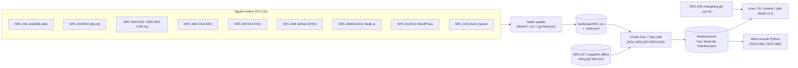

# Đặc tả lớp dữ liệu online (CVE + vòng đời) — php-quickpatch v2

## Lịch sử sửa đổi (Revision History)
| Phiên bản | Ngày | Người thực hiện | Tóm tắt thay đổi |
| :--- | :--- | :--- | :--- |
| 1.0.0 | 2026-10-22 | BA Agent | Khởi tạo đặc tả lớp dữ liệu online thay cho mảng ghi cứng `PHP_FIXED`, `PHP_CVES`, `NODE_FIXED`, `WP_FIXED` của v0.1.0. Toàn bộ endpoint được gọi thử ngày 2026-10-22 (UTC); số liệu đo ghi ở §3.2 |
| 1.0.1 | 2026-10-22 | BA Agent | Sửa `BR-FEED-001`: so sánh nghiêm ngặt `age > TTL` khiến lượt theo lịch 6 giờ bỏ qua nguồn TTL 6 giờ (làm mới thực tế 12 giờ/lần). Thêm ngưỡng làm mới `age ≥ TTL − (N + 45 phút)` cho `feeds update`; thêm §5.1 (căn cứ chọn biên 45 phút, cận tuổi tối đa, công thức kiểm chứng `NFR-FEED-006`); cập nhật định nghĩa TTL, `FR-FEED-SYNC-001` (thêm trạng thái từng nguồn trong `last-sync.log`), `NFR-FEED-006` (đo tuổi bằng phút từ `last_ok_at`, chỉ áp dụng khi `N ≤ 6 giờ`), `Q-FEED-01` (phương án thay thế đã cân nhắc), tham chiếu systemd.timer(5) |
| 1.0.2 | 2026-10-22 | BA Agent | Sửa theo review, đồng bộ error-matrix.md (DOC-SRS-QP-ERR-001 §4.2, §5 mục 5), business-rules.md (§6 mục 1) và functional-requirements.md (§14, `CR-FR-06`): (1) `ERR-FEED-503-01` chỉ còn 1 mức Medium cho nguồn vai trò **Chính**; thêm `ERR-FEED-503-03` (Low) cho nguồn **Phụ**, **Dự phòng**, **Tùy chọn** (`SRC-003`, `SRC-005`, `SRC-008`, `SRC-013`, `SRC-015`) ở §3.1 (chú giải cột "Vai trò"), §3.4 (`SRC-003` "Khi nguồn lỗi"), §4 (`FR-FEED-EOL-001`, `FR-FEED-PCVE-002`, `FR-FEED-PCVE-003`, `FR-FEED-WCVE-002`, `FR-FEED-DIST-002`, `FR-FEED-SYNC-001`), §5.1 bước 3 (loại mẫu khi `SRC-008` lỗi) và §7; (2) đổi tên `FR-FEED-WCVE-002` sang dạng động từ + tân ngữ "Đồng bộ lỗ hổng WordPress từ nguồn cần API key" (rule 01 §2) — các bảng chỉ mục functional-requirements.md §14, rtm.md, backlog.md cần đồng bộ tên theo `CR-FR-06`; (3) thêm cột "Phạm vi áp dụng" (`Module / Kênh / Actor`, rule 02 §2) cho 16 BR `BR-FEED-001..016` ở §5; (4) §9 thêm 3 tài liệu căn cứ |

## 1. Giới thiệu (Introduction)

### 1.1 Mục đích tài liệu (Purpose)
Tài liệu đặc tả lớp dữ liệu online (module `FEED`) của php-quickpatch v2: các nguồn CVE, KEV, vòng đời phiên bản và bản phát hành mà tool lấy về, cách lưu cache, cách hợp nhất khi các nguồn mâu thuẫn, cách tính phiên bản vá tối thiểu, cách phát hiện bản vá backport của distro, và thuật toán điểm rủi ro 0–100 cho một phiên bản runtime. Người đọc: Dev (cài đặt module `FEED` và lệnh `feeds`), QA (thiết kế test case), PO (duyệt ngưỡng TTL, trọng số điểm rủi ro).

### 1.2 Phạm vi (Scope)
- **Trong phạm vi**: 17 nguồn dữ liệu `SRC-001`..`SRC-017` (§3); TTL, timeout, retry, fallback, kiểm tra toàn vẹn của từng nguồn; mô hình dữ liệu chuẩn hóa; quy tắc hợp nhất; thuật toán phiên bản vá tối thiểu; phát hiện backport; điểm rủi ro; thư mục cache `/var/lib/php-quickpatch/feeds/`; snapshot offline; nhóm lệnh `php-quickpatch.sh feeds ...`.
- **Ngoài phạm vi**: metadata package Packagist/npm registry dùng cho quét tương thích (`FEAT-054`, thuộc module `CMPT`); giao diện console (chỉ đặc tả dữ liệu mà màn hình `FEAT-081`, `FEAT-082` tiêu thụ); đồng bộ feed trung tâm Phase 2 (`FEAT-123`, chỉ ghi ràng buộc định dạng snapshot để Phase 2 dùng lại).

### 1.3 Bộ tài liệu của module FEED
Đặc tả được tách thành 3 file để mỗi file ≤ 800 dòng:

| Tài liệu | Mã | Nội dung |
| :--- | :--- | :--- |
| `data-sources.md` (tài liệu này) | DOC-SRS-QP-FEED-001 | Danh mục nguồn `SRC-001`..`SRC-017`, kết quả gọi thử, đặc tả từng nguồn, FR/BR/NFR/ERR chung của module `FEED`, ma trận truy vết |
| [data-sources-merge-risk.md](data-sources-merge-risk.md) | DOC-SRS-QP-FEED-002 | Mô hình dữ liệu chuẩn hóa, ánh xạ trường nguồn → mô hình, quy tắc hợp nhất, so khớp dải phiên bản, phiên bản vá tối thiểu theo nhánh, phát hiện backport, thuật toán điểm rủi ro 0–100 kèm ví dụ tính |
| [data-sources-cache-cli.md](data-sources-cache-cli.md) | DOC-SRS-QP-FEED-003 | Cấu trúc thư mục cache, định dạng file chuẩn hóa và snapshot, kiểm tra SHA256, lịch đồng bộ, lệnh `feeds update\|status\|verify\|export\|import\|schedule` |

Dải mã dùng trong module: `BR-FEED-001..019` (thu thập, TTL, độ tươi, fallback, toàn vẹn — tài liệu này), `BR-FEED-020..049` (hợp nhất, vá tối thiểu, backport, điểm rủi ro — DOC-SRS-QP-FEED-002), `BR-FEED-050..069` (cache, snapshot, CLI — DOC-SRS-QP-FEED-003). Mã lỗi `ERR-FEED-*` tập trung ở §7 của tài liệu này.

### 1.4 Định nghĩa và thuật ngữ (Definitions & Acronyms)
| Thuật ngữ | Định nghĩa |
| :--- | :--- |
| Nguồn (`SRC-NNN`) | Một endpoint hoặc một nhóm endpoint cùng nhà cung cấp, cùng định dạng, cùng chính sách TTL |
| Raw cache | Bản phản hồi nguyên gốc của nguồn lưu trong `feeds/raw/<SRC>/`, kèm file meta (ETag, Last-Modified, SHA256, thời điểm lấy) |
| Bundle chuẩn hóa | Tập file `feeds/current/` (TSV cho Bash, JSON + SQLite cho console) sinh từ raw cache sau khi hợp nhất; mọi lệnh `scan`/`fix`/`assess` chỉ đọc bundle này |
| Snapshot offline | Gói `tar.gz` chứa bundle chuẩn hóa + manifest SHA256, đóng gói kèm mỗi bản phát hành tool (`FEAT-017`) |
| TTL | Thời gian sống của dữ liệu một nguồn trong cache; quá TTL thì `scan`/`fix`/`assess` gọi `feeds update` trước khi đánh giá. `feeds update` lấy lại nguồn sớm hơn TTL theo ngưỡng làm mới của `BR-FEED-001` để lượt theo lịch kế tiếp không bỏ qua nguồn (§5.1) |
| Tuổi dữ liệu (`data_age_h`) | Số giờ từ `fetched_at` của lần lấy thành công cuối cùng đến thời điểm đánh giá, làm tròn xuống |
| `source_updated_at` | Thời điểm dữ liệu được nguồn cập nhật (vd `dateReleased` của KEV, `lastModified` của NVD, `generated_at` của endoflife.date) |
| CNA | CVE Numbering Authority — tổ chức cấp mã CVE (vd `security@php.net` cho PHP) |
| Dải ảnh hưởng (affected range) | Điều kiện phiên bản bị ảnh hưởng của 1 CVE trên 1 sản phẩm (vd `>= 8.4.0, < 8.4.27`) |
| Phiên bản vá tối thiểu (`min_patched`) | Phiên bản nhỏ nhất của 1 nhánh không còn bị ảnh hưởng bởi tập CVE xét (định nghĩa đầy đủ: DOC-SRS-QP-FEED-002 §6) |
| Backport | Bản vá CVE do distro (Debian, Ubuntu, RHEL, AlmaLinux, Rocky, Alpine) đưa vào gói có số phiên bản upstream thấp hơn `min_patched` |
| KEV | Danh mục CISA Known Exploited Vulnerabilities |
| GHSA | GitHub Security Advisory (mã `GHSA-xxxx-xxxx-xxxx`) |
| MAL | Bản ghi mã độc trong OSV (mã `MAL-YYYY-N`) |

### 1.5 Tài liệu tham chiếu (References)
Xem §9.

## 2. Mô tả tổng quan (Overall Description)

### 2.1 Bối cảnh: dữ liệu ghi cứng của v0.1.0 cần thay thế
| Biến v0.1.0 (`php-quickpatch.sh` dòng 13–18) | Giá trị ghi cứng | Nguồn thay thế trong v2 | Bảng chuẩn hóa thay thế |
| :--- | :--- | :--- | :--- |
| `PHP_FIXED` | `8.2.35 8.3.36 8.4.27 8.5.12` | `SRC-004` NVD + `SRC-002` php.net + `SRC-003` ChangeLog + `SRC-008` GHSA php-src | `min_patched.tsv` (`product=php`) |
| `PHP_CVES` | `CVE-2026-109618 CVE-2026-109619` | `SRC-004`, `SRC-005`, `SRC-008` | `advisories.tsv`, `affected.tsv` |
| `NODE_FIXED` | `22.23.4 24.22.1 26.12.1` | `SRC-009` nodejs.org release index + `SRC-011` Node.js Security WG + `SRC-004` | `min_patched.tsv` (`product=node`) |
| `WP_FIXED` | `6.9.5 7.0.2` | `SRC-012` WordPress.org `stable-check` + `SRC-004` + `SRC-006` | `min_patched.tsv` (`product=wordpress`) |
| `PHP_RELEASES_URL`, `NODE_BASE_URL`, `OSV_BATCH_URL` | URL cố định trong script | Giữ URL, chuyển vào bảng cấu hình nguồn (`feeds/sources.conf`) | — |

Hàm v0.1 tiêu thụ các mảng trên (`php_state`, `node_state`, `check_wordpress`, `php_mitigation_ini`, `pkg_has_cves`) giữ nguyên giao diện gọi; v2 thay phần thân bằng phép tra bundle chuẩn hóa (DOC-SRS-QP-FEED-003 §3). Hành vi kế thừa bắt buộc: tra OSV lô 500 package (`osv_check`), nhận diện backport qua changelog gói (`pkg_has_cves`, kế thừa thành nguồn `SRC-016`), chế độ `--offline` không gọi mạng.

### 2.2 Kiến trúc lớp dữ liệu (DIAG-FLOW-QP-FEED-001)

Nguyên tắc:
1. **Tách lấy dữ liệu và dùng dữ liệu**: `scan`/`fix` không gọi trực tiếp nguồn CVE/vòng đời; chỉ đọc bundle `feeds/current/`. Khi bundle quá TTL, `scan` gọi `feeds update` trước (trừ `--offline`), giới hạn thời gian theo `NFR-FEED-002`.
2. **Hai tầng xử lý**: tầng lấy dữ liệu dùng `curl` (đã có trong v0.1); tầng chuẩn hóa dùng `qp-feeds.py` (Python 3 thư viện chuẩn: `json`, `urllib`, `sqlite3`, `hashlib`, `html.parser`) — cùng ràng buộc công nghệ với web console (`DOC-BRS-QP-001` mục 3.2). Máy không có Python 3: chỉ dùng bundle từ snapshot hoặc từ máy khác (`feeds import`), xem `BR-FEED-012`.
3. **Bundle hai định dạng**: TSV (Bash đọc bằng `awk`/`grep`, không cần `jq`/`sqlite3`) và SQLite `feeds.db` (console đọc). Hai định dạng sinh cùng một lần, cùng `bundle_id`.
4. **Thay bundle nguyên tử**: bundle mới ghi vào `feeds/staging/`, kiểm tra xong mới `rename` thành `feeds/current/`; lượt `scan` đang chạy đọc bundle cũ đến hết lượt.

### 2.3 Tác nhân (User Classes)
| Mã | Tác nhân | Tương tác với module FEED |
| :--- | :--- | :--- |
| `PER-01`, `PER-02`, `PER-03` | Người vận hành VPS, quản trị hosting panel, DevOps Docker | Chạy `feeds update`, `feeds status`, `feeds import`; đọc tuổi dữ liệu trên kết quả `scan` |
| `PER-04` | Kỹ sư bảo mật / kiểm toán viên | Đọc `feeds status --json`, nguồn và thời điểm lấy của từng CVE trong báo cáo |
| `SYS-01` | Bộ lập lịch (cron / systemd timer) | Gọi `feeds update --quiet` theo chu kỳ 6 giờ (`FEAT-018`) |
| `SYS-02` | Nguồn dữ liệu online | 15 nguồn online `SRC-001`..`SRC-015` |
| `SYS-05` | Pipeline phát hành tool (bổ sung trong tài liệu này) | Sinh snapshot `SRC-017` và ghi SHA256 vào script trước mỗi lần phát hành |

### 2.4 Môi trường vận hành (Operating Environment)
- Linux (Debian/Ubuntu, RHEL-family, Alpine) như v0.1 (`PRD C-06`); `curl` ≥ 7.34 (cần `--tlsv1.2`, `--proto`, `--compressed`, `-z`/`If-Modified-Since`, `--max-time`, `--connect-timeout`); `--http2` chỉ dùng khi `curl -V` liệt kê `HTTP2`.
- Python 3 ≥ 3.6 cho `qp-feeds.py` (đề xuất; chờ chốt cùng Q-05 của PRD).
- Mạng: HTTPS cổng 443 tới các host ở §3.1; hỗ trợ biến môi trường `HTTPS_PROXY` của `curl`/`urllib`.
- Dung lượng: cache + bundle ≤ 60 MB ở cấu hình mặc định (chi tiết DOC-SRS-QP-FEED-003 §2.3).

### 2.5 Ràng buộc thiết kế (Constraints)
| Mã | Ràng buộc | Căn cứ |
| :--- | :--- | :--- |
| `C-FEED-01` | Cấu hình mặc định không dùng nguồn bắt buộc API key: `SRC-013` chỉ bật khi người vận hành khai báo key; `SRC-004`, `SRC-008` chạy không key, key tùy chọn chỉ nâng hạn mức request | Đề xuất của BA để cài đặt không cần đăng ký tài khoản dịch vụ ngoài; PO duyệt cùng `Q-FEED-05` |
| `C-FEED-02` | Tuân thủ giới hạn tốc độ công bố của từng nguồn ngay cả khi thử nghiệm không quan sát thấy chặn | `PRD C-08` |
| `C-FEED-03` | Mọi kết nối dùng HTTPS, xác thực chứng chỉ (không dùng `curl -k`, không tắt `ssl` verify trong Python) | `NFR-FEED-004` |
| `C-FEED-04` | Không gửi danh sách package/phiên bản của server tới nguồn nào ngoài OSV (`SRC-007`, `SRC-014`) và `api.wordpress.org` (`SRC-012` `version-check`, gửi đúng 2 tham số `version`, `php` — cùng dữ liệu WordPress core tự gửi về wordpress.org) — giữ phạm vi chia sẻ như v0.1 | Hành vi `osv_check` v0.1 |
| `C-FEED-05` | Không dùng WPScan ở cấu hình mặc định: gói miễn phí giới hạn 25 request/ngày và chỉ cho mục đích phi thương mại | wpscan.com/pricing (đọc 2026-10-22) |

### 2.6 Giả định và phụ thuộc (Assumptions & Dependencies)
| Mã | Giả định | Nếu sai |
| :--- | :--- | :--- |
| `A-FEED-01` | Định dạng JSON của các nguồn giữ như ngày 2026-10-22 (§3.2) | Bộ kiểm tra schema phát `ERR-FEED-502-02`, dùng dữ liệu cũ hơn (`BR-FEED-007`) |
| `A-FEED-02` | Độ trễ công bố của nguồn thứ cấp so với nguồn gốc ≤ 7 ngày (đo ngày 2026-10-22: NVD chưa có CVE Node.js 2026-10-21 sau 1 ngày; Node.js Security WG chưa có đợt 2026-10-21) | Quy tắc tín hiệu bản bảo mật `BR-FEED-024` (DOC-SRS-QP-FEED-002) bù khoảng trễ |
| `A-FEED-03` | Pipeline phát hành có mạng tới mọi nguồn ở §3.1 khi build snapshot | Không phát hành bản tool khi snapshot > 7 ngày (`KR5.2`) |

## 3. Danh mục nguồn dữ liệu (Data Sources)

### 3.1 Bảng tổng hợp
Cột "Vai trò": **Chính** = nguồn quyết định giá trị thuộc tính; **Phụ** = làm giàu hoặc đối chiếu; **Dự phòng** = chỉ dùng khi nguồn chính lỗi/trễ; **Tùy chọn** = tắt mặc định, bật khi có key. Vai trò quyết định mã lỗi khi nguồn online không truy cập được sau 3 lần thử (§7): nguồn **Chính** → `ERR-FEED-503-01` (Medium); nguồn **Phụ**, **Dự phòng**, **Tùy chọn** (`SRC-003`, `SRC-005`, `SRC-008`, `SRC-013`, `SRC-015`) → `ERR-FEED-503-03` (Low); OSV thư viện (`SRC-007`) lỗi mà không có kết quả cache ≤ 7 ngày cho lockfile → `ERR-FEED-503-02`.

| Mã | Nguồn | Dữ liệu | Runtime / sản phẩm | Xác thực | Bật mặc định | TTL | Vai trò |
| :--- | :--- | :--- | :--- | :--- | :---: | :--- | :--- |
| `SRC-001` | endoflife.date API v1 | Vòng đời nhánh: phát hành, hết hỗ trợ chủ động, EOL, LTS | php, nodejs, wordpress, laravel, symfony, drupal, magento, composer | Không | Có | 24 giờ | Chính (ngày vòng đời có cấu trúc); phụ cho `latest` |
| `SRC-002` | php.net releases JSON | Bản phát hành mới nhất/lịch sử mỗi nhánh, nhãn `security`, `supported_versions`, SHA256 tarball | PHP | Không | Có | 6 giờ | Chính (bản mới nhất, tín hiệu bản bảo mật) |
| `SRC-003` | php.net ChangeLog + trang EOL (HTML) | Ánh xạ GHSA/CVE ↔ phiên bản sửa; ngày EOL lịch sử (4.4–7.x) | PHP | Không | Có | 24 giờ | Phụ (đối chiếu `min_patched`); chính cho ngày EOL nhánh không có trong `SRC-001` |
| `SRC-004` | NVD CVE API 2.0 | CVE, CVSS v2/v3.x/v4.0, CWE, cấu hình CPE (dải phiên bản), dữ liệu CNA `affected` | PHP (`cpe:2.3:a:php:php`), Node.js (`cpe:2.3:a:nodejs:node.js`), WordPress (`cpe:2.3:a:wordpress:wordpress`) | API key tùy chọn | Có | 6 giờ (tăng dần) | Chính (CVSS, dải CPE) |
| `SRC-005` | CVE.org CVE Services API | Bản ghi CVE JSON 5.x của CNA (`affected`, `metrics`, `workarounds`) | Mọi CVE | Không | Có | 24 giờ/bản ghi, tra theo nhu cầu | Dự phòng cho `SRC-004` (NVD trễ hoặc lỗi) |
| `SRC-006` | CISA KEV JSON | CVE đang bị khai thác, `dateAdded`, `dueDate`, `knownRansomwareCampaignUse` | Mọi CVE | Không | Có | 6 giờ | Chính (cờ KEV) |
| `SRC-007` | OSV API (thư viện) | Advisory Packagist, npm (gồm `MAL-*`), alias CVE/GHSA | Composer, npm | Không | Có | 6 giờ/cặp package-version | Chính (thư viện) — kế thừa v0.1 |
| `SRC-008` | GitHub Security Advisories | Advisory kho `php/php-src` (GHSA ↔ CVE, CVSS, phiên bản vá) | PHP | Token tùy chọn (REST không xác thực 60 request/giờ) | Có | 6 giờ | Phụ (alias GHSA ↔ CVE cho PHP) |
| `SRC-009` | nodejs.org release index | Mọi bản phát hành Node.js, cờ `security`, `lts`, `modules` | Node.js | Không | Có | 6 giờ | Chính (bản mới nhất, tín hiệu bản bảo mật) |
| `SRC-010` | nodejs/Release `schedule.json` | Lịch `start`, `lts`, `maintenance`, `end` mỗi nhánh | Node.js | Không | Có | 24 giờ | Chính (vòng đời Node.js, theo `BR-SCN-002`) |
| `SRC-011` | Node.js Security WG `vuln/core/index.json` | CVE Node.js core, dải `vulnerable`/`patched` (semver), mức độ | Node.js | Không | Có | 6 giờ | Chính (dải ảnh hưởng Node.js core) |
| `SRC-012` | WordPress.org core API | Trạng thái `latest`/`outdated`/`insecure` mỗi bản core; bản đề xuất theo phiên bản PHP | WordPress core | Không | Có | 6 giờ | Chính (`min_patched` WordPress) |
| `SRC-013` | CSDL lỗ hổng WordPress (Wordfence Intelligence v3, WPScan, Patchstack) | Lỗ hổng core/plugin/theme kèm phiên bản vá | WordPress | Bắt buộc key/token | Không | 24 giờ | Tùy chọn |
| `SRC-014` | OSV API (hệ sinh thái distro) | Advisory theo gói nguồn distro: `Debian:N`, `Ubuntu:XX.YY:LTS`, `Red Hat`, `AlmaLinux:N`, `Rocky Linux:N`, `Alpine:vX.Y` | Gói PHP/Node.js của distro | Không | Có | 6 giờ/cặp gói-phiên bản | Chính (backport distro) |
| `SRC-015` | Tracker distro trực tiếp (Ubuntu CVE API, Red Hat Security Data API, Debian Security Tracker) | Trạng thái CVE theo bản phát hành distro | Gói distro | Không | Có (tra theo nhu cầu) | 24 giờ/bản ghi | Dự phòng cho `SRC-014` |
| `SRC-016` | Changelog gói cục bộ (`changelog.Debian.gz`, `rpm -q --changelog`) | CVE đã được nhắc trong changelog gói đã cài | Gói distro | Không (đọc file cục bộ) | Có | Đọc mỗi lượt `scan` | Dự phòng cuối cho backport — kế thừa `pkg_has_cves` v0.1 |
| `SRC-017` | Snapshot offline đóng gói kèm tool | Bundle chuẩn hóa của `SRC-001..015` tại thời điểm phát hành | Tất cả | SHA256 ghi trong script | Có | Theo tuổi snapshot (`BR-FEED-005`) | Dự phòng chung khi không có mạng hoặc mọi nguồn lỗi |

### 3.2 Kết quả gọi thử ngày 2026-10-22
Phương pháp: `curl -sS --compressed --max-time 120` (riêng NVD trang lớn: `--max-time 300–400`) qua proxy HTTPS của phiên làm việc, từ 09:22 đến 09:55 UTC. "Truyền" = byte nhận qua mạng (đã nén nếu máy chủ nén); "Giải nén" = byte JSON/HTML sau giải nén. Riêng `SRC-009` đo bằng WebFetch vì hook `scout-block` của môi trường làm việc chặn lệnh Bash chứa chuỗi `dist` (không ảnh hưởng tool trên server, xem DOC-BRS-QP-001 §4 mục 7).

| Mã | Yêu cầu thử | HTTP | Truyền | Giải nén | Thời gian | Kết quả chính |
| :--- | :--- | :---: | ---: | ---: | ---: | :--- |
| `SRC-001` | `GET https://endoflife.date/api/v1/products/php/` | 200 | 1.018 B (br) | 6.402 B | 0,36 s | `schema_version` 1.2.1, 18 nhánh 5.0–8.5; `8.5.latest` = 8.5.11 (chậm hơn php.net 1 bản) |
| `SRC-001` | `GET .../api/v1/products/nodejs/` | 200 | 1.485 B | 10.870 B | 0,38 s | 26 nhánh; nhánh 26: `ltsFrom` 2026-10-28, `eoasFrom` 2027-10-27, `eolFrom` 2029-04-30 |
| `SRC-001` | `GET .../api/php.json` (API cũ) + gửi lại `If-None-Match` | 200 → 304 | 479 B | 2.664 B | 0,16 s | ETag phụ thuộc mã hóa nén: `"…-ssl-df"` (br) và `"…-ssl"` (không nén); gửi sai biến thể → 200 |
| `SRC-001` | `GET .../api/v1/products/full` | 200 | 276.967 B | 2.991.160 B | 0,74 s | 485 sản phẩm trong 1 request (dùng khi build snapshot) |
| `SRC-001` | `GET .../api/v1/products/<không tồn tại>/` | 404 | — | — | — | Thân lỗi là HTML, không phải JSON (đúng mô tả OpenAPI v1.2.1) |
| `SRC-001` | laravel / symfony / wordpress / drupal / magento / composer (API cũ) | 200 | 305–1.093 B | 1.489–10.026 B | 0,17–0,29 s | Trường PHP hỗ trợ: `supportedPhpVersions` (laravel, magento), `supportedPHPVersions` (wordpress); symfony, drupal, composer không có |
| `SRC-002` | `GET https://www.php.net/releases/index.php?json&version=8.4` | 200 | 338 B | 618 B | 0,23 s | 8.4.27, `tags:["security"]`, `date:"21 Oct 2026"`, `supported_versions` 8.2–8.5; không có ETag/Last-Modified; `cache-control: max-age=2592000` |
| `SRC-002` | `...?json&version=8.4&max=100` | 200 | 3.809 B | 15.554 B | 0,24 s | Đối tượng khóa theo phiên bản, 26 bản (8.4.27 → 8.4.1); `tags` có 3 dạng: `["security"]` (9), `[]` (11), `[""]` (6) |
| `SRC-002` | `...?json&version=5` / `4` / `7` | 200 | — | — | — | 5.6.40 (không có `tags`), 4.4.9 (`date` dạng "07 August 2008"), 7.4.33 (`tags:["security"]`); `supported_versions` rỗng |
| `SRC-002` | `GET https://www.php.net/releases/active.php` | 200 | 753 B | 2.319 B | 0,24 s | Bản mới nhất mọi nhánh còn hỗ trợ; `max-age=900` |
| `SRC-002` | `GET https://www.php.net/releases/states.php` | 500 | 0 B | — | 0,33 s | Không dùng được |
| `SRC-003` | `GET https://www.php.net/ChangeLog-8.php` | 200 | 132.069 B (br) | 752.126 B | 0,20 s | Mục 8.4.27 (ngày "22 Oct 2026") ghi `GHSA-w8hw-w9fx-j79w`, `GHSA-6wmf-4rv5-p3rp`, không ghi mã CVE; có `Last-Modified` |
| `SRC-003` | `GET https://raw.githubusercontent.com/php/php-src/PHP-8.4/NEWS` | 200 | 42.732 B | — | — | Mục `22 Oct 2026, PHP 8.4.27`, dòng 140–141: "Fixed GHSA-w8hw-w9fx-j79w, GHSA-6wmf-4rv5-p3rp (…). (CVE-2026-109618, CVE-2026-109619)" → ánh xạ GHSA ↔ CVE ↔ phiên bản không cần GitHub API |
| `SRC-001` | Bản sao GitHub: `raw.githubusercontent.com/endoflife-date/endoflife.date/master/products/php.md`, `.../release-data/main/releases/php.json` | 200 | 1.295 B / 4.870 B | — | — | YAML frontmatter có `releaseCycle`, `eoas`, `eol`, `latest`; dùng làm dự phòng khi endoflife.date lỗi |
| `SRC-004` | `GET https://services.nvd.nist.gov/rest/json/cves/2.0?cveId=CVE-2026-109618` | 200 | 1.856 B (gzip) | 4.914 B | 0,28 s | CVSS v3.1 9.8 (Primary, nvd@nist.gov), v4.0 9.2 (Secondary, CNA); 4 dải CPE; khối `affected` của CNA chỉ liệt kê 8.2–8.5 |
| `SRC-004` | `...?virtualMatchString=cpe:2.3:a:php:php&resultsPerPage=500&startIndex=0` | 200 | 404.886 B | 4.590.224 B | 42,6 s | `totalResults` = 749; trang 2 (249 bản ghi): 155.828 B → 1.665.885 B, 41,5 s; 1 lần thử trang 2 khác hết 120 s khi mới nhận 115.058 B |
| `SRC-004` | `...?cpeName=cpe:2.3:a:php:php:8.3.6:*:*:*:*:*:*:*` / `8.3.99` | 200 | — | — | 1,5–1,8 s | 40 CVE / 2 CVE: phiên bản không có trong từ điển CPE chỉ khớp bản ghi ký tự đại diện → **không dùng `cpeName`** |
| `SRC-004` | `virtualMatchString` Node.js / WordPress | 200 | — | — | 0,3–0,4 s | 188 CVE (`nodejs:node.js`), 584 CVE (`wordpress:wordpress`) |
| `SRC-004` | Tải đủ 584 CVE WordPress (`resultsPerPage=300`, 2 trang) | 200 | 174.010 B + 158.516 B | 1.552.929 B + 1.580.491 B | 16,0 s + 14,2 s | Lần đầu tải trang 2 lỗi luồng HTTP/2 (`curl` mã 92) sau 52 s, JSON bị cắt; tải lại bằng `--http1.1` thành công |
| `SRC-004` | `lastModStartDate` → `lastModEndDate` dài 294 ngày | 404 | 0 B | — | 0,22 s | Header `message: Date range cannot exceed 120 days.` |
| `SRC-004` | `resultsPerPage=2001` | 404 | 0 B | — | — | Header `message: resultsPerPage parameter cannot exceed 2000.` |
| `SRC-004` | 8 request liên tiếp trong 2,5 s, không API key | 200 × 8 | — | — | 0,2–0,5 s/request | Không quan sát thấy chặn, không có header rate limit; CORS cho phép header `apiKey` |
| `SRC-004` | `?cveId=CVE-2026-111497` (CVE Node.js công bố 2026-10-21) | 200 | 145 B | — | 2,1 s | `totalResults` = 0: NVD chưa có bản ghi sau 1 ngày |
| `SRC-004` | `?sourceIdentifier=security@php.net&lastModStartDate=2026-09-01…&lastModEndDate=2026-10-22…` | 200 | 7.829 B | — | 1,5 s | 16 CVE của CNA php.net, trong đó **12 CVE ở trạng thái `Awaiting Analysis`, không có `configurations`** (vd CVE-2026-17545, CVE-2026-91765..91769, công bố 2026-09-25) và **không xuất hiện** trong truy vấn `virtualMatchString` (749 CVE). Cả 16 có khối `affected` của CNA |
| `SRC-004` | Tải đủ 749 CVE PHP rồi so khớp cục bộ | — | 560.714 B | 6.256.109 B | 84,1 s (2 trang) | 2 CVE chỉ có CPE `cpe:2.3:a:php:php:-` (giá trị NA) và 1 CVE có CPE `*` không giới hạn phiên bản; 415/749 CVE chỉ có CVSS v2; CVE-2024-4577 (KEV) chỉ áp dụng khi chạy trên Windows (nút `AND` với `cpe:2.3:o:microsoft:windows`) |
| `SRC-005` | `GET https://cveawg.mitre.org/api/cve/CVE-2026-109618` | 200 | 5.080 B | 5.080 B | 0,16 s | `CVE_RECORD` 5.2, có `containers.cna.affected`, `metrics` (CVSS 4.0), `workarounds`; header `ratelimit-policy: 25000;w=60` |
| `SRC-005` | `GET .../api/cve/CVE-2026-111497` | 404 | 84 B | — | 0,38 s | `{"error":"CVE_RECORD_DNE"}`: bản ghi CVE chưa được công bố dù blog Node.js đã nêu mã |
| `SRC-006` | `GET https://www.cisa.gov/sites/default/files/feeds/known_exploited_vulnerabilities.json` | 200 | 198.118 B (gzip) | 1.803.428 B | 0,39 s | `catalogVersion` 2026.10.21, `count` 1.754; trường mới `forensicTriage`; `If-Modified-Since` → 304; `If-None-Match` → 200 (ETag không dùng được) |
| `SRC-006` | Bản sao `https://raw.githubusercontent.com/cisagov/kev-data/main/known_exploited_vulnerabilities.json` | 200 | 198.118 B | 1.803.428 B | 0,24 s | Cùng `catalogVersion`; ETag yếu → 304 khi gửi lại |
| `SRC-007` | `POST https://api.osv.dev/v1/querybatch` (7 truy vấn Packagist/npm) | 200 | 2.855 B | 2.855 B | 0,33 s | Mỗi kết quả chỉ có `id`, `modified`; `flatmap-stream@0.1.1` → `MAL-2025-20690`; `php@8.3.6` (Packagist) → 0 |
| `SRC-007` | `GET https://api.osv.dev/v1/vulns/GHSA-mh6f-8j2x-4483` / `CVE-2026-109618` | 200 / 404 | 1.773 B | — | 0,16 s | Bản ghi đầy đủ: `affected[].ranges[].events`, `severity[]` (vector CVSS), `database_specific.severity`; OSV không có CVE PHP core |
| `SRC-007` | `HEAD https://osv-vulnerabilities.storage.googleapis.com/{Packagist,npm}/all.zip` | 200 | — | 10.988.996 B / 218.843.332 B | — | Bản xuất toàn bộ: Packagist 10,5 MB (dùng được cho snapshot đầy đủ), npm 209 MB (không dùng trên server) |
| `SRC-008` | `GET https://api.github.com/repos/php/php-src/security-advisories` | 403 | 378 B | — | 0,14 s | **Chưa kiểm chứng**: proxy của phiên làm việc chặn GitHub API cho kho chưa gắn vào phiên (không phải phản hồi của GitHub). Trang web GHSA của php-src đã đọc được trong bước PRD |
| `SRC-009` | `https://nodejs.org/dist/index.json` (WebFetch) | 200 | — | ≈ 334.935 ký tự | — | Phần tử đầu `v26.12.1`, `date` 2026-10-21, `security: true`, `modules` "147"; 11 trường mỗi phần tử |
| `SRC-010` | `GET https://raw.githubusercontent.com/nodejs/Release/main/schedule.json` | 200 → 304 | 627 B | 3.247 B | 0,12 s | 27 nhánh; `v24.maintenance` 2026-10-20; `v26.maintenance` 2027-10-20; `v27.alpha` 2026-10-28 |
| `SRC-011` | `GET https://raw.githubusercontent.com/nodejs/security-wg/main/vuln/core/index.json` | 200 → 304 | 28.244 B | 133.772 B | 0,14 s | 194 bản ghi (khóa 1..194); bản mới nhất là đợt 2026-07; **chưa có** đợt 2026-10-21 |
| `SRC-012` | `GET https://api.wordpress.org/core/stable-check/1.0/` | 200 | 1.369 B | 22.508 B | 0,17 s | 959 phiên bản: 934 `insecure`, 24 `outdated`, 1 `latest` (7.1.3); không có ETag/Last-Modified |
| `SRC-012` | `GET https://api.wordpress.org/core/version-check/1.7/?version=6.9.5&php=8.3.6&locale=en_US` | 200 | 360 B | 2.301 B | 0,12 s | 4 `offers`: 7.1.3 (`upgrade`, `autoupdate`), 7.0.7, 6.9.10 (`autoupdate`); có `php_version` tối thiểu |
| `SRC-013` | WPScan `/api/v3/wordpresses/713`; Wordfence `/api/intelligence/v2/...` và `/v3/...`; Patchstack `/database/api/v2/...` | 403; 410; 401; 401 | — | — | — | WPScan cần token; Wordfence v2 đã gỡ (410), v3 báo "API key must be supplied using a Bearer token."; Patchstack cần key |
| `SRC-014` | `POST .../v1/querybatch` với `Ubuntu:24.04:LTS`, `Debian:12`, `Red Hat`, `AlmaLinux:9`, `Rocky Linux:9`, `Alpine:v3.20/v3.22` | 200 | 6.089–13.667 B | — | 0,64–0,94 s | `php8.3 8.3.6-0ubuntu0.24.04.13` → 1 advisory còn lại; `…24.04.1` → 54; `Debian:12 php8.2` → 57/28; `Red Hat php` → 45; `AlmaLinux` → 20; `Rocky` → 13; Alpine `php83` → 0 (chưa xác định là do dữ liệu hay tên gói) |
| `SRC-014` | `GET .../v1/vulns/UBUNTU-CVE-2026-109618`, `DEBIAN-CVE-2026-109618` | 200 | 30.831 B | — | 0,41 s | Ubuntu 24.04 `fixed` = `8.3.6-0ubuntu0.24.04.13`; Debian 12 `fixed` = `8.2.35-1~deb12u1`, Debian 13 `8.4.27-1~deb13u1`, Debian 14 chưa có bản sửa |
| `SRC-015` | `GET https://ubuntu.com/security/cves.json?package=php8.3&limit=5` | 200 | 8.164 B (zstd) | 374.685 B | 0,84 s | `total_results` 59; 5 bản ghi đã 374 KB → chỉ dùng tra từng CVE |
| `SRC-015` | `GET https://ubuntu.com/security/cves/CVE-2026-109618.json` | 504 | 93 B | — | 50,3 s | Hết thời gian phía máy chủ |
| `SRC-015` | `GET https://ubuntu.com/security/cves/CVE-2024-5585.json`, `CVE-2024-2408.json` | 200 | — | — | 40,0 s / 19,3 s | `php8.3` / `noble`: `not-affected` (5585: "windows-specific"); 2 CVE này không có bản ghi `Ubuntu:24.04:LTS`/`php8.3` trên OSV → tracker trực tiếp cần thiết cho bước 3 của DOC-SRS-QP-FEED-002 §7 |
| `SRC-015` | `GET https://access.redhat.com/hydra/rest/securitydata/cve.json?package=php&after=2026-09-01` | 200 | 1.502 B | 9.238 B | 0,80 s | 17 bản ghi nhưng có cả `nginx-main-…`: bộ lọc `package` không chính xác |
| `SRC-015` | `GET .../securitydata/cve/CVE-2026-109618.json` / `CVE-2024-11236.json` | 404 / 200 | — / 908 B | — / 2.675 B | 0,4–0,7 s | CVE 1 ngày tuổi chưa có; bản ghi cũ có `package_state[].fix_state` theo RHEL 7/8/9 |
| `SRC-015` | `HEAD https://security-tracker.debian.org/tracker/data/json` | 200 | — | 84.973.608 B | — | 81 MB, `max-age=3600` → **không tải** trên server được quản lý; dùng `SRC-014` (OSV nhập dữ liệu Debian) |

### 3.3 Chính sách gọi nguồn mặc định
Áp dụng cho mọi nguồn trừ khi đặc tả riêng ở §3.4 ghi khác (chi tiết quy tắc: §5).

| Thuộc tính | Giá trị mặc định |
| :--- | :--- |
| Giao thức | HTTPS, xác thực chứng chỉ theo kho CA hệ thống; `curl --proto =https --tlsv1.2 --compressed`; theo tối đa 3 chuyển hướng 301/302 cùng giao thức HTTPS |
| User-Agent | `php-quickpatch/<QP_VERSION> (+https://github.com/<repo>/php-quickpatch)` — bắt buộc cho GitHub API, áp dụng cho mọi nguồn |
| Timeout | Kết nối 10 s; tổng thời gian mỗi request theo cột "Timeout" của từng nguồn |
| Retry | Tối đa 3 lần thử cho lỗi mạng, timeout, HTTP 408/429/5xx; chờ 5 s, 15 s, 45 s; nếu có header `Retry-After` ≤ 300 s thì chờ đúng giá trị đó; `Retry-After` > 300 s → dừng nguồn, ghi `ERR-FEED-429-01` |
| Không retry | HTTP 400, 401, 403 (trừ NVD, xem `SRC-004`), 404, 410 |
| Conditional GET | Gửi `If-None-Match` (ETag lưu nguyên văn, kèm đúng `Accept-Encoding` của lần lấy trước) hoặc `If-Modified-Since`; HTTP 304 → chỉ cập nhật `fetched_at` |
| Ngân sách thời gian | Mỗi lần `feeds update` ≤ 900 s (đồng bộ đầy đủ) hoặc ≤ 180 s (đồng bộ tăng dần khi bundle hiện có ≤ 7 ngày tuổi); vượt ngân sách → dừng nguồn còn lại, giữ dữ liệu cũ của nguồn đó (`ERR-FEED-504-01`) |
| Toàn vẹn | Lưu SHA256 của mọi phản hồi raw vào `.meta.json`; kiểm tra schema tối thiểu và ngưỡng biến động số bản ghi (`BR-FEED-009`) trước khi chuẩn hóa |

### 3.4 Đặc tả chi tiết từng nguồn

#### SRC-001 — endoflife.date API v1
| Thuộc tính | Đặc tả |
| :--- | :--- |
| Mục đích | Ngày vòng đời có cấu trúc cho runtime và framework/CMS: `releaseDate`, `eoasFrom` (hết hỗ trợ chủ động), `eolFrom`, `isLts`/`ltsFrom`; ma trận PHP ↔ framework (`FEAT-054`) |
| Endpoint | `GET https://endoflife.date/api/v1/products/{product}/` với `product` ∈ {`php`, `nodejs`, `wordpress`, `laravel`, `symfony`, `drupal`, `magento`, `composer`}; build snapshot dùng `GET /api/v1/products/full`. Trường `supportedPhpVersions` chỉ có ở API cũ `/api/{product}.json` → lấy thêm `laravel`, `magento`, `wordpress` từ API cũ |
| Xác thực | Không |
| Rate limit | Không công bố con số; OpenAPI v1.2.1 mô tả HTTP 429 kèm `Retry-After`. Tool gửi tối đa 11 request/lần đồng bộ, cách nhau ≥ 1 s |
| Kích thước | 6–11 KB/sản phẩm (giải nén); `full` 2,99 MB |
| Trường dùng | `result.releases[].name`, `releaseDate`, `isLts`, `ltsFrom`, `isEoas`, `eoasFrom`, `isEol`, `eolFrom`, `isMaintained`, `latest.name`, `latest.date`; `generated_at`, `last_modified`; API cũ: `cycle`, `support`, `eol`, `lts`, `supportedPhpVersions`/`supportedPHPVersions` |
| Ánh xạ | `lifecycle_branch` (DOC-SRS-QP-FEED-002 §2.2): `name`→`branch`, `releaseDate`→`ga_date`, `eoasFrom`→`active_support_end`, `eolFrom`→`eol_date`, `ltsFrom`→`lts_start`; `latest.name`→`lifecycle_branch.latest_hint` (chỉ tham khảo, `BR-DATA-002`) |
| TTL / đồng bộ | 24 giờ (`BR-SCN-002`); conditional GET bằng ETag |
| Timeout | 30 s/request; `full`: 60 s |
| Khi nguồn lỗi | (1) Bản sao GitHub `endoflife-date/endoflife.date/master/products/{product}.md` (YAML `releases[].releaseCycle/eoas/eol`); (2) PHP: `supported_versions` của `SRC-002` + ngày EOL của `SRC-003`; Node.js: `SRC-010`; (3) cache cũ; (4) `SRC-017` |
| Toàn vẹn | `schema_version` bắt đầu bằng `1.`; mỗi `releases[].name` khớp `^\d+(\.\d+)*$`; ngày theo ISO-8601 hoặc `null`; trường kiểu hỗn hợp (`eol: false\|"YYYY-MM-DD"`, `support: true\|"YYYY-MM-DD"` ở API cũ) chuẩn hóa theo `BR-FEED-021`; PHP phải có ≥ 18 nhánh, Node.js ≥ 26 dòng (`KR5.1`) |

#### SRC-002 — php.net releases JSON
| Thuộc tính | Đặc tả |
| :--- | :--- |
| Mục đích | Bản phát hành mới nhất và lịch sử của từng nhánh PHP, nhãn `security` (tín hiệu bản bảo mật), danh sách nhánh được php.net hỗ trợ, SHA256 tarball nguồn |
| Endpoint | (a) `GET https://www.php.net/releases/index.php?json` (bản mới nhất mỗi major); (b) `GET ...?json&version={X.Y}&max=100` cho mỗi nhánh trong `supported_versions` và mỗi nhánh đang chạy trên server; (c) `GET https://www.php.net/releases/active.php` |
| Xác thực | Không |
| Rate limit | Không công bố. Tool gửi ≤ 10 request/lần đồng bộ, cách nhau ≥ 1 s |
| Kích thước | (a) 2,8 KB; (b) ≤ 16 KB/nhánh; (c) 2,3 KB |
| Trường dùng | Khóa phiên bản, `version`, `date` (định dạng `DD Mon YYYY` hoặc `DD Month YYYY`), `tags[]`, `supported_versions[]`, `source[].filename`, `source[].sha256` |
| Ánh xạ | `release` (`product=php`): `version`, `release_date`, `is_security = ("security" ∈ tags)`; `tags = [""]` hoặc `[]` → `is_security = false`; `supported_versions` → `lifecycle_branch.php_net_supported = true` |
| TTL / đồng bộ | 6 giờ (`KR1.1`); không có ETag/Last-Modified → tải lại toàn bộ; bỏ qua `cache-control: max-age=2592000` của máy chủ |
| Timeout | 30 s/request |
| Khi nguồn lỗi | (1) `git ls-remote --tags https://github.com/php/php-src 'php-X.Y.*'` lấy tag `php-X.Y.Z` (đã kiểm chứng: có `php-8.4.27`, `php-8.5.12`; bỏ tag có hậu tố `RC`, `alpha`, `beta`; không có cờ security); (2) `latest` của `SRC-001` (đã ghi nhận chậm 1 bản); (3) cache cũ; (4) `SRC-017` |
| Toàn vẹn | `version` khớp `^\d+\.\d+\.\d+$`; ngày parse được; bản mới nhất của nhánh không được nhỏ hơn bản mới nhất đã lưu (phát hiện phản hồi cũ từ CDN) — vi phạm → giữ dữ liệu cũ, ghi `ERR-FEED-502-02` |

#### SRC-003 — php.net ChangeLog, trang EOL và `NEWS` của php-src
| Thuộc tính | Đặc tả |
| :--- | :--- |
| Mục đích | Ánh xạ mã GHSA/CVE ↔ phiên bản sửa của từng bản PHP (đối chiếu `min_patched`); ngày EOL lịch sử cho nhánh `SRC-001` không có (PHP 4.4, EOL 2008-08-07) |
| Endpoint | `GET https://www.php.net/ChangeLog-{5,7,8}.php` (HTML); `GET https://www.php.net/eol.php` (HTML); `GET https://raw.githubusercontent.com/php/php-src/PHP-{X.Y}/NEWS` cho nhánh còn hỗ trợ |
| Xác thực | Không |
| Rate limit | Không công bố (php.net); raw.githubusercontent.com không yêu cầu token |
| Kích thước | `ChangeLog-8.php` 752 KB giải nén (132 KB truyền); `NEWS` 43 KB/nhánh |
| Trường dùng | Phần tử có `id="X.Y.Z"`; chuỗi khớp `CVE-\d{4}-\d{4,}` và `GHSA(-[23456789cfghjmpqrvwx]{4}){3}` trong khối của phiên bản; dòng NEWS dạng `Fixed GHSA-… (…). (CVE-…, CVE-…)` |
| Ánh xạ | `advisory_alias` (GHSA ↔ CVE); `fix_evidence(product=php, version, advisory_id, source=SRC-003)`; `lifecycle_branch.eol_date` cho nhánh không có ở `SRC-001` |
| TTL / đồng bộ | 24 giờ; `If-Modified-Since` (ChangeLog có `Last-Modified`), ETag cho `NEWS` |
| Timeout | 60 s (ChangeLog), 30 s (NEWS, eol.php) |
| Khi nguồn lỗi | Bỏ qua (nguồn phụ); `min_patched` tính từ `SRC-004`/`SRC-005`; ghi cảnh báo `ERR-FEED-503-03` (Low) |
| Toàn vẹn | Phân tích bằng `html.parser`; số phiên bản trích được của `ChangeLog-8.php` phải ≥ số đã lưu; ngày trong ChangeLog có thể lệch 1 ngày so với `SRC-002` (8.4.27: "22 Oct 2026" và "21 Oct 2026") → ngày phát hành lấy từ `SRC-002` |

#### SRC-004 — NVD CVE API 2.0
| Thuộc tính | Đặc tả |
| :--- | :--- |
| Mục đích | Danh mục CVE của PHP core, Node.js core, WordPress core; điểm CVSS; CWE; dải phiên bản ảnh hưởng (cấu hình CPE do NVD phân tích và khối `affected` do CNA cung cấp) |
| Endpoint | `GET https://services.nvd.nist.gov/rest/json/cves/2.0` với 2 họ truy vấn cho mỗi sản phẩm: (Q1) `virtualMatchString=cpe:2.3:a:{vendor}:{product}`; (Q2) `sourceIdentifier={email CNA}` (PHP: `security@php.net`; Node.js, WordPress: chưa xác định email CNA — Q2 chỉ áp dụng cho PHP ở bản 1.0.0). Đồng bộ tăng dần: thêm `lastModStartDate`/`lastModEndDate` (cửa sổ ≤ 120 ngày, chia nhỏ nếu dài hơn). Phân trang `resultsPerPage=200`, `startIndex`. Không dùng `cpeName` (§3.2) và không dùng `noRejected` (cần biết bản ghi `Rejected` để thu hồi) |
| Xác thực | API key tùy chọn, gửi bằng header `apiKey`; khai báo trong file cấu hình quyền `0600` (DOC-SRS-QP-FEED-003 §2.4) |
| Rate limit | Tài liệu NVD: 5 request / 30 s cửa sổ trượt không key; 50 request / 30 s có key; giới hạn tính theo bên gửi request (nhiều server sau 1 IP NAT dùng chung hạn mức). Tool chờ 6 s giữa 2 request khi không key, 1 s khi có key. Thử nghiệm 8 request/2,5 s không bị chặn (§3.2) nhưng tool vẫn tuân thủ con số tài liệu (`C-FEED-02`) |
| Kích thước | Đo ngày 2026-10-22: PHP 749 CVE = 6,26 MB giải nén (≈ 8,35 KB/CVE); WordPress 584 CVE = 3,13 MB (≈ 5,4 KB/CVE); Node.js 188 CVE ≈ 1,6 MB (ước tính). Đồng bộ đầy đủ ≈ 9 trang × 200 bản ghi (PHP Q1: 4, PHP Q2: ≥ 1 — tổng số chưa đo, WordPress: 3, Node.js: 1); đồng bộ tăng dần 6 giờ/lần dự kiến 1 trang/truy vấn (đo: cửa sổ 30 ngày của Q1 PHP trả 7 bản ghi, cửa sổ 51 ngày của Q2 PHP trả 16 bản ghi) |
| Trường dùng | `cve.id`, `sourceIdentifier`, `published`, `lastModified`, `vulnStatus`, `descriptions[lang=en].value`, `metrics.cvssMetricV40/V31/V30/V2[].{source,type,cvssData.baseScore,baseSeverity,vectorString}`, `weaknesses[].description[].value`, `configurations[].{operator,nodes[].cpeMatch[].{vulnerable,criteria,versionStartIncluding,versionStartExcluding,versionEndIncluding,versionEndExcluding}}`, `affected[].affectedData[].{product,defaultStatus,versions[].{version,lessThan,lessThanOrEqual,status}}`, `references[].{url,tags}` |
| Ánh xạ | `advisory` (id, published, modified, status, mô tả, CWE), `advisory_score` (mỗi phiên bản CVSS một dòng), `affected_range` (`origin=NVD_CPE` hoặc `origin=CNA`), `advisory_alias` (GHSA trích từ URL tham chiếu `…/security/advisories/GHSA-…`) |
| TTL / đồng bộ | 6 giờ, tăng dần từ `last_sync_lastmod − 1 giờ`; bundle không còn dữ liệu NVD hoặc khoảng trống > 120 ngày → chia cửa sổ 120 ngày |
| Timeout | 180 s/trang (đo: 41–43 s cho 250–500 bản ghi, 1 lần > 120 s); HTTP 403/429/503 → chờ 30 s, 60 s, 120 s rồi thử lại (NVD có thể chặn bằng 403); lỗi luồng HTTP/2 (`curl` mã 92) hoặc JSON bị cắt → thử lại trang đó bằng `--http1.1` (đã gặp khi tải trang 2 của WordPress ngày 2026-10-22) |
| Khi nguồn lỗi | (1) `SRC-005` CVE.org cho từng CVE đã biết mã (từ `SRC-002`, `SRC-003`, `SRC-008`, `SRC-011`); (2) cache cũ; (3) `SRC-017`. CVE có trong nguồn khác nhưng NVD trả 0 kết quả → bản ghi `advisory.status = PENDING_NVD` |
| Toàn vẹn | `format = NVD_CVE`, `version` bắt đầu `2.`; `totalResults` tổng các trang = số bản ghi nhận được (lệch > 0 → tải lại trang thiếu); header `message` khi HTTP 404 ghi vào log nguyên văn |

#### SRC-005 — CVE.org CVE Services API
| Thuộc tính | Đặc tả |
| :--- | :--- |
| Mục đích | Bản ghi gốc của CNA khi NVD chưa có (vd CVE Node.js 2026-10-21) hoặc NVD lỗi; lấy `affected`, `metrics`, `workarounds` (gợi ý mitigation cho `FEAT-061`) |
| Endpoint | `GET https://cveawg.mitre.org/api/cve/{CVE-ID}` |
| Xác thực | Không (đọc bản ghi đã công bố) |
| Rate limit | Header phản hồi `ratelimit-policy: 25000;w=60` (25.000 request/60 s). Tool giới hạn 1 request/s, ≤ 200 request/lần đồng bộ |
| Kích thước | ≈ 5 KB/bản ghi |
| Trường dùng | `cveMetadata.{cveId,state,datePublished,dateUpdated}`, `containers.cna.{affected,metrics,problemTypes,workarounds,references}`, `containers.adp[]` |
| Ánh xạ | `advisory` (`origin=CVE_ORG`), `affected_range` (`origin=CNA`), `advisory_score` (`source=CNA`) |
| TTL / đồng bộ | Theo nhu cầu; 24 giờ/bản ghi |
| Timeout | 20 s |
| Khi nguồn lỗi | HTTP 404 `CVE_RECORD_DNE` → `advisory.status = RESERVED`; giữ bản ghi giả từ tín hiệu bản bảo mật (`BR-FEED-024`) |
| Toàn vẹn | `dataType = CVE_RECORD`, `dataVersion` bắt đầu `5.`; `cveMetadata.state = PUBLISHED` (bản ghi `REJECTED` → thu hồi advisory) |

#### SRC-006 — CISA KEV
| Thuộc tính | Đặc tả |
| :--- | :--- |
| Mục đích | Gắn cờ CVE đang bị khai thác thực tế (`BR-SEC-001`); hạn khắc phục `dueDate`; cờ ransomware |
| Endpoint | `GET https://www.cisa.gov/sites/default/files/feeds/known_exploited_vulnerabilities.json`; bản sao `https://raw.githubusercontent.com/cisagov/kev-data/main/known_exploited_vulnerabilities.json` |
| Xác thực | Không |
| Rate limit | Không công bố; tool gọi 1 request/lần đồng bộ |
| Kích thước | 1,80 MB giải nén, 198 KB gzip; 1.754 bản ghi (2026-10-21) |
| Trường dùng | `catalogVersion`, `dateReleased`, `count`, `vulnerabilities[].{cveID,vendorProject,product,dateAdded,dueDate,knownRansomwareCampaignUse,forensicTriage,cwes,notes}` |
| Ánh xạ | `kev_entry` khóa `cve_id`; nối với `advisory` bằng `cve_id` (không nối theo `vendorProject`: PHP core được ghi `PHP` ở CVE-2012-1823, CVE-2019-11043 và `PHP Group` ở CVE-2024-4577, trong khi `vendorProject = PHP` còn dùng cho PHPMailer ở CVE-2016-10033) |
| TTL / đồng bộ | 6 giờ; `If-Modified-Since` (đã kiểm chứng 304); không dùng ETag (máy chủ trả 200 dù ETag khớp) |
| Timeout | 60 s |
| Khi nguồn lỗi | (1) Bản sao GitHub `cisagov/kev-data` (ETag → 304); (2) cache cũ; (3) `SRC-017` |
| Toàn vẹn | `count` = độ dài `vulnerabilities`; `catalogVersion` mới ≥ bản đã lưu; số bản ghi không giảm quá 5 so với lần trước (ngưỡng đề xuất; số mục KEV bị gỡ mỗi lần cập nhật chưa được đo) |

#### SRC-007 — OSV API cho thư viện (Packagist, npm)
| Thuộc tính | Đặc tả |
| :--- | :--- |
| Mục đích | Advisory của package Composer và npm, gồm bản ghi mã độc `MAL-*` — kế thừa `osv_check` v0.1 (`FEAT-015`) |
| Endpoint | `POST https://api.osv.dev/v1/querybatch` (lô ≤ 500 truy vấn như v0.1; xử lý `next_page_token` khi 1 truy vấn > 1.000 hoặc cả lô > 3.000 kết quả); `GET https://api.osv.dev/v1/vulns/{id}` lấy chi tiết advisory chưa có trong cache hoặc có `modified` mới hơn |
| Xác thực | Không |
| Rate limit | Tài liệu OSV: "Currently there are no limits on the API"; giới hạn phản hồi 32 MiB với HTTP/1.1 → dùng `--http2` khi `curl` hỗ trợ; nếu không, giữ lô ≤ 500 truy vấn (đo ≈ 400 B/truy vấn, lô 500 ≈ 0,2 MB, dưới ngưỡng 32 MiB) |
| Kích thước | ≈ 400 B/kết quả truy vấn; 0,7–2 KB/advisory chi tiết |
| Trường dùng | Querybatch: `results[].vulns[].{id,modified}`, `next_page_token`; chi tiết: `id`, `aliases`, `summary`, `severity[].{type,score}`, `database_specific.severity`, `affected[].{package.{name,ecosystem,purl},ranges[].events[].{introduced,fixed,last_affected},versions[]}`, `modified`, `withdrawn` |
| Ánh xạ | `advisory` (`origin=OSV`), `affected_range` (`origin=OSV`), `advisory_alias` (từ `aliases`); id bắt đầu `MAL-` → `advisory.kind = MALWARE` |
| TTL / đồng bộ | 6 giờ cho mỗi cặp (ecosystem, package, version); khóa cache = SHA256 của lockfile; chi tiết advisory cache đến khi `modified` đổi |
| Timeout | 60 s/lô (như v0.1) |
| Khi nguồn lỗi | Cache kết quả cũ (≤ 7 ngày) kèm tuổi dữ liệu; quá 7 ngày hoặc `--offline` không có cache → giữ hành vi v0.1 "skipped (offline)" và ghi `ERR-FEED-503-02`. Bản xuất `Packagist/all.zip` (10,5 MB) chỉ đóng vào snapshot biến thể `full` (DOC-SRS-QP-FEED-003 §4.4) |
| Toàn vẹn | Số phần tử `results` = số truy vấn gửi đi (lệch → coi cả lô lỗi) |

#### SRC-008 — GitHub Security Advisories (php/php-src)
| Thuộc tính | Đặc tả |
| :--- | :--- |
| Mục đích | Advisory do dự án php-src công bố (GHSA), gồm `cve_id`, mức độ, CVSS, phiên bản vá — bổ sung alias GHSA ↔ CVE và mức độ khi NVD chưa phân tích |
| Endpoint | `GET https://api.github.com/repos/php/php-src/security-advisories?state=published&sort=updated&direction=desc&per_page=100`; header `Accept: application/vnd.github+json`, `X-GitHub-Api-Version: 2022-11-28`. Không dùng GraphQL (tài liệu GitHub chỉ mô tả truy cập GraphQL bằng token/App) và không dùng `/advisories` toàn cục cho Composer/npm (OSV `SRC-007` đã nhập GitHub Advisory Database, quan sát ở `database_specific.source`) |
| Xác thực | Không bắt buộc; token tùy chọn (`Authorization: Bearer`) |
| Rate limit | Tài liệu GitHub: 60 request/giờ/IP không xác thực; 5.000 request/giờ với token; vượt hạn mức → HTTP 403 hoặc 429, header `x-ratelimit-remaining`, `x-ratelimit-reset`, `retry-after` |
| Kích thước | Chưa kiểm chứng (ước lượng ≤ 100 advisory/trang) |
| Trường dùng | `ghsa_id`, `cve_id`, `summary`, `severity`, `cvss_severities.{cvss_v3,cvss_v4}.{vector_string,score}`, `vulnerabilities[].{package,vulnerable_version_range,patched_versions}`, `published_at`, `updated_at`, `withdrawn_at` (theo tài liệu REST) |
| Ánh xạ | `advisory_alias`, `advisory_score` (`source=GHSA`), `affected_range` (`origin=GHSA`) |
| TTL / đồng bộ | 6 giờ; 1 request/lần đồng bộ; dừng phân trang khi gặp `updated_at` ≤ lần đồng bộ trước |
| Timeout | 30 s |
| Khi nguồn lỗi | Alias GHSA ↔ CVE lấy từ `SRC-003` (`NEWS`) và URL tham chiếu trong `SRC-004`; mức độ lấy từ `SRC-004`/`SRC-005` |
| Toàn vẹn | Kiểm tra `x-ratelimit-remaining` trước request kế tiếp; trạng thái kiểm chứng: **chưa gọi được trong phiên thiết kế** (proxy phiên chặn) — QA phải gọi thử trước khi bật mặc định (§8) |

#### SRC-009 — nodejs.org release index
| Thuộc tính | Đặc tả |
| :--- | :--- |
| Mục đích | Mọi bản phát hành Node.js: bản mới nhất mỗi dòng, cờ `security` (tín hiệu bản bảo mật), tên LTS, `modules` (`NODE_MODULE_VERSION` cho kiểm tra native addon, `BR-SCN-006`) |
| Endpoint | `GET https://nodejs.org/dist/index.json` (đã dùng trong v0.1 qua `NODE_BASE_URL`) |
| Xác thực | Không |
| Rate limit | Không công bố; 1 request/lần đồng bộ |
| Kích thước | ≈ 335 KB (334.935 ký tự, đo bằng WebFetch) |
| Trường dùng | `version`, `date`, `lts` (`false` hoặc tên mã), `security` (bool), `modules`, `npm`, `openssl`, `files[]` |
| Ánh xạ | `release` (`product=node`): `version` (bỏ tiền tố `v`), `release_date`, `is_security`, `lts_codename`, `abi_modules` |
| TTL / đồng bộ | 6 giờ; gửi `If-Modified-Since` khi lần trước có `Last-Modified` (chưa kiểm chứng máy chủ trả header này) |
| Timeout | 60 s |
| Khi nguồn lỗi | (1) `latest` của `SRC-001` (khớp 26.12.1 / 24.22.1 / 22.23.4 ngày 2026-10-22, không có cờ security); (2) cache cũ; (3) `SRC-017` |
| Toàn vẹn | `version` khớp `^v\d+\.\d+\.\d+$`; phần tử đầu là bản mới nhất; tarball tải về vẫn kiểm `SHASUMS256.txt` như v0.1 (`node_upgrade`) |

#### SRC-010 — nodejs/Release `schedule.json`
| Thuộc tính | Đặc tả |
| :--- | :--- |
| Mục đích | Lịch vòng đời chính thức của Node.js (nguồn ưu tiên theo `BR-SCN-002`) |
| Endpoint | `GET https://raw.githubusercontent.com/nodejs/Release/main/schedule.json` |
| Xác thực | Không |
| Rate limit | Không công bố; 1 request/lần đồng bộ |
| Kích thước | 3,2 KB |
| Trường dùng | Khóa `vNN`, `start`, `lts`, `maintenance`, `end`, `codename`, `alpha` (xuất hiện từ v27) |
| Ánh xạ | `lifecycle_branch` (`product=node`): `start`→`ga_date`, `lts`→`lts_start`, `maintenance`→`active_support_end`, `end`→`eol_date`, `alpha`→`prerelease_date` |
| TTL / đồng bộ | 24 giờ; ETag → 304 (đã kiểm chứng) |
| Timeout | 30 s |
| Khi nguồn lỗi | `SRC-001` (`nodejs`); cache cũ; `SRC-017` |
| Toàn vẹn | Mọi ngày parse được ISO-8601; `start` < `lts` < `maintenance` < `end` khi có đủ trường |

#### SRC-011 — Node.js Security WG `vuln/core/index.json`
| Thuộc tính | Đặc tả |
| :--- | :--- |
| Mục đích | Danh mục CVE Node.js core kèm dải `vulnerable`/`patched` dạng semver và mức độ |
| Endpoint | `GET https://raw.githubusercontent.com/nodejs/security-wg/main/vuln/core/index.json` |
| Xác thực | Không |
| Rate limit | Không công bố; 1 request/lần đồng bộ |
| Kích thước | 134 KB giải nén, 28 KB gzip; 194 bản ghi |
| Trường dùng | `cve[]`, `vulnerable`, `patched`, `severity` (`critical`/`high`/`medium`/`low`/`unknown`), `affectedEnvironments[]`, `ref`, `description`, `overview`; `cvss`, `cvss_score` (chỉ 2/194 bản ghi có) |
| Ánh xạ | `advisory` (`origin=NODE_WG`, id = mã CVE đầu tiên, khóa gốc lưu thành alias `NODEWG-{khóa}`), `affected_range` (`origin=NODE_WG`, biểu thức semver giữ nguyên văn + dạng đã phân tích); `affectedEnvironments = ["win32"]` → `platform=windows` (loại khi đánh giá trên Linux) |
| TTL / đồng bộ | 6 giờ; ETag → 304 (đã kiểm chứng) |
| Timeout | 30 s |
| Khi nguồn lỗi | `SRC-004` (`nodejs:node.js`); cache cũ; `SRC-017`. Độ trễ đã đo: đợt bảo mật 2026-10-21 chưa có trong nguồn ngày 2026-10-22 → `BR-FEED-024` |
| Toàn vẹn | Khóa là số nguyên liên tiếp, khóa lớn nhất không giảm; biểu thức semver không phân tích được → bỏ bản ghi đó, ghi `ERR-FEED-422-01` |

#### SRC-012 — WordPress.org core API
| Thuộc tính | Đặc tả |
| :--- | :--- |
| Mục đích | Phiên bản WordPress core nào bị wordpress.org gắn nhãn `insecure` → `min_patched` theo nhánh (thay `WP_FIXED`); bản đề xuất và PHP tối thiểu cho từng bản |
| Endpoint | (a) `GET https://api.wordpress.org/core/stable-check/1.0/`; (b) `GET https://api.wordpress.org/core/version-check/1.7/?version={wp_version}&php={php_version}` (chỉ khi lập kế hoạch nâng cấp site WordPress) |
| Xác thực | Không |
| Rate limit | Không công bố; (a) 1 request/lần đồng bộ; (b) ≤ 1 request/site/ngày |
| Kích thước | (a) 22,5 KB; (b) 2,3 KB |
| Trường dùng | (a) map `phiên bản → latest\|outdated\|insecure`; (b) `offers[].{response,version,php_version,mysql_version,partial_version}` |
| Ánh xạ | `release` (`product=wordpress`, `wp_status`); `min_patched` (DOC-SRS-QP-FEED-002 §6.4) |
| TTL / đồng bộ | 6 giờ; không có ETag/Last-Modified |
| Timeout | 30 s |
| Khi nguồn lỗi | `SRC-004` (`wordpress:wordpress`) + `SRC-006`; cache cũ; `SRC-017` |
| Toàn vẹn | Có đúng 1 phiên bản `latest`; số phiên bản không giảm |

#### SRC-013 — CSDL lỗ hổng WordPress cần key (tùy chọn)
| Thuộc tính | Đặc tả |
| :--- | :--- |
| Mục đích | Lỗ hổng plugin/theme/core kèm phiên bản vá — phạm vi rộng hơn `SRC-012` (chỉ core). Tắt mặc định (`C-FEED-01`) |
| Endpoint | Wordfence Intelligence v3: `GET https://www.wordfence.com/api/intelligence/v3/vulnerabilities/production` (`Authorization: Bearer <key>`); v1/v2 đã gỡ (HTTP 410). WPScan: `GET https://wpscan.com/api/v3/wordpresses/{phiên bản bỏ dấu chấm}` (`Authorization: Token token=<token>`). Patchstack: endpoint `…/database/api/v2/…` trả 401 khi thiếu key |
| Xác thực | Bắt buộc. Wordfence: key miễn phí từ tài khoản wordfence.com, cho phép dùng cá nhân và thương mại, kèm điều khoản ghi nguồn; WPScan: gói miễn phí 25 request/ngày, chỉ phi thương mại, dùng thương mại cần gói trả phí; Patchstack: điều khoản chưa kiểm chứng |
| Rate limit | WPScan 25 request/ngày (gói miễn phí); Wordfence, Patchstack: chưa kiểm chứng |
| Kích thước | Chưa kiểm chứng (cần key) |
| Trường dùng | Chưa kiểm chứng — Dev xác nhận theo tài liệu nhà cung cấp khi bật |
| Ánh xạ | `advisory` (`origin=WORDFENCE\|WPSCAN\|PATCHSTACK`), `affected_range` (`product=wp-plugin:{slug}` hoặc `wp-theme:{slug}`) |
| TTL / đồng bộ | 24 giờ (Wordfence: tải cả feed); WPScan: theo nhu cầu, ≤ 25 request/ngày, ưu tiên site có KEV |
| Timeout | 120 s (Wordfence), 30 s (WPScan, Patchstack) |
| Khi nguồn lỗi | Bỏ qua; kết quả plugin/theme giữ hành vi v0.1 (`verify-checksums`, cập nhật bản patch plugin) |
| Toàn vẹn | Key lưu file `0600`, không ghi vào log/`--json`/snapshot (`BR-FEED-011`) |

#### SRC-014 — OSV API cho hệ sinh thái distro (phát hiện backport)
| Thuộc tính | Đặc tả |
| :--- | :--- |
| Mục đích | Danh sách advisory **chưa được vá** cho đúng gói nguồn + phiên bản distro đang cài → xác định backport (`FEAT-035`) mà không so số phiên bản upstream (`BR-SCN-015`) |
| Endpoint | `POST https://api.osv.dev/v1/querybatch` với `package.ecosystem` theo bảng ánh xạ bên dưới, `package.name` = tên gói nguồn (dpkg `${source:Package}`, rpm tên gói nguồn từ `%{SOURCERPM}`, apk `origin`), `version` = phiên bản gói đầy đủ (vd `8.3.6-0ubuntu0.24.04.13`); `GET /v1/vulns/{id}` để lấy `upstream`/`aliases` và `ranges[].events.fixed` |
| Xác thực | Không |
| Rate limit | Như `SRC-007` |
| Kích thước | 6–14 KB/lô 5–7 truy vấn; 31 KB/advisory Ubuntu chi tiết (liệt kê mọi gói nhị phân) |
| Trường dùng | `results[].vulns[].id`; chi tiết: `upstream[]` (Ubuntu) hoặc `aliases`, `affected[].package.{ecosystem,name}`, `affected[].ranges[].events.{introduced,fixed}`, `severity[]` (Ubuntu: `{"type":"Ubuntu","score":"critical"}`), `ecosystem_specific` |
| Ánh xạ | `distro_fix` (DOC-SRS-QP-FEED-002 §2.2): (`ecosystem`, `src_package`, `cve_id`, `fixed_version` hoặc `null` = chưa có bản sửa) |
| TTL / đồng bộ | 6 giờ cho mỗi cặp (gói nguồn, phiên bản); tra lại ngay sau khi `fix` nâng gói |
| Timeout | 60 s/lô |
| Khi nguồn lỗi | `SRC-015` cho từng CVE đang xét; sau đó `SRC-016` (changelog cục bộ, kế thừa v0.1) |
| Toàn vẹn | Số `results` = số truy vấn; ecosystem không nằm trong bảng ánh xạ → không gửi, chuyển `SRC-016` |

Bảng ánh xạ `/etc/os-release` → ecosystem OSV:

| `ID` | `VERSION_ID` | Ecosystem OSV | Trạng thái kiểm chứng 2026-10-22 |
| :--- | :--- | :--- | :--- |
| `debian` | `12`, `13` | `Debian:12`, `Debian:13` | Đã kiểm chứng (`php8.2`, `nodejs`) |
| `ubuntu` | `24.04`, `22.04` (LTS) | `Ubuntu:24.04:LTS`, `Ubuntu:22.04:LTS` | Đã kiểm chứng `24.04`; bản không LTS: chưa kiểm chứng tên ecosystem |
| `rhel` | `8`, `9` | `Red Hat` (phiên bản gói mang hậu tố `.el8`/`.el9`) | Đã kiểm chứng (`php 8.0.30-1.el9_2`) |
| `almalinux` | `8`, `9` | `AlmaLinux:8`, `AlmaLinux:9` | Đã kiểm chứng `AlmaLinux:9` |
| `rocky` | `8`, `9` | `Rocky Linux:8`, `Rocky Linux:9` | Đã kiểm chứng `Rocky Linux:9` |
| `alpine` | `3.20.x` | `Alpine:v3.20` (cắt `MAJOR.MINOR`) | Ecosystem trả dữ liệu cho `openssl`; gói `php83` trả 0 → chưa kiểm chứng cho PHP, dùng `SRC-016`/so sánh upstream |
| Khác (`centos`, `cloudlinux`, panel tự build) | — | Không gửi | Dùng `SRC-016`; gói không thuộc distro → so sánh upstream |

#### SRC-015 — Tracker distro trực tiếp (dự phòng)
| Thuộc tính | Đặc tả |
| :--- | :--- |
| Mục đích | Trạng thái sửa CVE theo bản phát hành distro khi `SRC-014` lỗi hoặc chưa có bản ghi |
| Endpoint | Ubuntu: `GET https://ubuntu.com/security/cves/{CVE}.json`; Red Hat: `GET https://access.redhat.com/hydra/rest/securitydata/cve/{CVE}.json`; Debian: không gọi API (JSON toàn bộ 81 MB), chỉ hiển thị liên kết `https://security-tracker.debian.org/tracker/{CVE}` cho người vận hành |
| Xác thực | Không |
| Rate limit | Không công bố; tool giới hạn 1 request/s, ≤ 50 request/lần đồng bộ |
| Kích thước | Red Hat 2,7 KB/CVE; Ubuntu 7,5–11,4 KB/CVE (đo 2 bản ghi); endpoint danh sách Ubuntu 374 KB/5 CVE nên không dùng |
| Trường dùng | Ubuntu: `packages[].statuses[].{release_codename,status,description}`; Red Hat: `package_state[].{product_name,fix_state,package_name,cpe}`, `affected_release[].{package,advisory}` |
| Ánh xạ | `distro_fix` (`origin=UBUNTU_API\|REDHAT_API`) |
| TTL / đồng bộ | 24 giờ/bản ghi, theo nhu cầu |
| Timeout | Ubuntu 60 s (đo 19–40 s/CVE, 1 lần 504 sau 50 s); Red Hat 20 s (đo 0,4–0,7 s) |
| Khi nguồn lỗi | `SRC-016` |
| Toàn vẹn | Red Hat 404 `{"message":"Not Found"}` → "chưa có dữ liệu", không suy ra "không bị ảnh hưởng"; không dùng bộ lọc `package=` của Red Hat (trả cả gói khác tên) |

#### SRC-016 — Changelog gói cục bộ (kế thừa v0.1)
| Thuộc tính | Đặc tả |
| :--- | :--- |
| Mục đích | Bằng chứng cuối cùng về backport khi không có mạng hoặc distro không có trong OSV |
| Endpoint | File cục bộ: `/usr/share/doc/<pkg>/changelog.Debian.gz` (thử cả tên gói nguồn); `rpm -q --changelog <pkg>`; apk: không có changelog → không áp dụng |
| Xác thực / rate limit / kích thước | Không áp dụng (đọc cục bộ, `zcat`) |
| Trường dùng | Chuỗi `CVE-\d{4}-\d{4,}` trong changelog |
| Ánh xạ | `distro_fix` (`origin=LOCAL_CHANGELOG`, chỉ có `fixed=true` cho CVE xuất hiện) |
| TTL / đồng bộ | Đọc lại mỗi lượt `scan` |
| Timeout | 10 s/gói |
| Khi nguồn lỗi | Không đọc được → "chưa xác định", ưu tiên tính như chưa vá (`BR-SCN-015`) |
| Toàn vẹn | Áp `BR-SEC-002`: chỉ gắn `ok-backport` khi changelog chứa **tất cả** CVE áp dụng |

#### SRC-017 — Snapshot offline
| Thuộc tính | Đặc tả |
| :--- | :--- |
| Mục đích | Dữ liệu khởi tạo cho lần chạy đầu (tránh đồng bộ đầy đủ NVD) và dự phòng khi không có mạng/mọi nguồn lỗi (`FEAT-017`, `KR5.3`) |
| Endpoint | File `share/php-quickpatch/feeds-snapshot.tar.gz` đóng gói kèm tool; nhập thêm bằng `feeds import FILE --sha256 HEX` |
| Xác thực | SHA256 của snapshot ghi cứng trong script (`QP_SNAPSHOT_SHA256`) và trong ghi chú phát hành |
| Kích thước | Mục tiêu ≤ 3 MB nén (biến thể `standard`); ≤ 15 MB (biến thể `full` có `Packagist/all.zip`) — DOC-SRS-QP-FEED-003 §4 |
| Ánh xạ | Chứa sẵn bundle chuẩn hóa cùng schema với `feeds/current/` |
| TTL | Tuổi ≤ 7 ngày tại ngày phát hành tool (`KR5.2`); ngưỡng cảnh báo theo `BR-FEED-005` |
| Toàn vẹn | SHA256 toàn gói + `SHA256SUMS` từng file bên trong (`BR-FEED-010`) |

## 4. Yêu cầu chức năng (Functional Requirements)
FR về chuẩn hóa, hợp nhất, phiên bản vá tối thiểu, backport và điểm rủi ro: DOC-SRS-QP-FEED-002 §9. FR về cache, snapshot, lịch đồng bộ và lệnh CLI: DOC-SRS-QP-FEED-003 §7.

| Mã FR | Tên yêu cầu | Ưu tiên | Input | Processing Logic | Output | BR tham chiếu | Mã lỗi |
| :--- | :--- | :---: | :--- | :--- | :--- | :--- | :--- |
| `FR-FEED-EOL-001` | Đồng bộ vòng đời runtime | P0 | `SRC-001` (`php`, `nodejs`), `SRC-010`, `SRC-003` (`eol.php`); `.meta.json` lần trước | Gọi có điều kiện (ETag); kiểm tra schema; Node.js lấy ngày từ `SRC-010`, PHP lấy ngày từ `SRC-001` rồi đối chiếu `supported_versions` của `SRC-002`; ghi raw + meta | `lifecycle_branch` cho PHP 4.4, 5.0–8.5 và Node.js 0.8, 0.10, 0.12, 1–27 (`SRC-010` có sẵn `v0.8`, `v0.10`, `v0.12`; `SRC-001` có dòng 1–26) | `BR-FEED-001`, `BR-FEED-006`, `BR-FEED-009`, `BR-FEED-020`, `BR-SCN-002` | `ERR-FEED-503-01` (`SRC-001`, `SRC-010`), `ERR-FEED-503-03` (`SRC-003`), `ERR-FEED-502-02` |
| `FR-FEED-EOL-002` | Bổ sung bản ghi vòng đời tĩnh | P0 | Bảng tĩnh trong snapshot: PHP 4.4 (GA 2005-07-11 theo `SRC-002` `version=4.4`, EOL 2008-08-07 theo php.net `eol.php`, bản cuối 4.4.9) | Chỉ dùng khi `SRC-001` và `SRC-003` không trả nhánh; đánh dấu `origin=STATIC` | Bản ghi đủ cho `KR5.1` | `BR-FEED-020` | — |
| `FR-FEED-EOL-003` | Đồng bộ ma trận framework/CMS ↔ PHP | P1 | `SRC-001` (`laravel`, `symfony`, `wordpress`, `drupal`, `magento`, `composer`) | Đọc `supportedPhpVersions`/`supportedPHPVersions` (không phân biệt hoa thường), phân tích dạng `"8.3 - 8.5"` thành `[min,max]` | `framework_php_support` cho `FEAT-054` | `BR-FEED-021` | `ERR-FEED-422-01` |
| `FR-FEED-REL-001` | Đồng bộ bản phát hành PHP | P0 | `SRC-002` (a)(b)(c) | Lấy bản mới nhất và lịch sử ≤ 100 bản mỗi nhánh; `is_security` theo nhãn; phát hiện bản bảo mật mới | `release` (`php`); sự kiện `security_release_detected` | `BR-DATA-002`, `BR-FEED-024` | `ERR-FEED-503-01` |
| `FR-FEED-REL-002` | Đồng bộ bản phát hành Node.js | P0 | `SRC-009` | Như trên; lưu `modules` cho kiểm tra native addon | `release` (`node`); sự kiện `security_release_detected` | `BR-DATA-002`, `BR-FEED-024` | `ERR-FEED-503-01` |
| `FR-FEED-REL-003` | Đồng bộ trạng thái WordPress core | P0 | `SRC-012` (a); (b) khi lập kế hoạch | Lưu trạng thái từng phiên bản; tính `min_patched` theo nhánh (DOC-SRS-QP-FEED-002 §6.4) | `release` (`wordpress`) | `BR-FEED-025` | `ERR-FEED-503-01` |
| `FR-FEED-PCVE-001` | Đồng bộ CVE PHP core | P0 | `SRC-004` Q1 (`cpe:2.3:a:php:php`) + Q2 (`sourceIdentifier=security@php.net`), cửa sổ `lastMod` | Gộp kết quả 2 truy vấn theo `cve.id`; tôn trọng 6 s/request (không key); thu hồi bản ghi `Rejected` | `advisory`, `advisory_score`, `affected_range` | `BR-FEED-002`, `BR-FEED-004`, `BR-FEED-022` | `ERR-FEED-429-01`, `ERR-FEED-504-01` |
| `FR-FEED-PCVE-002` | Làm giàu alias GHSA ↔ CVE cho PHP | P1 | `SRC-003` (`NEWS`, ChangeLog), `SRC-008`, URL tham chiếu của `SRC-004` | Trích cặp (GHSA, CVE, phiên bản sửa); tạo `advisory` tạm `GHSA-…` khi chưa có CVE | `advisory_alias`, `fix_evidence` | `BR-FEED-023` | `ERR-FEED-503-03` |
| `FR-FEED-PCVE-003` | Tra CVE.org khi NVD thiếu | P0 | Mã CVE có trong nguồn khác nhưng NVD trả 0 hoặc không có dải ảnh hưởng | Gọi `SRC-005`; 404 `CVE_RECORD_DNE` → `RESERVED` | `advisory` (`origin=CVE_ORG`) | `BR-FEED-014` | `ERR-FEED-503-03` |
| `FR-FEED-NCVE-001` | Đồng bộ CVE Node.js core | P0 | `SRC-011`, `SRC-004` (`cpe:2.3:a:nodejs:node.js`), `SRC-009` | Phân tích semver `vulnerable`/`patched`; loại `affectedEnvironments=["win32"]`; bù độ trễ bằng `BR-FEED-024` | `advisory`, `affected_range` (`node`) | `BR-FEED-022`, `BR-FEED-024` | `ERR-FEED-422-01` |
| `FR-FEED-WCVE-001` | Đồng bộ CVE WordPress core | P0 | `SRC-004` (`cpe:2.3:a:wordpress:wordpress`), `SRC-012`, `SRC-006` | Như `FR-FEED-PCVE-001` (chỉ Q1) | `advisory`, `affected_range` (`wordpress`) | `BR-FEED-002`, `BR-FEED-025` | `ERR-FEED-429-01` |
| `FR-FEED-WCVE-002` | Đồng bộ lỗ hổng WordPress từ nguồn cần API key | P2 | Key trong file cấu hình; `SRC-013` | Chỉ chạy khi có key; WPScan ≤ 25 request/ngày | `advisory` plugin/theme | `BR-FEED-011`, `C-FEED-05` | `ERR-FEED-401-01`, `ERR-FEED-503-03` |
| `FR-FEED-KEV-001` | Đồng bộ CISA KEV | P0 | `SRC-006` (chính, bản sao GitHub) | `If-Modified-Since`; kiểm tra `count`; nối theo `cve_id` | `kev_entry`; cờ `in_kev` trên `advisory` | `BR-SEC-001`, `BR-FEED-009` | `ERR-FEED-502-02` |
| `FR-FEED-OSV-001` | Tra OSV cho Composer/npm có cache | P0 | Danh sách `name version` từ `deps_of` (v0.1) | Lô ≤ 500; cache theo SHA256 lockfile 6 giờ; tải chi tiết advisory mới; xử lý `next_page_token` | Findings thư viện (`FEAT-034`), gồm `MAL-*` | `BR-FEED-001`, `BR-FEED-013` | `ERR-FEED-503-02` |
| `FR-FEED-DIST-001` | Tra advisory distro cho gói runtime | P0 | Gói nguồn + phiên bản từ `pkg_owner` (v0.1), `/etc/os-release` | Ánh xạ ecosystem (bảng ở `SRC-014`); querybatch; lấy `fixed` của từng advisory | `distro_fix` cho `FEAT-035` | `BR-FEED-026`, `BR-SCN-015` | `ERR-FEED-503-01` |
| `FR-FEED-DIST-002` | Dự phòng tracker distro và changelog | P1 | CVE cần xác định; gói đã cài | `SRC-015` rồi `SRC-016` theo `BR-FEED-026` | `distro_fix` (`origin` tương ứng) | `BR-FEED-026`, `BR-SEC-002` | `ERR-FEED-503-03` |
| `FR-FEED-SYNC-001` | Điều phối một lần đồng bộ | P0 | `--source`, `--force`, `--offline`, TTL từng nguồn, chu kỳ lịch đã cài `N` | Lấy khóa `feeds/.lock`; chạy nguồn đến hạn theo ngưỡng `age ≥ TTL − (N + 45 phút)` (`BR-FEED-001`, §5.1); áp ngân sách 900/180 s; ghi `feeds/state/sync-status.json`; gọi chuẩn hóa; thay bundle nguyên tử | Bundle mới hoặc bundle cũ + danh sách nguồn lỗi; mỗi nguồn 1 dòng trong `feeds/state/last-sync.log` với trạng thái `fetched`, `not_modified`, `not_due` hoặc `failed` (dùng cho bước 5 của §5.1) | `BR-FEED-001`..`BR-FEED-008`, `BR-FEED-015` | `ERR-FEED-423-01`, `ERR-FEED-504-01`, `ERR-FEED-503-01`/`ERR-FEED-503-03` (theo vai trò nguồn lỗi, §3.1) |
| `FR-FEED-AGE-001` | Gắn tuổi dữ liệu vào mọi kết quả | P0 | `fetched_at` từng nguồn trong bundle | Tính `data_age_h` = tuổi nguồn cũ nhất được dùng cho kết quả; phân mức theo `BR-FEED-005` | Trường `data_age_h`, `data_freshness`, `stale_sources[]` trong `scan --json`; dòng "Dữ liệu cũ N giờ (nguồn: …)" trong đầu ra văn bản | `BR-FEED-005`, `BR-DATA-001` | `ERR-FEED-412-01`, `ERR-SCN-503-01` |

## 5. Quy tắc nghiệp vụ (Business Rules) — thu thập, độ tươi, dự phòng, toàn vẹn
| Mã BR | Tên quy tắc | Phạm vi áp dụng | KHI (WHEN) | THÌ (THEN) | NGOẠI LỆ (UNLESS) |
| :--- | :--- | :--- | :--- | :--- | :--- |
| `BR-FEED-001` | TTL theo nguồn và ngưỡng làm mới | FEED, SCAN, PTCH, ASMT / CLI (`feeds update`, `scan`, `fix`, `assess`), console SCR-008 (job `feeds_update`), lịch đồng bộ / PER-01..03, SYS-01 | (a) `scan`, `fix`, `assess` chạy; (b) một lượt `feeds update` chạy (thủ công, theo lịch `SYS-01`, hoặc do (a) gọi). `age(SRC) = now − fetched_at(SRC)`; trong (b) `now` lấy ngay sau khi giữ được `feeds/.lock` | (a) Gọi `feeds update` trước khi đánh giá khi có ≥ 1 nguồn bật với `age > TTL` (TTL ở §3.1). (b) Lấy lại mọi nguồn bật "đến hạn": `age ≥ TTL − (N + M)`, với `N` = chu kỳ lịch đồng bộ đã cài (`schedule.interval_h` của `feeds status --json`, DOC-SRS-QP-FEED-003 §6.4; `N = 0` khi chưa cài lịch) và `M` = 45 phút (biên lệch lịch, §5.1); nguồn chưa đến hạn không gọi lại. Với lịch mặc định `N = 6 giờ`: nhóm TTL 6 giờ được lấy lại ở mọi lượt; nhóm TTL 24 giờ được lấy lại khi `age ≥ 17 giờ 15 phút`. Nguồn tra theo nhu cầu (`SRC-005`, `SRC-007`, `SRC-014`, `SRC-015`) xét từng bản ghi với `age > TTL` | `--offline`: không gọi mạng; `feeds update --force` bỏ qua ngưỡng, lấy lại mọi nguồn bật; `scan` chờ tối đa 120 s (`NFR-FEED-002`) rồi đánh giá bằng bundle hiện có |
| `BR-FEED-002` | Đồng bộ tăng dần NVD | FEED (`SRC-004`) / CLI (`feeds update`), console SCR-008 (job `feeds_update`), lịch đồng bộ / PER-01..03, SYS-01, SYS-02 | Đã có dữ liệu NVD với `last_lastmod` | Cửa sổ `lastModStartDate = last_lastmod − 1 giờ`, `lastModEndDate = now`; nếu > 120 ngày thì chia các cửa sổ ≤ 120 ngày liên tiếp; bản ghi trùng `cve.id` giữ bản có `lastModified` lớn hơn | Chưa có dữ liệu NVD và có snapshot → bắt đầu từ `generated_at` của snapshot − 1 ngày |
| `BR-FEED-003` | Timeout và retry | FEED (`SRC-001`..`SRC-015`) / CLI (`feeds update`, tra theo nhu cầu trong `scan`/`assess`), console SCR-008, lịch đồng bộ / PER-01..03, SYS-01, SYS-02 | Mọi request mạng | Áp §3.3 và cột "Timeout" từng nguồn | — |
| `BR-FEED-004` | Giới hạn tốc độ | FEED (`SRC-001`, `SRC-002`, `SRC-004`, `SRC-005`, `SRC-008`, `SRC-013`, `SRC-015`) / CLI (`feeds update`, `scan`), console SCR-008, lịch đồng bộ / SYS-01, SYS-02 | Gọi nguồn có giới hạn | NVD: ≥ 6 s giữa 2 request (≥ 1 s khi có key); GitHub: dừng khi `x-ratelimit-remaining = 0` tới `x-ratelimit-reset`; endoflife.date, php.net: ≥ 1 s; CVE.org, tracker distro: ≤ 1 request/s; WPScan ≤ 25 request/ngày | Không |
| `BR-FEED-005` | Mức độ tươi và hiển thị tuổi dữ liệu | FEED, SCAN, ASMT, PLAN, RPT / CLI (văn bản, `--json`), console SCR-002, SCR-003, SCR-008, API, báo cáo / PER-01..04 | Hiển thị bất kỳ kết quả đánh giá nào (CLI văn bản, `--json`, console) | Tính `data_age_h`; phân mức: `FRESH` (≤ TTL), `AGING` (TTL < tuổi ≤ 168 giờ) → hiển thị "Dữ liệu cũ N giờ"; `STALE` (168 < tuổi ≤ 2.160 giờ) → thêm cảnh báo `ERR-FEED-412-01` vào mọi kết quả (`BR-DATA-001`); `EXPIRED` (> 2.160 giờ = 90 ngày) → `ERR-SCN-503-01`: chỉ cho phép vá cùng nhánh, tạm ngừng đề xuất nâng nhánh | Nguồn tùy chọn bị tắt (`SRC-013`) không tính vào `data_age_h` |
| `BR-FEED-006` | Chuỗi dự phòng | FEED / CLI (`feeds update`), console SCR-008 (job `feeds_update`), lịch đồng bộ / PER-01..03, SYS-01, SYS-02 | Nguồn chính lỗi sau retry | Thứ tự: nguồn chính → bản sao/nguồn chéo (cột "Khi nguồn lỗi") → cache cũ → snapshot `SRC-017`; mỗi bản ghi lưu `data_origin` (`PRIMARY`, `MIRROR`, `CROSS:<SRC>`, `CACHE`, `SNAPSHOT`) | Không trộn bản ghi cùng khóa từ 2 tầng dự phòng khác nhau trong 1 bundle |
| `BR-FEED-007` | Không ghi đè dữ liệu hợp lệ bằng phản hồi lỗi | FEED / CLI (`feeds update`), console SCR-008 (job `feeds_update`), lịch đồng bộ / PER-01..03, SYS-01, SYS-02 | Phản hồi không parse được, sai schema hoặc vi phạm `BR-FEED-009` | Giữ raw + bundle cũ của nguồn đó; lưu phản hồi lỗi vào `feeds/raw/<SRC>/rejected/` tối đa 3 file gần nhất | — |
| `BR-FEED-008` | Lỗi nguồn không chặn lượt chạy | FEED, SCAN / CLI (`scan`, `feeds update`), console SCR-002, SCR-008, API / PER-01..04, SYS-01 | ≥ 1 nguồn lỗi | `scan` vẫn hoàn tất (`KR5.3`), ghi tên nguồn lỗi + `fetched_at` cuối cùng vào kết quả; `feeds update` trả mã thoát 1 | Không có dữ liệu nào cho 1 runtime (không cache, không snapshot) → runtime đó nhận trạng thái `UNKNOWN`, mã thoát 2 cho `feeds update` |
| `BR-FEED-009` | Phát hiện biến động bất thường | FEED / CLI (`feeds update`, `--force --accept-shrink`), console SCR-008 (job `feeds_update`), lịch đồng bộ / PER-01..03, SYS-01, SYS-02 | Phản hồi mới hợp lệ cú pháp | Từ chối nếu số bản ghi giảm > 20% so với lần trước (KEV: giảm > 5 bản ghi; NVD tăng dần: không áp dụng) hoặc bản mới nhất của nhánh nhỏ hơn bản đã lưu | Người vận hành chạy `feeds update --force --accept-shrink` (ghi audit) |
| `BR-FEED-010` | Toàn vẹn snapshot | FEED (`SRC-017`) / CLI (`feeds import`, lần chạy đầu dùng snapshot đóng gói), console SCR-008 (`POST /api/v1/feed-snapshots`), pipeline phát hành / PER-01..03, SYS-05 | Dùng hoặc nhập snapshot | So SHA256 toàn gói với `QP_SNAPSHOT_SHA256` (snapshot đóng gói) hoặc giá trị `--sha256` (snapshot nhập); so từng file với `SHA256SUMS` | Không có ngoại lệ (DOC-SRS-QP-FEED-003 §4.3) |
| `BR-FEED-011` | Bảo vệ API key | FEED (`SRC-004`, `SRC-008`, `SRC-013`) / CLI (`feeds`), console SCR-008, lịch đồng bộ, snapshot, log, `--json`, audit / PER-01, PER-02, SYS-01 | Có key cho `SRC-004`, `SRC-008`, `SRC-013` | Đọc từ file cấu hình quyền `0600` hoặc biến môi trường `QP_NVD_API_KEY`, `QP_GITHUB_TOKEN`, `QP_WORDFENCE_KEY`, `QP_WPSCAN_TOKEN`; không ghi key vào log, `--json`, audit, snapshot, `.meta.json`; file cấu hình quyền rộng hơn `0600` → bỏ qua key và cảnh báo | — |
| `BR-FEED-012` | Chế độ chỉ đọc bundle | FEED / CLI (`feeds update`, `feeds export --raw`, `scan`, `fix`) / PER-01..03 | Không có `python3` ≥ 3.6 | Không chạy chuẩn hóa; dùng bundle hiện có hoặc snapshot; `feeds update` chỉ tải raw (để `feeds export --raw` chuyển sang máy có Python) | — |
| `BR-FEED-013` | Phạm vi dữ liệu gửi ra ngoài | FEED, SCAN, ASMT, PLAN (`SRC-007`, `SRC-012`, `SRC-014` và mọi nguồn online) / CLI, console, API, lịch đồng bộ / PER-01..03, SYS-01, SYS-02 | Gọi nguồn online | Chỉ OSV nhận danh sách package/phiên bản; chỉ `api.wordpress.org` nhận phiên bản WordPress + PHP của site; các nguồn khác chỉ nhận tham số công khai (mã CVE, tên sản phẩm, khoảng thời gian) | `--offline`: không gửi gì |
| `BR-FEED-014` | Theo dõi CVE chưa đầy đủ | FEED, ASMT / CLI (`feeds update`, `assess`), console SCR-003, lịch đồng bộ / PER-01, PER-02, PER-04, SYS-01, SYS-02 | `advisory.status` ∈ {`PENDING_NVD`, `RESERVED`, `AWAITING_ANALYSIS`} | Tra lại ở mỗi lần đồng bộ cho tới khi có dải ảnh hưởng từ NVD hoặc CNA, tối đa 30 ngày; trong thời gian đó vẫn tính vào đánh giá theo `BR-FEED-024` | — |
| `BR-FEED-015` | Một tiến trình đồng bộ | FEED / CLI (`feeds update`, `scan` gọi đồng bộ), console SCR-008 (job `feeds_update`), lịch đồng bộ / PER-01..03, SYS-01 | `feeds update` khởi động | Lấy `flock` trên `feeds/.lock` (không dùng chung `STATE_DIR/.lock` của `fix`); khóa bận → chờ ≤ 30 s rồi thoát `ERR-FEED-423-01`; `scan` không cần khóa, đọc bundle `current/` | — |
| `BR-FEED-016` | Bắt buộc HTTPS | FEED / CLI (`feeds update`, cấu hình `feeds/sources.conf`), console SCR-008, lịch đồng bộ / PER-01, PER-02, SYS-01, SYS-02 | Mọi URL nguồn, kể cả URL do người vận hành cấu hình | Từ chối URL `http://` và chuyển hướng sang `http://`; xác thực chứng chỉ | — |

### 5.1 Ngưỡng làm mới của lượt đồng bộ theo lịch (căn cứ `BR-FEED-001`, kiểm chứng `NFR-FEED-006`)

**Lỗi của so sánh nghiêm ngặt `age > TTL` trong lượt theo lịch.** Lịch mặc định (DOC-SRS-QP-FEED-003 §5.2) chạy `feeds update --quiet` (không `--force`) mỗi `N = 6` giờ, trùng TTL 6 giờ của nhóm CVE/KEV/bản phát hành. Gọi `s_k` là thời điểm lượt `k` giữ được `feeds/.lock`, `f_k` là độ trễ từ `s_k` đến lúc một nguồn được lấy xong trong lượt đó (`0 ≤ f_k ≤ B`, `B` = 180 s khi đồng bộ tăng dần, 900 s khi đồng bộ đầy đủ). Ở lượt `k+1`, tuổi nguồn là `A = (s_{k+1} − s_k) − f_k`:
- Cron (`MM */6 * * *`): `s_{k+1} − s_k = 6 giờ` → `A = 6 giờ − f_k < 6 giờ` ở mọi lượt → nguồn luôn bị bỏ qua, chỉ được lấy lại ở lượt `k+2` → làm mới 12 giờ/lần.
- systemd timer (`RandomizedDelaySec=900`, độ trễ chọn lại ngẫu nhiên đều trong `[0, 900 s]` trước mỗi lần kích hoạt vì không đặt `FixedRandomDelay=`): `A > 6 giờ` chỉ khi `r_{k+1} − r_k > f_k` (`r` = độ trễ ngẫu nhiên của từng lần) — xác suất ≤ 50% vì hiệu `r_{k+1} − r_k` đối xứng quanh 0 → ≥ 50% số lượt bỏ qua nguồn, khoảng làm mới thực tế 12 giờ ở các lượt đó. `NFR-FEED-006` không đạt.

**Khoảng cách giữa 2 lượt theo lịch liên tiếp** (`Δ = s_{k+1} − s_k`):

| Thành phần | Biên độ | Căn cứ |
| :--- | :--- | :--- |
| `RandomizedDelaySec=900` | Hiệu giữa 2 lần: `[−15, +15]` phút | systemd.timer(5): độ trễ phân bố đều trong `[0, giá trị]`, chọn lại mỗi lần |
| `AccuracySec` mặc định 1 phút | Hiệu ≤ 1 phút (systemd đặt vị trí cố định theo máy trong cửa sổ, BA tính bảo thủ 1 phút) | systemd.timer(5) |
| Chờ khóa `feeds/.lock` khi lượt thủ công hoặc lượt do `scan` gọi đang chạy | ≤ 30 s (`BR-FEED-015`) | Tài liệu này |
| **Tổng** | `N − 16,5 phút ≤ Δ ≤ N + 16,5 phút` | |

**Chọn biên `M = 45 phút`.** Ngưỡng của lượt `feeds update`: lấy lại nguồn khi `age ≥ TTL − (N + M)`. Gọi `j` là lượt theo lịch đầu tiên mà nguồn đến hạn; ở lượt `j−1` nguồn chưa đến hạn (`age_{j−1} < TTL − N − M`), nên khi được lấy xong ở lượt `j` tuổi nguồn `≤ age_{j−1} + Δ_max + B < TTL − N − M + (N + 16,5 phút) + 15 phút = TTL − M + 31,5 phút`. Điều kiện "không nguồn nào vượt TTL chỉ vì bị lượt theo lịch bỏ qua" cần `M ≥ 31,5 phút`; `M = 45 phút` giữ thêm 13,5 phút dự phòng (vd thời gian khởi động tiến trình, lệch đồng hồ khi NTP chỉnh). `M` là hằng số của tool, không có tham số dòng lệnh để đổi; muốn lấy lại mọi nguồn bất kể tuổi thì dùng `feeds update --force`.

**Hệ quả và cận tuổi tối đa** (có mạng, mọi nguồn trả lời trong timeout):

| Nhóm nguồn | Ngưỡng với lịch mặc định `N = 6 giờ` | Hành vi | Cận tuổi ngay trước lần lấy lại |
| :--- | :--- | :--- | :--- |
| TTL 6 giờ: `SRC-002`, `SRC-004`, `SRC-006`, `SRC-008` (khi bật), `SRC-009`, `SRC-011`, `SRC-012` | `age ≥ −45 phút` (luôn đúng) | Lấy lại ở mọi lượt (lượt theo lịch, lượt thủ công, lượt do `scan` gọi); nguồn có ETag/`Last-Modified` nhận 304 nên chỉ tốn 1 request | Đồng bộ tăng dần: `≤ Δ_max + B − f_k ≤ 6 giờ 16,5 phút + 3 phút = 6 giờ 19,5 phút`; đồng bộ đầy đủ (bundle > 7 ngày): `≤ 6 giờ 31,5 phút` |
| TTL 24 giờ: `SRC-001`, `SRC-003`, `SRC-010`, `SRC-013` (Wordfence, khi bật) | `age ≥ 17 giờ 15 phút` | Lấy lại ở lượt thứ 3 sau lần lấy trước (tuổi ≈ 18 giờ) | `< 24 giờ − 13,5 phút` → luôn `FRESH` |
| Tra theo nhu cầu: `SRC-005`, `SRC-007`, `SRC-014`, `SRC-015` | Không áp ngưỡng `N + M`; xét từng bản ghi với `age > TTL` | Tra khi `scan`/`assess` cần | Theo TTL từng bản ghi (§3.1) |
| Không cài lịch (`N = 0`) | `age ≥ TTL − 45 phút` | Lượt thủ công lấy lại nguồn sắp hết hạn trong 45 phút | Phụ thuộc tần suất chạy thủ công; `NFR-FEED-006` không áp dụng |
| `N` ∈ {8, 12, 24} | Nhóm 6 giờ: ngưỡng âm, lấy lại mọi lượt | Tuổi tối đa ≈ `N + 31,5 phút` > 6 giờ 15 phút | `NFR-FEED-006` không áp dụng (chỉ đo với `N ≤ 6 giờ`) |

Ước lượng tỉ lệ thời gian vượt 6 giờ 15 phút ở trạng thái ổn định (`N = 6 giờ`, đồng bộ tăng dần, systemd timer): tuổi vượt 375 phút chỉ khi `(r_{k+1} − r_k) + 1,5 phút + (f_{k+1} − f_k) > 15 phút`, tức `r_{k+1} − r_k > 10,5 phút` với `B = 3 phút`. Xác suất mỗi chu kỳ `= (4,5/15)² / 2 = 4,5%`; mỗi lần vượt kéo dài ≤ 4,5 phút trên chu kỳ 360 phút → tỉ lệ thời gian vượt ≤ `4,5% × 4,5/360 ≈ 0,06%`, dưới ngưỡng 1% của `NFR-FEED-006`. Với cron (không độ trễ ngẫu nhiên): `Δ ≤ 6 giờ + 30 s` (chờ khóa), tuổi tối đa `≤ 6 giờ 3,5 phút`, tỉ lệ vượt = 0%. Các con số này là phân tích từ cấu hình, **chưa đo** trên server thật; QA đo theo công thức dưới đây.

**Công thức kiểm chứng `NFR-FEED-006`** (cấu hình đo: lịch mặc định `N = 6 giờ` cài bằng `feeds schedule install`, `M = 45 phút`, không API key, 30 ngày liên tục):
1. Tập nguồn đo `G6` = {`SRC-002`, `SRC-004`, `SRC-006`, `SRC-009`, `SRC-011`, `SRC-012`} ∪ {`SRC-008` nếu bật}.
2. Lấy mẫu `feeds status --json` tại `t_i`, cách nhau 15 phút (`i = 1..2.880`). Với mỗi mẫu: `age_i = max_{S ∈ G6} (t_i − sources[S].last_ok_at)`, tính bằng **phút** (không dùng `data_age_h` vì trường này làm tròn xuống theo giờ, không phân biệt được 6 giờ 15 phút).
3. Loại mẫu `i` khi lượt `feeds update` gần nhất trước `t_i` ghi `ERR-FEED-503-01` cho ≥ 1 nguồn Chính thuộc `G6` hoặc `ERR-FEED-503-03` cho `SRC-008` (nguồn Phụ, khi bật) (mất mạng hoặc nguồn ngừng phục vụ — ngoài điều kiện "có mạng"); ghi số mẫu bị loại vào báo cáo đo. Mẫu có `ERR-FEED-429-01` hoặc `ERR-FEED-504-01` **không** bị loại (lỗi do tool phải tự xử lý).
4. Đạt khi `|{i hợp lệ : age_i ≤ 375}| / |{i hợp lệ}| ≥ 0,99` (không loại mẫu nào: ≤ 28/2.880 mẫu vượt 375 phút).
5. Kiểm tra cấu hình kèm theo: trong `feeds/state/last-sync.log` của 120 lượt theo lịch, 0 dòng nguồn thuộc `G6` mang trạng thái `not_due` (mỗi lượt ghi 1 dòng/nguồn với trạng thái `fetched`, `not_modified`, `not_due` hoặc `failed`).

## 6. Yêu cầu phi chức năng (NFR)
| Mã NFR | Nhóm (ISO/IEC 25010) | Yêu cầu định lượng | Cách đo |
| :--- | :--- | :--- | :--- |
| `NFR-FEED-001` | Hiệu năng | Đồng bộ tăng dần (bundle ≤ 7 ngày tuổi) hoàn tất ≤ 180 s ở P95; đồng bộ đầy đủ không có snapshot ≤ 900 s; trên VPS 2 vCPU / 2 GB RAM, băng thông ≥ 10 Mbit/s, không API key | Đo 20 lần `feeds update` tại 4 khung giờ UTC khác nhau |
| `NFR-FEED-002` | Hiệu năng | `scan` khi bundle quá TTL chờ đồng bộ tối đa 120 s, sau đó đánh giá bằng bundle hiện có và ghi `AGING`/`STALE` | Test với nguồn giả lập trả chậm 300 s |
| `NFR-FEED-003` | Tài nguyên | `qp-feeds.py` chuẩn hóa 2.000 CVE + 2.000 bản ghi KEV dùng ≤ 200 MB RSS và ≤ 30 s CPU | `/usr/bin/time -v` |
| `NFR-FEED-004` | Bảo mật | TLS ≥ 1.2 có xác thực chứng chỉ; thư mục `feeds/` quyền `0755` (root) hoặc `0700` (non-root); file cấu hình key `0600`; 0 key xuất hiện trong log/`--json`/snapshot | Kiểm tra bằng `grep` key giả trên toàn bộ đầu ra test |
| `NFR-FEED-005` | Dung lượng | `feeds/` ≤ 60 MB ở cấu hình mặc định (raw ≤ 30 MB, `current/` + 1 bundle trước ≤ 15 MB, snapshot ≤ 15 MB) | `du -sb` sau 30 ngày đồng bộ 6 giờ/lần |
| `NFR-FEED-006` | Độ tươi | Khi đã cài lịch đồng bộ chu kỳ `N ≤ 6 giờ` (mặc định 6 giờ) và có mạng: tuổi của nguồn cũ nhất trong nhóm CVE/KEV/bản phát hành (`G6`, §5.1) ≤ 375 phút (6 giờ 15 phút) tại ≥ 99% thời điểm đo (`KR1.1`); cận phân tích ở trạng thái ổn định: tối đa 6 giờ 19,5 phút, vượt 375 phút ≤ 0,06% thời gian (chưa đo) | Lấy mẫu `feeds status --json` mỗi 15 phút trong 30 ngày (2.880 mẫu), tính tuổi bằng phút từ `last_ok_at`, đạt khi ≤ 1% mẫu hợp lệ vượt 375 phút — công thức đầy đủ và quy tắc loại mẫu: §5.1 |
| `NFR-FEED-007` | Độ tin cậy | 100% lượt `scan` hoàn tất khi 1..15 nguồn online lỗi đồng thời, miễn có cache hoặc snapshot (`KR5.3`) | Test chặn từng host bằng `/etc/hosts` và tổ hợp chặn toàn bộ |
| `NFR-FEED-008` | Tải lên nguồn (số request) | Đồng bộ tăng dần ở cấu hình mặc định gửi ≤ 45 request (không tính `SRC-005`, `SRC-007`, `SRC-014` vốn theo nhu cầu); không vượt giới hạn tốc độ ở `BR-FEED-004` | Đếm request trong log `feeds/state/last-sync.log` |

## 7. Ma trận lỗi module FEED (Error Matrix)
| Mã ERR | HTTP | Điều kiện phát sinh | Localization key | Thông báo hiển thị | Thông báo kỹ thuật (log) | Mức độ | Hành động tiếp theo |
| :--- | :---: | :--- | :--- | :--- | :--- | :--- | :--- |
| `ERR-FEED-503-01` | 503 | Nguồn có vai trò **Chính** (§3.1) không truy cập được sau 3 lần thử (DNS, TLS, kết nối, HTTP 5xx) | `feed.source.unavailable` | "Không lấy được dữ liệu từ {source}; đang dùng {origin} (cũ {age_h} giờ)." | `SRC={id} role=primary url={url} curl_exit={code} http={status} attempts=3` | Medium | Kiểm tra kết nối HTTPS tới host; chạy lại `feeds update --source {id}` |
| `ERR-FEED-503-03` | 503 | Nguồn có vai trò **Phụ**, **Dự phòng** hoặc **Tùy chọn** (§3.1: `SRC-003`, `SRC-005`, `SRC-008`, `SRC-013`, `SRC-015`) không truy cập được sau 3 lần thử (DNS, TLS, kết nối, HTTP 5xx); kết quả tiếp tục theo chuỗi dự phòng `BR-FEED-006` | `feed.source.unavailable_secondary` | "Không lấy được dữ liệu từ nguồn bổ trợ {source}; kết quả dùng {origin}." | `SRC={id} role={secondary\|fallback\|optional} url={url} curl_exit={code} http={status} attempts=3` | Low | Không bắt buộc thao tác; chạy lại `feeds update --source {id}` khi có mạng |
| `ERR-FEED-503-02` | 503 | OSV không truy cập được và không có kết quả cache ≤ 7 ngày cho lockfile | `feed.osv.unavailable` | "Bỏ qua kiểm tra thư viện {lockfile}: không tra được OSV." | `SRC-007 lock_sha256={h}` | Medium | Chạy lại khi có mạng; hoặc dùng snapshot biến thể `full` (chỉ Packagist) |
| `ERR-FEED-504-01` | 504 | Vượt ngân sách thời gian đồng bộ (900 s / 180 s) hoặc timeout 1 request | `feed.sync.timeout` | "Đồng bộ dữ liệu vượt {budget} giây; các nguồn chưa xong giữ dữ liệu cũ: {sources}." | `budget={s} pending={ids}` | Medium | Chạy `feeds update --source {ids}` riêng; cân nhắc khai báo API key NVD |
| `ERR-FEED-429-01` | 429 | Nguồn trả 429, NVD trả 403, GitHub `x-ratelimit-remaining = 0`, hoặc `Retry-After` > 300 s | `feed.source.rate_limited` | "{source} đang giới hạn tốc độ; thử lại sau {retry_after} giây." | `SRC={id} http={status} retry_after={s}` | Low | Chờ hoặc khai báo API key/token |
| `ERR-FEED-401-01` | 401 | Nguồn trả 401/403 khi đã gửi key/token | `feed.source.auth_failed` | "Khóa truy cập {source} bị từ chối." | `SRC={id} http={status}` (không ghi key) | Medium | Kiểm tra key trong file cấu hình; nguồn tùy chọn tự tắt tới lần sửa cấu hình |
| `ERR-FEED-502-01` | 502 | Phản hồi không phải JSON hợp lệ (vd trang lỗi HTML, JSON bị cắt) | `feed.response.malformed` | "Dữ liệu từ {source} không đọc được; giữ dữ liệu cũ." | `SRC={id} bytes={n} sha256={h} parse_error={msg}` | Medium | Tự thử lại ở lần đồng bộ kế tiếp; báo lỗi nếu lặp ≥ 3 lần liên tiếp |
| `ERR-FEED-502-02` | 502 | Sai schema tối thiểu hoặc vi phạm `BR-FEED-009` (số bản ghi giảm bất thường, phiên bản lùi) | `feed.response.anomaly` | "Dữ liệu {source} bất thường ({detail}); giữ dữ liệu cũ." | `SRC={id} prev_count={a} new_count={b}` | High | Kiểm tra nguồn thủ công; chấp nhận bằng `--force --accept-shrink` |
| `ERR-FEED-422-01` | 422 | 1 bản ghi không phân tích được (biểu thức semver, chuỗi CPE, ngày) | `feed.record.unparseable` | "Bỏ qua {count} bản ghi không đọc được từ {source}." | `SRC={id} key={k} value={v}` | Low | Không cần thao tác; Dev cập nhật bộ phân tích |
| `ERR-FEED-412-01` | 412 | Dữ liệu dùng cho kết quả ở mức `STALE` (> 7 ngày) | `feed.data.stale` | "Dữ liệu dùng để đánh giá đã cũ {age_d} ngày (nguồn: {sources})." | `stale_sources={ids}` | Medium | Chạy `feeds update` hoặc nhập snapshot mới |
| `ERR-SCN-503-01` | 503 | Dữ liệu ở mức `EXPIRED` (> 90 ngày) — mã đã định nghĩa tại DOC-SRS-QP-SCN-000 §6 | `scn.data.stale` | Như DOC-SRS-QP-SCN-000 | — | Medium | Như DOC-SRS-QP-SCN-000 |
| `ERR-FEED-409-01` | 409 | Hai nguồn lệch nhau vượt ngưỡng của `BR-FEED-027` (vd `min_patched` khác nhau, ngày EOL lệch > 3 ngày) | `feed.sources.conflict` | "Dữ liệu {attribute} giữa {src_a} và {src_b} không khớp; đang dùng {chosen}." | `attr={a} values={json}` | Low | Không cần thao tác; xem log đối chiếu |
| `ERR-FEED-423-01` | 423 | Một tiến trình `feeds update` khác đang giữ khóa > 30 s | `feed.sync.locked` | "Đang có lượt đồng bộ dữ liệu khác chạy (PID {pid})." | `lock=feeds/.lock pid={pid}` | Low | Chờ lượt kia xong; `feeds status` xem tiến trình |
| `ERR-FEED-424-01` | 424 | Không có `python3` ≥ 3.6 (`BR-FEED-012`) | `feed.normalizer.missing` | "Không tìm thấy Python 3.6+; chỉ dùng được dữ liệu snapshot/bundle có sẵn." | `python3=absent\|version={v}` | Medium | Cài `python3` hoặc nhập bundle từ máy khác |
| `ERR-FEED-507-01` | 507 | Dung lượng trống phân vùng chứa `feeds/` < 100 MB trước khi đồng bộ | `feed.disk.insufficient` | "Không đủ dung lượng để đồng bộ dữ liệu (còn {free} MB, cần 100 MB)." | `free_mb={n}` | High | Giải phóng dung lượng; dữ liệu cũ vẫn được dùng |
| `ERR-FEED-422-02` | 422 | SHA256 snapshot không khớp (đóng gói hoặc nhập) | `feed.snapshot.integrity` | "Snapshot dữ liệu không khớp mã băm SHA256; đã từ chối." | `expected={a} actual={b} file={f}` | Critical | Tải lại bản phát hành/snapshot từ nguồn chính thức |
| `ERR-FEED-409-02` | 409 | Nhập snapshot cũ hơn bundle hiện tại | `feed.snapshot.older` | "Snapshot ({gen_at}) cũ hơn dữ liệu hiện có ({current_at}); không nhập." | — | Low | Dùng `--force` nếu chủ động quay về dữ liệu cũ |

## 8. Sai lệch dữ liệu phát hiện khi kiểm chứng, giả định và câu hỏi mở

### 8.1 Sai lệch và rủi ro dữ liệu đã đo (2026-10-22)
| STT | Phát hiện | Bằng chứng | Xử lý trong thiết kế |
| :--- | :--- | :--- | :--- |
| 1 | Truy vấn NVD theo CPE bỏ sót CVE chưa được NVD phân tích | 12/16 CVE của CNA `security@php.net` sửa đổi từ 2026-09-01 ở trạng thái `Awaiting Analysis` 27 ngày, không có `configurations`, không có trong 749 kết quả `virtualMatchString` | Truy vấn Q2 theo `sourceIdentifier` + so khớp bằng khối `affected` của CNA (`BR-FEED-022`) |
| 2 | Cấu hình CPE của NVD rộng hơn dữ liệu CNA | CVE-2026-109618: NVD ghi `versionEndExcluding 8.2.35` không có cận dưới (bao gồm 5.x, 7.x, 8.0, 8.1); CNA chỉ liệt kê 8.2–8.5, `defaultStatus: unaffected` | Nhánh EOL không được CNA đánh giá → dùng cấu hình NVD, gắn nhãn `assessed=false` (DOC-SRS-QP-FEED-002 §4) |
| 3 | Đợt bảo mật Node.js 2026-10-21 chưa có ở mọi nguồn CVE máy đọc được | Node.js Security WG: bản ghi mới nhất là đợt 2026-07; NVD `CVE-2026-111497` = 0 kết quả; CVE.org `CVE_RECORD_DNE`; chỉ `SRC-009` có `security: true` và blog liệt kê 10 CVE | Tín hiệu bản bảo mật tạo advisory tạm (`BR-FEED-024`) |
| 4 | Ngày hết hỗ trợ chủ động Node.js 26 lệch 7 ngày | `SRC-010` `v26.maintenance` = 2027-10-20; `SRC-001` `eoasFrom` = 2027-10-27 | Node.js lấy `SRC-010` (`BR-SCN-002`, `BR-FEED-020`), ghi `ERR-FEED-409-01` |
| 5 | `latest` của endoflife.date chậm 1 bản vá PHP | `SRC-001` 8.5.11 / 8.4.26; `SRC-002` 8.5.12 / 8.4.27 | `BR-DATA-002` |
| 6 | Ngày phát hành lệch 1 ngày giữa 2 trang php.net | ChangeLog 8.4.27 "22 Oct 2026", releases JSON "21 Oct 2026" | Ngày lấy từ `SRC-002` |
| 7 | Mốc ghi cứng `WP_FIXED` của v0.1 không còn đúng | NVD: WordPress 7.0.2 vẫn bị CVE-2026-87902 (CVSS 8.1, có trong KEV); `SRC-012` đánh dấu 7.0.2 `insecure`, bản tối thiểu không `insecure` của nhánh 7.0 là 7.0.7 | `min_patched` WordPress lấy từ `SRC-012` (DOC-SRS-QP-FEED-002 §6.4) |
| 8 | Tên nhà cung cấp trong KEV không thống nhất | `vendorProject` = `PHP` (CVE-2012-1823, CVE-2019-11043), `PHP Group` (CVE-2024-4577) | Nối KEV theo `cve_id` |
| 9 | CVE chỉ áp dụng Windows nằm trong danh mục PHP | CVE-2024-4577 (KEV) có nút `AND` với `cpe:2.3:o:microsoft:windows` | Loại theo nền tảng khi đánh giá trên Linux (`BR-FEED-022`) |
| 10 | Bản ghi NVD cũ có CPE không mang phiên bản | 2 CVE (2007) chỉ có `cpe:2.3:a:php:php:-`, 1 CVE có `*` không giới hạn | Không khớp với mọi phiên bản; liệt kê riêng nhóm `range_unbounded` |
| 11 | Nhánh EOL bị đếm thiếu CVE | PHP 7.4.33 chỉ khớp 4 CVE; Node.js 16.20.2, 18.20.8, 20.20.2 khớp 0 bản ghi `SRC-011` vì nhánh EOL không được đánh giá | Điểm sàn theo mức ưu tiên kịch bản (DOC-SRS-QP-FEED-002 §8.4) |
| 12 | Nhãn `tags` của php.net có 3 dạng | `["security"]`, `[]`, `[""]` | `is_security` chỉ đúng khi có phần tử `"security"` |
| 13 | Bộ lọc `package=` của Red Hat API không chính xác; Ubuntu API trả 504 sau 50 s | §3.2 | Chỉ tra theo mã CVE, timeout 20 s, dùng làm dự phòng |
| 14 | ETag của endoflife.date phụ thuộc mã hóa nén; ETag của KEV không được máy chủ tôn trọng | §3.2 | Lưu ETag kèm `Accept-Encoding`; KEV dùng `If-Modified-Since` |
| 15 | Phiên bản sửa của NVD và CNA lệch nhau | 7 cặp (CVE, nhánh) lệch, vd CVE-2025-1861 nhánh 8.2: NVD 8.2.26, CNA 8.2.28, php.net ChangeLog 8.2.28; CVE-2023-3823: NVD 8.2.9, CNA 8.2.8, ChangeLog 8.2.9 | `BR-FEED-027` lấy giá trị lớn nhất — trùng php.net ở cả 7 cặp (DOC-SRS-QP-FEED-002 §4.3) |

### 8.2 Câu hỏi mở và đề xuất thay đổi
| Mã | Nội dung | Đề xuất của BA | Người quyết định |
| :--- | :--- | :--- | :--- |
| `Q-FEED-01` | TTL 6 giờ cho nhóm CVE/KEV/bản phát hành và 24 giờ cho vòng đời (liên quan `Q-08` của PRD); ngưỡng làm mới `age ≥ TTL − (N + 45 phút)` của `feeds update` (`BR-FEED-001`, §5.1) — hệ quả: với lịch 6 giờ, nhóm TTL 6 giờ được lấy lại ở mọi lượt kể cả lượt chạy thủ công | Chấp nhận TTL như §3.1 và biên 45 phút; phương án thay thế đã cân nhắc: (1) giảm TTL nhóm 6 giờ xuống 5 giờ 30 phút — vẫn bỏ lượt khi `Δ − f_k` < 5 giờ 30 phút (đồng bộ đầy đủ: `Δ − f_k` có thể tới 5 giờ 28,5 phút) và làm `FRESH`/`AGING` của `scan` lệch khỏi TTL công bố; (2) đơn vị lịch gọi `--force` — bỏ luôn ngưỡng cho nhóm 24 giờ, tăng request tới endoflife.date, php.net ChangeLog mỗi 6 giờ | PO |
| `Q-FEED-02` | Ngưỡng độ tươi: tài liệu này cảnh báo từ 7 ngày (`BR-DATA-001`, `KR5.2`) trong khi `BR-SCN-002` ghi cảnh báo khi snapshot > 30 ngày | Lập CR sửa `BR-SCN-002` tham chiếu `BR-FEED-005` (7 ngày cảnh báo, 90 ngày `ERR-SCN-503-01`) | BA + PO |
| `Q-FEED-03` | Trọng số điểm rủi ro 40/20/20/10/10 và điểm sàn (DOC-SRS-QP-FEED-002 §8) | Chấp nhận, rà lại sau 90 ngày vận hành (liên quan `Q-09`) | PO |
| `Q-FEED-04` | Bật mặc định `SRC-008` sau khi QA gọi thử thành công từ mạng không qua proxy phiên | Bật nếu QA xác nhận HTTP 200 và header `x-ratelimit-*` | QA → PO |
| `Q-FEED-05` | Có cho bật Wordfence Intelligence v3 (key miễn phí, yêu cầu ghi nguồn) để phủ plugin/theme không | Tùy chọn, hiển thị dòng ghi nguồn trên console khi bật | PO |
| `Q-FEED-06` | Có ký số snapshot (minisign/GPG) ngoài SHA256 không | Phase 1 chỉ SHA256 (SHA256 nằm trong script tải qua HTTPS); xem lại ở Phase 2 khi snapshot đi qua máy trung tâm | PO |
| `Q-FEED-07` | Phiên bản Python tối thiểu cho `qp-feeds.py` (liên quan `Q-05`) | 3.6 | PO |
| `Q-FEED-08` | Email CNA (`sourceIdentifier`) của Node.js và WordPress cho truy vấn Q2 | Dev xác minh qua trường `sourceIdentifier` của bản ghi NVD đã phân tích; tới lúc đó dựa vào `SRC-011`, `SRC-012`, `BR-FEED-024` | Dev |
| `Q-FEED-09` | Nguồn backport cho PHP trên Alpine (`Alpine:v3.x` của OSV trả 0 cho `php83`) | So sánh phiên bản upstream (gói Alpine bám bản upstream) + cảnh báo "chưa xác minh backport" | Dev xác minh |
| `Q-FEED-10` | Vòng đời của gói PHP/Node.js do distro duy trì (vd `php8.3` của Ubuntu 24.04 tiếp tục nhận bản vá sau EOL upstream 2027-12-31) chưa có nguồn máy đọc được trong 17 nguồn | Bản 1.0.0 dùng vòng đời upstream cho `S_life`, `S_eol`; kịch bản `OVERLAY` của DOC-SRS-QP-SCN-000 hiển thị ghi chú distro | BA nghiên cứu nguồn vòng đời distro, PO quyết định |

## 9. Tài liệu tham chiếu (References)
Truy cập ngày 2026-10-22. "Gọi thử" = request thực bằng `curl`; "Đọc" = đọc trang tài liệu (WebFetch/WebSearch).

| Nguồn | URL | Dùng cho | Trạng thái |
| :--- | :--- | :--- | :--- |
| Biên bản làm rõ yêu cầu v2 | `docs/php-quickpatch/brainstorms/quickpatch-v2-console.md` (DOC-BRS-QP-001) | Phạm vi, quyết định | Đã đọc |
| PRD v2 | `docs/php-quickpatch/01-prd.md` (DOC-PRD-QP-001) | FEAT-010..019, KR1.1, KR5.x, BR-DATA, C-08 | Đã đọc |
| Quy ước kịch bản | `docs/php-quickpatch/srs/version-scenarios-common.md` (DOC-SRS-QP-SCN-000) | `lifecycle_status`, `priority`, BR-SCN-002/004/015, ERR-SCN-503-01 | Đã đọc |
| php-quickpatch v0.1.0 | `/home/user/php-quickpatch/php-quickpatch.sh` | Mảng ghi cứng, `osv_check`, `pkg_has_cves`, `fetch`, `STATE_DIR` | Đã đọc |
| endoflife.date API v1 + OpenAPI | https://endoflife.date/api/v1/products/php/, https://endoflife.date/docs/api/v1/openapi.yml | `SRC-001`, mã HTTP 304/404/429 | Gọi thử |
| endoflife.date bản sao GitHub | https://raw.githubusercontent.com/endoflife-date/endoflife.date/master/products/php.md, https://raw.githubusercontent.com/endoflife-date/release-data/main/releases/php.json | Dự phòng `SRC-001` | Gọi thử |
| php.net releases | https://www.php.net/releases/index.php?json&version=8.4&max=100, https://www.php.net/releases/active.php | `SRC-002` | Gọi thử |
| php.net ChangeLog / EOL / php-src NEWS | https://www.php.net/ChangeLog-8.php, https://www.php.net/eol.php, https://raw.githubusercontent.com/php/php-src/PHP-8.4/NEWS | `SRC-003` | Gọi thử |
| php-src tags | `git ls-remote --tags https://github.com/php/php-src` | Dự phòng `SRC-002` | Gọi thử |
| NVD CVE API 2.0 | https://services.nvd.nist.gov/rest/json/cves/2.0 | `SRC-004` | Gọi thử |
| NVD Developers — Start Here | https://nvd.nist.gov/developers/start-here | Giới hạn 5/50 request mỗi 30 s, khuyến nghị chờ giữa các request | Đọc qua kết quả WebSearch (trang trả Cloudflare chặn khi `curl` trực tiếp) |
| NVD Terms of Use | https://nvd.nist.gov/developers/terms-of-use | Hạn mức tính theo bên gửi request | Đọc qua kết quả WebSearch |
| CVE.org CVE Services | https://cveawg.mitre.org/api/cve/CVE-2026-109618 | `SRC-005` | Gọi thử |
| CISA KEV | https://www.cisa.gov/sites/default/files/feeds/known_exploited_vulnerabilities.json, https://raw.githubusercontent.com/cisagov/kev-data/main/known_exploited_vulnerabilities.json | `SRC-006` | Gọi thử |
| OSV API + tài liệu | https://api.osv.dev/v1/querybatch, https://google.github.io/osv.dev/api/, https://google.github.io/osv.dev/post-v1-querybatch/ | `SRC-007`, `SRC-014`: không giới hạn tốc độ, 32 MiB với HTTP/1.1, phân trang 1.000/3.000 | Gọi thử + Đọc |
| OSV bản xuất toàn bộ | https://osv-vulnerabilities.storage.googleapis.com/Packagist/all.zip | Snapshot biến thể `full` | Gọi thử (HEAD) |
| GitHub REST — repository advisories, global advisories, rate limits | https://docs.github.com/en/rest/security-advisories/repository-advisories, https://docs.github.com/en/rest/security-advisories/global-advisories, https://docs.github.com/en/rest/using-the-rest-api/rate-limits-for-the-rest-api | `SRC-008`: 60/5.000 request/giờ, header `x-ratelimit-*` | Đọc; endpoint chưa gọi được (proxy phiên chặn) |
| GitHub GraphQL — forming calls | https://docs.github.com/en/graphql/guides/forming-calls-with-graphql | Xác thực GraphQL bằng token/App | Đọc |
| nodejs.org release index | https://nodejs.org/dist/index.json | `SRC-009` | Đọc bằng WebFetch (hook môi trường chặn `curl`) |
| Node.js Release schedule | https://raw.githubusercontent.com/nodejs/Release/main/schedule.json | `SRC-010` | Gọi thử |
| Node.js Security WG | https://raw.githubusercontent.com/nodejs/security-wg/main/vuln/core/index.json | `SRC-011` | Gọi thử |
| Node.js October 2026 security releases | https://nodejs.org/en/blog/vulnerability/october-2026-security-releases | Bằng chứng độ trễ của `SRC-011`, `SRC-004`, `SRC-005` | Đọc |
| WordPress.org core API | https://api.wordpress.org/core/stable-check/1.0/, https://api.wordpress.org/core/version-check/1.7/ | `SRC-012` | Gọi thử |
| Wordfence Intelligence v3 + điều khoản | https://www.wordfence.com/api/intelligence/v3/vulnerabilities/production, https://www.wordfence.com/help/wordfence-intelligence/v3-accessing-and-consuming-the-vulnerability-data-feed/, https://www.wordfence.com/wordfence-intelligence-terms-and-conditions/ | `SRC-013`: key miễn phí, dùng cá nhân và thương mại | Gọi thử (401) + Đọc qua WebSearch |
| WPScan API + bảng giá | https://wpscan.com/api/, https://wpscan.com/pricing/ | `SRC-013`: 25 request/ngày, phi thương mại | Gọi thử (403) + Đọc |
| Patchstack API | https://patchstack.com/database/api/v2/product/wordpress/wordpress/7.1.2 | `SRC-013` | Gọi thử (401); điều khoản chưa kiểm chứng |
| Ubuntu CVE API | https://ubuntu.com/security/cves.json?package=php8.3, https://ubuntu.com/security/cves/CVE-2026-109618.json | `SRC-015` | Gọi thử (200 / 504) |
| Red Hat Security Data API | https://access.redhat.com/hydra/rest/securitydata/cve/CVE-2024-11236.json | `SRC-015` | Gọi thử |
| Debian Security Tracker | https://security-tracker.debian.org/tracker/data/json | Lý do không dùng trực tiếp (81 MB) | Gọi thử (HEAD) |
| systemd.timer(5) | https://www.freedesktop.org/software/systemd/man/latest/systemd.timer.html | §5.1: `RandomizedDelaySec=` (độ trễ phân bố đều trong `[0, giá trị]`, chọn lại trước mỗi lần trừ khi bật `FixedRandomDelay=`), `AccuracySec=` mặc định 1 phút (vị trí cố định theo máy), `Persistent=` (chạy bù sau thời gian máy tắt, vẫn chịu `RandomizedDelaySec=`) | Đọc (WebFetch); máy thiết kế chạy systemd 255 |
| Ma trận lỗi tổng hợp | `docs/php-quickpatch/srs/error-matrix.md` (DOC-SRS-QP-ERR-001) §4.2, §5 mục 5 | Tách `ERR-FEED-503-01` (nguồn Chính, Medium) và `ERR-FEED-503-03` (nguồn Phụ/Dự phòng/Tùy chọn, Low); ma trận được ưu tiên hơn phụ lục theo `BR-DATA-004` | Đã đọc, đã đồng bộ §3.1, §3.4, §4, §5.1, §7 |
| Quy tắc nghiệp vụ tổng hợp | `docs/php-quickpatch/srs/business-rules.md` (DOC-SRS-QP-BR-001) §1, §2, §6 mục 1 | Mẫu cột "Phạm vi áp dụng" `Module / Kênh / Actor`, phạm vi mặc định dải `BR-FEED-001..016` | Đã đọc, đã áp dụng §5 |
| Yêu cầu chức năng tổng hợp | `docs/php-quickpatch/srs/functional-requirements.md` (DOC-SRS-QP-FR-001) §14, `CR-FR-06` | Đổi tên FR dạng cụm danh từ tại phụ lục trước khi đồng bộ bảng chỉ mục (`FR-FEED-WCVE-002`) | Đã đọc, đã đổi tên ở §4 |
| OpenBA-Kit | `luongkam/openba-kit/skills/srs/SKILL.md`, `_templates/08-srs.md`, `rules/01`, `02`, `03`, `04`, `05`, `09`, `11`, `16`, `18`, `19` | Cấu trúc và quy ước tài liệu | Đã áp dụng |

## 10. Ma trận truy vết (Traceability Matrix)
| Feature (PRD) | Yêu cầu chức năng | Nguồn | Tài liệu |
| :--- | :--- | :--- | :--- |
| `FEAT-010` Đồng bộ vòng đời | `FR-FEED-EOL-001`, `FR-FEED-EOL-002`, `FR-FEED-EOL-003` | `SRC-001`, `SRC-003`, `SRC-010` | DOC-SRS-QP-FEED-001 |
| `FEAT-011` Bản phát hành & mốc vá | `FR-FEED-REL-001..003`, `FR-FEED-NORM-002` | `SRC-002`, `SRC-009`, `SRC-012` | DOC-SRS-QP-FEED-001, -002 |
| `FEAT-012` CVE PHP core | `FR-FEED-PCVE-001..003` | `SRC-004`, `SRC-005`, `SRC-003`, `SRC-008` | DOC-SRS-QP-FEED-001 |
| `FEAT-013` CVE Node.js core | `FR-FEED-NCVE-001` | `SRC-011`, `SRC-004`, `SRC-009` | DOC-SRS-QP-FEED-001 |
| `FEAT-014` CISA KEV | `FR-FEED-KEV-001` | `SRC-006` | DOC-SRS-QP-FEED-001 |
| `FEAT-015` OSV thư viện | `FR-FEED-OSV-001` | `SRC-007` | DOC-SRS-QP-FEED-001 |
| `FEAT-016` Cache có TTL | `FR-FEED-SYNC-001`, `FR-FEED-CACH-001..003` | Tất cả | DOC-SRS-QP-FEED-001, -003 |
| `FEAT-017` Snapshot offline | `FR-FEED-SNAP-001..004` | `SRC-017` | DOC-SRS-QP-FEED-003 |
| `FEAT-018` Lịch đồng bộ | `FR-FEED-SCHD-001` | — | DOC-SRS-QP-FEED-003 |
| `FEAT-019` Chuẩn hóa & khử trùng lặp | `FR-FEED-NORM-001`, `FR-FEED-NORM-002` | Tất cả | DOC-SRS-QP-FEED-002 |
| `FEAT-030`, `FEAT-032`, `FEAT-033` Đánh giá & xếp hạng | `FR-ASMT-RISK-001`, `FR-ASMT-RISK-002`, `FR-FEED-AGE-001` | Bundle chuẩn hóa | DOC-SRS-QP-FEED-002 |
| `FEAT-034` Đánh giá dependency / WordPress | `FR-FEED-OSV-001`, `FR-FEED-WCVE-001`, `FR-FEED-WCVE-002` | `SRC-004`, `SRC-006`, `SRC-007`, `SRC-012`, `SRC-013` | DOC-SRS-QP-FEED-001 |
| `FEAT-035` Backport distro | `FR-FEED-DIST-001`, `FR-FEED-DIST-002`, `FR-FEED-NORM-003` | `SRC-014`, `SRC-015`, `SRC-016` | DOC-SRS-QP-FEED-001, -002 |
| `FEAT-081`, `FEAT-082` Console | `FR-FEED-AGE-001`, `FR-FEED-CMD-002` (`feeds status --json`) | Bundle chuẩn hóa | DOC-SRS-QP-FEED-001, -003 |
| `FEAT-102` Lệnh mới (`sync`, `snapshot export/import`) | `FR-FEED-CMD-001..006` | — | DOC-SRS-QP-FEED-003 |

