# Đặc tả health check định lượng khi chuyển site

## Lịch sử sửa đổi (Revision History)
| Phiên bản | Ngày | Người thực hiện | Tóm tắt thay đổi |
| :--- | :--- | :--- | :--- |
| 1.0.0 | 2026-10-22 | BA Agent | Khởi tạo: tham số cấu hình, tập URL thăm dò, FastCGI probe trước chuyển, baseline, nguồn log, 10 tiêu chí `HC-C0`..`HC-C9`, điều kiện tự rollback, biến thể Node.js, `BR-HC-001..012`, `FR-UPG-HC-001..006`, `ERR-HC-*` |
| 1.0.1 | 2026-10-22 | BA Agent | Sửa theo review: (1) §6.5 DIAG-STATE-QP-ENV-002 bổ sung `PREFLIGHT` → `ROLLED_BACK` (C9 reload lỗi), nguồn `PREFLIGHT`/`SWITCHED`/`HC_FAILED_KEPT`/`PASSED` → `ROLLBACK_FAILED`, chạy lại health check, huỷ job, trạng thái kết thúc `ABORTED`/`ROLLBACK_FAILED`; thêm ma trận chuyển trạng thái (rules/12 §2) và liên kết bản chi tiết DIAG-STATE-QP-ENV-003 (states.md §4.1–4.2); (2) §3.3 và `BR-HC-003`: PB-007, PB-009 chuyển sang nhóm bỏ bước C4 (pool FPM đích của site chỉ do panel sinh khi đổi phiên bản), PB-012 điều kiện socket theo người dùng; §11 thêm mục 5–6, §12 thêm nguồn cPanel, Plesk |
| 1.1.0 | 2026-10-22 | BA Agent | Sửa theo review (MINOR theo rules/19 vì đổi hành vi: thêm bước chọn địa chỉ đích, đổi tác nhân chạy lại health check). (1) §3.1 bước 4 và §3.1.1 mới: chọn địa chỉ đích theo `listen`/`<VirtualHost IP:port>` của vhost front-end; chỉ dùng 127.0.0.1/`::1` khi vhost nghe wildcard; xác minh cặp (địa chỉ, host) trỏ đúng vhost của site trước baseline; `ERR-HC-412-03` mở rộng điều kiện (thiếu địa chỉ, sai vhost); §7 lấy địa chỉ nghe của ứng dụng Node.js từ `ss -ltnp`. (2) §4, §8, §9.1: tách `ERR-HC-412-02` (trang chủ, High, `ABORTED`) và `ERR-HC-412-04` (URL khai báo, Low, URL bị loại) theo DOC-SRS-QP-ERR-001 §4.4, §5 mục 5; `FR-UPG-HC-003` thêm `ERR-HC-412-04`. (3) §6.4, §6.5 (`T-SW-08`): chỉ `migrate healthcheck <site_id>`, lệnh ghi và `serve` khi khởi động mới chạy lại health check bị gián đoạn, sau khi lấy `flock -x` `STATE_DIR/.lock` và khoá site; lệnh đọc/`--dry-run` chỉ cảnh báo (`BR-SCAN-001`, `BR-JOB-002`, `NFR-PERF-004`). (4) §9.1 đổi tên `FR-UPG-HC-002`, `FR-UPG-HC-006` sang dạng động từ + tân ngữ (rule 01 §2, `CR-FR-06`). (5) §9.2 thêm cột "Phạm vi áp dụng" (rule 02 §2). §11 thêm mục 7–9, §12 thêm nguồn Apache, Nginx, cPanel, Plesk, DirectAdmin |

## 1. Giới thiệu (Introduction)

### 1.1 Mục đích
Đặc tả cách tool quyết định 1 site vừa chuyển sang runtime mới (hành động (c) của DOC-SRS-QP-ENV-001) là **ĐẠT** hay **KHÔNG ĐẠT**, và khi nào tự rollback. Tài liệu chi tiết hoá `BR-SCN-009` (ngưỡng) và `BR-SCN-010` (tự hoàn tác) của DOC-SRS-QP-SCN-000; giá trị mặc định giữ nguyên các con số đã đề xuất ở đó, phần bổ sung được ghi rõ ở §10 để PO duyệt (PRD `Q-01`).

### 1.2 Phạm vi
- **Trong phạm vi**: site PHP trên mọi playbook PB-005..PB-013; ứng dụng Node.js trên PB-017, PB-018, PB-013.
- **Ngoài phạm vi**: kiểm thử nghiệp vụ (đăng nhập, giỏ hàng, thanh toán) — là mục `MANUAL` P6 của checklist; giám sát dài hạn sau cửa sổ 10 phút.

### 1.3 Định nghĩa
| Thuật ngữ | Định nghĩa |
| :--- | :--- |
| Vòng thăm dò (round) | 1 lượt gửi tuần tự 1 request tới mỗi URL trong tập thăm dò |
| `M(u)` | Trung vị kích thước body (byte) của URL `u` trong 5 mẫu baseline |
| `spread(u)` | `(max − min) / M(u)` của 5 mẫu baseline |
| `P95_b(u)` | Thời gian phản hồi lớn nhất trong 5 mẫu baseline của `u` (với 5 mẫu, phân vị 95 = giá trị lớn nhất) |
| `W0` | Số dòng `PHP Warning` thuộc site trong 600 s trước thời điểm chuyển |
| Fail-fast | Tiêu chí mà 1 vi phạm đơn lẻ kích hoạt rollback ngay, không chờ hết cửa sổ |
| `<addr>` | Địa chỉ IP mà mọi request health check của site được gửi tới (`curl --resolve <host>:<port>:<addr>`), là địa chỉ nghe của vhost front-end của site, chọn theo §3.1.1 |

## 2. Tham số cấu hình
Đặt trong `/etc/php-quickpatch/healthcheck.conf` (toàn máy) và ghi đè theo site trong `/etc/php-quickpatch/sites.d/<site_id>.conf`; người không root dùng `~/.config/php-quickpatch/` (cùng quy ước DOC-SRS-QP-FEED-003 §2.1). Giá trị ngoài khoảng cho phép → `ERR-HC-422-01`, dùng mặc định.

| Khoá | Mặc định | Khoảng cho phép | Ý nghĩa | Nguồn |
| :--- | :--- | :--- | :--- | :--- |
| `hc.window_s` | 600 | 300–3600 | Cửa sổ theo dõi sau chuyển | `BR-SCN-009` (10 phút) |
| `hc.interval_s` | 60 | 15–300 | Khoảng cách giữa 2 vòng | `BR-SCN-009` |
| `hc.timeout_s` | 10 | 3–60 | Timeout toàn phần mỗi request (`curl --max-time`) | `BR-SCN-009` |
| `hc.connect_timeout_s` | 3 | 1–10 | Timeout kết nối (`curl --connect-timeout`) | Bổ sung |
| `hc.max_user_urls` | 10 | 0–10 | Số URL người dùng khai báo tối đa | `BR-SCN-009` |
| `hc.baseline_rounds` | 5 | 3–10 | Số vòng baseline | Bổ sung |
| `hc.baseline_interval_s` | 10 | 5–60 | Khoảng cách vòng baseline | Bổ sung |
| `hc.size_dev_pct` | 15 | 5–50 | Ngưỡng lệch kích thước tối thiểu | `BR-SCN-009` |
| `hc.size_dev_cap_pct` | 40 | 15–80 | Trần ngưỡng lệch kích thước cho trang động | Bổ sung |
| `hc.small_body_bytes` | 512 | 128–4096 | Dưới ngưỡng này so sánh lệch tuyệt đối | Bổ sung |
| `hc.small_body_abs_bytes` | 256 | 64–2048 | Lệch tuyệt đối cho phép với body nhỏ | Bổ sung |
| `hc.p95_factor` | 1.5 | 1.1–3.0 | Hệ số P95 | `BR-SCN-009` |
| `hc.p95_add_ms` | 1000 | 200–5000 | Trần cộng thêm của P95 | `BR-SCN-009` |
| `hc.p95_floor_ms` | 100 | 0–1000 | Sàn cộng thêm của P95 | Bổ sung |
| `hc.warn_min` | 20 | 0–1000 | Số dòng `PHP Warning` mới tối thiểu được phép | `BR-SCN-009` |
| `hc.warn_factor` | 1.2 | 1.0–5.0 | Hệ số so với `W0` | `BR-SCN-009` |
| `hc.fatal_max` | 0 | 0 (cố định) | Số dòng Fatal/Parse mới tối đa | `BR-SCN-009` |
| `hc.timeout_retry` | 1 | 0–2 | Số lần thử lại ngay khi 1 request timeout | Bổ sung |
| `hc.skip_window_s` | 120 | 60–600 | Cửa sổ khi `hc_mode=skip` | `BR-SCN-009` ngoại lệ |
| `hc.node_rss_factor` | 1.5 | 1.1–4.0 | RSS tối đa so với baseline (Node.js) | `BR-SCN-009` (6) |
| `hc.cachebust` | `on` | `on`/`off` | Thêm tham số truy vấn `qp_hc=<run_id>-<n>` để tránh trang cache | Bổ sung |

## 3. Tập URL thăm dò

### 3.1 Trang chủ tự phát hiện (`BR-HC-001`)
| Bước | Quy tắc |
| :--- | :--- |
| 1 | Host = phần tử đầu tiên của `server_names` không phải `_`, `localhost`, `default`, không chứa `*` và không phải địa chỉ IP; không có → dùng `ServerName`/`server_name` kế tiếp; hết → `ERR-HC-412-03` |
| 2 | Scheme/cổng: vhost có `listen [<địa chỉ>:]443 ssl` (Nginx) / `<VirtualHost <địa chỉ>:443>` có `SSLEngine on` (Apache) / listener SSL (LiteSpeed) → `https`, cổng đó; ngược lại `http`, cổng của vhost (mặc định 80) |
| 3 | Đường dẫn `/`. Với panel có docroot con (vd addon domain), dùng cùng quy tắc trên vhost của panel |
| 4 | Gửi tới chính máy chủ, không qua DNS/CDN: `curl --resolve <host>:<port>:<addr>`, trong đó `<addr>` là địa chỉ mà vhost của site lắng nghe, chọn theo §3.1.1 (không mặc định 127.0.0.1). Mọi request của health check cho site — vòng baseline, `HC-C0` phương pháp 1, vòng thăm dò, vòng sau rollback, R6 — dùng cùng `<addr>` |
| 5 | Không theo chuyển hướng (`--max-redirs 0`); mã 3xx được so sánh bằng header `Location` (§6 `HC-C4`) |
| 6 | Header gửi kèm: `User-Agent: php-quickpatch-hc/<version>`, `Accept-Encoding: identity` (để kích thước body không phụ thuộc nén), `Cache-Control: no-cache` |
| 7 | TLS: mặc định kiểm chứng chứng chỉ. Nếu vòng baseline đầu tiên trả lỗi chứng chỉ (`curl` exit 60) thì toàn bộ baseline và health check của URL đó dùng `--insecure`, ghi `tls_verify=false` vào báo cáo (lỗi chứng chỉ không liên quan tới phiên bản PHP) |

### 3.1.1 Chọn địa chỉ đích và xác minh vhost (bước 4)
Lý do: web server chọn vhost theo địa chỉ IP và cổng **của kết nối** trước, rồi mới theo header `Host`. Apache: khớp chính xác `IP:port` được ưu tiên hơn `*:port`; kết nối tới địa chỉ không khớp `<VirtualHost>` nào (kể cả `*`) rơi vào main server hoặc vhost `_default_`. Nginx: so địa chỉ và cổng với `listen` trước, sau đó so `Host` với `server_name` trong các khối `server` đã khớp; không khớp tên → default server của cổng đó (§12). cPanel, Plesk, DirectAdmin (PB-007, PB-009, PB-012) sinh vhost gắn địa chỉ IP của máy (`<VirtualHost 203.0.113.10:80>`, `listen 203.0.113.10:443 ssl;`, template `<VirtualHost |IP|:…>`), nên request gửi tới 127.0.0.1 đi vào vhost mặc định, không phải site; baseline và 10 vòng thăm dò khi đó đo nhầm site và tự rollback không kích hoạt khi site thật lỗi.

| Bước | Quy tắc |
| :--- | :--- |
| 4a | Lấy danh sách địa chỉ nghe của khối vhost **tiếp nhận request từ client** (front-end) chứa host ở bước 1 và cổng ở bước 2, từ dữ liệu quét chỉ đọc DOC-SRS-QP-ENV-003 §6.2 bước 1: Nginx — `listen` của khối `server` trong `nginx -T`; Apache — địa chỉ của `<VirtualHost>` trong `apachectl -S`/`httpd -S`; LiteSpeed/OpenLiteSpeed — `address` của listener gắn vhost. Nginx đứng trước Apache (Plesk: Apache nghe cổng nội bộ 7080/7081) → dùng `listen` của Nginx. Panel (PB-007..PB-012): chỉ đọc cấu hình web server do panel sinh, không sửa (`BR-ENV-002`) |
| 4b | Địa chỉ wildcard (`*`, `0.0.0.0`, `_default_`, Nginx `listen <port>` không ghi địa chỉ) → `<addr>` = 127.0.0.1; wildcard chỉ IPv6 (`[::]`) → `::1`. Địa chỉ cụ thể (vd `203.0.113.10`, hoặc địa chỉ nội bộ khi máy dùng 1:1 NAT) → `<addr>` = chính địa chỉ đó; IPv6 viết trong `[]` |
| 4c | Vhost nghe ≥ 2 địa chỉ → chọn theo thứ tự: wildcard (IPv4 trước IPv6), rồi địa chỉ IPv4 đầu tiên theo thứ tự khai báo, rồi IPv6 đầu tiên. Bỏ qua địa chỉ không gán trên interface nào của máy (`ip -o addr show`) |
| 4d | Xác minh tĩnh, bắt buộc, ≤ 1 s, chạy ở đầu C5 trước vòng baseline 1: áp thuật toán chọn vhost của web server front-end cho cặp (`<addr>:<port>`, host). Nginx: trong các khối `server` có `listen` khớp `<addr>:<port>` (khớp địa chỉ chính xác ưu tiên hơn wildcard), khối có `server_name` khớp host theo thứ tự của Nginx (tên chính xác → wildcard bắt đầu bằng `*` dài nhất → wildcard kết thúc bằng `*` dài nhất → regex đầu tiên theo thứ tự khai báo) phải là khối thuộc `binding_ref` của site; không khối nào khớp tên → default server của `<addr>:<port>` phải thuộc `binding_ref`. Apache: trong nhóm `apachectl -S` của `<addr>:<port>` (nhóm IP chính xác ưu tiên hơn `*`), vhost có `ServerName`/`ServerAlias` khớp host phải thuộc `binding_ref`; không vhost nào khớp tên → vhost đầu tiên của nhóm (default) phải thuộc `binding_ref` |
| 4e | Xác minh động, khi vhost có log truy cập riêng (Nginx `access_log`, Apache `CustomLog` trong khối của site, không dùng chung với vhost khác) và log không bật bộ đệm (Nginx `access_log … buffer=`/`flush=`; Apache `BufferedLogs On`): sau request trang chủ của vòng baseline 1, log có ≥ 1 dòng mới chứa `qp_hc=<run_id>-` (hoặc User-Agent `php-quickpatch-hc/<version>` khi `cachebust=off`) trong ≤ 10 s, chạy song song với khoảng nghỉ 10 s giữa 2 vòng baseline nên không làm C5 vượt 50 s. Không đủ điều kiện → chỉ dùng 4d, ghi `vhost_check=static` vào `switch.json`; ngược lại ghi `vhost_check=static+access_log` |
| 4f | Không có địa chỉ nào hợp lệ sau 4a–4c, hoặc 4d/4e không đạt → `ERR-HC-412-03`, lượt chuyển `ABORTED` ở C5, chưa thay đổi site. Ghi `<addr>`, danh sách `listen`/`<VirtualHost>` đã xét và kết quả 4d/4e vào `switch.json` |

### 3.2 URL người dùng khai báo (`BR-HC-002`)
- Nguồn: dòng `hc_url` trong `sites.d/<site_id>.conf`; tuỳ chọn CLI `--hc-url <url>` (lặp lại được); ô nhập trên console màn hình Kế hoạch. Tối đa `hc.max_user_urls` = 10; vượt → lấy 10 dòng đầu, `ERR-HC-422-02` mức cảnh báo.
- Cú pháp 1 dòng: `hc_url <đường dẫn bắt đầu bằng / hoặc URL tuyệt đối cùng host> [expect=<mã HTTP>] [size=ignore] [cachebust=off]`.
- URL tuyệt đối khác host của site → bị loại (`ERR-HC-422-02`), tool không thăm dò host khác.
- Chỉ phương thức `GET`; tool không gửi `POST`/`PUT`/`DELETE` để tránh thay đổi dữ liệu ứng dụng.
- Khuyến nghị nội dung (hiển thị trên console, không bắt buộc): 1 trang danh sách, 1 trang chi tiết, 1 endpoint API JSON, trang đăng nhập (vd WordPress `/wp-login.php`), 1 URL có tham số tìm kiếm.

### 3.3 FastCGI probe trước khi chuyển (bước C4, `BR-HC-003`)
Mục đích: chạy thử mã của site trên pool đích **khi site chưa nhận traffic thật** của pool đó.

| Mục | Đặc tả |
| :--- | :--- |
| Công cụ | Client FastCGI viết bằng Python 3 thư viện chuẩn (`socket`, `struct`), đóng gói cùng console; không có Python 3 → bỏ bước, ghi cảnh báo `ERR-HC-424-02` mức Low (`C-ENV-01`) |
| Đích | `runtime_endpoint` của pool đích (unix socket hoặc `host:port`) |
| Tham số FastCGI | `REQUEST_METHOD=GET`, `SCRIPT_FILENAME=<docroot>/index.php`, `SCRIPT_NAME=/index.php`, `REQUEST_URI=/`, `QUERY_STRING=`, `DOCUMENT_ROOT=<docroot>`, `SERVER_NAME`/`HTTP_HOST=<host>`, `SERVER_PORT`, `HTTPS=on` khi scheme https, `REMOTE_ADDR=127.0.0.1`, `SERVER_PROTOCOL=HTTP/1.1`, `GATEWAY_INTERFACE=CGI/1.1`, `HTTP_USER_AGENT=php-quickpatch-hc/<version>` |
| Áp dụng khi | Có `<docroot>/index.php` và pool FPM đích phục vụ site đã tồn tại, truy cập được trước C7: PB-005 (pool `qp-<site_id>` do tool tạo ở C3, `BR-ENV-007`); PB-010 (pool dùng chung của `$NEWND`: `/tmp/php-cgi-$NEWND.sock`, hoặc `127.0.0.1:<cổng>` khi `listen` trong `/www/server/php/$NEWND/etc/php-fpm.conf` là cổng TCP — DOC-SRS-QP-ENV-004 §5.1); PB-012 (socket theo người dùng `/usr/local/php$NEWND/sockets/<USER>.sock` của khe `k`, là tiêu chí đạt của hành động (b) — DOC-SRS-QP-ENV-004 §7.2; socket không tồn tại tại C4 → xử lý như hàng "Bỏ bước C4", §11 mục 5) |
| Bỏ bước C4 | (1) Pool FPM đích của site chỉ do panel sinh khi đổi phiên bản ở C7, tool không được tự tạo file trong thư mục của panel (`BR-ENV-002`): PB-007 — cPanel sinh `/opt/cpanel/ea-php$NEWND/root/etc/php-fpm.d/<vhost>.conf` từ file `.yaml` của domain trong `/var/cpanel/userdata/<user>/` khi vhost được gán `ea-php$NEWND`, và khi rebuild gỡ pool của phiên bản không còn domain (§12); PB-009 — Plesk sinh `/opt/plesk/php/<X.Y>/etc/php-fpm.d/<domain>.conf` khi đổi handler (DOC-SRS-QP-ENV-004 §4.3; §12, Gián tiếp). (2) Không có pool FPM: PB-008, PB-011 (LSAPI), PB-013 (container). Thay bằng `HC-C0` (§3.4) ở C10 và các tiêu chí fail-fast của §6.2 từ vòng 1 tại `t_C9 + 0 s`; vi phạm → tự rollback theo §6.4 (bắt đầu ≤ 5 s, hoàn tất ≤ 60 s). Lý do bỏ bước ghi vào kết quả probe trong `switch.json`. Hệ quả: lỗi mã trên `$NEW` chỉ được phát hiện sau C9, khi site đã nhận traffic thật (sớm nhất ở vòng 1 tại `t_C9 + 0 s`), không phải trước C7 như nhóm "Áp dụng khi" |
| ĐẠT khi | (1) nhận đủ bản ghi `FCGI_END_REQUEST` trong ≤ `hc.timeout_s`; (2) header `Status` không có hoặc không bắt đầu bằng `5`; (3) bản ghi `FCGI_STDERR` không chứa `PHP Fatal error`, `PHP Parse error`; (4) body không chứa `<?php` |
| Không ĐẠT | `ERR-HC-424-01`, lượt chuyển `ABORTED`, chưa có thay đổi nào với site |

### 3.4 Xác minh gán đã có hiệu lực (bước C10, tiêu chí `HC-C0`)
Thử lần lượt, dừng ở phương pháp đầu tiên áp dụng được:

| Thứ tự | Phương pháp | Áp dụng | ĐẠT khi |
| :--- | :--- | :--- | :--- |
| 1 | FPM status của pool đích qua FastCGI (`SCRIPT_NAME=/qp-fpm-status`, pool do tool tạo có `pm.status_path = /qp-fpm-status`) | PB-005 (pool `qp-<site_id>`) | Trường `accepted conn` tăng ≥ 1 sau 1 request trang chủ, trong ≤ 10 s |
| 2 | Tiến trình worker của pool đích | PB-007, PB-009, PB-010, PB-012 | Có ≥ 1 tiến trình `php-fpm: pool <tên pool của site>` thuộc binary `$NEW` (`readlink /proc/<pid>/exe` khớp `$NEW_BIN` hoặc đường dẫn `sbin/php-fpm` cùng prefix) trong ≤ 10 s sau 1 request |
| 3 | Lệnh liệt kê của panel | PB-007 (`php_get_vhost_versions`), PB-008 (`selectorctl --user-current`), PB-009 (`php_handler --get-usage`), PB-011 (`path` trong vhost) | Giá trị đọc lại = `$NEW` |
| 4 | Tiến trình LSAPI | PB-008, PB-011 | Có ≥ 1 tiến trình `lsphp` thuộc `/usr/local/lsws/lsphp$NEWND/` hoặc `/opt/alt/php$NEWND/` chạy dưới user của site trong ≤ 10 s sau 1 request |
| 5 | Container/ứng dụng | PB-013, PB-017, PB-018 | Container đích `running` và `healthy` (nếu image có `HEALTHCHECK`); hoặc `readlink /proc/<MainPID>/exe` = `$NEW_BIN` (systemd); `pm2 jlist` báo `exec_interpreter` = `$NEW_BIN` (pm2) |

## 4. Baseline (bước C5, `BR-HC-004`)
| Mục | Đặc tả |
| :--- | :--- |
| Thời điểm | Ngay trước C6, khi site còn chạy `$OLD`; tuổi baseline khi bắt đầu C7 ≤ 120 s, quá → thu lại |
| Mẫu HTTP | `hc.baseline_rounds` = 5 vòng, cách nhau 10 s; mỗi URL ghi: mã HTTP, header `Location`, kích thước body (byte), `time_total` (ms), có/không chứa các chuỗi cấm ở `HC-C5` |
| Tính toán | `code_b(u)` = mã HTTP chung của 5 mẫu; `M(u)`; `spread(u)`; `P95_b(u)` |
| Điều kiện baseline hợp lệ | (1) 5 mẫu cùng mã HTTP; (2) mã không thuộc 5xx; (3) trang chủ tự phát hiện có mã thuộc 200–399 hoặc thuộc `expect=` đã khai báo; (4) URL khai báo có `expect=` → mã baseline phải bằng `expect` |
| URL không hợp lệ | URL người dùng khai báo → loại khỏi tập, lượt chuyển tiếp tục với các URL còn lại, cảnh báo `ERR-HC-412-04` (Low). Trang chủ → `ERR-HC-412-02` (High), lượt chuyển `ABORTED`; người vận hành có thể chọn `hc_mode=skip` có duyệt |
| Xác minh vhost | §3.1.1 bước 4d (tĩnh) trước vòng baseline 1; bước 4e (động, khi đủ điều kiện) sau request trang chủ của vòng 1, trong khoảng nghỉ trước vòng 2; không đạt → `ERR-HC-412-03`, `ABORTED`, không thu tiếp các vòng còn lại |
| Baseline log | `W0` = số dòng `PHP Warning` thuộc site trong `[t_C7 − 600 s, t_C7)` đọc theo dấu thời gian dòng log; log không có dấu thời gian → `W0 = 0`. Ghi byte offset + inode của từng file log tại `t_C7` để đếm dòng mới |
| Baseline Node.js | `NRestarts` (systemd) hoặc `restart_time` (pm2) tại `t_C7`; RSS trung bình 5 mẫu của tiến trình ứng dụng (`/proc/<pid>/status` `VmRSS`) |
| Lưu trữ | `STATE_DIR/backups/<run_id>/baseline.json` (dùng lại khi health check bị gián đoạn, §6.4) |

## 5. Nguồn log lỗi và cách đếm (`BR-HC-005`)

### 5.1 Xác định nguồn log của site (thứ tự ưu tiên, lấy tất cả nguồn tồn tại)
| Thứ tự | Nguồn | Cách đọc đường dẫn |
| :--- | :--- | :--- |
| 1 | `error_log` riêng của pool đích | Directive `php_admin_value[error_log]` hoặc `php_value[error_log]` trong file pool; pool do tool tạo (`BR-ENV-007`) luôn đặt giá trị này = `/var/log/php-quickpatch/<site_id>-<X.Y>.error.log` |
| 2 | Log toàn cục của FPM đích | Directive `error_log` trong `php-fpm.conf` của `$NEW` (Debian: `/var/log/php<X.Y>-fpm.log`); chỉ chứa lỗi worker khi pool có `catch_workers_output = yes` |
| 3 | Error log của vhost trên web server | Nginx: `error_log` trong khối `server` (không có → khối `http`); Apache: `ErrorLog` trong `<VirtualHost>`. Nginx ghi stderr của FastCGI dạng `FastCGI sent in stderr: "PHP message: PHP Fatal error: …"` |
| 4 | Log do panel quy định | Theo mục (d) của từng PB (vd aaPanel `/www/wwwlogs/<site>.error.log`, OpenLiteSpeed `errorlog` của vhost) |
| 5 | Node.js | systemd: `journalctl -u <unit> --since @<t_C9> -o short-iso`; pm2: `pm2_env.pm_err_log_path` trong `pm2 jlist` |

Không tìm được nguồn nào → `ERR-HC-412-01`: lượt chuyển `ABORTED` trừ khi người vận hành duyệt `hc_mode=skip`.

### 5.2 Mẫu đếm
| Nhóm | Biểu thức (POSIX ERE, phân biệt hoa thường) | Dùng cho |
| :--- | :--- | :--- |
| Fatal | `PHP (Fatal error\|Parse error\|Compile error\|Core error\|Recoverable fatal error)` hoặc `Fatal error: Uncaught` | `HC-C7` |
| Crash worker | `child [0-9]+ exited on signal (6\|7\|11)` | `HC-C9` |
| Warning | `PHP Warning` | `HC-C8` |
| Deprecated | `PHP Deprecated` | Chỉ báo cáo, không làm thất bại (mã dùng API bị đánh dấu deprecated ở `$NEW` sinh dòng Deprecated mới mà không làm hỏng phản hồi) |
| Node.js | `uncaughtException`, `UnhandledPromiseRejection`, `ERR_OSSL_EVP_UNSUPPORTED` | `HC-C7` biến thể Node.js |

### 5.3 Quy tắc quy thuộc dòng log cho site
- Dòng mới = dòng sau byte offset đã ghi ở `t_C7`; file bị xoay vòng (inode đổi) → đọc phần còn lại của file cũ (nếu còn ở `<file>.1`) rồi file mới từ byte 0.
- Nguồn 1 và nguồn 4 khi là log riêng của site: mọi dòng thuộc site.
- Nguồn 2, 3 dùng chung: dòng thuộc site khi chứa tên pool của site (`[pool <tên>]`) hoặc đường dẫn bắt đầu bằng `docroot` của site, hoặc host của site; dòng không quy thuộc được chỉ báo cáo, không tính vào ngưỡng.

## 6. Tiêu chí ĐẠT/KHÔNG ĐẠT và điều kiện tự rollback

### 6.1 Lịch thăm dò
Vòng 1 tại `t_C9 + 0 s`, vòng `k` tại `t_C9 + (k−1) × 60 s`, k = 1..10; đánh giá log mỗi vòng và lần cuối tại `t_C9 + 600 s`. Mỗi vòng gửi tuần tự 1 request/URL; tổng tối đa 11 URL × 10 vòng = 110 request trong 600 s (≤ 0,19 request/giây).

### 6.2 Bảng tiêu chí
| Mã | Tiêu chí | Ngưỡng ĐẠT | Thời điểm đánh giá | Fail-fast |
| :--- | :--- | :--- | :--- | :---: |
| `HC-C0` | Gán đã có hiệu lực | Phương pháp §3.4 ĐẠT trong ≤ 10 s | C10 | Có |
| `HC-C1` | Mã HTTP chấp nhận | Mỗi request: mã = `code_b(u)`. Tập mã được phép làm baseline: trang chủ tự phát hiện 200–399; URL khai báo: mã `expect=` (mặc định = mã baseline, thuộc 200–499). 5xx không bao giờ được chấp nhận | Mỗi vòng | Có |
| `HC-C2` | Không lỗi máy chủ | 0 phản hồi 5xx trên mọi URL, mọi vòng | Mỗi vòng | Có |
| `HC-C3` | Timeout | Request vượt `hc.timeout_s` = 10 s được thử lại 1 lần sau 5 s; 2 lần timeout liên tiếp trên cùng URL → KHÔNG ĐẠT; tổng số timeout (kể cả đã thử lại thành công) ≤ 2 trong cửa sổ | Mỗi vòng | Có |
| `HC-C4` | Độ lệch nội dung | Mã 2xx/4xx với `M(u)` ≥ 512 byte: `abs(S − M(u)) / M(u) ≤ T(u)`, `T(u) = min(40%, max(15%, 2 × spread(u)))`, `S` = kích thước body của request. `M(u)` < 512 byte: `abs(S − M(u)) ≤ 256` byte. Mã 3xx: `Location` (bỏ tham số `qp_hc`) bằng `Location` baseline. URL có `size=ignore`: bỏ qua | Mỗi vòng | Không (vi phạm ở 2 vòng bất kỳ → KHÔNG ĐẠT) |
| `HC-C5` | Không lộ mã nguồn/lỗi PHP trong body | Body không chứa `<?php`, `Fatal error`, `Parse error`; chuỗi đã xuất hiện trong body baseline của chính URL đó được loại khỏi kiểm tra cho URL đó | Mỗi vòng | Có |
| `HC-C6` | Thời gian phản hồi | `P95(u)` tính trên vòng 2–10 (loại vòng 1 vì opcache của pool mới còn trống) ≤ `min(max(1,5 × P95_b(u), P95_b(u) + 100 ms), P95_b(u) + 1.000 ms)` | Cuối cửa sổ | Không |
| `HC-C7` | Không lỗi Fatal mới | Số dòng nhóm Fatal mới thuộc site = 0 | Mỗi vòng + cuối | Có |
| `HC-C8` | Warning trong ngưỡng | Số dòng `PHP Warning` mới thuộc site ≤ `max(20, 1,2 × W0)` | Mỗi vòng (vượt → ngay) | Có khi vượt |
| `HC-C9` | Tiến trình runtime không crash, không khởi động lại | PHP: dịch vụ/tiến trình FPM của `$NEW` ở trạng thái `active` mọi vòng, 0 dòng nhóm Crash worker; Node.js: `NRestarts`/`restart_time` tăng 0, RSS ≤ 1,5 × RSS baseline | Mỗi vòng | Có |

Kết luận **ĐẠT** khi cả 10 tiêu chí đạt khi hết cửa sổ. Kết luận **KHÔNG ĐẠT** ngay khi 1 tiêu chí fail-fast vi phạm, hoặc tại cuối cửa sổ với `HC-C4`/`HC-C6`.

Ví dụ tính `HC-C4`: trang chủ baseline 5 mẫu = 48.100, 48.900, 49.200, 50.300, 51.000 byte → `M` = 49.200; `spread` = (51.000 − 48.100) / 49.200 = 5,9%; `T` = min(40%, max(15%, 11,8%)) = 15%; khoảng chấp nhận = 41.820–56.580 byte. Trang danh sách sản phẩm có `spread` = 12% → `T` = 24%. Trang lỗi 404 baseline 380 byte → chấp nhận 124–636 byte.

Ví dụ tính `HC-C6`: `P95_b` = 40 ms → ngưỡng = min(max(60, 140), 1.040) = 140 ms; `P95_b` = 800 ms → min(max(1.200, 900), 1.800) = 1.200 ms; `P95_b` = 3.000 ms → min(4.500, 4.000) = 4.000 ms.

### 6.3 Chế độ `hc_mode=skip`
Chỉ đánh giá `HC-C0`, `HC-C1`, `HC-C2` trên trang chủ trong `hc.skip_window_s` = 120 s, 1 vòng mỗi 30 s (4 vòng). Bật bằng khai báo trong `sites.d/<site_id>.conf` và phải được duyệt cho từng lượt chuyển (audit ghi người duyệt).

### 6.4 Điều kiện tự rollback (`BR-HC-010`)
| Tình huống | Hành vi |
| :--- | :--- |
| Kết luận KHÔNG ĐẠT | Gọi `rollback-site <site_id> <run_id>` (DOC-SRS-QP-ENV-001 §5.2) bắt đầu ≤ 5 s, hoàn tất ≤ 60 s; phát `ERR-SCN-500-01`; dừng các site còn lại của kế hoạch (`BR-UPG-003`) |
| Lượt chạy có `--no-auto-rollback` (đã duyệt theo ngoại lệ `BR-SCN-010`) | Không rollback; `switch_record.status = HC_FAILED_KEPT`; phát `ERR-HC-500-01`; console hiển thị nút rollback ở đầu màn hình Tổng quan cho tới khi người vận hành xử lý |
| Tiến trình health check bị dừng giữa chừng (máy khởi động lại, `kill`) | Lượt bị gián đoạn = lượt `HC_RUNNING` chưa có kết luận, `t_C9` cách hiện tại > `hc.window_s + 300 s` (mặc định 900 s) và khoá site `STATE_DIR/switches/<site_id>.lock` không bị giữ. Hành vi theo loại lệnh phát hiện ra lượt đó: (1) Lệnh đọc và mọi lệnh `--dry-run` (`scan`, `assess`, `plan` chỉ xem, `report`, `audit`, `feeds status`, `migrate status`, `migrate healthcheck --baseline-only`, `fix --dry-run`…): chỉ in cảnh báo "health check của {site} bị gián đoạn" kèm lệnh gợi ý `migrate healthcheck <site_id>` (stdout và `warnings[]` của `--json`); không gửi request thăm dò, không reload/restart, không rollback, không lấy khoá ghi, thời gian thêm ≤ 1 s (`BR-SCAN-001`, `NFR-PERF-004`, `BR-JOB-002` lệnh đọc giữ `flock -s`). (2) `migrate healthcheck <site_id>` (không `--baseline-only`), lệnh ghi khác (`fix`, `migrate install`, `migrate switch`, `migrate remove-old`, `rollback <run_id>` của lượt khác) và `serve` khi khởi động (đối soát `T-JOB-16`, chạy thành job ghi): lấy `flock -x -n STATE_DIR/.lock` rồi `flock -x -n STATE_DIR/switches/<site_id>.lock` (không lấy được → `ERR-ENV-409-01`, không chạy lại), chạy lại health check đầy đủ (600 s) với `baseline.json` đã lưu và kết luận theo các dòng khác của bảng này. Lệnh ghi khác chỉ tiếp tục thao tác của mình khi kết quả là `PASSED` hoặc `ROLLED_BACK`; `HC_FAILED_KEPT` → dừng với `ERR-HC-500-01`, `ROLLBACK_FAILED` → dừng với `ERR-HC-500-02`. (3) `migrate rollback <site_id>`/`rollback-site` hoặc `rollback <run_id>` của chính lượt đó: rollback R1–R7 trực tiếp, không chạy lại health check. Không rollback khi chưa có bằng chứng vi phạm |
| Rollback thất bại (`ERR-ENV-500-03`, `ERR-ENV-410-01`, panel lỗi) | `status = ROLLBACK_FAILED`; phát `ERR-HC-500-02` (Critical); khoá mọi lệnh `switch-site` trên máy chủ cho tới khi người vận hành xác nhận đã xử lý |
| Health check sau rollback | Sau R6, chạy 1 vòng thăm dò trên `$OLD`: mã HTTP mọi URL = `code_b(u)` → `ROLLED_BACK`; khác → `ERR-HC-500-02` |

### 6.5 Sơ đồ trạng thái (DIAG-STATE-QP-ENV-002)

```mermaid
stateDiagram-v2
  [*] --> PREFLIGHT: migrate switch qua C1
  PREFLIGHT --> ABORTED: C2..C6 không đạt, hoặc huỷ job trước MANIFEST_WRITTEN
  PREFLIGHT --> SWITCHED: C7..C9 xong
  PREFLIGHT --> ROLLED_BACK: C9 reload lỗi, R1..R7 đạt
  SWITCHED --> HC_RUNNING: HC-C0 đạt
  SWITCHED --> ROLLED_BACK: HC-C0 không đạt, R1..R7 đạt
  HC_RUNNING --> HC_RUNNING: health check bị dừng; lệnh ghi hoặc serve chạy lại với baseline.json
  HC_RUNNING --> PASSED: đủ 10 tiêu chí sau 600 s
  HC_RUNNING --> ROLLED_BACK: vi phạm + tự rollback, hoặc huỷ job
  HC_RUNNING --> HC_FAILED_KEPT: vi phạm + --no-auto-rollback
  HC_FAILED_KEPT --> ROLLED_BACK: rollback-site thủ công
  PASSED --> ROLLED_BACK: rollback-site thủ công
  PREFLIGHT --> ROLLBACK_FAILED: rollback sau lỗi C9 thất bại
  SWITCHED --> ROLLBACK_FAILED: rollback lỗi
  HC_RUNNING --> ROLLBACK_FAILED: rollback lỗi hoặc site vẫn lỗi sau rollback
  HC_FAILED_KEPT --> ROLLBACK_FAILED: rollback lỗi
  PASSED --> ROLLBACK_FAILED: rollback lỗi
  ABORTED --> [*]
  ROLLED_BACK --> [*]
  ROLLBACK_FAILED --> [*]
```

Trạng thái đầu: `PREFLIGHT`. Trạng thái kết thúc: `ABORTED`, `ROLLED_BACK`, `ROLLBACK_FAILED`. `PASSED` và `HC_FAILED_KEPT` là trạng thái dừng, chỉ rời đi bằng rollback thủ công. Chuyển site lần nữa = lượt mới với `run_id` mới.

Ma trận chuyển trạng thái (rules/12 §2). Cột cuối là mã chuyển của bản chi tiết DIAG-STATE-QP-ENV-003; ma trận đầy đủ `T-SW-01`..`T-SW-19` kèm hành động kèm theo và truy vết: [states.md §4.2](states.md#42-ma-trận-chuyển-trạng-thái), sơ đồ chi tiết: [states.md §4.1](states.md#41-sơ-đồ).

| Trạng thái hiện tại | Sự kiện kích hoạt | Điều kiện kiểm tra | Trạng thái tiếp theo | Vai trò thực hiện | Mã chi tiết |
| :--- | :--- | :--- | :--- | :--- | :--- |
| `[*]` | `migrate switch <site_id>` (console: job `migrate_switch`) qua bước C1 | Lấy được `flock` `STATE_DIR/.lock`; không có lượt `SWITCHED`/`HC_RUNNING` trên máy chủ (`BR-ENV-003`); site thuộc kế hoạch `approved`/`in_progress` (`BR-UPG-005`) | `PREFLIGHT` | Người vận hành `PER-01/02` (`PER-03` với `app:`/`svc:`) | `T-SW-01` |
| `PREFLIGHT` | Bước C2–C6 không đạt (C4: §3.3; C5: §4, §5.1; C2, C3, C6: DOC-SRS-QP-ENV-001 §5.1) | — | `ABORTED` | Hệ thống (CLI) | `T-SW-03` |
| `PREFLIGHT` | Yêu cầu huỷ job | `phase` chưa tới `MANIFEST_WRITTEN` (`BR-JOB-004`) | `ABORTED` | Người vận hành `PER-01/02` | `T-SW-04` |
| `PREFLIGHT` | C9 graceful reload hoàn tất | C6 đã ghi manifest trước C7 (`NFR-ENV-05`); C7, C8 đạt | `SWITCHED` | Hệ thống (CLI) | `T-SW-06` |
| `PREFLIGHT` | C9 reload lỗi | Rollback R1–R7 đạt | `ROLLED_BACK` | Hệ thống (CLI) | `T-SW-07` |
| `SWITCHED` | C10 xác minh gán (§3.4) | `HC-C0` đạt trong ≤ 10 s | `HC_RUNNING` | Hệ thống (CLI) | `T-SW-09` |
| `SWITCHED` | C10 xác minh gán (§3.4) | `HC-C0` không đạt; rollback R1–R7 đạt | `ROLLED_BACK` | Hệ thống (CLI) | `T-SW-10` |
| `HC_RUNNING` | `migrate healthcheck <site_id>`, lệnh ghi khác (`fix`, `migrate install`/`switch`/`remove-old`, `rollback` lượt khác) hoặc `serve` khởi động (job ghi, `T-JOB-16`) thấy lượt chưa có kết luận | `t_C9` cách hiện tại > `hc.window_s` + 300 s; khoá site không bị giữ; lấy được `flock -x -n` `STATE_DIR/.lock` rồi khoá site (§6.4). Lệnh đọc và `--dry-run` không kích hoạt chuyển này, chỉ cảnh báo | `HC_RUNNING` (chạy lại với `baseline.json`) | Hệ thống (CLI hoặc job ghi của console) | `T-SW-08` |
| `HC_RUNNING` | Hết cửa sổ theo dõi | Cả 10 tiêu chí đạt (`hc_mode=skip`: `HC-C0`..`HC-C2` đạt, §6.3) | `PASSED` | Hệ thống (CLI) | `T-SW-13` |
| `HC_RUNNING` | Kết luận KHÔNG ĐẠT (§6.2), hoặc yêu cầu huỷ job (`BR-JOB-004`) | Tự rollback bật (hoặc huỷ job); R1–R6 đạt và vòng thăm dò sau rollback trên `$OLD` trả mã = `code_b(u)` mọi URL | `ROLLED_BACK` | Hệ thống (CLI); huỷ job: Người vận hành `PER-01/02` | `T-SW-11` |
| `HC_RUNNING` | Kết luận KHÔNG ĐẠT | `--no-auto-rollback` đã duyệt (`BR-SCN-010`) | `HC_FAILED_KEPT` | Hệ thống (CLI) | `T-SW-12` |
| `HC_FAILED_KEPT` | `rollback-site <site_id> <run_id>` thủ công | Binary `$OLD` còn (`BR-SCN-014`) | `ROLLED_BACK` | Người vận hành `PER-01/02` | `T-SW-14` |
| `PASSED` | `rollback-site <site_id> <run_id>` hoặc `rollback <run_id>` thủ công | `rollback_available = true`; binary `$OLD` còn | `ROLLED_BACK` | Người vận hành `PER-01/02` | `T-SW-15` |
| `PREFLIGHT` (sau lỗi C9), `SWITCHED`, `HC_RUNNING`, `HC_FAILED_KEPT`, `PASSED` | Rollback thất bại (`ERR-ENV-500-03`, `ERR-ENV-410-01`, `ERR-ENV-502-01`) hoặc vòng thăm dò sau rollback trả mã khác `code_b(u)` | — | `ROLLBACK_FAILED` | Hệ thống (CLI) | `T-SW-18` |

Chỉ có ở DIAG-STATE-QP-ENV-003: `T-SW-02` (từ chối tạo lượt), `T-SW-05` (C7/C8 lỗi đã khôi phục → `ABORTED`, đề xuất chờ duyệt `Q-ST-04`), nguồn `PREFLIGHT` sau lỗi C7/C8 của `T-SW-18`, `T-SW-16`/`T-SW-17` (`PASSED` giữ nguyên khi `$OLD` đã gỡ hoặc sau `migrate remove-old`), `T-SW-19` (xác nhận sau `ROLLBACK_FAILED`, `Q-ST-07`).

## 7. Biến thể cho ứng dụng Node.js (PB-017, PB-018) và container (PB-013)
| Mục | Khác biệt so với PHP |
| :--- | :--- |
| URL | Trang chủ = `http://<addr>:<port>/`, `<port>` lấy theo thứ tự: biến `PORT` trong unit/ecosystem; cổng nghe của `MainPID`/PID pm2 (`ss -ltnp`); URL người dùng khai báo. `<addr>` = địa chỉ nghe của socket đó trong `ss -ltnp`; wildcard (`0.0.0.0`, `*`) → 127.0.0.1, `[::]` → `::1` (cùng quy tắc §3.1.1 bước 4b). Ứng dụng sau reverse proxy có vhost → dùng quy tắc §3.1, §3.1.1 trên vhost đó |
| Probe trước chuyển | Không có FastCGI probe. Thay bằng: khởi động tạm 1 tiến trình bằng `$NEW_BIN` với `PORT` = cổng trống ngẫu nhiên trong 20000–29999, gửi 1 request trang chủ, ĐẠT khi mã không thuộc 5xx trong ≤ 30 s, rồi dừng tiến trình tạm. Chỉ áp dụng khi người vận hành khai báo lệnh khởi động có biến `PORT` (`hc_node_probe=on`) |
| `HC-C5` | Bỏ chuỗi `<?php`; giữ `Fatal error`, thêm `Error: Cannot find module` |
| `HC-C7` | Nhóm Node.js của §5.2 = 0 dòng mới |
| `HC-C9` | `NRestarts` (systemd: `systemctl show -p NRestarts <unit>`) hoặc `restart_time` (pm2: `pm2 jlist`) tăng 0; RSS ≤ 1,5 × baseline |
| Container (PB-013) | `HC-C9`: `docker inspect -f '{{.RestartCount}}'` tăng 0 và `.State.Health.Status` = `healthy` khi image có `HEALTHCHECK`; log = `docker logs --since <t_C9>` |

## 8. Ma trận lỗi health check (Error Matrix)
| Mã ERR | HTTP | Điều kiện phát sinh | Localization key | Thông báo hiển thị | Mức độ | Hành động tiếp theo |
| :--- | :---: | :--- | :--- | :--- | :--- | :--- |
| `ERR-HC-412-01` | 412 | Không xác định được nguồn log lỗi của site (§5.1) | `hc.log.unknown` | "Không tìm thấy log lỗi PHP của {site}; không thể kiểm tra sau khi chuyển." | High | Đặt `error_log` cho pool hoặc khai báo `hc_log` trong `sites.d/{site}.conf` |
| `ERR-HC-412-02` | 412 | Baseline **trang chủ** không hợp lệ (§4): 5 mẫu trên `$OLD` có mã HTTP khác nhau, có 5xx, hoặc mã ngoài 200–399 và khác `expect=` đã khai báo; lượt chuyển `ABORTED` | `hc.baseline.unstable` | "Trang chủ {url} của {site} trả mã HTTP khác nhau, lỗi 5xx hoặc mã không mong đợi trong 5 lần đo trước khi chuyển (mã {codes}); đã dừng lượt chuyển." | High | Sửa lỗi trên `$OLD` trước; hoặc duyệt `hc_mode=skip` |
| `ERR-HC-412-03` | 412 | Không xác định được địa chỉ trang chủ: không có host hợp lệ (§3.1 bước 1); không có địa chỉ nghe hợp lệ của vhost (§3.1.1 bước 4a–4c); hoặc cặp (địa chỉ, host) không trỏ về vhost của site (§3.1.1 bước 4d, 4e) | `hc.url.no_host` | "Không xác định được địa chỉ trang chủ của {site}." | Medium | Thiếu host: khai báo `hc_url`. Thiếu địa chỉ hoặc sai vhost: sửa `listen`/`<VirtualHost>` của site cho khớp địa chỉ có trên máy (`ip -o addr show`), hoặc sửa `server_name`/`ServerName` trùng với vhost khác |
| `ERR-HC-412-04` | 412 | Baseline của **URL khai báo** trong `hc_url` không hợp lệ (§4): 5 mẫu trên `$OLD` có mã HTTP khác nhau, có 5xx, hoặc khác `expect=` đã khai báo; URL bị loại khỏi tập thăm dò, lượt chuyển tiếp tục với các URL còn lại | `hc.baseline.url_unstable` | "URL kiểm tra {url} của {site} bị loại khỏi tập thăm dò: mã HTTP khác nhau, lỗi 5xx hoặc khác mã mong đợi trong 5 lần đo trước khi chuyển (mã {codes})." | Low | Sửa trang trên `$OLD` hoặc bỏ URL khỏi `hc_url` |
| `ERR-HC-422-01` | 422 | Tham số `hc.*` ngoài khoảng cho phép (§2) | `hc.config.out_of_range` | "Giá trị {key}={value} không hợp lệ; dùng mặc định {default}." | Low | Sửa file cấu hình |
| `ERR-HC-422-02` | 422 | URL khai báo sai cú pháp, khác host, hoặc quá 10 URL | `hc.url.invalid` | "URL kiểm tra {url} bị bỏ qua: {reason}." | Low | Sửa danh sách `hc_url` |
| `ERR-HC-424-01` | 424 | FastCGI probe trên pool đích không đạt (§3.3) | `hc.probe.failed` | "Mã nguồn {site} lỗi khi chạy thử trên PHP {target}: {detail}. Site chưa bị thay đổi." | High | Xem stderr của probe; sửa trên staging |
| `ERR-HC-424-02` | 424 | Không có Python 3 để chạy FastCGI probe | `hc.probe.unavailable` | "Bỏ qua bước chạy thử trước khi chuyển (thiếu Python 3)." | Low | Cài `python3` hoặc chấp nhận bỏ bước |
| `ERR-HC-500-01` | 500 | Health check KHÔNG ĐẠT, người vận hành đã tắt tự rollback | `hc.failed.kept` | "Site {site} không đạt kiểm tra ({criteria}) và đang chạy PHP {target}." | Critical | Rollback ngay hoặc xác nhận chấp nhận rủi ro |
| `ERR-HC-500-02` | 500 | Tự rollback thất bại hoặc site vẫn lỗi sau rollback | `hc.rollback.failed` | "Không hoàn tác được {site} về PHP {old}: {detail}." | Critical | Can thiệp thủ công theo manifest `{run_id}` |

Khi tự rollback thành công: dùng `ERR-SCN-500-01` (DOC-SRS-QP-SCN-000 §6), trường `{criteria}` liệt kê mã `HC-C*` vi phạm.

## 9. Yêu cầu chức năng và quy tắc nghiệp vụ

### 9.1 Yêu cầu chức năng
| Mã FR | Tên yêu cầu | Ưu tiên | Input | Processing Logic | Output | BR tham chiếu | Mã lỗi |
| :--- | :--- | :---: | :--- | :--- | :--- | :--- | :--- |
| `FR-UPG-HC-001` | Lập tập URL thăm dò | P0 | `site_binding` (`server_names`, `listen`/`<VirtualHost>`, `binding_ref`), `sites.d/<site_id>.conf`, `--hc-url` | §3.1, §3.1.1 bước 4a–4c, §3.2 | `hc_urls[]`, địa chỉ đích `<addr>` | `BR-HC-001`, `BR-HC-002` | `ERR-HC-412-03`, `ERR-HC-422-02` |
| `FR-UPG-HC-002` | Chạy thử FastCGI trên pool đích trước khi chuyển | P0 | Pool đích, docroot | §3.3 | Kết quả probe trong `switch.json` | `BR-HC-003` | `ERR-HC-424-01`, `ERR-HC-424-02` |
| `FR-UPG-HC-003` | Thu baseline | P0 | `hc_urls[]`, `<addr>`, nguồn log | §3.1.1 bước 4d–4f, §4 | `baseline.json`; `vhost_check` trong `switch.json` | `BR-HC-004`, `BR-HC-005` | `ERR-HC-412-01`, `ERR-HC-412-02`, `ERR-HC-412-03`, `ERR-HC-412-04` |
| `FR-UPG-HC-004` | Chạy cửa sổ theo dõi và kết luận | P0 | `baseline.json`, tham số §2 | §6.1, §6.2 | `hc.json` (`verdict`, `violations[]`, số liệu từng vòng) | `BR-HC-006`..`BR-HC-009` | — |
| `FR-UPG-HC-005` | Ra quyết định sau health check | P0 | `verdict` | §6.4: `FAIL` + tự rollback bật → gọi `FR-UPG-RBK-002` (DOC-SRS-QP-ENV-001 §6); `FAIL` + `--no-auto-rollback` → `HC_FAILED_KEPT`; `PASS` → `PASSED`; sau rollback chạy 1 vòng thăm dò trên `$OLD` | `switch_record.status` | `BR-HC-010`, `BR-SCN-010` | `ERR-HC-500-01`, `ERR-HC-500-02` |
| `FR-UPG-HC-006` | Xuất báo cáo health check | P0 | `hc.json` | Hiển thị bảng từng vòng × từng URL, biểu đồ thời gian phản hồi, dòng log vi phạm (≤ 50 dòng) trên màn hình Jobs & Log; `healthcheck --json` | Báo cáo | `BR-HC-011` | — |

### 9.2 Quy tắc nghiệp vụ
| Mã BR | Tên quy tắc | Phạm vi áp dụng (Module / Kênh / Actor) | KHI (WHEN) | THÌ (THEN) | NGOẠI LỆ (UNLESS) |
| :--- | :--- | :--- | :--- | :--- | :--- |
| `BR-HC-001` | Trang chủ luôn có trong tập URL | UPG (health check) / CLI (`migrate switch --hc-url`, `migrate hc-urls`), console SCR-009 / PER-01, PER-02, PER-03 (`app:`/`svc:`) | Mọi lượt chuyển | Tập URL = trang chủ tự phát hiện + ≤ 10 URL khai báo | Không tìm được host → `ERR-HC-412-03`, bắt buộc khai báo ≥ 1 URL |
| `BR-HC-002` | Chỉ GET, chỉ host của site | UPG (health check) / CLI (`migrate switch`, `migrate healthcheck`), console SCR-009 / PER-01, PER-02, PER-03; SYS-03 (site đích) | Thăm dò | Không gửi phương thức khác GET; không thăm dò host khác; kết nối tới địa chỉ nghe của vhost của site (`<addr>`, §3.1.1), dùng 127.0.0.1/`::1` chỉ khi vhost nghe wildcard | — |
| `BR-HC-003` | Chạy thử trước khi nhận traffic | UPG (bước C4) / CLI (`migrate switch`), console SCR-006 / SYS-03 (pool FPM đích, PB-005, PB-010, PB-012) | Pool FPM đích phục vụ site tồn tại, truy cập được trước C7 (PB-005, PB-010, PB-012 — §3.3 hàng "Áp dụng khi") | Probe §3.3 phải ĐẠT trước C6 | Pool đích chỉ do panel sinh khi đổi phiên bản (PB-007, PB-009; PB-012 khi chưa có socket người dùng), hoặc không có FastCGI (PB-008, PB-011 LSAPI; PB-013 container) → bỏ C4, kiểm tra bằng `HC-C0` ở C10 và vòng thăm dò 1 (§3.3 hàng "Bỏ bước C4") |
| `BR-HC-004` | Baseline tươi | UPG (bước C5) / CLI (`migrate switch`, `migrate healthcheck --baseline-only`), console SCR-006 / PER-01, PER-02, PER-03 | Trước C7 | Baseline có tuổi ≤ 120 s | — |
| `BR-HC-005` | Đếm log theo byte offset | UPG (health check) / CLI (`migrate switch`, `migrate healthcheck`) / SYS-03 (log FPM, web server, panel, journald, pm2) | Đánh giá `HC-C7`, `HC-C8` | Chỉ đếm dòng sau offset đã ghi ở `t_C7`, quy thuộc theo §5.3 | — |
| `BR-HC-006` | Loại vòng khởi động khỏi P95 | UPG (health check) / CLI (`migrate switch`, `migrate healthcheck`), console SCR-006 / PER-01, PER-02, PER-03 | Đánh giá `HC-C6` | Bỏ vòng 1 | Cửa sổ `skip` không đánh giá `HC-C6` |
| `BR-HC-007` | Ngưỡng nội dung thích nghi | UPG (health check) / CLI (`migrate switch`, `migrate healthcheck`), console SCR-006 / PER-01, PER-02, PER-03 | Đánh giá `HC-C4` | `T(u) = min(40%, max(15%, 2 × spread(u)))` | `size=ignore` |
| `BR-HC-008` | Chuỗi cấm đã có ở baseline | UPG (health check) / CLI (`migrate switch`, `migrate healthcheck`), console SCR-006 / PER-01, PER-02, PER-03 | Đánh giá `HC-C5` | Không tính chuỗi đã xuất hiện trong body baseline của chính URL | — |
| `BR-HC-009` | Chống cache | UPG (health check) / CLI (`migrate switch`, `migrate healthcheck`) / SYS-03 (site đích, cache tầng web server) | `hc.cachebust = on` | Thêm `qp_hc=<run_id>-<n>` vào query; so sánh `Location` sau khi bỏ tham số này | URL có `cachebust=off` |
| `BR-HC-010` | Tự rollback | UPG, JOB (tự rollback) / CLI (`migrate switch`, `migrate healthcheck`, `migrate rollback`), console SCR-002, SCR-006, SCR-007 / PER-01, PER-02, PER-03; SYS-03 | Kết luận KHÔNG ĐẠT | §6.4 | `--no-auto-rollback` đã duyệt |
| `BR-HC-011` | Lưu bằng chứng | UPG, AUD (bằng chứng) / CLI (`migrate healthcheck --json`), console SCR-006, SCR-010, báo cáo / PER-01..04 | Mọi lượt | Lưu `baseline.json`, `hc.json`, ≤ 50 dòng log vi phạm (đã che chuỗi khớp mẫu `password=`, `token=`, `Authorization:`) trong thư mục backup của lượt | — |
| `BR-HC-012` | Tải tối đa | UPG (health check) / CLI (`migrate switch`, `migrate healthcheck`) / SYS-03 (site đích) | Thăm dò | ≤ 1 request đồng thời tới site; ≤ 11 request/phút | — |

## 10. Khác biệt so với BR-SCN-009 (chờ PO duyệt)
| STT | BR-SCN-009 | Tài liệu này | Lý do |
| :--- | :--- | :--- | :--- |
| 1 | P95 ≤ 1,5 × P95 baseline **và** ≤ P95 baseline + 1.000 ms | Thêm sàn +100 ms và loại vòng 1 (`BR-HC-006`) | Với baseline 40 ms, ngưỡng 60 ms bị vượt bởi 1 request khi opcache của pool mới chưa nạp; sàn 100 ms giữ ngưỡng chặt với trang chậm |
| 2 | Lệch kích thước ≤ 15% so với trung vị | 15% là sàn; trang động dùng `2 × spread` (trần 40%); body < 512 byte dùng lệch tuyệt đối 256 byte | Trang có nội dung thay đổi theo thời gian (tin mới, token CSRF) lệch > 15% ngay trên `$OLD`; body nhỏ (trang lỗi, JSON ngắn) dao động % lớn |
| 3 | Mã HTTP trùng baseline 100% | Giữ nguyên; bổ sung tập mã được phép làm baseline và mã 3xx so `Location` | Trang chủ chuyển hướng (`/` → `/vi/`) phổ biến |
| 4 | Timeout 10 s | Giữ nguyên; thêm thử lại 1 lần, tối đa 2 timeout/cửa sổ | Giảm rollback do 1 gói tin mất |
| 5 | Không có | FastCGI probe trước chuyển (`BR-HC-003`, PB-005, PB-010, PB-012), xác minh gán (`HC-C0`) | Phát hiện lỗi trước khi site nhận traffic; tránh ĐẠT giả khi site vẫn chạy `$OLD` |

## 11. Giả định và câu hỏi mở
| STT | Nội dung | Loại | Người quyết định |
| :--- | :--- | :--- | :--- |
| 1 | Các ngưỡng §2 và §10 là đề xuất (PRD `Q-01`) | Câu hỏi mở | PO |
| 2 | Định dạng dòng Nginx `FastCGI sent in stderr: "PHP message: …"` dựa trên quan sát log Nginx phổ biến; chưa đối chiếu tài liệu chính thức Nginx (chưa kiểm chứng) | Giả định | QA kiểm trên máy thật |
| 3 | Full-page cache tầng web server (vd `fastcgi_cache`, LSCache) có thể bỏ qua tham số `qp_hc`; khi đó `HC-C0` (§3.4) là lớp chặn ĐẠT giả | Giả định | QA |
| 4 | Health check không thay thế kiểm thử nghiệp vụ (mục P6 `MANUAL`); KR4.3 đo tỉ lệ rollback để hiệu chỉnh ngưỡng sau 90 ngày | Ràng buộc | PO |
| 5 | PB-012: DirectAdmin tạo socket `/usr/local/php$NEWND/sockets/<USER>.sock` cho mọi người dùng ở khe `k` sau `da build php` + `da build rewrite_confs`, trước khi domain chọn khe đó (tiêu chí (b) của DOC-SRS-QP-ENV-004 §7.2). Tài liệu DirectAdmin chỉ xác nhận mọi khe phải dùng PHP-FPM và người dùng chọn phiên bản theo domain; đường dẫn socket và thời điểm tạo pool theo người dùng: chưa kiểm chứng. Tool kiểm tra socket tồn tại tại C4, không có → bỏ C4 (§3.3) | Giả định | QA kiểm trên máy DirectAdmin |
| 6 | Bản 1.0.1 bổ sung chuyển trạng thái cho DIAG-STATE-QP-ENV-002 (§6.5); cột "Chuyển có trên sơ đồ gốc" của states.md §1.5 và đề xuất `I-ST-02` của states.md §9.1 cần cập nhật theo (CR cho chủ tài liệu DOC-SRS-QP-STATE-001) | Ràng buộc | BA |
| 7 | Bản 1.1.0 thay đổi các nội dung đang được chép ở tài liệu khác; cần cập nhật theo (CR cho chủ từng tài liệu): (a) `T-SW-08` của [states.md](states.md) §4.2 và dòng "`serve` khởi động" của states.md §8 — tác nhân chỉ còn `migrate healthcheck <site_id>`, lệnh ghi và `serve` khởi động, kèm `flock -x` và khoá site (§6.4); `api/api-spec-jobs.md` hàng #12 `migrate_healthcheck` chỉ có biến thể đọc `--baseline-only`, cần thêm biến thể ghi (không `--baseline-only`) cho đối soát của `serve`; (b) `A-ENV-02` của [environment-playbooks.md](environment-playbooks.md) còn ghi `--resolve <host>:<port>:127.0.0.1` → thay bằng địa chỉ chọn theo §3.1.1; (c) [error-matrix.md](error-matrix.md) §4.4 dòng `ERR-HC-412-03`: điều kiện mở rộng (§3.1.1 bước 4a–4e) và log thêm `listen={list} addr={ip\|none} vhost_check={static\|static+access_log} reason={no_host\|no_addr\|vhost_mismatch}`; (d) `ERR-HC-412-02` (Low) cho URL khai báo còn ở `usecases/UC-UPG-002.md` bước 8b2 và `usecases/UC-UPG-003.md` bước 10b1 → `ERR-HC-412-04`; (e) tên mới của `FR-UPG-HC-002`, `FR-UPG-HC-006` đồng bộ vào [functional-requirements.md](functional-requirements.md) §8.1 (bỏ `FR-UPG-HC-002` khỏi danh sách tên cụm danh từ ở cuối §14), `test/rtm.md`, `srs/environment-playbooks.md`, `srs/erd-console-ops.md`, `usecases/UC-UPG-002.md`, `usecases/UC-JOB-001.md`, `userstories/backlog.md`, `userstories/acceptance-criteria*.md`, `test/test-cases-upg.md`, `html-wireframe/jobs-log.html` (mã FR không đổi); (f) timeout job của [business-rules.md](business-rules.md) `BR-JOB-008`: biến thể ghi của job `migrate healthcheck` chưa có timeout riêng nên theo nhóm "khác" 600 s, bằng đúng `hc.window_s` mặc định nên hết giờ trước khi kết luận → cần tối thiểu `hc.window_s` + 300 s; `fix`, `migrate install` (3.600 s) cần cộng `hc.window_s` khi phải chạy lại health check của lượt bị gián đoạn (§6.4 mục 2) | Ràng buộc | BA |
| 8 | §3.1.1: cách Apache và Nginx chọn vhost theo địa chỉ/cổng rồi theo `Host` đã kiểm chứng trên tài liệu chính thức (§12). Việc cPanel, Plesk, DirectAdmin gắn vhost với IP của máy dựa trên bài KB cPanel (không tải được nguyên văn, HTTP 403; nội dung đọc qua kết quả tìm kiếm) và diễn đàn Plesk, DirectAdmin: Gián tiếp. Thiết kế §3.1.1 không phụ thuộc vào điều này vì luôn đọc địa chỉ từ cấu hình web server đang chạy | Giả định | QA kiểm trên máy cPanel, Plesk, DirectAdmin có ≥ 1 vhost gắn IP cụ thể |
| 9 | §3.1.1 bước 4e: piped logging hoặc log tập trung của panel (vd log ghi qua tiến trình trung gian) có thể làm dòng log xuất hiện chậm > 10 s; khi đó bước 4e báo sai vhost. Chưa kiểm chứng trên panel nào; QA đo độ trễ ghi access log trên PB-007, PB-009, PB-012 trước khi bật 4e mặc định | Giả định | QA |

## 12. Tài liệu tham chiếu (References)
| Nguồn | URL / đường dẫn | Dùng cho | Trạng thái |
| :--- | :--- | :--- | :--- |
| Quy ước kịch bản | [version-scenarios-common.md](version-scenarios-common.md) `BR-SCN-009`, `BR-SCN-010`, `ERR-SCN-500-01` | Ngưỡng gốc | Đã đọc |
| Tổng quan playbook | [environment-playbooks.md](environment-playbooks.md) §5 | Bước C1–C12, R1–R7 | Cùng bộ |
| Playbook panel | [environment-playbooks-panels.md](environment-playbooks-panels.md) (DOC-SRS-QP-ENV-004) §2.5, §4.3, §5.1, §7.2 | Pool/socket đích theo PB cho §3.3 | Cùng bộ |
| Máy trạng thái chi tiết | [states.md](states.md) (DOC-SRS-QP-STATE-001) §1.5, §4.1, §4.2 | DIAG-STATE-QP-ENV-003, `T-SW-01..19` | Cùng bộ |
| cPanel PHP-FPM Domain Pools | https://docs.cpanel.net/knowledge-base/php-fpm/php-fpm-domain-pools/ ; https://docs.cpanel.net/knowledge-base/php-fpm/php-fpm-code-and-filesystem-layout-for-easyapache-4/ | Pool `[domain].conf` sinh từ `.yaml` trong `/var/cpanel`; rebuild gỡ pool của phiên bản không còn domain (PB-007 bỏ C4) | Kiểm chứng (truy cập 2026-10-22) |
| Plesk — sinh pool theo domain khi đổi handler | https://talk.plesk.com/threads/php-issue.339365/ | Pool `/opt/plesk/php/<X.Y>/etc/php-fpm.d/<domain>.conf` sinh khi domain đổi handler (PB-009 bỏ C4) | Gián tiếp (diễn đàn Plesk, không phải tài liệu chính thức) |
| DirectAdmin Multiple PHP versions | https://docs.directadmin.com/webservices/php/multiple-php.html | Mọi khe dùng PHP-FPM, chọn phiên bản theo domain (PB-012) | Kiểm chứng; đường dẫn socket theo người dùng: chưa kiểm chứng (§11 mục 5) |
| PRD | `docs/php-quickpatch/01-prd.md` FEAT-073, FEAT-074, KR4.2, KR4.3, `Q-01` | Phạm vi | Đã đọc |
| Đóng gói `php8.4-fpm` Debian | https://sources.debian.org/src/php8.4/8.4.26-1~deb13u1/debian/ (`php-fpm.service`: `ExecReload=/bin/kill -USR2 $MAINPID`) | Graceful reload FPM | Kiểm chứng |
| pm2 | https://pm2.keymetrics.io/docs/usage/quick-start/ (`pm2 jlist`) | `restart_time`, `exec_interpreter` | Kiểm chứng (lệnh `jlist`); tên trường chưa kiểm chứng |
| systemd | `man systemd.exec`, `systemctl show -p NRestarts` | `HC-C9` | Thuộc tính `NRestarts` có từ systemd 235 (chưa kiểm chứng trên tài liệu chính thức) |
| Ma trận lỗi tổng hợp | [error-matrix.md](error-matrix.md) (DOC-SRS-QP-ERR-001) §4.4, §5 mục 5 | Tách `ERR-HC-412-02`/`ERR-HC-412-04`, key `hc.baseline.url_unstable` | Cùng bộ |
| Quy tắc nghiệp vụ | [business-rules.md](business-rules.md) (DOC-SRS-QP-BR-001) §1, §2 dòng `HC`, `BR-SCAN-001`, `BR-JOB-002` | Mẫu cột "Phạm vi áp dụng"; giới hạn tác nhân chạy lại health check (§6.4) | Cùng bộ |
| Playbook OS/web server | [environment-playbooks-os.md](environment-playbooks-os.md) (DOC-SRS-QP-ENV-003) §6.2 bước 1 | Nguồn `listen`, `apachectl -S` cho §3.1.1 | Cùng bộ |
| Apache — VirtualHost Matching | https://httpd.apache.org/docs/2.4/vhosts/details.html | Thứ tự khớp `IP:port` chính xác → `*:port` → main server; main server chỉ nhận kết nối tới địa chỉ/cổng không khớp vhost nào (§3.1.1) | Kiểm chứng (truy cập 2026-10-22) |
| Nginx — How nginx processes a request | https://nginx.org/en/docs/http/request_processing.html | So địa chỉ/cổng với `listen` trước, rồi `Host` với `server_name`; default server là thuộc tính của cổng nghe (§3.1.1 bước 4d) | Kiểm chứng (truy cập 2026-10-22) |
| cPanel KB 360061002473 "How do I set a default VirtualHost for each IP address" | https://support.cpanel.net/hc/en-us/articles/360061002473 | Apache phục vụ site đầu tiên gắn với IP mà domain trỏ tới; vhost cPanel gắn theo IP (PB-007) | Gián tiếp (trang trả HTTP 403 khi truy cập 2026-10-22; nội dung đọc qua kết quả tìm kiếm) |
| cPanel 1:1 NAT | https://docs.cpanel.net/knowledge-base/general-systems-administration/1-1-nat/ | Máy dùng địa chỉ cục bộ trên interface, ánh xạ sang IP công khai (§3.1.1 bước 4b) | Kiểm chứng; trang không nói về `<VirtualHost>` |
| Plesk — `listen <IP>:443 ssl` trong cấu hình Nginx do Plesk sinh | https://talk.plesk.com/threads/double-listen-directives.344024/ | Vhost Nginx của Plesk gắn IP (PB-009) | Gián tiếp (diễn đàn Plesk) |
| DirectAdmin — template `<VirtualHost \|IP\|:… \|MULTI_IP\|>` | https://forum.directadmin.com/threads/custom-templates-vhosts.40870 | Vhost DirectAdmin gắn IP qua token `\|IP\|` (PB-012) | Gián tiếp (diễn đàn DirectAdmin) |
