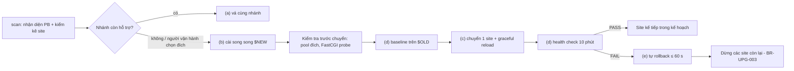

# Đặc tả playbook theo môi trường (tổng quan)

## Lịch sử sửa đổi (Revision History)
| Phiên bản | Ngày | Người thực hiện | Tóm tắt thay đổi |
| :--- | :--- | :--- | :--- |
| 1.0.0 | 2026-10-22 | BA Agent | Khởi tạo: mô hình 5 hành động (a)–(e), thuật toán nhận diện môi trường và chọn playbook, danh mục PB-001..PB-018, mở rộng backup manifest cho chuyển site, FR/BR/NFR/ERR, ma trận truy vết. Lệnh panel kiểm chứng bằng tài liệu chính thức hoặc mã nguồn chính thức ngày 2026-10-22; lệnh chưa kiểm chứng được đánh dấu |
| 1.0.1 | 2026-10-22 | BA Agent | Sửa theo review: (1) thêm `BR-ENV-013` chặn mọi lệnh ghi khác (`fix`, `rollback`, `migrate *`, mục checklist thay đổi hệ thống) khi khoá site `switches/*.lock` đang bị giữ; C1 lấy khoá site trước khi C11 nhả `STATE_DIR/.lock`; R3, `FR-UPG-SWT-001`, `FR-UPG-RBK-002`, `ERR-ENV-409-01` cập nhật theo; (2) `ensure_backup_dir` và dòng `switch`/`created`/`reload … purge-only` của pool đích chuyển lên C3, trước khi tạo pool (`BR-SCN-017`); thêm nhánh `ABORTED` xoá pool vừa tạo, `php-fpm -t`, reload FPM đích; §5.3, §5.4, R4, `NFR-ENV-05` cập nhật theo; (3) rule 16: `ERR-ENV-424-01` nêu kho cụ thể theo PB provider; §11 mục 5 thay "ngoài giờ cao điểm" bằng khung giờ thấp tải định lượng của DOC-SRS-QP-SCN-PHP-002 §1; thêm §11 mục 7 (tài liệu cần cập nhật theo) |
| 1.1.0 | 2026-10-22 | BA Agent | Sửa theo review. Đánh lại phiên bản theo rule 19: bản 1.0.1 đã thêm quy tắc mới (`BR-ENV-013`) và đổi quy trình C1/C3/C6/C11/R3, tức mức MINOR nhưng ghi là PATCH; bản này gồm cả thay đổi của 1.0.1. Nội dung: (1) §7 thêm cột "Phạm vi áp dụng (Module / Kênh / Actor)" cho 13 BR (rule 02 §2); (2) mọi tên file suy từ site dùng `<site_key>` của DOC-SRS-QP-ENV-003 §6.3.1 thay cho `site_id`, vì `site_id` dạng `svc:<project>/<service>` chứa `/` làm `switches/<site_id>.lock` trỏ vào thư mục con không tồn tại (chạy thử 2026-10-22: mở `switches/svc:proj/web.lock` trả `No such file or directory`): thêm thuật ngữ §1.4, trường `site_key` ở §4.2, §4.3, mục §4.4 (khoá site, `sites.d/<site_key>.conf`, ca kiểm thử với `svc:proj/web`); C1, C11, R3, ví dụ §5.4, `BR-ENV-007`, `BR-ENV-013`, `ERR-ENV-409-01` cập nhật theo; C1 ghi nối dòng `PREFLIGHT` có `site_key` vào `switches/index.tsv`, `index.tsv` ghi 1 dòng mỗi lần lượt đổi trạng thái (khớp `Q-ERD-02` của erd.md) để `BR-ENV-013` tra `site_key` → `site_id`; (3) §11 thêm mục 8 (tài liệu cần cập nhật theo `site_key`); §12 thêm nguồn |

## 1. Giới thiệu (Introduction)

### 1.1 Mục đích tài liệu (Purpose)
Tài liệu đặc tả **playbook theo môi trường** của php-quickpatch v2: với mỗi loại máy chủ (hệ điều hành, panel hosting, container, cách cài Node.js), tool làm 5 hành động sau như thế nào:

| Ký hiệu | Hành động | Tính năng PRD | Giai đoạn checklist (DOC-SRS-QP-SCN-000 §3.1) |
| :--- | :--- | :--- | :--- |
| (a) | Vá cùng nhánh (patch) | FEAT-060, FEAT-061, FEAT-062, FEAT-065, FEAT-066 | P2 |
| (b) | Cài PHP/Node.js bản mới **song song** bản cũ | FEAT-070, FEAT-071, FEAT-075 | P2 |
| (c) | Chuyển **từng site** (hoặc từng ứng dụng Node.js) sang bản mới | FEAT-072, FEAT-075, FEAT-076 | P5 |
| (d) | Health check định lượng sau khi chuyển | FEAT-073 | P6 |
| (e) | Rollback 1 site bằng 1 lệnh, tự rollback khi health check thất bại | FEAT-074 | P5/P6 |

Người đọc: Dev (cài đặt module `UPG` và lớp nhận diện `SCAN-ENV`), QA (thiết kế test case trên từng môi trường), PO (duyệt ngưỡng health check — câu hỏi mở `Q-01` của PRD).

### 1.2 Phạm vi (Scope)
- **Trong phạm vi**: 18 playbook `PB-001`..`PB-018` (§3); nhận diện tự động; liệt kê site và phiên bản đang gán; lệnh cài song song, chuyển 1 site, rollback; file cấu hình phải sao lưu; lệnh restart/reload; điều kiện cần root; rủi ro; đặc tả health check (DOC-SRS-QP-ENV-002).
- **Ngoài phạm vi** (DOC-BRS-QP-001 §5.2): Windows Server; agent thường trú; sửa mã nguồn ứng dụng trên production; build/deploy image Docker thay người vận hành (tool chỉ sửa file và chạy lệnh compose khi người vận hành duyệt, §2.5); nâng cấp OS hoặc web server khác major; Phase 2 (nhiều server qua SSH) — playbook của tài liệu này được Phase 2 gọi lại qua SSH, không thay đổi nội dung.

### 1.3 Bộ tài liệu playbook (tách file do giới hạn 800 dòng)
| Tài liệu | Mã | Nội dung |
| :--- | :--- | :--- |
| Tài liệu này | DOC-SRS-QP-ENV-001 | Mô hình chung, nhận diện môi trường, danh mục playbook, manifest, FR/BR/NFR/ERR, truy vết |
| [environment-playbooks-healthcheck.md](environment-playbooks-healthcheck.md) | DOC-SRS-QP-ENV-002 | Đặc tả health check định lượng và điều kiện tự rollback (`BR-HC-*`, `FR-UPG-HC-*`, `ERR-HC-*`) |
| [environment-playbooks-os.md](environment-playbooks-os.md) | DOC-SRS-QP-ENV-003 | PB-001 Debian/Ubuntu, PB-002 RHEL AppStream, PB-003 RHEL + Remi SCL, PB-004 Alpine, PB-005 Nginx/Apache + PHP-FPM, PB-006 Apache `mod_php` → PHP-FPM |
| [environment-playbooks-panels.md](environment-playbooks-panels.md) | DOC-SRS-QP-ENV-004 | PB-007 cPanel/WHM EasyApache 4, PB-008 CloudLinux alt-php + PHP Selector, PB-009 Plesk, PB-010 aaPanel, PB-011 CyberPanel/OpenLiteSpeed/LiteSpeed, PB-012 DirectAdmin CustomBuild |
| [environment-playbooks-container-node.md](environment-playbooks-container-node.md) | DOC-SRS-QP-ENV-005 | PB-013 Docker/Compose, PB-014 Node.js NodeSource, PB-015 Node.js tarball prefix, PB-016 nvm, PB-017 systemd, PB-018 pm2 |

### 1.4 Định nghĩa, thuật ngữ (Definitions & Acronyms)
Ký hiệu `$OLD`, `$NEW`, `$OLD_BIN`, `$NEW_BIN`, `$SITE`, `$VHOST`, `$APP` theo [version-scenarios-common.md §1.3](version-scenarios-common.md). Bổ sung:

| Thuật ngữ | Định nghĩa |
| :--- | :--- |
| Playbook (`PB-NNN`) | Bộ thủ tục cho 1 môi trường: dấu hiệu nhận diện, lệnh (a)–(e), file sao lưu, reload, quyền, rủi ro. Là dữ liệu trong gói snapshot (FEAT-022), cập nhật không cần sửa script |
| Lớp cung cấp runtime (`provider`) | Cơ chế cài binary PHP/Node.js: gói distro, kho bên thứ ba, panel, image Docker, tarball, nvm |
| Lớp gán site (`binding`) | Cơ chế nối 1 site/ứng dụng với 1 binary: `fastcgi_pass` (Nginx), `SetHandler` (Apache), API panel, `ExecStart` (systemd), `interpreter` (pm2), `image:` (Compose) |
| `$NEWND`, `$OLDND` | Nhánh viết liền không dấu chấm, vd `84` cho 8.4 (quy ước tên gói `php84`, `ea-php84`, `lsphp84`) |
| Mã site (`site_id`) | Tên miền chính của vhost (`server_name`/`ServerName` đầu tiên, chữ thường); ứng dụng Node.js: `app:<unit systemd>` hoặc `app:pm2:<tên>`; dịch vụ Compose: `svc:<project>/<service>` |
| Khoá tên file của site (`site_key`) | Dạng của `site_id` dùng làm tên file, theo DOC-SRS-QP-ENV-003 §6.3.1: = `site_id` khi khớp `^[a-z0-9.-]{1,48}$` và thoả điều kiện độ dài socket của §6.3.1, ngược lại `h_` + 12 ký tự hex đầu của SHA-1 chuỗi `site_id`. `site_id` có `:` hoặc `/` (`app:`, `app:pm2:`, `svc:`) luôn ở dạng băm. Quy tắc dùng ở §4.4 |
| Lượt chuyển (`switch`) | 1 lần chạy (c) cho 1 site; có mã `run_id` dạng `YYYYmmdd-HHMMSS` (cùng định dạng thư mục backup v0.1) |
| Baseline | Số liệu thu trước khi chuyển: mã HTTP, kích thước body, thời gian phản hồi, số dòng log lỗi (DOC-SRS-QP-ENV-002 §4) |
| Pool đích | Pool PHP-FPM (hoặc tiến trình LSAPI) của `$NEW` dùng cho site sau khi chuyển |
| Graceful reload | Nạp lại cấu hình mà tiến trình master không dừng, kết nối đang xử lý không bị cắt: `nginx -s reload`, `apachectl -k graceful`, `systemctl reload php*-fpm` (Debian: `ExecReload=/bin/kill -USR2 $MAINPID`) |

### 1.5 Tài liệu tham chiếu (References)
Xem §12.

## 2. Mô tả tổng quan (Overall Description)

### 2.1 Bối cảnh: hành vi v0.1.0 được kế thừa
| Hành vi v0.1.0 (`php-quickpatch.sh`) | Dùng lại trong playbook |
| :--- | :--- |
| `detect_env`: container (`/.dockerenv`, `/proc/1/cgroup`), panel (`/usr/local/cpanel/cpanel`, `/usr/local/psa`, `/www/server/panel`, `/usr/local/CyberCP`, `/usr/local/directadmin`), `PKG_MGR` (apt-get → dnf → yum → apk), systemd (`/run/systemd/system`), Docker daemon (`docker info`), root (`EUID`) | Bước 1–3 của thuật toán nhận diện (§2.3) giữ nguyên thứ tự |
| `discover_php_bins`, `discover_node_bins` | Kiểm kê binary của mọi playbook |
| `php_upgrade` (apt `--only-upgrade`, dnf/yum `upgrade`, apk `upgrade`), `node_upgrade`, `node_upgrade_prefix` (tarball + `SHASUMS256.txt`) | Hành động (a) của PB-001..PB-004, PB-007, PB-009, PB-011, PB-014, PB-015 |
| `php_mitigate` / `php_unmitigate` (`zz-php-quickpatch-mitigation.ini`) | Hành động (a) khi chưa có gói vá (mọi PB PHP) |
| `restart_php_services` (cPanel `restartsrv`, unit `php*-fpm`, `ea-php*-php-fpm`, `plesk-php*-fpm`, `apache2`/`httpd`, `lsws`), `restart_node_services` (unit có `ExecStart` trỏ prefix, `pm2 reload all`) | Hành động (a). Hành động (c)/(e) dùng **reload có phạm vi** thay vì restart toàn bộ (`BR-ENV-006`) |
| Backup manifest `STATE_DIR/backups/<run-id>/manifest` (`copy`, `created`, `untar`, `composer-install`, `npm-ci`, `note`), `rollback [ID]` phát lại theo thứ tự ngược | Hành động (c)/(e) dùng cùng thư mục, cùng định dạng; bổ sung hành động mới ở §5.2 |
| `--dry-run`, `--no-restart`, khoá `flock` trên `STATE_DIR/.lock` | Mọi lệnh thay đổi hệ thống của playbook |

### 2.2 Mô hình 5 hành động và lệnh CLI đề xuất
Tên lệnh theo đề xuất FEAT-102 của PRD; SRS chính chốt tên cuối cùng. Mọi lệnh có `--dry-run` và `--json` (FEAT-100).

| Hành động | Lệnh CLI đề xuất | Nút trên console (FEAT-083, FEAT-086) | Kết quả |
| :--- | :--- | :--- | :--- |
| Kiểm kê | `php-quickpatch.sh scan --only sites --json` | Tổng quan → bảng Site | Danh sách `site_binding` (§4.2) |
| (a) | `php-quickpatch.sh fix [--only php,node]` (kế thừa v0.1) | Đánh giá runtime → "Vá cùng nhánh" | Gói/tarball cùng nhánh mới nhất; mitigation khi chưa vá được |
| (b) | `php-quickpatch.sh upgrade --runtime php\|node --target <X.Y\|major> [--from <bin>]` | Kế hoạch → mục P2 "Cài song song" | `$NEW_BIN` đã cài, pool/handler đích sẵn sàng, 0 site bị đổi |
| (c) | `php-quickpatch.sh switch-site <site_id> --target <X.Y\|major> [--no-auto-rollback]` | Kế hoạch → mục P5 của từng site | Site trỏ `$NEW`, health check chạy ngay sau |
| (d) | `php-quickpatch.sh healthcheck <site_id> [--baseline-only]` (cũng chạy tự động trong (c)) | Jobs & Log → báo cáo health check | `hc.json` với kết luận `PASS`/`FAIL` |
| (e) | `php-quickpatch.sh rollback-site <site_id> [run_id]` | Rollback → chọn lượt chuyển → 1 xác nhận | Site trỏ lại `$OLD` trong ≤ 60 s (KR4.2) |

Luồng chuẩn (DIAG-FLOW-QP-ENV-001):



### 2.3 Thuật toán nhận diện môi trường và chọn playbook (`FR-SCAN-ENV-001`)
Mỗi máy chủ được gán **1 playbook cung cấp PHP**, **0..n playbook gán site PHP**, và cho mỗi binary Node.js **1 playbook nguồn cài + 1 playbook quản lý tiến trình**. Thứ tự xét như sau; mỗi bước ghi dấu hiệu khớp vào `scan --json` trường `environment.evidence[]`.

| Bước | Kiểm tra (đọc, không thay đổi hệ thống) | Kết quả |
| :--- | :--- | :--- |
| 1 | Trong container: `/.dockerenv` tồn tại hoặc `/proc/1/cgroup` chứa `docker\|containerd\|kubepods\|libpod` (v0.1) | Gắn cờ `in_container`; chỉ cho phép (a) dạng mitigation và đề xuất PB-013 ở host; (b)(c)(e) bị khoá (`BR-ENV-009`) |
| 2 | Panel, dừng ở dấu hiệu đầu tiên (thứ tự v0.1): `-x /usr/local/cpanel/cpanel` → PB-007; `-d /usr/local/psa` → PB-009; `-d /www/server/panel` → PB-010; `-d /usr/local/CyberCP` → PB-011; `-d /usr/local/directadmin` → PB-012 | Panel sở hữu cả lớp cung cấp và lớp gán: không áp PB-001..PB-006 cho site do panel quản lý |
| 3 | CloudLinux PHP Selector (bổ sung cho bước 2): `selectorctl` có trong `PATH` **và** tồn tại `/etc/cl.selector/selector.conf`; binary `/opt/alt/php*/usr/bin/php` (v0.1) | Thêm PB-008 (overlay); site thoả điều kiện dùng PHP Selector (DOC-SRS-QP-ENV-004 §3.1) được gán PB-008 thay cho PB của panel |
| 4 | Không có panel, có LiteSpeed: `-x /usr/local/lsws/bin/lswsctrl` | PB-011 chế độ không panel |
| 5 | Không có panel: `/etc/os-release` `ID`/`ID_LIKE` và `PKG_MGR` | `debian`/`ubuntu` + apt → PB-001; `rhel`/`almalinux`/`rocky`/`centos` + dnf/yum → PB-002 (PHP từ AppStream) và/hoặc PB-003 (kho Remi: `rpm -q remi-release` exit 0 hoặc tồn tại `/etc/yum.repos.d/remi*.repo`); `alpine` + apk → PB-004 |
| 6 | Lớp gán site khi không có panel: tiến trình `nginx: master` đang chạy → PB-005 (biến thể Nginx); `apache2`/`httpd` đang chạy và `apachectl -M` (hoặc `httpd -M`) có `php[0-9]*_module` → PB-006; Apache có `proxy_fcgi_module` và vhost có `SetHandler "proxy:` → PB-005 (biến thể Apache) | Một máy có thể khớp cả PB-005 và PB-006 (vhost khác nhau dùng cơ chế khác nhau); gán theo từng site ở §4.2 |
| 7 | Docker host: `docker info` exit 0 (v0.1) **và** có Dockerfile/compose chứa `FROM php:`/`FROM node:`/`image: php:`/`image: node:` (v0.1 `check_dockerfiles`) hoặc container đang chạy từ image `php`/`node` | PB-013 cho từng dịch vụ Compose/container |
| 8 | Mỗi binary Node.js (v0.1 `discover_node_bins`): gói sở hữu có nguồn `deb.nodesource.com`/`rpm.nodesource.com` → PB-014; đường dẫn `*/.nvm/versions/node/*` → PB-016; không có gói sở hữu và `$PREFIX/lib/node_modules/npm` tồn tại → PB-015; gói distro → PB-015 cho phần cài song song (theo `BR-SCN-026`) | Quản lý tiến trình: unit systemd có `ExecStart` chứa đường dẫn binary → PB-017; `pm2 jlist` liệt kê tiến trình có `pm2_env.exec_interpreter` hoặc `node_version` khớp binary → PB-018 |
| 9 | Không khớp bước nào ở 2–7 cho PHP | Playbook `PB-000` (không xác định): chỉ cho phép (a) dạng mitigation và báo cáo; (b)(c) phát `ERR-ENV-422-01` |

Quy tắc giải xung đột: khi 1 site khớp nhiều lớp gán (vd aaPanel cài Nginx và Apache cùng lúc), playbook được chọn theo **file cấu hình đang được tiến trình web server nạp** (Nginx: `nginx -T`; Apache: `apachectl -t -D DUMP_VHOSTS` hoặc `apachectl -S`; OpenLiteSpeed: `/usr/local/lsws/conf/httpd_config.conf`), không theo file tồn tại trên đĩa.

### 2.4 Tác nhân và quyền (User Classes)
| Tác nhân | Quyền hệ thống | Hành động được phép |
| :--- | :--- | :--- |
| Người vận hành root (PER-01, PER-02) | `EUID = 0` | (a)–(e) trên mọi playbook có mức tự động `AUTO`/`SEMI` (§3) |
| Người dùng không root sở hữu ứng dụng Node.js (PER-03) | Chủ thư mục `$NVM_DIR` hoặc chủ tiến trình pm2 của chính mình | (b)(c)(d)(e) trên PB-016, PB-018 cho ứng dụng của chính người đó; không sửa unit systemd hệ thống |
| Người dùng hosting không root (shared hosting) | Không | Chỉ báo cáo và hướng dẫn thao tác trên giao diện panel (mục `MANUAL`), như v0.1 |
| Console `serve` | Kế thừa quyền của tiến trình `serve` (PRD §2.3) | Như dòng tương ứng ở trên |

### 2.5 Ràng buộc thiết kế (Constraints)
| Mã | Ràng buộc |
| :--- | :--- |
| `C-ENV-01` | CLI viết bằng Bash, không cần runtime bổ sung để chạy (a)–(e). Python 3 (đã là yêu cầu của console) chỉ dùng cho FastCGI probe trước chuyển (DOC-SRS-QP-ENV-002 §3.3); không có Python 3 → bỏ bước probe, ghi cảnh báo |
| `C-ENV-02` | Tool không ghi file vào docroot của site (DOC-BRS-QP-001 §5.2). Ngoại lệ duy nhất: file do **chính panel** ghi khi tool gọi API panel (vd cPanel ghi khối handler vào `.htaccess`); tool sao lưu file đó trước khi gọi |
| `C-ENV-03` | Mọi thay đổi cấu hình đi qua lệnh kiểm tra cú pháp trước reload (`nginx -t`, `apachectl configtest`, `php-fpm<X.Y> -t`); kiểm tra lỗi → không reload, khôi phục file ngay (`BR-ENV-005`) |
| `C-ENV-04` | Với panel, tool ưu tiên API/CLI chính thức của panel; chỉ sửa file cấu hình do panel sinh khi tài liệu chính thức hoặc mã nguồn chính thức của panel cho thấy panel đọc lại file đó (aaPanel, DirectAdmin `php1_select`), vì panel có thể ghi đè file khi tái sinh cấu hình |
| `C-ENV-05` | Docker: tool sửa `Dockerfile`/`compose.yaml` (có backup) và chỉ chạy `docker compose build`/`up` khi người vận hành bấm duyệt mục `SEMI`; tool không đẩy image lên registry |

### 2.6 Giả định và phụ thuộc
| Mã | Nội dung |
| :--- | :--- |
| `A-ENV-01` | Web server dùng phiên bản hỗ trợ `SetHandler "proxy:unix:...\|fcgi://localhost"` (Apache ≥ 2.4.10) và `nginx -T` (Nginx ≥ 1.9.2). Phiên bản thấp hơn → playbook chuyển sang mục `MANUAL` (chưa kiểm chứng ngưỡng phiên bản trên tài liệu chính thức) |
| `A-ENV-02` | Site cần health check phải phân giải được về chính máy chủ qua `curl --resolve <host>:<port>:127.0.0.1`; site sau CDN/proxy ngoài vẫn được kiểm tra trực tiếp tại máy chủ |
| `A-ENV-03` | Lệnh panel đánh dấu "chưa kiểm chứng" ở các file playbook chỉ được dùng ở mức `MANUAL` hoặc `SEMI` cho tới khi QA chạy thử trên máy có panel tương ứng (DOC-SRS-QP-SCN-000 §8 mục 6) |
| `A-ENV-04` | Thời gian `da build rewrite_confs` (DirectAdmin) và `plesk bin site -u` (Plesk) chưa đo; ngân sách C7 của 2 playbook này được xác lập sau khi QA đo trên máy có ≥ 50 domain |

## 3. Danh mục playbook (Playbook Catalog)
Mức tự động theo `exec_type` của DOC-SRS-QP-SCN-000 §3.2: `AUTO` (tool tự làm trong `fix`/job, tôn trọng `--dry-run`), `SEMI` (tool chuẩn bị lệnh/diff, chạy sau khi người vận hành duyệt), `MANUAL` (tool chỉ hướng dẫn và kiểm tra tiêu chí), `—` (không áp dụng; dùng playbook ghi trong ngoặc). Theo `BR-SCN-008`, mọi lần chuyển site (c) tối thiểu là `SEMI` (duyệt riêng từng site); rollback (e) do health check kích hoạt là `AUTO`.

| Mã | Môi trường | Lớp | Dấu hiệu nhận diện chính | (a) Vá cùng nhánh | (b) Cài song song | (c) Chuyển 1 site | (e) Rollback | Root | Chi tiết |
| :--- | :--- | :--- | :--- | :--- | :--- | :--- | :--- | :---: | :--- |
| `PB-001` | Debian/Ubuntu: gói distro + kho Ondřej Surý (`packages.sury.org`, `ppa:ondrej/php`) | provider | `ID`/`ID_LIKE` chứa `debian`; `apt-get`; `/usr/bin/php[0-9].[0-9]` thuộc gói `php<X.Y>-cli` | AUTO | AUTO khi kho đã có nhánh đích; SEMI khi phải thêm kho (PRD `Q-03`) | — (PB-005/PB-006) | — (PB-005) | Có | [os §2](environment-playbooks-os.md#2-pb-001--debianubuntu) |
| `PB-002` | RHEL/Alma/Rocky 8–9: AppStream module `php:X.Y`; RHEL 10: gói AppStream không module | provider | `ID_LIKE` chứa `rhel`; `/usr/bin/php` thuộc gói `php-cli` không có tiền tố SCL | AUTO | — (không cài song song được; dùng PB-003 hoặc PB-013) | — | — | Có | [os §3](environment-playbooks-os.md#3-pb-002--rhelalmarocky-appstream) |
| `PB-003` | RHEL/Alma/Rocky + Remi SCL `phpXY` | provider | `rpm -q remi-release` exit 0; binary `/opt/remi/php*/root/usr/bin/php` (v0.1) | AUTO | AUTO khi kho Remi đã có; SEMI khi phải thêm kho | — (PB-005) | — (PB-005) | Có | [os §4](environment-playbooks-os.md#4-pb-003--rhelalmarocky--remi-scl) |
| `PB-004` | Alpine (`apk`, gói `phpXY` theo nhánh) | provider | `ID=alpine`; `apk`; `/usr/bin/php[0-9][0-9]` | AUTO | AUTO khi nhánh đích có trong kho `community` của bản Alpine đang chạy | — (PB-005) | — (PB-005) | Có | [os §5](environment-playbooks-os.md#5-pb-004--alpine-linux) |
| `PB-005` | Web server Nginx hoặc Apache + PHP-FPM (pool, socket/cổng) | binding | Tiến trình `nginx: master` đang chạy; hoặc vhost Apache có `SetHandler "proxy:` | — | Tạo pool đích: AUTO | SEMI | AUTO | Có | [os §6](environment-playbooks-os.md#6-pb-005--nginx-hoặc-apache--php-fpm) |
| `PB-006` | Apache `mod_php` (rủi ro cao, chuyển sang PHP-FPM trước) | binding | `apachectl -M` có `php[0-9]*_module` (v0.1 `php_sapis_note`) | AUTO (qua PB provider) | — | SEMI, 2 bước: `mod_php` → FPM của `$OLD`, rồi PB-005 | AUTO | Có | [os §7](environment-playbooks-os.md#7-pb-006--apache-mod_php) |
| `PB-007` | cPanel/WHM EasyApache 4 (`ea-phpXY`, MultiPHP Manager) | panel | `-x /usr/local/cpanel/cpanel` (v0.1) | AUTO | SEMI | SEMI (`whmapi1 php_set_vhost_versions`) | AUTO | Có | [panels §2](environment-playbooks-panels.md#2-pb-007--cpanelwhm-easyapache-4) |
| `PB-008` | CloudLinux alt-php + PHP Selector | panel overlay | `selectorctl`; `/etc/cl.selector/selector.conf`; `/opt/alt/php*/usr/bin/php` (v0.1) | AUTO | SEMI | SEMI (`selectorctl --set-user-current`, phạm vi **người dùng**) | AUTO | Có | [panels §3](environment-playbooks-panels.md#3-pb-008--cloudlinux-alt-php--php-selector) |
| `PB-009` | Plesk (`plesk-phpXY`, handler theo domain) | panel | `-d /usr/local/psa` (v0.1); `/opt/plesk/php/*/bin/php` | AUTO | SEMI | SEMI (`plesk bin site -u … -php_handler_id`) | AUTO | Có | [panels §4](environment-playbooks-panels.md#4-pb-009--plesk) |
| `PB-010` | aaPanel (`/www/server/php/XY`, cấu hình theo site) | panel | `-d /www/server/panel` (v0.1) | MANUAL + mitigation AUTO | MANUAL (App Store); SEMI (script cài của panel, chưa chạy thử) | SEMI (sửa vhost theo đúng thuật toán `SetPHPVersion` của panel) | AUTO | Có | [panels §5](environment-playbooks-panels.md#5-pb-010--aapanel) |
| `PB-011` | CyberPanel / OpenLiteSpeed / LiteSpeed Enterprise (`lsphpXY`) | panel | `-d /usr/local/CyberCP` (v0.1); không panel: `-x /usr/local/lsws/bin/lswsctrl` | AUTO | AUTO | SEMI (`cyberpanel changePHP`; không panel: sửa vhost) | AUTO | Có | [panels §6](environment-playbooks-panels.md#6-pb-011--cyberpanel--openlitespeed--litespeed) |
| `PB-012` | DirectAdmin CustomBuild (`php1_release`..`php9_release`, chọn theo domain) | panel | `-d /usr/local/directadmin` (v0.1) | SEMI (biên dịch lại) | SEMI | SEMI (`php1_select=N` + `da build rewrite_confs`) | AUTO | Có | [panels §7](environment-playbooks-panels.md#7-pb-012--directadmin-custombuild) |
| `PB-013` | Docker / Compose (`php:X.Y-fpm`, `php:X.Y-apache`, `node:N`) | provider + binding | `docker info` exit 0 + Dockerfile/compose dùng image `php`/`node` (v0.1) | SEMI | SEMI (dịch vụ mới song song) | SEMI (đổi upstream reverse proxy) | AUTO | Có (hoặc nhóm `docker`) | [container-node §2](environment-playbooks-container-node.md#2-pb-013--docker--compose) |
| `PB-014` | Node.js từ NodeSource | provider | Gói `nodejs` có nguồn `deb.nodesource.com`/`rpm.nodesource.com` | AUTO | — (dùng PB-015) | — (PB-017/PB-018) | — | Có | [container-node §3](environment-playbooks-container-node.md#3-pb-014--nodesource) |
| `PB-015` | Node.js tarball theo prefix (`/opt/node-v…`, `/usr/local`) | provider | Không có gói sở hữu, có thư mục `npm` dưới `$PREFIX/lib` (v0.1) | AUTO | AUTO | — (PB-017/PB-018) | — | Có | [container-node §4](environment-playbooks-container-node.md#4-pb-015--tarball-theo-prefix) |
| `PB-016` | nvm theo người dùng | provider | Đường dẫn `*/.nvm/versions/node/*` (v0.1) | SEMI | SEMI | — (PB-017/PB-018) | — | Không (chủ `$NVM_DIR`) | [container-node §5](environment-playbooks-container-node.md#5-pb-016--nvm) |
| `PB-017` | Ứng dụng Node.js chạy bằng systemd | binding | Unit có `ExecStart` chứa đường dẫn binary Node.js (v0.1 `restart_node_services`) | — | — | SEMI (drop-in) | AUTO | Có | [container-node §6](environment-playbooks-container-node.md#6-pb-017--systemd) |
| `PB-018` | Ứng dụng Node.js chạy bằng pm2 | binding | `pm2 pid` exit 0 (v0.1); `pm2 jlist` | — | — | SEMI (`interpreter`) | AUTO | Không (chủ tiến trình pm2) | [container-node §7](environment-playbooks-container-node.md#7-pb-018--pm2) |
| `PB-000` | Không xác định (PHP không khớp bước 2–7 của §2.3) | — | — | Chỉ mitigation ini (v0.1) | — (`ERR-ENV-422-01`) | — | — | Có | §2.3 bước 9 |

Ánh xạ sang bảng biến thể môi trường đã có: PHP E1 = PB-001, E2 = PB-003, E3 = PB-002, E4 = PB-004, E5 = PB-007/PB-008, E6 = PB-009, E7 = PB-010, E8 = PB-011, E9 = PB-012, E10 = PB-013 ([version-scenarios-php.md §8](version-scenarios-php.md#8-biến-thể-thực-thi-theo-môi-trường)); Node.js E1 = PB-015, E2 = PB-016, E3 = PB-014, E4 = PB-015 (cài song song), E5 = Node.js của aaPanel (`MANUAL`, chưa có playbook riêng), E6 = PB-013 ([version-scenarios-node.md §8](version-scenarios-node.md#8-biến-thể-thực-thi-theo-môi-trường)). Khi lệnh ở 2 tài liệu khác nhau, tài liệu playbook này thay thế vì đã kiểm chứng lại ngày 2026-10-22 (§11 mục 1).

## 4. Cấu trúc dữ liệu (Data Dictionary)

### 4.1 Thực thể `playbook`
| Tên trường (Logical) | Tên cột (Physical) | Kiểu dữ liệu | Độ dài | Cho phép Null? | Khóa | Ràng buộc / Giá trị mặc định | Diễn giải nghiệp vụ |
| :--- | :--- | :--- | :--- | :--- | :--- | :--- | :--- |
| Mã playbook | pb_id | VARCHAR | 6 | Không | PK | Regex `^PB-\d{3}$` | Định danh |
| Lớp | layer | ENUM | - | Không | - | `provider`, `binding`, `panel`, `panel_overlay` | §1.4 |
| Runtime | runtime | ENUM | - | Không | - | `php`, `node`, `both` | |
| Luật nhận diện | detect_rules | JSON | - | Không | - | Mảng `{type: file\|dir\|exec\|cmd_exit0\|os_release, value}`, xét theo thứ tự | §2.3 |
| Lệnh theo hành động | actions | JSON | - | Không | - | Khoá `inventory`, `patch`, `install`, `switch`, `healthcheck_inputs`, `rollback`, `reload`; mỗi phần tử `{cmd, exec_type, verified, source_ref}` | `verified=false` → không chạy ở mức `AUTO` (`BR-ENV-010`) |
| File sao lưu | backup_paths | JSON | - | Không | - | Mẫu đường dẫn với biến `$VHOST`, `$NEWND`, `$USER` | Sao lưu bằng `backup_file` (v0.1) trước mọi thay đổi |
| Cần root | requires_root | BOOLEAN | - | Không | - | - | §2.4 |
| Ngân sách chuyển | switch_budget_s | SMALLINT | - | Không | - | Mặc định 30 | `NFR-ENV-01` |

### 4.2 Thực thể `site_binding` (đầu ra kiểm kê, FEAT-004)
| Tên trường (Logical) | Tên cột (Physical) | Kiểu dữ liệu | Độ dài | Cho phép Null? | Khóa | Ràng buộc / Giá trị mặc định | Diễn giải nghiệp vụ |
| :--- | :--- | :--- | :--- | :--- | :--- | :--- | :--- |
| Mã site | site_id | VARCHAR | 255 | Không | PK | Chữ thường, §1.4 | |
| Khoá tên file | site_key | VARCHAR | 49 | Không | - | Regex `^([a-z0-9.-]{1,48}\|h_[0-9a-f]{12})$`; tính 1 lần khi kiểm kê (§4.4) | Tên khoá site, file `sites.d`, pool/socket/log đích |
| Playbook gán | pb_id | VARCHAR | 6 | Không | FK → playbook | - | Playbook lớp `binding`/`panel` của site |
| Tên miền | server_names | JSON | - | Không | - | ≥ 1 phần tử | `server_name`/`ServerName`/`ServerAlias` |
| Docroot | docroot | VARCHAR | 1024 | Có | - | Đường dẫn tuyệt đối | Null với ứng dụng Node.js chỉ chạy sau proxy |
| Chủ site | owner_user | VARCHAR | 32 | Không | - | `stat -c %U <docroot>` (v0.1) | Dùng cho pool FPM và lệnh chạy dưới quyền chủ |
| Kiểu gán | binding_kind | ENUM | - | Không | - | `nginx_fastcgi`, `apache_proxy_fcgi`, `apache_mod_php`, `cpanel_multiphp`, `cloudlinux_selector`, `plesk_handler`, `aapanel_vhost`, `ols_extprocessor`, `lsws_addhandler`, `da_php_select`, `compose_service`, `systemd_execstart`, `pm2_interpreter` | |
| Vị trí gán | binding_ref | VARCHAR | 1024 | Không | - | `file:line` hoặc khoá panel, vd `/etc/nginx/sites-enabled/a.conf:42` | Dòng/khoá bị đổi ở (c) |
| Nhánh hiện tại | current_branch | VARCHAR | 8 | Không | - | `X.Y` (PHP) hoặc `N` (Node.js) | |
| Binary hiện tại | current_bin | VARCHAR | 1024 | Không | - | Kết quả `readlink -f` | Đối chiếu kịch bản `SCN-*` |
| Điểm nối runtime | runtime_endpoint | VARCHAR | 1024 | Có | - | `unix:/run/php/php8.3-fpm.sock`, `127.0.0.1:9000`, `lsapi:/usr/local/lsws/lsphp83/bin/lsphp`, `pid:1234` | |
| Nguồn log lỗi | log_sources | JSON | - | Không | - | Mảng đường dẫn file hoặc `journal:<unit>`; rỗng → `ERR-HC-412-01` | DOC-SRS-QP-ENV-002 §5 |
| URL health check | hc_urls | JSON | - | Không | - | 1 trang chủ + ≤ 10 URL khai báo | DOC-SRS-QP-ENV-002 §3 |
| Chế độ health check | hc_mode | ENUM | - | Không | - | `full` (mặc định), `skip` (ngoại lệ của `BR-SCN-009`) | |

### 4.3 Thực thể `switch_record` (lượt chuyển site)
| Tên trường (Logical) | Tên cột (Physical) | Kiểu dữ liệu | Độ dài | Cho phép Null? | Khóa | Ràng buộc / Giá trị mặc định | Diễn giải nghiệp vụ |
| :--- | :--- | :--- | :--- | :--- | :--- | :--- | :--- |
| Mã lượt | run_id | VARCHAR | 15 | Không | PK | `YYYYmmdd-HHMMSS`, trùng tên thư mục `STATE_DIR/backups/<run_id>` | Kế thừa định dạng v0.1 |
| Site | site_id | VARCHAR | 255 | Không | FK → site_binding | - | |
| Khoá tên file | site_key | VARCHAR | 49 | Không | - | Sao chép từ `site_binding.site_key` ở C1, không tính lại | Tên khoá site `switches/<site_key>.lock`; `BR-ENV-013` tra ngược `site_id` (§4.4) |
| Từ nhánh / sang nhánh | from_branch, to_branch | VARCHAR | 8 | Không | - | `to_branch` thoả `BR-SCN-007` | |
| Trạng thái | status | ENUM | - | Không | - | `PREFLIGHT` → `SWITCHED` → `HC_RUNNING` → `PASSED` \| `ROLLED_BACK` \| `ROLLBACK_FAILED` \| `HC_FAILED_KEPT` (health check không đạt, tự rollback bị tắt có duyệt); `ABORTED` khi dừng trước bước C7 | Sơ đồ trạng thái: DOC-SRS-QP-ENV-002 §6.5 |
| Mốc thời gian | t_start, t_switched, t_hc_end, t_rollback_end | TIMESTAMP | - | Có | - | UTC, độ phân giải 1 ms | Đo `NFR-ENV-01..03` |
| Lý do rollback | rollback_reason | VARCHAR | 64 | Có | - | Mã tiêu chí `HC-C0`..`HC-C9` hoặc `MANUAL` | DOC-SRS-QP-ENV-002 §6 |
| Người thực hiện | actor | VARCHAR | 64 | Không | - | `cli:<user>` hoặc `console:<user>` | Audit FEAT-092 |

Lưu trữ: `STATE_DIR/switches/index.tsv` (chỉ ghi nối, 1 dòng mỗi lần lượt đổi trạng thái, dòng đầu tiên `PREFLIGHT` ghi ở C1; mỗi dòng có `run_id`, `site_id`, `site_key`, trạng thái; trạng thái hiện hành = dòng cuối của `run_id`) và `STATE_DIR/backups/<run_id>/switch.json` (có trường `site_key`). SQLite của console (FEAT-016) đọc lại 2 file này, không phải nguồn dữ liệu gốc.

### 4.4 Tên file suy từ site (`site_key`)
`site_id` chứa ký tự không dùng được trong 1 thành phần tên file: `/` của `svc:<project>/<service>` (regex `site_id` của `BR-CON-008` cho phép) tạo thư mục con, nên `switches/svc:shop/web.lock` không mở được và glob `switches/*.lock` không thấy khoá lồng; tên miền dài tới 253 ký tự vượt giới hạn socket (DOC-SRS-QP-ENV-003 §6.3.1). Mọi tên file do tool tạo từ 1 site dùng `site_key` (§1.4), không dùng `site_id`:

| Mục | Quy tắc |
| :--- | :--- |
| Tính giá trị | Theo DOC-SRS-QP-ENV-003 §6.3.1, 1 lần khi kiểm kê (`FR-SCAN-MAP-001`), lưu ở `site_binding.site_key`; lượt chuyển sao chép vào `switch.json` và mọi dòng `index.tsv` (§4.3); lệnh sau đó đọc giá trị đã lưu, không tính lại. Điều kiện độ dài socket của §6.3.1 chỉ đổi kết quả khi thư mục socket của PB > 47 byte (phần tên socket dạng đọc được ≤ 60 byte, cộng thư mục ≤ 47 byte thì tổng ≤ 107 byte); thư mục PB-001 `/run/php/` (9 byte) và PB-003 `/var/opt/remi/php84/run/php-fpm/` (32 byte, đường dẫn chưa kiểm chứng theo §6.3.1) không thuộc trường hợp này |
| Khoá site | `STATE_DIR/switches/<site_key>.lock`, file rỗng, nằm trực tiếp trong `switches/` (0 thư mục con). Tool không xoá file khoá sau khi nhả: xoá file đang dùng cho `flock` cho phép 2 tiến trình giữ khoá trên 2 inode khác nhau cùng lúc |
| Tra ngược khi báo lỗi | `BR-ENV-013` gặp `<site_key>.lock` đang bị giữ → đọc dòng cuối có `site_key` đó trong `switches/index.tsv` để lấy `site_id`, `run_id` cho thông báo `ERR-ENV-409-01`. Dòng `PREFLIGHT` được ghi ở C1 khi lượt còn giữ `STATE_DIR/.lock`, nên mọi lệnh khác (phải lấy `STATE_DIR/.lock` trước) luôn thấy dòng này |
| Cấu hình health check theo site | `/etc/php-quickpatch/sites.d/<site_key>.conf` (không root: `~/.config/php-quickpatch/sites.d/<site_key>.conf`); dòng đầu `# qp-site-id = <site_id>`; tool chỉ dùng file khi giá trị này bằng `site_id` của site (cùng cách kiểm của file pool, DOC-SRS-QP-ENV-003 §6.3.1) |
| Pool, socket, log, snippet đích (PB-005) | Theo DOC-SRS-QP-ENV-003 §6.3.1 (`qp-<site_key>`), tên lưu trong `switch.json` |
| Kiểm thử bắt buộc | 3 site `shop.example.com` (PB-005), `svc:proj/web` (PB-013), `app:pm2:api` (PB-018) → `site_key` lần lượt `shop.example.com`, `h_ffd400634466`, `h_40a670b5bf62` (SHA-1 tính bằng `printf '%s' <site_id> \| sha1sum` ngày 2026-10-22). Mỗi lượt chuyển: C1 mở và `flock` được `switches/<site_key>.lock`, `switches/` có 0 thư mục con. Trong `HC_RUNNING` của `svc:proj/web`: `fix`, `switch-site shop.example.com` và `rollback-site svc:proj/web`, mỗi lệnh 10 lần → 100% `ERR-ENV-409-01` có `site_id` = `svc:proj/web`. Sau khi lượt `PASSED`: `rollback-site svc:proj/web` lấy khoá `h_ffd400634466.lock` và kết thúc `ROLLED_BACK`. `migrate hc-urls svc:proj/web --set <url>` ghi `sites.d/h_ffd400634466.conf` với dòng đầu `# qp-site-id = svc:proj/web` |

## 5. Quy trình chung và mở rộng backup manifest

### 5.1 Quy trình chuẩn của hành động (c) chuyển 1 site
| Bước | Nội dung | Ngân sách thời gian | Thất bại → |
| :--- | :--- | :--- | :--- |
| C1 | Lấy khoá `flock -x -n` `STATE_DIR/.lock` (v0.1); kiểm tra không có lượt nào ở `SWITCHED`/`HC_RUNNING` và không có file `STATE_DIR/switches/*.lock` nào đang bị giữ (`BR-ENV-003`, `BR-ENV-013`); lấy khoá site `flock -x -n STATE_DIR/switches/<site_key>.lock` (`site_key` đọc từ `site_binding`, §4.4), giữ tới hết C12, R7 hoặc nhánh `ABORTED`; ghi nối dòng `PREFLIGHT` (`run_id`, `site_id`, `site_key`) vào `STATE_DIR/switches/index.tsv` trước khi nhả `STATE_DIR/.lock` | ≤ 1 s | `ERR-ENV-409-01` |
| C2 | Kiểm tra điều kiện: `BR-SCN-018` (P3, P4 đã `DONE`/`WAIVED`), `BR-UPG-002` (quét tương thích 0 lỗi `error`), `BR-SCN-007` (nhánh đích hợp lệ), `$NEW_BIN -r 'exit(0);'` exit 0 (Node.js: `$NEW_BIN -e 'process.exit(0)'`) | ≤ 10 s | `ERR-SCN-424-01`, `ERR-SCN-409-02`, `ERR-ENV-412-01` |
| C3 | (1) `ensure_backup_dir` (dung lượng trống tại `STATE_DIR` ≥ 50 MB); ghi dòng `switch`; **trước khi** tạo hoặc sửa file pool/handler đích, ghi bước hoàn tác (`BR-SCN-017`): file mới → `reload fpm:<unit đích> purge-only` rồi `created <file>`; file đã có → `backup_file` (dòng `copy`) (§5.4). (2) Chuẩn bị pool/handler đích cho site (theo PB), kiểm tra cú pháp (`php-fpm<X.Y> -t` hoặc lệnh của panel); reload riêng dịch vụ FPM đích | ≤ 2 s cho (1) + ≤ 15 s cho (2) | `ERR-ENV-507-01` hoặc `ERR-ENV-500-01`; nhánh `ABORTED`, không đổi site |
| C4 | FastCGI probe tới pool đích với file chỉ mục của docroot (DOC-SRS-QP-ENV-002 §3.3) | ≤ 10 s | `ERR-HC-424-01`; nhánh `ABORTED`, không đổi site |
| C5 | Thu baseline trên `$OLD` (DOC-SRS-QP-ENV-002 §4) | 5 vòng × 10 s = 50 s | `ERR-HC-412-02`; nhánh `ABORTED` |
| C6 | `backup_file` mọi file lớp gán sẽ đổi ở C7; ghi các dòng còn lại theo thứ tự §5.4 (`reload <web server>`, `copy`/`panel`/`systemd`/`pm2`/`compose`) vào thư mục backup đã tạo ở C3 | ≤ 2 s | `ERR-ENV-507-01`; nhánh `ABORTED` |
| C7 | Đổi lớp gán (sửa file hoặc gọi API/CLI panel) | ≤ 5 s (PB-009, PB-012: chưa đo, `A-ENV-04`) | Khôi phục ngay theo manifest |
| C8 | Kiểm tra cú pháp web server (`nginx -t`, `apachectl configtest`, lệnh panel) | ≤ 5 s | Khôi phục ngay, không reload, `ERR-ENV-500-02` |
| C9 | Graceful reload phạm vi nhỏ nhất (`BR-ENV-006`) | ≤ 5 s | Rollback (e) |
| C10 | Xác minh gán đã có hiệu lực (DOC-SRS-QP-ENV-002 §3.4) | ≤ 10 s | Rollback (e), lý do `HC-C0` |
| C11 | Giải phóng `STATE_DIR/.lock`; khoá site `STATE_DIR/switches/<site_key>.lock` đã giữ từ C1 vẫn giữ, nên mọi lệnh ghi khác bị từ chối trong cửa sổ (`BR-ENV-013`); chạy health check 600 s | 600 s | Tự rollback (e) |
| C12 | `PASSED`: ghi `switch_record`, audit, đặt mục checklist P5/P6 của site thành `DONE` | ≤ 1 s | — |

Tổng thời gian C6–C10 (đoạn có thể ảnh hưởng tới request của site) ≤ 30 s (`NFR-ENV-01`).

**Nhánh `ABORTED`** (dừng ở C2–C8, trước reload C9, kể cả huỷ job theo `BR-JOB-004`), ngân sách ≤ 15 s:
1. C7/C8 lỗi → khôi phục file lớp gán theo manifest như cột "Thất bại" (`BR-ENV-005`).
2. Manifest của lượt có dòng `created` → phát lại theo thứ tự ngược chỉ các dòng `created` và `reload … purge-only` của lượt: xoá file pool/handler vừa tạo ở C3, chạy `php-fpm<X.Y> -t` (hoặc lệnh kiểm tra của panel); exit 0 → graceful reload riêng FPM đích; exit ≠ 0 → không reload, phát `ERR-ENV-500-03`.
3. Ghi `switch_record` trạng thái `ABORTED`, audit; nhả khoá site và `STATE_DIR/.lock`.

Tiến trình bị kill trong khoảng C3–C9: manifest đã có dòng `switch` và `created` trước khi file pool được tạo, nên `rollback <run_id>` xoá được pool và reload FPM đích; 0 file pool/handler do tool tạo mà không có dòng manifest (`NFR-ENV-05`).

### 5.2 Quy trình chuẩn của hành động (e) rollback 1 site
| Bước | Nội dung | Ngân sách |
| :--- | :--- | :--- |
| R1 | Tìm lượt: `run_id` được chỉ định, hoặc thư mục `STATE_DIR/backups/*` mới nhất có dòng `switch<TAB><site_id>` ở trạng thái `SWITCHED`/`HC_RUNNING`/`PASSED` | ≤ 1 s |
| R2 | Kiểm tra binary `$OLD` còn tồn tại (`BR-SCN-014`); đã bị gỡ → `ERR-ENV-410-01`, dừng | ≤ 1 s |
| R3 | Lấy khoá: `rollback-site` thủ công lấy `flock -x -n` `STATE_DIR/.lock` rồi khoá site `switches/<site_key>.lock` (`site_key` đọc từ `switch.json` của lượt tìm ở R1; khoá site bị giữ → `ERR-ENV-409-01`, `BR-ENV-013`); tự rollback trong cửa sổ health check dùng khoá site đang giữ từ C1, không chờ khoá chung — không lệnh ghi nào khác chạy song song được vì `BR-ENV-013` | ≤ 5 s |
| R4 | Phát lại manifest của lượt theo thứ tự ngược, chỉ các dòng thuộc lượt đó (`copy`, `panel`, `link`, `systemd`, `pm2`, `compose`; `created` và `reload … purge-only` chỉ khi `--purge-pool`) | ≤ 30 s |
| R5 | Hành động `reload` cuối cùng: kiểm tra cú pháp, graceful reload | ≤ 10 s |
| R6 | Xác minh: lớp gán trỏ lại `$OLD` (lệnh liệt kê của PB) và trang chủ trả mã HTTP bằng mã baseline | ≤ 10 s |
| R7 | Ghi `ROLLED_BACK`, audit, phát `ERR-SCN-500-01` nếu do health check; dừng các site còn lại của kế hoạch (`BR-UPG-003`) | ≤ 1 s |

Tổng R1–R6 ≤ 60 s (KR4.2, `NFR-ENV-02`).

### 5.3 Hành động manifest bổ sung
Định dạng giữ như v0.1: mỗi dòng `ACTION<TAB>ARG1<TAB>ARG2`; `rollback`/`rollback-site` phát lại bằng `tac` (thứ tự ngược). Các hành động v0.1 (`copy`, `created`, `untar`, `composer-install`, `npm-ci`, `note`) giữ nguyên ý nghĩa.

| Hành động | ARG1 | ARG2 | Khi phát lại | Playbook dùng |
| :--- | :--- | :--- | :--- | :--- |
| `switch` | `site_id` | `from>to`, vd `8.1>8.4` | Không thao tác; đánh dấu manifest là lượt chuyển của `site_id` | Mọi PB (c) |
| `reload` | Khoá dịch vụ: `nginx`, `apache`, `fpm:<unit>`, `lsws`, `cpanel-fpm`, `plesk-web`, `aapanel`, `da-rewrite` | Rỗng hoặc `purge-only` | Lệnh kiểm tra cú pháp tương ứng; đạt → graceful reload; không đạt → dừng, `ERR-ENV-500-03`. Dòng có `purge-only` chỉ được phát lại khi dòng `created` ghi ngay sau nó trong cùng lượt được phát lại (`rollback [ID]`, `rollback-site --purge-pool`, nhánh `ABORTED` §5.1) | PB-005..PB-012 |
| `panel` | `cpanel`, `cloudlinux`, `plesk`, `cyberpanel` | JSON lời gọi ngược, vd `{"fn":"php_set_vhost_versions","version":"ea-php81","vhost":"a.com","php_fpm":1}` | Gọi lại API/CLI panel với giá trị cũ; xác minh bằng lệnh liệt kê của panel | PB-007, PB-008, PB-009, PB-011 |
| `link` | Đường dẫn liên kết | Đích cũ | `ln -sfn <đích cũ> <liên kết>` | PB-001 (`update-alternatives`), PB-015 (`/opt/node-<major>`) |
| `systemd` | Tên unit | — | `systemctl daemon-reload` rồi `systemctl restart <unit>` | PB-017 |
| `pm2` | File ecosystem | Tên ứng dụng | `pm2 delete <app>`, `pm2 start <ecosystem> --only <app>`, `pm2 save` dưới quyền chủ pm2 | PB-018 |
| `compose` | File compose | Tên dịch vụ | `docker compose -f <file> up -d --no-deps <service>` | PB-013 |

### 5.4 Thứ tự ghi manifest cho 1 lượt chuyển
Manifest phát lại ngược, nên bước phải chạy **cuối cùng** khi rollback được ghi **đầu tiên** (cùng kỹ thuật `composer-install` của v0.1). Mỗi dòng được ghi trước thay đổi mà nó hoàn tác (`BR-SCN-017`):

```text
switch   shop.example.com   8.1>8.4                       # ghi 1 (C3, trước mọi thay đổi) → đánh dấu lượt, không thao tác khi phát lại
reload   fpm:php8.4-fpm     purge-only                    # ghi 2 (C3) → chạy cuối cùng, chỉ khi dòng created bên dưới được phát lại
created  /etc/php/8.4/fpm/pool.d/qp-shop.example.com.conf # ghi 3 (C3, trước khi tạo file; tên qp-<site_key>, §4.4) → xoá khi rollback [ID], rollback-site --purge-pool, nhánh ABORTED
reload   nginx                                            # ghi 4 (C6) → chạy sau khi khôi phục vhost
copy     /etc/nginx/sites-available/shop.example.com      <backup>/files/etc/nginx/sites-available/shop.example.com   # ghi 5 (C6) → chạy đầu tiên
```

Thứ tự phát lại khi `rollback-site --purge-pool`: khôi phục vhost → kiểm tra cú pháp + reload Nginx (site đã về socket `$OLD`) → xoá file pool → `php-fpm8.4 -t` + reload FPM 8.4. Không có `--purge-pool`: dừng sau reload Nginx, file pool đích được giữ cho lần chuyển sau.

## 6. Yêu cầu chức năng (Functional Requirements)
| Mã FR | Tên yêu cầu | Ưu tiên | Input | Processing Logic | Output | BR tham chiếu | Mã lỗi |
| :--- | :--- | :---: | :--- | :--- | :--- | :--- | :--- |
| `FR-SCAN-ENV-001` | Nhận diện môi trường và chọn playbook | P0 | Hệ thống tệp, `/etc/os-release`, tiến trình đang chạy | Thuật toán §2.3; ghi bằng chứng từng bước | `environment{pb_provider, pb_bindings[], pb_node[], in_container, evidence[]}` trong `scan --json` | `BR-ENV-001`, `BR-ENV-009` | `ERR-ENV-422-01` |
| `FR-SCAN-MAP-001` | Kiểm kê site → runtime | P0 | Playbook đã chọn | Chạy lệnh `inventory` của từng PB (bảng "Liệt kê site" ở file chi tiết); hợp nhất theo `site_id` | Danh sách `site_binding` (§4.2) | `BR-ENV-001`, `BR-ENV-002` | `ERR-ENV-422-02` |
| `FR-UPG-INST-001` | Cài runtime đích song song | P0 | `--runtime`, `--target`, PB provider | Kiểm tra `BR-SCN-016`; ghim mặc định (`BR-SCN-012`); chạy lệnh `install` của PB; kiểm `readlink -f` liên kết mặc định không đổi | `$NEW_BIN`, dịch vụ FPM đích ở trạng thái `active` | `BR-UPG-001`, `BR-SCN-012`, `BR-ENV-004`, `BR-ENV-010` | `ERR-SCN-412-01`, `ERR-ENV-424-01` |
| `FR-UPG-CFG-001` | Tạo pool/handler đích cho site | P0 | `site_binding`, pool hiện tại | Sao chép pool `$OLD` của site sang `$NEW`, loại directive theo `BR-SCN-046`, giữ `user`/`group`/giới hạn `pm.*`; socket mới khác socket cũ | File pool mới (dòng `created` ghi trước khi tạo file, §5.4), `php-fpm<X.Y> -t` exit 0 | `BR-SCN-046`, `BR-ENV-007`, `BR-SCN-017` | `ERR-ENV-500-01` |
| `FR-UPG-SWT-001` | Chuyển 1 site | P0 | `site_id`, `--target`, duyệt của người vận hành | Quy trình §5.1 bước C1–C12 | `switch_record` `PASSED`, `ROLLED_BACK` hoặc `ABORTED` (đã dọn pool vừa tạo) | `BR-SCN-008`, `BR-SCN-017`, `BR-SCN-018`, `BR-UPG-002`, `BR-ENV-003`, `BR-ENV-005`, `BR-ENV-006`, `BR-ENV-013` | `ERR-ENV-409-01`, `ERR-ENV-500-02`, `ERR-ENV-507-01`, `ERR-SCN-500-01` |
| `FR-UPG-SWT-002` | Chuyển 1 site qua API panel | P0 | Như trên, PB lớp `panel` | Gọi lệnh `switch` của PB; ghi `panel` với lời gọi ngược trước khi gọi | Như trên | `BR-ENV-010`, `C-ENV-04` | `ERR-ENV-502-01` |
| `FR-UPG-RBK-001` | Rollback 1 site bằng 1 lệnh | P0 | `site_id`, `run_id` tuỳ chọn | Quy trình §5.2 bước R1–R7 | Site trỏ `$OLD`, `ROLLED_BACK` | `BR-SCN-010`, `BR-UPG-003`, `BR-ENV-008` | `ERR-ENV-410-01`, `ERR-ENV-500-03` |
| `FR-UPG-RBK-002` | Tự rollback khi health check thất bại | P0 | Quyết định rollback từ `FR-UPG-HC-005` | Gọi `FR-UPG-RBK-001` với khoá site đang giữ, bắt đầu ≤ 5 s, hoàn tất ≤ 60 s từ lúc phát hiện | Như trên + `ERR-SCN-500-01` | `BR-SCN-010`, `BR-HC-010`, `BR-ENV-013` | `ERR-SCN-500-01`, `ERR-HC-500-02` |
| `FR-UPG-NODE-001` | Chuyển 1 ứng dụng Node.js (PB-017, PB-018; health check biến thể Node.js theo `FR-UPG-HC-*`) | P1 | `app:` site, `--target` | PB-017/PB-018; health check biến thể Node.js | Như `FR-UPG-SWT-001` | `BR-SCN-027`, `BR-ENV-003` | `ERR-SCN-424-02` |
| `FR-UPG-DKR-001` | Chuyển 1 dịch vụ Compose | P1 | `svc:` site, tag đích | PB-013 | Như `FR-UPG-SWT-001` | `C-ENV-05`, `BR-ENV-011` | `ERR-ENV-424-02` |

FR của health check (`FR-UPG-HC-001`..`FR-UPG-HC-006`: tập URL, FastCGI probe, baseline, cửa sổ theo dõi, quyết định, báo cáo) nằm ở [environment-playbooks-healthcheck.md §9.1](environment-playbooks-healthcheck.md#91-yêu-cầu-chức-năng).

## 7. Quy tắc nghiệp vụ (Business Rules)
| Mã BR | Tên quy tắc | Phạm vi áp dụng (Module / Kênh / Actor) | KHI (WHEN) | THÌ (THEN) | NGOẠI LỆ (UNLESS) |
| :--- | :--- | :--- | :--- | :--- | :--- |
| `BR-ENV-001` | Một site — một playbook gán | SCAN / CLI `scan --only sites`, console SCR-009, `GET /api/v1/sites` / PER-01..03, SYS-03 | Kiểm kê tìm thấy 1 site trong ≥ 2 lớp gán | Chọn lớp gán theo cấu hình đang được tiến trình web server nạp (§2.3 quy tắc giải xung đột); ghi các lớp còn lại vào `evidence[]` | Không xác định được → `ERR-ENV-422-02`, site chỉ ở mức `MANUAL` |
| `BR-ENV-002` | Site panel không sửa ngoài panel | UPG / CLI `switch-site`/`migrate switch`, `rollback-site`/`migrate rollback`, job console tương ứng — site PB-007..PB-012 / PER-01, PER-02, SYS-03 | Site thuộc PB-007..PB-012 | Tool không sửa file vhost do panel sinh, trừ khi `C-ENV-04` cho phép (PB-010, PB-012) | — |
| `BR-ENV-003` | Chuyển tuần tự, site đầu là canary | UPG, PLAN / CLI `switch-site`/`migrate switch`, job `migrate_switch`, SCR-004, SCR-009 / PER-01..03 | Kế hoạch có ≥ 2 site | Tại một thời điểm chỉ 1 site ở `SWITCHED`/`HC_RUNNING` trên cùng máy chủ; site thứ 2 chỉ được bắt đầu khi site thứ 1 `PASSED` | Người vận hành chạy `switch-site` cho site khác khi đang có health check → `ERR-ENV-409-01` |
| `BR-ENV-004` | Kho gói bên thứ ba | UPG / CLI `upgrade`/`migrate install`, job `migrate_install`, mục checklist P2 — PB-001, PB-003, PB-011, PB-014 / PER-01, PER-02 | Nhánh đích không có trong kho đang bật | Thêm kho (Surý, Remi, LiteSpeed, NodeSource) là mục `SEMI`; ghi file kho và khoá ký vào manifest (`created`) | PO cấm thêm kho (PRD `Q-03` trả lời "không") → dùng PB-013 hoặc máy chủ mới |
| `BR-ENV-005` | Kiểm tra cú pháp trước reload | UPG / CLI `upgrade`, `switch-site`, `rollback-site`, `rollback [ID]`, job console tương ứng — bước C3, C8, R5 / PER-01..03, SYS-03 | Mọi thay đổi file cấu hình web server/FPM | Chạy lệnh kiểm tra; exit ≠ 0 → khôi phục file từ backup trong ≤ 5 s, không reload | — |
| `BR-ENV-006` | Phạm vi reload nhỏ nhất | UPG / CLI `switch-site`, `rollback-site`, job console tương ứng — bước C3, C9, R5 / PER-01..03, SYS-03 | Bước C3, C9, R5 | Chỉ reload dịch vụ bị ảnh hưởng (FPM đích, web server); dùng graceful reload, không `restart` web server; không dùng `restart_php_services` (restart mọi FPM) | Panel không có lệnh reload riêng (PB-011 `lswsctrl restart`, PB-012 `rewrite_confs`) → dùng lệnh của panel, ghi cảnh báo |
| `BR-ENV-007` | Pool riêng cho site chuyển | UPG / CLI `upgrade`, `switch-site`, job console tương ứng — PB-005 / PER-01, PER-02 | PB-005 khi site cũ dùng pool chung (vd `www`) với site khác | Tạo pool mới tên `qp-<site_key>` cho `$NEW`, socket `/run/php/qp-<site_key>-<X.Y>.sock` (đường dẫn theo PB; `site_key` theo §4.4 và DOC-SRS-QP-ENV-003 §6.3.1); không đổi pool chung | — |
| `BR-ENV-008` | Giữ runtime cũ để rollback | UPG / CLI `migrate remove`, job console, SCR-007 / PER-01, PER-02 | Sau `PASSED` | Không gỡ `$OLD` và pool cũ; gỡ chỉ theo `BR-SCN-014` (14 ngày không dùng) | — |
| `BR-ENV-009` | Trong container | SCAN, PTCH, UPG / CLI, console khi `in_container = 1` / PER-01..03 | `in_container = 1` | Khoá (b)(c)(e) cho runtime trong container; hướng dẫn chạy PB-013 ở host | — |
| `BR-ENV-010` | Lệnh chưa kiểm chứng | PTCH, UPG, PLAN / dữ liệu playbook trong snapshot (FEAT-022), CLI, console / PER-01..03, QA | Lệnh có `verified=false` trong dữ liệu playbook | Chỉ hiển thị ở mức `MANUAL`/`SEMI` kèm nhãn "chưa kiểm chứng"; không bao giờ chạy ở mức `AUTO` | QA chạy thử đạt trên môi trường thật, cập nhật `verified=true` trong snapshot |
| `BR-ENV-011` | Không tự build/deploy image | PTCH, UPG / CLI, console — PB-013 / PER-01..03, SYS-03 | PB-013 | Tool chỉ chạy `docker compose build`/`up` sau khi người vận hành duyệt; không `push` | — |
| `BR-ENV-012` | Không dùng kết quả panel không đọc lại được | UPG / CLI `switch-site`, `rollback-site`, job console — PB-007..PB-012 bước C7, R4 / PER-01, PER-02, SYS-03 | Gọi API/CLI panel ở C7 | Sau khi gọi, đọc lại giá trị bằng lệnh liệt kê của panel; khác giá trị mong muốn → khôi phục, `ERR-ENV-502-01` | — |
| `BR-ENV-013` | Chặn lệnh ghi khi đang có lượt chuyển | UPG, PTCH, PLAN / CLI `fix`, `rollback [ID]`, `upgrade`, `switch-site`, `rollback-site`, `migrate *`, `plan run` mục `AUTO`/`SEMI` thay đổi hệ thống; job console loại `write` (`BR-JOB-003`) / PER-01..03 | Một lệnh ghi bắt đầu (CLI qua SSH hoặc job console): `fix`, `rollback [ID]`, `upgrade`/`migrate install`, `switch-site`/`migrate switch`, `rollback-site`/`migrate rollback`, `migrate remove`, chạy mục checklist `AUTO`/`SEMI` thay đổi hệ thống (`FR-PLAN-CHK-002`) | Sau khi lấy `flock -x -n` `STATE_DIR/.lock` (`BR-JOB-002`), lệnh thử `flock -n` từng file `STATE_DIR/switches/*.lock` (tên `<site_key>.lock`, §4.4); có file đang bị giữ (lượt chuyển từ C1 tới hết C12/R7, gồm cửa sổ health check sau C11) → nhả `STATE_DIR/.lock`, không thay đổi hệ thống, trả `ERR-ENV-409-01` kèm `site_id` (tra từ dòng cuối có `site_key` đó trong `switches/index.tsv`) và số giây còn lại (CLI mã thoát 2; job console `FAILED` theo `BR-JOB-008`). Lượt chuyển lấy khoá site ở C1 khi còn giữ `STATE_DIR/.lock`, nên không có khoảng hở giữa 2 khoá. Kiểm chứng: với 1 lượt ở `HC_RUNNING`, chạy lần lượt `fix`, `rollback <ID>`, `migrate install`, `rollback-site <site đang chuyển>`, `switch-site <site khác>`, mỗi lệnh 10 lần → 100% trả `ERR-ENV-409-01`; 0 dòng manifest mới ngoài lượt chuyển; `ActiveEnterTimestamp` của mọi unit PHP-FPM/web server không đổi; health check của lượt kết thúc với cùng kết luận như lần chạy không có lệnh chen; lặp lại kiểm chứng với lượt của `svc:proj/web` (§4.4) cho cùng kết quả | `--dry-run` không thay đổi hệ thống → vẫn chạy, kèm cảnh báo lượt chuyển đang chạy. Hoàn tác trước khi hết cửa sổ health check: huỷ job (`BR-JOB-004`) hoặc gửi SIGTERM cho tiến trình `switch-site` → tiến trình dừng health check, rollback R1–R7 với `rollback_reason = MANUAL` |

## 8. Yêu cầu phi chức năng (NFR)
| Mã | Thuộc tính (ISO/IEC 25010) | Yêu cầu định lượng | Cách đo |
| :--- | :--- | :--- | :--- |
| `NFR-ENV-01` | Hiệu năng | Bước C6–C10 của 1 lượt chuyển ≤ 30 s ở P95 trên máy 2 vCPU / 2 GB RAM với ≤ 50 vhost | `t_switched − t_start` trừ C1–C5 trong `switch.json`, 20 lần đo/playbook |
| `NFR-ENV-02` | Độ tin cậy | Rollback 1 site (R1–R6) ≤ 60 s ở P95 (KR4.2) | `t_rollback_end − lệnh/phát hiện` |
| `NFR-ENV-03` | Độ tin cậy | Tự rollback bắt đầu ≤ 5 s và hoàn tất ≤ 60 s sau thời điểm health check phát hiện vi phạm | Mốc trong `hc.json` |
| `NFR-ENV-04` | Độ tin cậy | Graceful reload ở C9/R5 gây 0 phản hồi 5xx cho request đang xử lý (đo bằng 20 request/giây trong 30 s quanh thời điểm reload trên môi trường kiểm thử) | Kiểm thử tải QA |
| `NFR-ENV-05` | Khả năng phục hồi | 100% lượt chuyển có manifest với dòng `switch` và ít nhất 1 dòng khôi phục (`copy` hoặc `panel` hoặc `systemd`/`pm2`/`compose`) trước bước C7 (KR4.1); 100% file pool/handler do lượt tạo có dòng `created` trong manifest trước khi file được tạo (C3); 0 file pool/handler của lượt còn lại sau nhánh `ABORTED` | Kiểm tra tự động trong test; gây lỗi C4 và C5 (mỗi bước 10 lần) → 0 file pool của lượt còn trên đĩa, `php-fpm<X.Y> -t` exit 0; `kill -9` tiến trình tại C3, C4, C5 (mỗi điểm 10 lần) rồi chạy `rollback <run_id>` → 0 file pool của lượt còn trên đĩa |
| `NFR-ENV-06` | Bảo trì | Thêm 1 playbook mới chỉ cần thêm dữ liệu vào snapshot (`playbook.actions`), 0 dòng sửa trong luồng §5.1/§5.2 | Review mã |
| `NFR-ENV-07` | Tương thích | Nhận diện §2.3 chạy xong ≤ 5 s trên máy có ≤ 200 vhost | Đo `scan --only sites` |

## 9. Ma trận lỗi (Error Matrix)
Mã lỗi health check (`ERR-HC-*`) ở DOC-SRS-QP-ENV-002 §8. Mã HTTP dùng cho API console; CLI trả mã thoát 2 (lỗi tham số/runtime) hoặc 1 (còn vấn đề) như v0.1.

| Mã ERR | HTTP | Điều kiện phát sinh | Localization key | Thông báo hiển thị | Mức độ | Hành động tiếp theo |
| :--- | :---: | :--- | :--- | :--- | :--- | :--- |
| `ERR-ENV-409-01` | 409 | Đang có lượt chuyển ở `SWITCHED`/`HC_RUNNING` (`BR-ENV-003`), khoá `flock` đang bị giữ, hoặc lệnh ghi bắt đầu khi khoá site `STATE_DIR/switches/<site_key>.lock` đang bị giữ (`BR-ENV-013`; `{site}` = `site_id` tra từ `switches/index.tsv`, §4.4) | `env.switch.busy` | "Site {site} đang trong thời gian kiểm tra sau chuyển; chờ {remaining} giây." | Medium | Chờ health check kết thúc ({remaining} giây) rồi chạy lại lệnh; hoàn tác trước khi hết cửa sổ: huỷ job (`BR-JOB-004`) hoặc gửi SIGTERM cho tiến trình `switch-site` |
| `ERR-ENV-410-01` | 410 | Runtime cũ đã bị gỡ, không rollback được (`BR-SCN-014`) | `env.rollback.old_removed` | "Không thể hoàn tác {site}: PHP {old} đã được gỡ khỏi máy chủ." | Critical | Cài lại `$OLD` bằng (b) rồi chạy lại `rollback-site` |
| `ERR-ENV-412-01` | 412 | `$NEW_BIN` không tồn tại hoặc không chạy được | `env.target.missing` | "Chưa cài {runtime} {target} trên máy chủ." | High | Chạy (b) `upgrade --target {target}` |
| `ERR-ENV-422-01` | 422 | Không nhận diện được playbook cho PHP (`PB-000`) | `env.playbook.unknown` | "Không nhận diện được cách PHP được cài và gán cho site trên máy chủ này." | High | Làm theo hướng dẫn thủ công; gửi `scan --json` để bổ sung playbook |
| `ERR-ENV-422-02` | 422 | Không xác định được lớp gán của site (`BR-ENV-001`) | `env.binding.ambiguous` | "Không xác định được site {site} đang dùng PHP nào." | High | Khai báo `binding` thủ công trong file cấu hình site |
| `ERR-ENV-424-01` | 424 | Lệnh cài song song thất bại (gói không có trong kho, xung đột gói) | `env.install.failed` | "Cài {runtime} {target} thất bại: {detail}." | High | Xem log job (`{detail}` nêu gói thiếu hoặc gói xung đột). Gói thiếu: bật kho theo PB provider của máy (§3) — mục `SEMI` có xác nhận (`BR-ENV-004`): PB-001 → `packages.sury.org/php` (Debian, Ubuntu Resolute) hoặc `ppa:ondrej/php` (Ubuntu Jammy/Noble) (DOC-SRS-QP-ENV-003 §2); PB-003 → kho Remi `remi-release-<8\|9\|10>` kèm EPEL (DOC-SRS-QP-ENV-003 §4); PB-011 → kho LiteSpeed `repo.litespeed.sh` (DOC-SRS-QP-ENV-004 §6); PB-007, PB-009, PB-010, PB-012 → mục (b) của playbook panel. Không có kho để bật: PB-002 (không cài song song) và PB-004 (nhánh đích không có trong kho `community` của bản Alpine đang chạy) → PB-013; Node.js không bật NodeSource (script `setup_<N>.x` đổi major tại chỗ, `BR-UPG-001`) mà cài tarball PB-015 (`BR-SCN-026`) |
| `ERR-ENV-424-02` | 424 | `docker compose build/up` của dịch vụ đích thất bại | `env.docker.failed` | "Không khởi động được dịch vụ {service} với image {image}." | High | Xem log build; sửa Dockerfile trên staging |
| `ERR-ENV-500-01` | 500 | Pool/handler đích không qua kiểm tra cú pháp hoặc dịch vụ FPM đích không `active` sau 15 s | `env.pool.invalid` | "Không tạo được pool PHP {target} cho {site}." | High | Xem `php-fpm{target} -t`; sửa directive bị loại (`BR-SCN-046`) |
| `ERR-ENV-500-02` | 500 | Kiểm tra cú pháp web server sau khi đổi lớp gán thất bại; đã khôi phục file | `env.config.test_failed` | "Cấu hình web server không hợp lệ sau khi chuyển {site}; đã khôi phục." | High | Xem đầu ra `nginx -t`/`apachectl configtest` trong log |
| `ERR-ENV-500-03` | 500 | Khi rollback, kiểm tra cú pháp sau khôi phục thất bại; chưa reload | `env.rollback.config_failed` | "Hoàn tác {site} chưa áp dụng: cấu hình khôi phục không hợp lệ." | Critical | Can thiệp thủ công ngay; cấu hình đang chạy vẫn là bản trước khi khôi phục |
| `ERR-ENV-502-01` | 502 | API/CLI panel trả lỗi hoặc giá trị đọc lại khác giá trị mong muốn (`BR-ENV-012`) | `env.panel.call_failed` | "Panel {panel} không áp dụng thay đổi cho {site}: {reason}." | High | Kiểm tra trên giao diện panel; thử lại |
| `ERR-ENV-507-01` | 507 | Không đủ dung lượng để ghi backup (< 50 MB trống tại `STATE_DIR`) | `env.backup.no_space` | "Không đủ dung lượng để sao lưu trước khi chuyển {site}." | High | Giải phóng dung lượng |

## 10. Ma trận truy vết (Traceability Matrix)
| Tính năng PRD | FR | Playbook | Health check | Kịch bản/checklist |
| :--- | :--- | :--- | :--- | :--- |
| FEAT-001 | `FR-SCAN-ENV-001` | §2.3, mọi PB | — | `BR-SCN-001` |
| FEAT-004 | `FR-SCAN-MAP-001` | Mục "Liệt kê site" mọi PB | — | P1 |
| FEAT-060, FEAT-061, FEAT-062, FEAT-065, FEAT-066 | (kế thừa v0.1) | Mục (a) mọi PB | — | P2 vá cùng nhánh, `BR-SCN-008` |
| FEAT-070, FEAT-071 | `FR-UPG-INST-001`, `FR-UPG-CFG-001` | Mục (b) PB-001..PB-013 | — | P2, `BR-SCN-012`, `BR-SCN-016`, `BR-SCN-046` |
| FEAT-072 | `FR-UPG-SWT-001`, `FR-UPG-SWT-002` | Mục (c) PB-005..PB-013 | — | P5, `BR-SCN-018` |
| FEAT-073 | `FR-UPG-HC-001` | Mục (d) mọi PB | DOC-SRS-QP-ENV-002 | P6, `BR-SCN-009` |
| FEAT-074 | `FR-UPG-RBK-001`, `FR-UPG-RBK-002` | Mục (e) mọi PB | DOC-SRS-QP-ENV-002 §6 | `BR-SCN-010`, KR4.2 |
| FEAT-075 | `FR-UPG-NODE-001` | PB-014..PB-018 | DOC-SRS-QP-ENV-002 §7 | `BR-SCN-026`, `BR-SCN-027` |
| FEAT-076 | `FR-UPG-DKR-001` | PB-013 | DOC-SRS-QP-ENV-002 | `BR-SCN-030` |

## 11. Giả định, câu hỏi mở và sai lệch đã phát hiện
| STT | Nội dung | Loại | Người quyết định |
| :--- | :--- | :--- | :--- |
| 1 | Bảng biến thể ở DOC-SRS-QP-SCN-PHP-001 §8 ghi lệnh Plesk, CyberPanel, DirectAdmin, cPanel ở trạng thái "chưa kiểm chứng". Kiểm chứng ngày 2026-10-22: `plesk bin site -u <domain> -php_handler_id <id>` (tài liệu CLI Plesk), `cyberpanel changePHP --domainName <d> --php <X.Y>` (mã nguồn `cli/cyberPanel.py`), `da build set php1_release` + `da build php` + `da build rewrite_confs` (tài liệu DirectAdmin; dạng mới `da build` thay `./build`), tham số `version`/`vhost`/`php_fpm` của `php_set_vhost_versions` (OpenAPI cPanel). Tài liệu SCN cần cập nhật bản 1.0.1 để trỏ sang playbook | Sai lệch | BA |
| 2 | Ngưỡng health check (DOC-SRS-QP-ENV-002) là đề xuất, chờ PO duyệt (PRD `Q-01`) | Câu hỏi mở | PO |
| 3 | Thêm kho bên thứ ba (PRD `Q-03`) quyết định (b) của PB-001, PB-003, PB-011, PB-014 là `AUTO` hay `SEMI` | Câu hỏi mở | PO |
| 4 | CloudLinux PHP Selector đổi phiên bản theo **người dùng**, không theo domain: chuyển 1 site trên PB-008 kéo theo mọi domain của người dùng đó. Đề xuất: chỉ cho phép khi người dùng có 1 domain, hoặc chuyển site sang MultiPHP (PB-007) trước | Câu hỏi mở | PO |
| 5 | DirectAdmin `da build rewrite_confs` tái sinh cấu hình của **mọi** domain; một lỗi template ảnh hưởng toàn máy chủ. Đề xuất: chạy C7 trong "khung giờ thấp tải" của DOC-SRS-QP-SCN-PHP-002 §1 — trong `maintenance_window` do người vận hành khai báo (mặc định 01:00–05:00 giờ máy chủ), hoặc số request trong 5 phút gần nhất theo access log của **mọi** domain trên máy chủ < 20% giá trị P95 của số request mỗi 5 phút trong 24 giờ trước; Phase 1 chỉ cảnh báo trong dry-run khi ngoài khung giờ, không chặn; health check trang chủ của 5 domain ngẫu nhiên khác ngoài site đang chuyển | Câu hỏi mở | PO |
| 6 | Lệnh đánh dấu "chưa kiểm chứng" trong các file playbook phải được QA chạy thử trên máy thật trước khi đặt `verified=true` (`BR-ENV-010`) | Ràng buộc | QA |
| 7 | Bản 1.0.1 đổi C1, C3, C6, C11, R3, nhánh `ABORTED`, `NFR-ENV-05` và thêm `BR-ENV-013`. Tài liệu cần cập nhật theo: `nfr.md` (dòng `NFR-ENV-05`), `states.md` (`T-SW-01`, `T-SW-03`, `T-SW-06`, `T-SW-09`: manifest ghi từ C3, khoá site từ C1, dọn pool khi `ABORTED`), `business-rules.md` (`BR-JOB-002` trỏ `BR-ENV-013`), `flows-upgrade.md` (DIAG-SEQ-QP-UPG-002), DOC-SRS-QP-ENV-002 §6.5, test case của `FR-UPG-SWT-001` theo tiêu chí kiểm chứng của `BR-ENV-013` và `NFR-ENV-05` | Sai lệch | BA |
| 8 | Bản 1.1.0 thay `site_id` bằng `site_key` (§4.4) trong mọi tên file suy từ site. Tài liệu còn ghi `<site_id>` trong tên file, cần cập nhật theo: DOC-SRS-QP-ENV-002 (`sites.d/<site_id>.conf` ở §2, §3.2, §6.3 chế độ `hc_mode=skip`, `ERR-HC-412-01`, `FR-UPG-HC-001`; pool `qp-<site_id>` ở §3.3–§3.4; log nguồn 1 ở §5.1; khoá `switches/<site_id>.lock` ở §6.4 dòng tiến trình health check bị dừng giữa chừng), `states.md` (`T-SW-01`, `T-SW-03`, `T-SW-09`, ghi chú khoá site), `business-rules.md` (`BR-JOB-002`, `BR-JOB-003`), `spec.md` (cây thư mục `switches/`, mô tả hành động `control`), `functional-requirements.md` (`hc-urls`, tiêu chí khoá site), `error-matrix.md` (chi tiết `lock=` của `ERR-ENV-409-01`, `ERR-HC-412-01`), `erd.md`, `erd-console-db.md`, `erd-feeds-files.md` (§8 tên file; §9.4 thêm cột `site_key` cho `index.tsv`; §9.5 thêm trường `site_key`), `api/api-spec-core.md` (`config_file`, `migrate hc-urls`), `usecases/UC-UPG-001.md`, `usecases/UC-UPG-002.md` bước 14; DOC-SRS-QP-ENV-003 §6.3.1 ghi `site_key` lấy từ `site_binding` (§4.4) và đóng ghi chú đồng bộ về `BR-ENV-007`. Ví dụ dùng tên miền ≤ 48 ký tự (`shop.test`, `example.com`) cho cùng tên file nên không phải sửa | Sai lệch | BA |

## 12. Tài liệu tham chiếu (References)
Truy cập ngày 2026-10-22 (UTC). "Kiểm chứng" = đã đọc tài liệu chính thức hoặc mã nguồn chính thức; "gián tiếp" = chỉ thấy qua kết quả tìm kiếm trỏ tới tài liệu chính thức, không mở được trang.

| Nguồn | URL / đường dẫn | Dùng cho | Trạng thái |
| :--- | :--- | :--- | :--- |
| Biên bản v2 | `docs/php-quickpatch/brainstorms/quickpatch-v2-console.md` (DOC-BRS-QP-001) | Quyết định cài song song, chuyển từng site, rollback 1 lệnh | Đã đọc |
| PRD v2 | `docs/php-quickpatch/01-prd.md` (DOC-PRD-QP-001) | FEAT-001, 004, 060–077, 102; KR4.1–KR4.3; `BR-UPG-*`; `Q-01`, `Q-03` | Đã đọc |
| Quy ước kịch bản | [version-scenarios-common.md](version-scenarios-common.md), [version-scenarios-php.md](version-scenarios-php.md), [version-scenarios-node.md](version-scenarios-node.md) | `BR-SCN-*`, `ERR-SCN-*`, biến thể E1..E10 | Đã đọc |
| Kịch bản PHP 8.x | [version-scenarios-php-8x.md](version-scenarios-php-8x.md) §1 (DOC-SRS-QP-SCN-PHP-002) | Định nghĩa "khung giờ thấp tải" (`maintenance_window` 01:00–05:00, ngưỡng 20% P95) cho §11 mục 5 | Đã đọc |
| Khoá dùng chung | [business-rules.md](business-rules.md) `BR-JOB-002`, `BR-CON-008` | `flock -x`/`-s` trên `STATE_DIR/.lock`, khoá site (nay `switches/<site_key>.lock`) — nền của `BR-ENV-013`; regex `site_id` cho phép `svc:<project>/<service>` | Đã đọc |
| Quy tắc `site_key` | [environment-playbooks-os.md](environment-playbooks-os.md) §6.3.1 (DOC-SRS-QP-ENV-003) | Dạng đọc được/dạng băm, giới hạn socket 107 byte, `NAME_MAX` 255 byte, dòng truy vết `qp-site-id` — nền của §4.4 | Đã đọc |
| `switches/index.tsv` | [erd-feeds-files.md](erd-feeds-files.md) §9.4, [erd.md](erd.md) `Q-ERD-02` | 1 dòng ghi nối mỗi lần lượt đổi trạng thái, dòng `PREFLIGHT` đầu tiên — nền của tra ngược `site_key` → `site_id` | Đã đọc |
| Chạy thử đường dẫn khoá | Bash 5 trên Linux, thư mục tạm, 2026-10-22 | Mở `<dir>/svc:proj/web.lock` (thư mục con `svc:proj` không tồn tại) trả `No such file or directory`; SHA-1 của `svc:proj/web`, `app:pm2:api` cho `site_key` ở §4.4 | Đã chạy |
| php-quickpatch v0.1.0 | `/home/user/php-quickpatch/php-quickpatch.sh` | `detect_env`, `discover_*`, `php_upgrade`, `restart_*` (dòng 759–780: `restart_php_services` chạy `systemctl restart` mọi unit `php*-fpm`, `apache2`/`httpd`, `lsws` đang chạy, và `lswsctrl restart` — lý do `BR-ENV-013`), manifest, `do_rollback`, khoá `flock -n` dòng 856–857 | Đã đọc |
| Tài liệu chi tiết từng playbook | DOC-SRS-QP-ENV-003, 004, 005 mục "Tài liệu tham chiếu" | Nguồn của từng lệnh | Xem từng file |
| OpenBA-Kit | `luongkam/openba-kit/skills/srs/SKILL.md`, `rules/01`, `02`, `03`, `04`, `05`, `09`, `11`, `16`, `18`, `19`, `_templates/08-srs.md` | Cấu trúc, mã FR/BR/ERR, metadata | Đã áp dụng |
