# Từ điển dữ liệu `console.db` — kiểm kê, quét, phát hiện, đánh giá, chỉ mục feed

## Lịch sử sửa đổi (Revision History)
| Phiên bản | Ngày | Người thực hiện | Tóm tắt thay đổi |
| :--- | :--- | :--- | :--- |
| 1.0.0 | 2026-10-22 | BA Agent | Khởi tạo: sơ đồ DIAG-ERD-QP-002 và từ điển dữ liệu theo rules/09 cho 11 bảng `host`, `scan_run`, `runtime_install`, `site`, `project`, `finding`, `package_finding`, `assessment`, `feed_bundle`, `feed_snapshot`, `import_state`; chỉ mục; quy tắc nhập và đóng phát hiện. Lược đồ đã chạy thử trên SQLite 3.45.1 |
| 1.0.1 | 2026-10-22 | BA Agent | Điền cột "Diễn giải nghiệp vụ" (96 dòng trống) và "Ràng buộc / Giá trị mặc định" (29 dòng trống) cho §3–§13 theo rules/09; ánh xạ `n_eol`, `n_critical`, `n_dep_vulnerable` tới `summary` của `qp.scan/1`; ghi rõ định dạng `catalog_version`, phạm vi lockfile OSV (`composer.lock`, `package-lock.json`) |

## 1. Phạm vi và quy ước
- Tài liệu con của [erd.md](erd.md) (DOC-SRS-QP-ERD-001). Kiến trúc lưu trữ, ràng buộc SQLite (≥ 3.26.0, không `STRICT`/`RETURNING`/JSON1), quy ước kiểu (§2.5), lưu giữ (§4) và bí mật (§5) ở tài liệu chính, không nhắc lại.
- Mọi bảng ở đây là **bảng chiếu** (`NT-01`): nguồn sự thật là tệp ghi ở dòng "Nguồn nhập" của từng bảng; trừ `import_state` do console tự sinh.
- Cột "Độ dài" = giới hạn ép bằng `CHECK (length(col) <= N)`; "-" = không giới hạn độ dài hoặc kiểu số. Kiểu "TEXT (JSON)" = chuỗi JSON UTF-8 kiểm bằng `json.loads` ở tầng Python.
- Mốc thời gian dạng `YYYY-MM-DDTHH:MM:SS.sssZ` (24 ký tự, UTC).

## 2. Sơ đồ (DIAG-ERD-QP-002)

```mermaid
erDiagram
  host ||--o{ scan_run : "được quét"
  host ||--o{ runtime_install : "có"
  host ||--o{ site : "có"
  host ||--o{ project : "có"
  host ||--o{ finding : "có"
  host ||--o{ package_finding : "có"
  scan_run |o--o{ runtime_install : "thấy lần cuối"
  scan_run |o--o{ site : "thấy lần cuối"
  scan_run |o--o{ project : "thấy lần cuối"
  scan_run |o--o{ finding : "mở, thấy, đóng"
  scan_run |o--o{ package_finding : "mở, thấy, đóng"
  runtime_install |o--o{ site : "phục vụ"
  site |o--o{ project : "chứa"
  runtime_install |o--o{ finding : "lỗ hổng runtime"
  site |o--o{ finding : "WordPress, thay đổi ngoài tool"
  project |o--o{ finding : "webshell"
  project ||--o{ package_finding : "thư viện lỗi"
  runtime_install ||--o{ assessment : "được đánh giá"
  scan_run |o--o{ assessment : "đầu vào"
  feed_bundle |o--o{ scan_run : "dữ liệu dùng"
  feed_bundle |o--o{ assessment : "dữ liệu dùng"
  feed_snapshot |o--o{ feed_bundle : "làm nền"
  feed_snapshot }o--o| feed_bundle : "dựng ra"
  job |o--o{ scan_run : "tạo"
  job |o--o{ assessment : "tạo"
  job |o--o{ feed_snapshot : "nhập"

  host {
    INTEGER host_id PK
    TEXT machine_key UK "HMAC-SHA256"
    TEXT hostname
    INTEGER is_local
    TEXT os_id
    TEXT os_version
    TEXT kernel
    TEXT arch
    TEXT pkg_mgr
    TEXT panel
    TEXT pb_provider
    INTEGER in_container
    INTEGER is_root_scan
    TEXT environment_json
    TEXT first_seen_at
    TEXT last_scan_at
  }
  scan_run {
    INTEGER scan_run_id PK
    INTEGER host_id FK
    TEXT origin
    TEXT job_id FK
    TEXT schema_ver
    TEXT tool_version
    TEXT generated_at
    TEXT argv_masked
    TEXT only_filter
    INTEGER is_offline
    INTEGER is_root
    INTEGER exit_code
    TEXT bundle_id FK
    TEXT catalog_version
    TEXT freshness
    INTEGER data_age_h
    TEXT scan_fingerprint
    INTEGER n_runtimes
    INTEGER n_vulnerable
    INTEGER n_eol
    INTEGER n_kev
    INTEGER n_critical
    INTEGER n_dep_vulnerable
    TEXT result_path
    TEXT result_sha256 UK
    TEXT imported_at
  }
  runtime_install {
    INTEGER id PK
    INTEGER host_id FK "UK cùng runtime_id"
    TEXT runtime_id "php|node + 12 hex"
    TEXT kind
    TEXT bin_path
    TEXT version_raw
    TEXT version
    TEXT branch
    TEXT install_source
    TEXT owner_pkg
    TEXT pb_provider
    TEXT sapis_json
    TEXT extensions_json
    TEXT ini_scan_dirs_json
    INTEGER abi
    TEXT npm_version
    TEXT scenario_ids_json
    TEXT lifecycle_status
    INTEGER is_lts
    TEXT eol_date
    TEXT patch_state
    INTEGER locked
    TEXT lock_reason
    INTEGER risk_score
    TEXT risk_level
    TEXT first_seen_at
    TEXT last_seen_at
    INTEGER last_seen_scan_id FK
    TEXT removed_at
  }
  site {
    INTEGER id PK
    INTEGER host_id FK "UK cùng site_id"
    TEXT site_id
    INTEGER runtime_ref FK
    TEXT pb_id
    TEXT binding_kind
    TEXT binding_ref
    TEXT server_names_json
    TEXT docroot
    TEXT owner_user
    TEXT current_branch
    TEXT current_bin
    TEXT runtime_endpoint
    TEXT log_sources_json
    TEXT hc_urls_json
    TEXT hc_mode
    TEXT first_seen_at
    TEXT last_seen_at
    INTEGER last_seen_scan_id FK
    TEXT removed_at
  }
  project {
    INTEGER id PK
    INTEGER host_id FK "UK cùng project_id"
    TEXT project_id "12 hex"
    TEXT dir
    TEXT owner_user
    TEXT kinds_json
    TEXT lockfiles_json
    INTEGER site_ref FK
    TEXT first_seen_at
    TEXT last_seen_at
    INTEGER last_seen_scan_id FK
    TEXT removed_at
  }
  finding {
    INTEGER id PK
    INTEGER host_id FK
    TEXT finding_key "UK khi đang mở"
    TEXT finding_type
    INTEGER runtime_ref FK
    INTEGER site_ref FK
    INTEGER project_ref FK
    TEXT object_ref
    TEXT adv_id "logic: cve.adv_id"
    TEXT version_at_detect
    TEXT severity
    REAL cvss_rep
    INTEGER in_kev
    TEXT kev_due_date
    TEXT distro_state
    TEXT fixed_version
    TEXT rule_id
    TEXT evidence_json
    INTEGER first_seen_scan_id FK
    INTEGER last_seen_scan_id FK
    INTEGER resolved_scan_id FK
    TEXT first_seen_at
    TEXT last_seen_at
    TEXT resolved_at
  }
  package_finding {
    INTEGER id PK
    INTEGER host_id FK
    INTEGER project_ref FK
    TEXT finding_key "UK khi đang mở"
    TEXT ecosystem
    TEXT package_name
    TEXT version
    TEXT lockfile
    TEXT advisory_ids_json
    TEXT cve_ids_json
    TEXT severity
    REAL cvss_max
    INTEGER in_kev
    INTEGER is_malware
    TEXT fixed_versions_json
    TEXT osv_cache_key
    TEXT osv_fetched_at
    INTEGER first_seen_scan_id FK
    INTEGER last_seen_scan_id FK
    INTEGER resolved_scan_id FK
    TEXT first_seen_at
    TEXT last_seen_at
    TEXT resolved_at
  }
  assessment {
    INTEGER assessment_id PK
    INTEGER runtime_ref FK
    INTEGER scan_run_id FK
    TEXT job_id FK
    TEXT assessed_at
    TEXT as_of_date
    TEXT bundle_id FK
    TEXT catalog_version
    TEXT freshness
    INTEGER data_age_h
    TEXT current_version
    TEXT lifecycle_status
    INTEGER is_lts
    TEXT eol_date
    INTEGER days_to_eol
    TEXT latest_patch
    TEXT min_patched
    INTEGER n_critical
    INTEGER n_high
    INTEGER n_medium
    INTEGER n_low
    INTEGER n_kev
    INTEGER risk_score
    TEXT risk_level
    TEXT risk_components_json
    TEXT candidates_json
    TEXT result_path
    TEXT result_sha256
  }
  feed_bundle {
    TEXT bundle_id PK
    TEXT generated_at
    TEXT generator
    TEXT base_type
    INTEGER base_snapshot_id FK
    TEXT sources_json
    TEXT coverage_json
    TEXT manifest_sha256
    TEXT first_seen_at
    TEXT replaced_at
  }
  feed_snapshot {
    INTEGER snapshot_id PK
    TEXT kind
    TEXT variant
    TEXT sha256
    TEXT generated_at
    TEXT schema_ver
    TEXT tool_version_min
    TEXT file_path
    INTEGER size_bytes
    TEXT integrity
    INTEGER forced
    TEXT result_bundle_id FK
    TEXT error_code
    TEXT job_id FK
    TEXT actor
    TEXT occurred_at
  }
  import_state {
    TEXT source_path PK
    TEXT source_kind
    INTEGER inode
    INTEGER size_bytes
    INTEGER mtime_ns
    TEXT sha256
    INTEGER last_offset
    TEXT imported_at
    TEXT last_error
  }
  job {
    TEXT job_id PK "chi tiết ở ERD-003"
  }
```

## 3. Bảng `host` — máy chủ được quản lý
- **Nguồn nhập**: envelope `host{hostname, os, kernel, is_root, in_container}` và `data.environment` của `state/last-scan.json` (`FR-CLI-JSON-001`, `FR-SCAN-ENV-001`). Phase 1 có đúng 1 dòng `is_local = 1`; Phase 2 `central.db` có 1 dòng mỗi server đã thu dữ liệu (DOC-SRS-QP-ERD-005 §2).

| Tên trường (Logical) | Tên cột (Physical) | Kiểu dữ liệu | Độ dài | Cho phép Null? | Khóa (PK/FK) | Ràng buộc / Giá trị mặc định | Diễn giải nghiệp vụ |
| :--- | :--- | :--- | :--- | :--- | :--- | :--- | :--- |
| Mã máy chủ | host_id | INTEGER | - | Không | PK | Tự tăng | Khoá thay thế dùng cho khoá ngoại |
| Khoá máy | machine_key | TEXT | 64 | Không | Unique | Hex chữ thường; HMAC-SHA256(khoá `php-quickpatch`, `/etc/machine-id`); không có `/etc/machine-id` → HMAC của `hostname` (đề xuất) | Định danh không đổi qua các lần quét và khởi động lại, không lộ machine-id (ERD-001 §5) |
| Tên máy | hostname | TEXT | 253 | Không | - | 1–253 ký tự | Hiển thị, báo cáo (`BR-RPT-002`) |
| Máy cục bộ | is_local | INTEGER | - | Không | - | 0/1; mặc định 1 | 1 = máy chạy console |
| Mã hệ điều hành | os_id | TEXT | 32 | Có | - | Giá trị `ID` của `/etc/os-release` | Chọn playbook (DOC-SRS-QP-ENV-001 §2.3 bước 5) |
| Phiên bản hệ điều hành | os_version | TEXT | 32 | Có | - | `VERSION_ID` | Kiểm OS còn hỗ trợ (`BR-SCN-016`) |
| Kernel | kernel | TEXT | 64 | Có | - | `uname -r` | Thông tin môi trường ghi ở phần máy chủ của báo cáo đánh giá (`FR-RPT-ASMT-001`); chỉ hiển thị, không dùng trong quyết định vá |
| Kiến trúc | arch | TEXT | 16 | Có | - | `uname -m` | Chọn tarball Node.js (`BR-PTCH-005`) |
| Trình quản lý gói | pkg_mgr | TEXT | - | Không | - | `apt-get`, `dnf`, `yum`, `apk`, `none`; mặc định `none` | Biến `PKG_MGR` của v0.1 |
| Panel | panel | TEXT | - | Không | - | `cpanel`, `plesk`, `aapanel`, `cyberpanel`, `directadmin`, `none` | DOC-SRS-QP-ENV-001 §2.3 bước 2 |
| Playbook cung cấp PHP | pb_provider | TEXT | 6 | Có | - | `GLOB 'PB-[0-9][0-9][0-9]'` | `environment.pb_provider` |
| Trong container | in_container | INTEGER | - | Không | - | 0/1; mặc định 0 | Giới hạn chỉ mitigation (`BR-ENV-009`) |
| Quét gần nhất có root | is_root_scan | INTEGER | - | Không | - | 0/1 | Lần quét không root không đọc được cấu hình hệ thống; dùng ở quy tắc đóng phát hiện §14 |
| Môi trường | environment_json | TEXT (JSON) | - | Không | - | Mặc định `'{}'` | `pb_bindings[]`, `pb_node[]`, `evidence[]`, `restrictions[]` (`FR-SCN-ENV-001`) |
| Thấy lần đầu | first_seen_at | TEXT | 24 | Không | - | ISO-8601 UTC | Thời điểm console nhập lượt quét đầu tiên của máy chủ; đặt 1 lần, không đổi ở các lần nhập sau |
| Quét gần nhất | last_scan_at | TEXT | 24 | Có | - | `generated_at` của lượt quét mới nhất | SCR-002 hiện nút "Quét lại" khi > 24 giờ (`FR-CON-OVW-001`) |

## 4. Bảng `scan_run` — lượt quét đã nhập
- **Nguồn nhập**: `state/last-scan.json` (`origin = LAST_SCAN_FILE`, quét chạy từ CLI hoặc lịch); `jobs/<job_id>/result.json` của job `scan` (`origin = JOB`); JSON thu từ server Phase 2 (`origin = FLEET`). Khử trùng lặp theo `result_sha256`: cùng nội dung chỉ nhập 1 lần.
- **Chỉ mục**: `UNIQUE (result_sha256)`; `ix_scan_run_host_time (host_id, generated_at)`.

| Tên trường (Logical) | Tên cột (Physical) | Kiểu dữ liệu | Độ dài | Cho phép Null? | Khóa (PK/FK) | Ràng buộc / Giá trị mặc định | Diễn giải nghiệp vụ |
| :--- | :--- | :--- | :--- | :--- | :--- | :--- | :--- |
| Mã lượt quét | scan_run_id | INTEGER | - | Không | PK | Tự tăng | Khoá thay thế của 1 lượt quét đã nhập; được `runtime_install`, `site`, `project`, `finding`, `package_finding`, `assessment` tham chiếu; không xuất hiện ở API (`NT-08`) |
| Máy chủ | host_id | INTEGER | - | Không | FK → host | `ON DELETE CASCADE` | Máy chủ được quét; xoá dòng `host` xoá mọi lượt quét của máy chủ đó |
| Nguồn | origin | TEXT | - | Không | - | `LAST_SCAN_FILE`, `JOB`, `FLEET` | Kênh sinh lượt quét: tệp `state/last-scan.json` (CLI hoặc lịch), job `scan` của console, hoặc JSON thu từ server Phase 2; xác định tệp nguồn khi dựng lại (`NT-01`) |
| Job tạo | job_id | TEXT | 23 | Có | FK → job | `ON DELETE SET NULL` | Chỉ khi `origin = JOB` |
| Schema | schema_ver | TEXT | 16 | Không | - | `GLOB 'qp.scan/[0-9]*'` | Major schema (`BR-CLI-001`) |
| Phiên bản tool | tool_version | TEXT | 16 | Không | - | `tool.version` | Phiên bản php-quickpatch sinh kết quả; ghi vào báo cáo (`BR-RPT-002`) |
| Thời điểm tạo | generated_at | TEXT | 24 | Không | - | ISO-8601 UTC | Tuổi kết quả quét |
| Tham số | argv_masked | TEXT (JSON) | - | Không | - | `command.argv` đã che (`BR-SEC-006`) | Lệnh và tham số đã chạy (vd `["scan","--only","php","--json"]`) để truy vết lượt quét; đã che bí mật trước khi ghi |
| Bộ lọc `--only` | only_filter | TEXT | 128 | Có | - | Danh sách `php,node,composer,npm,wp,docker,webshell,sites`; `NULL` = quét đủ | Quyết định phạm vi được đóng phát hiện (§14) |
| Ngoại tuyến | is_offline | INTEGER | - | Không | - | 0/1 | `--offline` |
| Chạy bằng root | is_root | INTEGER | - | Không | - | 0/1 | Độ đầy đủ của kết quả |
| Mã thoát | exit_code | INTEGER | - | Không | - | 0, 1, 2 (`BR-CLI-004`) | Kết quả tổng: 0 = không còn vấn đề, 1 = còn vấn đề, 2 = lỗi tham số/runtime/khoá → không đóng phát hiện, không xoá mềm (§14 bước 5) |
| Bundle dữ liệu | bundle_id | TEXT | 40 | Có | FK → feed_bundle | `ON DELETE SET NULL` | `data.bundle_id` |
| Phiên bản catalog | catalog_version | TEXT | 32 | Có | - | `catalog_version` của envelope (vd `2026.10.20-1`); `NULL` khi envelope trả `null` | `FR-SCN-CAT-001` |
| Độ tươi | freshness | TEXT | - | Có | - | `FRESH`, `AGING`, `STALE`, `EXPIRED` (`BR-FEED-005`) | Mức độ tươi của bundle dùng cho lượt quét: `AGING` → SCR-002 hiện dòng "Dữ liệu cũ N giờ"; `STALE` (> 168 giờ) → cảnh báo `ERR-FEED-412-01`; `EXPIRED` (> 2.160 giờ) → `ERR-SCN-503-01` (`FR-FEED-AGE-001`) |
| Tuổi dữ liệu (giờ) | data_age_h | INTEGER | - | Có | - | ≥ 0 | > 168 → cảnh báo `ERR-FEED-412-01` (`BR-DATA-001`) |
| Dấu vân tay quét | scan_fingerprint | TEXT | 64 | Có | - | SHA-256 hex của `site_binding` + phiên bản runtime | Phát hiện kế hoạch lỗi thời (`BR-PLAN-006`), dry-run hợp lệ (`BR-CON-005`) |
| Số runtime | n_runtimes | INTEGER | - | Không | - | Mặc định 0 | Số liệu SCR-002 |
| Số runtime chưa vá | n_vulnerable | INTEGER | - | Không | - | Mặc định 0 | `patch_state = vulnerable` |
| Số runtime EOL | n_eol | INTEGER | - | Không | - | Mặc định 0 | `summary.by_state.eol`: số runtime `patch_state = eol` tại lượt quét; số liệu ô đếm runtime theo trạng thái trên SCR-002 (`FR-CON-OVW-001`) |
| Số phát hiện KEV | n_kev | INTEGER | - | Không | - | Mặc định 0 | `BR-SEC-001` |
| Số phát hiện mức critical | n_critical | INTEGER | - | Không | - | Mặc định 0 | `summary.critical_issues`: số phát hiện mức `critical` tại lượt quét, gồm runtime, WordPress core và package; số liệu đếm finding KEV/Critical trên SCR-002 (`FR-CON-OVW-001`) |
| Số dependency có lỗ hổng | n_dep_vulnerable | INTEGER | - | Không | - | Mặc định 0 | `summary.vulnerable_packages`: số package Composer/npm có lỗ hổng tại lượt quét; số liệu ô "Package có lỗ hổng" trên SCR-002, chi tiết ở SCR-005 (`FR-CON-OVW-001`, `FR-CON-DEP-001`) |
| Đường dẫn kết quả | result_path | TEXT | 1024 | Không | - | Tương đối `STATE_DIR` | `state/last-scan.json` bị ghi đè ở lần quét sau; nội dung lịch sử chỉ còn ở các bảng con |
| Băm kết quả | result_sha256 | TEXT | 64 | Không | Unique | SHA-256 hex của tệp | Khử trùng lặp khi nhập |
| Thời điểm nhập | imported_at | TEXT | 24 | Không | - | ISO-8601 UTC; thời điểm giao dịch nhập (§14 bước 6) hoàn tất | Thời điểm console nhập kết quả vào `console.db`; hiệu `imported_at` − `generated_at` là độ trễ nhập (luồng nhập dò tệp mỗi 5 s — ERD-001 §2.4) |

## 5. Bảng `runtime_install` — runtime PHP/Node.js đã phát hiện
- **Nguồn nhập**: `result.runtimes[]` (`FR-SCAN-RT-001`, `FR-SCAN-RT-002`) của lượt quét mới nhất; UPSERT theo (`host_id`, `runtime_id`). Các cột trạng thái là ảnh chụp tại lần quét gần nhất; `lifecycle_status`, `priority`, `days_to_eol` được tính lại theo ngày hiện tại khi hiển thị (`BR-SCN-003`).
- **Chỉ mục**: `UNIQUE (host_id, runtime_id)`; `ix_runtime_state (host_id, patch_state) WHERE removed_at IS NULL`; `ix_runtime_risk (host_id, risk_score) WHERE removed_at IS NULL`.

| Tên trường (Logical) | Tên cột (Physical) | Kiểu dữ liệu | Độ dài | Cho phép Null? | Khóa (PK/FK) | Ràng buộc / Giá trị mặc định | Diễn giải nghiệp vụ |
| :--- | :--- | :--- | :--- | :--- | :--- | :--- | :--- |
| Khoá thay thế | id | INTEGER | - | Không | PK | Tự tăng | Dùng cho khoá ngoại nội bộ |
| Máy chủ | host_id | INTEGER | - | Không | FK → host; Unique (cùng `runtime_id`) | `ON DELETE CASCADE` | Máy chủ có runtime; cùng `runtime_id` tạo khoá nghiệp vụ dùng để UPSERT khi nhập |
| Mã runtime | runtime_id | TEXT | 17 | Không | Unique (cùng `host_id`) | Regex `^(php\|node):[0-9a-f]{12}$` (`BR-CON-008`) | `php:`/`node:` + 12 hex đầu SHA-1 của `readlink -f` (spec §1.3) |
| Loại | kind | TEXT | - | Không | - | `php`, `node` | Ánh xạ `lifecycle_cycle.product` |
| Đường dẫn binary | bin_path | TEXT | 1024 | Không | - | Đã `readlink -f` | Đường dẫn thật của binary PHP/Node.js; đầu vào tính `runtime_id` và khoá nối `site.current_bin` → `site.runtime_ref` (§6) |
| Chuỗi phiên bản thô | version_raw | TEXT | 64 | Có | - | Đầu ra `PHP_VERSION` / `node --version` | `NULL` khi không trả trong 10 s (`BR-SCAN-002`) |
| Phiên bản | version | TEXT | 32 | Có | - | Không tiền tố `v` | Phiên bản chuẩn hoá để so với `min_patched` và bản patch mới nhất cùng nhánh (`BR-SCN-004`); `NULL` khi `version_raw` là `NULL` |
| Nhánh | branch | TEXT | 8 | Có | - | PHP `X.Y`, Node.js `N` | Khoá tra vòng đời, `min_patched` và chọn nhánh đích (`BR-SCN-005`, `BR-SCN-006`) |
| Nguồn cài | install_source | TEXT | - | Không | - | `package`, `scl`, `panel`, `source_build`, `docker`, `nodesource`, `tarball`, `nvm`, `unknown`; mặc định `unknown` | `FR-SCAN-RT-001/002` |
| Gói sở hữu | owner_pkg | TEXT | 128 | Có | - | Kết quả `pkg_owner` v0.1 | Quyết định backport (`BR-SEC-002`) |
| Playbook cung cấp | pb_provider | TEXT | 6 | Có | - | `PB-NNN` | Playbook lớp `provider` đã cài runtime (DOC-SRS-QP-ENV-001 §2); quyết định lệnh vá cùng nhánh và cài song song (`FR-PTCH-PHP-002`, `FR-UPG-INST-001`) |
| SAPI | sapis_json | TEXT (JSON) | - | Không | - | Mặc định `'[]'` | `cli`, `fpm`, `apache2handler`… |
| Extension | extensions_json | TEXT (JSON) | - | Không | - | Mặc định `'[]'` | `$BIN -m` (`FR-CMPT-EXT-001`) |
| Thư mục ini | ini_scan_dirs_json | TEXT (JSON) | - | Không | - | Mặc định `'[]'` | Nơi ghi mitigation (`FR-PTCH-MIT-001`) |
| ABI Node.js | abi | INTEGER | - | Có | - | `process.versions.modules` | Native addon (`BR-SCN-022`) |
| Phiên bản npm | npm_version | TEXT | 16 | Có | - | Không tiền tố `v`; chỉ có với `kind = node`, `NULL` với `kind = php` | Phiên bản npm đi kèm Node.js; căn cứ xử lý lockfile khi vá và nâng major (`BR-SCN-024`) |
| Kịch bản | scenario_ids_json | TEXT (JSON) | - | Không | - | Mảng `SCN-PHP-NNN`/`SCN-NODE-NNN`: đúng 1 `VERSION` + 0..n `OVERLAY` | `FR-SCN-CLS-001/002` |
| Trạng thái hỗ trợ | lifecycle_status | TEXT | - | Có | - | `ACTIVE`, `SECURITY_ONLY`, `CURRENT`, `ACTIVE_LTS`, `MAINTENANCE_LTS`, `EOL`, `PRE_RELEASE`, `UNKNOWN` | DOC-SRS-QP-SCN-000 §2.1 |
| Là LTS | is_lts | INTEGER | - | Có | - | 0/1 | Node.js |
| Ngày EOL | eol_date | TEXT | 10 | Có | - | `YYYY-MM-DD` | Ngày nhánh hết hỗ trợ theo bundle tại lần quét; SCR-002 đếm runtime EOL trong ≤ 90 ngày tới (`FR-CON-OVW-001`) |
| Trạng thái vá | patch_state | TEXT | - | Không | - | `ok`, `ok-backport`, `vulnerable`, `eol`, `unknown`; mặc định `unknown` | Trường `state` của `result.runtimes[]` |
| Khoá tự động hoá | locked | INTEGER | - | Không | - | 0/1; mặc định 0 | `FR-SCN-LOCK-001`, `BR-SCN-013` |
| Lý do khoá | lock_reason | TEXT | 256 | Có | - | ≤ 256 ký tự; có giá trị khi `locked = 1`, `NULL` khi `locked = 0` | Lý do khoá hiển thị cho người vận hành, vd chuỗi phiên bản không khớp dải đã biết (`ERR-SCN-422-01`, `BR-SCN-013`) |
| Điểm rủi ro | risk_score | INTEGER | - | Có | - | 0–100 | `BR-FEED-040` |
| Mức rủi ro | risk_level | TEXT | - | Có | - | `LOW`, `MEDIUM`, `HIGH`, `CRITICAL` | `BR-FEED-042` |
| Thấy lần đầu | first_seen_at | TEXT | 24 | Không | - | ISO-8601 UTC; đặt 1 lần khi chèn dòng | Thời điểm runtime xuất hiện lần đầu trong kiểm kê |
| Thấy lần cuối | last_seen_at | TEXT | 24 | Không | - | ISO-8601 UTC; = `generated_at` của lượt quét gần nhất thấy runtime | Mốc runtime còn tồn tại; căn cứ xoá mềm (§14 bước 4) |
| Lượt quét thấy lần cuối | last_seen_scan_id | INTEGER | - | Có | FK → scan_run | `ON DELETE SET NULL` | Lượt quét gần nhất có runtime; các cột trạng thái của dòng là ảnh chụp tại lượt này |
| Thời điểm xoá mềm | removed_at | TEXT | 24 | Có | - | Đặt theo §14 | Runtime đã gỡ (`FR-UPG-RMV-001`) hoặc không còn thấy |

## 6. Bảng `site` — site/ứng dụng và lớp gán runtime
- **Nguồn nhập**: `site_binding[]` của quét (`FR-SCAN-MAP-001`, cấu trúc DOC-SRS-QP-ENV-001 §4.2) và `sites.d/<site_id>.conf` (dòng `hc_url`, `hc_mode` — DOC-SRS-QP-ENV-002 §2, §3.2). `runtime_ref` nối bằng `current_bin` = `runtime_install.bin_path` cùng `host_id`.
- **Chỉ mục**: `UNIQUE (host_id, site_id)`; `ix_site_runtime (runtime_ref)`.

| Tên trường (Logical) | Tên cột (Physical) | Kiểu dữ liệu | Độ dài | Cho phép Null? | Khóa (PK/FK) | Ràng buộc / Giá trị mặc định | Diễn giải nghiệp vụ |
| :--- | :--- | :--- | :--- | :--- | :--- | :--- | :--- |
| Khoá thay thế | id | INTEGER | - | Không | PK | Tự tăng | Khoá thay thế dùng cho khoá ngoại nội bộ (`project.site_ref`, `finding.site_ref`, kế hoạch, lượt chuyển); không xuất hiện ở API (`NT-08`) |
| Máy chủ | host_id | INTEGER | - | Không | FK → host; Unique (cùng `site_id`) | `ON DELETE CASCADE` | Máy chủ chứa site; cùng `site_id` tạo khoá nghiệp vụ dùng để UPSERT khi nhập |
| Mã site | site_id | TEXT | 253 | Không | Unique (cùng `host_id`) | Regex `site_id` của `BR-CON-008`; không bắt đầu bằng `-` | Tên miền chính, `app:<unit>`, `app:pm2:<tên>`, `svc:<project>/<service>` |
| Runtime đang phục vụ | runtime_ref | INTEGER | - | Có | FK → runtime_install | `ON DELETE SET NULL` | `NULL` khi binary không nằm trong kiểm kê |
| Playbook gán | pb_id | TEXT | 6 | Không | - | `GLOB 'PB-[0-9][0-9][0-9]'` | Lớp `binding`/`panel` (`BR-ENV-001`) |
| Kiểu gán | binding_kind | TEXT | - | Không | - | 13 giá trị của DOC-SRS-QP-ENV-001 §4.2 (`nginx_fastcgi` … `pm2_interpreter`) | Cách site gắn với runtime; quyết định thao tác đổi lớp gán ở bước C7 và hoàn tác khi rollback (DOC-SRS-QP-ENV-001 §5.1) |
| Vị trí gán | binding_ref | TEXT | 1024 | Không | - | `file:line` hoặc khoá panel | Dòng bị đổi ở bước C7; đối chiếu thay đổi ngoài tool (`FR-SCAN-DRF-001`) |
| Tên miền | server_names_json | TEXT (JSON) | - | Không | - | ≥ 1 phần tử với site web | Tên miền từ `server_name`/`ServerName`/`ServerAlias`; nguồn chọn host cho URL trang chủ của health check (`BR-HC-001`, `BR-HC-002`; không có host hợp lệ → `ERR-HC-412-03`) |
| Docroot | docroot | TEXT | 1024 | Có | - | Đường dẫn tuyệt đối | `NULL` với ứng dụng Node.js chỉ chạy sau proxy |
| Chủ site | owner_user | TEXT | 32 | Không | - | `stat -c %U` | Người dùng chạy pool FPM đích và các lệnh chạy dưới quyền chủ site (DOC-SRS-QP-ENV-001 §4.2) |
| Nhánh hiện tại | current_branch | TEXT | 8 | Không | - | PHP `X.Y`, Node.js `N` | Nhánh runtime site đang dùng; so với lượt chuyển `PASSED` gần nhất để phát hiện thay đổi ngoài tool (`FR-SCAN-DRF-001`) |
| Binary hiện tại | current_bin | TEXT | 1024 | Không | - | Đường dẫn tuyệt đối đã `readlink -f` | Binary site đang dùng; nối với `runtime_install.bin_path` cùng `host_id` để đặt `runtime_ref` |
| Điểm nối runtime | runtime_endpoint | TEXT | 1024 | Có | - | `unix:…`, `127.0.0.1:9000`, `lsapi:…`, `pid:…` | FastCGI probe (`FR-UPG-HC-002`) |
| Nguồn log lỗi | log_sources_json | TEXT (JSON) | - | Không | - | Mảng đường dẫn hoặc `journal:<unit>`; rỗng → `ERR-HC-412-01` | Nguồn đếm dòng lỗi khi health check, đọc theo byte offset (`BR-HC-005`, DOC-SRS-QP-ENV-002 §5) |
| URL health check | hc_urls_json | TEXT (JSON) | - | Không | - | 1 trang chủ (`source = auto`) + ≤ 10 URL khai báo (`source = declared`); mỗi phần tử `{url, source, expect, size_ignore, cachebust}` | `BR-HC-001`, `BR-HC-002`; sửa qua `PATCH /api/v1/sites/{site_id}` (ghi audit) |
| Chế độ health check | hc_mode | TEXT | - | Không | - | `full`, `skip`; mặc định `full` | `skip` cần duyệt từng lượt chuyển |
| Thấy lần đầu / lần cuối | first_seen_at, last_seen_at | TEXT | 24 | Không | - | ISO-8601 UTC; `first_seen_at` đặt 1 lần khi chèn; `last_seen_at` = `generated_at` của lượt quét gần nhất thấy site | Khoảng thời gian site có trong kiểm kê; `last_seen_at` là căn cứ xoá mềm (§14 bước 4) |
| Lượt quét thấy lần cuối | last_seen_scan_id | INTEGER | - | Có | FK → scan_run | `ON DELETE SET NULL` | Lượt quét gần nhất có site |
| Thời điểm xoá mềm | removed_at | TEXT | 24 | Có | - | Đặt theo §14 | Site không còn trong lượt quét bao phủ nhóm `sites`; giữ dòng để kế hoạch, lượt chuyển cũ còn tham chiếu (`NT-07`) |

## 7. Bảng `project` — dự án Composer/npm/WordPress/Docker
- **Nguồn nhập**: `result.projects[]` (`FR-SCAN-PRJ-001`). `site_ref` nối khi `dir` nằm trong `site.docroot` cùng máy chủ.
- **Chỉ mục**: `UNIQUE (host_id, project_id)`; `ix_project_site (site_ref)`.

| Tên trường (Logical) | Tên cột (Physical) | Kiểu dữ liệu | Độ dài | Cho phép Null? | Khóa (PK/FK) | Ràng buộc / Giá trị mặc định | Diễn giải nghiệp vụ |
| :--- | :--- | :--- | :--- | :--- | :--- | :--- | :--- |
| Khoá thay thế | id | INTEGER | - | Không | PK | Tự tăng | Khoá thay thế dùng cho `finding.project_ref`, `package_finding.project_ref`; không xuất hiện ở API (`NT-08`) |
| Máy chủ | host_id | INTEGER | - | Không | FK → host; Unique (cùng `project_id`) | `ON DELETE CASCADE` | Máy chủ chứa dự án; cùng `project_id` tạo khoá nghiệp vụ dùng để UPSERT khi nhập |
| Mã dự án | project_id | TEXT | 12 | Không | Unique (cùng `host_id`) | 12 ký tự hex (SHA-1 của đường dẫn) | Mã dự án giữ nguyên qua các lượt quét khi thư mục không đổi; dùng ở `GET /api/v1/projects` và trong khoá phát hiện thư viện (§9) |
| Thư mục | dir | TEXT | 1024 | Không | - | Đường dẫn tuyệt đối | Dùng cho `fix --path` (danh sách trắng, spec §3.3.4) |
| Chủ thư mục | owner_user | TEXT | 32 | Có | - | `stat -c %U` | Chạy vá dưới quyền chủ (`BR-PTCH-006`) |
| Loại | kinds_json | TEXT (JSON) | - | Không | - | Phần tử ∈ {`composer`, `npm`, `yarn`, `pnpm`, `wordpress`, `docker`} | Loại dự án; quyết định lệnh vá khả dụng: Composer (`FR-PTCH-DEP-001`), npm (`FR-PTCH-DEP-002`), WordPress (`FR-PTCH-WP-001`), Docker (`FR-PTCH-DKR-001`) |
| Lockfile | lockfiles_json | TEXT (JSON) | - | Không | - | Đường dẫn `composer.lock`, `package-lock.json`, `yarn.lock`, `pnpm-lock.yaml` | `yarn`/`pnpm` chỉ cảnh báo (v0.1, `Q-06`) |
| Site chứa dự án | site_ref | INTEGER | - | Có | FK → site | `ON DELETE SET NULL` | Site có `docroot` chứa `dir`; `NULL` khi dự án nằm ngoài mọi docroot (vd ứng dụng Node.js chỉ chạy sau proxy, thư mục khai báo bằng `--path`) |
| Thấy lần đầu / lần cuối | first_seen_at, last_seen_at | TEXT | 24 | Không | - | ISO-8601 UTC; `first_seen_at` đặt 1 lần khi chèn; `last_seen_at` = `generated_at` của lượt quét gần nhất thấy dự án | Khoảng thời gian dự án có trong kiểm kê; `last_seen_at` là căn cứ xoá mềm (§14 bước 4) |
| Lượt quét thấy lần cuối | last_seen_scan_id | INTEGER | - | Có | FK → scan_run | `ON DELETE SET NULL` | Lượt quét gần nhất có dự án |
| Thời điểm xoá mềm | removed_at | TEXT | 24 | Có | - | Đặt theo §14 | Dự án không còn trong lượt quét bao phủ nhóm tương ứng (`composer`, `npm`, `wp`, `docker`); giữ dòng để phát hiện cũ còn tham chiếu (`NT-07`) |

## 8. Bảng `finding` — phát hiện về runtime, WordPress core, webshell, container, thay đổi ngoài tool
- **Nguồn nhập**: tập `U(X)` CVE chưa vá của từng runtime (`FR-ASMT-CUR-001`) trong kết quả quét; `wordpress_findings[]` (`FR-ASMT-DEP-002`); `webshell_findings[]` (`FR-SCAN-WSH-001`); container có PHP chưa vá (`FR-PTCH-DKR-002`); `drift_warnings[]` (`FR-SCAN-DRF-001`). Lưu theo **vòng đời phát hiện** (§14).
- **Chỉ mục**: `ux_finding_open UNIQUE (host_id, finding_key) WHERE resolved_at IS NULL`; `ix_finding_runtime (runtime_ref, resolved_at)`; `ix_finding_open_sev (host_id, in_kev, severity) WHERE resolved_at IS NULL`; `ix_finding_adv (adv_id)`.

| Tên trường (Logical) | Tên cột (Physical) | Kiểu dữ liệu | Độ dài | Cho phép Null? | Khóa (PK/FK) | Ràng buộc / Giá trị mặc định | Diễn giải nghiệp vụ |
| :--- | :--- | :--- | :--- | :--- | :--- | :--- | :--- |
| Mã phát hiện | id | INTEGER | - | Không | PK | Tự tăng | Khoá thay thế; mỗi lần tồn tại của 1 phát hiện là 1 dòng (§14 bước 3) |
| Máy chủ | host_id | INTEGER | - | Không | FK → host | `ON DELETE CASCADE` | Máy chủ có phát hiện; phạm vi của chỉ mục duy nhất `ux_finding_open` |
| Khoá phát hiện | finding_key | TEXT | 64 | Không | Unique khi đang mở | SHA-256 hex của `finding_type`, `object_ref`, `adv_id`, `rule_id` nối bằng `\|` | Nhận ra cùng 1 phát hiện qua các lượt quét |
| Loại | finding_type | TEXT | - | Không | - | `RUNTIME_ADVISORY`, `WORDPRESS_ADVISORY`, `WEBSHELL`, `CONTAINER_RUNTIME`, `BINDING_DRIFT` | Phân loại phát hiện; quyết định cột tham chiếu có giá trị (`runtime_ref`/`site_ref`/`project_ref`) và nhóm `--only` xét khi đóng (§14 bước 2) |
| Runtime | runtime_ref | INTEGER | - | Có | FK → runtime_install | `ON DELETE CASCADE` | Với `RUNTIME_ADVISORY` |
| Site | site_ref | INTEGER | - | Có | FK → site | `ON DELETE CASCADE` | Với `WORDPRESS_ADVISORY`, `BINDING_DRIFT` |
| Dự án | project_ref | INTEGER | - | Có | FK → project | `ON DELETE CASCADE` | Với `WEBSHELL` |
| Đối tượng | object_ref | TEXT | 1024 | Không | - | `runtime_id`, `site_dir`, đường dẫn tệp, tên container | Trùng `object_ref` của xếp hạng (`FR-ASMT-RANK-001`) |
| Mã advisory | adv_id | TEXT | 32 | Có | Tham chiếu logic → cve | `NULL` với `WEBSHELL`, `BINDING_DRIFT` | Không có ràng buộc khoá ngoại (`NT-03`) |
| Phiên bản khi phát hiện | version_at_detect | TEXT | 32 | Có | - | Phiên bản runtime hoặc WordPress tại lượt mở; `NULL` với `WEBSHELL`, `BINDING_DRIFT` | Bằng chứng trạng thái trước/sau (`FR-RPT-AUD-001`) |
| Mức độ | severity | TEXT | - | Không | - | `critical`, `high`, `medium`, `low`, `none`, `unknown`; `WEBSHELL` = `critical` | Dải CVSS v3.1 (DOC-SRS-QP-FEED-002 §1.3) |
| Điểm CVSS đại diện | cvss_rep | REAL | - | Có | - | 0,0–10,0 | `BR-FEED-028` |
| Thuộc KEV | in_kev | INTEGER | - | Không | - | 0/1; mặc định 0 | `BR-SEC-001` |
| Hạn KEV | kev_due_date | TEXT | 10 | Có | - | `YYYY-MM-DD` | `dueDate` hiển thị kèm dòng KEV |
| Trạng thái distro | distro_state | TEXT | - | Không | - | `FIXED`, `UNFIXED`, `NOT_AFFECTED`, `UNKNOWN`, `NA`; mặc định `NA` (không phải gói distro) | Chuỗi quyết định backport (`BR-SEC-002`, `BR-FEED-026`) |
| Bản sửa | fixed_version | TEXT | 32 | Có | - | Bản sửa trong nhánh | Phiên bản đích cho hành động vá cùng nhánh (`FR-PTCH-PHP-001`, `FR-PTCH-WP-001`); `NULL` khi nhánh chưa có bản sửa (`min_patched = NONE`) |
| Luật | rule_id | TEXT | 64 | Có | - | Mẫu regex webshell của v0.1 | Mẫu đã khớp của phát hiện `WEBSHELL` (trường `rule` của `webshell_findings[]`); `NULL` với loại khác |
| Bằng chứng | evidence_json | TEXT (JSON) | - | Không | - | Mặc định `'{}'`; webshell: `{path, sha256, mtime, size}`; thay đổi ngoài tool: `{expected, actual}` | Không chứa nội dung tệp (`BR-SEC-003`) |
| Lượt mở / thấy cuối / đóng | first_seen_scan_id, last_seen_scan_id, resolved_scan_id | INTEGER | - | Có | FK → scan_run | `ON DELETE SET NULL` | Lượt quét mở, thấy lần cuối và đóng phát hiện; truy vết lượt quét xác nhận lỗ hổng đã hết (§14) |
| Thời điểm mở / thấy cuối | first_seen_at, last_seen_at | TEXT | 24 | Không | - | ISO-8601 UTC; = `generated_at` của lượt quét tương ứng | Thời gian tồn tại lỗ hổng |
| Thời điểm đóng | resolved_at | TEXT | 24 | Có | - | `NULL` = đang mở | Thời điểm lượt quét bao phủ nhóm không còn thấy phát hiện (§14 bước 2); dòng đã đóng giữ 365 ngày (ERD-001 §4) |

## 9. Bảng `package_finding` — thư viện Composer/npm có lỗ hổng
- **Nguồn nhập**: `result.dependency_findings[]` (`FR-ASMT-DEP-001`), kết quả OSV có cache 6 giờ (`FR-FEED-OSV-001`). Vòng đời phát hiện như `finding` (§14); khoá = (`project_id`, `ecosystem`, `package_name`, `version`).
- **Chỉ mục**: `ux_pkgf_open UNIQUE (host_id, finding_key) WHERE resolved_at IS NULL`; `ix_pkgf_project (project_ref, resolved_at)`; `ix_pkgf_open_sev (host_id, is_malware, in_kev, severity) WHERE resolved_at IS NULL`.

| Tên trường (Logical) | Tên cột (Physical) | Kiểu dữ liệu | Độ dài | Cho phép Null? | Khóa (PK/FK) | Ràng buộc / Giá trị mặc định | Diễn giải nghiệp vụ |
| :--- | :--- | :--- | :--- | :--- | :--- | :--- | :--- |
| Mã phát hiện | id | INTEGER | - | Không | PK | Tự tăng | Khoá thay thế; mỗi lần tồn tại của 1 phát hiện thư viện là 1 dòng (§14 bước 3) |
| Máy chủ | host_id | INTEGER | - | Không | FK → host | `ON DELETE CASCADE` | Máy chủ có phát hiện; phạm vi của chỉ mục duy nhất `ux_pkgf_open` |
| Dự án | project_ref | INTEGER | - | Không | FK → project | `ON DELETE CASCADE` | Dự án chứa lockfile có package lỗi; SCR-005 nhóm phát hiện theo dự án (`FR-CON-DEP-001`) |
| Khoá phát hiện | finding_key | TEXT | 64 | Không | Unique khi đang mở | SHA-256 hex của `project_id\|ecosystem\|package_name\|version` | Nhận ra cùng 1 package lỗi qua các lượt quét; package đổi phiên bản → khoá mới, dòng cũ được đóng (§14) |
| Hệ sinh thái | ecosystem | TEXT | - | Không | - | `Packagist`, `npm` (tên hệ sinh thái OSV) | Hệ sinh thái dùng tra OSV và chọn lệnh vá (`composer update` hoặc `npm audit fix`) |
| Tên package | package_name | TEXT | 214 | Không | - | 1–214 ký tự (giới hạn tên npm kể cả scope; Composer dùng cùng giới hạn — giới hạn riêng của Packagist chưa kiểm chứng) | Tên package hiển thị trên SCR-005 (`FR-CON-DEP-001`) |
| Phiên bản | version | TEXT | 64 | Không | - | Theo lockfile | Phiên bản đang khoá trong lockfile tại lượt quét; so với `fixed_versions_json` để gợi ý bản nâng |
| Lockfile | lockfile | TEXT | 1024 | Không | - | Đường dẫn tuyệt đối tới `composer.lock` hoặc `package-lock.json`; `yarn.lock`/`pnpm-lock.yaml` chỉ cảnh báo, không tạo dòng (v0.1) | Tệp nguồn của phát hiện; `osv_cache_key` tính từ nội dung tệp này |
| Mã advisory | advisory_ids_json | TEXT (JSON) | - | Không | - | Mảng `GHSA-…`, `MAL-…`, mã OSV | Danh sách advisory hiển thị trên SCR-005; có `MAL-*` → `is_malware = 1` (`BR-SEC-004`) |
| CVE tương ứng | cve_ids_json | TEXT (JSON) | - | Không | - | Mảng alias CVE | Nối logic tới `cve` |
| Mức độ | severity | TEXT | - | Không | - | `critical`, `high`, `medium`, `low`, `unknown` | Mức cao nhất của các advisory (`BR-ASMT-005`); `MAL-*` → `critical` |
| CVSS cao nhất | cvss_max | REAL | - | Có | - | 0,0–10,0 | Điểm CVSS cao nhất trong các advisory; `NULL` khi advisory chỉ có mức độ chữ (`BR-FEED-043`) |
| Thuộc KEV | in_kev | INTEGER | - | Không | - | 0/1 | 1 khi ≥ 1 CVE alias thuộc CISA KEV; xếp trước mọi phát hiện khác (`BR-SEC-001`) |
| Mã độc | is_malware | INTEGER | - | Không | - | 0/1 | `BR-SEC-004` |
| Bản sửa | fixed_versions_json | TEXT (JSON) | - | Không | - | Mảng chuỗi phiên bản; mặc định `'[]'` (`[]` = chưa có bản sửa) | Gợi ý `FR-PTCH-DEP-001/002` |
| Khoá cache OSV | osv_cache_key | TEXT | 64 | Có | - | SHA-256 của lockfile = tên tệp `feeds/cache/osv/<sha256>.json` | Liên kết cache (DOC-SRS-QP-FEED-003 §2.2) |
| Thời điểm lấy OSV | osv_fetched_at | TEXT | 24 | Có | - | ISO-8601 UTC; `fetched_at` của phản hồi OSV đã dùng (tải mới hoặc từ cache) | Tuổi dữ liệu; > 7 ngày khi OSV lỗi → `ERR-FEED-503-02` |
| Lượt mở / thấy cuối / đóng | first_seen_scan_id, last_seen_scan_id, resolved_scan_id | INTEGER | - | Có | FK → scan_run | `ON DELETE SET NULL` | Lượt quét mở, thấy lần cuối và đóng phát hiện thư viện (§14) |
| Thời điểm mở / thấy cuối / đóng | first_seen_at, last_seen_at, resolved_at | TEXT | 24 | `first_seen_at`, `last_seen_at`: Không; `resolved_at`: Có | - | ISO-8601 UTC; `resolved_at` = `NULL` khi đang mở | Thời gian tồn tại của lỗ hổng thư viện; dùng cho báo cáo trạng thái trước/sau (`FR-RPT-AUD-001`) |

## 10. Bảng `assessment` — đánh giá runtime và so sánh ứng viên
- **Nguồn nhập**: `result.json` của job `assess` hoặc tệp `--json` của lệnh `assess` (`qp.assess/1`, `FR-CLI-CMD-001`): `assessment.current`, `assessment.candidates[]`, `assessment.comparison`. Mọi cột tính trên cùng `bundle_id` và cùng ngày `as_of_date` (`BR-ASMT-003`).
- **Chỉ mục**: `ix_assessment_runtime_time (runtime_ref, assessed_at)`.

| Tên trường (Logical) | Tên cột (Physical) | Kiểu dữ liệu | Độ dài | Cho phép Null? | Khóa (PK/FK) | Ràng buộc / Giá trị mặc định | Diễn giải nghiệp vụ |
| :--- | :--- | :--- | :--- | :--- | :--- | :--- | :--- |
| Mã đánh giá | assessment_id | INTEGER | - | Không | PK | Tự tăng | Khoá thay thế; mỗi lần đánh giá 1 runtime là 1 dòng |
| Runtime | runtime_ref | INTEGER | - | Không | FK → runtime_install | `ON DELETE CASCADE` | Runtime được đánh giá; SCR-003 hiển thị dòng có `assessed_at` mới nhất (`FR-CON-ASMT-001`) |
| Lượt quét đầu vào | scan_run_id | INTEGER | - | Có | FK → scan_run | `ON DELETE SET NULL` | `assess` dùng quét ≤ 24 giờ, quá thì quét lại (`FR-CLI-CMD-001`) |
| Job tạo | job_id | TEXT | 23 | Có | FK → job | `ON DELETE SET NULL` | Job `assess` của console tạo đánh giá; `NULL` khi nhập từ tệp `--json` của CLI |
| Thời điểm đánh giá | assessed_at | TEXT | 24 | Không | - | ISO-8601 UTC; `generated_at` của envelope `qp.assess/1` | Thời điểm đánh giá; sắp xếp lịch sử và chọn bản mới nhất mỗi runtime |
| Ngày tính | as_of_date | TEXT | 10 | Không | - | `YYYY-MM-DD` (UTC) | Ngày `T` của `BR-ASMT-003` |
| Bundle dữ liệu | bundle_id | TEXT | 40 | Có | FK → feed_bundle | `ON DELETE SET NULL` | Bundle feed dùng cho mọi cột của đánh giá; hiển thị trên bảng so sánh SCR-003 (`BR-ASMT-003`) |
| Phiên bản catalog | catalog_version | TEXT | 32 | Có | - | Như `scan_run.catalog_version` | Phiên bản catalog hiển thị trên bảng so sánh (`BR-ASMT-003`) |
| Độ tươi / tuổi dữ liệu | freshness, data_age_h | TEXT / INTEGER | - | Có | - | Như `scan_run` | `FR-FEED-AGE-001` |
| Phiên bản hiện tại | current_version | TEXT | 32 | Không | - | Không tiền tố `v`; = `runtime_install.version` tại thời điểm đánh giá | Phiên bản được đánh giá; lưu riêng vì runtime có thể được vá sau thời điểm đánh giá |
| Trạng thái hỗ trợ | lifecycle_status | TEXT | - | Không | - | 8 giá trị như `runtime_install` | Trạng thái hỗ trợ của nhánh hiện tại tại ngày `as_of_date` (`BR-SCN-003`) |
| Là LTS | is_lts | INTEGER | - | Có | - | 0/1 | Nhánh Node.js là LTS; `NULL` với PHP |
| Ngày EOL / số ngày còn lại | eol_date, days_to_eol | TEXT / INTEGER | 10 / - | Có | - | `days_to_eol` âm khi đã EOL | `FR-ASMT-CUR-001` |
| Bản patch mới nhất cùng nhánh | latest_patch | TEXT | 32 | Có | - | Từ `SRC-002`/`SRC-009`/`SRC-012` (`BR-DATA-002`) | So với `current_version` để biết runtime đã ở bản patch mới nhất cùng nhánh hay chưa |
| Bản vá tối thiểu | min_patched | TEXT | 32 | Có | - | `min_patched_sec`; `NONE` = có CVE chưa có bản sửa trong nhánh | `BR-SCN-004` |
| Số CVE theo mức | n_critical, n_high, n_medium, n_low | INTEGER | - | Không | - | ≥ 0, mặc định 0 | `cve_counts{}` |
| Số CVE thuộc KEV | n_kev | INTEGER | - | Không | - | ≥ 0 | Số CVE chưa vá thuộc CISA KEV; > 0 → ưu tiên cao nhất (`BR-SEC-001`) |
| Điểm rủi ro | risk_score | INTEGER | - | Không | - | 0–100 | `BR-FEED-040` |
| Mức rủi ro | risk_level | TEXT | - | Không | - | `LOW`, `MEDIUM`, `HIGH`, `CRITICAL` | `BR-FEED-042` |
| Thành phần điểm | risk_components_json | TEXT (JSON) | - | Không | - | `{cvss, count, kev, life, eol, floor}` | Truy vết công thức (DOC-SRS-QP-FEED-002 §8) |
| Ứng viên | candidates_json | TEXT (JSON) | - | Không | - | Mảng `{version, branch, types[], lifecycle_status, is_lts, eol_date, selectable, not_selectable_reason, installable, install_source, risk_score, delta_r, compat_errors, compat_warnings}` | `FR-ASMT-CAND-001/002`, `FR-ASMT-CMP-001`, `BR-FEED-044` |
| Tệp kết quả | result_path | TEXT | 1024 | Có | - | Tương đối `STATE_DIR` | Tệp `result.json` của job hoặc tệp `--json` đã nhập; nguồn chi tiết đầy đủ của đánh giá |
| Băm kết quả | result_sha256 | TEXT | 64 | Có | - | SHA-256 hex chữ thường của tệp kết quả | Đối chiếu để biết tệp `result_path` còn đúng nội dung đã nhập |

## 11. Bảng `feed_bundle` — chỉ mục bundle dữ liệu feed
- **Nguồn nhập**: `feeds/current/manifest.json` (`qp.feeds.bundle/1`, DOC-SRS-QP-FEED-003 §3.1) mỗi khi `bundle_id` đổi. Bảng giữ lịch sử bundle để giải thích kết quả cũ, trong khi đĩa chỉ còn `current/` và `previous/` (`BR-FEED-051`).

| Tên trường (Logical) | Tên cột (Physical) | Kiểu dữ liệu | Độ dài | Cho phép Null? | Khóa (PK/FK) | Ràng buộc / Giá trị mặc định | Diễn giải nghiệp vụ |
| :--- | :--- | :--- | :--- | :--- | :--- | :--- | :--- |
| Mã bundle | bundle_id | TEXT | 40 | Không | PK | Dạng `b-YYYYmmddTHHMMSSZ-<8 hex>` | Định danh bundle; hiển thị kèm kết quả và báo cáo (`BR-RPT-002`); được `scan_run`, `assessment` tham chiếu |
| Thời điểm dựng | generated_at | TEXT | 24 | Có | - | `NULL` khi dòng được tạo tối thiểu trước khi thấy `manifest.json` (ERD-001 §3.2) | Thời điểm `qp-feeds.py` dựng bundle; căn cứ so sánh khi nhập snapshot (`BR-FEED-054`) |
| Bộ sinh | generator | TEXT | 64 | Có | - | vd `qp-feeds.py 2.0.0` | Công cụ và phiên bản dựng bundle (`manifest.generator`); truy vết nguồn gốc dữ liệu (`BR-RPT-002`) |
| Loại nền | base_type | TEXT | - | Có | - | `snapshot`, `sync` | `manifest.base.type` |
| Snapshot làm nền | base_snapshot_id | INTEGER | - | Có | FK → feed_snapshot | `ON DELETE SET NULL` | Snapshot làm nền khi `base_type = snapshot`; `NULL` khi bundle dựng từ đồng bộ |
| Trạng thái nguồn | sources_json | TEXT (JSON) | - | Không | - | Mảng `{src_id, status, last_ok_at, source_updated_at, records, data_origin, last_error}` | Ảnh chụp `feed_source` tại bundle (ERD-001 §3.2) |
| Độ phủ | coverage_json | TEXT (JSON) | - | Không | - | `{php_branches, node_branches, advisories, kev}` | `KR5.1` |
| Băm manifest | manifest_sha256 | TEXT | 64 | Có | - | SHA-256 hex chữ thường của `manifest.json`; `NULL` với dòng tối thiểu | Phát hiện `manifest.json` bị sửa sau khi nhập |
| Thấy lần đầu | first_seen_at | TEXT | 24 | Không | - | ISO-8601 UTC; đặt 1 lần khi chèn | Thời điểm console thấy bundle lần đầu; bắt đầu khoảng hiệu lực |
| Bị thay | replaced_at | TEXT | 24 | Có | - | Thời điểm có bundle mới | Kết thúc khoảng hiệu lực của bundle; `NULL` = bundle hiện hành |

## 12. Bảng `feed_snapshot` — snapshot dữ liệu đã dùng, nhập, xuất
- **Nguồn nhập**: `manifest.json` trong gói snapshot (DOC-SRS-QP-FEED-003 §4.1), thư mục `feeds/snapshots/imported/`, bản ghi audit của `feeds import` (`BR-FEED-055`) và `feeds export`; Phase 2: lượt phân phối (`FR-FLT-FEED-001`).
- **Chỉ mục**: `ix_feed_snapshot_kind_time (kind, occurred_at)`.

| Tên trường (Logical) | Tên cột (Physical) | Kiểu dữ liệu | Độ dài | Cho phép Null? | Khóa (PK/FK) | Ràng buộc / Giá trị mặc định | Diễn giải nghiệp vụ |
| :--- | :--- | :--- | :--- | :--- | :--- | :--- | :--- |
| Mã snapshot | snapshot_id | INTEGER | - | Không | PK | Tự tăng | Khoá thay thế; mỗi sự kiện dùng, nhập, xuất hoặc phân phối snapshot là 1 dòng |
| Loại sự kiện | kind | TEXT | - | Không | - | `PACKAGED` (dùng gói kèm tool), `IMPORTED`, `EXPORTED`, `FLEET_PUSHED` | `FR-FEED-SNAP-001..003` |
| Biến thể | variant | TEXT | - | Không | - | `standard`, `full`; mặc định `standard` | DOC-SRS-QP-FEED-003 §4.4 |
| SHA-256 gói | sha256 | TEXT | 64 | Không | - | Hex chữ thường | Toàn vẹn (`BR-FEED-010`) |
| Thời điểm dựng gói | generated_at | TEXT | 24 | Không | - | `manifest.generated_at` | So với bundle hiện tại (`BR-FEED-054`) |
| Schema | schema_ver | TEXT | 32 | Không | - | vd `qp.feeds.bundle/1` | Cùng major mới nhập được |
| Phiên bản tool tối thiểu | tool_version_min | TEXT | 16 | Có | - | `manifest.tool_version_min`; `NULL` khi gói không khai báo | Phiên bản php-quickpatch tối thiểu gói khai báo tương thích (DOC-SRS-QP-FEED-003 §4.1) |
| Đường dẫn tệp | file_path | TEXT | 1024 | Có | - | Đường dẫn tuyệt đối tới gói `.tar.gz` tại thời điểm sự kiện | Vị trí gói đã dùng, nhập hoặc xuất; tệp có thể đã bị dọn sau đó (`feeds/snapshots/imported/` giữ 3 gói — `BR-FEED-052`) |
| Kích thước | size_bytes | INTEGER | - | Có | - | ≥ 0; tải lên ≤ 20 MiB (`BR-CON-009`) | Kích thước gói; đối chiếu giới hạn tải lên qua console |
| Kết quả kiểm toàn vẹn | integrity | TEXT | - | Không | - | `OK`, `FAILED`, `NOT_CHECKED` | Kết quả kiểm SHA-256 của gói và `SHA256SUMS` (DOC-SRS-QP-FEED-003 §4.3); `FAILED` → gói không được dùng |
| Nhập cưỡng bức | forced | INTEGER | - | Không | - | 0/1 | `--force` cho snapshot cũ hơn |
| Bundle dựng ra | result_bundle_id | TEXT | 40 | Có | FK → feed_bundle | `ON DELETE SET NULL` | Bundle dựng từ snapshot khi dùng hoặc nhập thành công; `NULL` khi lỗi và với `EXPORTED` |
| Mã lỗi | error_code | TEXT | 32 | Có | - | `ERR-FEED-422-02`, `ERR-FEED-409-02` | Lý do sự kiện thất bại: SHA-256 không khớp (`ERR-FEED-422-02`) hoặc snapshot cũ hơn bundle hiện tại (`ERR-FEED-409-02`) |
| Job | job_id | TEXT | 23 | Có | FK → job | `ON DELETE SET NULL` | Nhập qua console (`FR-CON-FEED-002`) |
| Người thực hiện | actor | TEXT | 64 | Có | - | `cli:<user>`, `console:<user>` | Người thực hiện, lấy từ bản ghi audit; truy vết ai đưa dữ liệu feed vào máy chủ (`BR-FEED-055`) |
| Thời điểm | occurred_at | TEXT | 24 | Không | - | ISO-8601 UTC | Thời điểm sự kiện; sắp xếp lịch sử snapshot trên SCR-008 |

## 13. Bảng `import_state` — con trỏ nhập tệp
- Do `qp-console.py` tự sinh; không có tệp nguồn. Xoá dòng khi tệp nguồn không còn.

| Tên trường (Logical) | Tên cột (Physical) | Kiểu dữ liệu | Độ dài | Cho phép Null? | Khóa (PK/FK) | Ràng buộc / Giá trị mặc định | Diễn giải nghiệp vụ |
| :--- | :--- | :--- | :--- | :--- | :--- | :--- | :--- |
| Đường dẫn tệp nguồn | source_path | TEXT | 1024 | Không | PK | Tuyệt đối | Tệp nguồn console theo dõi để nhập (ERD-001 §2.4) |
| Loại tệp | source_kind | TEXT | - | Không | - | `LAST_SCAN`, `JOB`, `PLAN`, `PLAN_ITEMS`, `SWITCH_INDEX`, `SWITCH_JSON`, `MANIFEST`, `AUDIT`, `FEEDS_MANIFEST`, `SNAPSHOT_DIR`, `SITE_CONF` | Chọn bộ nhập |
| Inode | inode | INTEGER | - | Có | - | Giá trị `st_ino` của `stat` | Phát hiện tệp bị thay bằng `rename` |
| Kích thước | size_bytes | INTEGER | - | Có | - | Giá trị `st_size` của `stat`; ≥ 0 | Cùng `inode`, `mtime_ns` phát hiện tệp đổi mà không phải tính SHA-256 ở mỗi chu kỳ dò 5 s (ERD-001 §2.4) |
| Thời điểm sửa | mtime_ns | INTEGER | - | Có | - | Nano giây | Cùng `inode`, `size_bytes` phát hiện tệp đổi (ERD-001 §2.4) |
| SHA-256 đã nhập | sha256 | TEXT | 64 | Có | - | SHA-256 hex chữ thường của nội dung đã nhập | Bỏ qua nếu nội dung không đổi |
| Vị trí đọc tiếp | last_offset | INTEGER | - | Không | - | ≥ 0; mặc định 0 | Tệp chỉ ghi nối (`*.jsonl`, `index.tsv`, `output.log`) |
| Thời điểm nhập | imported_at | TEXT | 24 | Không | - | ISO-8601 UTC | Thời điểm nhập thành công gần nhất; chẩn đoán độ trễ nhập |
| Lỗi nhập cuối | last_error | TEXT | 256 | Có | - | Đã che bí mật | ERD-001 §2.4 quy tắc 3 |

## 14. Quy tắc nhập: vòng đời phát hiện và xoá mềm
| Bước | Quy tắc |
| :--- | :--- |
| 1 | Mỗi phát hiện trong lượt quét mới: tính `finding_key`; có dòng đang mở cùng khoá → cập nhật `last_seen_scan_id`, `last_seen_at` và các cột giá trị có thể đổi (`severity`, `cvss_rep`, `in_kev`, `kev_due_date`, `distro_state`, `fixed_version`); chưa có → chèn dòng mới (`first_seen_*` = lượt này) |
| 2 | Dòng đang mở không xuất hiện trong lượt quét mới → đóng (`resolved_scan_id`, `resolved_at`) **chỉ khi** lượt quét bao phủ nhóm của phát hiện: `only_filter` là `NULL` hoặc chứa nhóm (`php`/`node` cho `RUNTIME_ADVISORY`, `wp` cho `WORDPRESS_ADVISORY`, `webshell`, `docker`, `sites` cho `BINDING_DRIFT`, `composer`/`npm` cho `package_finding`) **và** `is_root` của lượt mới ≥ `is_root` của lượt thấy lần cuối |
| 3 | Phát hiện đã đóng xuất hiện lại (vd sau `rollback`) → chèn dòng mới, không mở lại dòng cũ; lịch sử 2 lần tồn tại được giữ riêng |
| 4 | `runtime_install`, `site`, `project` không còn trong lượt quét bao phủ nhóm tương ứng (cùng điều kiện bước 2) → đặt `removed_at`; xuất hiện lại → xoá `removed_at` (cùng khoá nghiệp vụ) |
| 5 | Lượt quét có `exit_code = 2` (lỗi tham số, runtime, khoá) → chỉ nhập `scan_run`, không đóng phát hiện, không xoá mềm |
| 6 | Toàn bộ bước 1–5 của 1 lượt quét chạy trong 1 giao dịch SQLite |

## 15. Tài liệu tham chiếu
Xem [erd.md §8](erd.md). Cấu trúc nguồn: [functional-requirements.md §2–§4](functional-requirements.md), [environment-playbooks.md §4.2](environment-playbooks.md), [data-sources-cache-cli.md §3.1, §3.5, §4.1](data-sources-cache-cli.md), [version-scenarios-common.md §2](version-scenarios-common.md).
