# Từ điển dữ liệu `console.db` — nhóm vận hành

## Lịch sử sửa đổi (Revision History)
| Phiên bản | Ngày | Người thực hiện | Tóm tắt thay đổi |
| :--- | :--- | :--- | :--- |
| 1.0.0 | 2026-10-22 | BA Agent | Khởi tạo: sơ đồ DIAG-ERD-QP-003 và từ điển dữ liệu theo rules/09 cho 9 bảng `upgrade_plan`, `plan_site`, `checklist_item`, `job`, `job_log`, `migration`, `site_migration`, `backup_run`, `audit_event`; chỉ mục, chỉ mục duy nhất có điều kiện cho hàng đợi job, trigger chỉ nối thêm cho audit. Lược đồ đã chạy thử trên SQLite 3.45.1 |
| 1.0.1 | 2026-10-22 | BA Agent | Điền cột "Diễn giải nghiệp vụ" (62 dòng trống) và "Ràng buộc / Giá trị mặc định" (27 dòng trống) cho §3–§11 theo rules/09, liên kết BR/FR/chuyển trạng thái liên quan; `job.timeout_s` bỏ trần 3.600 s, tính theo `BR-JOB-008` bản 1.0.1 (`plan create` 600 + 1.800 × số site, `migrate switch` tối đa 4.800 s); `upgrade_plan.approval_deadline` ghi điều kiện có hạn duyệt theo `FR-PLAN-DL-001`; `upgrade_plan.assessment_id`, `scan_run_id` ghi cách nối khi nhập (`plan.json` không có 2 trường này) |

## 1. Phạm vi và quy ước
- Tài liệu con của [erd.md](erd.md) (DOC-SRS-QP-ERD-001); quy ước như [erd-console-db.md §1](erd-console-db.md).
- Giá trị trạng thái giữ đúng enum đã phát hành ở DOC-SRS-QP-STATE-001 (job §2, kế hoạch §3, lượt chuyển §4, mục checklist §5); tài liệu này không thêm trạng thái mới.
- `job` là bảng duy nhất trong nhóm do console sở hữu (tạo, đổi trạng thái); bản gốc bền vững của job vẫn là `jobs/<job_id>/job.json` (`NT-05`). Các bảng còn lại là bảng chiếu của tệp do CLI/`qp-feeds.py` ghi.

## 2. Sơ đồ (DIAG-ERD-QP-003)

```mermaid
erDiagram
  runtime_install ||--o{ upgrade_plan : "có kế hoạch"
  assessment |o--o{ upgrade_plan : "căn cứ"
  scan_run |o--o{ upgrade_plan : "dấu vân tay"
  feed_bundle |o--o{ upgrade_plan : "dữ liệu dùng"
  upgrade_plan |o--o| upgrade_plan : "bị thay bởi"
  upgrade_plan ||--o{ plan_site : "thứ tự site"
  site ||--o{ plan_site : "thuộc kế hoạch"
  upgrade_plan ||--|{ checklist_item : "gồm mục"
  site |o--o{ checklist_item : "mục theo site"
  upgrade_plan |o--o{ job : "thực hiện qua"
  checklist_item |o--o{ job : "chạy bởi"
  checklist_item }o--o| job : "job gần nhất"
  job |o--o{ job : "xác nhận dry-run"
  feed_bundle |o--o{ job : "dữ liệu lúc tạo"
  job ||--o{ job_log : "dòng log"
  job |o--o{ backup_run : "tạo lượt"
  upgrade_plan |o--o{ backup_run : "thuộc kế hoạch"
  upgrade_plan |o--o{ migration : "nâng runtime"
  runtime_install |o--o{ migration : "runtime cũ, mới"
  backup_run |o--o| migration : "manifest cài, gỡ"
  migration |o--o{ site_migration : "chuyển site"
  site ||--o{ site_migration : "lượt chuyển"
  upgrade_plan |o--o{ site_migration : "theo kế hoạch"
  job |o--o{ site_migration : "chạy bởi"
  backup_run ||--o| site_migration : "1 manifest"
  host ||--o{ audit_event : "ghi"

  upgrade_plan {
    TEXT plan_id PK "PLN-YYYYmmdd-HHMMSS-XXXX"
    INTEGER runtime_ref FK
    INTEGER assessment_id FK
    INTEGER scan_run_id FK
    TEXT mode
    TEXT from_branch
    TEXT target_branch
    TEXT target_patch_version
    TEXT target_types_json
    TEXT override_reason
    TEXT status
    INTEGER stale
    TEXT stale_reasons_json
    TEXT canary_site_id
    TEXT upgrade_items_json
    TEXT preconditions_json
    TEXT bundle_id FK
    TEXT catalog_version
    TEXT scan_fingerprint
    TEXT approval_deadline
    TEXT created_by
    TEXT approved_by
    TEXT created_at
    TEXT approved_at
    TEXT started_at
    TEXT ended_at
    TEXT superseded_by FK
    TEXT plan_json_sha256
  }
  plan_site {
    TEXT plan_id PK, FK
    INTEGER site_ref PK, FK
    INTEGER seq_no "UK cùng plan_id"
    INTEGER is_canary
    TEXT compat_status
    INTEGER n_errors
    INTEGER n_warnings
    INTEGER n_waived
    INTEGER php_file_count
    TEXT pending_parts_json
    TEXT blocked_reason
    TEXT compat_scanned_at
  }
  checklist_item {
    INTEGER id PK
    TEXT plan_id FK
    TEXT chk_id
    INTEGER site_ref FK
    TEXT scenario_id
    TEXT phase
    TEXT exec_type
    INTEGER seq_no
    TEXT action_text
    TEXT cli_action
    INTEGER verified
    INTEGER is_required
    TEXT applies_when
    TEXT depends_on_json
    TEXT item_status
    TEXT reason
    TEXT evidence
    TEXT last_job_id FK
    TEXT updated_by
    TEXT started_at
    TEXT done_at
    TEXT updated_at
  }
  job {
    TEXT job_id PK "JOB-YYYYmmdd-HHMMSS-XXXX"
    TEXT action
    TEXT kind
    INTEGER is_dry_run
    TEXT params_json
    TEXT params_sha256
    TEXT argv_masked_json
    TEXT target_ref
    TEXT confirm_dry_run_job_id FK
    TEXT serve_instance_id
    TEXT auth_kind
    TEXT session_hash "SHA-256, không lưu session_id"
    TEXT actor
    TEXT sys_user
    TEXT state
    TEXT phase
    TEXT end_reason
    INTEGER pid
    INTEGER pid_start_ticks
    INTEGER exit_code
    TEXT error_codes_json
    INTEGER timeout_s
    TEXT bundle_id FK
    TEXT scan_fingerprint
    TEXT plan_id FK
    INTEGER chk_ref FK
    TEXT run_id FK
    INTEGER log_bytes
    INTEGER log_truncated
    TEXT log_purged_at
    TEXT result_sha256
    TEXT created_at
    TEXT started_at
    TEXT ended_at
  }
  job_log {
    TEXT job_id PK, FK
    INTEGER line_no PK
    INTEGER byte_offset
    TEXT ts
    TEXT stream
    TEXT level
    TEXT err_code
    TEXT message
  }
  backup_run {
    TEXT run_id PK "YYYYmmdd-HHMMSS"
    TEXT command
    TEXT job_id FK
    TEXT plan_id FK
    TEXT actor
    TEXT created_at
    INTEGER n_lines
    TEXT action_counts_json
    INTEGER has_switch
    INTEGER files_bytes
    TEXT manifest_sha256
    TEXT rollback_status
    TEXT rolled_back_at
    TEXT rolled_back_by
  }
  migration {
    INTEGER migration_id PK
    TEXT install_run_id FK, UK
    TEXT plan_id FK
    TEXT kind
    INTEGER from_runtime_ref FK
    INTEGER to_runtime_ref FK
    TEXT from_branch
    TEXT target_branch
    TEXT new_bin
    TEXT pb_id
    TEXT status
    TEXT cfg_report_json
    TEXT actor
    TEXT started_at
    TEXT installed_at
    TEXT remove_run_id FK
    TEXT old_removed_at
    TEXT error_codes_json
  }
  site_migration {
    TEXT run_id PK, FK
    INTEGER site_ref FK
    INTEGER migration_id FK
    TEXT plan_id FK
    TEXT no_plan_reason
    TEXT job_id FK
    TEXT from_branch
    TEXT to_branch
    TEXT status
    TEXT hc_mode
    INTEGER auto_rollback
    TEXT hc_verdict
    TEXT violations_json
    TEXT rollback_reason
    INTEGER rollback_available
    TEXT error_codes_json
    TEXT actor
    TEXT t_start
    TEXT t_switched
    TEXT t_hc_end
    TEXT t_rollback_end
    TEXT acknowledged_at
    TEXT acknowledged_by
    TEXT switch_json_sha256
  }
  audit_event {
    INTEGER id PK
    INTEGER host_id FK "UK cùng seq"
    INTEGER seq
    TEXT ts
    TEXT record_type
    TEXT actor
    TEXT sys_user
    TEXT source
    TEXT action
    TEXT job_id "logic"
    TEXT run_id "logic"
    TEXT plan_id "logic"
    TEXT result
    INTEGER exit_code
    TEXT hash
    TEXT file_name
    INTEGER byte_offset
    INTEGER byte_len
    TEXT chain_status
    TEXT verified_at
  }
  runtime_install {
    INTEGER id PK "chi tiết ở ERD-002"
  }
  site {
    INTEGER id PK "chi tiết ở ERD-002"
  }
```

## 3. Bảng `upgrade_plan` — kế hoạch nâng cấp của 1 runtime
- **Nguồn nhập**: `plans/<plan_id>/plan.json` (`qp.plan/1`, ghi tạm + `rename`, `FR-PLAN-GEN-001`, `NFR-REL-006`). Trạng thái theo DIAG-STATE-QP-PLAN-001; `stale` là cờ, không phải trạng thái (`BR-PLAN-006`).
- **Chỉ mục**: `ix_plan_runtime_status (runtime_ref, status)`; `ix_plan_deadline (approval_deadline) WHERE status IN ('draft','approved')` cho cảnh báo hạn duyệt trên SCR-002.

| Tên trường (Logical) | Tên cột (Physical) | Kiểu dữ liệu | Độ dài | Cho phép Null? | Khóa (PK/FK) | Ràng buộc / Giá trị mặc định | Diễn giải nghiệp vụ |
| :--- | :--- | :--- | :--- | :--- | :--- | :--- | :--- |
| Mã kế hoạch | plan_id | TEXT | 23 | Không | PK | Regex `^PLN-[0-9]{8}-[0-9]{6}-[0-9a-f]{4}$` (`BR-CON-008`) | Mã nghiệp vụ của kế hoạch, sinh khi tạo (`FR-PLAN-GEN-001`; `XXXX` = 4 ký tự hex ngẫu nhiên — spec §1.3); trùng tên thư mục `plans/<plan_id>/`; khoá dùng ở `/api/v1/plans/{plan_id}`, `job.plan_id` và audit (`NT-08`) |
| Runtime | runtime_ref | INTEGER | - | Không | FK → runtime_install | `ON DELETE RESTRICT` | Kế hoạch giữ runtime khỏi bị xoá cứng (`NT-07`) |
| Đánh giá làm căn cứ | assessment_id | INTEGER | - | Có | FK → assessment | `ON DELETE SET NULL` | Bản đánh giá runtime làm căn cứ chọn đích (ứng viên `selectable=true` — `FR-PLAN-TGT-001`, `BR-ASMT-002`). `plan.json` không có trường này: bộ nhập gán bản `assessment` mới nhất của `runtime_ref` có `assessed_at` ≤ `created_at` (đề xuất); `NULL` khi runtime chưa được đánh giá hoặc bản đánh giá đã bị dọn sau khi kế hoạch kết thúc (ERD-001 §4) |
| Lượt quét làm căn cứ | scan_run_id | INTEGER | - | Có | FK → scan_run | `ON DELETE SET NULL` | Lượt quét có `scan_fingerprint` bằng `inputs.scan_fingerprint` của kế hoạch (lấy lượt mới nhất khi nhiều lượt trùng): kiểm kê site/runtime đã dùng để sinh kế hoạch (`FR-PLAN-GEN-001`); `NULL` khi lượt quét đã bị dọn (ERD-001 §4) |
| Chế độ | mode | TEXT | - | Không | - | `same_branch`, `cross_branch` | `FR-PLAN-GEN-001` |
| Nhánh hiện tại | from_branch | TEXT | 8 | Không | - | PHP `X.Y` (regex `^[4-9]\.[0-9]$`), Node.js `N` (`^[0-9]{1,2}$`) theo `BR-CON-008` | Nhánh của runtime tại lúc sinh kế hoạch; cùng `target_branch` quyết định `mode` và dải breaking change cần quét (`BR-SCN-041`, `BR-SCN-021`) |
| Nhánh đích | target_branch | TEXT | 8 | Không | - | Không phải `EOL`, `PRE_RELEASE`, `UNKNOWN`, "6.x" (`BR-UPG-004`) — kiểm bởi CLI | Nhánh đích người vận hành chọn (`FR-PLAN-TGT-001`); bằng `from_branch` → `mode = same_branch`; site production không nhận nhánh trung gian hoặc Node.js `CURRENT` trước ngày LTS (`BR-SCN-007`) |
| Bản patch đích | target_patch_version | TEXT | 32 | Có | - | Không tiền tố `v`; thuộc `target_branch` (vd `8.4.x` khi đích là `8.4`); `NULL` khi `plan.json` không ghi bản patch | Bản patch của nhánh đích (`target.patch_version`, `FR-PLAN-TGT-001`); mặc định = bản patch mới nhất của nhánh, tối thiểu = bản đã vá mọi CVE CVSS ≥ 7,0 và mọi CVE thuộc KEV của nhánh (`BR-SCN-004`) |
| Nhãn đích | target_types_json | TEXT (JSON) | - | Không | - | Phần tử ∈ {`SAME_BRANCH_LATEST`, `NEXT_SUPPORTED`, `RECOMMENDED`, `LATEST_STABLE`} | `BR-ASMT-001` |
| Lý do chọn đích khác đề xuất | override_reason | TEXT | 500 | Có | - | 20–500 ký tự khi có | `BR-PLAN-001` |
| Trạng thái | status | TEXT | - | Không | - | `draft`, `approved`, `in_progress`, `completed`, `rolled_back`, `cancelled`; mặc định `draft` | Trạng thái vòng đời theo DIAG-STATE-QP-PLAN-001 (`FR-PLAN-STS-001`): `draft` → `approved` (`BR-PLAN-003`) → `in_progress` (job ghi đầu tiên, `T-PLN-07`) → `completed` hoặc `rolled_back` (`BR-PLAN-007`); `cancelled` khi huỷ hoặc bị kế hoạch mới thay (`BR-PLAN-002`). Ràng buộc 1 kế hoạch hiệu lực mỗi runtime do CLI ép, bảng chỉ cảnh báo khi nhập (`NT-04`) |
| Lỗi thời | stale | INTEGER | - | Không | - | 0/1; mặc định 0 | `BR-PLAN-006` |
| Lý do lỗi thời | stale_reasons_json | TEXT (JSON) | - | Không | - | Mặc định `'[]'` | Các điều kiện lỗi thời đang đúng (`stale_reasons[]`): `scan_fingerprint` đổi; nhánh đích có KEV mới hoặc `R` của đích tăng ≥ 20; `catalog_version` đổi ở kịch bản liên quan; nhánh đích chuyển `EOL` (`BR-PLAN-006`, `T-PLN-12`); SCR-004 hiển thị lý do khi `stale = 1` |
| Site canary | canary_site_id | TEXT | 253 | Có | - | Bằng `site_id` của dòng `plan_site.is_canary = 1` | `BR-PLAN-004` |
| Thư viện, dependency phải nâng | upgrade_items_json | TEXT (JSON) | - | Không | - | Mảng `{component_type, name, current, required, min_compatible, evidence, chk_id}` | `FR-PLAN-DEP-001` |
| Tiền điều kiện | preconditions_json | TEXT (JSON) | - | Không | - | Mảng `{check, required, actual, pass}` | `FR-UPG-PRE-001` |
| Bundle dữ liệu | bundle_id | TEXT | 40 | Có | FK → feed_bundle | `ON DELETE SET NULL` | Dấu vân tay đầu vào |
| Phiên bản catalog | catalog_version | TEXT | 32 | Có | - | Định dạng như `scan_run.catalog_version` (vd `2026.10.20-1`); `NULL` khi `inputs.catalog_version` là `null` | `BR-PLAN-006` |
| Dấu vân tay quét | scan_fingerprint | TEXT | 64 | Không | - | SHA-256 hex | `BR-PLAN-006` |
| Hạn duyệt | approval_deadline | TEXT | 10 | Có | - | `YYYY-MM-DD`; = EOL − 30 ngày khi nhánh hiện tại ở `SECURITY_ONLY`/`MAINTENANCE_LTS` hoặc còn ≤ 90 ngày tới EOL (`FR-PLAN-DL-001`); `NULL` khi không thuộc 2 trường hợp này | Ngày kế hoạch phải ở `approved` (`BR-SCN-049` PHP, `BR-SCN-029` Node.js); SCR-002 cảnh báo từ EOL − 90 ngày, quá hạn mà chưa `approved` → cảnh báo mức `high` (`FR-PLAN-DL-001`) |
| Người tạo | created_by | TEXT | 64 | Không | - | `cli:<user>`, `console:<user>` | Actor sinh kế hoạch: `cli:<user>` khi chạy `plan create` trực tiếp, `console:<user>` khi qua job `plan_create`; ghi vào audit và báo cáo bằng chứng thay đổi (`FR-RPT-AUD-001`) |
| Người duyệt | approved_by | TEXT | 64 | Có | - | Định dạng như `created_by`; `NULL` khi kế hoạch chưa từng được duyệt | `BR-PLAN-003` |
| Mốc thời gian | created_at, approved_at, started_at, ended_at | TEXT | 24 | `created_at`: Không; còn lại: Có | - | `approved_at` bị xoá khi đổi canary (`T-PLN-06`) | `created_at`: lúc sinh kế hoạch (`T-PLN-01`); `approved_at`: lúc duyệt (`T-PLN-03`); `started_at`: lúc tạo job ghi đầu tiên (`T-PLN-07`); `ended_at`: lúc vào `completed`, `rolled_back` hoặc `cancelled` — mốc tính thời hạn lưu giữ 365 ngày (ERD-001 §4) |
| Bị thay bởi | superseded_by | TEXT | 23 | Có | FK → upgrade_plan | `ON DELETE SET NULL` | Kế hoạch mới cho cùng runtime (`BR-PLAN-002`, `T-PLN-04`) |
| Băm `plan.json` | plan_json_sha256 | TEXT | 64 | Không | - | SHA-256 hex chữ thường của `plan.json` tại lần nhập | Phát hiện tệp đổi |

## 4. Bảng `plan_site` — site trong kế hoạch, thứ tự chuyển và kết luận tương thích
- **Nguồn nhập**: `site_order[]`, `canary_site_id`, `blocked_sites[]` và `compat_verdict` theo `site_id` trong `plan.json` (`FR-PLAN-GEN-002`, `FR-CMPT-RES-001`); chi tiết hit tương thích nằm trong thư mục kế hoạch (`Q-ERD-03`), không nhập vào CSDL.
- **Chỉ mục**: `PRIMARY KEY (plan_id, site_ref)`; `UNIQUE (plan_id, seq_no)`; `ux_plan_site_canary UNIQUE (plan_id) WHERE is_canary = 1`; `ix_plan_site_site (site_ref)`.

| Tên trường (Logical) | Tên cột (Physical) | Kiểu dữ liệu | Độ dài | Cho phép Null? | Khóa (PK/FK) | Ràng buộc / Giá trị mặc định | Diễn giải nghiệp vụ |
| :--- | :--- | :--- | :--- | :--- | :--- | :--- | :--- |
| Kế hoạch | plan_id | TEXT | 23 | Không | PK, FK → upgrade_plan | `ON DELETE CASCADE` | Kế hoạch chứa site; xoá kế hoạch khi hết hạn lưu giữ (ERD-001 §4) xoá các dòng site của kế hoạch |
| Site | site_ref | INTEGER | - | Không | PK, FK → site | `ON DELETE RESTRICT` | Site thuộc phạm vi kế hoạch (mặc định mọi site dùng runtime — `FR-PLAN-TGT-001`); nối `site_id` trong `site_order[]`/`compat_verdict` sang `site.id` cùng `host_id`; `RESTRICT` giữ site đã xoá mềm (`NT-07`) |
| Thứ tự chuyển | seq_no | INTEGER | - | Không | Unique (cùng `plan_id`) | ≥ 1 | Site `PASS` sắp theo số tệp `*.php` tăng dần rồi `site_id` |
| Là canary | is_canary | INTEGER | - | Không | - | 0/1; tối đa 1 dòng = 1 mỗi kế hoạch | `BR-PLAN-004`, `BR-ENV-003` |
| Kết luận tương thích | compat_status | TEXT | - | Không | - | `PASS`, `FAIL`, `PENDING`; mặc định `PENDING` | Điều kiện chuyển site (`BR-UPG-002`) |
| Số hit `error` / `warning` / đã miễn trừ | n_errors, n_warnings, n_waived | INTEGER | - | Không | - | ≥ 0; mặc định 0 | `compat_verdict` |
| Số tệp PHP | php_file_count | INTEGER | - | Có | - | ≥ 0 | Khoá sắp thứ tự |
| Phần chưa chạy | pending_parts_json | TEXT (JSON) | - | Không | - | vd `["lint","phpcompatibility"]` khi chưa có `$NEW_BIN` | `FR-CMPT-CODE-003` |
| Lý do bị chặn | blocked_reason | TEXT | 256 | Có | - | ≤ 256 ký tự; có giá trị khi `compat_status = FAIL` (phần tử của `blocked_sites[]`), `NULL` với `PASS`/`PENDING` | Site `FAIL` → mục P5 `PENDING` |
| Thời điểm quét tương thích | compat_scanned_at | TEXT | 24 | Có | - | ISO-8601 UTC (`compat_verdict.scanned_at`); `NULL` khi site chưa được quét tương thích | Dùng lại khi `scan_fingerprint` và đích không đổi |

## 5. Bảng `checklist_item` — mục checklist theo kế hoạch và site
- **Nguồn nhập**: `plans/<plan_id>/items.json` (cấu trúc DOC-SRS-QP-SCN-000 §5.2 + `site_id`, `cli_action`, `verified` — `FR-SCN-CHK-001`). Trạng thái theo DIAG-STATE-QP-CHK-001; lịch sử chuyển trạng thái ở `events.jsonl` và audit, bảng chỉ giữ trạng thái hiện hành.
- **Chỉ mục**: `ux_chk_plan_item_site UNIQUE (plan_id, chk_id, ifnull(site_ref, 0))` (mục cấp runtime có `site_ref` rỗng; SQLite cho phép nhiều `NULL` trong `UNIQUE` thường nên dùng chỉ mục biểu thức); `ix_chk_plan_status (plan_id, item_status)`.

| Tên trường (Logical) | Tên cột (Physical) | Kiểu dữ liệu | Độ dài | Cho phép Null? | Khóa (PK/FK) | Ràng buộc / Giá trị mặc định | Diễn giải nghiệp vụ |
| :--- | :--- | :--- | :--- | :--- | :--- | :--- | :--- |
| Khoá thay thế | id | INTEGER | - | Không | PK | Tự tăng | Khoá thay thế của 1 mục theo (kế hoạch, `chk_id`, site); được `job.chk_ref` tham chiếu; không xuất hiện ở API — API dùng `chk_id` (`NT-08`) |
| Kế hoạch | plan_id | TEXT | 23 | Không | FK → upgrade_plan | `ON DELETE CASCADE` | Kế hoạch chứa mục; xoá kế hoạch xoá toàn bộ mục (dữ liệu con thuần tuý — ERD-001 §2.5) |
| Mã mục | chk_id | TEXT | 18 | Không | Unique (cùng `plan_id`, site) | Regex `^CHK-(PHP\|NODE)-[0-9]{3}-[0-9]{2}(-[0-9]{2})?$` (`BR-CON-008`) | Hậu tố `-NN` cho mục con "(khi nâng)" |
| Site | site_ref | INTEGER | - | Có | FK → site | `ON DELETE RESTRICT`; `NULL` = mục cấp runtime/máy chủ | Site mục áp dụng (checklist chia theo site — `FR-PLAN-GEN-001`); `NULL` với mục chung của runtime/máy chủ (vd P2 cài song song, P7 gỡ nhánh cũ); phạm vi kiểm `BR-SCN-018` (mục P3/P4 cùng site) |
| Kịch bản | scenario_id | TEXT | 16 | Không | - | `SCN-PHP-NNN`, `SCN-NODE-NNN` | Kịch bản `VERSION` hoặc `OVERLAY` sinh ra mục (`BR-SCN-001`, `FR-SCN-CHK-001`); khoá tra nội dung gốc của mục trong catalog (`FR-SCN-CAT-001`) |
| Giai đoạn | phase | TEXT | - | Không | - | `P1`..`P7` | DOC-SRS-QP-SCN-000 §3.1 |
| Loại thực hiện | exec_type | TEXT | - | Không | - | `AUTO`, `SEMI`, `MANUAL` | §3.2 |
| Thứ tự hiển thị | seq_no | INTEGER | - | Không | - | ≥ 1; `OVERLAY` trước `VERSION` cùng giai đoạn | `BR-SCN-001` |
| Hành động | action_text | TEXT | 500 | Không | - | Đã thay biến `$OLD`, `$NEW`, `$SITE` | Mô tả hành động hiển thị trên SCR-004 (trường `action` của `items.json`, DOC-SRS-QP-SCN-000 §5.2) sau khi thay biến theo runtime, nhánh đích, site (`FR-SCN-CHK-001`); đã che bí mật (`BR-SEC-006`) |
| Hành động CLI | cli_action | TEXT | - | Có | - | 1 trong 16 `action` của danh sách trắng (spec §3.3.4) | `FR-PLAN-CHK-002` |
| Lệnh đã kiểm chứng | verified | INTEGER | - | Không | - | 0/1; mặc định 1 | `verified = 0` không chạy ở mức `AUTO` (`BR-ENV-010`) |
| Bắt buộc | is_required | INTEGER | - | Không | - | 0/1; mặc định 1 | Mục P3/P4 bắt buộc chặn P5 (`BR-SCN-018`) |
| Điều kiện áp dụng | applies_when | TEXT | 256 | Có | - | vd `framework=wordpress` | Không thoả → `SKIPPED` |
| Phụ thuộc | depends_on_json | TEXT (JSON) | - | Không | - | Mảng `chk_id` | `BR-SCN-018` |
| Trạng thái | item_status | TEXT | - | Không | - | `PENDING`, `RUNNING`, `DONE`, `FAILED`, `SKIPPED`, `WAIVED`; mặc định `PENDING` | `BR-PLAN-005` |
| Lý do | reason | TEXT | 500 | Có | - | `WAIVED` → bắt buộc ≥ 20 ký tự (`CHECK (item_status <> 'WAIVED' OR (reason IS NOT NULL AND length(reason) >= 20))`) | Miễn trừ, bỏ qua, thất bại |
| Bằng chứng | evidence | TEXT | 2000 | Có | - | Mục `MANUAL` ở `DONE` → bắt buộc ≥ 10 ký tự | `BR-PLAN-005`; đã che bí mật |
| Job gần nhất | last_job_id | TEXT | 23 | Có | FK → job | `ON DELETE SET NULL` | Job gần nhất chạy mục (`FR-PLAN-CHK-002`): gắn khi mục vào `RUNNING` (`T-CHK-03`, `T-CHK-12`), gỡ khi job bị huỷ trước khi có thay đổi (`T-CHK-08`); SCR-004 dẫn tới log của job trên SCR-006 |
| Người cập nhật | updated_by | TEXT | 64 | Có | - | `cli:<user>` hoặc `console:<user>`; chuyển trạng thái tự động khi job kết thúc (`T-CHK-05`..`T-CHK-08`) ghi `actor` của job đó (đề xuất); `NULL` khi mục chưa được cập nhật sau khi sinh | Người cập nhật trạng thái, lý do hoặc bằng chứng gần nhất; lịch sử đầy đủ ở `events.jsonl` và audit (`FR-PLAN-CHK-001`, `BR-AUD-001`) |
| Mốc thời gian | started_at, done_at | TEXT | 24 | Có | - | ISO-8601 UTC; `started_at` đặt khi mục vào `RUNNING`; `done_at` đặt khi mục vào `DONE`; `NULL` khi chưa xảy ra | Thời điểm bắt đầu lần chạy gần nhất (`T-CHK-03`, `T-CHK-10`, `T-CHK-12`) và hoàn thành (`T-CHK-05`, `T-CHK-09`); hiển thị trên SCR-004 |
| Cập nhật lúc | updated_at | TEXT | 24 | Không | - | ISO-8601 UTC; đặt khi sinh mục và mỗi lần đổi trạng thái, lý do, bằng chứng | Thời điểm thay đổi gần nhất của mục; hiển thị cùng `updated_by` trên SCR-004 (`FR-PLAN-CHK-001`) |

## 6. Bảng `job` — job console (hàng đợi, trạng thái, kết quả)
- **Nguồn**: console tạo (`FR-JOB-RUN-001`); bản gốc bền vững `jobs/<job_id>/job.json` + `phase` + `result.json` (`FR-JOB-LOG-001`). Trạng thái theo DIAG-STATE-QP-JOB-001.
- **Chỉ mục** (ép ràng buộc do console sở hữu, `NT-04`):
  - `ix_job_queue (state, created_at)` — FIFO theo `created_at` (`BR-JOB-001`).
  - `ux_job_active_target UNIQUE (action, target_ref) WHERE state IN ('QUEUED','RUNNING')` — chặn job cùng hành động, cùng đối tượng (`ERR-JOB-409-01`).
  - `ux_job_one_running_write UNIQUE (kind) WHERE state = 'RUNNING' AND kind IN ('write','data')` — ≤ 1 job `write` và ≤ 1 job `data` ở `RUNNING` (`BR-JOB-001`, `NFR-REL-004`); giới hạn 2 job `read` và 20 job `QUEUED` kiểm trong giao dịch tạo job (`ERR-JOB-429-01`).
  - `ix_job_plan (plan_id)`, `ix_job_created (created_at)` — lọc trên SCR-006, dọn theo §4 của ERD-001.

| Tên trường (Logical) | Tên cột (Physical) | Kiểu dữ liệu | Độ dài | Cho phép Null? | Khóa (PK/FK) | Ràng buộc / Giá trị mặc định | Diễn giải nghiệp vụ |
| :--- | :--- | :--- | :--- | :--- | :--- | :--- | :--- |
| Mã job | job_id | TEXT | 23 | Không | PK | Regex `^JOB-[0-9]{8}-[0-9]{6}-[0-9a-f]{4}$`; `CHECK` viết bằng `GLOB` với 8, 6, 4 lớp ký tự liên tiếp | spec §1.3 |
| Hành động | action | TEXT | - | Không | - | 16 giá trị danh sách trắng: `scan`, `assess`, `fix`, `rollback_run`, `feeds_update`, `feeds_import`, `feeds_schedule`, `plan_create`, `plan_run_item`, `migrate_install`, `migrate_switch`, `migrate_healthcheck`, `migrate_rollback`, `migrate_remove_old`, `report`, `audit_verify` | `BR-CON-008` |
| Loại | kind | TEXT | - | Không | - | `read`, `write`, `data`; `CHECK (is_dry_run = 0 OR kind = 'read')` | `BR-JOB-003`: mọi lệnh `--dry-run` là `read` |
| Là dry-run | is_dry_run | INTEGER | - | Không | - | 0/1; mặc định 0 | `FR-CON-SAFE-001` |
| Tham số chuẩn hoá | params_json | TEXT (JSON) | - | Không | - | Khoá sắp theo bảng chữ cái, đã che | Tham số hành động đã qua kiểm danh sách trắng và regex/enum (`FR-CON-SAFE-003`, `BR-CON-008`); nguồn dựng argv cố định và hiển thị trên SCR-006; giá trị khớp mẫu bí mật thay bằng `***` (`BR-SEC-006`) |
| Băm tham số | params_sha256 | TEXT | 64 | Không | - | SHA-256 của `params_json` bỏ cờ `dry_run` | So khớp "tham số chuẩn hoá giống hệt" (`BR-CON-005`) |
| argv đã che | argv_masked_json | TEXT (JSON) | - | Không | - | Không chứa key/token (`BR-SEC-006`) | Đối chiếu `/proc/<pid>/cmdline` khi đối soát |
| Đối tượng | target_ref | TEXT | 253 | Không | - | `site_id`, `runtime_id`, `run_id`, `plan_id:chk_id` hoặc `*` (toàn máy chủ); mặc định `*` | Khoá chống trùng `ERR-JOB-409-01` |
| Job dry-run xác nhận | confirm_dry_run_job_id | TEXT | 23 | Có | FK → job | `ON DELETE SET NULL`; bắt buộc với job `write` tạo từ console (trừ ngoại lệ `BR-CON-005`) | Trỏ tới job dry-run `SUCCEEDED` ≤ 15 phút trước |
| Phiên bản tiến trình `serve` | serve_instance_id | TEXT | 32 | Không | - | 16 byte ngẫu nhiên dạng hex, sinh mỗi lần `serve` khởi động, ghi trong `console/serve.pid`; không phải bí mật | "Cùng phiên" với client Bearer; đối soát job của lần chạy trước |
| Kiểu xác thực | auth_kind | TEXT | - | Không | - | `cookie`, `bearer` | `BR-AUTH-004`, `BR-AUTH-005` |
| Băm phiên | session_hash | TEXT | 64 | Có | - | SHA-256 hex của `session_id`; `NULL` khi `bearer` | Kiểm "cùng phiên" (`BR-CON-005`); không lưu `session_id` (ERD-001 §5) |
| Người thực hiện | actor | TEXT | 64 | Không | - | `console:<user>` (biến `QP_ACTOR`) | Audit |
| Người dùng hệ thống | sys_user | TEXT | 32 | Không | - | Chủ tiến trình `serve` | `BR-CON-010` |
| Trạng thái | state | TEXT | - | Không | - | `QUEUED`, `RUNNING`, `SUCCEEDED`, `SUCCEEDED_WITH_ISSUES`, `FAILED`, `CANCELLED`, `INTERRUPTED`; mặc định `QUEUED` | DIAG-STATE-QP-JOB-001 |
| Giai đoạn job ghi | phase | TEXT | - | Có | - | `MANIFEST_WRITTEN`, `CHANGING`, `VERIFYING`, `HC_RUNNING`; `NULL` = ngoài vùng tới hạn | Từ chối huỷ trong vùng tới hạn (`BR-JOB-004`, `ERR-JOB-423-01`) |
| Lý do kết thúc | end_reason | TEXT | - | Có | - | `EXIT`, `TIMEOUT`, `CANCELLED_BY_USER`, `CONSOLE_RESTART`, `LOCK_TIMEOUT`, `PROCESS_LOST` | Phân biệt `T-JOB-05`, `T-JOB-07`, `T-JOB-11`, `T-JOB-16` |
| PID | pid | INTEGER | - | Có | - | > 0 | Nhóm tiến trình = PID (`start_new_session=True`) |
| Thời điểm khởi động PID | pid_start_ticks | INTEGER | - | Có | - | Trường 22 (`starttime`) của `/proc/<pid>/stat` | Chống nhận nhầm PID tái sử dụng khi đối soát (đề xuất, `T-JOB-17`) |
| Mã thoát | exit_code | INTEGER | - | Có | - | 0, 1, 2 | Ánh xạ `BR-JOB-008` |
| Mã lỗi | error_codes_json | TEXT (JSON) | - | Không | - | Mảng `ERR-*`; mặc định `'[]'` | Mã lỗi của job (trường `errors[]`): mã console gán (`ERR-JOB-409-02`, `ERR-JOB-500-01`, `ERR-JOB-500-02`, `ERR-JOB-504-01`) cùng mã `ERR-*` CLI trả trong `result.json` (`T-JOB-10`); SCR-006 hiển thị thông điệp theo localization key (`NFR-USE-005`) |
| Timeout | timeout_s | INTEGER | - | Không | - | ≥ 1; tính khi tạo job theo `BR-JOB-008`: `scan`/`assess` 1.800; `fix`, `migrate install` 3.600; `migrate rollback` 300; `feeds update` 960; hành động khác 600; `plan create` = 600 + 1.800 × số site quét tương thích (vd 10 site → 18.600); `migrate switch` = 600 + `hc.baseline_rounds` × `hc.baseline_interval_s` + cửa sổ theo dõi (mặc định 1.250, tối đa 4.800) | Thời gian chạy tối đa của job; quá hạn → `FAILED` + `ERR-JOB-504-01`; trong vùng tới hạn hoãn tín hiệu tối đa thêm 600 s (đề xuất), `phase = HC_RUNNING` → CLI rollback site rồi mới thoát (`BR-JOB-008`) |
| Bundle lúc tạo | bundle_id | TEXT | 40 | Có | FK → feed_bundle | `ON DELETE SET NULL` | `BR-CON-005` |
| Dấu vân tay quét lúc tạo | scan_fingerprint | TEXT | 64 | Có | - | SHA-256 hex (`site_binding` + phiên bản runtime) của lượt quét mới nhất lúc tạo job; `NULL` khi máy chủ chưa có lượt quét | `BR-CON-005` |
| Kế hoạch | plan_id | TEXT | 23 | Có | FK → upgrade_plan | `ON DELETE SET NULL` | Huỷ kế hoạch khi không còn job `RUNNING` (`BR-PLAN-007`) |
| Mục checklist | chk_ref | INTEGER | - | Có | FK → checklist_item | `ON DELETE SET NULL` | `FR-PLAN-CHK-002` |
| Lượt backup tạo ra | run_id | TEXT | 15 | Có | FK → backup_run | `ON DELETE SET NULL` | Lượt backup `backups/<run_id>/` do job ghi tạo ra (`fix`, `migrate install`, `migrate switch`, `migrate remove-old`, `plan run` mục thay đổi hệ thống — `FR-PTCH-RBK-001`); SCR-006 dẫn sang SCR-007 để rollback (`FR-CON-RBK-001`); `NULL` với job đọc và `rollback [ID]` (v0.1 không tạo lượt mới) |
| Số byte log | log_bytes | INTEGER | - | Không | - | 0–20.971.520 (20 MiB) | `FR-JOB-LOG-001` |
| Log bị cắt | log_truncated | INTEGER | - | Không | - | 0/1 | Vượt 20 MiB |
| Log đã dọn lúc | log_purged_at | TEXT | 24 | Có | - | ISO-8601 UTC; `NULL` khi `output.log` còn trên đĩa | Sau 30 ngày → `ERR-JOB-410-01` |
| Băm kết quả | result_sha256 | TEXT | 64 | Có | - | SHA-256 của `result.json` | Băm `result.json` (stdout `--json` của CLI) tại lần nhập; khác giá trị đã nhập → nhập lại bảng nghiệp vụ theo `action` (`scan_run`, `assessment` — ERD-001 §2.4); `NULL` khi job chưa kết thúc hoặc không sinh `result.json` |
| Mốc thời gian | created_at, started_at, ended_at | TEXT | 24 | `created_at`: Không; còn lại: Có | - | ISO-8601 UTC, 1 ms; `started_at` đặt khi `QUEUED` → `RUNNING` (`T-JOB-03`); `ended_at` đặt khi vào trạng thái kết thúc; job huỷ ở `QUEUED` không có `started_at` | P95 tạo job ≤ 1.500 ms (`NFR-PERF-002`) |

## 7. Bảng `job_log` — chỉ mục dòng log quan trọng của job
- **Nguồn nhập**: `jobs/<job_id>/output.log`, đọc tiếp từ `import_state.last_offset`. Toàn văn log vẫn ở tệp (SSE đọc tệp, `id` = byte offset — `FR-JOB-LOG-002`); bảng chỉ giữ dòng mức `WARN`, `VULN`, `ERROR`, dòng chứa mã `ERR-*`, dòng đổi `phase` (mức `PHASE`) để lọc trên SCR-006, tối đa 5.000 dòng mỗi job (đề xuất).
- **Chỉ mục**: `PRIMARY KEY (job_id, line_no)` (`WITHOUT ROWID`); `ix_job_log_level (job_id, level)`.

| Tên trường (Logical) | Tên cột (Physical) | Kiểu dữ liệu | Độ dài | Cho phép Null? | Khóa (PK/FK) | Ràng buộc / Giá trị mặc định | Diễn giải nghiệp vụ |
| :--- | :--- | :--- | :--- | :--- | :--- | :--- | :--- |
| Job | job_id | TEXT | 23 | Không | PK, FK → job | `ON DELETE CASCADE` | Job sở hữu dòng log; xoá dòng `job` hoặc dọn `output.log` sau 30 ngày xoá các dòng log của job (`BR-JOB-006`, ERD-001 §4) |
| Số dòng | line_no | INTEGER | - | Không | PK | ≥ 1, số thứ tự dòng trong `output.log` | Số thứ tự dòng trong `output.log` (đếm từ 1); khoá sắp xếp khi lọc log trên SCR-006; không liên tục vì chỉ dòng quan trọng được nhập |
| Vị trí byte | byte_offset | INTEGER | - | Không | - | ≥ 0 | Nhảy tới dòng trong tệp; khớp `Last-Event-ID` |
| Thời điểm | ts | TEXT | 24 | Không | - | ISO-8601 UTC, 1 ms; lấy từ tiền tố `<ts>` của dòng (ERD-004 §9.3) | Thời điểm CLI ghi dòng; lọc và hiển thị theo thời gian trên SCR-006 |
| Luồng | stream | TEXT | - | Không | - | `stdout`, `stderr` | Luồng gốc của dòng (tiền tố `<stream>` của `output.log`, ERD-004 §9.3); giữ để đối chiếu dòng đã lọc với đầu ra gốc của CLI |
| Mức | level | TEXT | - | Không | - | `WARN`, `VULN`, `ERROR`, `PHASE` | Tiền tố `[WARN]`, `[VULN]` của v0.1 |
| Mã lỗi | err_code | TEXT | 32 | Có | - | `GLOB 'ERR-*'` | Mã `ERR-*` đầu tiên trong dòng; lọc dòng theo mã lỗi và tra thông điệp, cách xử lý ở ma trận lỗi; `NULL` khi dòng không chứa mã |
| Nội dung | message | TEXT | 1000 | Không | - | Cắt 1.000 ký tự, đã che (`BR-SEC-006`) | Nội dung dòng sau khi bỏ tiền tố thời điểm và luồng; hiển thị trong danh sách lọc của SCR-006; toàn văn đọc từ `output.log` theo `byte_offset` |

## 8. Bảng `migration` — nâng runtime khác nhánh (cài song song → gỡ runtime cũ)
- **Nguồn nhập**: bản ghi audit `migrate install`/`migrate remove-old` (intent + result), `backups/<run_id>/manifest` của lượt cài/gỡ, `result.json` (`qp.migrate/1`) khi chạy qua console. `to_runtime_ref` được nối sau lần quét đầu tiên thấy `$NEW_BIN`.
- **Chỉ mục**: `UNIQUE (install_run_id)`; `ix_migration_from (from_runtime_ref)`; `ix_migration_plan (plan_id)`.

| Tên trường (Logical) | Tên cột (Physical) | Kiểu dữ liệu | Độ dài | Cho phép Null? | Khóa (PK/FK) | Ràng buộc / Giá trị mặc định | Diễn giải nghiệp vụ |
| :--- | :--- | :--- | :--- | :--- | :--- | :--- | :--- |
| Mã nâng cấp | migration_id | INTEGER | - | Không | PK | Tự tăng | Khoá thay thế của 1 lần nâng runtime khác nhánh (cài song song → chuyển site → gỡ runtime cũ); được `site_migration.migration_id` tham chiếu; không xuất hiện ở API (`NT-08`) |
| Lượt cài | install_run_id | TEXT | 15 | Có | FK → backup_run; Unique | `ON DELETE RESTRICT` | Manifest của `migrate install` (`FR-UPG-INST-001`) |
| Kế hoạch | plan_id | TEXT | 23 | Có | FK → upgrade_plan | `ON DELETE SET NULL` | `migrate install` có thể chạy không kèm kế hoạch |
| Loại | kind | TEXT | - | Không | - | `php`, `node`, `docker` | `docker`: dịch vụ Compose mới (`BR-UPG-001` ngoại lệ PB-013) |
| Runtime cũ | from_runtime_ref | INTEGER | - | Có | FK → runtime_install | `ON DELETE RESTRICT` | `$OLD` |
| Runtime mới | to_runtime_ref | INTEGER | - | Có | FK → runtime_install | `ON DELETE RESTRICT` | `$NEW` |
| Nhánh cũ / đích | from_branch, target_branch | TEXT | 8 | `from_branch`: Có; `target_branch`: Không | - | Định dạng nhánh của `BR-CON-008` (PHP `X.Y`, Node.js `N`); `target_branch` khác `from_branch` (`BR-UPG-001`); `from_branch` `NULL` khi nguồn nhập không ghi nhánh cũ | Nhánh của `$OLD` và nhánh đích được cài song song (`FR-UPG-INST-001`); khoá đối chiếu với `upgrade_plan.target_branch` khi lượt cài thuộc kế hoạch |
| Binary mới | new_bin | TEXT | 1024 | Có | - | Đường dẫn tuyệt đối đã `readlink -f`; `NULL` khi lượt cài chưa xong, `FAILED`, hoặc `kind = docker` (không có binary trên máy chủ) | `$NEW_BIN` |
| Playbook cung cấp | pb_id | TEXT | 6 | Có | - | `PB-NNN` | Playbook lớp `provider` có lệnh `install` đã dùng để cài `$NEW` (`FR-UPG-INST-001`, DOC-SRS-QP-ENV-001 §2); `NULL` khi nguồn nhập không ghi playbook |
| Trạng thái | status | TEXT | - | Không | - | `INSTALLING` (có intent, chưa có result), `INSTALLED`, `FAILED`, `OLD_REMOVED` | Suy ra từ audit; không phải máy trạng thái mới của SRS |
| Báo cáo cấu hình | cfg_report_json | TEXT (JSON) | - | Không | - | `{copied[], dropped_directives[], extensions_installed[], not_transferable[]}` | `FR-UPG-CFG-002` |
| Người thực hiện | actor | TEXT | 64 | Không | - | `cli:<user>`, `console:<user>` | Người chạy `migrate install` (trường `actor` của bản ghi audit intent); dùng trong báo cáo bằng chứng thay đổi (`FR-RPT-AUD-001`) |
| Bắt đầu / cài xong | started_at, installed_at | TEXT | 24 | `started_at`: Không; `installed_at`: Có | - | ISO-8601 UTC; `started_at` = `ts` của audit intent `migrate install`; `installed_at` = `ts` của audit result thành công, `NULL` khi `INSTALLING` hoặc `FAILED` | Khoảng thời gian cài song song; sau `installed_at` mới chạy được phần quét cần `$NEW_BIN` (`FR-CMPT-CODE-003`) và chuyển site (`FR-UPG-SWT-001`) |
| Lượt gỡ runtime cũ | remove_run_id | TEXT | 15 | Có | FK → backup_run | `ON DELETE RESTRICT` | `FR-UPG-RMV-001` |
| Gỡ runtime cũ lúc | old_removed_at | TEXT | 24 | Có | - | ISO-8601 UTC = `ts` của audit result `migrate remove-old` thành công; có giá trị khi và chỉ khi `status = OLD_REMOVED` | Kéo theo `site_migration.rollback_available = 0` |
| Mã lỗi | error_codes_json | TEXT (JSON) | - | Không | - | Mảng `ERR-*`; mặc định `'[]'`; vd `ERR-SCN-412-01`, `ERR-ENV-424-01` | Mã lỗi của lượt cài/gỡ (từ `errors[]` của `result.json` hoặc audit result): tiền điều kiện `BR-SCN-016` không đạt (`ERR-SCN-412-01`), lệnh cài song song lỗi (`ERR-ENV-424-01`), gỡ khi còn site/tiến trình dùng trong 14 ngày (`ERR-UPG-412-01`) |

## 9. Bảng `site_migration` — lượt chuyển 1 site (`switch_record`)
- **Nguồn nhập**: `switches/index.tsv` (ghi nối 1 dòng mỗi lần đổi trạng thái — `Q-ERD-02`) và `backups/<run_id>/switch.json` (bản đầy đủ: probe, baseline, kết luận). Báo cáo health check `backups/<run_id>/hc.json`, `baseline.json` đọc thẳng từ tệp khi mở `GET /api/v1/switches/{run_id}` (`FR-UPG-HC-006`), không nhập. Cấu trúc gốc DOC-SRS-QP-ENV-001 §4.3; trạng thái DIAG-STATE-QP-ENV-002 (bản chi tiết DOC-SRS-QP-STATE-001 §4).
- **Chỉ mục**: `ix_site_migration_site_time (site_ref, t_start)`; `ix_site_migration_open (status) WHERE status IN ('PREFLIGHT','SWITCHED','HC_RUNNING','HC_FAILED_KEPT','ROLLBACK_FAILED')` cho dải cảnh báo SCR-002; `ix_site_migration_plan (plan_id)`. Không ép "≤ 1 lượt `SWITCHED`/`HC_RUNNING`" bằng `UNIQUE` vì đây là ràng buộc của CLI (`NT-04`); vi phạm khi nhập → cảnh báo.

| Tên trường (Logical) | Tên cột (Physical) | Kiểu dữ liệu | Độ dài | Cho phép Null? | Khóa (PK/FK) | Ràng buộc / Giá trị mặc định | Diễn giải nghiệp vụ |
| :--- | :--- | :--- | :--- | :--- | :--- | :--- | :--- |
| Mã lượt | run_id | TEXT | 15 | Không | PK, FK → backup_run | Regex `^[0-9]{8}-[0-9]{6}$`; `ON DELETE RESTRICT` | Trùng thư mục `backups/<run_id>` (v0.1 `ensure_backup_dir`) |
| Site | site_ref | INTEGER | - | Không | FK → site | `ON DELETE RESTRICT` | Site được chuyển (`site_id` của `switch_record`, nối sang `site.id` cùng `host_id`); `RESTRICT` giữ site đã xoá mềm để lịch sử chuyển và rollback còn truy được (`NT-07`) |
| Nâng cấp runtime | migration_id | INTEGER | - | Có | FK → migration | `ON DELETE SET NULL` | Lần nâng runtime cung cấp `$NEW` cho lượt chuyển (tra `migration.install_run_id` bằng `install_run_id` của `switch.json`, ERD-004 §9.5); `NULL` khi `$NEW_BIN` không do `migrate install` cài |
| Kế hoạch | plan_id | TEXT | 23 | Có | FK → upgrade_plan | `ON DELETE SET NULL`; `NULL` chỉ khi CLI `--no-plan` | `BR-UPG-005` |
| Lý do không theo kế hoạch | no_plan_reason | TEXT | 500 | Có | - | 20–500 ký tự | `migrate switch --no-plan --reason` |
| Job | job_id | TEXT | 23 | Có | FK → job | `ON DELETE SET NULL` | `NULL` khi chạy từ CLI ngoài console |
| Từ nhánh / sang nhánh | from_branch, to_branch | TEXT | 8 | Không | - | Định dạng nhánh của `BR-CON-008`; `to_branch` thoả `BR-SCN-007` (DOC-SRS-QP-ENV-001 §4.3) | Ghi trong dòng manifest `switch <site_id> from>to` |
| Trạng thái | status | TEXT | - | Không | - | `PREFLIGHT`, `SWITCHED`, `HC_RUNNING`, `PASSED`, `ROLLED_BACK`, `ROLLBACK_FAILED`, `HC_FAILED_KEPT`, `ABORTED` | Trạng thái hiện hành = trạng thái ở dòng cuối của `run_id` trong `index.tsv` (`Q-ERD-02`); chuyển trạng thái theo DOC-SRS-QP-STATE-001 §4 (`T-SW-01`..`T-SW-19`); `ROLLBACK_FAILED` khoá mọi lượt chuyển mới (`ERR-UPG-423-01`); `ROLLED_BACK`, `HC_FAILED_KEPT` dừng site kế tiếp của kế hoạch (`BR-UPG-003`) |
| Chế độ health check | hc_mode | TEXT | - | Không | - | `full`, `skip`; mặc định `full` | `skip`: cửa sổ 120 s |
| Tự rollback | auto_rollback | INTEGER | - | Không | - | 0/1; mặc định 1; 0 = `--no-auto-rollback` đã xác nhận kép | `BR-SCN-010`, `BR-CON-006` |
| Kết luận health check | hc_verdict | TEXT | - | Có | - | `PASS`, `FAIL` | `FR-UPG-HC-004` |
| Tiêu chí vi phạm | violations_json | TEXT (JSON) | - | Không | - | Mảng mã `HC-C0`..`HC-C9`; mặc định `'[]'` | Tiêu chí health check bị vi phạm (DOC-SRS-QP-ENV-002 §6); rỗng khi `hc_verdict = PASS` hoặc chưa chạy health check; căn cứ của `ERR-SCN-500-01` và báo cáo health check (`FR-UPG-HC-005`, `FR-UPG-HC-006`) |
| Lý do rollback | rollback_reason | TEXT | 64 | Có | - | `HC-C0`..`HC-C9`, `MANUAL`, mã bước (`C9`) | Phân biệt tự rollback và rollback thủ công |
| Còn rollback được | rollback_available | INTEGER | - | Không | - | 0/1; mặc định 1; 0 sau `migrate remove-old` | `FR-UPG-RMV-001`, `BR-SCN-014` |
| Mã lỗi | error_codes_json | TEXT (JSON) | - | Không | - | Mảng `ERR-*`; mặc định `'[]'`; vd `ERR-SCN-500-01`, `ERR-HC-500-02` | Mã lỗi của lượt (trường `errors[]` của `switch.json`): lỗi bước C2–C8 khi `ABORTED` (vd `ERR-UPG-409-01`, `ERR-HC-424-01`, `ERR-ENV-500-02`), `ERR-SCN-500-01` khi tự rollback, `ERR-HC-500-01` khi `HC_FAILED_KEPT`, `ERR-HC-500-02` khi `ROLLBACK_FAILED` (`T-SW-03`, `T-SW-05`, `T-SW-11`, `T-SW-12`, `T-SW-18`) |
| Người thực hiện | actor | TEXT | 64 | Không | - | `cli:<user>` hoặc `console:<user>` | Người khởi động lượt chuyển (`T-SW-01`); ghi trong `index.tsv`, `switch.json` và audit; dùng trong báo cáo bằng chứng thay đổi (`FR-RPT-AUD-001`) |
| Mốc thời gian | t_start, t_switched, t_hc_end, t_rollback_end | TEXT | 24 | `t_start`: Không; còn lại: Có | - | Độ phân giải 1 ms | Đo `NFR-ENV-01..03` |
| Đã xác nhận xử lý | acknowledged_at, acknowledged_by | TEXT | 24 / 64 | Có | - | Dành cho cơ chế xác nhận chưa quy định (`Q-ERD-06`) | Gỡ khoá chuyển site sau `ROLLBACK_FAILED` (`BR-UPG-003`) |
| Băm `switch.json` | switch_json_sha256 | TEXT | 64 | Có | - | SHA-256 hex chữ thường của `switch.json` tại lần nhập; `NULL` khi lượt mới có dòng `index.tsv`, chưa có `switch.json` | Phát hiện `switch.json` đổi để nhập lại (ERD-001 §2.4); tệp được ghi lại nguyên tử ở mỗi lần lượt đổi trạng thái (ERD-004 §8) |

## 10. Bảng `backup_run` — lượt chạy có backup manifest
- **Nguồn nhập**: `backups/<run_id>/manifest` (định dạng v0.1 `ACTION<TAB>ARG1<TAB>ARG2`, hành động v0.1 + DOC-SRS-QP-ENV-001 §5.3). Manifest không ghi lệnh tạo ra nó, nên `command`, `actor`, `job_id`, `plan_id`, `rollback_status` suy ra từ audit theo `run_id`. Nội dung từng dòng manifest đọc thẳng từ tệp (`GET /api/v1/backup-runs/{run_id}`), không nhập. Theo v0.1, `rollback [ID]` không tạo thư mục backup mới.
- **Chỉ mục**: `ix_backup_run_created (created_at)`.

| Tên trường (Logical) | Tên cột (Physical) | Kiểu dữ liệu | Độ dài | Cho phép Null? | Khóa (PK/FK) | Ràng buộc / Giá trị mặc định | Diễn giải nghiệp vụ |
| :--- | :--- | :--- | :--- | :--- | :--- | :--- | :--- |
| Mã lượt | run_id | TEXT | 15 | Không | PK | Regex `^[0-9]{8}-[0-9]{6}$` | Giờ địa phương của máy chủ như v0.1 (`date +%Y%m%d-%H%M%S`) |
| Lệnh tạo | command | TEXT | - | Có | - | `fix`, `plan_run_item`, `migrate_install`, `migrate_switch`, `migrate_remove_old`, `other` | Từ audit |
| Job | job_id | TEXT | 23 | Có | FK → job | `ON DELETE SET NULL` | Job console tạo lượt (khớp `job.run_id`), lấy từ trường `job_id` của audit theo `run_id`; `NULL` khi lượt chạy trực tiếp từ CLI |
| Kế hoạch | plan_id | TEXT | 23 | Có | FK → upgrade_plan | `ON DELETE SET NULL` | Kế hoạch có mục đã tạo lượt (`plan run`, `migrate install`, `migrate switch --plan`), lấy từ trường `plan_id` của audit; `NULL` với `fix` chạy ngoài kế hoạch |
| Người thực hiện | actor | TEXT | 64 | Có | - | `cli:<user>`, `console:<user>`; `NULL` khi không có bản ghi audit cho `run_id` (vd lượt do v0.1 tạo) | Người chạy lệnh tạo lượt, suy ra từ audit theo `run_id`; hiển thị trên SCR-007 (`FR-CON-RBK-001`) |
| Tạo lúc | created_at | TEXT | 24 | Không | - | Từ `mtime` của thư mục khi audit không có | Thời điểm bắt đầu lượt (`ts` của audit intent theo `run_id`); sắp xếp danh sách lượt trên SCR-007 (`FR-CON-RBK-001`) |
| Số dòng manifest | n_lines | INTEGER | - | Không | - | ≥ 0 | Số dòng manifest = số hành động phát lại khi rollback; bằng số phần tử `planned_actions[]` của `rollback <run_id> --dry-run --json` (`FR-PTCH-RBK-002`) |
| Đếm theo hành động | action_counts_json | TEXT (JSON) | - | Không | - | vd `{"copy":3,"created":1,"note":2,"switch":1,"reload":1}` | Cảnh báo "gói đã nâng không bị hạ cấp" khi có `note` (`BR-PTCH-008`) |
| Có dòng `switch` | has_switch | INTEGER | - | Không | - | 0/1 | Lượt chuyển site → rollback theo R1–R7 |
| Dung lượng `files/` | files_bytes | INTEGER | - | Không | - | ≥ 0 | Tổng `backups/` > 1 GiB → cảnh báo (`NFR-CAP-003`) |
| Băm manifest | manifest_sha256 | TEXT | 64 | Không | - | SHA-256 hex chữ thường của tệp `manifest` tại lần nhập | Phát hiện manifest đổi (CLI ghi nối 1 dòng trước mỗi thay đổi — `BR-SCN-017`) để nhập lại `n_lines`, `action_counts_json`, `has_switch` (ERD-001 §2.4) |
| Trạng thái rollback | rollback_status | TEXT | - | Không | - | `NONE`, `ROLLED_BACK`, `ROLLBACK_FAILED`; mặc định `NONE` | Từ audit `rollback`/`migrate rollback` |
| Rollback lúc / bởi | rolled_back_at, rolled_back_by | TEXT | 24 / 64 | Có | - | `rolled_back_at`: ISO-8601 UTC = `ts` của audit result `rollback`/`migrate rollback`; `rolled_back_by`: `cli:<user>` hoặc `console:<user>`; `NULL` khi `rollback_status = NONE` | SCR-007 |

## 11. Bảng `audit_event` — chỉ mục audit chỉ nối thêm
- **Nguồn nhập**: `audit/audit-YYYYMM.jsonl` (`FR-JOB-AUD-001`), đọc tiếp từ `import_state.last_offset`. Tệp là bản gốc; bảng là chỉ mục để lọc theo thời gian/actor/hành động/kết quả (`FR-JOB-AUD-003`, `FR-CON-AUD-001`). Trường `args` (đã che) và `prev_hash` không nhập: đọc lại từ tệp bằng `file_name` + `byte_offset` + `byte_len` khi xem chi tiết; kiểm chuỗi hash (`FR-JOB-AUD-002`) luôn tính lại từ tệp, không tin bảng.
- **Chỉ mục**: `UNIQUE (host_id, seq)`; `ix_audit_time (host_id, ts)`; `ix_audit_action (action, ts)`; `ix_audit_actor (actor, ts)`; `ix_audit_job (job_id) WHERE job_id IS NOT NULL`; `ix_audit_run (run_id) WHERE run_id IS NOT NULL`; `ix_audit_plan (plan_id) WHERE plan_id IS NOT NULL`.
- **Trigger chỉ nối thêm** (`BR-AUD-002`): `tr_audit_no_update` — `BEFORE UPDATE OF` mọi cột nội dung → `RAISE(ABORT, 'audit_event is append-only')`; chỉ cho cập nhật `chain_status`, `verified_at`. `tr_audit_no_delete` — `BEFORE DELETE … WHEN old.ts >= strftime('%Y-%m-%dT%H:%M:%fZ','now','-400 days')` → `RAISE(ABORT, …)`; chỉ tác vụ dọn được xoá dòng cũ hơn 400 ngày (ERD-001 §4). Đã chạy thử: sửa `actor` và xoá dòng mới bị từ chối; xoá dòng 400+ ngày được phép.

| Tên trường (Logical) | Tên cột (Physical) | Kiểu dữ liệu | Độ dài | Cho phép Null? | Khóa (PK/FK) | Ràng buộc / Giá trị mặc định | Diễn giải nghiệp vụ |
| :--- | :--- | :--- | :--- | :--- | :--- | :--- | :--- |
| Khoá thay thế | id | INTEGER | - | Không | PK | Tự tăng | Khoá thay thế theo thứ tự chèn vào bảng; không dùng làm thứ tự chuỗi hash (thứ tự chuỗi là `seq` — `BR-AUD-003`) |
| Máy chủ | host_id | INTEGER | - | Không | FK → host; Unique (cùng `seq`) | `ON DELETE RESTRICT` | Phase 2 gộp audit nhiều server, giữ `hash` gốc (`FR-FLT-AUD-001`) |
| Số thứ tự | seq | INTEGER | - | Không | Unique (cùng `host_id`) | ≥ 1 | Trường `seq` của bản ghi |
| Thời điểm | ts | TEXT | 24 | Không | - | UTC, ms | Thời điểm ghi bản ghi (`FR-JOB-AUD-001`); lọc theo khoảng thời gian trên SCR-010 và `audit list --from --to` (`FR-JOB-AUD-003`); mốc lưu giữ 400 ngày của dòng (ERD-001 §4) |
| Loại bản ghi | record_type | TEXT | - | Không | - | `INTENT` (trước thay đổi), `RESULT` (sau khi kết thúc), `EVENT` (đăng nhập, duyệt, miễn trừ…) | `BR-AUD-004` |
| Người thực hiện | actor | TEXT | 64 | Không | - | `cli:<user>`, `console:<user>`; Phase 2 thêm tài khoản | Người thực hiện hành động; bộ lọc `--actor` (`FR-JOB-AUD-003`); báo cáo bằng chứng ghi người chạy, người duyệt (`FR-RPT-AUD-001`) |
| Người dùng hệ thống | sys_user | TEXT | 32 | Có | - | Tên người dùng hệ điều hành, ≤ 32 ký tự; `NULL` khi bản ghi gốc không có trường `sys_user` | Tài khoản hệ điều hành của tiến trình ghi audit (root hay user thường); xác định quyền thực thi theo ma trận spec §2.3 (`BR-CON-010`, `BR-CLI-005`) |
| Kênh | source | TEXT | - | Không | - | `cli`, `console`, `central` (Phase 2) | Kênh phát sinh bản ghi: `cli`, `console` (`FR-JOB-AUD-001`); `central` dành cho audit trung tâm Phase 2 (`FR-FLT-AUD-001`); lọc theo kênh trên SCR-010 |
| Hành động | action | TEXT | 48 | Không | - | vd `fix`, `migrate_switch`, `plan_approve`, `login_failed`, `token_issued` | Danh sách sự kiện `BR-AUD-001` |
| Job / lượt / kế hoạch | job_id, run_id, plan_id | TEXT | 23 / 15 / 23 | Có | Tham chiếu logic | Không có khoá ngoại (ERD-001 §3.2) | Liên kết bản ghi tới job, lượt backup, kế hoạch để SCR-010, SCR-007 và báo cáo bằng chứng truy ngược (`FR-RPT-AUD-001`); `NULL` khi sự kiện không gắn đối tượng (vd đăng nhập); mã có thể trỏ tới đối tượng đã hết hạn lưu giữ (ERD-001 §3.2) |
| Kết quả | result | TEXT | 32 | Có | - | vd `ok`, `failed`, `cancelled`, `denied` | Kết quả của bản ghi `RESULT`/`EVENT` (`FR-JOB-AUD-001`); `NULL` ở bản ghi `INTENT` vì thao tác chưa kết thúc; bộ lọc kết quả (`FR-JOB-AUD-003`, `FR-CON-AUD-001`) |
| Mã thoát | exit_code | INTEGER | - | Có | - | 0, 1, 2 (`BR-CLI-004`); `NULL` với bản ghi `INTENT` và sự kiện không chạy lệnh CLI (đăng nhập, phát hành token) | Mã thoát của lệnh CLI ứng với bản ghi `RESULT` (`FR-JOB-AUD-001`); đối chiếu với `job.exit_code` theo `BR-JOB-008` |
| Hash bản ghi | hash | TEXT | 64 | Không | - | SHA-256 hex theo `BR-AUD-003` | Đối chiếu khi gộp audit Phase 2 |
| Tệp nguồn | file_name | TEXT | 18 | Không | - | Regex `^audit-[0-9]{6}\.jsonl$` | Tệp tháng chứa bản ghi gốc; cùng `byte_offset`, `byte_len` để đọc lại `args`, `prev_hash` khi xem chi tiết (`BR-AUD-002`: tệp là bản gốc) |
| Vị trí / độ dài dòng | byte_offset, byte_len | INTEGER | - | Không | - | `byte_len` 1–65.536 | Đọc lại `args`, `prev_hash` từ tệp |
| Trạng thái chuỗi | chain_status | TEXT | - | Không | - | `UNVERIFIED`, `OK`, `BROKEN`; mặc định `UNVERIFIED` | Kết quả lần `audit verify` gần nhất (`ERR-AUD-409-01`) |
| Kiểm lúc | verified_at | TEXT | 24 | Có | - | ISO-8601 UTC; `NULL` khi `chain_status = UNVERIFIED` | Thời điểm lần `audit verify` gần nhất bao trùm bản ghi (`FR-JOB-AUD-002`); SCR-010 hiển thị cùng `chain_status` |

## 12. Ghi chú cài đặt
- **Tạo job (giao dịch đơn)**: `BEGIN IMMEDIATE` → đếm job `QUEUED` (< 20) và job `read` `RUNNING` → ghi `job.json` (ghi tạm + `rename`) → `INSERT job` → `COMMIT`. Vi phạm chỉ mục `UNIQUE` → `ERR-JOB-409-01`; đủ 20 job `QUEUED` → `ERR-JOB-429-01`.
- **Kiểm dry-run hợp lệ (`BR-CON-005`)**: dòng `job` có `job_id = confirm_dry_run_job_id`, `is_dry_run = 1`, `state = 'SUCCEEDED'`, cùng `action`, cùng `params_sha256`, cùng `serve_instance_id` và (`auth_kind = 'cookie'` thì cùng `session_hash`), `created_at` ≥ hiện tại − 15 phút, `bundle_id` và `scan_fingerprint` bằng giá trị hiện hành; sai → `ERR-JOB-428-01`.
- **Đối soát khi `serve` khởi động (`BR-JOB-005`)**: đọc mọi `jobs/*/job.json` có `state` ∈ {`QUEUED`, `RUNNING`}; PID không sống hoặc `pid_start_ticks` khác → `INTERRUPTED` (`end_reason = PROCESS_LOST`); `QUEUED` → `CANCELLED` (`end_reason = CONSOLE_RESTART`, `Q-ST-01`).

## 13. Tài liệu tham chiếu
Xem [erd.md §8](erd.md). Cấu trúc nguồn: [functional-requirements.md §5, §7, §8, §10](functional-requirements.md), [business-rules.md §4.4, §4.9, §4.10](business-rules.md), [states.md §2–§5](states.md), [environment-playbooks.md §4.3, §5](environment-playbooks.md), [version-scenarios-common.md §3, §5.2](version-scenarios-common.md), `php-quickpatch.sh` v0.1.0 (`ensure_backup_dir`, `record`, `do_rollback`).
