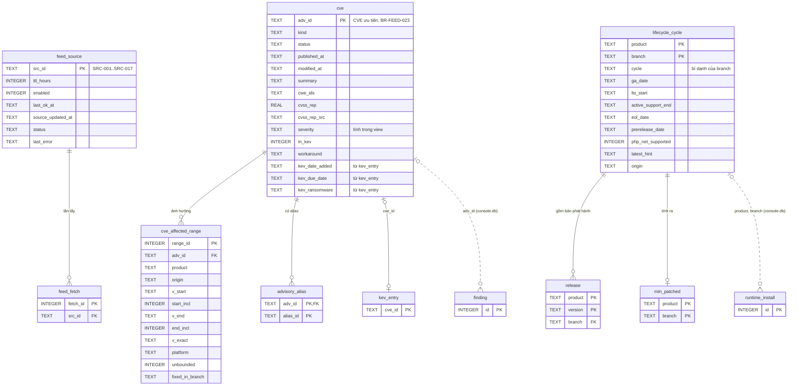

# Thực thể logic của `feeds.db` và danh mục tệp của CLI

## Lịch sử sửa đổi (Revision History)
| Phiên bản | Ngày | Người thực hiện | Tóm tắt thay đổi |
| :--- | :--- | :--- | :--- |
| 1.0.0 | 2026-10-22 | BA Agent | Khởi tạo: ánh xạ tên thực thể logic `cve`, `cve_affected_range`, `lifecycle_cycle`, `feed_source` sang bảng vật lý đã phát hành của `feeds.db`; định nghĩa `TEMP VIEW` (đã chạy thử); sơ đồ DIAG-ERD-QP-004; từ điển theo rules/09; danh mục tệp trong `STATE_DIR` và cấu trúc trường của các tệp nguồn của `console.db` |
| 1.0.1 | 2026-10-22 | BA Agent | §4–§7 theo rules/09: điền 18 ô "Diễn giải nghiệp vụ" còn trống (`kind`, `published_at`, `modified_at`, `cwe_ids`, `kev_date_added`, `kev_ransomware`, `range_id`, `adv_id`, `product`, `v_start`, `start_incl`, `v_end`, `v_exact`, `branch`, `prerelease_date`, `origin`, `source_updated_at`, `last_error`) và 4 ô "Ràng buộc" còn trống (`adv_id`, `v_start`, `v_end` của `cve_affected_range`; `active_support_end`); bổ sung giá trị `NULL` của cột KEV khi `in_kev = 0`; đồng bộ các diễn giải ngắn với DOC-SRS-QP-FEED-002 §2.2 (`BR-DATA-004`) |

## 1. Phạm vi và quy ước
- Tài liệu con của [erd.md](erd.md) (DOC-SRS-QP-ERD-001).
- **Phần A (§2–§7)**: `feeds.db` do `qp-feeds.py` dựng mỗi bundle; lược đồ vật lý gốc ở DOC-SRS-QP-FEED-002 §2.2 (DIAG-ERD-QP-FEED-001). Tài liệu này chỉ: (1) ánh xạ tên logic theo yêu cầu thiết kế; (2) chép lại từ điển các bảng được console dùng trực tiếp, kèm chỉ mục đề xuất. Khi bản chép lệch DOC-SRS-QP-FEED-002, DOC-SRS-QP-FEED-002 được ưu tiên (`BR-DATA-004`).
- **Phần B (§8–§9)**: tệp trong `STATE_DIR` là nguồn sự thật (`NT-01`); cấu trúc trường của các tệp mà SRS chưa liệt kê đầy đủ được đề xuất ở đây và đánh dấu "(đề xuất)".

## 2. Ánh xạ thực thể logic → bảng vật lý `feeds.db`

### 2.1 Bảng ánh xạ
| Thực thể logic | Bảng vật lý (`feeds.db`) | Cách console truy cập | Thay đổi so với bảng vật lý |
| :--- | :--- | :--- | :--- |
| `cve` | `advisory` LEFT JOIN `kev_entry` (theo `cve_id = adv_id`) | `TEMP VIEW cve` | Thêm `severity` (tính từ `cvss_rep` theo dải DOC-SRS-QP-FEED-002 §1.3), `kev_date_added`, `kev_due_date`, `kev_ransomware`. Bao gồm cả advisory không phải CVE (`GHSA-…`, `MAL-…`, `QP-SR-…`), phân biệt bằng `kind` |
| `cve_affected_range` | `affected_range` | `TEMP VIEW cve_affected_range` | Không đổi cột |
| `lifecycle_cycle` | `lifecycle_branch` | `TEMP VIEW lifecycle_cycle` | Thêm bí danh `cycle` = `branch` (tên trường `cycle` của endoflife.date) |
| `feed_source` | `feed_source` | Truy cập trực tiếp `feeds.feed_source` | Không đổi |
| (không đổi tên) | `release`, `min_patched`, `kev_entry`, `advisory_alias`, `advisory_score`, `fix_evidence`, `distro_fix`, `risk_assessment`, `feed_fetch`, `meta` | `feeds.<bảng>` | Từ điển ở DOC-SRS-QP-FEED-002 §2.2, không chép lại |

### 2.2 Định nghĩa `TEMP VIEW` (tạo trên mỗi kết nối sau `ATTACH`)
Chạy thử 2026-10-22 trên SQLite 3.45.1 với `feeds.db` mẫu đúng lược đồ DOC-SRS-QP-FEED-002: 3 view trả đúng dữ liệu; `VIEW` không có `TEMP` bị từ chối vì tham chiếu CSDL `ATTACH` (`NT-03`).

```sql
ATTACH DATABASE 'file:/var/lib/php-quickpatch/feeds/current/feeds.db?mode=ro' AS feeds;
CREATE TEMP VIEW cve AS
  SELECT a.adv_id, a.kind, a.status, a.published_at, a.modified_at, a.summary, a.cwe_ids,
         a.cvss_rep, a.cvss_rep_src,
         CASE WHEN a.cvss_rep IS NULL THEN NULL
              WHEN a.cvss_rep >= 9.0 THEN 'critical' WHEN a.cvss_rep >= 7.0 THEN 'high'
              WHEN a.cvss_rep >= 4.0 THEN 'medium' WHEN a.cvss_rep > 0 THEN 'low' ELSE 'none' END AS severity,
         a.in_kev, a.workaround,
         k.date_added AS kev_date_added, k.due_date AS kev_due_date, k.ransomware AS kev_ransomware
  FROM feeds.advisory AS a LEFT JOIN feeds.kev_entry AS k ON k.cve_id = a.adv_id;
CREATE TEMP VIEW cve_affected_range AS
  SELECT range_id, adv_id, product, origin, v_start, start_incl, v_end, end_incl, v_exact,
         platform, unbounded, fixed_in_branch
  FROM feeds.affected_range;
CREATE TEMP VIEW lifecycle_cycle AS
  SELECT product, branch, branch AS cycle, ga_date, lts_start, active_support_end, eol_date,
         prerelease_date, php_net_supported, latest_hint, origin
  FROM feeds.lifecycle_branch;
```
Đường dẫn ở ví dụ là `STATE_DIR` khi chạy root; người dùng không root thay bằng `~/.php-quickpatch/feeds/current/feeds.db` (DOC-SRS-QP-FEED-003 §2.1).

## 3. Sơ đồ (DIAG-ERD-QP-004)

Bảng chỉ có khoá ở sơ đồ (`feed_fetch`, `kev_entry`, `advisory_alias`, `release`, `min_patched`) có từ điển đầy đủ ở DOC-SRS-QP-FEED-002 §2.2; `finding`, `runtime_install` ở DOC-SRS-QP-ERD-002.

## 4. Thực thể `cve` (bảng vật lý `advisory` + `kev_entry`)
- **Nguồn**: `SRC-004` NVD, `SRC-005` CVE.org, `SRC-007` OSV, `SRC-008` GHSA, `SRC-011` Node.js Security WG, `SRC-006` KEV sau khử trùng lặp (`FR-FEED-NORM-001`, `BR-FEED-023`). Khoá chính `adv_id` = mã CVE nếu có, nếu không theo thứ tự GHSA → mã OSV → `QP-SR-…`.
- **Chỉ mục đề xuất cho `qp-feeds.py`**: `advisory(in_kev)`, `advisory(modified_at)` (đồng bộ tăng dần, `BR-FEED-002`); `kev_entry` dùng khoá chính `cve_id`.

| Tên trường (Logical) | Tên cột (Physical) | Kiểu dữ liệu | Độ dài | Cho phép Null? | Khóa (PK/FK) | Ràng buộc / Giá trị mặc định | Diễn giải nghiệp vụ |
| :--- | :--- | :--- | :--- | :--- | :--- | :--- | :--- |
| Mã chuẩn | adv_id | TEXT | 32 | Không | PK | CVE, GHSA, mã OSV hoặc `QP-SR-{product}-{version}` | Khoá logic của `finding.adv_id` |
| Loại | kind | TEXT | 12 | Không | - | `VULN`, `MALWARE`, `SEC_RELEASE` | `VULN` = lỗ hổng; `MALWARE` = package mã độc `MAL-*` (`BR-SEC-004`); `SEC_RELEASE` = advisory tạm `QP-SR-…` (`BR-FEED-024`); console dùng để tách advisory không phải CVE khỏi danh sách CVE |
| Trạng thái | status | TEXT | 20 | Không | - | `PUBLISHED`, `AWAITING_ANALYSIS`, `PENDING_NVD`, `RESERVED`, `REJECTED`, `WITHDRAWN` | `REJECTED`/`WITHDRAWN` bị loại khỏi mọi phép tính rủi ro và giữ 90 ngày (`BR-FEED-031`) |
| Ngày công bố | published_at | TEXT | 20 | Có | - | ISO-8601 UTC | Ngày nguồn công bố advisory; cột "ngày công bố" trên SCR-003 (`FR-CON-ASMT-001`) |
| Sửa đổi cuối | modified_at | TEXT | 20 | Không | - | ISO-8601 UTC | Mốc sửa đổi cuối của nguồn; dùng đồng bộ tăng dần (`BR-FEED-002`) |
| Tóm tắt | summary | TEXT | 500 | Có | - | Tiếng Anh nguyên văn, cắt 500 ký tự | Hiển thị SCR-003 |
| CWE | cwe_ids | TEXT | 128 | Có | - | Danh sách `CWE-<số>` phân tách dấu phẩy | Loại điểm yếu, chỉ hiển thị tham khảo; không là đầu vào điểm rủi ro (DOC-SRS-QP-FEED-002 §8.1) |
| Điểm CVSS đại diện | cvss_rep | REAL | - | Có | - | 0,0–10,0 | `BR-FEED-028` |
| Nguồn điểm | cvss_rep_src | TEXT | 24 | Có | - | vd `NVD:3.1:Primary`, `PROXY:high` | Truy vết |
| Mức độ | severity | TEXT | - | Có | - | Tính trong view: ≥ 9,0 `critical`; 7,0–8,9 `high`; 4,0–6,9 `medium`; 0,1–3,9 `low`; 0 `none` | Không lưu vật lý trong `advisory` (cột `severity` có ở `advisories.tsv`) |
| Trong KEV | in_kev | INTEGER | - | Không | - | 0/1 | `BR-SEC-001` |
| Gợi ý mitigation | workaround | TEXT | 1000 | Có | - | `containers.cna.workarounds` (`SRC-005`) | `FEAT-061` |
| Ngày thêm vào KEV | kev_date_added | TEXT | 10 | Có | - | `kev_entry.date_added` (`YYYY-MM-DD`); `NULL` khi `in_kev = 0` (LEFT JOIN không khớp) | `dateAdded` của `SRC-006`: ngày CISA đưa CVE vào KEV; hiển thị tham khảo kèm dòng KEV |
| Hạn xử lý KEV | kev_due_date | TEXT | 10 | Có | - | `kev_entry.due_date` (`YYYY-MM-DD`); `NULL` khi `in_kev = 0` | `dueDate` của `SRC-006`: hạn khắc phục CISA đặt cho cơ quan liên bang Mỹ; hiển thị kèm dòng KEV ở CLI, SCR-003 và báo cáo (`BR-SEC-001`); không là đầu vào điểm rủi ro |
| Ransomware | kev_ransomware | TEXT | 8 | Có | - | `Known`, `Unknown`; `NULL` khi `in_kev = 0` | `knownRansomwareCampaignUse` của `SRC-006`: `Known` = CISA đã ghi nhận chiến dịch ransomware khai thác CVE; hiển thị tham khảo, không đổi điểm rủi ro (`S_kev` chỉ phụ thuộc `in_kev`, `BR-FEED-040`) |

## 5. Thực thể `cve_affected_range` (bảng vật lý `affected_range`)
- **Nguồn**: cấu hình CPE NVD, dữ liệu CNA, OSV, GHSA, Node.js WG, tín hiệu bản bảo mật (DOC-SRS-QP-FEED-002 §5). Khoá ngoại `adv_id → advisory` nằm trong cùng tệp `feeds.db`.
- **Chỉ mục đề xuất**: `affected_range(adv_id)`; `affected_range(product, origin)` cho so khớp phiên bản (`BR-FEED-022`).

| Tên trường (Logical) | Tên cột (Physical) | Kiểu dữ liệu | Độ dài | Cho phép Null? | Khóa (PK/FK) | Ràng buộc / Giá trị mặc định | Diễn giải nghiệp vụ |
| :--- | :--- | :--- | :--- | :--- | :--- | :--- | :--- |
| Mã dòng | range_id | INTEGER | - | Không | PK | Tự tăng | Định danh 1 dải của 1 advisory |
| Mã chuẩn | adv_id | TEXT | 32 | Không | FK → advisory (`cve`) | Phải tồn tại trong `advisory.adv_id` | Advisory có dải này; 1 advisory có nhiều dải (theo nhánh, theo nguồn); nối `cve.adv_id` khi console liệt kê dải của 1 CVE |
| Sản phẩm | product | TEXT | 32 | Không | - | `php`, `node`, `wordpress`, `npm:<name>`, `composer:<name>` | Sản phẩm bị ảnh hưởng, khớp với runtime/package đang quét (`runtime_install.kind`, `package_finding`) |
| Nguồn dải | origin | TEXT | 12 | Không | - | `NVD_CPE`, `CNA`, `GHSA`, `OSV`, `NODE_WG`, `SEC_RELEASE` | Chọn dải theo thứ tự `BR-FEED-022`; khi các nguồn cho phiên bản sửa khác nhau, chọn giá trị lớn nhất (`BR-FEED-027`) |
| Cận dưới | v_start | TEXT | 32 | Có | - | Phiên bản; `NULL` = không có cận dưới hoặc dòng dùng `v_exact` | Bản đầu tiên bị ảnh hưởng |
| Bao gồm cận dưới | start_incl | INTEGER | - | Không | - | 0/1; mặc định 1 | 1 = `versionStartIncluding`/`introduced`; 0 = `versionStartExcluding` |
| Cận trên | v_end | TEXT | 32 | Có | - | Phiên bản; `NULL` = không có cận trên hoặc dòng dùng `v_exact` | Mốc kết thúc dải bị ảnh hưởng |
| Bao gồm cận trên | end_incl | INTEGER | - | Không | - | 0/1 | 1 = `versionEndIncluding`/`lessThanOrEqual`/`last_affected`; 0 = `versionEndExcluding`/`lessThan`/`fixed` |
| Phiên bản đơn | v_exact | TEXT | 32 | Có | - | Khi CPE ghi phiên bản cụ thể | Chỉ đúng phiên bản này bị ảnh hưởng (DOC-SRS-QP-FEED-002 §5.1) |
| Nền tảng | platform | TEXT | 16 | Không | - | `any`, `windows`, `macos` | Dải `windows`/`macos` bị loại khi máy chủ là Linux (`BR-FEED-022`) |
| Không giới hạn | unbounded | INTEGER | - | Không | - | 0/1 | 1 khi CPE `*` không có cận: dải không xác định được phiên bản, liệt kê riêng, không tính khi so khớp (DOC-SRS-QP-FEED-002 §5.1) |
| Bản sửa trong nhánh | fixed_in_branch | TEXT | 32 | Có | - | Cận trên loại trừ nếu cùng nhánh | Tính `min_patched` (DOC-SRS-QP-FEED-002 §6) |

Sai lệch phát hiện: `affected.tsv` (DOC-SRS-QP-FEED-003 §3.2) có cột `assessed` và cờ này được định nghĩa ở DOC-SRS-QP-FEED-002 §1.3 (`BR-FEED-029`), nhưng bảng `affected_range` ở DOC-SRS-QP-FEED-002 §2.2 không có cột `assessed` (`Q-ERD-08`, ERD-001 §7). View `cve_affected_range` sẽ thêm cột này khi DOC-SRS-QP-FEED-002 được sửa.

## 6. Thực thể `lifecycle_cycle` (bảng vật lý `lifecycle_branch`)
- **Nguồn**: `SRC-001` endoflife.date, `SRC-003` php.net, `SRC-010` Node.js Release schedule, bản ghi tĩnh (`FR-FEED-EOL-001..003`, ưu tiên nguồn `BR-FEED-020`). `lifecycle_status` **không** lưu: tính tại thời điểm chạy theo ngày UTC (`BR-SCN-003`).
- **Chỉ mục**: khoá chính (`product`, `branch`); không cần chỉ mục phụ vì mọi truy vấn tra theo đúng khoá chính; số dòng = số nhánh của các sản phẩm (PHP 19 nhánh, Node.js 30 dòng theo `coverage` của DOC-SRS-QP-FEED-003 §3.1; WordPress và framework chưa đếm).

| Tên trường (Logical) | Tên cột (Physical) | Kiểu dữ liệu | Độ dài | Cho phép Null? | Khóa (PK/FK) | Ràng buộc / Giá trị mặc định | Diễn giải nghiệp vụ |
| :--- | :--- | :--- | :--- | :--- | :--- | :--- | :--- |
| Sản phẩm | product | TEXT | 16 | Không | PK | `php`, `node`, `wordpress`, `laravel`, `symfony`, `drupal`, `magento`, `composer` | Khớp `runtime_install.kind` |
| Nhánh | branch | TEXT | 8 | Không | PK | PHP `X.Y`, Node.js `N` hoặc `0.N`, WordPress `X.Y` | Nhánh phát hành; khoá chính gồm (`product`, `branch`); khớp `runtime_install.branch` để tra vòng đời và `min_patched` |
| Chu kỳ | cycle | TEXT | 8 | Không | - | Bí danh của `branch` trong view | Tên trường của endoflife.date |
| Ngày GA | ga_date | TEXT | 10 | Có | - | `YYYY-MM-DD` | Ngày phát hành bản GA đầu tiên của nhánh; điều kiện GA ≤ hôm nay − 90 ngày khi chọn đích (`BR-SCN-005` (b)) |
| Bắt đầu LTS | lts_start | TEXT | 10 | Có | - | `YYYY-MM-DD`; `NULL` khi nhánh không có LTS (PHP, WordPress, Node.js số lẻ) | Node.js: trước ngày này nhánh ở `CURRENT`, không được chọn làm đích production (`BR-SCN-007`); tính `is_lts` của `assessment.current` (`FR-ASMT-CUR-001`) |
| Hết hỗ trợ chủ động | active_support_end | TEXT | 10 | Có | - | `YYYY-MM-DD`; PHP `support`/`eoasFrom`; Node.js `maintenance` | Sau ngày này nhánh chỉ nhận bản sửa bảo mật: PHP `ACTIVE` → `SECURITY_ONLY`, Node.js → `MAINTENANCE_LTS` (DOC-SRS-QP-SCN-000 §2.1) |
| Ngày EOL | eol_date | TEXT | 10 | Có | - | `YYYY-MM-DD`; `NULL` = chưa công bố | Mốc trạng thái `EOL`, đầu vào `d` của điểm rủi ro (DOC-SRS-QP-FEED-002 §8.1) và hạn duyệt kế hoạch (`FR-PLAN-DL-001`) |
| Ngày pre-release | prerelease_date | TEXT | 10 | Có | - | `YYYY-MM-DD`; Node.js `alpha` | Nhánh chỉ có trong nguồn pre-release → `PRE_RELEASE` (DOC-SRS-QP-SCN-000 §2.1), không được chọn làm đích production (`BR-SCN-007`) |
| php.net còn hỗ trợ | php_net_supported | INTEGER | - | Có | - | 0/1 | Đối chiếu `BR-FEED-020` |
| Bản mới nhất (tham khảo) | latest_hint | TEXT | 32 | Có | - | `latest.name` của `SRC-001` | Không dùng làm mốc vá (`BR-DATA-002`) |
| Nguồn | origin | TEXT | 16 | Không | - | `SRC-001`, `SRC-003`, `SRC-010`, `STATIC` | Nguồn của giá trị vòng đời được chọn theo `BR-FEED-020`; `STATIC` = bản ghi tĩnh (`FR-FEED-EOL-002`); truy vết khi 2 nguồn lệch ngày > 3 ngày (`ERR-FEED-409-01`) |

## 7. Thực thể `feed_source` (bảng vật lý `feed_source`)
- **Nguồn**: `sources.conf` (cấu hình, không chứa key) + kết quả mỗi lần đồng bộ (`FR-FEED-SYNC-001`); trạng thái theo DIAG-STATE-QP-FEED-002. Mỗi bundle có bản `feed_source` riêng trong `feeds.db` của nó; lịch sử qua các bundle giữ ở `console.db.feed_bundle.sources_json`.
- **Chỉ mục**: khoá chính `src_id` (17 dòng `SRC-001..017`).

| Tên trường (Logical) | Tên cột (Physical) | Kiểu dữ liệu | Độ dài | Cho phép Null? | Khóa (PK/FK) | Ràng buộc / Giá trị mặc định | Diễn giải nghiệp vụ |
| :--- | :--- | :--- | :--- | :--- | :--- | :--- | :--- |
| Mã nguồn | src_id | TEXT | 7 | Không | PK | Regex `^SRC-\d{3}$` | `SRC-001`..`SRC-017` |
| TTL | ttl_hours | INTEGER | - | Không | - | 6 hoặc 24 (`BR-FEED-001`) | Số giờ tối đa giữa 2 lần lấy; quá TTL thì `feeds update` lấy lại nguồn |
| Bật | enabled | INTEGER | - | Không | - | 0/1; `SRC-013` mặc định 0 | 1 = nguồn tham gia `feeds update`; `SRC-013` cần API key nên chỉ bật khi có key (`FR-FEED-WCVE-002`, `BR-FEED-011`) |
| Lần lấy thành công cuối | last_ok_at | TEXT | 20 | Có | - | ISO-8601 UTC; `NULL` = chưa lấy thành công lần nào | Tính `data_age_h` (`FR-FEED-AGE-001`) và mức tươi trên SCR-008 (`BR-FEED-005`) |
| Thời điểm nguồn cập nhật | source_updated_at | TEXT | 20 | Có | - | ISO-8601 UTC | Mốc dữ liệu phía nguồn: `dateReleased` (KEV), `generated_at` (endoflife.date), `lastModified` lớn nhất (NVD); hiển thị cạnh `last_ok_at` để phân biệt "lấy gần đây" với "dữ liệu nguồn mới" |
| Trạng thái | status | TEXT | 16 | Không | - | `OK`, `DEGRADED`, `FAILED`, `DISABLED` | Trạng thái sau lần đồng bộ gần nhất (DIAG-STATE-QP-FEED-002), hiển thị ở `feeds status` và SCR-008 |
| Lỗi cuối | last_error | TEXT | 64 | Có | - | Mã `ERR-FEED-*`; `NULL` khi lần lấy gần nhất thành công | Lý do lỗi hiển thị cạnh trạng thái `DEGRADED`/`FAILED` trên SCR-008 và `feeds status` |

## 8. Danh mục tệp trong `STATE_DIR` và cấu hình (Phần B)
Quyền mặc định theo `NFR-SEC-010`: `STATE_DIR` `0700` (root: `0750` được phép), thư mục `audit/`, `jobs/`, `console/`, `plans/` `0700`, tệp `0600`; `feeds/` theo DOC-SRS-QP-FEED-003 §2.1. "Nguyên tử" = ghi tệp tạm cùng thư mục rồi `rename`. Cột "Nhập vào" = bảng `console.db` (DOC-SRS-QP-ERD-002/003). Thời hạn giữ: ERD-001 §4.

| Đường dẫn (tương đối `STATE_DIR`) | Định dạng | Bên ghi | Cách ghi | Giới hạn | Nhập vào |
| :--- | :--- | :--- | :--- | :--- | :--- |
| `.lock` | Rỗng (khoá `flock`) | CLI | `flock -x`/`-s` (`BR-JOB-002`) | — | — |
| `php-quickpatch.log` | Văn bản (v0.1) | CLI | Ghi nối | Không giới hạn (`Q-ERD-05`) | — |
| `state/last-scan.json` | JSON `qp.scan/1` (envelope `FR-CLI-JSON-001`) | CLI `scan --json` | Nguyên tử | 1 tệp, bản mới nhất | `host`, `scan_run`, `runtime_install`, `site`, `project`, `finding`, `package_finding` |
| `plans/<plan_id>/plan.json` | JSON `qp.plan/1` | `qp-feeds.py` qua lệnh `plan` | Nguyên tử (`NFR-REL-006`) | — | `upgrade_plan`, `plan_site` |
| `plans/<plan_id>/items.json` | JSON (mảng mục) | `qp-feeds.py` qua lệnh `plan` | Nguyên tử | — | `checklist_item` |
| `plans/<plan_id>/events.jsonl` | JSONL | `qp-feeds.py` | Ghi nối | — | — (đọc trực tiếp khi xem lịch sử mục) |
| `plans/<plan_id>/compat/<site_id>.json` | JSON (hit tương thích) | `qp-feeds.py` | Nguyên tử | Đoạn trích ≤ 200 ký tự/hit | — (đề xuất tên tệp, `Q-ERD-03`) |
| `plans/<plan_id>/rector.diff` | Diff | `qp-feeds.py` (Rector, tuỳ chọn) | Nguyên tử | — | — (`FR-CMPT-RCT-001`) |
| `jobs/<job_id>/job.json` | JSON | `qp-console.py` | Nguyên tử | — | `job` |
| `jobs/<job_id>/phase` | Văn bản 1 dòng | CLI của job | Nguyên tử | ≤ 32 byte | `job.phase` |
| `jobs/<job_id>/output.log` | Văn bản | `qp-console.py` (stderr + dòng log của tiến trình con) | Ghi nối | ≤ 20 MiB (`FR-JOB-LOG-001`) | `job_log` |
| `jobs/<job_id>/result.json` | JSON envelope của lệnh | `qp-console.py` (stdout tiến trình con) | Nguyên tử | — | `job`; `scan_run`/`assessment` khi `action` ∈ {`scan`, `assess`} |
| `switches/index.tsv` | TSV | CLI `migrate` | Ghi nối | — | `site_migration` |
| `switches/<site_id>.lock` | Rỗng (khoá site) | CLI `migrate switch` | `flock` trong cửa sổ health check | — | — |
| `backups/<run_id>/manifest` | TSV v0.1 `ACTION<TAB>ARG1<TAB>ARG2` | CLI (`record`, `backup_file`) | Ghi nối trước mỗi thay đổi | — | `backup_run`, `migration` |
| `backups/<run_id>/files/…` | Bản sao tệp gốc (`cp -a`) | CLI | — | Tổng `backups/` cảnh báo > 1 GiB | `backup_run.files_bytes` |
| `backups/<run_id>/switch.json` | JSON | CLI `migrate switch` | Nguyên tử ở mỗi lần đổi trạng thái | — | `site_migration` |
| `backups/<run_id>/baseline.json`, `hc.json` | JSON (DOC-SRS-QP-ENV-002 §4, §6) | CLI | Nguyên tử | ≤ 50 dòng log vi phạm (`BR-HC-011`) | — (đọc trực tiếp, `FR-UPG-HC-006`) |
| `audit/audit-YYYYMM.jsonl` | JSONL, chuỗi hash | CLI, `qp-console.py`, `qp-feeds.py` | `O_APPEND` (`BR-AUD-002`) | Tăng ≤ 10 MiB/tháng (`NFR-CAP-001`) | `audit_event` |
| `console/serve.pid` | Văn bản 1 dòng | `qp-console.py` | Nguyên tử; xoá khi dừng | — | — |
| `reports/<report_id>.<json\|csv\|md\|html>` | Báo cáo (`BR-RPT-001`) | `qp-feeds.py` qua lệnh `report` | Không ghi đè (`BR-RPT-003`) | HTML ≤ 5 MiB | — |
| `tools/php/tools_manifest.json` | JSON | CLI (`FR-CMPT-TOOL-001`) | Nguyên tử | `tools/php` ≤ 80 MB (`NFR-CAP-002`) | — |
| `work/<plan_id>/`, `work/upload-<job_id>.tar.gz` | Tạm | `qp-feeds.py`, `qp-console.py` | — | Tải lên ≤ 20 MiB | — |
| `feeds/current/manifest.json`, `SHA256SUMS`, `*.tsv`, `feeds.db` | Bundle (DOC-SRS-QP-FEED-003 §3) | `qp-feeds.py` | Dựng ở `staging/`, `rename` (`BR-FEED-051`) | `feeds/` ≤ 60 MB | `feed_bundle`; `feeds.db` qua `ATTACH` |
| `feeds/raw/SRC-xxx/*` + `.meta.json`, `feeds/cache/…`, `feeds/state/sync-status.json` | JSON (gzip khi > 1 MB) | `qp-feeds.py` | Nguyên tử | DOC-SRS-QP-FEED-003 §2.3 | — (`feeds status --json` cho SCR-008) |
| `feeds/snapshots/imported/<generated_at>-<sha256[0:8]>.tar.gz` | tar.gz | CLI `feeds import` | Sao chép sau khi kiểm SHA-256 | 3 gói | `feed_snapshot` |
| `/etc/php-quickpatch/sites.d/<site_id>.conf` (không root: `~/.config/php-quickpatch/sites.d/`) | Dòng `khoá giá trị` (DOC-SRS-QP-ENV-002 §2, §3.2) | Người vận hành; console qua `PATCH /api/v1/sites/{site_id}` | Nguyên tử | ≤ 10 dòng `hc_url` | `site.hc_urls_json`, `site.hc_mode` |
| `/etc/php-quickpatch/feeds.conf` | `KEY=value` (chứa key) | Người vận hành | — | Quyền `0600` (`BR-FEED-011`) | **Không bao giờ nhập** (ERD-001 §5) |

## 9. Cấu trúc trường của tệp nguồn
Trường đã quy định ở SRS được ghi kèm mã FR; trường bổ sung để đủ cột của `console.db` ghi "(đề xuất)". Mọi chuỗi đã che theo `BR-SEC-006` trước khi ghi.

### 9.1 `state/last-scan.json` (`qp.scan/1`) → bảng
| Trường JSON | Bảng.cột | Ghi chú |
| :--- | :--- | :--- |
| `schema`, `tool.version`, `generated_at`, `command.argv`, `dry_run`, `exit_code` | `scan_run.schema_ver`, `tool_version`, `generated_at`, `argv_masked`, —, `exit_code` | Envelope `FR-CLI-JSON-001` |
| `host.hostname`, `host.os`, `host.kernel`, `host.is_root`, `host.in_container` | `host.hostname`, `os_id` + `os_version`, `kernel`, `is_root_scan` (và `scan_run.is_root`), `in_container` | |
| `data.bundle_id`, `data.freshness`, `data.data_age_h`; `catalog_version` | `scan_run.bundle_id`, `freshness`, `data_age_h`, `catalog_version` | DOC-SRS-QP-FEED-003 §3.5 |
| `result.environment{pb_provider, pb_bindings[], pb_node[], in_container, evidence[], restrictions[]}` | `host.pb_provider`, `host.environment_json` | `FR-SCAN-ENV-001`, `FR-SCN-ENV-001` |
| `result.runtimes[]` | `runtime_install` (1 dòng/phần tử) + `finding` loại `RUNTIME_ADVISORY` cho từng CVE chưa vá | `FR-SCAN-RT-001/002`, `FR-ASMT-CUR-001` |
| `result.site_bindings[]` (đề xuất tên mảng; cấu trúc DOC-SRS-QP-ENV-001 §4.2) | `site` | `FR-SCAN-MAP-001` |
| `result.projects[]`, `result.containers[]` | `project`; container chỉ tạo `finding` loại `CONTAINER_RUNTIME` | `FR-SCAN-PRJ-001/002` |
| `result.dependency_findings[]`, `result.wordpress_findings[]`, `result.webshell_findings[]`, `result.drift_warnings[]` | `package_finding`; `finding` loại `WORDPRESS_ADVISORY`, `WEBSHELL`, `BINDING_DRIFT` | `FR-ASMT-DEP-001/002`, `FR-SCAN-WSH-001`, `FR-SCAN-DRF-001` |
| `result.ranking[]`, `result.plan_deadlines[]` | `runtime_install.risk_score`, `risk_level`; hạn duyệt tính lại từ `upgrade_plan` | `FR-ASMT-RANK-001`, `FR-PLAN-DL-001` |
| `result.scan_fingerprint` (đề xuất vị trí) | `scan_run.scan_fingerprint` | `FR-PLAN-GEN-001` |

### 9.2 `plans/<plan_id>/plan.json` (`qp.plan/1`) và `items.json`
| Trường JSON | Bảng.cột |
| :--- | :--- |
| `plan_id`, `runtime_id`, `mode`, `from_branch`, `status`, `stale`, `stale_reasons[]` | `upgrade_plan.plan_id`, `runtime_ref` (tra `runtime_install`), `mode`, `from_branch`, `status`, `stale`, `stale_reasons_json` |
| `target{branch, patch_version, types[], override_reason}` (`FR-PLAN-TGT-001`) | `target_branch`, `target_patch_version`, `target_types_json`, `override_reason` |
| `inputs{bundle_id, catalog_version, scan_fingerprint}` (`FR-PLAN-GEN-001`) | `bundle_id`, `catalog_version`, `scan_fingerprint` |
| `site_order[]`, `canary_site_id`, `blocked_sites[]` (`FR-PLAN-GEN-002`) | `plan_site.seq_no`, `is_canary`, `blocked_reason`; `upgrade_plan.canary_site_id` |
| `compat_verdict{<site_id>: {status, errors, warnings, waived, pending_parts[], php_file_count, scanned_at}}` (`FR-CMPT-RES-001`) | `plan_site.compat_status`, `n_errors`, `n_warnings`, `n_waived`, `pending_parts_json`, `php_file_count`, `compat_scanned_at` |
| `upgrade_items[]`, `preconditions[]`, `deadline` | `upgrade_items_json`, `preconditions_json`, `approval_deadline` |
| `created_by`, `approved_by`, `created_at`, `approved_at`, `started_at`, `ended_at`, `superseded_by` | Cột cùng tên |
| `items.json[]`: `chk_id`, `site_id`, `scenario_id`, `phase`, `exec_type`, `seq_no`, `action`, `cli_action`, `verified`, `required`, `applies_when`, `depends_on[]`, `item_status`, `reason`, `evidence`, `last_job_id`, `updated_by`, `started_at`, `done_at`, `updated_at` | `checklist_item` (cột cùng nghĩa; `action` → `action_text`, `required` → `is_required`, `site_id` → `site_ref`) |
| `events.jsonl`: `{ts, actor, chk_id, site_id, from_status, to_status, job_id, reason}` (đề xuất) | Không nhập |

### 9.3 `jobs/<job_id>/`
| Tệp / trường | Bảng.cột |
| :--- | :--- |
| `job.json`: `job_id`, `action`, `kind`, `dry_run`, `params`, `params_sha256`, `argv`, `target_ref`, `confirm_dry_run_job_id`, `serve_instance_id`, `auth_kind`, `session_hash`, `actor`, `sys_user`, `state`, `end_reason`, `pid`, `pid_start_ticks`, `exit_code`, `errors[]`, `timeout_s`, `bundle_id`, `scan_fingerprint`, `plan_id`, `chk_id` + `site_id`, `run_id`, `log_bytes`, `log_truncated`, `created_at`, `started_at`, `ended_at` | `job` (cột cùng nghĩa). `FR-JOB-RUN-001` quy định tối thiểu `job_id`, `action`, `argv` đã che, `actor`, `state`, `created_at`, `started_at`, `ended_at`, `exit_code`, `result`; các trường còn lại (đề xuất) để kiểm `BR-CON-005`, `BR-JOB-005` |
| `phase`: 1 trong `MANIFEST_WRITTEN`, `CHANGING`, `VERIFYING`, `HC_RUNNING` hoặc rỗng | `job.phase` |
| `result.json`: envelope `qp.<lệnh>/1` | `job.result_sha256`; bảng nghiệp vụ theo `action` |
| `output.log`: mỗi dòng `<ts> <stream> <nội dung>` (đề xuất tiền tố) | `job_log` (chỉ dòng mức `WARN`/`VULN`/`ERROR`/`PHASE`) |

### 9.4 `switches/index.tsv` (đề xuất cột, theo `Q-ERD-02`)
Dòng đầu là tên cột bắt đầu bằng `#` (quy ước TSV của DOC-SRS-QP-FEED-003 §3.2); 1 dòng ghi nối mỗi lần lượt đổi trạng thái; trạng thái hiện hành = dòng cuối của `run_id`.

```text
#ts	run_id	site_id	from>to	status	actor	plan_id	job_id	rollback_reason
2026-10-22T09:41:07.120Z	20261022-094105	shop.example.com	8.2>8.5	PREFLIGHT	console:root	PLN-20261022-093000-ab12	JOB-20261022-094100-1f2e	-
2026-10-22T09:41:31.455Z	20261022-094105	shop.example.com	8.2>8.5	SWITCHED	console:root	PLN-20261022-093000-ab12	JOB-20261022-094100-1f2e	-
```
Giá trị trong ví dụ là minh hoạ định dạng, không phải dữ liệu thật.

### 9.5 `backups/<run_id>/switch.json` (đề xuất trường)
`run_id`, `site_id`, `pb_id`, `binding_kind`, `binding_ref`, `from_branch`, `to_branch`, `old_bin`, `new_bin`, `plan_id`, `no_plan_reason`, `install_run_id`, `job_id`, `actor`, `status`, `hc_mode`, `auto_rollback`, `probe{ok, fcgi_status, stderr_excerpt}`, `verify{method, ok}` (bước C10), `hc_verdict`, `violations[]`, `rollback_reason`, `rollback_available`, `errors[]`, `t_start`, `t_switched`, `t_hc_end`, `t_rollback_end`. Ánh xạ sang `site_migration` theo tên cột; `install_run_id` → `migration_id` (tra `migration.install_run_id`).

### 9.6 `audit/audit-YYYYMM.jsonl`
Trường theo `FR-JOB-AUD-001`: `seq`, `ts`, `actor`, `sys_user`, `source`, `action`, `args`, `job_id`, `run_id`, `plan_id`, `result`, `exit_code`, `prev_hash`, `hash`. Bổ sung (đề xuất) trường `kind` ∈ {`intent`, `result`, `event`} để phân biệt bản ghi "intent"/"result" mà `BR-AUD-004` yêu cầu → `audit_event.record_type`. `args`, `prev_hash` không nhập (ERD-003 §11). `hash` tính trên JSON chuẩn hoá khoá sắp theo bảng chữ cái, không gồm trường `hash` (`BR-AUD-003`).

### 9.7 `console/serve.pid` (đề xuất định dạng)
1 dòng TSV: `<pid>\t<port>\t<started_at>\t<serve_instance_id>`. `FR-CON-AUTH-001` quy định PID + cổng; `started_at` và `serve_instance_id` (16 byte hex, không phải bí mật) bổ sung để đối chiếu `job.serve_instance_id`. Không ghi token hay hash token (`BR-AUTH-001`).

## 10. Tài liệu tham chiếu
Xem [erd.md §8](erd.md). Cấu trúc nguồn: [data-sources-merge-risk.md §1.3, §2](data-sources-merge-risk.md), [data-sources-cache-cli.md §2, §3, §4](data-sources-cache-cli.md), [spec.md §2.1, §3.3.4](spec.md), [functional-requirements.md §5, §6, §10, §11](functional-requirements.md), [environment-playbooks.md §4, §5](environment-playbooks.md), [environment-playbooks-healthcheck.md §2–§6](environment-playbooks-healthcheck.md).
