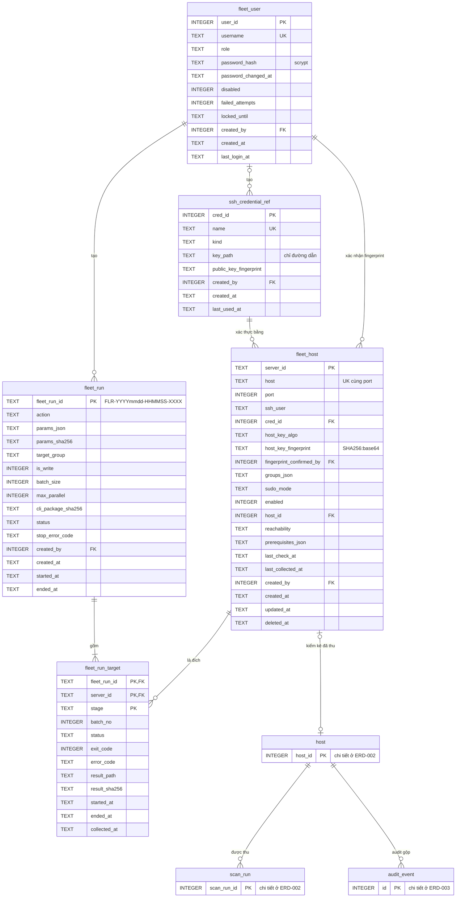

# Từ điển dữ liệu `central.db` — Phase 2

## Lịch sử sửa đổi (Revision History)
| Phiên bản | Ngày | Người thực hiện | Tóm tắt thay đổi |
| :--- | :--- | :--- | :--- |
| 1.0.0 | 2026-10-22 | BA Agent | Khởi tạo (chỉ đặc tả, Phase 2 chưa triển khai): sơ đồ DIAG-ERD-QP-005; từ điển theo rules/09 cho `fleet_host`, `ssh_credential_ref`, `fleet_user`, `fleet_run`, `fleet_run_target`; tái sử dụng lược đồ kiểm kê của `console.db`; lưu giữ và bí mật Phase 2. Lược đồ đã chạy thử trên SQLite 3.45.1 cùng lược đồ `console.db` |
| 1.0.1 | 2026-10-22 | BA Agent | Thống nhất định danh với DOC-API-QP-006 §3 và wireframe SCR-020/SCR-022: `fleet_run_id` `^FLR-[0-9]{8}-[0-9]{6}-[0-9a-f]{4}$` (thay `FRN-…`; độ dài sửa 23 → 24), `server_id` `^[a-z0-9][a-z0-9_.-]{0,62}$` (độ dài 64 → 63), thêm `CHECK` đã chạy thử; điền đủ cột "Ràng buộc" (15 dòng) và "Diễn giải nghiệp vụ" (31 dòng) theo rules/09 cho 5 bảng; làm rõ cơ chế ghim khoá máy chủ (`known_hosts.d/<server_id>` ghi ở bước S0, không sinh từ fingerprint) |

## 1. Phạm vi và quy ước
- `central.db` là SQLite trên máy trung tâm (`FR-FLT-INV-001`), do console trung tâm ghi; máy trung tâm cũng chỉ bind `127.0.0.1`, truy cập qua SSH tunnel (`C-SRS-06`). Đường dẫn đề xuất: `STATE_DIR/central.db` của máy trung tâm.
- Khác `console.db` Phase 1: các bảng `fleet_*`, `ssh_credential_ref` **là nguồn sự thật** (không có tệp gốc); chính sách sao lưu `central.db` chưa quy định (`Q-ERD-09`, ERD-001 §7).
- Ràng buộc SQLite, quy ước kiểu, PRAGMA, quyền tệp như [erd.md §2.3, §2.5](erd.md). Không lưu bí mật: [erd.md §5](erd.md).
- Định danh Phase 2 dùng đúng định dạng của hợp đồng API [api-spec-phase2.md §3](../api/api-spec-phase2.md) (DOC-API-QP-006) và wireframe SCR-020, SCR-022: `server_id` `^[a-z0-9][a-z0-9_.-]{0,62}$` (1–63 ký tự), `fleet_run_id` `^FLR-[0-9]{8}-[0-9]{6}-[0-9a-f]{4}$` (24 ký tự). Đề xuất ban đầu của `Q-ERD-07` ở erd.md (`FRN-…`, 64 ký tự) được thay bằng định dạng này; erd.md cần cập nhật dòng `Q-ERD-07` tương ứng.

## 2. Tái sử dụng lược đồ kiểm kê
`central.db` chứa cùng định nghĩa bảng `host`, `scan_run`, `runtime_install`, `site`, `project`, `finding`, `package_finding`, `assessment`, `feed_bundle`, `audit_event` như `console.db` (DOC-SRS-QP-ERD-002, DOC-SRS-QP-ERD-003 §11), với các khác biệt:

| Bảng | Khác biệt ở `central.db` |
| :--- | :--- |
| `host` | 1 dòng mỗi server đã thu dữ liệu, `is_local = 0`; nối `fleet_host.host_id` |
| `scan_run` | `origin = FLEET`; `result_path` trỏ tệp JSON thu về trên máy trung tâm (`fleet/results/<fleet_run_id>/<server_id>.json`, đề xuất) |
| `audit_event` | Gộp audit máy trung tâm (`source = central`) và audit thu từ server; giữ `hash` gốc từng server, kiểm chuỗi theo từng `host_id` (`FR-FLT-AUD-001`) |
| `upgrade_plan`, `checklist_item`, `job`, `job_log`, `migration`, `site_migration`, `backup_run` | Không sao chép lên máy trung tâm: kế hoạch, job, manifest nằm trên từng server; màn hình đi sâu đọc từ JSON đã thu ở chế độ chỉ đọc (`FR-FLT-DASH-002`) |

Độ tươi (`BR-FLT-006`): `fleet_host.last_collected_at` > 24 giờ → nhãn "cũ"; > 7 ngày → loại khỏi số liệu tổng của SCR-021, liệt kê riêng.

## 3. Sơ đồ (DIAG-ERD-QP-005)

## 4. Bảng `fleet_host` — danh mục server
- **Nguồn**: `POST/PATCH/DELETE /api/v1/servers` (vai trò Admin, `BR-FLT-008`); kiểm kết nối `POST /api/v1/servers/{server_id}/connection-checks` (`FR-FLT-INV-002`). Xoá = xoá mềm (`deleted_at`) để giữ lịch sử `fleet_run_target`. Ghim khoá máy chủ (`BR-FLT-002`): tệp `known_hosts.d/<server_id>` (quyền `0600`) chỉ được ghi ở bước S0 khi khoá do `ssh-keyscan` thu về có fingerprint SHA256 (`ssh-keygen -l -E sha256`) bằng `host_key_fingerprint` (DOC-API-QP-006 §4.3); cột fingerprint là giá trị đối chiếu, không đủ để tự sinh dòng `known_hosts` vì không chứa khoá công khai.
- **Chỉ mục**: `UNIQUE (host, port)`; `ix_fleet_host_cred (cred_id)`; `ix_fleet_host_collected (last_collected_at) WHERE deleted_at IS NULL`.
- **CHECK định danh** (chạy thử SQLite 3.45.1: nhận `web01` và chuỗi 63 ký tự; từ chối chuỗi 64 ký tự, `Web01`, `-web`, `web 01`): `CHECK (length(server_id) BETWEEN 1 AND 63 AND server_id GLOB '[a-z0-9]*' AND server_id NOT GLOB '*[^a-z0-9_.-]*')`; regex đầy đủ kiểm thêm ở tầng Python (erd.md §2.5).

| Tên trường (Logical) | Tên cột (Physical) | Kiểu dữ liệu | Độ dài | Cho phép Null? | Khóa (PK/FK) | Ràng buộc / Giá trị mặc định | Diễn giải nghiệp vụ |
| :--- | :--- | :--- | :--- | :--- | :--- | :--- | :--- |
| Mã server | server_id | TEXT | 63 | Không | PK | Regex `^[a-z0-9][a-z0-9_.-]{0,62}$` (1–63 ký tự, DOC-API-QP-006 §3, `Q-ERD-07`); không đổi sau khi tạo (`PATCH` không nhận `server_id`) | Tên do Admin đặt, là tham số `{server_id}` của API; dùng làm tên tệp `known_hosts.d/<server_id>`, `fleet/results/<fleet_run_id>/<server_id>.json` và phần sau dấu `:` của `QP_JOB_ID` trên server |
| Địa chỉ | host | TEXT | 253 | Không | Unique (cùng `port`) | Tên miền ≤ 253 ký tự hoặc địa chỉ IPv4/IPv6; không chứa `user@` | Đích kết nối `<ssh_user>@<host>`; cặp (`host`, `port`) duy nhất để 1 máy chủ chỉ có 1 bản ghi, không bị tính 2 lần trên SCR-021 |
| Cổng SSH | port | INTEGER | - | Không | Unique (cùng `host`) | 1–65.535; mặc định 22 | Tham số `-p <port>` của `ssh` và `ssh-keyscan` |
| Người dùng SSH | ssh_user | TEXT | 32 | Không | - | Regex `^[a-z_][a-z0-9_-]{0,31}$` (DOC-API-QP-006 §3.2) | Tài khoản đăng nhập trên server được quản lý; lệnh cấp hệ thống cần root hoặc `sudo_mode = sudo-n` (`BR-CLI-005`) |
| Tham chiếu khoá | cred_id | INTEGER | - | Không | FK → ssh_credential_ref | `ON DELETE RESTRICT` | Khoá SSH dùng để xác thực; bảng không có cột mật khẩu/passphrase, khai báo có trường `password` hoặc `passphrase` bị từ chối `ERR-FLT-422-01` (`BR-FLT-002`, `NFR-SEC-011`); không xoá được tham chiếu khi còn server dùng |
| Thuật toán khoá máy chủ | host_key_algo | TEXT | 32 | Không | - | Tên loại khoá OpenSSH, vd `ssh-ed25519`, `ecdsa-sha2-nistp256` | Loại của khoá máy chủ có fingerprint khớp ở bước S0; chỉ dòng khoá loại này được ghi vào `known_hosts.d/<server_id>` |
| Fingerprint khoá máy chủ | host_key_fingerprint | TEXT | 50 | Không | - | Regex `^SHA256:[A-Za-z0-9+/]{43}$` (7 + 43 = 50 ký tự; SHA-256 32 byte mã hoá base64 không đệm); Admin lấy qua kênh tin cậy ngoài SSH (vd console của nhà cung cấp VPS) | Giá trị ghim (`BR-FLT-002`): không bao giờ chấp nhận khoá lần đầu tự động (`FR-FLT-INV-002`); khoá thu về lệch → `reachability = HOSTKEY_MISMATCH`, `ERR-FLT-403-01`, không chạy lệnh nào (`NFR-SEC-011`); đổi giá trị cần `confirm_retype` = `server_id` và ghim lại ở bước S0 (DOC-API-QP-006 §3.3) |
| Người xác nhận fingerprint | fingerprint_confirmed_by | INTEGER | - | Không | FK → fleet_user | `ON DELETE RESTRICT`; tài khoản có `role = Admin` tại thời điểm xác nhận (kiểm ở tầng Python) | Truy vết Admin chịu trách nhiệm về giá trị ghim (`BR-FLT-002`, `BR-FLT-008`); cập nhật mỗi lần đổi `host_key_fingerprint` |
| Nhóm | groups_json | TEXT (JSON) | - | Không | - | Mảng ≤ 20 tên nhóm, mỗi tên regex `^[a-z0-9_-]{1,32}$` (DOC-API-QP-006 §3); mặc định `'[]'` | Lọc dashboard SCR-021, chọn đích `target.group` của đợt chạy |
| Chế độ sudo | sudo_mode | TEXT | - | Không | - | `none`, `sudo-n`; mặc định `none` | `sudo-n`: lệnh từ xa chạy qua `sudo -n` (không hỏi mật khẩu); `sudo` đòi mật khẩu → bước S1 không đạt, `ERR-FLT-424-01`. `none`: chạy bằng chính `ssh_user` |
| Đang bật | enabled | INTEGER | - | Không | - | 0/1; mặc định 1 | 0 = tắt: bị bỏ khỏi đợt chạy mới và được liệt kê trong phản hồi `POST /api/v1/fleet-runs`; kết quả đã thu vẫn hiển thị |
| Kiểm kê đã thu | host_id | INTEGER | - | Có | FK → host | `ON DELETE SET NULL` | `NULL` khi chưa thu lần nào |
| Khả năng kết nối | reachability | TEXT | - | Không | - | `UNKNOWN`, `OK`, `AUTH_FAILED` (`ERR-FLT-401-01`), `HOSTKEY_MISMATCH` (`ERR-FLT-403-01`), `TIMEOUT` (`ERR-FLT-504-01`), `PREREQ_MISSING` (`ERR-FLT-424-01`); mặc định `UNKNOWN` | Kết quả kiểm gần nhất |
| Điều kiện từ xa | prerequisites_json | TEXT (JSON) | - | Không | - | Mảng `{check, required, actual, pass}`: Bash ≥ 4.3, `flock`, `curl`, `python3` | `FR-FLT-INV-002` |
| Kiểm lúc / thu dữ liệu lúc | last_check_at, last_collected_at | TEXT | 24 | Có | - | ISO-8601 UTC `YYYY-MM-DDTHH:MM:SS.sssZ` (erd.md §2.5); `NULL` khi chưa kiểm/chưa thu lần nào | `last_check_at`: lần kiểm kết nối gần nhất. `last_collected_at`: lần thu envelope `scan`/`assess` hợp lệ gần nhất, là mốc độ tươi `BR-FLT-006` (> 24 giờ → "cũ", > 7 ngày → loại khỏi số liệu tổng SCR-021) |
| Người tạo | created_by | INTEGER | - | Có | FK → fleet_user | `ON DELETE SET NULL` | Admin đã khai báo server, đối chiếu với bản ghi audit trung tâm; thực tế luôn có giá trị vì `fleet_user` không bị xoá cứng (§9) |
| Tạo / cập nhật / xoá mềm | created_at, updated_at, deleted_at | TEXT | 24 | `deleted_at`: Có; còn lại: Không | - | ISO-8601 UTC (erd.md §2.5); `created_at` mặc định `(strftime('%Y-%m-%dT%H:%M:%fZ','now'))`; `updated_at` ≥ `created_at`; `deleted_at` `NULL` = đang hiệu lực | `deleted_at` có giá trị = server đã xoá mềm: ẩn khỏi SCR-020, không nhận đợt chạy mới, giữ lịch sử `fleet_run_target` tới hết hạn lưu giữ (§9) |

## 5. Bảng `ssh_credential_ref` — tham chiếu khoá SSH (không lưu khoá)
- **Nguồn**: Admin khai báo. Console chỉ lưu **đường dẫn** tới tệp khoá riêng trên máy trung tâm hoặc chọn ssh-agent; trước mỗi lần dùng kiểm tệp tồn tại, quyền `0600`, chủ = người chạy console; không đọc nội dung khoá vào CSDL, log, audit (`BR-FLT-002`, ERD-001 §5).
- **Chỉ mục**: `UNIQUE (name)`.

| Tên trường (Logical) | Tên cột (Physical) | Kiểu dữ liệu | Độ dài | Cho phép Null? | Khóa (PK/FK) | Ràng buộc / Giá trị mặc định | Diễn giải nghiệp vụ |
| :--- | :--- | :--- | :--- | :--- | :--- | :--- | :--- |
| Mã tham chiếu | cred_id | INTEGER | - | Không | PK | Tự tăng | Định danh nội bộ; nhiều `fleet_host` dùng chung 1 khoá trỏ cùng `cred_id` |
| Tên | name | TEXT | 64 | Không | Unique | `CHECK (length(name) BETWEEN 1 AND 64)`; không chứa nội dung khoá | Hiển thị trên SCR-020 |
| Loại | kind | TEXT | - | Không | - | `KEY_FILE`, `AGENT`; `CHECK ((kind = 'KEY_FILE' AND key_path IS NOT NULL) OR (kind = 'AGENT' AND key_path IS NULL))` | Trường `auth` = `key:<đường dẫn>` hoặc `agent` (`FR-FLT-INV-001`) |
| Đường dẫn khoá riêng | key_path | TEXT | 1024 | Có | - | Đường dẫn tuyệt đối (bắt đầu `/`) | Chỉ là tham chiếu; nội dung khoá không vào CSDL |
| Fingerprint khoá công khai | public_key_fingerprint | TEXT | 50 | Có | - | `SHA256:…` | Nhận diện khoá khi xoay vòng, đối chiếu với `authorized_keys` |
| Người tạo | created_by | INTEGER | - | Có | FK → fleet_user | `ON DELETE SET NULL` | Admin khai báo tham chiếu khoá (`BR-FLT-008`: chỉ Admin quản lý khoá SSH) |
| Tạo lúc / dùng lần cuối | created_at, last_used_at | TEXT | 24 | `created_at`: Không; `last_used_at`: Có | - | ISO-8601 UTC (erd.md §2.5); `created_at` mặc định `(strftime('%Y-%m-%dT%H:%M:%fZ','now'))`; `last_used_at` `NULL` khi chưa dùng | `last_used_at` cập nhật mỗi lần mở phiên SSH thành công bằng khoá này; giúp Admin nhận ra khoá không còn dùng trước khi xoay vòng hoặc gỡ |

## 6. Bảng `fleet_user` — tài khoản và vai trò Phase 2
- **Nguồn**: `POST /api/v1/users` (Admin). Mật khẩu chỉ lưu băm `hashlib.scrypt` (thư viện chuẩn, thêm từ Python 3.6) với salt 16 byte `os.urandom`, N = 2^17, r = 8, p = 1 (mức tối thiểu OWASP); cần `maxmem` > 128 MiB — chạy thử: `maxmem` = 128 MiB bị OpenSSL 3.0.13 từ chối, 129 MiB đạt, 1 lần băm ≈ 0,5 s; đề xuất `maxmem` = 256 MiB. Lệch rule 04 (Argon2id/Bcrypt) theo câu hỏi mở `Q-SRS-06`.
- **Chỉ mục**: `UNIQUE (username)`.

| Tên trường (Logical) | Tên cột (Physical) | Kiểu dữ liệu | Độ dài | Cho phép Null? | Khóa (PK/FK) | Ràng buộc / Giá trị mặc định | Diễn giải nghiệp vụ |
| :--- | :--- | :--- | :--- | :--- | :--- | :--- | :--- |
| Mã tài khoản | user_id | INTEGER | - | Không | PK | Tự tăng | Định danh nội bộ, được `created_by`, `fingerprint_confirmed_by` tham chiếu |
| Tên đăng nhập | username | TEXT | 32 | Không | Unique | Regex `^[a-z][a-z0-9_.-]{2,31}$` (3–32 ký tự, DOC-API-QP-006 §3); trùng → `ERR-CON-422-01` (`details.constraint = duplicate`) | Tên đăng nhập `POST /api/v1/sessions`; ghi vào audit từng server dạng `QP_ACTOR=fleet:<username>`; chưa có endpoint đổi tên (`Q-P2-01`) |
| Vai trò | role | TEXT | - | Không | - | `Viewer`, `Operator`, `Admin` | `BR-FLT-008` |
| Băm mật khẩu | password_hash | TEXT | 200 | Không | - | `scrypt$<N>$<r>$
$<salt_b64>$<hash_b64>` | Không lưu mật khẩu nguyên văn |
| Đổi mật khẩu lúc | password_changed_at | TEXT | 24 | Không | - | ISO-8601 UTC (erd.md §2.5); đặt khi tạo tài khoản và mỗi lần đổi mật khẩu | Truy vết thời điểm đặt mật khẩu hiện hành; chính sách hết hạn mật khẩu chưa quy định |
| Vô hiệu | disabled | INTEGER | - | Không | - | 0/1; mặc định 0 | Không xoá cứng để giữ truy vết audit |
| Số lần sai liên tiếp | failed_attempts | INTEGER | - | Không | - | ≥ 0; mặc định 0 | Áp ngưỡng tương tự `BR-AUTH-003` (5 lần/60 s) — đề xuất |
| Khoá tới | locked_until | TEXT | 24 | Có | - | ISO-8601 UTC (erd.md §2.5); `NULL` = không khoá | Sai 5 lần trong 60 s → đặt = thời điểm lần sai thứ 5 + 60 s (DOC-API-QP-006 §2.1); đăng nhập trước mốc này → `ERR-AUTH-429-01` |
| Người tạo | created_by | INTEGER | - | Có | FK → fleet_user | `ON DELETE SET NULL` | Admin tạo tài khoản; `NULL` với tài khoản Admin đầu tiên tạo bằng CLI trên máy trung tâm (DOC-API-QP-006 §2.1) |
| Tạo lúc / đăng nhập cuối | created_at, last_login_at | TEXT | 24 | `created_at`: Không; `last_login_at`: Có | - | ISO-8601 UTC (erd.md §2.5); `created_at` mặc định `(strftime('%Y-%m-%dT%H:%M:%fZ','now'))`; `last_login_at` `NULL` khi chưa đăng nhập | `last_login_at` cập nhật mỗi lần `POST /api/v1/sessions` thành công; hiển thị ở `GET /api/v1/users` |

## 7. Bảng `fleet_run` — đợt chạy từ xa
- **Nguồn**: `POST /api/v1/fleet-runs` (Operator, `FR-FLT-EXEC-002`). Trạng thái theo DIAG-SEQ-QP-FLT-001: `PENDING` → `DRY_RUN` → `RUNNING` → `COMPLETED`, hoặc `STOPPED` (canary lỗi, > 20% server của đợt lỗi, có server chưa dry-run thành công — `BR-FLT-005`).
- **Chỉ mục**: `ix_fleet_run_status (status, created_at)`.
- **CHECK định danh** (chạy thử SQLite 3.45.1: nhận `FLR-20261022-090000-7d21`; từ chối `FRN-…` và hex chữ hoa `…-7D21`): `CHECK (length(fleet_run_id) = 24 AND fleet_run_id GLOB 'FLR-[0-9][0-9][0-9][0-9][0-9][0-9][0-9][0-9]-[0-9][0-9][0-9][0-9][0-9][0-9]-[0-9a-f][0-9a-f][0-9a-f][0-9a-f]')`.

| Tên trường (Logical) | Tên cột (Physical) | Kiểu dữ liệu | Độ dài | Cho phép Null? | Khóa (PK/FK) | Ràng buộc / Giá trị mặc định | Diễn giải nghiệp vụ |
| :--- | :--- | :--- | :--- | :--- | :--- | :--- | :--- |
| Mã đợt chạy | fleet_run_id | TEXT | 24 | Không | PK | Regex `^FLR-[0-9]{8}-[0-9]{6}-[0-9a-f]{4}$` (24 ký tự, DOC-API-QP-006 §3, `Q-ERD-07`): ngày giờ UTC lúc tạo đợt `YYYYmmdd-HHMMSS` + 4 ký tự hex chữ thường ngẫu nhiên | Tham số `{fleet_run_id}`; ghép `QP_JOB_ID=<fleet_run_id>:<server_id>` để đối chiếu `command.job_id` của envelope thu về (DOC-API-QP-006 §4.4) |
| Hành động | action | TEXT | 32 | Không | - | Danh sách trắng Phase 2 (DOC-API-QP-006 §3.8): `scan`, `assess`, `fix`, `rollback_run`, `feeds_update`, `migrate_healthcheck`, `migrate_install`, `migrate_switch`, `migrate_rollback`; hành động nội bộ `feeds_import_remote` (§3.10) | Lệnh CLI chạy trên từng server (`BR-CON-008`); hành động có `site_id`, `plan_id`, `runtime_id`, `run_id` trong tham số chỉ nhận đúng 1 server |
| Tham số / băm tham số | params_json, params_sha256 | TEXT | - / 64 | Không | - | `params_json`: theo lược đồ api-spec-jobs.md §2, khoá sắp theo bảng chữ cái, đã che (`BR-SEC-006`). `params_sha256`: SHA-256 hex chữ thường của `params_json` | Tham số lệnh (vd `{"only": ["php"]}`), được trích dẫn bằng `shlex.quote` khi dựng lệnh từ xa; băm bảo đảm giai đoạn `APPLY` dùng đúng tham số đã dry-run trên mọi server (`BR-FLT-005`) |
| Nhóm đích | target_group | TEXT | 32 | Có | - | Regex `^[a-z0-9_-]{1,32}$` (DOC-API-QP-006 §3); `NULL` khi đích là danh sách `server_ids` | Nhóm (`fleet_host.groups_json`) được chọn làm đích; danh sách server thực tế chốt vào `fleet_run_target` lúc tạo đợt (phản hồi 202 trả `servers`) |
| Là lệnh ghi | is_write | INTEGER | - | Không | - | 0/1 | Lệnh ghi cần dry-run đạt trên mọi server |
| Kích thước đợt | batch_size | INTEGER | - | Không | - | 1–5; mặc định 5 | `BR-FLT-005` |
| Kết nối song song | max_parallel | INTEGER | - | Không | - | 1–10; mặc định 10 | `BR-FLT-005`, `NFR-PERF-008` |
| SHA-256 gói CLI | cli_package_sha256 | TEXT | 64 | Không | - | SHA-256 hex chữ thường (64 ký tự) của tệp `SHA256SUMS` trong gói CLI của máy trung tâm | Bước S4 so hash `SHA256SUMS` tính trên server với giá trị này sau `sha256sum -c`; lệch → không chạy lệnh (`BR-FLT-003`); mọi server trong 1 đợt chạy cùng 1 phiên bản CLI |
| Trạng thái | status | TEXT | - | Không | - | `PENDING`, `DRY_RUN`, `RUNNING`, `STOPPED`, `COMPLETED`; mặc định `PENDING` | Trạng thái đợt theo DIAG-SEQ-QP-FLT-001; `DRY_RUN` chỉ có khi `is_write = 1`; `STOPPED`, `COMPLETED` là trạng thái kết thúc (client ngừng hỏi lại mỗi 5 s) |
| Mã lỗi dừng | stop_error_code | TEXT | 32 | Có | - | Mã `ERR-` có trong error matrix, vd `ERR-FLT-409-01`; `NULL` khi `status` ≠ `STOPPED` | Lý do đợt dừng (canary lỗi, > 20% server của 1 đợt lỗi — `BR-FLT-005`), hiển thị trên SCR-022 |
| Người tạo | created_by | INTEGER | - | Không | FK → fleet_user | `ON DELETE RESTRICT` | Operator/Admin tạo đợt (`BR-FLT-008`); `username` tương ứng được ghi vào `QP_ACTOR=fleet:<username>` trên audit từng server |
| Mốc thời gian | created_at, started_at, ended_at | TEXT | 24 | `created_at`: Không; còn lại: Có | - | ISO-8601 UTC (erd.md §2.5); `created_at` mặc định `(strftime('%Y-%m-%dT%H:%M:%fZ','now'))`; `created_at` ≤ `started_at` ≤ `ended_at`; `ended_at` có giá trị khi và chỉ khi `status` ∈ {`STOPPED`, `COMPLETED`} | `started_at`: lúc mở kết nối SSH đầu tiên của đợt; `ended_at`: mốc tính thời hạn lưu giữ 365 ngày (§9) |

## 8. Bảng `fleet_run_target` — kết quả từng server trong đợt
- **Nguồn**: kết quả mỗi lần chạy CLI từ xa (`FR-FLT-EXEC-001`): envelope JSON + mã thoát lưu tệp trên máy trung tâm; JSON `scan` hợp lệ được nhập tiếp vào bảng kiểm kê (§2).
- **Chỉ mục**: `PRIMARY KEY (fleet_run_id, server_id, stage)`; `ix_frt_server (server_id, collected_at)`.

| Tên trường (Logical) | Tên cột (Physical) | Kiểu dữ liệu | Độ dài | Cho phép Null? | Khóa (PK/FK) | Ràng buộc / Giá trị mặc định | Diễn giải nghiệp vụ |
| :--- | :--- | :--- | :--- | :--- | :--- | :--- | :--- |
| Đợt chạy | fleet_run_id | TEXT | 24 | Không | PK, FK → fleet_run | `ON DELETE CASCADE` | Đợt chứa dòng kết quả; đợt bị xoá khi hết hạn lưu giữ (§9) thì dòng con xoá theo |
| Server | server_id | TEXT | 63 | Không | PK, FK → fleet_host | `ON DELETE RESTRICT` | Server đích; `RESTRICT` để server không bị xoá cứng khi còn kết quả trong hạn lưu giữ (§9, `NT-07`) |
| Giai đoạn | stage | TEXT | - | Không | PK | `DRY_RUN`, `APPLY`; `DRY_RUN` chỉ khi `fleet_run.is_write = 1` (kiểm ở tầng Python) | `DRY_RUN`: lần chạy thử trên mọi server đích của lệnh ghi; `APPLY`: lần chạy thật; lệnh đọc chỉ có `APPLY` (`BR-FLT-005`) |
| Số đợt | batch_no | INTEGER | - | Không | - | ≥ 0; 0 = canary | Thứ tự đợt của giai đoạn `APPLY` với lệnh ghi: 0 = canary 1 server, 1..n = các đợt ≤ `batch_size` server (`BR-FLT-005`); API trả `batches[].n` = `batch_no` + 1. Dòng `DRY_RUN` và lệnh đọc (chạy song song ≤ `max_parallel`, không chia đợt) ghi 0, không mang nghĩa canary |
| Trạng thái | status | TEXT | - | Không | - | `PENDING`, `RUNNING`, `OK` (thoát 0), `ISSUES` (thoát 1), `FAILED`, `TIMEOUT`, `SKIPPED`; mặc định `PENDING` | `BR-FLT-004` |
| Mã thoát | exit_code | INTEGER | - | Có | - | 0, 1, 2 | Mã thoát CLI ở bước S5 (`BR-CLI-004`): 0 → `OK`, 1 → `ISSUES`, 2 → `FAILED`; `NULL` khi chưa chạy, `TIMEOUT` hoặc lỗi SSH (mã 255 của `ssh` không lưu ở cột này, chỉ thể hiện qua `error_code`) |
| Mã lỗi | error_code | TEXT | 32 | Có | - | vd `ERR-FLT-422-02`, `ERR-FLT-504-01`, `ERR-CLI-423-01` | Lỗi của server: kết nối/điều kiện (`ERR-FLT-401-01`, `ERR-FLT-403-01`, `ERR-FLT-424-01`, `ERR-FLT-504-01`), JSON sai schema (`ERR-FLT-422-02`) hoặc mã lỗi trong envelope CLI (vd `ERR-CLI-423-01` khi khoá của server bận); dùng tính tỉ lệ lỗi đợt > 20% (`BR-FLT-005`) |
| Tệp kết quả | result_path | TEXT | 1024 | Có | - | Tương đối thư mục trạng thái máy trung tâm: `fleet/results/<fleet_run_id>/<server_id>.json` cho `APPLY`, `…/<server_id>.dry-run.json` cho `DRY_RUN` (đề xuất, §2); `NULL` khi không thu được stdout | Envelope `--json` nguyên văn của bước S5 (stdout ≤ 20 MiB); nguồn của `GET /api/v1/servers/{server_id}/results` và SCR-021 |
| Băm kết quả | result_sha256 | TEXT | 64 | Có | - | SHA-256 hex chữ thường của tệp `result_path`; `NULL` khi `result_path` `NULL` | Phát hiện tệp kết quả bị sửa sau khi thu; khử trùng lặp khi nhập vào `scan_run` (`result_sha256` duy nhất, DOC-SRS-QP-ERD-002) |
| Mốc thời gian | started_at, ended_at, collected_at | TEXT | 24 | Có | - | ISO-8601 UTC (erd.md §2.5); `started_at` ≤ `ended_at`; `NULL` khi bước chưa diễn ra | `collected_at`: lúc lưu xong envelope trên máy trung tâm, là mốc độ tươi `BR-FLT-006`; envelope `scan`/`assess` hợp lệ cập nhật `fleet_host.last_collected_at` |

## 9. Lưu giữ và bí mật Phase 2
| Dữ liệu | Thời hạn giữ | Căn cứ |
| :--- | :--- | :--- |
| `fleet_run`, `fleet_run_target` | 365 ngày từ `ended_at` (đề xuất) | `FR-FLT-EXEC-002` (chưa quy định) |
| Tệp JSON thu về `fleet/results/…` | Bản mới nhất mỗi server: giữ; bản khác 90 ngày (đề xuất) | `BR-FLT-006` |
| `fleet_host` đã xoá mềm | Giữ tới khi mọi `fleet_run_target` tham chiếu hết hạn | `NT-07` |
| `fleet_user` | Không xoá cứng; vô hiệu bằng `disabled = 1` | Truy vết audit |
| `audit_event` trung tâm | Như Phase 1: tối thiểu 365 ngày, chỉ nối thêm | `BR-AUD-002`, `FR-FLT-AUD-001` |

Không lưu: nội dung khoá riêng SSH, passphrase, mật khẩu SSH, mật khẩu tài khoản nguyên văn (ERD-001 §5; `NFR-SEC-011`). Không còn tệp tạm của tool ngoài `STATE_DIR` trên server sau mỗi lần chạy (`BR-FLT-001`, `NFR-SEC-012`) — dữ liệu phía server không thuộc `central.db`.

## 10. Tài liệu tham chiếu
Xem [erd.md §8](erd.md). Cấu trúc nguồn: [functional-requirements.md §13](functional-requirements.md), [business-rules.md §4.12](business-rules.md), [flows-console-fleet.md §3](flows-console-fleet.md), [api-spec-phase2.md §2–§4](../api/api-spec-phase2.md) (định danh, ràng buộc trường, bước S0–S7), Python `hashlib` docs, OWASP Password Storage Cheat Sheet. `CHECK` định danh ở §4, §7 và giá trị mặc định `strftime('%Y-%m-%dT%H:%M:%fZ','now')` (ra chuỗi 24 ký tự) đã chạy thử bằng `sqlite3` của Python trên SQLite 3.45.1 ngày 2026-10-22.
