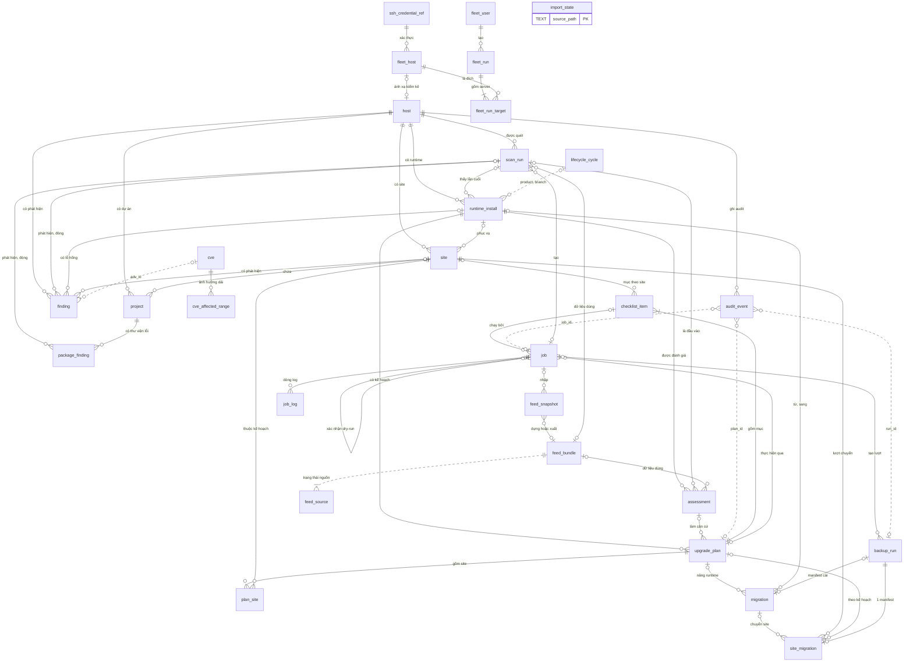

# Mô hình dữ liệu (ERD) và từ điển dữ liệu — php-quickpatch v2

## Lịch sử sửa đổi (Revision History)
| Phiên bản | Ngày | Người thực hiện | Tóm tắt thay đổi |
| :--- | :--- | :--- | :--- |
| 1.0.0 | 2026-10-22 | BA Agent | Khởi tạo theo skill `/erd` (rules/09, template 20): kiến trúc 3 kho dữ liệu (tệp CLI, `feeds.db`, `console.db`) + `central.db` Phase 2; sơ đồ tổng thể DIAG-ERD-QP-001; danh mục 29 thực thể; ràng buộc kỹ thuật SQLite ≥ 3.26.0; cơ chế đồng bộ `console.db` từ tệp; chính sách lưu giữ theo số ngày; chính sách không lưu bí mật. Từ điển dữ liệu chi tiết tách 4 file (DOC-SRS-QP-ERD-002..005) do giới hạn 800 dòng |
| 1.0.1 | 2026-10-22 | BA Agent | Sửa theo review: §7 `Q-ERD-07` thống nhất định dạng với DOC-API-QP-006 §3 và DOC-SRS-QP-ERD-005 1.0.1 (`fleet_run_id` `^FLR-[0-9]{8}-[0-9]{6}-[0-9a-f]{4}$` thay `FRN-…`; `server_id` `^[a-z0-9][a-z0-9_.-]{0,62}$`, 1–63 ký tự thay 64); §2.1 dòng `console.db` bỏ đường dẫn dự phòng `/tmp` cho root, dự phòng chỉ cho không root bằng `mktemp -d` `${TMPDIR:-/tmp}/php-quickpatch-$EUID.XXXXXX` qua kiểm tra spec §2.1 (`ERR-CLI-412-01`, `CR-SRS-13`); frontmatter thêm `depends_on` DOC-API-QP-006 |

## 1. Giới thiệu

### 1.1 Mục đích
Tài liệu đặc tả mô hình dữ liệu của php-quickpatch v2 để Dev cài đặt lược đồ SQLite của console (`console.db`), bộ nhập dữ liệu từ tệp của CLI, và để QA kiểm thử ràng buộc, lưu giữ, che bí mật. Tài liệu **không** định nghĩa lại FR/BR/ERR/NFR; mọi mã dẫn chiếu lấy từ bộ SRS (DOC-SRS-QP-001 và phụ lục). Khi tài liệu này lệch với SRS, áp `BR-DATA-004` (SRS chính và 4 file chi tiết được ưu tiên); điểm lệch phát hiện được liệt kê ở §7.

### 1.2 Phạm vi
- **Trong phạm vi**: `console.db` của console Phase 1 (`/var/lib/php-quickpatch/console.db`); các thực thể logic đọc từ `feeds.db` (CVE, dải phiên bản ảnh hưởng, vòng đời, nguồn dữ liệu, snapshot); các tệp JSON/JSONL/TSV/cache do CLI ghi trong `STATE_DIR`; `central.db` của máy trung tâm Phase 2 (chỉ đặc tả).
- **Ngoài phạm vi**: lược đồ vật lý chi tiết của `feeds.db` (đã phát hành tại DOC-SRS-QP-FEED-002 §2.2, tài liệu này chỉ ánh xạ sang tên thực thể logic); catalog kịch bản/checklist/playbook trong `share/php-quickpatch/catalog/` (dữ liệu tĩnh đóng gói, DOC-SRS-QP-SCN-000 §5, DOC-SRS-QP-ENV-001 §4.1); trạng thái trong bộ nhớ của `qp-console.py` (token, phiên, CSRF — DOC-SRS-QP-STATE-001 §7).

### 1.3 Bộ tài liệu ERD (tách file do giới hạn 800 dòng)
| Tài liệu | Mã | Nội dung | Sơ đồ |
| :--- | :--- | :--- | :--- |
| `erd.md` (tài liệu này) | DOC-SRS-QP-ERD-001 | Kiến trúc lưu trữ, nguyên tắc, ràng buộc SQLite, đồng bộ, sơ đồ tổng thể, danh mục thực thể, lưu giữ, bí mật | DIAG-ERD-QP-001 |
| [erd-console-db.md](erd-console-db.md) | DOC-SRS-QP-ERD-002 | Từ điển `console.db` nhóm kiểm kê, quét, phát hiện, đánh giá, chỉ mục feed: `host`, `scan_run`, `runtime_install`, `site`, `project`, `finding`, `package_finding`, `assessment`, `feed_bundle`, `feed_snapshot`, `import_state` | DIAG-ERD-QP-002 |
| [erd-console-ops.md](erd-console-ops.md) | DOC-SRS-QP-ERD-003 | Từ điển `console.db` nhóm vận hành: `upgrade_plan`, `plan_site`, `checklist_item`, `job`, `job_log`, `migration`, `site_migration`, `backup_run`, `audit_event` | DIAG-ERD-QP-003 |
| [erd-feeds-files.md](erd-feeds-files.md) | DOC-SRS-QP-ERD-004 | Thực thể logic của `feeds.db` (`cve`, `cve_affected_range`, `lifecycle_cycle`, `feed_source`) và danh mục tệp JSON/JSONL/TSV/cache của CLI kèm ánh xạ trường → cột | DIAG-ERD-QP-004 |
| [erd-fleet.md](erd-fleet.md) | DOC-SRS-QP-ERD-005 | Phase 2 — `central.db`: `fleet_host`, `ssh_credential_ref`, `fleet_user`, `fleet_run`, `fleet_run_target` | DIAG-ERD-QP-005 |

### 1.4 Thuật ngữ
Thuật ngữ `STATE_DIR`, `runtime_id`, `plan_id`, `job_id`, job đọc/ghi, phiên console, token `serve`, catalog, envelope JSON theo [spec.md §1.3](spec.md); `site_id`, lượt chuyển, `run_id`, baseline theo [environment-playbooks.md §1.4](environment-playbooks.md); bundle, raw cache, TTL, `min_patched` theo [data-sources.md §1.4](data-sources.md). Bổ sung:

| Thuật ngữ | Định nghĩa |
| :--- | :--- |
| Nguồn sự thật | Kho mà mọi bên khác phải dựng lại dữ liệu từ đó khi mâu thuẫn; với dữ liệu nghiệp vụ Phase 1 là tệp trong `STATE_DIR` |
| Bảng chiếu | Bảng `console.db` chứa bản sao có cấu trúc của tệp nguồn, dựng lại được bằng cách nhập lại tệp |
| Khoá thay thế | Cột `INTEGER PRIMARY KEY` (alias `rowid` của SQLite) dùng làm khoá ngoại nội bộ; mã nghiệp vụ (`runtime_id`, `site_id`) là khoá duy nhất kèm `host_id` |
| Xoá mềm | Đặt `removed_at` thay vì xoá dòng, để giữ khoá ngoại của kế hoạch và lượt chuyển cũ |
| Vòng đời phát hiện | Mô hình lưu `finding`/`package_finding`: 1 dòng tồn tại từ lần quét đầu thấy (`first_seen_scan_id`) tới lần quét đầu không còn thấy (`resolved_scan_id`), thay cho chép lại toàn bộ phát hiện ở mỗi lần quét |
| Tham chiếu logic | Liên kết giữa 2 kho khác tệp SQLite (vd `finding.adv_id` → `cve.adv_id` trong `feeds.db`); kiểm ở tầng ứng dụng, không có ràng buộc `FOREIGN KEY` |

## 2. Kiến trúc lưu trữ

### 2.1 Các kho dữ liệu
| Kho | Đường dẫn | Định dạng | Bên ghi | Bên đọc | Vai trò |
| :--- | :--- | :--- | :--- | :--- | :--- |
| Tệp của CLI | `STATE_DIR/{state, plans, jobs, switches, backups, audit, console, tools, reports, work}/` và `/etc/php-quickpatch/sites.d/` | JSON, JSONL, TSV, manifest TSV v0.1 | CLI Bash, `qp-feeds.py` (lệnh `plan`, `assess`, `report`), `qp-console.py` (chỉ `jobs/`, `console/`, `work/upload-*`) | CLI, console | **Nguồn sự thật** cho kết quả quét, kế hoạch, job, lượt chuyển, manifest, audit (spec §2.1; DOC-SRS-QP-ENV-001 §4.3) |
| `feeds.db` | `STATE_DIR/feeds/current/feeds.db` | SQLite, 1 tệp/bundle | `qp-feeds.py` (dựng trong `staging/`, `rename`) | `qp-feeds.py`; console qua `ATTACH … mode=ro` | Nguồn sự thật cho dữ liệu CVE/KEV/vòng đời chuẩn hoá của 1 bundle (DOC-SRS-QP-FEED-002 §2, DOC-SRS-QP-FEED-003 §3.3) |
| `console.db` | `STATE_DIR/console.db`: `/var/lib/php-quickpatch/console.db` (root; **không có dự phòng**, không tạo/không đạt kiểm tra → `ERR-CLI-412-01`); `$HOME/.php-quickpatch/console.db` (không root); dự phòng **chỉ cho không root** khi không dùng được `$HOME`: `${TMPDIR:-/tmp}/php-quickpatch-$EUID.XXXXXX/console.db` (`mktemp -d`, mode `0700`; dùng lại thư mục dự phòng đã có, kể cả tên v0.1 `php-quickpatch-$EUID`, chỉ khi đạt kiểm tra). Mọi đường dẫn qua kiểm tra an toàn spec §2.1 (thư mục thật không symlink, chủ = `EUID`, `mode & 0022 = 0`) trước lần mở đầu tiên (`CR-SRS-13`) | SQLite, `journal_mode=WAL` | Chỉ `qp-console.py` | Chỉ `qp-console.py` | Bảng chiếu + chỉ mục truy vấn cho 10 màn hình và `/api/v1`; dữ liệu do console sở hữu (hàng đợi job) có bản gốc ở `jobs/<job_id>/job.json` |
| `central.db` (Phase 2) | `STATE_DIR/central.db` của máy trung tâm (đề xuất đường dẫn) | SQLite, `journal_mode=WAL` | Console trung tâm | Console trung tâm | Nguồn sự thật cho danh mục server, tham chiếu khoá SSH, tài khoản, đợt chạy (`FR-FLT-INV-001`); bảng chiếu cho JSON thu từ server |

### 2.2 Nguyên tắc thiết kế
| Mã | Nguyên tắc | Căn cứ |
| :--- | :--- | :--- |
| `NT-01` | Tệp là nguồn sự thật; `console.db` dựng lại được 100% từ tệp. Xoá `console.db` không làm mất dữ liệu nghiệp vụ: lần khởi động sau dựng lại | spec §2.1; DOC-SRS-QP-ENV-001 §4.3 ("SQLite của console … không phải nguồn dữ liệu gốc"); flows.md §1.4 |
| `NT-02` | Một bên ghi: chỉ `qp-console.py` ghi `console.db`. CLI Bash không đọc/ghi SQLite, nên `scan`, `fix`, `rollback`, `migrate` chạy được khi không có Python | PRD C-01; `NFR-CMP-005`; `C-SRS-05` |
| `NT-03` | Không có khoá ngoại xuyên tệp SQLite: liên kết `console.db` → `feeds.db` là tham chiếu logic. Chạy thử 2026-10-22 (SQLite 3.45.1): `CREATE VIEW` thường trong `main` tham chiếu CSDL `ATTACH` bị từ chối ("view cve cannot reference objects in database feeds"); `CREATE TEMP VIEW` thì được | §8 mục "Chạy thử" |
| `NT-04` | Ràng buộc nghiệp vụ do CLI sở hữu không được lặp lại thành ràng buộc chặn trong bảng chiếu (vd ≤ 1 lượt `SWITCHED`/`HC_RUNNING` mỗi máy chủ — `BR-ENV-003`; 1 kế hoạch hiệu lực mỗi runtime — `BR-PLAN-002`): dữ liệu tệp vi phạm vẫn được nhập và gắn cảnh báo. Ràng buộc do console sở hữu (hàng đợi job — `BR-JOB-001`, `ERR-JOB-409-01`) được ép bằng chỉ mục `UNIQUE` có điều kiện | `C-SRS-05`; `FR-JOB-RUN-001` |
| `NT-05` | Ghi tệp trước, ghi CSDL sau: console ghi `jobs/<job_id>/job.json` (ghi tạm + `rename`) rồi mới chèn/cập nhật dòng `job`; mất điện giữa 2 bước → lần khởi động sau nhập lại từ `job.json` | `BR-JOB-005`; `NFR-REL-003`; `NFR-REL-006` |
| `NT-06` | Không lưu bí mật ở mọi kho (§5) | `BR-AUTH-001`; `BR-SEC-006`; `BR-FLT-002`; `NFR-SEC-002`; `NFR-SEC-011` |
| `NT-07` | Thực thể kiểm kê (`runtime_install`, `site`, `project`) dùng xoá mềm (`removed_at`) để giữ khoá ngoại của kế hoạch, lượt chuyển, phát hiện cũ | `FR-UPG-RMV-001`; `FR-RPT-AUD-001` |
| `NT-08` | Mã nghiệp vụ giữ đúng định dạng SRS (`runtime_id`, `site_id`, `plan_id`, `job_id`, `run_id`, `chk_id`); khoá thay thế chỉ dùng nội bộ, không xuất hiện ở API | `BR-CON-008`; spec §1.3 |

### 2.3 Ràng buộc kỹ thuật SQLite
**Phiên bản thư viện tối thiểu: SQLite 3.26.0.** Module `sqlite3` của Python dùng thư viện SQLite của hệ điều hành; `sqlite3.sqlite_version` là phiên bản thư viện nạp lúc chạy (Python docs). Bản thấp nhất trong danh sách hệ điều hành của `NFR-CMP-002`:

| Hệ điều hành | Gói | Phiên bản SQLite | Trạng thái |
| :--- | :--- | :--- | :--- |
| AlmaLinux 8 | `sqlite-libs` | 3.26.0 (`sqlite-libs-3.26.0-21.el8_10`) | Kiểm chứng (danh sách gói repo.almalinux.org, 2026-10-22); Rocky 8 cùng nguồn RHEL 8, chưa kiểm riêng |
| AlmaLinux 9 | `sqlite-libs` | 3.34.1 | Kiểm chứng (repo.almalinux.org) |
| Ubuntu 20.04 | `sqlite3` (nguồn) | 3.31.1 (`3.31.1-4ubuntu0.7`) | Kiểm chứng (Launchpad API) |
| Debian 11 / 12 / 13 | `libsqlite3-0` | 3.34.1 / 3.40.1 / 3.46.1 | Kiểm chứng (packages.debian.org) |
| Ubuntu 22.04, 24.04; Alpine 3.22–3.24; AlmaLinux/Rocky 10 | — | — | Chưa kiểm chứng; không ảnh hưởng vì ngưỡng đặt theo bản thấp nhất |

| Hạng mục | Quy định | Căn cứ (sqlite.org, truy cập 2026-10-22) |
| :--- | :--- | :--- |
| Không dùng | Bảng `STRICT` (từ 3.37.0); mệnh đề `RETURNING` (từ 3.35.0); hàm/toán tử JSON `json_extract`, `->>` (tích hợp mặc định từ 3.38.0, trước đó chỉ có khi biên dịch với `-DSQLITE_ENABLE_JSON1`); cột sinh `GENERATED` (từ 3.31.0) | stricttables.html, lang_returning.html, json1.html §2, gencol.html §3 |
| Được dùng | UPSERT `ON CONFLICT … DO UPDATE` (từ 3.24.0); chỉ mục có điều kiện (`WHERE`); chỉ mục biểu thức (`ifnull`); `WITHOUT ROWID`; trigger `BEFORE UPDATE OF`/`BEFORE DELETE` với `RAISE(ABORT, …)` | lang_upsert.html §4; đã chạy thử toàn bộ lược đồ (§8) |
| Kiểu cột | Chỉ `INTEGER`, `TEXT`, `REAL`; không `BLOB`. Không có `STRICT` nên ràng buộc kiểu, miền giá trị, độ dài viết bằng `CHECK` | Quy ước §2.5 |
| Khoá ngoại | `PRAGMA foreign_keys = ON` ở **mỗi** kết nối (mặc định tắt, phải bật riêng từng kết nối; lệnh không có tác dụng trong giao dịch đang mở) | foreignkeys.html |
| Nhật ký | `PRAGMA journal_mode = WAL` (đặt 1 lần, lưu trong tệp); `PRAGMA synchronous = NORMAL` — "WAL mode is safe from corruption with synchronous=NORMAL" nhưng có thể mất giao dịch cuối khi mất điện, chấp nhận được vì `console.db` dựng lại được (`NT-01`) | pragma.html |
| Chờ khoá | `PRAGMA busy_timeout = 5000` (ms) | pragma.html |
| Phiên bản lược đồ | `PRAGMA user_version = 1`. Khác giá trị mong đợi hoặc `PRAGMA integrity_check` ≠ `ok` → đổi tên tệp thành `console.db.bak-<YYYYmmdd-HHMMSS>` và dựng lại từ tệp (§2.4) | `NT-01` |
| Quyền tệp | `qp-console.py` đặt `umask 077` trước khi mở CSDL → `console.db`, `console.db-wal`, `console.db-shm` quyền `0600`, chủ = người chạy `serve` | `NFR-SEC-010` |
| Kết nối và luồng | 1 kết nối ghi duy nhất, tuần tự hoá bằng `threading.Lock`; luồng xử lý request dùng kết nối đọc riêng (mặc định `check_same_thread=True` cấm dùng chung kết nối giữa luồng) | Python docs `sqlite3` |
| URI | Mở `console.db` với `uri=True` (có từ Python 3.4) để `ATTACH DATABASE 'file:<STATE_DIR>/feeds/current/feeds.db?mode=ro' AS feeds` được hiểu là URI: "If URI filenames are recognized when the database connection is originally opened, then URI filenames will also be recognized on ATTACH statements" | uri.html; Python docs `sqlite3` |

### 2.4 Đồng bộ `console.db` từ tệp
Luồng nhập nền của `qp-console.py` đọc `stat` (inode, kích thước, `mtime_ns`) các tệp nguồn mỗi 5 s (đề xuất), so với bảng `import_state` ([erd-console-db.md §13](erd-console-db.md)); tệp đổi → tính SHA-256 → khác giá trị đã nhập → nhập trong 1 giao dịch. Tệp chỉ ghi nối (`*.jsonl`, `index.tsv`, `output.log`) được đọc tiếp từ `import_state.last_offset`.

| Tệp nguồn | Bảng đích | Cách nhập |
| :--- | :--- | :--- |
| `state/last-scan.json` (`qp.scan/1`) | `host`, `scan_run`, `runtime_install`, `site`, `project`, `finding`, `package_finding` | Toàn tệp; UPSERT theo khoá nghiệp vụ; cập nhật vòng đời phát hiện |
| `jobs/<job_id>/job.json`, `phase`, `result.json` | `job`; thêm `scan_run`/`assessment` khi `action` ∈ {`scan`, `assess`} | Toàn tệp |
| `jobs/<job_id>/output.log` | `job_log` | Từ `last_offset`; chỉ dòng mức `WARN`/`VULN`/`ERROR`, dòng có mã `ERR-*`, dòng đổi `phase` |
| `plans/<plan_id>/plan.json`, `items.json` | `upgrade_plan`, `plan_site`, `checklist_item` | Toàn tệp (tệp ghi bằng ghi tạm + `rename`, `NFR-REL-006`) |
| `switches/index.tsv`; `backups/<run_id>/switch.json` | `site_migration` | `index.tsv` từ `last_offset`; `switch.json` toàn tệp |
| `backups/<run_id>/manifest` | `backup_run` | Toàn tệp; đếm dòng theo hành động |
| `audit/audit-YYYYMM.jsonl` | `audit_event`; suy ra `backup_run.command`, `backup_run.rollback_status`, `migration`, `feed_snapshot` | Từ `last_offset` |
| `feeds/current/manifest.json`; `feeds/snapshots/imported/` | `feed_bundle`, `feed_snapshot` | Toàn tệp / liệt kê thư mục |
| `/etc/php-quickpatch/sites.d/<site_id>.conf` (không root: `~/.config/php-quickpatch/sites.d/`) | `site.hc_urls_json`, `site.hc_mode` | Toàn tệp (DOC-SRS-QP-ENV-002 §2, §3.2) |

Quy tắc bổ sung:
1. **Khởi động `serve`**: mở `console.db` có sẵn, đối soát job `RUNNING` từ `job.json` (`BR-JOB-005`, ≤ 5 s — `NFR-REL-003`) rồi mở socket; nhập tăng dần chạy nền để không vượt 3 s khởi động (`NFR-PERF-006`). Dựng lại toàn bộ (tệp CSDL thiếu, hỏng, sai `user_version`) cũng chạy nền; thời gian dựng lại chưa đo (`Q-ERD-04`).
2. **Đổi bundle**: khi `feeds/current/manifest.json` có `bundle_id` khác, console `DETACH DATABASE feeds` rồi `ATTACH` lại. Chạy thử 2026-10-22: sau khi `current/` bị `rename` sang `previous/`, kết nối cũ vẫn đọc tệp cũ (inode cũ) tới khi `DETACH`; `TEMP VIEW` (DOC-SRS-QP-ERD-004 §2.2) dùng lại được ngay sau `ATTACH` mới, không cần tạo lại.
3. **Nhập lỗi**: tệp JSON sai cú pháp hoặc sai schema → giữ dữ liệu đã nhập trước đó, ghi `import_state.last_error`, ghi log của console; không chặn API đọc.
4. **Ghi do console sở hữu**: tạo/cập nhật `job` theo `NT-05`. Mọi thay đổi khác (kế hoạch, mục checklist, `hc_url`) đi qua CLI/`qp-feeds.py` ghi tệp, sau đó console nhập lại (`C-SRS-05`).

### 2.5 Quy ước kiểu dữ liệu và đặt tên
| Kiểu logic | Kiểu SQLite | Độ dài | Quy ước | Ví dụ |
| :--- | :--- | :--- | :--- | :--- |
| Khoá thay thế | `INTEGER PRIMARY KEY` | - | Alias `rowid`, tự tăng | `id`, `scan_run_id` |
| Mã nghiệp vụ | `TEXT` | Theo mã | `CHECK` bằng `GLOB` + `length()`; regex đầy đủ (`BR-CON-008`) kiểm ở tầng Python trước khi ghi | `job_id`, `run_id` |
| Thời điểm | `TEXT` | 24 | ISO-8601 UTC, độ phân giải 1 ms: `YYYY-MM-DDTHH:MM:SS.sssZ` (tương thích `strftime('%Y-%m-%dT%H:%M:%fZ')`) | `2026-10-22T09:30:00.000Z` |
| Ngày | `TEXT` | 10 | `YYYY-MM-DD` | `2026-12-31` |
| Logic đúng/sai | `INTEGER` | - | `CHECK (x IN (0,1))` | `in_kev` |
| Liệt kê (enum) | `TEXT` | - | `CHECK (x IN (…))`, giữ nguyên giá trị đã phát hành ở SRS (chữ hoa/thường như nguồn) | `state` |
| Số thực | `REAL` | - | CVSS 0,0–10,0 | `cvss_rep` |
| Danh sách, đối tượng | `TEXT` (JSON) | - | Hậu tố `_json`; kiểm bằng `json.loads` ở Python vì không bảo đảm có hàm JSON (§2.3); mặc định `'[]'`/`'{}'` | `scenario_ids_json` |
| Mã băm | `TEXT` | 64 | Hex chữ thường SHA-256 | `result_sha256` |
| Đường dẫn | `TEXT` | 1024 | Tuyệt đối, đã `readlink -f` (trừ đường dẫn tương đối `STATE_DIR` ghi rõ) | `bin_path` |

- Tên bảng, cột: `snake_case` tiếng Anh, số ít (`job`, không `jobs`). Cột "Độ dài" ở từ điển là giới hạn ép bằng `CHECK (length(col) <= N)` (SQLite không ép độ dài theo kiểu khai báo).
- `NULL` trong `CHECK`: SQLite coi biểu thức `NULL` là đạt, nên ràng buộc bắt buộc có giá trị viết dạng `(col IS NOT NULL AND length(col) >= N)` (đã chạy thử với `checklist_item.reason`).
- Hành vi xoá: `ON DELETE CASCADE` cho dữ liệu con thuần tuý (dòng log, mục checklist, kiểm kê theo `host`); `RESTRICT` cho bằng chứng phải giữ (manifest `backup_run`; runtime, site được kế hoạch hoặc lượt chuyển tham chiếu); `SET NULL` cho liên kết tuỳ chọn (job tạo ra bản ghi) và tham chiếu tới lượt quét (giữ lại mốc `*_at` để lượt quét cũ xoá được theo §4).

## 3. Sơ đồ quan hệ tổng thể (DIAG-ERD-QP-001)
Sơ đồ chỉ thể hiện thực thể và quan hệ; thuộc tính, kiểu, khoá của từng bảng ở sơ đồ con DIAG-ERD-QP-002..005 và từ điển dữ liệu. Đường nét đứt (`..`) = tham chiếu logic không có ràng buộc `FOREIGN KEY` (`NT-03`, hoặc liên kết qua mã trong tệp audit). Thực thể `cve`, `cve_affected_range`, `lifecycle_cycle`, `feed_source` nằm trong `feeds.db`; `fleet_*`, `ssh_credential_ref` nằm trong `central.db` (Phase 2); còn lại nằm trong `console.db`.

### 3.1 Danh mục thực thể
"Nguồn sự thật" = nơi dữ liệu được dựng lại khi `console.db` mất hoặc lệch (`NT-01`). Cột "Lưu giữ" tóm tắt §4.

| # | Thực thể | Kho / bảng vật lý | Nguồn sự thật | Khoá chính (khoá nghiệp vụ) | FR chính | Từ điển |
| :---: | :--- | :--- | :--- | :--- | :--- | :--- |
| 1 | `host` | `console.db.host`; Phase 2 `central.db.host` | Envelope `host{}` + `data.environment` của `state/last-scan.json` | `host_id` (`machine_key`) | `FR-SCAN-ENV-001`, `FR-CLI-JSON-001` | ERD-002 §3 |
| 2 | `scan_run` | `console.db.scan_run` | `state/last-scan.json`, `jobs/<job_id>/result.json` của job `scan` | `scan_run_id` (`result_sha256`) | `FR-SCAN-*`, `FR-CLI-JSON-001`, `FR-FEED-AGE-001` | ERD-002 §4 |
| 3 | `runtime_install` | `console.db.runtime_install` | `result.runtimes[]` của lần quét gần nhất | `id` (`host_id` + `runtime_id`) | `FR-SCAN-RT-001`, `FR-SCAN-RT-002`, `FR-SCN-CLS-001`, `FR-SCN-CLS-002`, `FR-SCN-LIFE-001`, `FR-SCN-LOCK-001` | ERD-002 §5 |
| 4 | `site` | `console.db.site` | `site_binding[]` của quét + `sites.d/<site_id>.conf` | `id` (`host_id` + `site_id`) | `FR-SCAN-MAP-001`, `FR-CON-SITE-001`, `FR-UPG-HC-001` | ERD-002 §6 |
| 5 | `project` | `console.db.project` | `result.projects[]` | `id` (`host_id` + `project_id`) | `FR-SCAN-PRJ-001` | ERD-002 §7 |
| 6 | `finding` | `console.db.finding` | Phát hiện runtime/WordPress/webshell/container/thay đổi ngoài tool trong kết quả quét | `id` (`finding_key` khi đang mở) | `FR-ASMT-CUR-001`, `FR-ASMT-DEP-002`, `FR-SCAN-WSH-001`, `FR-SCAN-DRF-001`, `FR-PTCH-DKR-002` | ERD-002 §8 |
| 7 | `package_finding` | `console.db.package_finding` | `result.dependency_findings[]` | `id` (`finding_key` khi đang mở) | `FR-ASMT-DEP-001`, `FR-FEED-OSV-001`, `FR-CON-DEP-001` | ERD-002 §9 |
| 8 | `assessment` | `console.db.assessment` | `result.json` của `assess --json` (`qp.assess/1`) | `assessment_id` | `FR-ASMT-CUR-001`, `FR-ASMT-CAND-*`, `FR-ASMT-CMP-001`, `FR-ASMT-RISK-*` | ERD-002 §10 |
| 9 | `feed_bundle` | `console.db.feed_bundle` | `feeds/current/manifest.json` (`qp.feeds.bundle/1`) | `bundle_id` | `FR-FEED-CACH-002`, `FR-FEED-AGE-001` | ERD-002 §11 |
| 10 | `feed_snapshot` | `console.db.feed_snapshot` | `feeds/snapshots/imported/`, `manifest.json` của gói, audit `feeds import`/`export` | `snapshot_id` | `FR-FEED-SNAP-001..003`, `FR-CON-FEED-002` | ERD-002 §12 |
| 11 | `import_state` | `console.db.import_state` | Do console tự sinh (con trỏ nhập) | `source_path` | `NT-01` | ERD-002 §13 |
| 12 | `upgrade_plan` | `console.db.upgrade_plan` | `plans/<plan_id>/plan.json` (`qp.plan/1`) | `plan_id` | `FR-PLAN-*`, `FR-CON-PLAN-001` | ERD-003 §3 |
| 13 | `plan_site` | `console.db.plan_site` | `site_order[]`, `canary_site_id`, `compat_verdict` trong `plan.json` | (`plan_id`, `site_ref`) | `FR-PLAN-GEN-002`, `FR-CMPT-RES-001`, `FR-UPG-SEQ-001` | ERD-003 §4 |
| 14 | `checklist_item` | `console.db.checklist_item` | `plans/<plan_id>/items.json` | `id` (`plan_id` + `chk_id` + site) | `FR-SCN-CHK-001`, `FR-PLAN-CHK-001`, `FR-PLAN-CHK-002` | ERD-003 §5 |
| 15 | `job` | `console.db.job` | `jobs/<job_id>/job.json`, `phase`, `result.json` | `job_id` | `FR-JOB-RUN-001..004`, `FR-CON-SAFE-001`, `FR-CON-SAFE-003` | ERD-003 §6 |
| 16 | `job_log` | `console.db.job_log` | `jobs/<job_id>/output.log` | (`job_id`, `line_no`) | `FR-JOB-LOG-001..003` | ERD-003 §7 |
| 17 | `migration` | `console.db.migration` | Audit `migrate install`/`remove-old` + `backups/<run_id>/manifest` + `result.json` (`qp.migrate/1`) | `migration_id` (`install_run_id`) | `FR-UPG-PRE-001`, `FR-UPG-INST-001`, `FR-UPG-CFG-*`, `FR-UPG-RMV-001` | ERD-003 §8 |
| 18 | `site_migration` | `console.db.site_migration` | `switches/index.tsv` + `backups/<run_id>/switch.json` (`switch_record`) | `run_id` | `FR-UPG-SWT-*`, `FR-UPG-HC-*`, `FR-UPG-RBK-*`, `FR-UPG-SEQ-001` | ERD-003 §9 |
| 19 | `backup_run` | `console.db.backup_run` | `backups/<run_id>/manifest` (định dạng v0.1 + DOC-SRS-QP-ENV-001 §5.3) | `run_id` | `FR-PTCH-RBK-001`, `FR-PTCH-RBK-002`, `FR-CON-RBK-001` | ERD-003 §10 |
| 20 | `audit_event` | `console.db.audit_event`; Phase 2 `central.db.audit_event` | `audit/audit-YYYYMM.jsonl` | `id` (`host_id` + `seq`) | `FR-JOB-AUD-001..003`, `FR-CON-AUD-001` | ERD-003 §11 |
| 21 | `cve` | `feeds.db.advisory` (+ `kev_entry`) qua `TEMP VIEW cve` | `feeds/current/feeds.db` | `adv_id` | `FR-FEED-NORM-001`, `FR-FEED-PCVE-*`, `FR-FEED-NCVE-001`, `FR-FEED-WCVE-001`, `FR-FEED-KEV-001` | ERD-004 §4 |
| 22 | `cve_affected_range` | `feeds.db.affected_range` qua `TEMP VIEW` | `feeds/current/feeds.db` | `range_id` | `FR-FEED-NORM-001`, `FR-FEED-NORM-002` | ERD-004 §5 |
| 23 | `lifecycle_cycle` | `feeds.db.lifecycle_branch` qua `TEMP VIEW` | `feeds/current/feeds.db` | (`product`, `branch`) | `FR-FEED-EOL-001..003`, `FR-SCN-LIFE-001` | ERD-004 §6 |
| 24 | `feed_source` | `feeds.db.feed_source` | `feeds/current/feeds.db`, `feeds/state/sync-status.json` | `src_id` | `FR-FEED-SYNC-001`, `FR-FEED-CMD-002`, `FR-CON-FEED-001` | ERD-004 §7 |
| 25 | `fleet_host` | `central.db.fleet_host` | `central.db` (Phase 2) | `server_id` | `FR-FLT-INV-001`, `FR-FLT-INV-002` | ERD-005 §4 |
| 26 | `ssh_credential_ref` | `central.db.ssh_credential_ref` | `central.db` | `cred_id` (`name`) | `FR-FLT-INV-001`, `FR-FLT-INV-002` | ERD-005 §5 |
| 27 | `fleet_user` | `central.db.fleet_user` | `central.db` | `user_id` (`username`) | `FR-FLT-RBAC-001` | ERD-005 §6 |
| 28 | `fleet_run` | `central.db.fleet_run` | `central.db` | `fleet_run_id` | `FR-FLT-EXEC-001`, `FR-FLT-EXEC-002` | ERD-005 §7 |
| 29 | `fleet_run_target` | `central.db.fleet_run_target` | `central.db` + JSON thu từ server | (`fleet_run_id`, `server_id`) | `FR-FLT-EXEC-002`, `FR-FLT-DASH-001`, `FR-FLT-DASH-002` | ERD-005 §8 |

Ghi chú tên thực thể: yêu cầu thiết kế dùng tên logic `cve`, `cve_affected_range`, `lifecycle_cycle`. Bảng vật lý trong `feeds.db` giữ tên đã phát hành ở DOC-SRS-QP-FEED-002 §2.2 (`advisory`, `affected_range`, `lifecycle_branch`) để không làm hỏng `qp-feeds.py` và 3 tài liệu FEED; console tạo `TEMP VIEW` mang tên logic trên mỗi kết nối (DOC-SRS-QP-ERD-004 §2.2). Container đang chạy (`result.containers[]`, `FR-SCAN-PRJ-002`) không lập bảng riêng: API `GET /api/v1/containers` đọc từ tệp kết quả quét; phát hiện liên quan container lưu ở `finding` (`finding_type = CONTAINER_RUNTIME`).

### 3.2 Quan hệ logic không có ràng buộc khoá ngoại
| Bên tham chiếu | Bên được tham chiếu | Khoá so khớp | Lý do không dùng `FOREIGN KEY` | Xử lý khi không khớp |
| :--- | :--- | :--- | :--- | :--- |
| `finding.adv_id` | `cve.adv_id` (`feeds.db`) | `adv_id` | Khác tệp SQLite (`NT-03`); bundle thay mỗi lần đồng bộ | Hiển thị `adv_id` kèm nhãn "không có trong bundle `<bundle_id>`" (advisory bị thu hồi — `BR-FEED-031`) |
| `runtime_install` (`kind`, `branch`) | `lifecycle_cycle` (`product`, `branch`) | `kind` = `product` (`php`, `node`), `branch` | Khác tệp SQLite | `lifecycle_status = UNKNOWN` (`ERR-SCN-422-01`) như DOC-SRS-QP-FEED-003 §3.4 |
| `feed_bundle` | `feed_source` | `feeds.db` của bundle đó | `feed_source` nằm trong tệp `feeds.db` riêng của từng bundle; chỉ `current/` và `previous/` còn trên đĩa | `feed_bundle.sources_json` giữ ảnh chụp trạng thái nguồn từ `manifest.json` |
| `audit_event.job_id`, `run_id`, `plan_id` | `job`, `backup_run`, `upgrade_plan` | Mã nghiệp vụ | Audit giữ ≥ 365 ngày, lâu hơn `job` đọc và `output.log` (§4); audit là chỉ nối thêm, không phụ thuộc bảng khác | Hiển thị mã, liên kết bị vô hiệu khi đối tượng đã hết hạn lưu giữ |
| `fleet_run_target` (kết quả JSON) | `host` và bảng kiểm kê trong `central.db` | `fleet_host.host_id` | Kết quả thu thập được nhập vào cùng lược đồ kiểm kê (DOC-SRS-QP-ERD-005 §2) | Server chưa thu lần nào → `host_id` rỗng |

Cột `bundle_id` ở `scan_run`, `assessment`, `upgrade_plan`, `job` **có** khoá ngoại tới `feed_bundle` (`ON DELETE SET NULL`); để nhập được tệp nhắc tới bundle mà console chưa đọc `manifest.json`, bộ nhập chạy `INSERT OR IGNORE INTO feed_bundle(bundle_id, first_seen_at)` trước, rồi bổ sung các cột còn lại khi đọc được `manifest.json`.

## 4. Chính sách lưu giữ dữ liệu
Mốc tính: `ended_at` (job, kế hoạch), `resolved_at` (phát hiện), `removed_at` (kiểm kê), `generated_at` (lượt quét), `ts` (audit). Tác vụ dọn của console chạy khi `serve` khởi động và mỗi 24 giờ (cùng nhịp `FR-JOB-LOG-003`); tác vụ dọn của CLI chạy sau mỗi `feeds update` (`FR-FEED-CACH-003`). Dòng "(đề xuất)" là giá trị BA đề xuất vì SRS chưa quy định, chờ PO duyệt (`Q-ERD-01`).

| Dữ liệu | Kho | Thời hạn giữ | Khi hết hạn | Căn cứ |
| :--- | :--- | :--- | :--- | :--- |
| `jobs/<job_id>/output.log` và dòng `job_log` của job đó | Tệp + `console.db` | 30 ngày; tổng `jobs/` > 200 MiB → xoá `output.log` cũ nhất trước | Xoá tệp và dòng `job_log`; đặt `job.log_purged_at`; `GET …/log` trả `ERR-JOB-410-01` | `BR-JOB-006`, `FR-JOB-LOG-003`, `NFR-CAP-001` |
| `job.json`, `result.json` + dòng `job` của job `write` | Tệp + `console.db` | 365 ngày | Xoá thư mục `jobs/<job_id>/` và dòng `job` ở ngày thứ 366 (đề xuất; SRS quy định tối thiểu 365 ngày) | `BR-JOB-006` |
| `job.json`, `result.json` + dòng `job` của job `read`/`data` | Tệp + `console.db` | 30 ngày (đề xuất); job dry-run được 1 job `write` tham chiếu qua `confirm_dry_run_job_id` giữ bằng thời hạn của job `write` đó (bằng chứng `BR-CON-005`) | Xoá thư mục và dòng `job` | `BR-JOB-006` (chưa quy định job đọc), `FR-RPT-AUD-001` |
| `audit/audit-YYYYMM.jsonl` | Tệp | Tối thiểu 365 ngày; tool không có lệnh/API xoá | Chỉ root xoá thủ công ngoài tool; bị phát hiện bằng chuỗi hash | `BR-AUD-002`, `BR-AUD-003`, `NFR-REL-007` |
| Dòng `audit_event` | `console.db` | 400 ngày (đề xuất: 365 + 35 ngày đệm) | Trigger chỉ cho xoá dòng có `ts` cũ hơn 400 ngày; truy vấn khoảng cũ hơn đọc thẳng tệp `.jsonl` | `BR-AUD-002` (bản gốc vẫn là tệp) |
| `backups/<run_id>/` (`manifest`, `files/`, `switch.json`, `baseline.json`, `hc.json`) + dòng `backup_run`, `site_migration`, `migration` | Tệp + `console.db` | Không tự xoá ở Phase 1 | Cảnh báo khi `backups/` > 1 GiB; người vận hành tự dọn | `NFR-CAP-003`, `BR-HC-011` |
| `switches/index.tsv` | Tệp | Không xoá (chỉ ghi nối) | — | DOC-SRS-QP-ENV-001 §4.3 |
| `plans/<plan_id>/` + `upgrade_plan`, `plan_site`, `checklist_item` | Tệp + `console.db` | `draft`/`approved`/`in_progress`: không xoá; `completed`/`rolled_back`/`cancelled`: 365 ngày (đề xuất) | Xoá thư mục kế hoạch và các dòng (khoá ngoại tới kế hoạch ở `job`, `backup_run`, `migration`, `site_migration` → `SET NULL`) | `FR-PLAN-STS-001` (chưa quy định lưu giữ) |
| `state/last-scan.json` | Tệp | Chỉ bản mới nhất (ghi đè mỗi lần `scan`) | — | spec §2.1 |
| `scan_run` | `console.db` | 365 ngày (đề xuất); luôn giữ lượt mới nhất của mỗi `host` | Xoá dòng; khoá ngoại từ kiểm kê, phát hiện, đánh giá → `SET NULL` (giữ mốc thời gian `*_at`) | `FR-CON-OVW-001` (tuổi kết quả quét) |
| `finding`, `package_finding` đang mở (`resolved_at IS NULL`) | `console.db` | Tới khi đóng | — | `FR-ASMT-RANK-001` |
| `finding`, `package_finding` đã đóng | `console.db` | 365 ngày từ `resolved_at` (đề xuất) | Xoá dòng | `FR-RPT-AUD-001` (trạng thái trước/sau) |
| `runtime_install`, `site`, `project` đã xoá mềm | `console.db` | 365 ngày từ `removed_at` (đề xuất) | Xoá cứng chỉ khi không còn dòng tham chiếu `RESTRICT` (`upgrade_plan`, `plan_site`, `checklist_item`, `migration`, `site_migration`) | `NT-07` |
| `assessment` | `console.db` | Bản mới nhất mỗi runtime và bản được kế hoạch chưa kết thúc tham chiếu: giữ; bản khác 90 ngày (đề xuất) | Xoá dòng | `BR-ASMT-003` |
| `feed_bundle`, `feed_snapshot` | `console.db` | 365 ngày (đề xuất) | Xoá dòng; khoá ngoại → `SET NULL` | `BR-RPT-002` (nguồn gốc dữ liệu báo cáo) |
| `feeds/current/`, `feeds/previous/` | Tệp | Đúng 1 bundle hiện hành + 1 bundle liền trước | `rename` khi dựng bundle mới | `BR-FEED-051` |
| `feeds/snapshots/imported/` | Tệp | 3 gói mới nhất | Xoá gói cũ hơn | `BR-FEED-052` |
| `feed_fetch` (`feeds.db`), `feeds/cache/` | `feeds.db` + tệp | `feed_fetch` 30 ngày; `cache/` 7 ngày; tổng `feeds/` ≤ 60 MB | Xoá | `BR-FEED-052`, `NFR-FEED-005` |
| `reports/<report_id>.<ext>` | Tệp | 90 ngày (đề xuất) | Xoá tệp | `BR-RPT-001..003` (chưa quy định lưu giữ) |
| `work/<plan_id>/`, `work/upload-<job_id>.tar.gz` | Tệp | Tới khi bước kết thúc | Xoá ngay cả khi lỗi | `BR-CMPT-003`, `FR-CON-FEED-002` |
| `console/serve.pid`, tệp `--token-file` | Tệp | Tới khi `serve` dừng | Xoá | `FR-CON-AUTH-001`, `BR-AUTH-001` |
| `import_state` | `console.db` | Tới khi tệp nguồn không còn | Xoá dòng | `NT-01` |
| `tools/php/` | Tệp | Theo phiên bản ghim trong catalog; ≤ 80 MB | Thay khi catalog đổi | `BR-CMPT-006`, `NFR-CAP-002` |
| `php-quickpatch.log` (v0.1) | Tệp | Giữ hành vi v0.1 (ghi nối, không xoay vòng) | — | `BR-CLI-002`; chưa có quy định xoay vòng (`Q-ERD-05`) |
| Phase 2: `fleet_run`, `fleet_run_target`, JSON thu thập, `fleet_host`, `fleet_user`, audit trung tâm | `central.db` + tệp | Xem [erd-fleet.md §9](erd-fleet.md) | — | `BR-FLT-006` |

Ước lượng dung lượng `console.db` ở mức tải của `NFR-CAP-001` (1.000 sự kiện audit/ngày): `audit_event` ≈ 220 byte/dòng × 1.000 × 400 ngày ≈ 84 MiB kèm chỉ mục; các bảng còn lại ≤ 30 MiB với 1 máy chủ có ≤ 200 vhost (`NFR-ENV-07`). Tổng mục tiêu ≤ 128 MiB (đề xuất); số liệu là ước tính, chưa đo (`Q-ERD-04`).

## 5. Chính sách không lưu bí mật
| Bí mật | Có lưu không | Dạng và nơi lưu | Không bao giờ lưu | Căn cứ |
| :--- | :--- | :--- | :--- | :--- |
| Token `serve` (256 bit) | Chỉ trong bộ nhớ | SHA-256 của token trong bộ nhớ `qp-console.py` để so sánh hằng thời gian | Token, hash token, tiền tố token trong `console.db`, `jobs/`, audit, log, `--json`, `STATE_DIR`; ngoại lệ duy nhất: tệp `--token-file` (`0600`, xoá khi dừng) khi không có TTY | `BR-AUTH-001`, `BR-AUTH-002`, `FR-CON-AUTH-002`, `NFR-SEC-002` |
| `session_id` (cookie `qp_session`) | Chỉ băm | Bộ nhớ: phiên đang hiệu lực. `console.db`: `job.session_hash` = SHA-256 hex của `session_id`, chỉ để kiểm "cùng phiên" của `BR-CON-005`; vô nghĩa sau khi `serve` dừng (mọi phiên mất hiệu lực) | `session_id` nguyên văn; không có bảng phiên trên đĩa | `BR-AUTH-004`, DOC-SRS-QP-STATE-001 §7.2 |
| CSRF token | Không | Chỉ bộ nhớ (server) và biến JS (trình duyệt) | `localStorage`, `sessionStorage`, đĩa | `BR-AUTH-005`, `BR-CON-004` |
| API key/token nguồn dữ liệu (`NVD_API_KEY`, `GITHUB_TOKEN`, …) | Có, ngoài CSDL | `/etc/php-quickpatch/feeds.conf` (`0600`) hoặc biến `QP_*` | `console.db`, `feeds.db` (`feed_fetch.url` không chứa key), snapshot, log, audit, `job.params_json`, `job.argv_masked_json` | `BR-FEED-011`, `BR-FEED-056`, `BR-SEC-006` |
| Khoá riêng SSH (Phase 2) | Chỉ đường dẫn | `ssh_credential_ref.key_path` (đường dẫn tuyệt đối tới tệp khoá `0600` trên máy trung tâm) hoặc `kind = AGENT` (không đường dẫn); kèm fingerprint SHA256 của khoá công khai | Nội dung khoá riêng, passphrase | `BR-FLT-002`, `FR-FLT-INV-001` |
| Mật khẩu SSH | Không | — | Mọi nơi | `BR-FLT-002`, `NFR-SEC-011` |
| Mật khẩu tài khoản Phase 2 | Chỉ băm | `fleet_user.password_hash` dạng `scrypt$<N>$<r>$
$<salt_b64>$<hash_b64>` (`hashlib.scrypt`, salt 16 byte `os.urandom`) | Mật khẩu nguyên văn | `FR-FLT-RBAC-001`, `Q-SRS-06` |
| `/etc/machine-id` | Chỉ băm có khoá | `host.machine_key` = HMAC-SHA256(khoá ứng dụng cố định `php-quickpatch`, machine-id) hex | machine-id nguyên văn ("should be considered confidential … hashed with a cryptographic, keyed hash function, using a fixed, application-specific key" — machine-id(5)) | machine-id(5) |
| Giá trị khớp mẫu bí mật trong tham số, log, audit, đoạn trích mã | Đã che | Thay bằng `***` trước khi ghi `job.params_json`, `job.argv_masked_json`, `job_log.message`, `audit_event` (và tệp nguồn), `finding.evidence_json`, đoạn trích quét tương thích (≤ 200 ký tự, `FR-CMPT-CODE-001`) | Giá trị gốc | `BR-SEC-006`, `BR-AUD-005` |
| Nội dung tệp nghi webshell, `.env` của site | Không | `finding.evidence_json` chỉ có đường dẫn, mẫu, SHA-256, `mtime`, kích thước | Nội dung tệp | `BR-SEC-003`, `FR-SCAN-WSH-001` |

Kiểm thử chấp nhận cho chính sách: tìm chuỗi token `serve`, `session_id`, CSRF token, key trong `feeds.conf` (giá trị thật dùng khi test) trên toàn bộ `STATE_DIR` và `console.db` (kể cả `-wal`) bằng `grep -r` → 0 kết quả (mở rộng cách đo của `NFR-SEC-002`).

## 6. Truy vết yêu cầu phi chức năng → mô hình dữ liệu
| NFR / BR | Cách mô hình dữ liệu đáp ứng | Vị trí |
| :--- | :--- | :--- |
| `NFR-SEC-010` | `umask 077`: `console.db` và tệp `-wal`/`-shm` quyền `0600` | §2.3 |
| `NFR-SEC-002`, `NFR-SEC-011` | Không có cột chứa token, khoá riêng, mật khẩu SSH | §5 |
| `NFR-REL-004`, `BR-JOB-001` | Chỉ mục `UNIQUE` có điều kiện: ≤ 1 job `write` và ≤ 1 job `data` ở `RUNNING`; ≤ 1 job cùng `action` + `target_ref` ở `QUEUED`/`RUNNING` | ERD-003 §6 |
| `NFR-REL-003`, `BR-JOB-005` | `job.pid`, `job.state` đọc từ `job.json`; đối soát trước khi mở socket | §2.4; ERD-003 §6 |
| `NFR-REL-006` | Kế hoạch là tệp ghi tạm + `rename`; `console.db` chỉ là bảng chiếu, kiểm `plan_json_sha256` | ERD-003 §3 |
| `NFR-REL-007`, `BR-AUD-002`, `BR-AUD-003` | `audit_event` có trigger chặn `UPDATE` cột nội dung và `DELETE` dòng chưa đủ 400 ngày; `hash` gốc giữ nguyên; kiểm chuỗi tính lại từ tệp | ERD-003 §11 |
| `NFR-CAP-001`, `NFR-CAP-003` | `job.log_bytes` ≤ 20 MiB; `backup_run.files_bytes` để cảnh báo > 1 GiB | §4; ERD-003 §6, §10 |
| `NFR-PERF-001` | Chỉ mục cho mọi bộ lọc của API đọc (trạng thái, thời gian, `runtime_ref`, `site_ref`, `plan_id`, `action`, `actor`) | Từ điển ERD-002, ERD-003 |
| `NFR-CMP-003`, `NFR-CMP-005` | SQLite ≥ 3.26.0, không dùng tính năng mới hơn; CLI không phụ thuộc SQLite | §2.2, §2.3 |
| `BR-CON-005` | `job.params_sha256`, `job.session_hash`, `job.serve_instance_id`, `job.bundle_id`, `job.scan_fingerprint`, `job.created_at` đủ để kiểm "dry-run hợp lệ" | ERD-003 §6 |
| `BR-ASMT-003`, `BR-RPT-002` | `bundle_id`, `catalog_version`, `freshness` lưu trên `scan_run`, `assessment`, `upgrade_plan` | ERD-002, ERD-003 |

## 7. Sai lệch phát hiện và câu hỏi mở
| Mã | Nội dung | Đề xuất của ERD | Người quyết định |
| :--- | :--- | :--- | :--- |
| `Q-ERD-01` | SRS chưa quy định lưu giữ cho: job `read`/`data`, kế hoạch đã kết thúc, lượt quét, phát hiện đã đóng, đánh giá, báo cáo, chỉ mục bundle/snapshot | Các giá trị "(đề xuất)" ở §4 | PO |
| `Q-ERD-02` | DOC-SRS-QP-ENV-001 §4.3 ghi `switches/index.tsv` "1 dòng/lượt, chỉ ghi nối", trong khi DOC-SRS-QP-STATE-001 §4.3 ghi "trạng thái lượt được ghi vào `switches/index.tsv` (chỉ ghi nối)" — lượt có ≥ 3 trạng thái nên không thể vừa 1 dòng/lượt vừa ghi nối trạng thái | Ghi nối 1 dòng mỗi lần lượt đổi trạng thái; trạng thái hiện hành = dòng cuối của `run_id`; `switch.json` là bản đầy đủ (DOC-SRS-QP-ERD-004 §9.4). Sửa câu chữ DOC-SRS-QP-ENV-001 ở bản 1.0.1 | BA + Dev |
| `Q-ERD-03` | SRS chưa đặt tên tệp lưu kết quả quét tương thích chi tiết theo site (`compat.hits[]`) trong thư mục kế hoạch | `plans/<plan_id>/compat/<site_id>.json`; `plan.json` chỉ giữ `compat_verdict` tóm tắt | Dev |
| `Q-ERD-04` | Thời gian dựng lại `console.db` từ tệp và dung lượng thực tế chưa đo | QA đo trên máy 2 vCPU/2 GB với 200 vhost, 400 ngày audit ở 1.000 sự kiện/ngày; mục tiêu dựng lại ≤ 60 s (đề xuất) | QA |
| `Q-ERD-05` | `php-quickpatch.log` của v0.1 không xoay vòng | Giữ nguyên ở 2.0 (`BR-CLI-002`); xem xét xoay vòng 5 × 10 MB ở bản sau | PO |
| `Q-ERD-06` | Cơ chế người vận hành "xác nhận đã xử lý" lượt `ROLLBACK_FAILED`/`HC_FAILED_KEPT` chưa quy định (`Q-ST-07` của DOC-SRS-QP-STATE-001) | Cột `site_migration.acknowledged_at`, `acknowledged_by` đã dành sẵn; nguồn sự thật là bản ghi audit của hành động xác nhận | PO + BA |
| `Q-ERD-07` | Định dạng `fleet_run_id`, `server_id` Phase 2: đề xuất ban đầu của ERD 1.0.0 (`FRN-…`, `server_id` dài tối đa 64) lệch hợp đồng API Phase 2 | Thống nhất 1 định dạng theo DOC-API-QP-006 §3 và DOC-SRS-QP-ERD-005 1.0.1: `fleet_run_id` `^FLR-[0-9]{8}-[0-9]{6}-[0-9a-f]{4}$` (24 ký tự); `server_id` `^[a-z0-9][a-z0-9_.-]{0,62}$` (1–63 ký tự) | BA (khi triển khai Phase 2) |
| `Q-ERD-08` | `affected.tsv` (DOC-SRS-QP-FEED-003 §3.2) có cột `assessed` (`BR-FEED-029`) nhưng bảng `affected_range` của DOC-SRS-QP-FEED-002 §2.2 không có | DOC-SRS-QP-FEED-002 bản 1.0.1 bổ sung `assessed INTEGER NOT NULL DEFAULT 1` (0/1); view `cve_affected_range` thêm cột tương ứng (DOC-SRS-QP-ERD-004 §5) | BA |
| `Q-ERD-09` | Chưa có chính sách sao lưu `central.db` (Phase 2) — kho duy nhất không dựng lại được từ tệp | Sao lưu hằng ngày bằng Online Backup API (`sqlite3.Connection.backup`, có từ Python 3.7); không dùng `VACUUM INTO` vì chỉ có từ SQLite 3.27.0 (cao hơn mức tối thiểu 3.26.0); giữ 7 bản (đề xuất) | PO (khi triển khai Phase 2) |
| `Q-ERD-10` | `FR-JOB-AUD-001` liệt kê trường bản ghi audit nhưng không có trường phân biệt bản ghi "intent"/"result" mà `BR-AUD-004` yêu cầu | Thêm trường `kind` ∈ {`intent`, `result`, `event`} (DOC-SRS-QP-ERD-004 §9.6); thêm trường không đổi major schema (`BR-CLI-001`) | BA + Dev |

## 8. Tài liệu tham chiếu
Truy cập ngày 2026-10-22 (UTC).

| Nguồn | URL / đường dẫn | Dùng cho | Trạng thái |
| :--- | :--- | :--- | :--- |
| OpenBA-Kit | `luongkam/openba-kit/skills/erd/SKILL.md`, `_templates/20-erd-mermaid.md`, `rules/09`, `16`, `18`, `19` | Khung tài liệu, từ điển dữ liệu | Đã áp dụng |
| SRS php-quickpatch v2 | `spec.md`, `functional-requirements.md`, `business-rules.md`, `nfr.md`, `states.md`, `data-sources*.md`, `environment-playbooks*.md`, `version-scenarios-common.md`, `flows*.md` | Mã yêu cầu, bố cục `STATE_DIR`, trạng thái, thực thể đã phát hành | Đã đọc |
| php-quickpatch v0.1.0 | `/home/user/php-quickpatch/php-quickpatch.sh` (`ensure_backup_dir`, `record`, `do_rollback`, `main`) | `STATE_DIR`, định dạng manifest, `run_id`, rollback không tạo lượt backup mới | Đã đọc |
| SQLite STRICT tables | https://www.sqlite.org/stricttables.html | "as of version 3.37.0 (2021-11-27)" | Kiểm chứng (curl) |
| SQLite RETURNING | https://www.sqlite.org/lang_returning.html | "supported by SQLite since version 3.35.0 (2021-03-12)" | Kiểm chứng (curl) |
| SQLite JSON | https://www.sqlite.org/json1.html §2 | "built into SQLite by default, as of SQLite version 3.38.0"; trước đó cần `-DSQLITE_ENABLE_JSON1` | Kiểm chứng (curl) |
| SQLite UPSERT, cột sinh | https://www.sqlite.org/lang_upsert.html §4, https://www.sqlite.org/gencol.html §3 | UPSERT từ 3.24.0; cột sinh từ 3.31.0 | Kiểm chứng (curl) |
| SQLite 3.27.0 release log | https://www.sqlite.org/releaselog/3_27_0.html | "Added the VACUUM INTO command" | Kiểm chứng (curl) |
| SQLite URI | https://www.sqlite.org/uri.html | URI trên `ATTACH` khi kết nối mở bằng URI | Kiểm chứng (curl) |
| SQLite foreign keys | https://www.sqlite.org/foreignkeys.html | Khoá ngoại tắt mặc định, bật riêng từng kết nối | Kiểm chứng (curl) |
| SQLite PRAGMA | https://www.sqlite.org/pragma.html | `synchronous=NORMAL` ở WAL: không hỏng tệp khi mất điện, có thể mất giao dịch cuối ("WAL mode is safe from corruption with synchronous=NORMAL … does lose durability") | Kiểm chứng (curl) |
| Python `sqlite3` | https://docs.python.org/3/library/sqlite3.html | `uri` (từ 3.4), `sqlite_version` = thư viện lúc chạy, `check_same_thread`, `Connection.backup` (từ 3.7) | Kiểm chứng (WebFetch, curl) |
| Python `hashlib` | https://docs.python.org/3/library/hashlib.html | `hashlib.scrypt` thêm từ 3.6; salt "about 16 or more bytes" | Kiểm chứng (WebFetch) |
| OWASP Password Storage Cheat Sheet | https://cheatsheetseries.owasp.org/cheatsheets/Password_Storage_Cheat_Sheet.html | scrypt N = 2^17, r = 8, p = 1 | Kiểm chứng (WebFetch) |
| machine-id(5) | https://man7.org/linux/man-pages/man5/machine-id.5.html | machine-id là bí mật, dùng HMAC có khoá ứng dụng | Kiểm chứng (WebFetch) |
| npm `package.json` | https://docs.npmjs.com/cli/v10/configuring-npm/package-json | Tên package ≤ 214 ký tự kể cả scope | Kiểm chứng (WebFetch) |
| Phiên bản SQLite theo distro | repo.almalinux.org (8, 9), packages.debian.org, api.launchpad.net (focal) | Bảng §2.3 | Kiểm chứng (curl) |
| Chạy thử | Python 3 + SQLite 3.45.1 trong phiên làm việc | (1) toàn bộ lược đồ `console.db` của ERD-002/003 tạo được, `foreign_key_check` rỗng, `integrity_check` = `ok`; (2) `CHECK`, chỉ mục `UNIQUE` có điều kiện, chỉ mục biểu thức `ifnull`, trigger append-only chặn đúng dữ liệu sai; (3) `VIEW` thường không tham chiếu được CSDL `ATTACH`, `TEMP VIEW` được; (4) CSDL `ATTACH mode=ro` từ chối ghi; (5) sau `rename` bundle, kết nối cũ đọc tệp cũ tới khi `DETACH`/`ATTACH`; (6) `hashlib.scrypt(n=2^17, r=8, p=1)` cần `maxmem` > 128 MiB (OpenSSL 3.0.13) | Chạy thử 2026-10-22 |
| Mermaid erDiagram | Mermaid 11.4.1 `mermaid.parse` | 5 sơ đồ DIAG-ERD-QP-001..005 parse thành công | Chạy thử 2026-10-22 |
