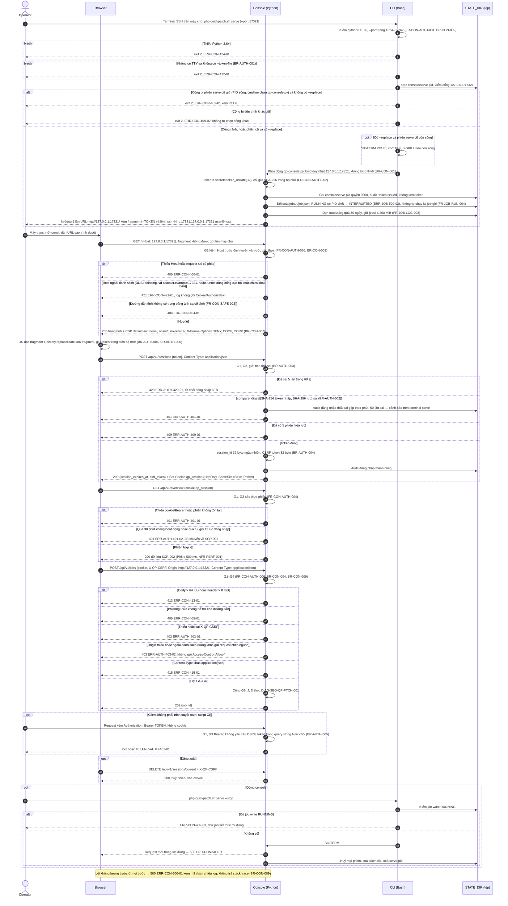
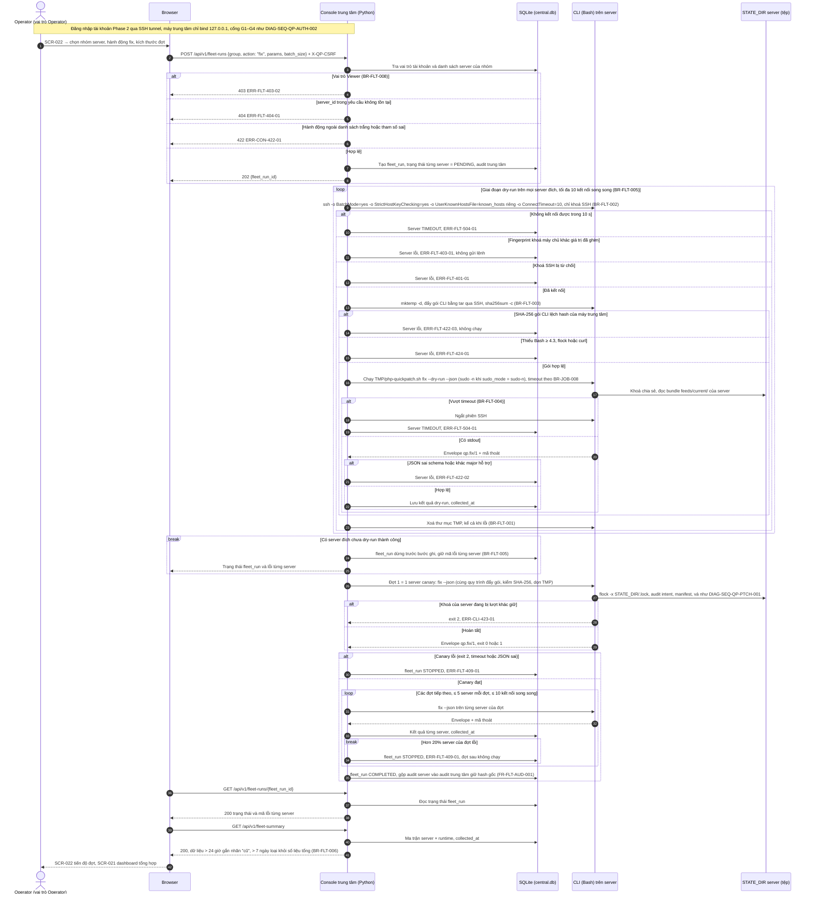

# Sơ đồ tuần tự — luồng 7 (serve, token, Host/CSRF) và luồng 8 (Phase 2)

## Lịch sử sửa đổi (Revision History)
| Phiên bản | Ngày | Người thực hiện | Tóm tắt thay đổi |
| :--- | :--- | :--- | :--- |
| 1.0.0 | 2026-10-22 | BA Agent | Khởi tạo: DIAG-SEQ-QP-AUTH-002 (bản đầy đủ của DIAG-SEQ-QP-AUTH-001: khởi động `serve`, token 256 bit, cổng G1–G4, Bearer, đăng xuất, dừng console) và DIAG-SEQ-QP-FLT-001 (Phase 2: dry-run toàn nhóm, canary, đợt ≤ 5 server qua SSH). Tách từ DOC-SRS-QP-FLOW-001 do giới hạn 800 dòng |
| 1.0.1 | 2026-10-22 | BA Agent | Sửa theo review: bỏ chú thích "(mã đề xuất mới)" của `ERR-FLT-422-03` trong DIAG-SEQ-QP-FLT-001 vì mã đã được định nghĩa chuẩn ở error-matrix.md §3.13 (DOC-SRS-QP-ERR-001 v1.0.1); câu dẫn cuối §4 trỏ tới định nghĩa chuẩn này |

## 1. Quy ước
Participant, ký hiệu và cổng dùng chung theo [flows.md §1.4–§1.6](flows.md). Cổng mặc định 17321 (`BR-CON-002`, câu hỏi mở `Q-SRS-01`). Luồng 7 là nơi vẽ đầy đủ cổng G1–G4; các sơ đồ khác vẽ rút gọn.

## 2. Luồng 7 — Khởi động `serve`, xác thực token, chặn Host và CSRF

### 2.1 Ngữ cảnh (DIAG-SEQ-QP-AUTH-002)
- **Use case**: `UC-CON-001`.
- **Tiền điều kiện**: người vận hành có phiên SSH trên máy chủ (có TTY, `A-SRS-03`) và mở được SSH local forwarding từ máy trạm (`A-SRS-01`).
- **Hậu điều kiện thành công**: console chỉ lắng nghe `127.0.0.1:17321` (`NFR-SEC-001`); trình duyệt có cookie `qp_session` và CSRF token trong bộ nhớ; job `RUNNING` của lần chạy trước đã được đối soát (`NFR-REL-003`).
- **Ràng buộc**: khởi động ≤ 3 s, RSS ≤ 100 MB khi rảnh (`NFR-PERF-006`); token 256 bit CSPRNG, 0 lần xuất hiện trong log/audit/JSON/`STATE_DIR` (`NFR-SEC-002`); 100% endpoint (trừ `GET /`, `GET /login`, `GET /static/*`, `POST /api/v1/sessions`) trả 401 khi thiếu xác thực (`NFR-SEC-003`); 100% Host sai trả 421 (`NFR-SEC-004`); 100% request ghi bằng cookie thiếu CSRF/Origin sai bị từ chối (`NFR-SEC-005`).

## 3. Luồng 8 — Phase 2: máy trung tâm chạy CLI từ xa qua SSH

### 3.1 Ngữ cảnh (DIAG-SEQ-QP-FLT-001)
- **Use case**: `UC-FLT-002` (chạy lệnh theo đợt), `UC-FLT-003` (xem tổng hợp). Phase 2 chỉ đặc tả, chưa triển khai.
- **Participant**: `CON` = console máy trung tâm (Python, chỉ bind `127.0.0.1`, truy cập qua SSH tunnel, `C-SRS-06`); `DB` = `central.db` (SQLite, `FR-FLT-INV-001`); `CLI` = `php-quickpatch.sh` chạy trên server được quản lý; `FS` = `STATE_DIR` của server (giữ backup, audit, feeds theo `FR-FLT-EXEC-001`).
- **Tiền điều kiện**: tài khoản vai trò Operator đã đăng nhập (`FR-FLT-RBAC-001`); server đã khai báo và ghim fingerprint khoá máy chủ (`FR-FLT-INV-002`).
- **Hậu điều kiện thành công**: `fleet_run` có kết quả từng server; audit server được gộp, giữ `hash` gốc (`FR-FLT-AUD-001`); 0 file tạm còn lại ngoài `STATE_DIR` trên server (`NFR-SEC-012`).
- **Ràng buộc**: canary 1 server → đợt ≤ 5 server, ≤ 10 kết nối song song, dừng khi canary lỗi hoặc > 20% server của đợt lỗi (`BR-FLT-005`); thu `scan --json` từ 100 server với 10 kết nối song song ≤ 20 phút (`NFR-PERF-008`); 0 kết nối chấp nhận khoá máy chủ chưa ghim, 0 mật khẩu SSH lưu trữ (`NFR-SEC-011`).

## 4. Ánh xạ bước → yêu cầu (rút gọn)
| Sơ đồ | Nhóm bước | FR | BR | NFR |
| :--- | :--- | :--- | :--- | :--- |
| DIAG-SEQ-QP-AUTH-002 | Khởi động `serve`, cổng, token, đối soát job | `FR-CON-AUTH-001`, `FR-CON-AUTH-002`, `FR-JOB-RUN-004`, `FR-JOB-LOG-003` | `BR-CON-001`, `BR-CON-002`, `BR-AUTH-001`, `BR-JOB-005` | `NFR-PERF-006`, `NFR-SEC-001`, `NFR-SEC-002`, `NFR-REL-003` |
| DIAG-SEQ-QP-AUTH-002 | Host, tài nguyên tĩnh, header | `FR-CON-AUTH-005`, `FR-CON-SAFE-002` | `BR-CON-003`, `BR-CON-007` | `NFR-SEC-004`, `NFR-SEC-006` |
| DIAG-SEQ-QP-AUTH-002 | Đăng nhập, phiên, Bearer, đăng xuất | `FR-CON-AUTH-003`, `FR-CON-AUTH-004` | `BR-AUTH-002..006` | `NFR-SEC-003` |
| DIAG-SEQ-QP-AUTH-002 | CSRF, giới hạn request, lỗi nội bộ, dừng console | `FR-CON-AUTH-006`, `FR-CON-API-001` | `BR-CON-004`, `BR-CON-009` | `NFR-SEC-005` |
| DIAG-SEQ-QP-FLT-001 | Phân quyền, tạo đợt | `FR-FLT-RBAC-001`, `FR-FLT-EXEC-002` | `BR-FLT-008`, `BR-FLT-005` | — |
| DIAG-SEQ-QP-FLT-001 | SSH, đẩy gói, chạy từ xa, dọn tạm | `FR-FLT-INV-002`, `FR-FLT-EXEC-001` | `BR-FLT-001..004` | `NFR-SEC-011`, `NFR-SEC-012` |
| DIAG-SEQ-QP-FLT-001 | Canary, đợt, tổng hợp, audit | `FR-FLT-EXEC-002`, `FR-FLT-DASH-001`, `FR-FLT-AUD-001` | `BR-FLT-005`, `BR-FLT-006` | `NFR-PERF-008` |

Phát hiện và giả định của tài liệu này được tổng hợp tại [flows.md §6](flows.md). Mã `ERR-FLT-422-03` dùng ở DIAG-SEQ-QP-FLT-001 được định nghĩa chuẩn tại [error-matrix.md §3.13](error-matrix.md) (DOC-SRS-QP-ERR-001, từ v1.0.1).

## 5. Tài liệu tham chiếu
| Nguồn | Dùng cho | Trạng thái |
| :--- | :--- | :--- |
| [spec.md §1.4, §3.3, §4.1.3](spec.md) (DOC-SRS-QP-001) | Danh mục API, DIAG-SEQ-QP-AUTH-001, nguồn Python `secrets`/`hmac`/`http.server` đã kiểm chứng | Đã đọc |
| [functional-requirements.md §9, §10, §13](functional-requirements.md), [business-rules.md §4.7–§4.9, §4.12](business-rules.md) | `FR-CON-*`, `FR-JOB-*`, `FR-FLT-*`, `BR-AUTH-*`, `BR-CON-*`, `BR-JOB-*`, `BR-FLT-*` | Đã đọc |
| WHATWG HTML — Server-sent events, https://html.spec.whatwg.org/multipage/server-sent-events.html | `EventSourceInit` chỉ có `withCredentials` (không gửi header tuỳ chỉnh → SSE xác thực bằng cookie); dòng bắt đầu bằng `:` bị bỏ qua, khuyến nghị gửi khoảng 15 s để giữ kết nối; trường `retry` tính bằng mili giây; header `Last-Event-ID` khi nối lại | Kiểm chứng (WebFetch 2026-10-22) |
| Mermaid — Sequence diagrams, https://mermaid.js.org/syntax/sequenceDiagram.html | Cú pháp khối `alt`, `opt`, `loop`, `par`, `break`; tránh `;` và `#` trong thông điệp | Kiểm chứng (WebFetch 2026-10-22); 2 sơ đồ qua `mermaid.parse` (Mermaid 11.4.1) |
