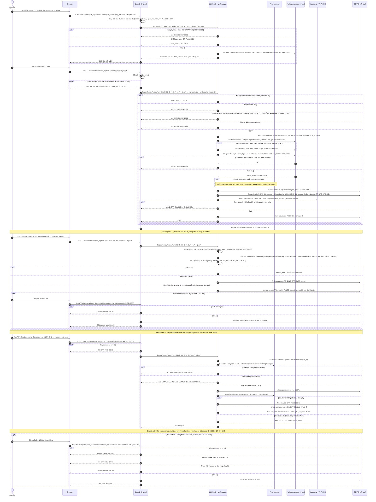
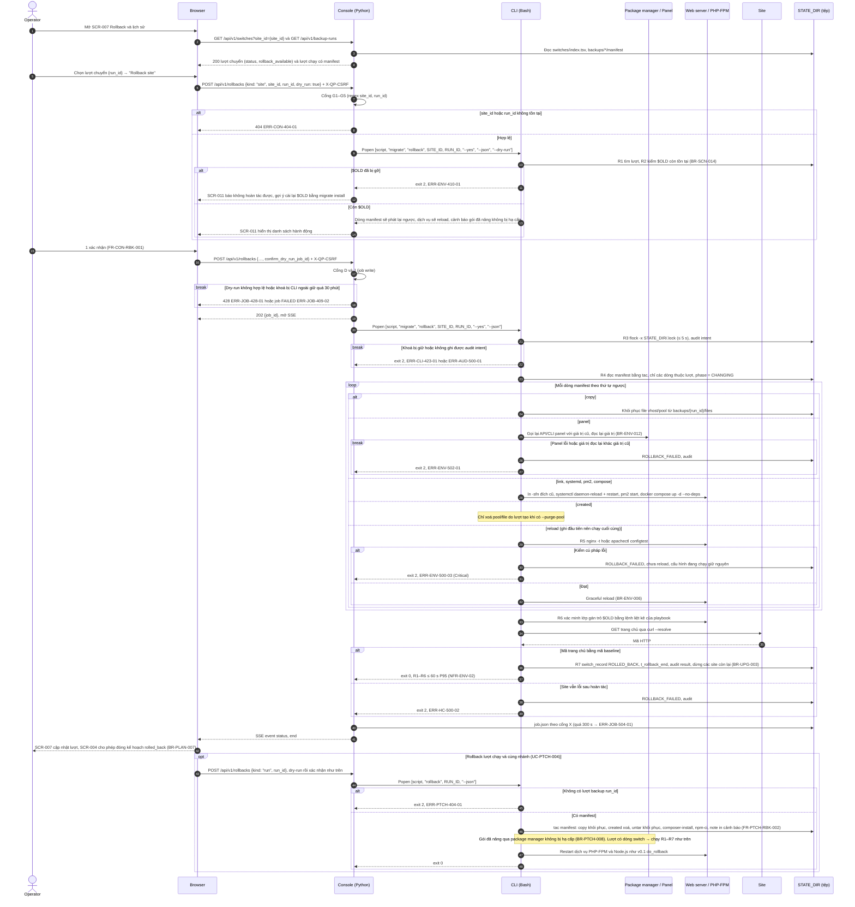

# Sơ đồ tuần tự — luồng 5 (nâng major) và luồng 6 (rollback thủ công)

## Lịch sử sửa đổi (Revision History)
| Phiên bản | Ngày | Người thực hiện | Tóm tắt thay đổi |
| :--- | :--- | :--- | :--- |
| 1.0.0 | 2026-10-22 | BA Agent | Khởi tạo: DIAG-SEQ-QP-UPG-001 (cài song song → quét tương thích → nâng dependency), DIAG-SEQ-QP-UPG-002 (chuyển 1 site C1–C12 → health check 600 s → tự rollback R1–R7), DIAG-SEQ-QP-UPG-003 (rollback thủ công 1 lệnh cho site và lượt chạy). Tách từ DOC-SRS-QP-FLOW-001 do giới hạn 800 dòng |
| 1.0.1 | 2026-10-22 | BA Agent | Sửa theo review: DIAG-SEQ-QP-UPG-002 bỏ nhãn "(mã đề xuất mới)" của `ERR-UPG-409-03` vì mã đã định nghĩa chuẩn ở [error-matrix.md](error-matrix.md) §3.11 (từ bản 1.0.1) |

## 1. Quy ước
Participant, ký hiệu và các cổng dùng chung G1–G5, J, D, A, X theo [flows.md §1.4–§1.6](flows.md). Bước C1–C12 và R1–R7 theo [environment-playbooks.md §5.1, §5.2](environment-playbooks.md); tiêu chí `HC-C0..HC-C9` theo [environment-playbooks-healthcheck.md §6.2](environment-playbooks-healthcheck.md). Ví dụ minh hoạ dùng PHP 8.1 → 8.4 trên PB-001 + PB-005 (Debian/Ubuntu, Nginx + PHP-FPM).

## 2. Luồng 5a — Cài song song, quét tương thích phần cần `$NEW_BIN`, nâng dependency

### 2.1 Ngữ cảnh (DIAG-SEQ-QP-UPG-001)
- **Use case**: `UC-UPG-001`, `UC-PLAN-003`.
- **Tiền điều kiện**: kế hoạch `approved` (DIAG-SEQ-QP-PLAN-001); mục P2 vá cùng nhánh (nếu có) đã `DONE` qua DIAG-SEQ-QP-PTCH-001 (`BR-UPG-006`); `serve` chạy root (`BR-CON-010`).
- **Hậu điều kiện thành công**: `$NEW_BIN` cài song song, liên kết mặc định không đổi (`BR-SCN-012`), dịch vụ FPM đích `active`, 0 site bị đổi; kết luận tương thích từng site `PASS` hoặc đã miễn trừ; mục P3, P4 của site `DONE`/`WAIVED` — điều kiện mở P5 (`BR-SCN-018`).
- **Ràng buộc**: timeout `migrate install` 3.600 s (`BR-JOB-008`); quét 1 site ≤ 1.800 s (`BR-CMPT-005`); Composer chạy trên bản sao trong `STATE_DIR/work/{plan_id}/` (`BR-CMPT-003`); tool không ghi docroot (`C-ENV-02`).

## 3. Luồng 5b — Chuyển 1 site, health check và tự rollback

### 3.1 Ngữ cảnh (DIAG-SEQ-QP-UPG-002)
- **Use case**: `UC-UPG-002`.
- **Tiền điều kiện**: kế hoạch `in_progress`; site là site kế tiếp trong `site_order` (site đầu là canary, `BR-PLAN-004`); P3, P4 của site `DONE`/`WAIVED`; kết luận tương thích `PASS`.
- **Hậu điều kiện**: `switch_record` ở `PASSED`, `ROLLED_BACK`, `HC_FAILED_KEPT` hoặc `ROLLBACK_FAILED` (DIAG-STATE-QP-ENV-002); `baseline.json`, `hc.json`, manifest trong `backups/{run_id}/` (`BR-HC-011`).
- **Ràng buộc**: C6–C10 ≤ 30 s P95 (`NFR-ENV-01`); graceful reload 0 phản hồi 5xx (`NFR-ENV-04`); 100% lượt có manifest trước C7 (`NFR-ENV-05`); cửa sổ 600 s, 10 vòng × 60 s, ≤ 11 request/phút (`BR-HC-012`); tự rollback bắt đầu ≤ 5 s, hoàn tất ≤ 60 s (`NFR-ENV-03`); timeout job `migrate switch` 1.200 s.

```mermaid
sequenceDiagram
    autonumber
    actor Op as Operator
    participant BR as Browser
    participant CON as Console (Python)
    participant CLI as CLI (Bash)
    participant PKG as Package manager / Panel
    participant WEB as Web server / PHP-FPM
    participant SITE as Site
    participant FS as STATE_DIR (tệp)

    Op->>BR: SCR-009 → site canary → "Chuyển sang 8.4"
    BR->>CON: POST /api/v1/jobs {action: "migrate_switch", params: {site_id, target, plan_id}, dry_run: true}
    CON->>CON: Cổng G1–G5 (regex site_id, nhánh, plan_id)
    CON->>CLI: Popen [script, "migrate", "switch", SITE_ID, "--target", "8.4", "--plan", PLAN_ID, "--yes", "--json", "--dry-run"]
    CLI-->>CON: File sẽ đổi, pool sẽ tạo, dịch vụ reload, URL thăm dò, gián đoạn dự kiến C6–C10 ≤ 30 s, cách hoàn tác
    CON-->>BR: SCR-011, yêu cầu xác nhận kép khi chọn --no-auto-rollback hoặc hc_mode=skip (BR-CON-006)
    Op->>BR: Xác nhận (gõ lại site_id khi cần xác nhận kép)
    BR->>CON: POST /api/v1/jobs {…, confirm_dry_run_job_id}
    CON->>CON: Cổng D và J (job write)
    break Dry-run không hợp lệ hoặc thiếu xác nhận kép
        CON-->>BR: 428 ERR-JOB-428-01
    end
    CON-->>BR: 202 {job_id}, mở SSE như DIAG-SEQ-QP-PTCH-001
    CON->>CLI: Popen [script, "migrate", "switch", SITE_ID, "--target", "8.4", "--plan", PLAN_ID, "--yes", "--json"]
    CLI->>FS: C1 flock -x STATE_DIR/.lock, đọc switches/index.tsv, kế hoạch
    alt Có lượt khác ở SWITCHED/HC_RUNNING hoặc khoá đang bị giữ
        CLI-->>CON: exit 2, ERR-ENV-409-01
    else Máy chủ đang bị khoá sau lượt ROLLBACK_FAILED
        CLI-->>CON: exit 2, ERR-UPG-423-01
    else Site không thuộc kế hoạch approved/in_progress (BR-UPG-005)
        CLI-->>CON: exit 2, ERR-UPG-409-02
    else Không phải site kế tiếp của site_order, hoặc lượt trước ROLLED_BACK chưa được xác nhận (BR-ENV-003, BR-UPG-003)
        CLI-->>CON: exit 2, ERR-UPG-409-03
    else C2: mục P3/P4 của site chưa DONE/WAIVED (BR-SCN-018)
        CLI-->>CON: exit 2, ERR-SCN-424-01
    else C2: kết luận tương thích khác PASS (BR-UPG-002)
        CLI-->>CON: exit 2, ERR-UPG-409-01
    else C2: nhánh đích không hợp lệ cho production (BR-SCN-007)
        CLI-->>CON: exit 2, ERR-SCN-409-02
    else C2: $NEW_BIN không tồn tại hoặc không chạy
        CLI-->>CON: exit 2, ERR-ENV-412-01
    else C2: site chạy mod_php (BR-SCN-047)
        CLI-->>CON: exit 2, ERR-SCN-412-02
    else Điều kiện đạt, switch_record = PREFLIGHT
        CLI->>WEB: C3 tạo pool qp-{site_id} cho $NEW (FR-UPG-CFG-001, BR-ENV-007), php-fpm8.4 -t, reload riêng FPM đích
        break Pool không qua kiểm cú pháp hoặc FPM đích không active sau 15 s
            CLI-->>CON: exit 2, ERR-ENV-500-01, ABORTED, site chưa đổi
        end
        CLI->>WEB: C4 FastCGI probe tới socket pool đích, SCRIPT_FILENAME = docroot/index.php (FR-UPG-HC-002, BR-HC-003)
        break Probe không đạt (Status 5xx, PHP Fatal/Parse error, lộ mã nguồn, quá 10 s)
            CLI-->>CON: exit 2, ERR-HC-424-01, ABORTED, site chưa đổi
        end
        opt Không có Python 3 để chạy probe
            Note over CLI: Bỏ probe, cảnh báo ERR-HC-424-02, kiểm bù ở C10
        end
        CLI->>CLI: Tập URL: trang chủ + ≤ 10 hc_url cùng host, chỉ GET, nguồn log lỗi (FR-UPG-HC-001, BR-HC-001, BR-HC-002)
        break Không có host trang chủ hoặc không có nguồn log lỗi
            CLI-->>CON: exit 2, ERR-HC-412-03 hoặc ERR-HC-412-01, ABORTED
        end
        opt URL khai báo sai cú pháp, khác host hoặc quá 10 URL
            Note over CLI: Bỏ URL đó, cảnh báo ERR-HC-422-02
        end
        opt Tham số hc.* trong healthcheck.conf ngoài khoảng cho phép
            Note over CLI: Dùng giá trị mặc định, cảnh báo ERR-HC-422-01
        end
        loop C5 baseline trên $OLD: 5 vòng cách 10 s (FR-UPG-HC-003)
            CLI->>WEB: curl --resolve host:port:127.0.0.1, GET từng URL, Accept-Encoding identity, --max-redirs 0
            WEB->>SITE: Xử lý bằng $OLD
            SITE-->>CLI: Mã HTTP, Location, kích thước body, time_total
        end
        break Trang chủ trả mã khác nhau giữa 5 mẫu hoặc có 5xx
            CLI-->>CON: exit 2, ERR-HC-412-02, ABORTED
        end
        CLI->>FS: baseline.json, W0, byte offset + inode từng file log (tuổi baseline ≤ 120 s khi vào C7, BR-HC-004)
        CLI->>FS: C6 ensure_backup_dir, manifest theo thứ tự reload, switch, copy, created, audit intent, phase = MANIFEST_WRITTEN
        break Dưới 50 MB trống hoặc không ghi được audit intent
            CLI-->>CON: exit 2, ERR-ENV-507-01 hoặc ERR-AUD-500-01, ABORTED
        end
        alt C7 với playbook sửa file (PB-005)
            CLI->>WEB: Đổi fastcgi_pass của vhost sang socket pool đích, phase = CHANGING
        else C7 với playbook panel (PB-007..PB-012)
            CLI->>PKG: Gọi API/CLI panel (vd whmapi1 php_set_vhost_versions), đọc lại giá trị (BR-ENV-012)
            break Panel trả lỗi hoặc giá trị đọc lại khác mong muốn
                CLI->>PKG: Gọi lại với giá trị cũ
                CLI-->>CON: exit 2, ERR-ENV-502-01
            end
        end
        CLI->>WEB: C8 nginx -t hoặc apachectl configtest
        break Kiểm cú pháp thất bại
            CLI->>FS: Khôi phục file từ backup trong ≤ 5 s, không reload (BR-ENV-005)
            CLI-->>CON: exit 2, ERR-ENV-500-02
        end
        CLI->>WEB: C9 graceful reload phạm vi nhỏ nhất (BR-ENV-006)
        CLI->>WEB: C10 xác minh gán: FPM status /qp-fpm-status, accepted conn tăng ≥ 1 sau 1 request (HC-C0)
        CLI->>FS: C11 nhả STATE_DIR/.lock, giữ switches/{site_id}.lock, SWITCHED → HC_RUNNING, phase = HC_RUNNING
        loop 10 vòng, vòng k tại t_C9 + (k − 1) × 60 s (FR-UPG-HC-004), bỏ qua khi HC-C0 không đạt
            CLI->>WEB: GET từng URL kèm qp_hc={run_id}-{n}, tuần tự, 1 request đồng thời (BR-HC-009, BR-HC-012)
            WEB->>SITE: Xử lý bằng $NEW
            SITE-->>CLI: Mã HTTP, body, time_total
            CLI->>FS: Đếm log mới từ byte offset, kiểm FPM $NEW active (HC-C1, C2, C3, C5, C7, C8, C9)
            break Vi phạm tiêu chí fail-fast
                CLI->>CLI: verdict = FAIL, violations[] ghi mã HC-C*
            end
        end
        CLI->>FS: hc.json (verdict, violations[], số liệu từng vòng), đánh giá HC-C4, HC-C6 cuối cửa sổ (BR-HC-006, BR-HC-007)
        alt ĐẠT đủ 10 tiêu chí sau 600 s
            CLI->>FS: C12 switch_record PASSED, audit result, mục P5/P6 của site DONE, mở site kế tiếp
            CLI-->>CON: exit 0
        else KHÔNG ĐẠT và tự rollback bật (FR-UPG-HC-005, FR-UPG-RBK-002, BR-HC-010)
            CLI->>FS: R1–R3 dùng khoá site đang giữ, kiểm $OLD còn tồn tại, bắt đầu ≤ 5 s sau phát hiện
            CLI->>WEB: R4 phát lại manifest ngược (copy hoặc panel), R5 kiểm cú pháp + graceful reload
            CLI->>SITE: R6 xác minh gán trỏ $OLD, 1 vòng thăm dò mọi URL trên $OLD
            alt Mã HTTP mọi URL bằng mã baseline, hoàn tất ≤ 60 s
                CLI->>FS: R7 ROLLED_BACK, audit, dừng các site còn lại của kế hoạch (BR-UPG-003)
                CLI-->>CON: exit 1, ERR-SCN-500-01 kèm mã HC-C* vi phạm
            else Kiểm cú pháp sau khôi phục lỗi, $OLD đã gỡ, panel lỗi hoặc site vẫn lỗi
                CLI->>FS: ROLLBACK_FAILED, khoá mọi lệnh chuyển site trên máy chủ (lượt sau nhận ERR-UPG-423-01)
                CLI-->>CON: exit 2, ERR-HC-500-02 (Critical) kèm ERR-ENV-500-03, ERR-ENV-410-01 hoặc ERR-ENV-502-01
            end
        else KHÔNG ĐẠT và --no-auto-rollback đã duyệt kép
            CLI->>FS: HC_FAILED_KEPT, audit
            CLI-->>CON: exit 1, ERR-HC-500-01 (Critical)
        end
    end
    opt Người vận hành huỷ khi phase = HC_RUNNING (BR-JOB-004)
        BR->>CON: POST /api/v1/jobs/{job_id}/cancellations
        CON->>CLI: Gửi yêu cầu huỷ
        CLI->>WEB: Dừng health check, rollback R1–R7 với lý do MANUAL
    end
    CON->>FS: job.json theo cổng X (quá 1.200 s → ERR-JOB-504-01)
    CON-->>BR: SSE event status, end
    BR->>CON: GET /api/v1/switches/{run_id}
    CON->>FS: Đọc backups/{run_id}/switch.json, hc.json
    CON-->>BR: 200 báo cáo health check: từng vòng × URL, ≤ 50 dòng log vi phạm (FR-UPG-HC-006)
    alt PASSED
        BR-->>Op: SCR-009 site PASSED, mở nút chuyển site kế tiếp
    else ROLLED_BACK, HC_FAILED_KEPT hoặc ROLLBACK_FAILED
        BR-->>Op: Dải cảnh báo đầu SCR-002, nút rollback hoặc xác nhận đã xử lý (FR-CON-OVW-001)
    end
```

## 4. Luồng 6 — Rollback thủ công 1 lệnh

### 4.1 Ngữ cảnh (DIAG-SEQ-QP-UPG-003)
- **Use case**: `UC-UPG-004` (site), `UC-PTCH-004` (lượt chạy vá cùng nhánh).
- **Tiền điều kiện**: lượt chuyển ở `SWITCHED`, `HC_RUNNING`, `PASSED` hoặc `HC_FAILED_KEPT` có manifest; hoặc lượt `fix` có `backups/{run_id}/manifest`.
- **Hậu điều kiện thành công**: site trỏ lại `$OLD`, `switch_record` = `ROLLED_BACK` (`t_rollback_end`); các site còn lại của kế hoạch dừng (`BR-UPG-003`); kế hoạch được phép đóng `rolled_back` (`BR-PLAN-007`).
- **Ràng buộc**: R1–R6 ≤ 60 s P95 (`NFR-ENV-02`, KR4.2); `rollback [ID]` khôi phục 100% file có dòng `copy`/`created` (`NFR-REL-005`); gói đã nâng qua package manager không bị hạ cấp (`BR-PTCH-008`); timeout job `migrate rollback` 300 s.
- **Đường CLI tương đương**: `php-quickpatch.sh rollback-site {site_id} [{run_id}]` (= `migrate rollback`); lệnh ghi mới có TTY hỏi `y/N`, không TTY bắt buộc `--yes` (`ERR-CLI-428-01`); `rollback [ID]` giữ hành vi v0.1 (không hỏi).

## 5. Ánh xạ bước → yêu cầu (rút gọn)
| Sơ đồ | Bước/nhóm bước | FR | BR | NFR |
| :--- | :--- | :--- | :--- | :--- |
| DIAG-SEQ-QP-UPG-001 | Dry-run, xác nhận, chạy mục P2 | `FR-PLAN-CHK-002`, `FR-CON-SAFE-001`, `FR-UPG-PRE-001`, `FR-UPG-INST-001` | `BR-SCN-016`, `BR-SCN-012`, `BR-ENV-004`, `BR-UPG-001` | `NFR-REL-002` |
| DIAG-SEQ-QP-UPG-001 | Cấu hình đích | `FR-UPG-CFG-002` | `BR-SCN-045`, `BR-SCN-046` | — |
| DIAG-SEQ-QP-UPG-001 | Quét P3 với `$NEW_BIN`, miễn trừ | `FR-CMPT-CODE-003`, `FR-CMPT-COMP-001`, `FR-CMPT-RES-001` | `BR-SCN-042`, `BR-SCN-044`, `BR-UPG-002`, `BR-CMPT-005` | `NFR-PERF-005` |
| DIAG-SEQ-QP-UPG-001 | Nâng dependency P4, mục MANUAL | `FR-PLAN-DEP-001`, `FR-PLAN-CHK-001`, `FR-FEED-OSV-001` | `BR-PLAN-005`, `BR-SCN-018` | — |
| DIAG-SEQ-QP-UPG-002 | C1–C2 | `FR-UPG-SEQ-001`, `FR-UPG-SWT-001` | `BR-ENV-003`, `BR-UPG-002`, `BR-UPG-003`, `BR-UPG-005`, `BR-SCN-007`, `BR-SCN-018`, `BR-SCN-047` | — |
| DIAG-SEQ-QP-UPG-002 | C3–C5 | `FR-UPG-CFG-001`, `FR-UPG-HC-001..003` | `BR-ENV-007`, `BR-HC-001..005` | — |
| DIAG-SEQ-QP-UPG-002 | C6–C10 | `FR-UPG-SWT-001`, `FR-UPG-SWT-002`, `FR-PTCH-RBK-001` | `BR-SCN-017`, `BR-ENV-005`, `BR-ENV-006`, `BR-ENV-012` | `NFR-ENV-01`, `NFR-ENV-04`, `NFR-ENV-05` |
| DIAG-SEQ-QP-UPG-002 | C11–C12, health check, tự rollback | `FR-UPG-HC-004..006`, `FR-UPG-RBK-002` | `BR-HC-006..012`, `BR-SCN-010` | `NFR-ENV-03` |
| DIAG-SEQ-QP-UPG-003 | R1–R7, rollback lượt chạy | `FR-UPG-RBK-001`, `FR-PTCH-RBK-002`, `FR-CON-RBK-001` | `BR-PTCH-008`, `BR-ENV-008`, `BR-SCN-014`, `BR-UPG-003` | `NFR-ENV-02`, `NFR-REL-005` |

Phát hiện, giả định và mã đề xuất mới của tài liệu này được tổng hợp tại [flows.md §6](flows.md).

## 6. Tài liệu tham chiếu
| Nguồn | Dùng cho | Trạng thái |
| :--- | :--- | :--- |
| [environment-playbooks.md §5.1–§5.4, §6, §7, §9](environment-playbooks.md) (DOC-SRS-QP-ENV-001) | Bước C1–C12, R1–R7, thứ tự manifest, `BR-ENV-*`, `ERR-ENV-*` | Đã đọc |
| [environment-playbooks-healthcheck.md §2–§6, §8, §9](environment-playbooks-healthcheck.md) (DOC-SRS-QP-ENV-002) | Tập URL, FastCGI probe, baseline, `HC-C0..C9`, tự rollback, `BR-HC-*`, `ERR-HC-*` | Đã đọc |
| [functional-requirements.md §6–§8](functional-requirements.md), [business-rules.md §4.2–§4.6](business-rules.md) | `FR-CMPT-*`, `FR-PTCH-*`, `FR-UPG-*`, `BR-UPG-*`, `BR-PLAN-*`, `BR-CMPT-*` | Đã đọc |
| [version-scenarios-common.md §3](version-scenarios-common.md), [version-scenarios-php.md](version-scenarios-php.md) | Giai đoạn P1–P6, mục P4 "Nâng dependency Composer trên `$NEW_BIN`" (`SEMI`, chạy trên `$COPY`) | Đã đọc |
| `/home/user/php-quickpatch/php-quickpatch.sh` v0.1.0 | `ensure_backup_dir`, `backup_file`, `record`, `do_rollback` (phát lại manifest bằng `tac`, restart dịch vụ), khoá `flock -n` | Đã đọc (grep hàm, 2026-10-22) |
| Mermaid — Sequence diagrams, https://mermaid.js.org/syntax/sequenceDiagram.html | Cú pháp `autonumber`, `alt/else`, `opt`, `loop`, `par/and`, `break`; `#59;` cho dấu chấm phẩy trong thông điệp | Kiểm chứng (WebFetch 2026-10-22); 3 sơ đồ qua `mermaid.parse` (Mermaid 11.4.1) |
