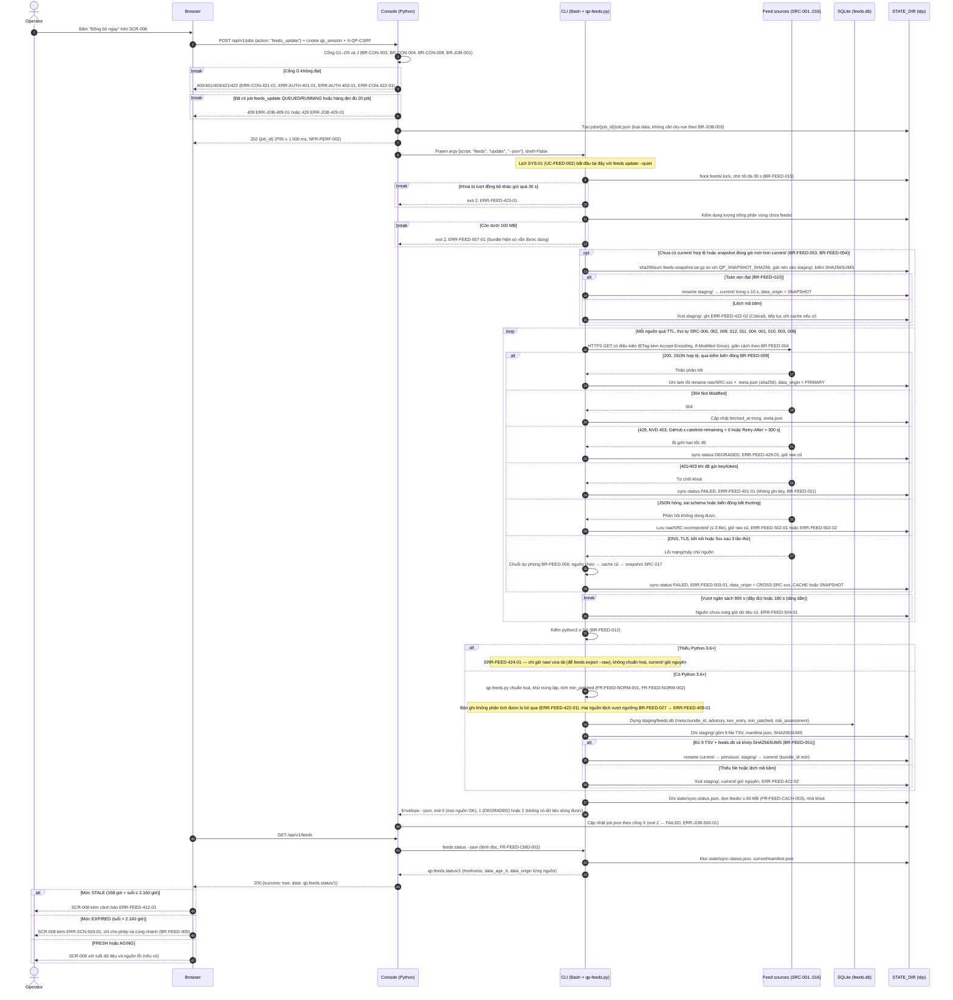
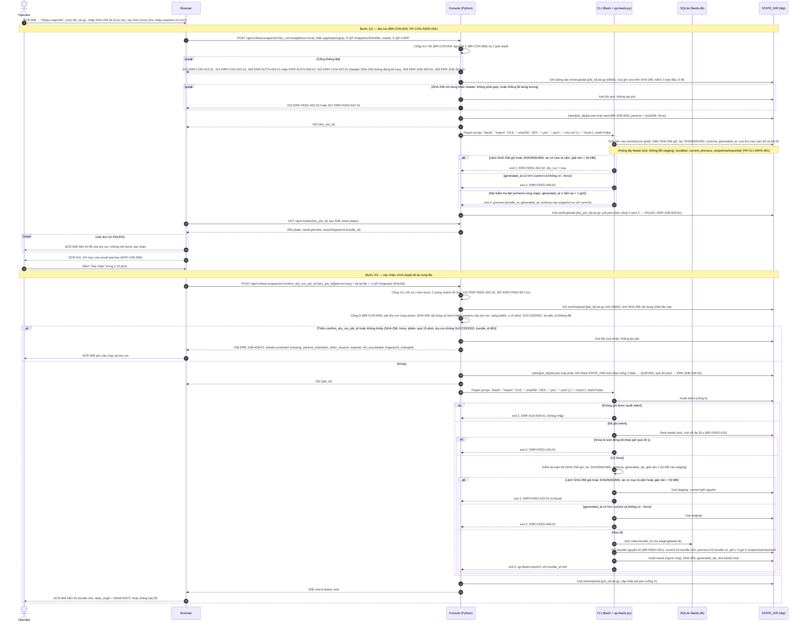
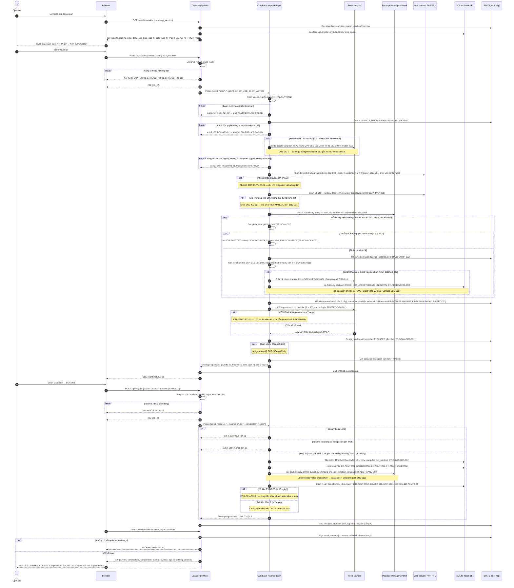
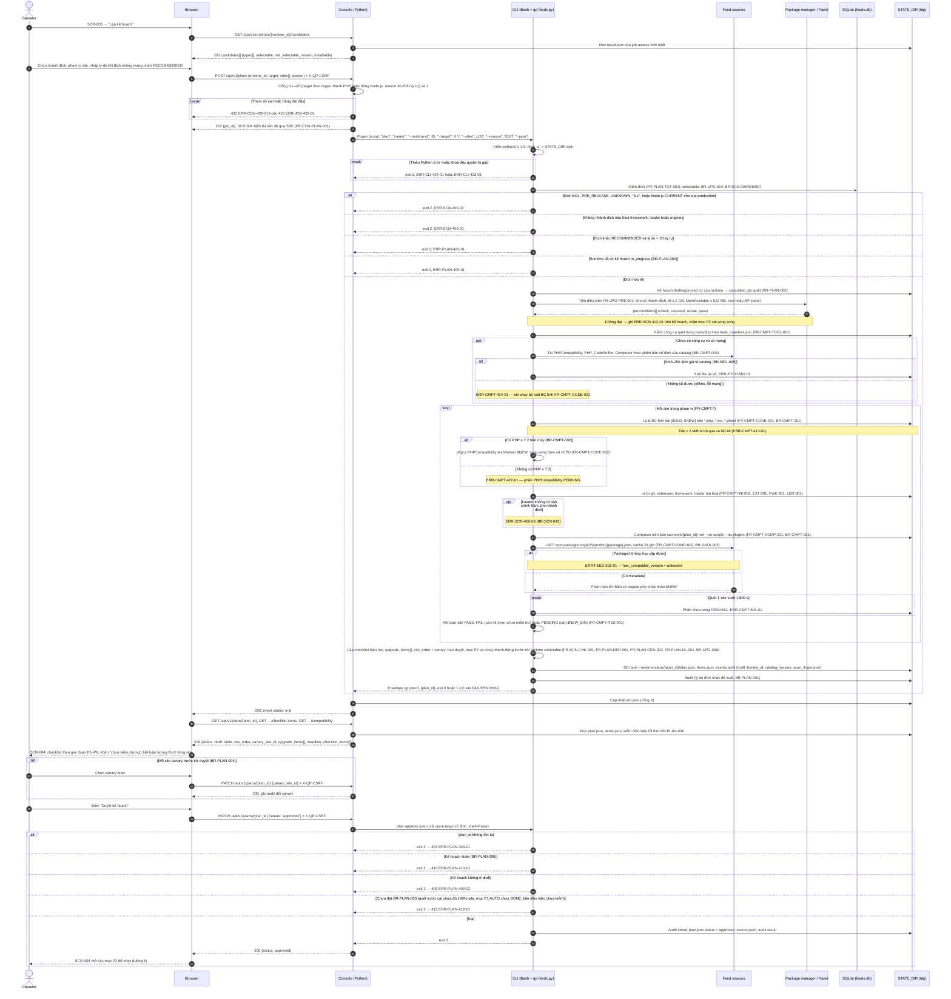
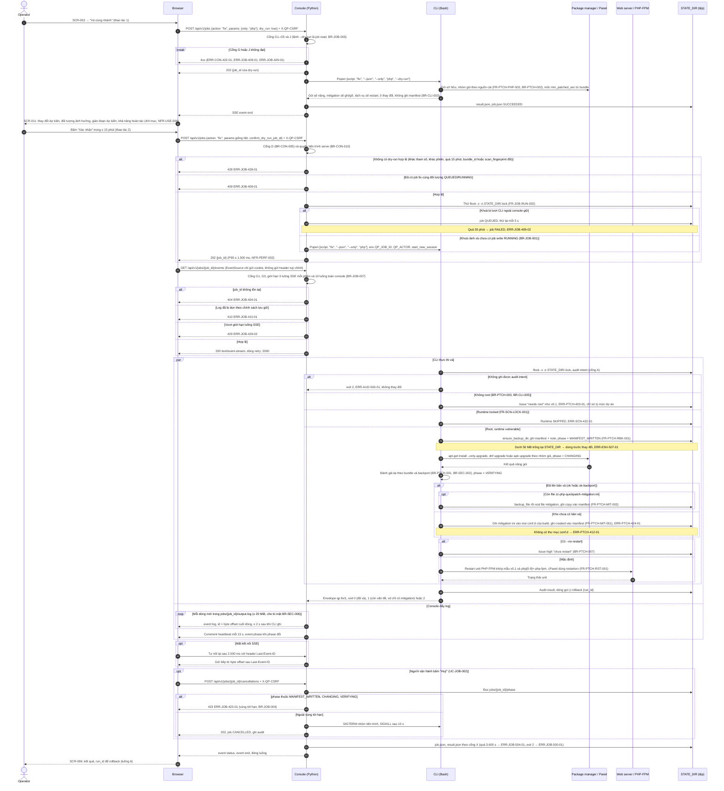

# Sơ đồ tuần tự (Sequence Diagram) — php-quickpatch v2

## Lịch sử sửa đổi (Revision History)
| Phiên bản | Ngày | Người thực hiện | Tóm tắt thay đổi |
| :--- | :--- | :--- | :--- |
| 1.0.0 | 2026-10-22 | BA Agent | Khởi tạo bộ sơ đồ tuần tự theo `skills/sequence` (template 15, rules 01, 10): quy ước participant và cổng kiểm tra chung; luồng 1–4 trong tài liệu này; luồng 5–6 tách sang [flows-upgrade.md](flows-upgrade.md), luồng 7–8 tách sang [flows-console-fleet.md](flows-console-fleet.md) do giới hạn 800 dòng; 10 sơ đồ Mermaid `sequenceDiagram` có `autonumber`, đã kiểm cú pháp bằng `mermaid.parse` (Mermaid 11.4.1) |
| 1.0.1 | 2026-10-22 | BA Agent | Sửa theo review: (1) vẽ lại DIAG-SEQ-QP-FEED-003 theo `BR-CON-005` 1.0.1 — 2 bước dry-run (job `read`, `feeds import … --dry-run`, 0 thay đổi `feeds/`) → xác nhận trên SCR-011 (tải lại file, cổng D so SHA-256 nội dung và `force` với job dry-run, thiếu hoặc lệch → 428 `ERR-JOB-428-01`), thêm nhánh `ERR-CON-415-01`, `ERR-FEED-507-01`, `ERR-FEED-423-01`; §2.2 thêm ràng buộc, ghi chú §2.2 và §6.2 mục 1 ghi "đã quyết"; §1.7 thêm `UC-CON-003`, `FR-CON-SAFE-001`, `FR-CLI-SAFE-001`, `GET /api/v1/jobs/{job_id}`; (2) bỏ nhãn "mã đề xuất mới" của `ERR-JOB-429-02` (DIAG-SEQ-QP-PTCH-001) và §1.1; §6.2 mục 4–6 ghi "Đã xử lý ở DOC-SRS-QP-ERR-001 v1.0.1"; thay bảng mã lỗi §6.3 bằng liên kết error-matrix.md §3.3, §3.11, §3.13; (3) §6.1 đếm lại DIAG-SEQ-QP-FEED-003 (46 thông điệp, 15 mã ERR) và độ phủ 111/129 mã của error-matrix.md 1.1.0; §6.4 thêm nguồn; 5/5 sơ đồ của file qua `mermaid.parse` (Mermaid 11.4.1) |

## 1. Giới thiệu

### 1.1 Mục đích
Mô tả **ai gọi ai, theo thứ tự nào** cho 8 luồng nghiệp vụ chính của php-quickpatch v2, làm đầu vào cho Dev (cài đặt `php-quickpatch.sh`, `qp-feeds.py`, `qp-console.py`), QA (thiết kế test case theo từng nhánh `alt`/`break`) và kỹ sư bảo mật (rà soát cổng kiểm tra của console). Mọi mã `FR-*`, `BR-*`, `ERR-*`, `UC-*`, `SCR-*`, `NFR-*` và đường dẫn API dùng trong tài liệu là mã đã định nghĩa ở SRS ([spec.md](spec.md), [functional-requirements.md](functional-requirements.md), [business-rules.md](business-rules.md), [error-matrix.md](error-matrix.md), [nfr.md](nfr.md)) và các phụ lục. 3 mã lỗi do bản 1.0.0 của tài liệu này đề xuất (`ERR-JOB-429-02`, `ERR-UPG-409-03`, `ERR-FLT-422-03`) đã được định nghĩa chuẩn ở [error-matrix.md](error-matrix.md) từ bản 1.0.1 (§6.3).

### 1.2 Phạm vi
| Trong phạm vi | Ngoài phạm vi (tài liệu khác đã có hoặc không thuộc nhiệm vụ) |
| :--- | :--- |
| 8 luồng, 10 sơ đồ (§1.7); Phase 1 (cục bộ) và Phase 2 (máy trung tâm qua SSH, chỉ đặc tả); 21/35 use case của SRS | Đăng nhập rút gọn DIAG-SEQ-QP-AUTH-001 ([spec.md §4.1.3](spec.md)) — được thay bằng bản đầy đủ DIAG-SEQ-QP-AUTH-002; một lần `feeds update` mức CLI DIAG-SEQ-QP-FEED-001 ([data-sources-cache-cli.md §5.1](data-sources-cache-cli.md)) — được mở rộng ở DIAG-SEQ-QP-FEED-002; 14 use case chưa có sơ đồ riêng: `UC-FEED-005`, `UC-ASMT-002` (tra OSV có trong luồng 2, chưa vẽ SCR-005), `UC-PTCH-002`, `UC-PTCH-003`, `UC-UPG-003`, `UC-UPG-005`, `UC-UPG-006`, `UC-UPG-007`, `UC-JOB-003`, `UC-CLI-001`, `UC-RPT-001`, `UC-RPT-002`, `UC-FLT-001`, `UC-FLT-004` |

### 1.3 Bộ tài liệu (tách file do giới hạn 800 dòng)
| File | Mã tài liệu | Nội dung |
| :--- | :--- | :--- |
| `flows.md` (tài liệu này) | DOC-SRS-QP-FLOW-001 | Quy ước, cổng kiểm tra chung, luồng 1 (đồng bộ feed + snapshot), 2 (scan + assess), 3 (chọn đích + kế hoạch), 4 (vá cùng nhánh + SSE), ma trận truy vết tổng hợp, phát hiện và câu hỏi mở |
| [flows-upgrade.md](flows-upgrade.md) | DOC-SRS-QP-FLOW-002 | Luồng 5 (nâng major: cài song song → quét tương thích → nâng dependency → chuyển 1 site → health check → tự rollback), luồng 6 (rollback thủ công 1 lệnh) |
| [flows-console-fleet.md](flows-console-fleet.md) | DOC-SRS-QP-FLOW-003 | Luồng 7 (`serve` + token + chặn Host/CSRF), luồng 8 (Phase 2: máy trung tâm chạy CLI từ xa qua SSH) |

### 1.4 Participant
| Alias | Participant | Thành phần thực tế | Ghi chú |
| :--- | :--- | :--- | :--- |
| `Op` | Operator | Người vận hành `PER-01`, `PER-02`, `PER-03` (Phase 2: vai trò Operator/Admin theo `BR-FLT-008`); `SYS-01` khi chạy theo lịch | Actor |
| `BR` | Browser | Trình duyệt chạy JS của console qua SSH tunnel `ssh -N -L 17321:127.0.0.1:17321` | `EventSource` cho SSE |
| `CON` | Console (Python) | `qp-console.py`, Python ≥ 3.6 thư viện chuẩn, chỉ bind `127.0.0.1` (`BR-CON-001`); Phase 2: console máy trung tâm | Gọi CLI bằng `subprocess.Popen(argv, shell=False)` (`FR-CON-SAFE-003`) |
| `CLI` | CLI (Bash) | `php-quickpatch.sh` (Bash ≥ 4.3) và `qp-feeds.py` do CLI gọi (chuẩn hoá feed, điểm rủi ro, kế hoạch) | Một đường thực thi duy nhất cho mọi thay đổi hệ thống (`C-SRS-05`) |
| `SRC` | Feed sources | Nguồn online `SRC-001..016` qua HTTPS (TLS ≥ 1.2), gồm Packagist/npm registry khi lập kế hoạch (`BR-DATA-003`) | `SRC-017` = snapshot cục bộ, vẽ trong `FS` |
| `PKG` | Package manager / Panel | `apt-get`, `dnf`/`yum`, `apk`, API/CLI panel (`whmapi1`, `selectorctl`, `plesk bin`, `cyberpanel`…), Docker | Lệnh theo playbook `PB-000..018` |
| `WEB` | Web server / PHP-FPM | Nginx, Apache, LiteSpeed, dịch vụ `php-fpm` (`$OLD`, `$NEW`), systemd/pm2 cho Node.js | Kiểm cú pháp trước reload (`BR-ENV-005`) |
| `SITE` | Site | Ứng dụng PHP/Node.js của khách hàng phía sau `WEB` | Chỉ nhận `GET` khi health check (`BR-HC-002`) |
| `DB` | SQLite | `feeds/current/feeds.db` (console mở chỉ đọc `file:…?mode=ro`); Phase 2: `central.db` của máy trung tâm | — |
| `FS` | STATE_DIR (tệp) | `STATE_DIR` (`feeds/`, `state/`, `plans/`, `jobs/`, `audit/`, `backups/`, `switches/`, `console/`) | **Participant bổ sung**: SRS lưu job, kế hoạch, audit, manifest dưới dạng tệp ([spec.md §2.1](spec.md)), không lưu trong SQLite; tách riêng để sơ đồ không gán sai nơi lưu trữ |

### 1.5 Quy ước ký hiệu
| Ký hiệu | Ý nghĩa |
| :--- | :--- |
| `autonumber` | Đánh số bước; test case dẫn chiếu `<mã sơ đồ>#<số bước>` |
| `->>` / `-->>` | Lời gọi / phản hồi |
| `alt … else … end` | Rẽ nhánh thành công/lỗi; nhánh lỗi ghi mã `ERR-*` |
| `break … end` | Nhánh lỗi **kết thúc** luồng tại điểm đó (tương đương `else Lỗi` của template 15, dùng để tránh lồng quá sâu) |
| `opt`, `loop`, `par` | Bước tuỳ điều kiện, lặp, song song |
| Mã thoát CLI | 0 = thành công/không còn vấn đề, 1 = còn vấn đề hoặc thành công có cảnh báo, 2 = lỗi tham số/runtime/khoá (`BR-CLI-004`) |
| Mã HTTP | Theo cột HTTP của mã `ERR-*`; body theo rules/10 `{success, data, error{code, http, message, localization_key, details}, meta, timestamp}` (`FR-CON-API-001`) |
| `{job_id}`, `{site_id}`… | Tham số đường dẫn; giá trị thật theo regex `BR-CON-008` |

### 1.6 Cổng kiểm tra dùng chung
Để không lặp lại trong từng sơ đồ, các bước sau được vẽ đầy đủ một lần ở DIAG-SEQ-QP-AUTH-002 ([flows-console-fleet.md §2](flows-console-fleet.md)) và DIAG-SEQ-QP-PTCH-001 (§5), các sơ đồ khác vẽ rút gọn thành 1 bước kèm mã lỗi chính.

| Mã cổng | Nội dung | Thứ tự | Mã lỗi |
| :--- | :--- | :---: | :--- |
| G1 | Header `Host` thuộc `127.0.0.1:<port>`, `localhost:<port>` hoặc cổng `--allow-local-port` (`BR-CON-003`); kiểm trước định tuyến, áp cho cả tài nguyên tĩnh và SSE | 1 | `ERR-CON-400-01`, `ERR-CON-421-01` |
| G2 | Kích thước và phương thức: body ≤ 64 KiB (snapshot ≤ 20 MiB), header ≤ 8 KiB, phương thức hỗ trợ (`BR-CON-009`) | 2 | `ERR-CON-413-01`, `ERR-CON-405-01`, `ERR-CON-404-01` |
| G3 | Xác thực cookie `qp_session` hoặc `Authorization: Bearer` (`BR-AUTH-004`, `BR-AUTH-005`) | 3 | `ERR-AUTH-401-01`, `ERR-AUTH-401-02` |
| G4 | Request ghi bằng cookie: `X-QP-CSRF`, `Origin`, `Content-Type: application/json` (`BR-CON-004`) | 4 | `ERR-AUTH-403-01`, `ERR-AUTH-403-02`, `ERR-CON-415-01` |
| G5 | `action` thuộc danh sách trắng, tham số khớp regex/enum, không bắt đầu bằng `-` (`BR-CON-008`) | 5 | `ERR-CON-422-01` |
| J | Tạo job: ≤ 1 `write`, ≤ 2 `read`, ≤ 1 `data` cùng `RUNNING`; ≤ 20 `QUEUED`; không trùng hành động + đối tượng; job `write` thử khoá `STATE_DIR/.lock` không chặn, bận bởi CLI ngoài → `QUEUED`, thử lại mỗi 5 s tới 30 phút (`BR-JOB-001`, `BR-JOB-002`) | 6 | `ERR-JOB-409-01`, `ERR-JOB-429-01`, `ERR-JOB-409-02` |
| D | Job `write` cần dry-run `SUCCEEDED` cùng tham số chuẩn hoá, cùng phiên, ≤ 15 phút, `bundle_id` và `scan_fingerprint` không đổi; hành động toàn máy chủ cần xác nhận kép (`BR-CON-005`, `BR-CON-006`) | 7 | `ERR-JOB-428-01` |
| A | CLI ghi audit "intent" trước thay đổi, "result" khi kết thúc; không ghi được intent → không thay đổi (`BR-AUD-004`) | Trong CLI | `ERR-AUD-500-01` |
| X | Ánh xạ kết thúc job: exit 0 → `SUCCEEDED`, 1 → `SUCCEEDED_WITH_ISSUES`, 2 → `FAILED`, quá timeout → `FAILED`, mất tiến trình → `INTERRUPTED` (`BR-JOB-008`, `BR-JOB-005`) | Cuối | `ERR-JOB-500-01`, `ERR-JOB-504-01`, `ERR-JOB-500-02` |

### 1.7 Danh mục sơ đồ
| Mã sơ đồ | Luồng | File | Use case | FR chính | API chính |
| :--- | :--- | :--- | :--- | :--- | :--- |
| DIAG-SEQ-QP-FEED-002 | 1a. Đồng bộ feed online + dự phòng snapshot đóng gói | `flows.md` §2.1 | `UC-FEED-001`, `UC-FEED-002`, `UC-FEED-003` | `FR-FEED-CMD-001`, `FR-FEED-SYNC-001`, `FR-FEED-SNAP-001`, `FR-FEED-CACH-001..003`, `FR-FEED-NORM-001..002`, `FR-CON-FEED-001` | `POST /api/v1/jobs`, `GET /api/v1/feeds` |
| DIAG-SEQ-QP-FEED-003 | 1b. Nhập snapshot qua console (máy không ra Internet), dry-run → xác nhận | `flows.md` §2.2 | `UC-FEED-004`, `UC-CON-003` | `FR-FEED-SNAP-002..003`, `FR-FEED-CMD-004..005`, `FR-CON-FEED-002`, `FR-CON-SAFE-001`, `FR-CLI-SAFE-001` | `POST /api/v1/feed-snapshots` (2 lần), `GET /api/v1/jobs/{job_id}` |
| DIAG-SEQ-QP-SCAN-001 | 2. Scan + assess qua console | `flows.md` §3 | `UC-CON-002`, `UC-SCAN-001`, `UC-ASMT-001` | `FR-CON-OVW-001`, `FR-SCAN-*`, `FR-SCN-CLS-001..002`, `FR-SCN-LIFE-001`, `FR-SCN-LOCK-001`, `FR-ASMT-*`, `FR-CON-ASMT-001`, `FR-CLI-CMD-001` | `GET /api/v1/overview`, `POST /api/v1/jobs`, `GET /api/v1/runtimes/{runtime_id}/assessment` |
| DIAG-SEQ-QP-PLAN-001 | 3. Chọn phiên bản đích, sinh kế hoạch/checklist, duyệt | `flows.md` §4 | `UC-PLAN-001`, `UC-PLAN-002` | `FR-PLAN-*`, `FR-SCN-CHK-001`, `FR-UPG-PRE-001`, `FR-CMPT-*`, `FR-CON-PLAN-001..002`, `FR-CLI-CMD-002` | `GET /api/v1/runtimes/{runtime_id}/candidates`, `POST /api/v1/plans`, `GET`/`PATCH /api/v1/plans/{plan_id}` |
| DIAG-SEQ-QP-PTCH-001 | 4. Vá cùng nhánh bằng job + stream log SSE | `flows.md` §5 | `UC-PTCH-001`, `UC-CON-003`, `UC-JOB-001`, `UC-JOB-002` | `FR-CON-SAFE-001`, `FR-CON-SAFE-003`, `FR-JOB-RUN-001..003`, `FR-JOB-LOG-001..002`, `FR-JOB-AUD-001`, `FR-PTCH-PHP-001..002`, `FR-PTCH-MIT-001..002`, `FR-PTCH-RST-001`, `FR-PTCH-RBK-001` | `POST /api/v1/jobs`, `GET /api/v1/jobs/{job_id}/events`, `POST /api/v1/jobs/{job_id}/cancellations` |
| DIAG-SEQ-QP-UPG-001 | 5a. Cài song song → quét tương thích → nâng dependency | [flows-upgrade.md §2](flows-upgrade.md) | `UC-UPG-001`, `UC-PLAN-003` | `FR-UPG-PRE-001`, `FR-UPG-INST-001`, `FR-UPG-CFG-002`, `FR-PLAN-CHK-001..002`, `FR-CMPT-CODE-003`, `FR-CMPT-COMP-001`, `FR-CMPT-RES-001` | `POST /api/v1/plans/{plan_id}/checklist-items/{chk_id}/runs`, `PATCH …/checklist-items/{chk_id}`, `POST …/compatibility-waivers` |
| DIAG-SEQ-QP-UPG-002 | 5b. Chuyển 1 site → health check → tự rollback | [flows-upgrade.md §3](flows-upgrade.md) | `UC-UPG-002` | `FR-UPG-SEQ-001`, `FR-UPG-SWT-001..002`, `FR-UPG-CFG-001`, `FR-UPG-HC-001..006`, `FR-UPG-RBK-002` | `POST /api/v1/jobs`, `GET /api/v1/switches/{run_id}` |
| DIAG-SEQ-QP-UPG-003 | 6. Rollback thủ công 1 lệnh (site và lượt chạy) | [flows-upgrade.md §4](flows-upgrade.md) | `UC-UPG-004`, `UC-PTCH-004` | `FR-UPG-RBK-001`, `FR-PTCH-RBK-002`, `FR-CON-RBK-001` | `GET /api/v1/switches`, `GET /api/v1/backup-runs`, `POST /api/v1/rollbacks` |
| DIAG-SEQ-QP-AUTH-002 | 7. `serve` + token + chặn Host/CSRF | [flows-console-fleet.md §2](flows-console-fleet.md) | `UC-CON-001` | `FR-CON-AUTH-001..006`, `FR-CON-SAFE-002`, `FR-CON-API-001`, `FR-JOB-RUN-004` | `POST`/`GET`/`DELETE /api/v1/sessions…` |
| DIAG-SEQ-QP-FLT-001 | 8. Phase 2: máy trung tâm chạy CLI từ xa qua SSH | [flows-console-fleet.md §3](flows-console-fleet.md) | `UC-FLT-002`, `UC-FLT-003` | `FR-FLT-INV-002`, `FR-FLT-EXEC-001..002`, `FR-FLT-RBAC-001`, `FR-FLT-DASH-001`, `FR-FLT-AUD-001` | `POST /api/v1/fleet-runs`, `GET /api/v1/fleet-runs/{fleet_run_id}`, `GET /api/v1/fleet-summary` |

## 2. Luồng 1 — Đồng bộ dữ liệu CVE/vòng đời online và dự phòng snapshot

### 2.1 Ngữ cảnh: Đồng bộ online từ console, dự phòng bằng snapshot đóng gói (DIAG-SEQ-QP-FEED-002)
- **Tiền điều kiện**: phiên console hợp lệ (luồng 7); hoặc lịch `SYS-01` đã cài bằng `feeds schedule install` (khi đó bắt đầu từ bước gọi CLI, có `--quiet`).
- **Hậu điều kiện thành công**: `feeds/current/` có `bundle_id` mới, `state/sync-status.json` cập nhật; nguồn lỗi giữ dữ liệu cũ với `data_origin` ≠ `PRIMARY` (`BR-FEED-006`), lượt chạy không bị chặn (`BR-FEED-008`).
- **Ngân sách**: tăng dần ≤ 180 s P95, đầy đủ ≤ 900 s (`NFR-FEED-001`); ≤ 45 request khi tăng dần (`NFR-FEED-008`); job `feeds update` timeout 960 s (`BR-JOB-008`).

### 2.2 Ngữ cảnh: Nhập snapshot qua console cho máy chủ không ra Internet — dry-run → xác nhận (DIAG-SEQ-QP-FEED-003)
- **Tiền điều kiện**: người vận hành đã chạy `feeds export --out FILE` trên máy có Internet (`FR-FEED-CMD-004`, loại dữ liệu riêng theo `BR-FEED-056`) và ghi lại SHA-256 in ra; phiên console hợp lệ.
- **Hậu điều kiện thành công**: job dry-run `SUCCEEDED` với 0 thay đổi trên `feeds/`; job nhập `SUCCEEDED`, `current` trỏ bundle của snapshot, audit có người chạy, SHA-256, `generated_at` (`BR-FEED-055`); 2 file tạm `work/upload-{job_id}.tar.gz` đã bị xoá.
- **Ràng buộc**: `feeds_import` là job `write`, bắt buộc dry-run trước (`BR-CON-005` 1.0.1, không thuộc ngoại lệ); job dry-run là `read` (`BR-JOB-003`); xác nhận ≤ 15 phút sau khi tạo job dry-run, cùng phiên, SHA-256 nội dung nhận và `force` bằng giá trị của job dry-run; thân `application/gzip` ≤ 20 MiB (`BR-CON-004` ngoại lệ 2, `BR-CON-009`), tải lên 2 lần vì bước xác nhận không dùng lại file của job dry-run; timeout mỗi job 600 s (`BR-JOB-008`, nhóm "khác"). Hợp đồng chi tiết: [api-spec.md §2.13.3](../api/api-spec.md), [api-spec-core.md §6.2](../api/api-spec-core.md).

Ghi chú: sơ đồ vẽ theo `BR-CON-005` 1.0.1 ([business-rules.md](business-rules.md)): `feeds_import` bắt buộc dry-run, xác nhận bằng cùng SHA-256 nội dung và cùng `force`; argv `feeds import … --dry-run` có trong danh sách trắng từ [spec.md §3.3.4](spec.md) 1.0.1. Mâu thuẫn ghi ở bản 1.0.0 của tài liệu này đã được quyết (§6.2 mục 1).

## 3. Luồng 2 — Scan và assess qua console

### 3.1 Ngữ cảnh: Quét lại máy chủ, đánh giá 1 runtime và so sánh ứng viên (DIAG-SEQ-QP-SCAN-001)
- **Tiền điều kiện**: phiên console hợp lệ; bundle `current/` có hoặc snapshot đóng gói hợp lệ.
- **Hậu điều kiện thành công**: `state/last-scan.json` mới; `result.json` của job `assess` chứa `qp.assess/1` cùng `bundle_id` với bảng so sánh (`BR-ASMT-003`); SCR-003 hiển thị.
- **Ràng buộc**: `scan` và `assess` là job `read`, không cần dry-run, chạy song song tối đa 2 job (`BR-JOB-001`); `scan` chỉ đọc (`BR-SCAN-001`); scan offline ≤ 60 s P95 (`NFR-PERF-004`, chưa đo); timeout job 1.800 s (`BR-JOB-008`).

Ghi chú: SRS không quy định `GET /api/v1/runtimes/{runtime_id}/assessment` tự tính hay đọc kết quả job; sơ đồ giả định console đọc `result.json` của job `assess` mới nhất (giữ nguyên tắc `GET` không tạo tiến trình, `FR-CON-AUTH-006`) — xem §6.2 mục 2.

## 4. Luồng 3 — Chọn phiên bản đích, sinh kế hoạch/checklist và duyệt

### 4.1 Ngữ cảnh: Từ SCR-003 tới kế hoạch `approved` (DIAG-SEQ-QP-PLAN-001)
- **Tiền điều kiện**: đã có kết quả `assess` của runtime (luồng 2); phiên console hợp lệ.
- **Hậu điều kiện thành công**: `STATE_DIR/plans/{plan_id}/` có `plan.json`, `items.json`, `events.jsonl` (ghi tạm + `rename`, `NFR-REL-006`); kế hoạch ở `draft`, sau duyệt ở `approved` (DIAG-STATE-QP-PLAN-001).
- **Ràng buộc**: từ SCR-002 tới checklist ≤ 4 thao tác (`NFR-USE-002`); sinh kế hoạch gồm quét tương thích ≤ 120 s cho 10.000 file `.php` và 300 package (`NFR-PERF-005`, chưa đo); `plan create` là job `read`, quét chỉ đọc và chạy Composer trên bản sao (`BR-CMPT-003`, `BR-CMPT-004`); 1 site ≤ 1.800 s (`BR-CMPT-005`).

Ghi chú: danh sách trắng `BR-CON-008` (spec §3.3.4) chưa có hành động cho `plan approve`, `plan item`, `plan cancel` và đổi canary, trong khi `PATCH /api/v1/plans/{plan_id}` và `PATCH …/checklist-items/{chk_id}` cần các thao tác này; sơ đồ giả định console gọi CLI với argv cố định ngoài hàng đợi job — xem §6.2 mục 3.

## 5. Luồng 4 — Vá cùng nhánh bằng job và stream log SSE

### 5.1 Ngữ cảnh: Dry-run → xác nhận → job `fix` → log trực tiếp → huỷ (DIAG-SEQ-QP-PTCH-001)
- **Tiền điều kiện**: runtime `vulnerable`, nhánh còn hỗ trợ, `locked = false`; `serve` chạy root cho thao tác hệ thống (`BR-CON-010`).
- **Hậu điều kiện thành công**: runtime `ok`/`ok-backport` hoặc có mitigation tạm; `STATE_DIR/backups/{run_id}/manifest` ghi trước thay đổi đầu tiên (kế thừa v0.1 `ensure_backup_dir`, `backup_file`, `record`); audit intent + result (`NFR-REL-002`).
- **Ràng buộc**: ≤ 3 thao tác trên console (`NFR-USE-001`); dòng log hiển thị ≤ 2 s ở P95 (`NFR-PERF-003`); timeout job `fix` 3.600 s (`BR-JOB-008`).

## 6. Truy vết, phát hiện và câu hỏi mở

### 6.1 Ma trận truy vết mã lỗi theo sơ đồ
| Sơ đồ | Số thông điệp đánh số | Số mã ERR | Mã ERR trên nhánh lỗi |
| :--- | :---: | :---: | :--- |
| DIAG-SEQ-QP-FEED-002 | 47 | 21 | `ERR-AUTH-401-01`, `ERR-AUTH-403-01`, `ERR-CON-421-01`, `ERR-CON-422-01`, `ERR-FEED-401-01`, `ERR-FEED-409-01`, `ERR-FEED-412-01`, `ERR-FEED-422-01`, `ERR-FEED-422-02`, `ERR-FEED-423-01`, `ERR-FEED-424-01`, `ERR-FEED-429-01`, `ERR-FEED-502-01`, `ERR-FEED-502-02`, `ERR-FEED-503-01`, `ERR-FEED-504-01`, `ERR-FEED-507-01`, `ERR-JOB-409-01`, `ERR-JOB-429-01`, `ERR-JOB-500-01`, `ERR-SCN-503-01` |
| DIAG-SEQ-QP-FEED-003 | 46 | 15 | `ERR-AUD-500-01`, `ERR-AUTH-403-01`, `ERR-AUTH-403-02`, `ERR-CON-413-01`, `ERR-CON-415-01`, `ERR-CON-422-01`, `ERR-FEED-409-02`, `ERR-FEED-422-02`, `ERR-FEED-423-01`, `ERR-FEED-507-01`, `ERR-JOB-409-01`, `ERR-JOB-409-02`, `ERR-JOB-428-01`, `ERR-JOB-429-01`, `ERR-JOB-500-01` |
| DIAG-SEQ-QP-SCAN-001 | 54 | 16 | `ERR-ASMT-404-01`, `ERR-CLI-423-01`, `ERR-CLI-424-01`, `ERR-CLI-424-02`, `ERR-CON-422-01`, `ERR-ENV-422-01`, `ERR-ENV-422-02`, `ERR-FEED-412-01`, `ERR-FEED-503-01`, `ERR-FEED-503-02`, `ERR-JOB-409-01`, `ERR-JOB-429-01`, `ERR-JOB-500-01`, `ERR-SCAN-409-01`, `ERR-SCN-422-01`, `ERR-SCN-503-01` |
| DIAG-SEQ-QP-PLAN-001 | 55 | 20 | `ERR-CLI-423-01`, `ERR-CLI-424-01`, `ERR-CMPT-413-01`, `ERR-CMPT-422-01`, `ERR-CMPT-424-01`, `ERR-CMPT-504-01`, `ERR-CON-422-01`, `ERR-FEED-503-01`, `ERR-JOB-429-01`, `ERR-PLAN-404-01`, `ERR-PLAN-409-01`, `ERR-PLAN-409-02`, `ERR-PLAN-410-01`, `ERR-PLAN-412-01`, `ERR-PLAN-422-01`, `ERR-PTCH-502-01`, `ERR-SCN-409-01`, `ERR-SCN-409-02`, `ERR-SCN-409-03`, `ERR-SCN-412-01` |
| DIAG-SEQ-QP-PTCH-001 | 53 | 17 | `ERR-AUD-500-01`, `ERR-CON-422-01`, `ERR-ENV-507-01`, `ERR-JOB-404-01`, `ERR-JOB-409-01`, `ERR-JOB-409-02`, `ERR-JOB-410-01`, `ERR-JOB-423-01`, `ERR-JOB-428-01`, `ERR-JOB-429-01`, `ERR-JOB-429-02`, `ERR-JOB-500-01`, `ERR-JOB-504-01`, `ERR-PTCH-403-01`, `ERR-PTCH-412-01`, `ERR-PTCH-424-01`, `ERR-SCN-422-01` |
| DIAG-SEQ-QP-UPG-001 | 67 | 19 | `ERR-AUD-500-01`, `ERR-CLI-403-01`, `ERR-CMPT-504-01`, `ERR-ENV-422-01`, `ERR-ENV-424-01`, `ERR-ENV-500-01`, `ERR-FEED-503-01`, `ERR-FEED-503-02`, `ERR-JOB-409-02`, `ERR-JOB-428-01`, `ERR-JOB-500-01`, `ERR-JOB-504-01`, `ERR-PLAN-409-02`, `ERR-PLAN-410-01`, `ERR-PLAN-422-01`, `ERR-PTCH-502-01`, `ERR-SCN-412-01`, `ERR-SCN-412-03`, `ERR-SCN-424-01` |
| DIAG-SEQ-QP-UPG-002 | 72 | 28 | `ERR-AUD-500-01`, `ERR-ENV-409-01`, `ERR-ENV-410-01`, `ERR-ENV-412-01`, `ERR-ENV-500-01`, `ERR-ENV-500-02`, `ERR-ENV-500-03`, `ERR-ENV-502-01`, `ERR-ENV-507-01`, `ERR-HC-412-01`, `ERR-HC-412-02`, `ERR-HC-412-03`, `ERR-HC-422-01`, `ERR-HC-422-02`, `ERR-HC-424-01`, `ERR-HC-424-02`, `ERR-HC-500-01`, `ERR-HC-500-02`, `ERR-JOB-428-01`, `ERR-JOB-504-01`, `ERR-SCN-409-02`, `ERR-SCN-412-02`, `ERR-SCN-424-01`, `ERR-SCN-500-01`, `ERR-UPG-409-01`, `ERR-UPG-409-02`, `ERR-UPG-409-03`, `ERR-UPG-423-01` |
| DIAG-SEQ-QP-UPG-003 | 48 | 11 | `ERR-AUD-500-01`, `ERR-CLI-423-01`, `ERR-CON-404-01`, `ERR-ENV-410-01`, `ERR-ENV-500-03`, `ERR-ENV-502-01`, `ERR-HC-500-02`, `ERR-JOB-409-02`, `ERR-JOB-428-01`, `ERR-JOB-504-01`, `ERR-PTCH-404-01` |
| DIAG-SEQ-QP-AUTH-002 | 56 | 20 | `ERR-AUTH-401-01`, `ERR-AUTH-401-02`, `ERR-AUTH-403-01`, `ERR-AUTH-403-02`, `ERR-AUTH-409-01`, `ERR-AUTH-429-01`, `ERR-CON-400-01`, `ERR-CON-404-01`, `ERR-CON-405-01`, `ERR-CON-409-01`, `ERR-CON-409-02`, `ERR-CON-409-03`, `ERR-CON-412-01`, `ERR-CON-413-01`, `ERR-CON-415-01`, `ERR-CON-421-01`, `ERR-CON-424-01`, `ERR-CON-500-01`, `ERR-CON-503-01`, `ERR-JOB-500-02` |
| DIAG-SEQ-QP-FLT-001 | 42 | 11 | `ERR-CLI-423-01`, `ERR-CON-422-01`, `ERR-FLT-401-01`, `ERR-FLT-403-01`, `ERR-FLT-403-02`, `ERR-FLT-404-01`, `ERR-FLT-409-01`, `ERR-FLT-422-02`, `ERR-FLT-422-03`, `ERR-FLT-424-01`, `ERR-FLT-504-01` |

Độ phủ (đếm lại 2026-10-22 trên 10 khối Mermaid của 3 file): 10 sơ đồ dùng 111/129 mã `ERR-*` của [error-matrix.md](error-matrix.md) 1.1.0, gồm `ERR-JOB-429-02`, `ERR-UPG-409-03`, `ERR-FLT-422-03` (định nghĩa chuẩn từ bản 1.0.1 của ma trận); 0 mã trên sơ đồ nằm ngoài ma trận. 18 mã chưa xuất hiện. (a) 6 mã ma trận thêm ở bản 1.0.1 và 1.1.0, chưa phản ánh vào sơ đồ: `ERR-FEED-503-03` (nguồn Phụ/Dự phòng/Tùy chọn lỗi, tách từ `ERR-FEED-503-01` theo error-matrix.md §5 mục 5; DIAG-SEQ-QP-FEED-002 vẫn ghi `ERR-FEED-503-01` cho mọi nguồn), `ERR-HC-412-04` (baseline URL khai báo không ổn định, tách từ `ERR-HC-412-02`), `ERR-CLI-412-01` (`STATE_DIR` hoặc thư mục lượt backup không đạt kiểm tra an toàn), `ERR-PTCH-409-01`, `ERR-PTCH-500-01`, `ERR-UPG-409-04` (3 mã đề xuất chờ PO duyệt `CR-FR-05`, `CR-FR-01`). (b) 12 mã thuộc luồng ngoài phạm vi tài liệu này: `ERR-AUD-409-01` (`UC-JOB-003`), `ERR-CLI-400-01` (chỉ phát sinh khi gọi CLI trực tiếp sai cú pháp; console dựng argv từ danh sách trắng), `ERR-CLI-428-01` (ghi ở phần ngữ cảnh luồng 6 cho đường CLI), `ERR-ENV-424-02` (`UC-UPG-006`), `ERR-FLT-422-01` (`UC-FLT-001`), `ERR-PTCH-424-02`, `ERR-PTCH-424-03`, `ERR-PTCH-424-04` (`UC-PTCH-002`), `ERR-RPT-409-01`, `ERR-RPT-422-01` (`UC-RPT-*`), `ERR-SCN-424-02` (`UC-UPG-005`), `ERR-UPG-412-01` (`UC-UPG-007`).

### 6.2 Phát hiện khi vẽ sơ đồ, giả định và câu hỏi mở
| STT | Phát hiện / giả định | Căn cứ | Cách vẽ trong sơ đồ | Đề xuất | Người quyết định |
| :---: | :--- | :--- | :--- | :--- | :--- |
| 1 | `feeds_import` là job `write` nhưng danh sách trắng (spec 1.0.0) không có `--dry-run`, mâu thuẫn `BR-CON-005` (mọi job ghi cần dry-run) | `BR-JOB-003`, spec §3.3.4, `FR-CON-FEED-002` | Từ bản 1.0.1: DIAG-SEQ-QP-FEED-003 chạy 2 bước dry-run → xác nhận, console so SHA-256 nội dung và `force` với job dry-run, thiếu hoặc lệch → 428 `ERR-JOB-428-01` | **Đã quyết** theo `BR-CON-005` 1.0.1 ([business-rules.md](business-rules.md)): bắt buộc dry-run cho `feeds_import`, không thuộc ngoại lệ; [spec.md §3.3.4](spec.md) từ 1.0.1 có `--dry-run` trong argv; hợp đồng API ở api-spec.md §2.13.3 | PO + Dev — đã đóng (business-rules.md §6 mục 2) |
| 2 | SRS không nói `GET /api/v1/runtimes/{runtime_id}/assessment` tự tính hay đọc kết quả job | spec §3.3.3, `FR-CON-ASMT-001` | Console đọc `result.json` của job `assess` mới nhất; chưa có → 404 `ERR-ASMT-404-01` | Ghi rõ vào hợp đồng API; khi `bundle_id` của kết quả khác bundle hiện tại, SCR-003 gắn nhãn "kết quả cũ" và nút đánh giá lại | Dev |
| 3 | Danh sách trắng `BR-CON-008` thiếu hành động cho duyệt/huỷ kế hoạch, đặt trạng thái mục, đổi canary, miễn trừ hit tương thích, sửa `hc_url`, trong khi các `PATCH`/`POST` tương ứng tồn tại | spec §3.3.3, §3.3.4 | Console gọi CLI `plan approve` với argv cố định, ngoài hàng đợi job, có audit | Bổ sung các dòng `plan_approve`, `plan_cancel`, `plan_item_set`, `plan_set_canary`, `plan_waive_hit`, `site_set_hc_url` vào spec §3.3.4 kèm regex tham số | BA + Dev |
| 4 | Không có mã lỗi khi chuyển site không theo `site_order` hoặc khi lượt trước `ROLLED_BACK` chưa được xác nhận | `BR-ENV-003`, `BR-UPG-003`, `FR-UPG-SEQ-001` | Dùng `ERR-UPG-409-03` | Đã xử lý ở DOC-SRS-QP-ERR-001 v1.0.1 ([error-matrix.md](error-matrix.md) §3.11) | BA — đã đóng |
| 5 | Không có mã lỗi khi SHA-256 gói CLI đẩy lên server lệch | `BR-FLT-003` | Dùng `ERR-FLT-422-03` | Đã xử lý ở DOC-SRS-QP-ERR-001 v1.0.1 ([error-matrix.md](error-matrix.md) §3.13) | BA — đã đóng |
| 6 | Không có mã lỗi khi vượt giới hạn 3 luồng SSE mỗi phiên / 10 luồng toàn console | `BR-JOB-007` | Dùng `ERR-JOB-429-02` | Đã xử lý ở DOC-SRS-QP-ERR-001 v1.0.1 ([error-matrix.md](error-matrix.md) §3.3) | BA — đã đóng |
| 7 | Bước nâng dependency P4 chạy `composer update` trên `$COPY`; `--no-scripts --no-plugins` chỉ bắt buộc cho phân tích lúc lập kế hoạch | `BR-CMPT-003`, `BR-CMPT-004`, mục `CHK-PHP-*-22` | Sơ đồ ghi đúng lệnh của checklist | Áp `--no-scripts --no-plugins` cho cả bước P4 để không chạy mã của package khi nâng | PO + kỹ sư bảo mật |
| 8 | Runtime trong container (`BR-ENV-009`) bị khoá (b)(c)(e) nhưng không có mã lỗi riêng | `BR-ENV-009`, DOC-SRS-QP-ENV-001 §2.3 bước 1 | Không vẽ nhánh này trong DIAG-SEQ-QP-UPG-001 | Bổ sung mã lỗi hoặc ghi rõ dùng issue cảnh báo kèm hướng dẫn PB-013 | BA |
| 9 | Chu kỳ cập nhật trạng thái đợt chạy Phase 2 chưa định nghĩa | `FR-FLT-EXEC-002`, API `GET /api/v1/fleet-runs/{fleet_run_id}` | Browser gọi `GET` định kỳ | Đề xuất 5 s, hoặc SSE như `FR-JOB-LOG-002`; chốt ở bước thiết kế API | PO + Dev |
| 10 | Giả định: audit intent/result của thao tác thay đổi hệ thống do CLI ghi (một đường thực thi cho CLI và console); console chỉ ghi sự kiện riêng (phát hành token, đăng nhập, huỷ job, đổi canary) | `C-SRS-05`, `FR-JOB-AUD-001`, `NFR-REL-002` | Cổng A nằm trong CLI | Ghi rõ trách nhiệm ghi audit ở `FR-JOB-AUD-001` | Dev |

### 6.3 Mã lỗi và mã mới của tài liệu này
**Mã lỗi**: tài liệu này không định nghĩa mã `ERR-*`. 3 mã do bản 1.0.0 đề xuất đã được định nghĩa chuẩn tại DOC-SRS-QP-ERR-001 từ v1.0.1, cùng HTTP, localization key và mức độ với đề xuất (error-matrix.md §5 mục 4); điều kiện phát sinh, thông báo VI/EN, thông báo kỹ thuật và hướng xử lý tra tại ma trận:
- `ERR-JOB-429-02` — [error-matrix.md §3.3](error-matrix.md) (Job runner `JOB`).
- `ERR-UPG-409-03` — [error-matrix.md §3.11](error-matrix.md) (Nâng cấp `UPG`).
- `ERR-FLT-422-03` — [error-matrix.md §3.13](error-matrix.md) (Phase 2 `FLT`).

**Mã tài liệu và mã sơ đồ** (rule 18):

| Mã | Loại | Phạm vi | Ghi chú |
| :--- | :--- | :--- | :--- |
| `DOC-SRS-QP-FLOW-001..003` | Mã tài liệu | 3 file sơ đồ tuần tự | Frontmatter rule 18 |
| `DIAG-SEQ-QP-FEED-002`, `-FEED-003`, `-SCAN-001`, `-PLAN-001`, `-PTCH-001`, `-UPG-001`, `-UPG-002`, `-UPG-003`, `-AUTH-002`, `-FLT-001` | Mã sơ đồ | 10 sơ đồ tuần tự | `related_diagrams` của rule 18; không trùng DIAG-SEQ-QP-AUTH-001, DIAG-SEQ-QP-FEED-001 đã phát hành |

### 6.4 Tài liệu tham chiếu
| Nguồn | Dùng cho | Trạng thái |
| :--- | :--- | :--- |
| Biên bản `docs/php-quickpatch/brainstorms/quickpatch-v2-console.md` (DOC-BRS-QP-001) | Quyết định PO: console Python 3 thư viện chuẩn, token + `127.0.0.1`, cài song song + chuyển từng site + rollback 1 lệnh, không agent; ngoài phạm vi: tool không sửa mã nguồn khách hàng | Đã đọc |
| SRS: [spec.md](spec.md), [functional-requirements.md](functional-requirements.md), [business-rules.md](business-rules.md), [error-matrix.md](error-matrix.md), [nfr.md](nfr.md) | Mã FR/BR/ERR/NFR/UC/SCR, danh mục API §3.3.3, danh sách trắng §3.3.4, sơ đồ trạng thái kế hoạch/job §4.1 | Đã đọc |
| Bản 1.0.1: [business-rules.md](business-rules.md) 1.1.0 (`BR-CON-004` ngoại lệ 2, `BR-CON-005`, `BR-JOB-003`, `BR-JOB-008`, §6 mục 2); [error-matrix.md](error-matrix.md) 1.1.0 (§2.1, §3.3, §3.11, §3.13, §5 mục 4, 5, 7); [spec.md §3.3.4](spec.md) 1.1.0 (argv `feeds_import`); [data-sources-cache-cli.md](data-sources-cache-cli.md) 1.0.1 §2.5, §4.3, §6.2 (`--dry-run` của `feeds import`); [api-spec.md §2.13.3](../api/api-spec.md), [api-spec-core.md §6.2](../api/api-spec-core.md) (2 bước `POST /api/v1/feed-snapshots`) | Vẽ lại DIAG-SEQ-QP-FEED-003, đóng §6.2 mục 1, 4–6, thay bảng §6.3 bằng liên kết, đếm lại độ phủ §6.1 | Đã đọc 2026-10-22 |
| [data-sources.md §5, §7](data-sources.md), [data-sources-cache-cli.md §2–§6](data-sources-cache-cli.md) | `BR-FEED-001..016`, `ERR-FEED-*`, thứ tự nguồn, bundle nguyên tử, snapshot, `feeds status` | Đã đọc |
| [environment-playbooks.md](environment-playbooks.md), [environment-playbooks-healthcheck.md](environment-playbooks-healthcheck.md), [version-scenarios-common.md](version-scenarios-common.md) | Playbook, C1–C12, R1–R7, health check, giai đoạn P1–P6 | Đã đọc |
| `/home/user/php-quickpatch/php-quickpatch.sh` v0.1.0 | Hành vi kế thừa: `flock -n 9` trên `STATE_DIR/.lock`, `ensure_backup_dir`/`backup_file`/`record` (manifest), `do_rollback` phát lại bằng `tac` rồi restart dịch vụ, `osv_check` (OSV `querybatch`), `restart_php_services`, mã thoát 0/1/2 | Đã đọc (grep hàm, 2026-10-22) |
| OpenBA-Kit `skills/sequence/SKILL.md`, `_templates/15-sequence-diagram.md`, `rules/01`, `rules/10`, `rules/16`, `rules/18`, `rules/19` | Cấu trúc, `autonumber`, `alt Hợp lệ`/`else Lỗi`, mã ERR tại điểm rẽ nhánh, response rules/10, frontmatter, lịch sử sửa đổi | Đã áp dụng |
| Mermaid — Sequence diagrams, https://mermaid.js.org/syntax/sequenceDiagram.html | Khối `alt/else`, `opt`, `loop`, `par/and`, `break`; "use `#59;` to include a semicolon in message text"; từ "end" có thể làm hỏng sơ đồ | Kiểm chứng (WebFetch 2026-10-22) |
| Mermaid 11.4.1 + jsdom 24.1.0 (`mermaid.parse`) | Kiểm cú pháp 10/10 sơ đồ; kiểm thêm 0 ký tự `;` và `#` trong khối Mermaid. Chạy thử cho thấy `#` làm mất phần sau của thông điệp mà không báo lỗi, `;` tách dòng gây lỗi cú pháp | Chạy thử 2026-10-22, đạt |
| WHATWG HTML — Server-sent events, https://html.spec.whatwg.org/multipage/server-sent-events.html | `EventSourceInit` chỉ có `withCredentials`; comment `:` khoảng 15 s giữ kết nối; `retry` (ms); `Last-Event-ID` khi nối lại | Kiểm chứng (WebFetch 2026-10-22) |
