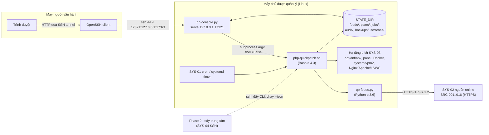
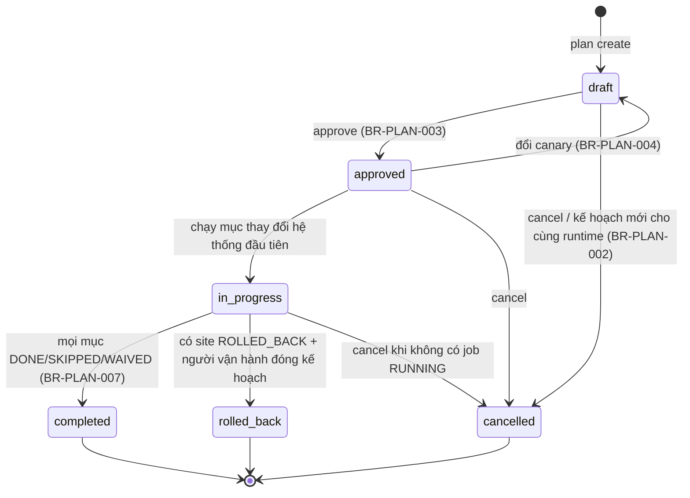
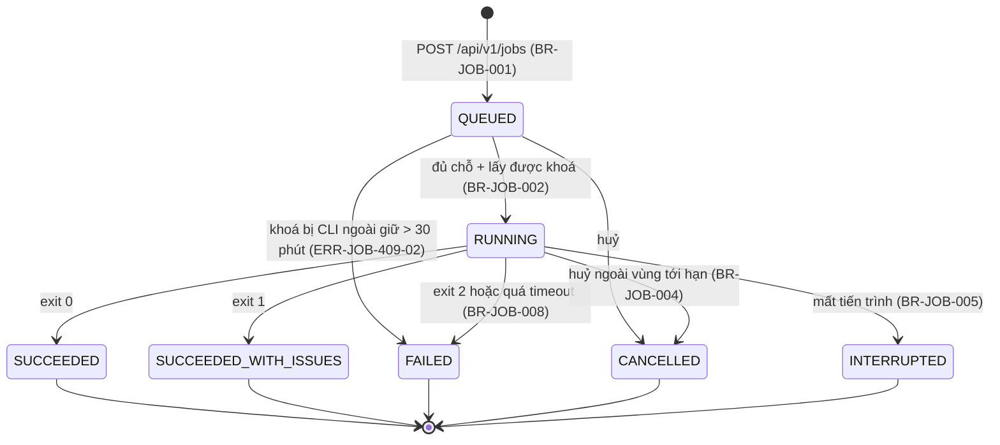
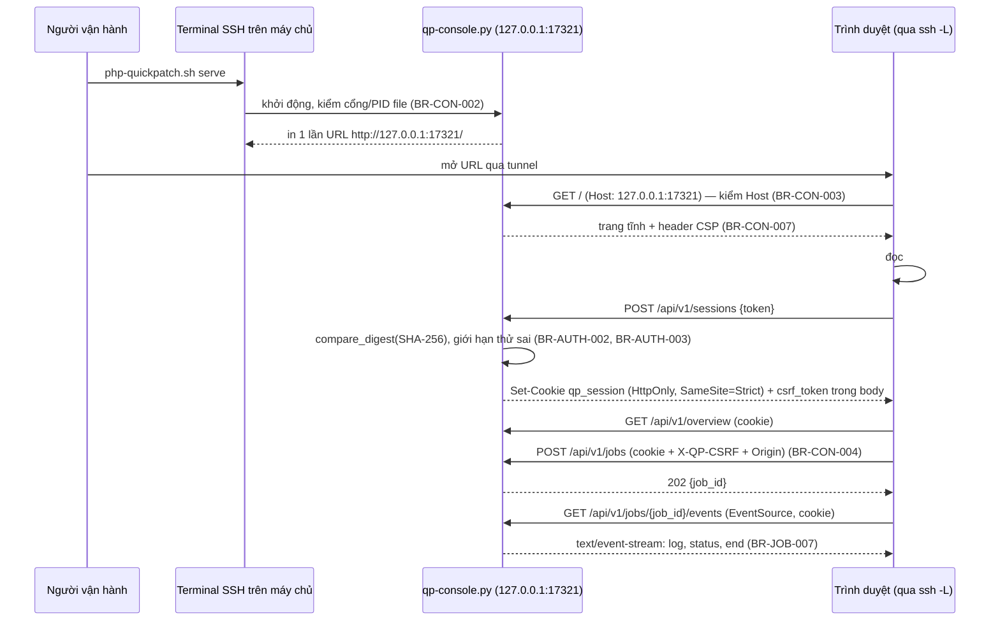

# Đặc tả Yêu cầu Phần mềm (SRS) — php-quickpatch v2

## Lịch sử sửa đổi (Revision History)
| Phiên bản | Ngày | Người thực hiện | Tóm tắt thay đổi |
| :--- | :--- | :--- | :--- |
| 1.0.0 | 2026-10-22 | BA Agent | Khởi tạo SRS chính theo khung IEEE 830 (rules/05): chốt mã module, toàn bộ danh mục FR/BR/ERR/NFR (tách 4 file chi tiết), giao diện CLI/console/API, use case, màn hình, ma trận truy vết FEAT → FR. Hợp nhất 11 phụ lục đã có (kịch bản, nguồn dữ liệu, playbook, health check) bằng tham chiếu, không chép lại |
| 1.0.1 | 2026-10-22 | BA Agent | Sửa theo review: §1.5 thêm 9 tài liệu SRS phân tích (DOC-SRS-QP-FLOW-001..003, -STATE-001, -ERD-001..005), vị trí của chúng trong `BR-DATA-004` và tài liệu hạ nguồn (DOC-UC-QP-000, DOC-API-QP-001, DOC-RTM-QP-001); §1.3.1 đăng ký mã cục bộ `T-*`, `NT-*`, `Q-ST-*`, `Q-ERD-*`; §3.3.4 thêm nhóm `control` (8 hành động điều khiển đồng bộ) và `feeds_verify`, sửa argv `feeds_import`, `feeds_schedule`, `report` (`--yes`, `--json`, `--dry-run`); §3.3.2 thêm lệnh con `plan complete\|close\|canary\|waive`, `migrate hc-urls`; §3.3.3 `PATCH` mục checklist nhận `RUNNING`; §2.1 thêm `reports/`, `work/` vào bố cục `STATE_DIR`; §4.1.5 danh mục 30 sơ đồ (kèm nhãn trạng thái); §4.1.1–§4.1.3 ghi là bản rút gọn, DIAG-SEQ-QP-AUTH-001 đã được thay bằng DIAG-SEQ-QP-AUTH-002; §4.1.4 bỏ "dự kiến", liên kết usecases/index.md; §4.2 liên kết test/rtm.md; §4.3 thêm `CR-SRS-09..12` cho các file khác phải cập nhật theo; frontmatter thêm 9 `depends_on`, 23 `related_diagrams`. Sửa theo review bảo mật `STATE_DIR` (leo thang đặc quyền qua thư mục dự phòng `/tmp` đoán trước được): §1.3 định nghĩa lại `STATE_DIR` (root không có dự phòng `/tmp`; không root dự phòng bằng `mktemp -d`); §2.1 thêm 5 bước chọn và kiểm tra an toàn (thư mục thật không symlink, chủ = `EUID`, `mode & 0022 = 0`, kiểm `backups/<run_id>/manifest` trước `rollback`); §3.5 định nghĩa `ERR-CLI-412-01`; §1.4 thêm nguồn musl `mkdtemp`, dòng v0.1 851–852, 807–825; §4.3 thêm `CR-SRS-13` cho error-matrix, nfr, FR, BR, data-sources-cache-cli, erd, `TC-FEED-105` |
| 1.1.0 | 2026-10-22 | BA Agent | Sửa theo review. Đánh lại phiên bản theo rule 19: bản 1.0.1 thêm mã lỗi `ERR-CLI-412-01`, quy trình 5 bước kiểm tra `STATE_DIR`, nhóm hành động `control` và lệnh con mới (thay đổi hành vi, mức MINOR) nhưng ghi là PATCH; bản này cũng thêm FR, lệnh, endpoint → 1.1.0, gồm cả thay đổi của 1.0.1. Nội dung: đăng ký `FR-UPG-ACK-001` (đề xuất, `CR-FR-01` của DOC-SRS-QP-FR-001 §15.2) ở §2.2, §3.1 (168 FR; Phase 1 = 159, P0 136; tổng P0 142), §3.3.2 (`migrate ack`), §3.3.3 (`POST /api/v1/switches/{run_id}/acknowledgements`), §3.3.4 (`switch_ack`, `control`), §4.1.4 (`UC-UPG-002`, `UC-UPG-004`), §4.2 (`FEAT-072`, `FEAT-074`); §4.1.5 thêm DIAG-STATE-QP-JOB-002, DIAG-STATE-QP-PLAN-002, DIAG-STATE-QP-ENV-003 của DOC-SRS-QP-STATE-001 1.0.1 (33 sơ đồ), 3 mã gốc chỉ trỏ nơi định nghĩa gốc; §1.3.1 thêm bảng mã tài liệu và mã truy vết hạ nguồn (`DOC-API-QP-*`, `DOC-UC-QP-*`, `DOC-WF-QP-SCR-*`, `DOC-US-QP-001`, `DOC-AC-QP-*`, `DOC-TC-QP-*`, `DOC-RTM-QP-001`, `US-`/`AC-`/`TC-[MODULE]-…`) và mã cục bộ `Q-API-*`, `Q-P2-*`, `I-ST-*`, `A-US-*`, `CR-FR-*`; §1.3 thêm `fleet_run_id`; §1.5 liệt kê đủ tài liệu hạ nguồn; §2.3 `PER-04` là Primary theo PRD 1.0.1 §2.1; §3.2 200 BR (thêm `BR-AUD-006`, `BR-ENV-013`); §3.5 theo error-matrix.md 1.0.1 (125 mã, cộng `ERR-CLI-412-01` = 126); §3.3.4 thêm biến môi trường tiến trình con theo `BR-CON-008` 1.0.1; bỏ 4 đường kẻ ngang giữa các chương để giữ ≤ 800 dòng |

## Metadata
- **Tên dự án**: php-quickpatch v2 (CLI Bash + web console Python 3 thư viện chuẩn)
- **Tiêu chuẩn áp dụng**: IEEE Std 830-1998 / ISO/IEC/IEEE 29148; OpenBA-Kit `skills/srs/SKILL.md`, `_templates/08-srs.md`, rules 01, 02, 03, 04, 05, 10, 11, 16, 17, 18, 19
- **Trạng thái**: Draft — chờ PO duyệt các câu hỏi mở ở §4.4
- **Baseline**: `/home/user/php-quickpatch/php-quickpatch.sh` v0.1.0 (881 dòng)

## 1. Giới thiệu (Introduction)

### 1.1 Mục đích tài liệu (Purpose)
Tài liệu này là **nguồn định nghĩa duy nhất** của mọi mã yêu cầu dùng cho php-quickpatch v2: `FR-*`, `BR-*`, `ERR-*`, `NFR-*`, `UC-*`, `SCR-*` và danh mục API `/api/v1/...`. Các tài liệu thiết kế sau (use case, user story, acceptance criteria, wireframe, API design, test case) chỉ được dùng mã đã định nghĩa ở đây hoặc ở các phụ lục được liệt kê tại §1.5. Người đọc: Dev (cài đặt CLI, `qp-feeds.py`, console), QA (thiết kế test case, kiểm chứng lệnh "chưa kiểm chứng"), PO (duyệt câu hỏi mở), kỹ sư bảo mật (rà soát yêu cầu bảo mật console).

### 1.2 Phạm vi sản phẩm (Scope)
php-quickpatch v2 là bộ công cụ **không có agent thường trú**, chạy trên chính máy chủ Linux được quản lý, gồm:
1. **CLI Bash** `php-quickpatch.sh`: kế thừa `scan`, `fix`, `rollback [ID]` của v0.1.0 và bổ sung `feeds`, `assess`, `plan`, `migrate`, `serve`, `report`, `audit`; mọi lệnh có `--json` với schema có phiên bản.
2. **Lớp dữ liệu online** (`qp-feeds.py`, Python 3 thư viện chuẩn): lấy CVE/KEV/vòng đời/bản phát hành từ 17 nguồn `SRC-001..017`, cache có TTL, snapshot offline, hợp nhất nguồn mâu thuẫn, điểm rủi ro 0–100.
3. **Web console Phase 1** (`qp-console.py`, Python 3 thư viện chuẩn): mở bằng `serve`, chỉ lắng nghe `127.0.0.1`, xác thực token 256-bit, truy cập qua SSH tunnel; xem đánh giá, sinh kế hoạch/checklist, chạy job, xem log, rollback.
4. **Thiết kế Phase 2** (chưa triển khai): dashboard trung tâm quản lý nhiều máy chủ qua SSH.

**Ngoài phạm vi** (giữ nguyên `DOC-BRS-QP-001` §5.2 và `DOC-PRD-QP-001` §3.2): agent thường trú; tự sửa mã nguồn ứng dụng trên docroot production; tự xoá file nghi webshell; mở console ra mạng ngoài hoặc quản lý tài khoản ở Phase 1; Windows Server; triển khai mã Phase 2; audit `yarn.lock`/`pnpm-lock.yaml` (chỉ cảnh báo như v0.1); tự build/push image Docker (chỉ chạy `docker compose build/up` sau duyệt, `BR-ENV-011`); nâng cấp OS hoặc web server khác major.

### 1.3 Định nghĩa, thuật ngữ, viết tắt (Definitions & Acronyms)
Thuật ngữ đã định nghĩa ở phụ lục không lặp lại: `$OLD`, `$NEW`, `$OLD_BIN`, `$NEW_BIN`, `$SITE`, `$VHOST`, `$APP` ([version-scenarios-common.md §1.3](version-scenarios-common.md)); playbook, `site_id`, lượt chuyển, baseline, graceful reload ([environment-playbooks.md §1.4](environment-playbooks.md)); bundle, raw cache, TTL, `min_patched`, backport ([data-sources.md §1.4](data-sources.md)). Bổ sung:

| Thuật ngữ | Định nghĩa |
| :--- | :--- |
| `STATE_DIR` | Thư mục trạng thái: `/var/lib/php-quickpatch` (root), `$HOME/.php-quickpatch` (không root, `HOME` khác rỗng); dự phòng **chỉ cho người dùng không root**: thư mục `${TMPDIR:-/tmp}/php-quickpatch-$EUID.XXXXXX` tạo bằng `mktemp -d`; root không có dự phòng. Mọi đường dẫn phải qua kiểm tra an toàn §2.1 (thư mục thật, chủ sở hữu = `EUID`, group/other không ghi được) trước lần đọc/ghi đầu tiên, không đạt → `ERR-CLI-412-01`. Khác v0.1 (`mkdir -p`, dự phòng `${TMPDIR:-/tmp}/php-quickpatch-$EUID` cho cả root): `CR-SRS-13` |
| Runtime (`runtime_id`) | 1 binary PHP hoặc Node.js phát hiện được; `runtime_id` = `<php\|node>:` + 12 ký tự hex đầu của SHA-1 đường dẫn `readlink -f` |
| Ứng viên | Phiên bản đích có thể chọn khi nâng cấp; 4 loại theo `BR-ASMT-001`: `SAME_BRANCH_LATEST`, `NEXT_SUPPORTED`, `RECOMMENDED`, `LATEST_STABLE` |
| Kế hoạch (`plan_id`) | Bản ghi nâng cấp cho 1 runtime tới 1 nhánh đích, mã `PLN-YYYYmmdd-HHMMSS-XXXX` (`XXXX` = 4 ký tự hex ngẫu nhiên); chứa checklist có trạng thái |
| Job (`job_id`) | 1 lần console chạy CLI dưới dạng tiến trình con, mã `JOB-YYYYmmdd-HHMMSS-XXXX` |
| Đợt chạy Phase 2 (`fleet_run_id`) | 1 lần máy trung tâm chạy 1 lệnh trên nhiều server theo đợt (`FR-FLT-EXEC-002`), mã `FLR-YYYYmmdd-HHMMSS-xxxx` (`xxxx` = 4 ký tự hex thường), regex `^FLR-[0-9]{8}-[0-9]{6}-[0-9a-f]{4}$`, 24 ký tự; định dạng của DOC-API-QP-006 §3 và DOC-SRS-QP-ERD-005, thay đề xuất `FRN-…` của `Q-ERD-07` |
| Job đọc / job ghi | Job đọc không đổi cấu hình hệ thống (vd `scan`, `assess`, mọi lệnh `--dry-run`); job ghi thay đổi gói, file cấu hình, dịch vụ hoặc site (`BR-JOB-003`) |
| Phiên console | Phiên trình duyệt sau khi đăng nhập bằng token, định danh bằng cookie `qp_session` (`BR-AUTH-004`) |
| Token `serve` | Chuỗi 43 ký tự base64url từ 32 byte ngẫu nhiên (`secrets.token_urlsafe(32)`), sinh mới mỗi lần `serve` (`BR-AUTH-001`) |
| Catalog | Dữ liệu định nghĩa kịch bản, checklist, playbook, luật breaking change, luật mitigation trong `share/php-quickpatch/catalog/`, cập nhật cùng snapshot (`FR-SCN-CAT-001`) |
| Dry-run hợp lệ | Job `--dry-run` thành công, cùng tham số chuẩn hoá, cùng phiên, tạo ≤ 15 phút trước và dấu vân tay hệ thống không đổi (`BR-CON-005`) |
| Envelope JSON | Cấu trúc chung của mọi đầu ra `--json` (`FR-CLI-JSON-001`) |
| SSE | Server-Sent Events, kiểu MIME `text/event-stream` (WHATWG HTML §9.2) |
| KEV, CVSS, GHSA, OSV, MAL, CNA, EOL, LTS | Như [data-sources.md §1.4](data-sources.md) và PRD |
| Phase 1 / Phase 2 | Phase 1: cục bộ trên máy chủ được quản lý (triển khai). Phase 2: dashboard trung tâm nhiều máy chủ qua SSH (chỉ đặc tả) |

#### 1.3.1 Quy ước mã và danh mục module
- FR: `FR-[MODULE]-[FEATURE]-[SEQ]` (rule 01). BR: `BR-[DOMAIN]-[SEQ]` (rule 02). ERR: `ERR-[MODULE]-[HTTP]-[SEQ]` (rule 03). NFR: `NFR-[NHÓM]-[SEQ]` (3 chữ số; riêng `NFR-ENV-01..07` giữ mã 2 chữ số đã phát hành ở DOC-SRS-QP-ENV-001). UC: `UC-[MODULE]-[SEQ]`. Màn hình: `SCR-[SEQ]`.
- Module dùng **tiền tố đã chốt ở PRD §4.1** và đã được 11 phụ lục sử dụng (`FR-FEED-*`, `FR-SCAN-*`, `FR-ASMT-RISK-*`, `FR-UPG-*`). Danh mục module gợi ý của bước giao việc được ánh xạ như bảng dưới để không đổi mã đã phát hành (đổi `FR-UPG-*` thành `FR-MIG-*` sẽ làm hỏng 34 tham chiếu `FR-UPG-*` trong 5 file playbook/health check, đếm ngày 2026-10-22).

| Module (mã dùng) | Phân hệ | Module gợi ý tương ứng | Tài liệu chi tiết |
| :--- | :--- | :--- | :--- |
| `SCAN` | Nhận diện môi trường, runtime, dự án, ánh xạ site | SCAN | [functional-requirements.md §2](functional-requirements.md), [environment-playbooks.md](environment-playbooks.md) |
| `FEED` | Đồng bộ dữ liệu online, cache, snapshot | FEED | [data-sources.md](data-sources.md), [data-sources-merge-risk.md](data-sources-merge-risk.md), [data-sources-cache-cli.md](data-sources-cache-cli.md) |
| `SCN` | Gán kịch bản phiên bản, lắp checklist | PLAN (phần kịch bản) | [functional-requirements.md §3](functional-requirements.md), [version-scenarios-common.md](version-scenarios-common.md) |
| `ASMT` | Đánh giá bảo mật, so sánh ứng viên, xếp hạng | ASMT | [functional-requirements.md §4](functional-requirements.md) |
| `PLAN` | Chọn đích, sinh kế hoạch, checklist có trạng thái | PLAN | [functional-requirements.md §5](functional-requirements.md) |
| `CMPT` | Quét tương thích mã, Composer, npm, ini, extension, framework | DEPS | [functional-requirements.md §6](functional-requirements.md) |
| `PTCH` | Vá cùng nhánh, mitigation, dependency, rollback lượt chạy (kế thừa v0.1) | FIX, ROLL (lượt chạy) | [functional-requirements.md §7](functional-requirements.md) |
| `UPG` | Cài song song, chuyển từng site, health check, rollback site | MIG, ROLL (site) | [functional-requirements.md §8](functional-requirements.md), [environment-playbooks.md](environment-playbooks.md), [environment-playbooks-healthcheck.md](environment-playbooks-healthcheck.md) |
| `CON` | Web console: `serve`, xác thực token (`FR-CON-AUTH-*`), màn hình, bảo vệ thao tác | CON, AUTH | [functional-requirements.md §9](functional-requirements.md) |
| `JOB` | Hàng đợi job, log, SSE, audit | JOB | [functional-requirements.md §10](functional-requirements.md) |
| `CLI` | `--json`, tương thích ngược, lệnh mới | RPT (phần `--json`) | [functional-requirements.md §11](functional-requirements.md) |
| `RPT` | Báo cáo đánh giá, báo cáo bằng chứng | RPT | [functional-requirements.md §12](functional-requirements.md) |
| `FLT` | Phase 2: danh mục server, chạy từ xa qua SSH, tổng hợp | FLT | [functional-requirements.md §13](functional-requirements.md) |

Domain BR bổ sung: `SEC`, `DATA`, `UPG` (định hướng ở PRD §6, chốt tại [business-rules.md](business-rules.md)), `SCAN`, `ASMT`, `PLAN`, `CMPT`, `PTCH`, `AUTH`, `CON`, `JOB`, `AUD`, `CLI`, `RPT`, `FLT`. Module ERR bổ sung: `AUTH`, `CON`, `JOB`, `AUD`, `CLI`, `SCAN`, `ASMT`, `PLAN`, `CMPT`, `PTCH`, `UPG`, `RPT`, `FLT`.

Mã cục bộ của tài liệu phân tích (§1.5) — dùng để truy vết test case, **không** phải mã yêu cầu, không thay `FR`/`BR`/`ERR`: `T-<JOB|PLN|SW|CHK|FD|SRC|CON|SES>-NN` mã chuyển trạng thái ([states.md §1.2](states.md)); `NT-01..08` nguyên tắc thiết kế dữ liệu ([erd.md §2.2](erd.md)); `G1..G5`, `J`, `D`, `A`, `X` cổng kiểm tra ([flows.md §1.6](flows.md)); `Q-ST-NN`, `Q-ERD-NN` câu hỏi mở ([states.md §9.2](states.md), [erd.md §7](erd.md)); `I-ST-01..07` mâu thuẫn/thiếu sót giữa tài liệu SRS ([states.md §9.1](states.md)); mã sơ đồ `DIAG-<CTX|UC|SEQ|STATE|FLOW|ERD>-QP-…` (§4.1.5). Mã cục bộ của tài liệu hạ nguồn, cùng tính chất: `Q-API-01..04` câu hỏi mở API ([api-spec.md §6.3](../api/api-spec.md)); `Q-P2-01..03` câu hỏi mở Phase 2 ([api-spec-phase2.md §5](../api/api-spec-phase2.md)); `A-US-NN` giả định của backlog ([backlog.md §7](../userstories/backlog.md)); `CR-FR-01..06` đề xuất thay đổi và `ERR-*` "(đề xuất)" chưa có trong error-matrix.md ([functional-requirements.md §15.1, §15.2](functional-requirements.md)). Mục gắn `ĐX` hoặc "(đề xuất)" trong các tài liệu này chưa có hiệu lực tới khi PO/BA duyệt. Mã tài liệu và mã truy vết của tài liệu hạ nguồn (§1.5):

| Nhóm | Định dạng mã | Phạm vi hiện có | Định nghĩa tại |
| :--- | :--- | :--- | :--- |
| Tài liệu API | `DOC-API-QP-NNN` | `001` chính, `002` phiên/tổng quan/runtime/site/feed, `003` kế hoạch/checklist/audit/báo cáo, `004` job/danh sách trắng/log/rollback, `005` hợp đồng `--json` của CLI, `006` Phase 2 | 6 file `api/api-spec*.md` |
| Tài liệu use case | `DOC-UC-QP-000` (chỉ mục); `DOC-UC-QP-<MODULE>-<SEQ>`, phần sau `DOC-` trùng mã `UC-<MODULE>-<SEQ>` của §4.1.4 | 1 + 35 | `usecases/index.md`, `usecases/UC-*.md` |
| Wireframe | `DOC-WF-QP-SCR-<SEQ>`, `<SEQ>` trùng mã `SCR-<SEQ>` của §3.3.1 | 14: `SCR-001..011`, `SCR-020..022` | `html-wireframe/*.html` |
| User story | Tài liệu `DOC-US-QP-001`; story `US-[MODULE]-NN`, `MODULE` = tiền tố FR (§1.3.1), `NN` 2 chữ số tăng dần trong module | 120 story (backlog 1.0.0) | [backlog.md §1.3](../userstories/backlog.md) |
| Acceptance criteria | Tài liệu `DOC-AC-QP-000` (chỉ mục, `SCAN`, `SCN`, `ASMT`), `DOC-AC-QP-<FEED\|PLAN\|PTCH\|UPG\|CON\|JOB>`; scenario `AC-[MODULE]-NN`, 1 mã cho 1 scenario Gherkin, đánh số liên tục trong module | 7 file | `userstories/acceptance-criteria*.md` |
| Test case | Tài liệu `DOC-TC-QP-000` (chỉ mục, quy ước), `DOC-TC-QP-<FEED\|PLAN\|PTCH\|UPG\|CON\|JOB>`, `DOC-TC-QP-COV` (độ phủ BR/ERR/NFR/chuyển trạng thái); ca `TC-[MODULE]-NNN`: `001–099` ánh xạ 1:1 với `AC-[MODULE]-NN` cùng số, `101–199` ca bổ sung | 8 file | [test-cases.md §1.4](../test/test-cases.md) |
| Ma trận truy vết | `DOC-RTM-QP-001` (FR → US → AC → TC, rules/14) | 1 | `test/rtm.md` |

### 1.4 Tài liệu tham chiếu (References)
Truy cập ngày 2026-10-22 (UTC). Nguồn của dữ liệu CVE/vòng đời và lệnh panel đã ghi tại mục tham chiếu của từng phụ lục; bảng dưới chỉ liệt kê nguồn được kiểm chứng thêm cho tài liệu này.

| Nguồn | URL / đường dẫn | Dùng cho | Trạng thái |
| :--- | :--- | :--- | :--- |
| Biên bản làm rõ yêu cầu v2 | `docs/php-quickpatch/brainstorms/quickpatch-v2-console.md` (DOC-BRS-QP-001) | Quyết định PO, scope | Đã đọc |
| PRD v2 | `docs/php-quickpatch/01-prd.md` (DOC-PRD-QP-001) | FEAT-001..123, KR, persona, RBAC, C-01..10, Q-01..09 | Đã đọc |
| 11 phụ lục SRS | `docs/php-quickpatch/srs/*.md` (§1.5) | FR/BR/ERR/NFR đã phát hành | Đã đọc |
| 9 tài liệu SRS phân tích, tài liệu hạ nguồn | `srs/flows*.md`, `srs/states.md`, `srs/erd*.md`, `usecases/index.md`, `api/api-spec.md` §2.14, `api/api-spec-jobs.md` §2, `test/rtm.md` | Danh mục sơ đồ, nhãn trạng thái, hành động điều khiển, độ phủ RTM (bản 1.0.1) | Đã đọc 2026-10-22 |
| Tài liệu đối chiếu cho bản 1.1.0 | `srs/functional-requirements.md` 1.0.1 (168 FR, §15), `srs/business-rules.md` 1.0.1 (`BR-AUD-006`, `BR-CON-008`, §6), `srs/environment-playbooks.md` 1.0.1 (`BR-ENV-013`), `srs/error-matrix.md` 1.0.1 (125 mã, §5 mục 4), `srs/states.md` 1.0.1 (§1.3, §1.5, `I-ST-07`), `01-prd.md` 1.0.1 §2.1; frontmatter `id` của 6 file `api/`, 36 file `usecases/`, 8 file `userstories/`, 9 file `test/`, 14 wireframe | Số liệu §3.1, §3.2, §3.5; mã sơ đồ §4.1.5; mã tài liệu §1.3.1, §1.5; phân loại actor §2.3 | Đếm bằng `grep` 2026-10-22 |
| php-quickpatch v0.1.0 | `/home/user/php-quickpatch/php-quickpatch.sh` | Hành vi kế thừa, khoá `flock`, manifest, mã thoát; chọn `STATE_DIR` bằng `mkdir -p` (dòng 851–852), `do_rollback` (dòng 807–825) | Đã đọc 881 dòng |
| musl `mkdtemp` | https://git.musl-libc.org/cgit/musl/plain/src/temp/mkdtemp.c | Mẫu phải kết thúc đúng `XXXXXX` (sai → `EINVAL`), tạo thư mục mode `0700`; GNU `mktemp -d` 9.4 tạo mode `0700`; BusyBox `mktemp` trên Alpine chưa chạy thử | Kiểm chứng (WebFetch, chạy thử 2026-10-22) |
| Python `http.server` | https://docs.python.org/3/library/http.server.html | `ThreadingHTTPServer` "identical to HTTPServer but uses threads … ThreadingMixIn", thêm từ 3.7; cảnh báo "not recommended for production. It only implements basic security checks"; `send_header()` không chống CRLF | Kiểm chứng (WebFetch) |
| Python `secrets` | https://docs.python.org/3/library/secrets.html | Thêm từ 3.6; `token_urlsafe(nbytes)`; "32 bytes (256 bits) of randomness is sufficient" | Kiểm chứng (WebFetch) |
| Python `hmac` | https://docs.python.org/3/library/hmac.html | `compare_digest` thêm từ 3.3; độ dài khác nhau có thể lộ độ dài, không lộ giá trị | Kiểm chứng (WebFetch) |
| WHATWG HTML — Server-sent events | https://html.spec.whatwg.org/multipage/server-sent-events.html | `EventSourceInit` chỉ có `withCredentials` → không gửi được header tuỳ chỉnh; MIME `text/event-stream`; trường `retry` (ms); header `Last-Event-ID` | Kiểm chứng (WebFetch) |
| GNU Bash NEWS | https://tiswww.case.edu/php/chet/bash/NEWS | `mapfile` và mở rộng đổi hoa/thường từ bash-4.0; chỉ số âm cho mảng từ bash-4.3 → Bash tối thiểu 4.3 (v0.1 dùng `${PHP_FIXED[-1]}`) | Kiểm chứng (WebFetch) |
| RFC 9110 HTTP Semantics | https://www.rfc-editor.org/rfc/rfc9110.html | Mã 421 Misdirected Request (§15.5.20), Host (§7.2) | Kiểm chứng mục lục; nội dung điều khoản chưa đọc |
| Linux `ip_local_port_range` | `/proc/sys/net/ipv4/ip_local_port_range` trên kernel 6.18 | Giá trị mặc định `32768 60999` → cổng `serve` mặc định đặt ngoài dải này | Chạy thử 2026-10-22 |
| Sổ đăng ký cổng IANA | https://www.iana.org/assignments/service-names-port-numbers | Cổng 17321 có được đăng ký cho dịch vụ khác không | Chưa kiểm chứng |
| OpenBA-Kit | `luongkam/openba-kit/skills/srs/SKILL.md`, `_templates/08-srs.md`, `rules/01..05, 10, 11, 16..19` | Khung và quy ước | Đã áp dụng |

### 1.5 Cấu trúc bộ SRS
| Tài liệu | Mã | Nội dung |
| :--- | :--- | :--- |
| `spec.md` (tài liệu này) | DOC-SRS-QP-001 | Giới thiệu, mô tả tổng quan, tóm tắt FR theo module, giao diện ngoài (màn hình, CLI, API), use case, truy vết FEAT → FR, câu hỏi mở |
| [functional-requirements.md](functional-requirements.md) | DOC-SRS-QP-FR-001 | Mọi FR: chi tiết Input → Processing → Output cho FR mới; bảng tham chiếu cho FR đã đặc tả ở phụ lục |
| [business-rules.md](business-rules.md) | DOC-SRS-QP-BR-001 | BR mới dạng KHI–THÌ–NGOẠI LỆ; chỉ mục BR đã phát hành; quy tắc ưu tiên khi phụ lục mâu thuẫn |
| [error-matrix.md](error-matrix.md) | DOC-SRS-QP-ERR-001 | Ma trận lỗi tổng hợp theo rule 11 (mọi `ERR-*`) |
| [nfr.md](nfr.md) | DOC-SRS-QP-NFR-001 | NFR theo ISO/IEC 25010, gồm chỉ mục `NFR-FEED-*`, `NFR-ENV-*` |
| [version-scenarios-common.md](version-scenarios-common.md), [version-scenarios-php.md](version-scenarios-php.md), [version-scenarios-php-8x.md](version-scenarios-php-8x.md), [version-scenarios-node.md](version-scenarios-node.md) | DOC-SRS-QP-SCN-000, -PHP-001, -PHP-002, -NODE-001 | Kịch bản `SCN-PHP-001..016`, `SCN-NODE-001..012`, checklist `CHK-*`, `BR-SCN-*`, `ERR-SCN-*` |
| [data-sources.md](data-sources.md), [data-sources-merge-risk.md](data-sources-merge-risk.md), [data-sources-cache-cli.md](data-sources-cache-cli.md) | DOC-SRS-QP-FEED-001..003 | Nguồn `SRC-001..017`, `FR-FEED-*`, `FR-ASMT-RISK-*`, `BR-FEED-*`, `NFR-FEED-*`, `ERR-FEED-*` |
| [environment-playbooks.md](environment-playbooks.md), [environment-playbooks-healthcheck.md](environment-playbooks-healthcheck.md), [-os](environment-playbooks-os.md), [-panels](environment-playbooks-panels.md), [-container-node](environment-playbooks-container-node.md) | DOC-SRS-QP-ENV-001..005 | Playbook `PB-000..018`, `FR-SCAN-ENV/MAP`, `FR-UPG-*`, `BR-ENV-*`, `BR-HC-*`, `ERR-ENV-*`, `ERR-HC-*`, `NFR-ENV-*` |
| [flows.md](flows.md), [flows-upgrade.md](flows-upgrade.md), [flows-console-fleet.md](flows-console-fleet.md) | DOC-SRS-QP-FLOW-001..003 | 10 sơ đồ trình tự `DIAG-SEQ-QP-*` cho 8 luồng (§4.1.5); cổng kiểm tra `G1..G5`, `J`, `D`, `A`, `X`; ma trận mã lỗi theo sơ đồ; mã đề xuất ở flows.md §6.3 |
| [states.md](states.md) | DOC-SRS-QP-STATE-001 | 8 máy trạng thái `DIAG-STATE-QP-*` của 6 đối tượng (job, kế hoạch, lượt chuyển site, mục checklist, bundle/nguồn feed, tiến trình `serve` và phiên console), trong đó 3 sơ đồ chi tiết mang mã DIAG-STATE-QP-JOB-002, -PLAN-002, -ENV-003 từ bản 1.0.1; mâu thuẫn `I-ST-*`; ma trận chuyển `T-*`; nhãn trạng thái `serve`/phiên/bundle (§4.1.5); câu hỏi `Q-ST-*` |
| [erd.md](erd.md), [erd-console-db.md](erd-console-db.md), [erd-console-ops.md](erd-console-ops.md), [erd-feeds-files.md](erd-feeds-files.md), [erd-fleet.md](erd-fleet.md) | DOC-SRS-QP-ERD-001..005 | Mô hình dữ liệu và từ điển dữ liệu: `console.db` (bảng chiếu dựng lại từ tệp `STATE_DIR`), thực thể logic `feeds.db`, tệp JSON/JSONL/TSV, `central.db` Phase 2; `DIAG-ERD-QP-001..005`; nguyên tắc `NT-01..08`; câu hỏi `Q-ERD-*` |

**Vị trí trong `BR-DATA-004`**: 9 tài liệu FLOW/STATE/ERD thuộc bậc (2), dẫn xuất từ SRS chính và 11 phụ lục, không định nghĩa lại `FR`/`BR`/`ERR`/`NFR`. Khi mâu thuẫn: bậc (1) thắng; giữa tài liệu phân tích và phụ lục chuyên đề mà nó dẫn xuất, phụ lục thắng, trừ điểm lệch đã ghi ở mục sai lệch của tài liệu phân tích (flows.md §6.2, states.md §9.1, erd.md §7) và đã được duyệt; mục `ĐX` chưa duyệt không có hiệu lực. Ghi điều này vào `BR-DATA-004`: `CR-SRS-11`.

Tài liệu hạ nguồn dùng mã của bộ SRS (không thuộc SRS, không định nghĩa mã yêu cầu; mã tài liệu và mã truy vết theo bảng §1.3.1): **Use case** — [usecases/index.md](../usecases/index.md) (DOC-UC-QP-000, DIAG-UC-QP-001, ma trận RBAC) và 35 file `usecases/UC-<MODULE>-<SEQ>.md` (DOC-UC-QP-<MODULE>-<SEQ>); **API** — [api-spec.md](../api/api-spec.md) (DOC-API-QP-001), [api-spec-core.md](../api/api-spec-core.md) (DOC-API-QP-002), [api-spec-plans.md](../api/api-spec-plans.md) (DOC-API-QP-003), [api-spec-jobs.md](../api/api-spec-jobs.md) (DOC-API-QP-004), [api-spec-cli-json.md](../api/api-spec-cli-json.md) (DOC-API-QP-005), [api-spec-phase2.md](../api/api-spec-phase2.md) (DOC-API-QP-006); **Wireframe** (DOC-WF-QP-SCR-<SEQ>) — 14 file `html-wireframe/*.html` theo cột "File wireframe" của §3.3.1 (`SCR-001..011`, `SCR-020..022`); **User story, AC** — [backlog.md](../userstories/backlog.md) (DOC-US-QP-001), [acceptance-criteria.md](../userstories/acceptance-criteria.md) (DOC-AC-QP-000) và `acceptance-criteria-feed.md`, `-plan-cmpt.md`, `-ptch-cli-rpt.md`, `-upg.md`, `-con.md`, `-job-flt.md` (DOC-AC-QP-FEED, -PLAN, -PTCH, -UPG, -CON, -JOB); **Test case** — [test-cases.md](../test/test-cases.md) (DOC-TC-QP-000) và `test-cases-feed.md`, `-plan-cmpt.md`, `-ptch-cli-rpt.md`, `-upg.md`, `-con.md`, `-job-flt.md`, `-coverage.md` (DOC-TC-QP-FEED, -PLAN, -PTCH, -UPG, -CON, -JOB, -COV); **RTM** — [test/rtm.md](../test/rtm.md) (DOC-RTM-QP-001, truy vết FR → US → AC → TC).

## 2. Mô tả tổng quan (Overall Description)

### 2.1 Bối cảnh hệ thống (Product Perspective)
php-quickpatch v2 thay mảng ghi cứng `PHP_FIXED`, `PHP_CVES`, `NODE_FIXED`, `WP_FIXED` của v0.1 bằng dữ liệu online có cache, thêm đánh giá so sánh, kế hoạch nâng cấp và mô hình cài song song → chuyển từng site → health check → rollback 1 lệnh. Console không chạy trên PHP nên vẫn hoạt động khi PHP-FPM lỗi hoặc đang restart (`DOC-BRS-QP-001` §3 mục 2).

Sơ đồ ngữ cảnh (DIAG-CTX-QP-001):


Thành phần phát hành (Phase 1):
| Thành phần | Ngôn ngữ | Phụ thuộc | Vai trò |
| :--- | :--- | :--- | :--- |
| `php-quickpatch.sh` | Bash ≥ 4.3 | `curl`, `flock` (util-linux), coreutils, `find`, `awk`, `sed`, `tar`, `sha256sum` | Toàn bộ lệnh CLI; `scan`/`fix`/`rollback`/`migrate` không cần Python (C-01) |
| `share/php-quickpatch/qp-feeds.py` | Python ≥ 3.6 (stdlib) | `json`, `urllib`, `sqlite3`, `hashlib` | Đồng bộ, chuẩn hoá, điểm rủi ro, sinh kế hoạch, báo cáo |
| `share/php-quickpatch/console/qp-console.py` + `static/` | Python ≥ 3.6 (stdlib) | `http.server`, `socketserver`, `sqlite3`, `subprocess`, `secrets`, `hmac`, `json` | Web console, job runner, SSE, FastCGI probe (`socket`, `struct`) |
| `share/php-quickpatch/catalog/` | JSON/TSV | — | Kịch bản, checklist, playbook, luật BC, luật mitigation, ma trận framework |
| `share/php-quickpatch/schemas/` | JSON Schema | — | Schema đầu ra `--json` (`FR-CLI-JSON-002`) |
| `share/php-quickpatch/feeds-snapshot.tar.gz` | tar.gz | — | Snapshot offline `SRC-017` |

Bố cục `STATE_DIR` bổ sung so với v0.1 (`backups/`, `.lock`, `php-quickpatch.log` giữ nguyên):
```text
STATE_DIR/
├── feeds/                 # DOC-SRS-QP-FEED-003 §2.2
├── state/last-scan.json   # kết quả scan --json gần nhất (console đọc)
├── plans/<plan_id>/       # plan.json, items.json, events.jsonl (ghi nguyên tử bằng rename)
├── jobs/<job_id>/         # job.json, output.log, result.json, phase (BR-JOB-006)
├── switches/              # index.tsv, <site_id>.lock (DOC-SRS-QP-ENV-001 §4.3)
├── audit/audit-YYYYMM.jsonl  # append-only, chuỗi hash (BR-AUD-003)
├── console/serve.pid      # PID + cổng của phiên serve (BR-CON-002)
├── reports/               # báo cáo do console tạo (job report), thư mục 0700, file 0600
├── work/                  # upload-<job_id>.tar.gz tạm của feeds_import (FR-CON-FEED-002)
└── tools/php/             # PHPCompatibility, PHP_CodeSniffer, Composer cho quét (BR-CMPT-006)
```

**Chọn và kiểm tra an toàn `STATE_DIR`** — thay `mkdir -p` của v0.1 (dòng 851–852), vốn chấp nhận thư mục hoặc symlink do người dùng khác tạo trước tại đường dẫn đoán trước được trong `/tmp`, rồi `rollback` (dòng 807–825, `do_rollback`) thực thi các dòng `copy`/`created`/`untar`/`composer-install`/`npm-ci` của `manifest` giả bằng quyền người chạy. CLI, `qp-feeds.py`, `qp-console.py` áp 5 bước dưới trước lần đọc/ghi đầu tiên trong `STATE_DIR` (trước `exec 9>"$STATE_DIR/.lock"`); giá trị `reason` ghi vào log và chi tiết lỗi `ERR-CLI-412-01` (thoát 2, `BR-CLI-004`):
1. **Đường dẫn chính**: root → `/var/lib/php-quickpatch`; không root → `$HOME/.php-quickpatch` khi `HOME` khác rỗng (bỏ nhánh `/tmp/.php-quickpatch` của v0.1 khi `HOME` rỗng). Chưa tồn tại → `mkdir -m 0750` (root) / `mkdir -m 0700` (không root) cho thành phần cuối, không dùng `-p`.
2. **Kiểm tra** bằng `lstat`, không theo symlink (Bash `[ -d "$p" ] && [ ! -L "$p" ]` + `stat -c '%u %a'`; Python `os.lstat`): (a) là thư mục thật, không phải symlink (`reason=symlink` hoặc `reason=not_dir`); (b) `st_uid` = `EUID` (`reason=owner`); (c) group/other không có quyền ghi, `mode & 0022 = 0` (`reason=mode`). Đường dẫn chính không đạt → thoát 2 với `ERR-CLI-412-01`, không đọc/ghi gì trong thư mục, không chuyển sang dự phòng. Đạt nhưng quyền đọc rộng hơn mode đích (vd `0755` do v0.1 tạo với umask `022`) → `chmod` về `0750` (root) / `0700` (không root) theo `NFR-SEC-010` và ghi 1 dòng cảnh báo vào log.
3. **Root không có dự phòng**: không tạo được đường dẫn chính (vd root FS chỉ đọc) → thoát 2 với `ERR-CLI-412-01` (`reason=create_failed`).
4. **Dự phòng chỉ cho người dùng không root**, khi `HOME` rỗng, không tạo được `$HOME/.php-quickpatch`, hoặc thư mục đó đạt bước 2 nhưng chủ sở hữu không có quyền ghi: chọn thư mục có mtime mới nhất trong các ứng viên `${TMPDIR:-/tmp}/php-quickpatch-$EUID` (tên v0.1, để `rollback` lượt cũ) và `${TMPDIR:-/tmp}/php-quickpatch-$EUID.*` đạt bước 2; ứng viên không đạt bị bỏ qua (1 dòng cảnh báo kèm `reason`, không xoá). Không có ứng viên đạt → `mktemp -d "${TMPDIR:-/tmp}/php-quickpatch-$EUID.XXXXXX"` (tạo nguyên tử, mode `0700`, 6 ký tự ngẫu nhiên; musl `mkdtemp` yêu cầu đúng hậu tố `XXXXXX`); `mktemp` thất bại → thoát 2 với `ERR-CLI-412-01` (`reason=create_failed`). Đường dẫn được in ở dòng đầu ra `log=…` như v0.1. Không dùng con trỏ lưu trong `~/.config` (không có khi `HOME` rỗng hoặc không ghi được); người dùng khác không tạo được thư mục có `st_uid` = `EUID` nên lọc theo bước 2 đủ để loại thư mục cài sẵn.
5. **`rollback [ID]`**, trước khi đọc `manifest`: `backups/<run_id>/` (thư mục) và `backups/<run_id>/manifest` (file thường) phải đạt (a)–(c) của bước 2; không đạt → `ERR-CLI-412-01`, không thực thi dòng nào của `manifest`.

### 2.2 Các phân hệ và chức năng chính (Product Functions Summary)
| Module | Chức năng | Số FR (P0/P1/P2) | Phase | Dải mã FR |
| :--- | :--- | :---: | :---: | :--- |
| `SCAN` | Nhận diện môi trường + playbook, runtime PHP/Node.js, dự án, container, ánh xạ site, webshell, phát hiện thay đổi ngoài tool | 8 (7/1/0) | 1 | `FR-SCAN-ENV-001`, `MAP-001`, `RT-001..002`, `PRJ-001..002`, `WSH-001`, `DRF-001` |
| `FEED` | 17 nguồn, TTL, đồng bộ tăng dần, hợp nhất, `min_patched`, backport, snapshot, lịch, lệnh `feeds` | 35 (27/7/1) | 1 | `FR-FEED-*` (phụ lục FEED) |
| `SCN` | Gán kịch bản `SCN-*`, trạng thái/ưu tiên động, catalog, checklist hiệu lực, khoá tự động hoá | 7 (7/0/0) | 1 | `FR-SCN-CLS-001..002`, `LIFE-001`, `CAT-001`, `CHK-001`, `LOCK-001`, `ENV-001` |
| `ASMT` | Đánh giá hiện tại, ứng viên, so sánh, điểm rủi ro, xếp hạng, dependency, WordPress | 9 (9/0/0) | 1 | `FR-ASMT-CUR-001`, `CAND-001..002`, `CMP-001`, `RANK-001`, `RISK-001..002`, `DEP-001..002` |
| `PLAN` | Chọn đích, sinh kế hoạch, thứ tự site/canary, danh sách dependency phải nâng, checklist, vòng đời kế hoạch, hạn duyệt | 8 (8/0/0) | 1 | `FR-PLAN-TGT-001`, `GEN-001..002`, `DEP-001`, `CHK-001..002`, `STS-001`, `DL-001` |
| `CMPT` | BC tĩnh, PHPCompatibility, lint, Composer, Packagist, npm `engines`, native addon, ini, extension, framework, loader, kết luận, Rector tuỳ chọn | 14 (10/3/1) | 1 | `FR-CMPT-*` |
| `PTCH` | Vá PHP/Node.js cùng nhánh, nhóm gói, mitigation, Composer/npm, WordPress, Docker, restart, manifest, rollback lượt | 14 (14/0/0) | 1 | `FR-PTCH-*` |
| `UPG` | Tiền điều kiện, cài song song, pool/ini/extension, chuyển site (file/panel/`mod_php`), điều phối, health check, rollback site, xác nhận lượt chuyển lỗi (đề xuất, `CR-FR-01`), Node.js, Docker, gỡ runtime cũ | 20 (17/2/1) | 1 | `FR-UPG-*` |
| `CON` | `serve`, token, phiên, Host/CSRF, 10 màn hình, dry-run + xác nhận, CSP, danh sách trắng lệnh, hợp đồng API | 22 (20/2/0) | 1 | `FR-CON-*` |
| `JOB` | Hàng đợi, khoá, huỷ, đối soát, log, SSE, lưu giữ, audit | 10 (8/2/0) | 1 | `FR-JOB-*` |
| `CLI` | Envelope `--json`, JSON Schema, tương thích v0.1, thay mảng ghi cứng, `assess`, `plan`, `migrate`, `report`/`audit`, dry-run/xác nhận, kiểm tra quyền và môi trường | 10 (9/1/0) | 1 | `FR-CLI-*` |
| `RPT` | Báo cáo đánh giá 4 định dạng, báo cáo bằng chứng | 2 (0/2/0) | 1 | `FR-RPT-ASMT-001`, `AUD-001` |
| `FLT` | Danh mục server, ghim khoá SSH, chạy từ xa, chạy theo đợt, dashboard, đi sâu, cache trung tâm, RBAC, audit trung tâm | 9 (6/3/0) | 2 | `FR-FLT-*` |

Danh sách đầy đủ từng FR: [functional-requirements.md](functional-requirements.md).

### 2.3 Phân loại người dùng và đặc điểm (User Classes & Characteristics)
Actor kế thừa PRD §2.1 (rule 17): `PER-01` người vận hành VPS (Primary), `PER-02` quản trị hosting có panel (Primary), `PER-03` DevOps Docker (Primary), `PER-04` kỹ sư bảo mật/kiểm toán (Primary — chỉ đọc, xuất báo cáo, tra cứu audit; actor chính của `UC-JOB-003`, `UC-RPT-001`, `UC-RPT-002` ở §4.1.4; Secondary khi chỉ nhận báo cáo do người khác xuất; theo PRD 1.0.1 §2.1), `SYS-01` cron/systemd timer, `SYS-02` nguồn online, `SYS-03` hạ tầng đích, `SYS-04` kết nối SSH (Phase 2), `SYS-05` pipeline phát hành (bổ sung ở DOC-SRS-QP-FEED-001 §2.3).

Ma trận quyền Phase 1 (không có tài khoản; quyền = có token phiên `serve` hoặc không × tiến trình chạy root hoặc không, `BR-CON-010`):

| Chức năng / Tài nguyên | Không token | Console, `serve` chạy root | Console, `serve` không root | CLI root | CLI không root |
| :--- | :---: | :---: | :---: | :---: | :---: |
| Trang đăng nhập, tài nguyên tĩnh | View | View | View | - | - |
| Xem tổng quan, đánh giá, findings, nguồn dữ liệu | - | View | View | View | View |
| `feeds update`, nhập/xuất snapshot | - | Execute | Execute (cache riêng của user) | Execute | Execute (cache riêng) |
| Sinh kế hoạch, cập nhật checklist | - | Create/Edit | Create/Edit | Create/Edit | Create/Edit |
| Vá runtime hệ thống, cài song song, chuyển site, gỡ runtime | - | Execute | - (nút vô hiệu, ghi lý do) | Execute | - (`ERR-CLI-403-01`) |
| Vá Composer/npm/WordPress | - | Execute | Execute (thư mục user sở hữu) | Execute | Execute (thư mục user sở hữu) |
| Rollback lượt chạy / site | - | Execute | Execute (chỉ thay đổi do user tạo) | Execute | Execute (chỉ thay đổi do user tạo) |
| Log job, audit | - | View | View (của user) | View | View (của user) |
| Sửa/xoá audit | - | - | - | - (không có lệnh) | - |
| Xuất báo cáo | - | Export | Export | Export | Export |

Ma trận Phase 2 (Viewer/Operator/Admin): [business-rules.md `BR-FLT-008`](business-rules.md).

### 2.4 Môi trường vận hành (Operating Environment)
| Thành phần | Yêu cầu | Căn cứ |
| :--- | :--- | :--- |
| Hệ điều hành | Linux: Debian/Ubuntu (apt), RHEL/AlmaLinux/Rocky (dnf/yum), Alpine (apk); có hoặc không có panel cPanel, Plesk, aaPanel, CyberPanel, DirectAdmin; Docker host | PRD C-06, v0.1 `detect_env` |
| Bash | ≥ 4.3 (chỉ số mảng âm, `mapfile`, `${var^^}`) | GNU Bash NEWS (§1.4) |
| Công cụ hệ thống | `curl` ≥ 7.34, `flock` (util-linux), `tar`, `sha256sum`, `find`, `awk`, `sed`, `readlink`, `stat`; thiếu `flock` hoặc Bash < 4.3 → `ERR-CLI-424-02` | DOC-SRS-QP-FEED-001 §2.4, v0.1 `main()` |
| Python 3 | ≥ 3.6 cho `qp-feeds.py` và console; Python 3.6 dùng lớp tương đương `ThreadingHTTPServer` ghép từ `socketserver.ThreadingMixIn` + `HTTPServer` (`daemon_threads = True`); không có Python → mất console, `assess`, `plan`, `report`, chuẩn hoá feed; `scan`/`fix`/`rollback`/`migrate` vẫn chạy | Python docs (§1.4); đề xuất chốt Q-05 |
| Trình duyệt | Phiên bản ổn định hiện hành và liền trước của Chrome, Edge, Firefox, Safari (hỗ trợ `EventSource`, `fetch`, CSP Level 2) | NFR-CMP-003 |
| Mạng | HTTPS ra các host nguồn `SRC-001..016` (hoặc `--offline` + snapshot); console chỉ loopback; Phase 2: SSH cổng do người quản trị khai báo (mặc định 22) | PRD A-01, A-02 |
| Tài nguyên tối thiểu đo NFR | 2 vCPU / 2 GB RAM; dung lượng trống ≥ 2 GB cho cài song song (`BR-SCN-016`), ≥ 100 MB cho feeds (`ERR-FEED-507-01`), ≥ 50 MB cho backup (`ERR-ENV-507-01`) | PRD KR3.2, phụ lục |

### 2.5 Các ràng buộc thiết kế & triển khai (Constraints)
Kế thừa PRD `C-01`..`C-10`, `C-FEED-01..05`, `C-ENV-01..05`. Bổ sung:

| Mã | Ràng buộc | Căn cứ |
| :--- | :--- | :--- |
| `C-SRS-01` | Console chỉ dùng Python 3 thư viện chuẩn: `http.server` (`ThreadingHTTPServer`), `sqlite3`, `subprocess`, `secrets`, `hmac`, `json`, `hashlib`, `socket`; 0 gói pip, 0 file JS/CSS tải từ CDN | DOC-BRS-QP-001 §3 mục 2, PRD C-02, C-09 |
| `C-SRS-02` | `http.server` "chỉ có kiểm tra bảo mật cơ bản" → mọi lớp bảo vệ (Host, token, CSRF, CSP, giới hạn kích thước body, lọc CRLF trong header) do `qp-console.py` tự cài đặt theo `BR-AUTH-*`, `BR-CON-*` | Python docs `http.server` |
| `C-SRS-03` | Console không có TLS riêng; kênh mã hoá là SSH tunnel; tiến trình chỉ bind `127.0.0.1` (lệch có chủ đích với rule 04 "TLS 1.3 cho mọi giao tiếp", lý do: lưu lượng không rời loopback) | PRD C-03 |
| `C-SRS-04` | Console gọi CLI bằng `subprocess` với danh sách argv cố định, `shell=False`; không có điểm vào nào thực thi chuỗi lệnh tự do | DOC-BRS-QP-001 §3 mục 2 |
| `C-SRS-05` | Mọi thay đổi hệ thống đi qua CLI (một đường thực thi duy nhất cho CLI và console) để dùng chung `flock`, manifest, audit | PRD FEAT-090, KR4.1 |
| `C-SRS-06` | Phase 2 không mở dashboard ra mạng ngoài: máy trung tâm cũng chỉ bind `127.0.0.1`, truy cập qua SSH tunnel | DOC-BRS-QP-001 §5.2 |

### 2.6 Giả định và phụ thuộc (Assumptions & Dependencies)
Kế thừa PRD `A-01`..`A-06`, `A-FEED-01..03`, `A-ENV-01..04`. Bổ sung:

| Mã | Giả định | Hệ quả nếu sai |
| :--- | :--- | :--- |
| `A-SRS-01` | Người vận hành mở SSH tunnel với cổng cục bộ trùng cổng `serve` (lệnh mẫu do `serve` in ra), hoặc khai báo cổng cục bộ khác bằng `--allow-local-port` | Request bị từ chối `ERR-CON-421-01` do kiểm tra Host |
| `A-SRS-02` | Người dùng hệ thống khác trên cùng máy chủ có thể kết nối `127.0.0.1:<port>` (shared hosting) | Token 256-bit + giới hạn thử sai là lớp bảo vệ; không dựa vào việc cổng "không ai thấy" |
| `A-SRS-03` | `serve` được khởi động từ terminal có TTY để in token | Không có TTY → bắt buộc `--token-file` (`BR-AUTH-001`) |
| `A-SRS-04` | PHPCompatibility 10.x (bản alpha tại 2026-10-22) và Composer 2.x tải được về `STATE_DIR/tools/php` khi lập kế hoạch lần đầu | Không tải được → `ERR-CMPT-424-01`, chỉ chạy bộ luật BC tĩnh của catalog |
| `A-SRS-05` | Thời gian quét tương thích đạt KR3.2 (≤ 120 s cho 10.000 file `.php`, 300 package) chưa được đo | NFR-PERF-005 là mục tiêu; QA đo benchmark trước khi phát hành |

## 3. Yêu cầu chi tiết hệ thống (Specific Requirements)

### 3.1 Danh mục yêu cầu chức năng (FR) — tóm tắt
Tổng 168 FR: Phase 1 = 159 (P0 136, P1 20, P2 3), Phase 2 = 9 (P0 6, P1 3); tổng P0 = 142. Input → Processing → Output, BR và ERR của từng FR: [functional-requirements.md](functional-requirements.md) 1.0.1. `FR-UPG-ACK-001` (P0, Phase 1; xác nhận đã xử lý lượt chuyển `ROLLED_BACK`/`HC_FAILED_KEPT`/`ROLLBACK_FAILED` để mở lại chuyển site, `BR-UPG-003`) đã được `FR-UPG-SEQ-001`, `FR-PLAN-STS-001`, `FR-CON-RBK-001`, `FR-CON-SITE-001` dùng; trạng thái "đề xuất" chờ PO duyệt `CR-FR-01` ([functional-requirements.md §15.2](functional-requirements.md)); nếu PO từ chối, gỡ FR này khỏi §2.2, §3.1, §3.3.2–§3.3.4, §4.1.4, §4.2 và tổng trở về 167 FR (P0 141).

| Module | Mã FR |
| :--- | :--- |
| `SCAN` | `FR-SCAN-ENV-001`, `FR-SCAN-MAP-001`, `FR-SCAN-RT-001`, `FR-SCAN-RT-002`, `FR-SCAN-PRJ-001`, `FR-SCAN-PRJ-002`, `FR-SCAN-WSH-001`, `FR-SCAN-DRF-001` |
| `FEED` | `FR-FEED-EOL-001..003`, `FR-FEED-REL-001..003`, `FR-FEED-PCVE-001..003`, `FR-FEED-NCVE-001`, `FR-FEED-WCVE-001..002`, `FR-FEED-KEV-001`, `FR-FEED-OSV-001`, `FR-FEED-DIST-001..002`, `FR-FEED-SYNC-001`, `FR-FEED-AGE-001`, `FR-FEED-NORM-001..003`, `FR-FEED-CACH-001..003`, `FR-FEED-SNAP-001..004`, `FR-FEED-SCHD-001`, `FR-FEED-CMD-001..006` |
| `SCN` | `FR-SCN-CLS-001`, `FR-SCN-CLS-002`, `FR-SCN-LIFE-001`, `FR-SCN-CAT-001`, `FR-SCN-CHK-001`, `FR-SCN-LOCK-001`, `FR-SCN-ENV-001` |
| `ASMT` | `FR-ASMT-CUR-001`, `FR-ASMT-CAND-001`, `FR-ASMT-CAND-002`, `FR-ASMT-CMP-001`, `FR-ASMT-RANK-001`, `FR-ASMT-RISK-001`, `FR-ASMT-RISK-002`, `FR-ASMT-DEP-001`, `FR-ASMT-DEP-002` |
| `PLAN` | `FR-PLAN-TGT-001`, `FR-PLAN-GEN-001`, `FR-PLAN-GEN-002`, `FR-PLAN-DEP-001`, `FR-PLAN-CHK-001`, `FR-PLAN-CHK-002`, `FR-PLAN-STS-001`, `FR-PLAN-DL-001` |
| `CMPT` | `FR-CMPT-TOOL-001`, `FR-CMPT-CODE-001..003`, `FR-CMPT-COMP-001..002`, `FR-CMPT-NPM-001..002`, `FR-CMPT-INI-001`, `FR-CMPT-EXT-001`, `FR-CMPT-FWK-001`, `FR-CMPT-LDR-001`, `FR-CMPT-RES-001`, `FR-CMPT-RCT-001` |
| `PTCH` | `FR-PTCH-PHP-001..002`, `FR-PTCH-MIT-001..002`, `FR-PTCH-NODE-001`, `FR-PTCH-DEP-001..002`, `FR-PTCH-WP-001..002`, `FR-PTCH-DKR-001..002`, `FR-PTCH-RST-001`, `FR-PTCH-RBK-001..002` |
| `UPG` | `FR-UPG-PRE-001`, `FR-UPG-INST-001`, `FR-UPG-CFG-001..002`, `FR-UPG-SWT-001..003`, `FR-UPG-SEQ-001`, `FR-UPG-HC-001..006`, `FR-UPG-RBK-001..002`, `FR-UPG-ACK-001` (đề xuất, `CR-FR-01`), `FR-UPG-NODE-001`, `FR-UPG-DKR-001`, `FR-UPG-RMV-001` |
| `CON` | `FR-CON-AUTH-001..006`, `FR-CON-OVW-001`, `FR-CON-ASMT-001`, `FR-CON-PLAN-001..002`, `FR-CON-JOB-001..002`, `FR-CON-DEP-001`, `FR-CON-RBK-001`, `FR-CON-FEED-001..002`, `FR-CON-SITE-001`, `FR-CON-AUD-001`, `FR-CON-SAFE-001..003`, `FR-CON-API-001` |
| `JOB` | `FR-JOB-RUN-001..004`, `FR-JOB-LOG-001..003`, `FR-JOB-AUD-001..003` |
| `CLI` | `FR-CLI-JSON-001..002`, `FR-CLI-COMP-001..002`, `FR-CLI-CMD-001..004`, `FR-CLI-SAFE-001`, `FR-CLI-ENV-001` |
| `RPT` | `FR-RPT-ASMT-001`, `FR-RPT-AUD-001` |
| `FLT` | `FR-FLT-INV-001..002`, `FR-FLT-EXEC-001..002`, `FR-FLT-DASH-001..002`, `FR-FLT-FEED-001`, `FR-FLT-RBAC-001`, `FR-FLT-AUD-001` |

### 3.2 Quy tắc nghiệp vụ (BR) — tóm tắt
Tổng 200 BR: 92 BR định nghĩa tại [business-rules.md](business-rules.md) 1.0.1 (9 BR định hướng của PRD được chốt + 83 BR mới ở domain `SEC`, `DATA`, `UPG`, `SCAN`, `ASMT`, `PLAN`, `CMPT`, `PTCH`, `AUTH`, `CON`, `JOB`, `AUD`, `CLI`, `RPT`, `FLT`, gồm `BR-AUD-006` "Neo chuỗi hash" thêm ở bản 1.0.1) và 108 BR đã phát hành ở phụ lục (`BR-SCN-*` 40, `BR-FEED-*` 43, `BR-ENV-*` 13 gồm `BR-ENV-013` "Chặn lệnh ghi khi đang có lượt chuyển" của DOC-SRS-QP-ENV-001 1.0.1, `BR-HC-*` 12). Khi các tài liệu mâu thuẫn, áp `BR-DATA-004`.

### 3.3 Yêu cầu giao diện ngoài (External Interfaces)

#### 3.3.1 Giao diện người dùng — màn hình console
Wireframe dự kiến đặt tại `/home/user/php-quickpatch/docs/php-quickpatch/html-wireframe/` (rules/13). Mọi màn hình (trừ SCR-001) yêu cầu phiên đăng nhập; mọi thao tác ghi mở SCR-011.

| Mã | Màn hình | File wireframe | FR chính | Phase |
| :--- | :--- | :--- | :--- | :---: |
| `SCR-001` | Đăng nhập token | `html-wireframe/console-login.html` | `FR-CON-AUTH-003`, `FR-CON-AUTH-004`, `FR-CON-AUTH-005` | 1 |
| `SCR-002` | Tổng quan | `html-wireframe/overview-dashboard.html` | `FR-CON-OVW-001`, `FR-ASMT-RANK-001`, `FR-PLAN-DL-001`, `FR-FEED-AGE-001` | 1 |
| `SCR-003` | Đánh giá runtime & so sánh phiên bản | `html-wireframe/runtime-assessment.html` | `FR-CON-ASMT-001`, `FR-ASMT-CUR-001`, `FR-ASMT-CAND-001`, `FR-ASMT-CAND-002`, `FR-ASMT-CMP-001`, `FR-ASMT-RISK-002` | 1 |
| `SCR-004` | Kế hoạch nâng cấp & checklist | `html-wireframe/upgrade-plan-checklist.html` | `FR-CON-PLAN-001`, `FR-CON-PLAN-002`, `FR-PLAN-TGT-001`, `FR-PLAN-GEN-001`, `FR-PLAN-GEN-002`, `FR-PLAN-DEP-001`, `FR-PLAN-CHK-001`, `FR-PLAN-CHK-002`, `FR-PLAN-STS-001`, `FR-CMPT-RES-001` | 1 |
| `SCR-005` | Findings thư viện / dependency | `html-wireframe/dependency-findings.html` | `FR-CON-DEP-001`, `FR-ASMT-DEP-001`, `FR-ASMT-DEP-002` | 1 |
| `SCR-006` | Jobs & Log | `html-wireframe/jobs-log.html` | `FR-CON-JOB-001`, `FR-CON-JOB-002`, `FR-JOB-LOG-002`, `FR-UPG-HC-006` | 1 |
| `SCR-007` | Rollback & lịch sử thay đổi | `html-wireframe/rollback-history.html` | `FR-CON-RBK-001`, `FR-PTCH-RBK-002`, `FR-UPG-RBK-001` | 1 |
| `SCR-008` | Nguồn dữ liệu (feed status) | `html-wireframe/feed-status.html` | `FR-CON-FEED-001`, `FR-CON-FEED-002`, `FR-FEED-CMD-002` | 1 |
| `SCR-009` | Site & ánh xạ runtime | `html-wireframe/sites-runtime-map.html` | `FR-CON-SITE-001`, `FR-SCAN-MAP-001`, `FR-SCAN-DRF-001`, `FR-UPG-SEQ-001`, `FR-UPG-HC-001` | 1 |
| `SCR-010` | Audit & báo cáo | `html-wireframe/audit-reports.html` | `FR-CON-AUD-001`, `FR-JOB-AUD-002`, `FR-JOB-AUD-003`, `FR-RPT-ASMT-001`, `FR-RPT-AUD-001` | 1 |
| `SCR-011` | Hộp thoại xem trước dry-run & xác nhận | `html-wireframe/dry-run-confirm-dialog.html` | `FR-CON-SAFE-001`, `FR-PTCH-PHP-001`, `FR-UPG-SWT-001`, `FR-UPG-SWT-003` | 1 |
| `SCR-020` | Phase 2 — Danh sách server | `html-wireframe/fleet-servers.html` | `FR-FLT-INV-001`, `FR-FLT-INV-002`, `FR-FLT-RBAC-001` | 2 |
| `SCR-021` | Phase 2 — Dashboard tổng hợp nhiều server | `html-wireframe/fleet-dashboard.html` | `FR-FLT-DASH-001`, `FR-FLT-DASH-002`, `FR-FLT-AUD-001` | 2 |
| `SCR-022` | Phase 2 — Đợt chạy từ xa & phân phối snapshot | `html-wireframe/fleet-rollout.html` | `FR-FLT-EXEC-001`, `FR-FLT-EXEC-002`, `FR-FLT-FEED-001` | 2 |

#### 3.3.2 Giao diện dòng lệnh (CLI)
Cú pháp chung: `php-quickpatch.sh <lệnh> [tuỳ chọn]`. Mọi lệnh hỗ trợ `--json` (`FR-CLI-JSON-001`, schema `qp.<lệnh>/1`); mã thoát 0/1/2 (`BR-CLI-004`). Cột "Loại" theo `BR-JOB-003`, thêm `control` = điều khiển đồng bộ (§3.3.4); "Py" = cần Python ≥ 3.6.

| Lệnh | Tuỳ chọn chính | Loại | Py | Root | FR |
| :--- | :--- | :--- | :---: | :--- | :--- |
| `scan` (mặc định) | `--path DIR` (lặp), `--only php,node,composer,npm,wp,docker,webshell,sites`, `--offline`, `--json` | read | Không | Không bắt buộc (thiếu root → không đọc được cấu hình hệ thống) | `FR-SCAN-*`, `FR-CLI-COMP-001` |
| `fix` | như `scan` + `--dry-run`, `--no-restart`, `--no-memlimit` | write | Không | Thao tác hệ thống | `FR-PTCH-*` |
| `rollback [ID]` | `--dry-run`, `--json` | write | Không | Theo thay đổi của lượt | `FR-PTCH-RBK-002` |
| `feeds update\|status\|verify\|export\|import\|schedule` (bí danh `sync`, `snapshot export\|import`) | DOC-SRS-QP-FEED-003 §6 | data/read/write | Chuẩn hoá cần | Không bắt buộc | `FR-FEED-CMD-001..006` |
| `assess` | `--runtime-id ID \| --bin PATH`, `--candidates`, `--offline` | read | Có | Không | `FR-CLI-CMD-001` |
| `plan create\|list\|show\|approve\|cancel\|complete\|close\|canary\|item\|waive\|run` | `--runtime-id`, `--target`, `--sites`, `--reason`, `--set start\|done\|fail\|skip\|waive`, `--evidence`, `--site`, `--hits`, `--dry-run`, `--yes` | read (`create`, `list`, `show`); control (`approve`, `cancel`, `complete`, `close`, `canary`, `item`, `waive`); write (`run` mục thay đổi hệ thống) | Có | `plan run` theo mục | `FR-CLI-CMD-002`, `FR-PLAN-STS-001`, `FR-PLAN-CHK-001`, `FR-CMPT-RES-001` |
| `migrate install\|switch\|healthcheck\|rollback\|remove-old\|status\|hc-urls\|ack` (bí danh `upgrade`, `switch-site`, `healthcheck`, `rollback-site`) | `--runtime`, `--target`, `--from`, `--plan`, `--no-plan --reason`, `--hc-url`, `--set` (`hc-urls`), `--no-auto-rollback`, `--baseline-only`, `--purge-pool`, `--dry-run`, `--yes`; `migrate ack RUN_ID --reason TEXT` (`TEXT` 20–500 ký tự; đề xuất, `CR-FR-01`) | write (`status`, `healthcheck --baseline-only`: read; `hc-urls`, `ack`: control, không cần `--dry-run`/`--yes`) | Không (FastCGI probe dùng Python nếu có) | Có, trừ PB-016/PB-018 của chính user | `FR-CLI-CMD-003`, `FR-UPG-*`, `FR-UPG-ACK-001` |
| `serve` | `--port N`, `--allow-local-port N`, `--replace`, `--stop`, `--token-file PATH` | — | Có | Không bắt buộc (root để chạy thao tác hệ thống) | `FR-CON-AUTH-001`, `FR-CON-AUTH-002` |
| `report assess\|evidence` | `--format json\|csv\|md\|html`, `--out FILE`, `--from`, `--to` | read | Có | Không | `FR-CLI-CMD-004`, `FR-RPT-*` |
| `audit list\|verify` | `--from`, `--to`, `--action`, `--actor` | read | Có | Đọc audit của root cần root | `FR-CLI-CMD-004`, `FR-JOB-AUD-*` |
| `schema <lệnh>` | — | read | Không | Không | `FR-CLI-JSON-002` |
| `--version`, `-h/--help` | — | — | Không | Không | `FR-CLI-COMP-001` |

#### 3.3.3 Danh mục API REST của console (`/api/v1`, rules/10)
Response chuẩn rules/10 `{success, data, error, meta, timestamp}` (`FR-CON-API-001`). Ngoài API: `GET /`, `GET /login`, `GET /static/{file}` (tài nguyên tĩnh nhúng, không cần phiên, vẫn kiểm Host). "Job" = endpoint tạo job qua `FR-JOB-RUN-001` và trả `job_id` (HTTP 202). `PATCH /api/v1/plans/{plan_id}`, `PATCH …/checklist-items/{chk_id}`, `POST …/compatibility-waivers`, `PATCH /api/v1/sites/{site_id}`, `POST /api/v1/switches/{run_id}/acknowledgements` gọi hành động nhóm `control` (§3.3.4), trả kết quả đồng bộ.

| Method | Path | Mô tả | FR |
| :--- | :--- | :--- | :--- |
| `POST` | `/api/v1/sessions` | Đăng nhập bằng token, cấp cookie phiên + CSRF token | `FR-CON-AUTH-003` |
| `GET` | `/api/v1/sessions/current` | Thông tin phiên (hạn, quyền tiến trình `serve`) | `FR-CON-AUTH-004`, `FR-CON-SAFE-001` |
| `DELETE` | `/api/v1/sessions/current` | Đăng xuất | `FR-CON-AUTH-004` |
| `GET` | `/api/v1/overview` | Số liệu tổng quan, xếp hạng, hạn duyệt, cảnh báo | `FR-CON-OVW-001`, `FR-ASMT-RANK-001`, `FR-PLAN-DL-001` |
| `GET` | `/api/v1/environment` | Môi trường, playbook, giới hạn | `FR-SCAN-ENV-001`, `FR-SCN-ENV-001` |
| `GET` | `/api/v1/runtimes` | Danh sách runtime, trạng thái, kịch bản | `FR-SCAN-RT-001`, `FR-SCAN-RT-002`, `FR-SCN-LIFE-001` |
| `GET` | `/api/v1/runtimes/{runtime_id}` | Chi tiết runtime | `FR-SCN-CLS-001`, `FR-SCN-CLS-002`, `FR-SCN-LOCK-001` |
| `GET` | `/api/v1/runtimes/{runtime_id}/assessment` | Đánh giá hiện tại + bảng so sánh | `FR-ASMT-CUR-001`, `FR-ASMT-CMP-001`, `FR-ASMT-RISK-001`, `FR-ASMT-RISK-002` |
| `GET` | `/api/v1/runtimes/{runtime_id}/candidates` | Ứng viên và khả năng cài | `FR-ASMT-CAND-001`, `FR-ASMT-CAND-002` |
| `GET` | `/api/v1/advisories` | Advisory theo `runtime_id`, `severity`, `kev` | `FR-ASMT-CUR-001`, `FR-FEED-NORM-001` |
| `GET` | `/api/v1/advisories/{adv_id}` | Chi tiết advisory, alias, nguồn | `FR-FEED-NORM-001` |
| `GET` | `/api/v1/sites` | Danh sách site và ánh xạ runtime | `FR-SCAN-MAP-001`, `FR-SCAN-DRF-001`, `FR-CON-SITE-001` |
| `GET` | `/api/v1/sites/{site_id}` | Chi tiết site, kết luận tương thích, lượt chuyển | `FR-CON-SITE-001`, `FR-CMPT-RES-001` |
| `PATCH` | `/api/v1/sites/{site_id}` | Cập nhật `hc_url` | `FR-CON-SITE-001`, `FR-UPG-HC-001` |
| `GET` | `/api/v1/projects` | Dự án Composer/npm/WordPress/Docker | `FR-SCAN-PRJ-001` |
| `GET` | `/api/v1/containers` | Container đang chạy | `FR-SCAN-PRJ-002` |
| `GET` | `/api/v1/dependency-findings` | Findings thư viện, WordPress | `FR-ASMT-DEP-001`, `FR-ASMT-DEP-002`, `FR-CON-DEP-001` |
| `GET` | `/api/v1/webshell-findings` | Dấu hiệu webshell (chỉ đọc) | `FR-SCAN-WSH-001` |
| `GET` | `/api/v1/feeds` | Trạng thái nguồn dữ liệu (`qp.feeds.status/1`) | `FR-FEED-CMD-002`, `FR-CON-FEED-001` |
| `POST` | `/api/v1/feed-snapshots` | Tải lên snapshot + SHA-256 → job `feeds import` | `FR-CON-FEED-002`, `FR-FEED-SNAP-003` |
| `GET` | `/api/v1/plans` | Danh sách kế hoạch | `FR-PLAN-STS-001` |
| `POST` | `/api/v1/plans` | Tạo kế hoạch (job `plan create`) | `FR-PLAN-TGT-001`, `FR-PLAN-GEN-001`, `FR-CON-PLAN-001` |
| `GET` | `/api/v1/plans/{plan_id}` | Chi tiết kế hoạch, thứ tự site, dependency phải nâng, hạn duyệt | `FR-PLAN-GEN-001`, `FR-PLAN-GEN-002`, `FR-PLAN-DEP-001`, `FR-PLAN-DL-001` |
| `PATCH` | `/api/v1/plans/{plan_id}` | Đổi trạng thái (`approved`, `cancelled`, `completed`, `rolled_back`), đổi canary | `FR-PLAN-STS-001`, `FR-PLAN-GEN-002` |
| `GET` | `/api/v1/plans/{plan_id}/checklist-items` | Danh sách mục checklist | `FR-PLAN-CHK-001`, `FR-SCN-CHK-001` |
| `PATCH` | `/api/v1/plans/{plan_id}/checklist-items/{chk_id}` | Đặt trạng thái mục (`RUNNING` cho mục `MANUAL`, `DONE`, `FAILED`, `SKIPPED`, `WAIVED`) kèm lý do/bằng chứng | `FR-PLAN-CHK-001`, `FR-CON-PLAN-002` |
| `POST` | `/api/v1/plans/{plan_id}/checklist-items/{chk_id}/runs` | Chạy mục `AUTO`/`SEMI` (job, `dry_run`) | `FR-PLAN-CHK-002` |
| `GET` | `/api/v1/plans/{plan_id}/compatibility` | Kết quả quét tương thích theo site, hit | `FR-CMPT-RES-001`, `FR-CMPT-CODE-001`, `FR-CMPT-COMP-001` |
| `POST` | `/api/v1/plans/{plan_id}/compatibility-waivers` | Miễn trừ hit `error` kèm lý do | `FR-CMPT-RES-001` |
| `GET` | `/api/v1/jobs` | Danh sách job (lọc, phân trang) | `FR-JOB-RUN-001`, `FR-CON-JOB-001` |
| `POST` | `/api/v1/jobs` | Tạo job từ hành động trong danh sách trắng (`dry_run`, `confirm_dry_run_job_id`) | `FR-JOB-RUN-001`, `FR-CON-SAFE-001`, `FR-CON-SAFE-003` |
| `GET` | `/api/v1/jobs/{job_id}` | Trạng thái và kết quả job | `FR-JOB-RUN-001`, `FR-JOB-LOG-001` |
| `GET` | `/api/v1/jobs/{job_id}/log` | Log dạng văn bản theo `offset` | `FR-JOB-LOG-001` |
| `GET` | `/api/v1/jobs/{job_id}/events` | Luồng SSE `text/event-stream` | `FR-JOB-LOG-002` |
| `POST` | `/api/v1/jobs/{job_id}/cancellations` | Yêu cầu huỷ job | `FR-JOB-RUN-003`, `FR-CON-JOB-002` |
| `GET` | `/api/v1/backup-runs` | Danh sách lượt chạy có manifest | `FR-PTCH-RBK-001`, `FR-CON-RBK-001` |
| `GET` | `/api/v1/backup-runs/{run_id}` | Nội dung manifest | `FR-PTCH-RBK-001` |
| `GET` | `/api/v1/switches` | Lượt chuyển site (lọc `site_id`) | `FR-UPG-SWT-001`, `FR-CON-RBK-001` |
| `GET` | `/api/v1/switches/{run_id}` | `switch.json` + báo cáo health check | `FR-UPG-HC-006` |
| `POST` | `/api/v1/switches/{run_id}/acknowledgements` | Xác nhận đã xử lý lượt chuyển `ROLLED_BACK`/`HC_FAILED_KEPT`/`ROLLBACK_FAILED`, body `{"reason": "<20–500 ký tự>"}` → hành động `switch_ack` (đề xuất, `CR-FR-01`) | `FR-UPG-ACK-001`, `FR-CON-RBK-001`, `FR-CON-SITE-001` |
| `POST` | `/api/v1/rollbacks` | Rollback lượt chạy hoặc site (job, `dry_run`) | `FR-PTCH-RBK-002`, `FR-UPG-RBK-001`, `FR-CON-RBK-001` |
| `GET` | `/api/v1/audit-events` | Truy vấn audit | `FR-JOB-AUD-003` |
| `POST` | `/api/v1/audit-verifications` | Kiểm tra chuỗi hash audit | `FR-JOB-AUD-002` |
| `POST` | `/api/v1/reports` | Tạo báo cáo (job `report`) | `FR-RPT-ASMT-001`, `FR-RPT-AUD-001` |
| `GET` | `/api/v1/reports/{report_id}` | Tải file báo cáo | `FR-RPT-ASMT-001`, `FR-RPT-AUD-001` |
| `GET` | `/api/v1/servers` | Phase 2: danh sách server | `FR-FLT-INV-001` |
| `POST` | `/api/v1/servers` | Phase 2: thêm server | `FR-FLT-INV-001` |
| `PATCH` | `/api/v1/servers/{server_id}` | Phase 2: sửa/tắt server | `FR-FLT-INV-001` |
| `DELETE` | `/api/v1/servers/{server_id}` | Phase 2: xoá server | `FR-FLT-INV-001` |
| `POST` | `/api/v1/servers/{server_id}/connection-checks` | Phase 2: kiểm kết nối, khoá máy chủ, điều kiện | `FR-FLT-INV-002` |
| `GET` | `/api/v1/servers/{server_id}/results` | Phase 2: dữ liệu JSON đã thu của 1 server | `FR-FLT-DASH-002` |
| `GET` | `/api/v1/fleet-summary` | Phase 2: ma trận server × runtime | `FR-FLT-DASH-001` |
| `POST` | `/api/v1/fleet-runs` | Phase 2: chạy lệnh theo đợt | `FR-FLT-EXEC-001`, `FR-FLT-EXEC-002` |
| `GET` | `/api/v1/fleet-runs/{fleet_run_id}` | Phase 2: trạng thái đợt chạy | `FR-FLT-EXEC-002` |
| `POST` | `/api/v1/feed-distributions` | Phase 2: đẩy snapshot tới server | `FR-FLT-FEED-001` |
| `GET` | `/api/v1/users` | Phase 2: danh sách tài khoản (Admin) | `FR-FLT-RBAC-001` |
| `POST` | `/api/v1/users` | Phase 2: tạo tài khoản, gán vai trò (Admin) | `FR-FLT-RBAC-001` |
| `GET` | `/api/v1/fleet-audit-events` | Phase 2: audit hợp nhất | `FR-FLT-AUD-001` |

#### 3.3.4 Danh sách trắng hành động của console (`BR-CON-008`)
Đường dẫn script tuyệt đối do `serve` xác định lúc khởi động (`readlink -f`), không lấy từ request. `<text>` = chuỗi 20–500 ký tự, không có ký tự điều khiển, truyền thành 1 phần tử argv; `<evidence>` = như `<text>` nhưng 10–500 ký tự (`ERR-PLAN-422-01`); `hit_id` `^H-[0-9a-f]{12}$`, 1–200 phần tử; `<url>` scheme `http`/`https`, host thuộc `server_names` của site, không `userinfo`, không fragment, ≤ 2.048 ký tự, 0–10 lần `--set` (0 = xoá URL khai báo; `BR-HC-001`, `BR-HC-002`, `ERR-HC-422-02`). Console chạy CLI với `stdin=DEVNULL` (không TTY) nên lệnh ghi mới luôn kèm `--yes` (`BR-CLI-003`) và mọi hành động kèm `--json` để đọc envelope (`FR-CLI-JSON-001`).

Loại: `read`, `write`, `data` theo `BR-JOB-003`. `control` = điều khiển đồng bộ: đổi dữ liệu của tool (`plans/<plan_id>/`, `sites.d/<site_id>.conf`; `switch_ack`: `switches/index.tsv`, `backups/<run_id>/switch.json`, giữ khoá `STATE_DIR/.lock` như lệnh ghi theo `FR-UPG-ACK-001`), không đổi gói, dịch vụ, cấu hình web server hay site; console gọi CLI đồng bộ, không qua hàng đợi job (không tính vào giới hạn `BR-JOB-001`), timeout 30 s; không cần dry-run (`BR-CON-005` chỉ áp cho job ghi) nhưng vẫn qua cổng Host/phiên/CSRF/danh sách trắng; CLI ghi audit (`BR-AUD-001`); ánh xạ mã thoát → HTTP và khoá theo DOC-API-QP-001 §2.14. Bảng này là nguồn của `BR-CON-008`; DOC-API-QP-001 §2.14 và api-spec-jobs.md §2 đồng bộ theo bảng này (`CR-SRS-10`).

**Biến môi trường tiến trình con** (`BR-CON-008` 1.0.1; console không nhận biến nào từ request): `PATH=/usr/local/sbin:/usr/local/bin:/usr/sbin:/usr/bin:/sbin:/bin` (cố định), `LANG=C.UTF-8`, `HOME`, `QP_JOB_ID`, `QP_ACTOR`, `QP_*_KEY`/`QP_*_TOKEN` khi được cấu hình; các biến sau lấy từ môi trường của `serve` lúc khởi động: `HTTPS_PROXY`/`https_proxy` khớp `^https?://([^\s:@/]{1,64}(:[^\s@/]{1,128})?@)?[A-Za-z0-9.-]{1,253}(:[0-9]{1,5})?/?$`; `NO_PROXY`/`no_proxy` khớp `^[A-Za-z0-9.*,:/-]{1,1024}$`; `QP_PHP_BINS`, `QP_NODE_BINS` = tối đa 32 (đề xuất) đường dẫn tuyệt đối cách nhau bằng dấu cách như v0.1, mỗi đường dẫn khớp `^/[A-Za-z0-9._+/-]{1,255}$`. Biến sai định dạng → không truyền biến đó, in cảnh báo (tên biến, không in giá trị) ra terminal của `serve`. Với cùng môi trường, `scan` chạy từ console và từ CLI cho cùng tập `runtime_id`.

| `action` | argv (sau đường dẫn script) | Loại | FR |
| :--- | :--- | :--- | :--- |
| `scan` | `scan --json [--only <enum list>] [--offline]` | read | `FR-SCAN-*` |
| `assess` | `assess --runtime-id <runtime_id> --candidates --json` | read | `FR-CLI-CMD-001` |
| `fix` | `fix --json [--only <enum list>] [--path <dir thuộc projects[]>] [--no-restart] [--no-memlimit] [--dry-run]` | write | `FR-PTCH-*` |
| `rollback_run` | `rollback <run_id> --json [--dry-run]` | write | `FR-PTCH-RBK-002` |
| `feeds_update` | `feeds update --json [--source <SRC-NNN,…>] [--force]` | data | `FR-FEED-CMD-001` |
| `feeds_import` | `feeds import <file tải lên> --sha256 <hex 64> --yes --json [--dry-run] [--force]` | write | `FR-FEED-CMD-005`, `FR-CON-FEED-002` |
| `feeds_schedule` | `feeds schedule install --interval-hours <1\|2\|3\|4\|6\|8\|12\|24> --yes --json [--dry-run]` hoặc `feeds schedule remove --yes --json [--dry-run]` | write | `FR-FEED-CMD-006` |
| `feeds_verify` | `feeds verify --json` (không nhận `--snapshot` từ console) | read | `FR-FEED-CMD-003`, `FR-CON-FEED-001` |
| `plan_create` | `plan create --runtime-id <runtime_id> --target <nhánh> [--sites <site_id,…>] [--reason <text>] --json` | read | `FR-CLI-CMD-002` |
| `plan_run_item` | `plan run <plan_id> <chk_id> --yes --json [--dry-run]` | write | `FR-PLAN-CHK-002` |
| `migrate_install` | `migrate install --runtime <php\|node> --target <nhánh> --yes --json [--dry-run]` | write | `FR-UPG-INST-001` |
| `migrate_switch` | `migrate switch <site_id> --target <nhánh> --plan <plan_id> --yes --json [--dry-run] [--no-auto-rollback]` | write | `FR-UPG-SWT-001`, `FR-UPG-SEQ-001` |
| `migrate_healthcheck` | `migrate healthcheck <site_id> --baseline-only --json` | read | `FR-UPG-HC-003` |
| `migrate_rollback` | `migrate rollback <site_id> [<run_id>] --yes --json [--dry-run] [--purge-pool]` | write | `FR-UPG-RBK-001` |
| `migrate_remove_old` | `migrate remove-old --runtime-id <runtime_id> --yes --json [--dry-run]` | write | `FR-UPG-RMV-001` |
| `report` | `report <assess\|evidence> --format <json\|csv\|md\|html> --out STATE_DIR/reports/<report_id>.<ext> [--from <YYYY-MM-DD>] [--to <YYYY-MM-DD>] --json` | read | `FR-RPT-*` |
| `audit_verify` | `audit verify --json [--from <YYYY-MM-DD>] [--to <YYYY-MM-DD>]` | read | `FR-JOB-AUD-002` |
| `plan_approve` | `plan approve <plan_id> --json` | control | `FR-PLAN-STS-001`, `FR-CON-PLAN-002` |
| `plan_cancel` | `plan cancel <plan_id> --json` | control | `FR-PLAN-STS-001` |
| `plan_complete` | `plan complete <plan_id> --json` | control | `FR-PLAN-STS-001` |
| `plan_close_rolled_back` | `plan close <plan_id> --reason <text> --json` | control | `FR-PLAN-STS-001` |
| `plan_set_canary` | `plan canary <plan_id> <site_id> --json` | control | `FR-PLAN-GEN-002`, `FR-PLAN-STS-001` |
| `plan_item_set` | `plan item <plan_id> <chk_id> --set <start\|done\|fail\|skip\|waive> [--reason <text>] [--evidence <evidence>] --json` (`start` chỉ cho mục `MANUAL`, `T-CHK-10`, chờ `Q-ST-09`) | control | `FR-PLAN-CHK-001`, `FR-CON-PLAN-002` |
| `plan_waive_hits` | `plan waive <plan_id> --site <site_id> --hits <hit_id,…> --reason <text> --json` | control | `FR-CMPT-RES-001` |
| `site_set_hc_urls` | `migrate hc-urls <site_id> [--set <url>]… --json` | control | `FR-UPG-HC-001`, `FR-CON-SITE-001` |
| `switch_ack` | `migrate ack <run_id> --reason <text> --json` (đề xuất, `CR-FR-01`) | control | `FR-UPG-ACK-001`, `FR-CON-RBK-001`, `FR-CON-SITE-001` |

#### 3.3.5 Giao diện phần mềm (Software Interfaces)
| Giao diện | Chi tiết | Tài liệu |
| :--- | :--- | :--- |
| Nguồn dữ liệu online `SRC-001..016` | HTTPS GET/POST theo chính sách gọi nguồn | [data-sources.md §3](data-sources.md) |
| Package manager, panel, Docker, systemd, pm2, web server | Lệnh nhận diện/liệt kê/(a)–(e) theo playbook, cột "KC" ghi trạng thái kiểm chứng | [environment-playbooks.md §3](environment-playbooks.md) và 3 file playbook chi tiết |
| PHP-FPM qua FastCGI | Client FastCGI Python (`socket`, `struct`) tới unix socket hoặc `127.0.0.1:<port>` cho probe và FPM status | [environment-playbooks-healthcheck.md §3.3, §3.4](environment-playbooks-healthcheck.md) |
| Công cụ quét | PHPCompatibility, PHP_CodeSniffer, Composer, Rector (tuỳ chọn) trong `STATE_DIR/tools/php` | `FR-CMPT-TOOL-001` |
| SQLite | `feeds.db` mở chỉ đọc bằng URI `file:…?mode=ro` từ console | [data-sources-cache-cli.md §3.3](data-sources-cache-cli.md) |
| Hệ thống tệp | `STATE_DIR` (§2.1), `share/php-quickpatch/` (catalog, schema, snapshot, console) | §2.1 |

#### 3.3.6 Giao diện phần cứng và truyền thông
- **Phần cứng**: không yêu cầu thiết bị riêng; tài nguyên tối thiểu ở §2.4.
- **Truyền thông**: (1) HTTPS ra ngoài, TLS ≥ 1.2, xác thực chứng chỉ (`NFR-FEED-004`); (2) HTTP/1.1 trên `127.0.0.1:<port>` (mặc định 17321) qua SSH local port forwarding; SSE cho log; (3) FastCGI cục bộ; (4) Phase 2: SSH (OpenSSH client, khoá, cổng mặc định 22).

### 3.4 Yêu cầu phi chức năng (NFR) — tóm tắt
60 NFR: 45 NFR mới (`NFR-PERF-001..008`, `NFR-SEC-001..012`, `NFR-REL-001..007`, `NFR-USE-001..006`, `NFR-CMP-001..005`, `NFR-MNT-001..004`, `NFR-CAP-001..003`) và 15 NFR đã phát hành (`NFR-FEED-001..008`, `NFR-ENV-01..07`). Chi tiết, cách đo và các điểm lệch có chủ đích so với rules/04: [nfr.md](nfr.md). Chỉ tiêu then chốt:

| Chỉ tiêu | Giá trị | Mã |
| :--- | :--- | :--- |
| API console đọc / ghi | P95 ≤ 500 ms / ≤ 1.500 ms | `NFR-PERF-001`, `NFR-PERF-002` |
| Log job hiển thị trên console | ≤ 2 s | `NFR-PERF-003` |
| Sinh kế hoạch gồm quét tương thích (10.000 file `.php`, 300 package) | ≤ 120 s (mục tiêu, chưa đo) | `NFR-PERF-005` |
| Console chỉ bind `127.0.0.1`; token 256 bit; Host/CSRF/CSP | 0 ngoại lệ | `NFR-SEC-001..006` |
| Rollback 1 site | ≤ 60 s P95 | `NFR-ENV-02` |
| Tuổi dữ liệu khi có mạng | ≤ 6 giờ 15 phút tại 99% thời điểm | `NFR-FEED-006` |
| Vá cùng nhánh / lập kế hoạch trên console | ≤ 3 / ≤ 4 thao tác | `NFR-USE-001`, `NFR-USE-002` |

### 3.5 Ma trận lỗi và mã phản hồi (ERR) — tóm tắt
125 mã lỗi hợp nhất theo rules/11 tại [error-matrix.md](error-matrix.md) 1.0.1: 76 mã ở 13 module mới (`AUTH` 6, `CON` 14, `JOB` 11, `AUD` 2, `CLI` 6, `SCAN` 1, `ASMT` 1, `PLAN` 6, `CMPT` 4, `PTCH` 8, `UPG` 5, `RPT` 2, `FLT` 10) và 49 mã ở module của phụ lục (`SCN` 11, `FEED` 16, `ENV` 12, `HC` 10). So với bản 1.0.0 của ma trận (120 mã): thêm `ERR-JOB-429-02`, `ERR-UPG-409-03`, `ERR-FLT-422-03` (đề xuất ở DOC-SRS-QP-FLOW-001 §6.3) và `ERR-FEED-503-03`, `ERR-HC-412-04` (tách mã có 2 mức độ, error-matrix.md §5 mục 4, 5). Tài liệu này định nghĩa thêm `ERR-CLI-412-01` (dòng cuối bảng dưới, §2.1), chờ đưa vào error-matrix.md theo `CR-SRS-13` → 126 mã (`CLI` 7). 3 mã "(đề xuất)" của [functional-requirements.md §15.1](functional-requirements.md) (`ERR-PTCH-500-01`, `ERR-PTCH-409-01`, `ERR-UPG-409-04` của `FR-UPG-ACK-001`) chưa tính, → 129 mã khi PO duyệt và đưa vào ma trận. Bảng mẫu theo template 08:

| Mã ERR | HTTP Code | Điều kiện phát sinh | Thông báo người dùng | Hành động khuyến nghị |
| :--- | :---: | :--- | :--- | :--- |
| `ERR-AUTH-401-01` | 401 | Thiếu/sai token hoặc phiên không tồn tại | "Token không hợp lệ hoặc phiên đã kết thúc. Nhập token in ra khi chạy serve." | Lấy token từ terminal chạy `serve` |
| `ERR-CON-421-01` | 421 | Header `Host` không thuộc danh sách cho phép | "Địa chỉ truy cập không hợp lệ. Mở console qua http://127.0.0.1:{port}." | Mở tunnel đúng cổng hoặc `--allow-local-port` |
| `ERR-JOB-428-01` | 428 | Tạo job ghi không có dry-run hợp lệ | "Cần xem trước (dry-run) trong vòng 15 phút trước khi thực hiện." | Chạy dry-run rồi xác nhận |
| `ERR-SCN-500-01` | 500 | Health check không đạt, đã tự rollback | "Site {vhost} không đạt kiểm tra sau khi chuyển sang {target}; đã hoàn tác về {old}." | Xem báo cáo health check, sửa trên staging |
| `ERR-CLI-412-01` | 412 | `STATE_DIR` chính, hoặc `backups/<run_id>/` và `manifest` khi `rollback`, không đạt kiểm tra §2.1 bước 2 (symlink/không phải thư mục, chủ sở hữu ≠ `EUID`, group/other ghi được); hoặc không tạo được thư mục (root: `/var/lib/php-quickpatch`; không root: thư mục dự phòng `mktemp -d`). Thoát 2 trước khi lấy khoá, không đọc/ghi trong thư mục đó; key `cli.state_dir.unsafe`, log `path=… reason=… uid=… euid=…` | "Thư mục trạng thái {path} không an toàn ({reason}); đã dừng." / EN "State directory {path} is unsafe ({reason}); aborting." | Kiểm tra `stat -c '%U %a %F' {path}`; thư mục không do mình tạo thì xoá hoặc đổi tên rồi chạy lại; root: cấp `/var/lib/php-quickpatch` ghi được |

## 4. Phụ lục (Appendices)

### 4.1 Sơ đồ phân tích và danh mục use case
Rule 05 §4.1 (Use Case, Sequence, Activity, ERD): §4.1.1–§4.1.3 là bản rút gọn trong tài liệu này; danh mục đầy đủ các sơ đồ ở tài liệu tách tại §4.1.5.

#### 4.1.1 Sơ đồ trạng thái kế hoạch (DIAG-STATE-QP-PLAN-001)
Bản rút gọn; bản chi tiết DIAG-STATE-QP-PLAN-002 kèm ma trận `T-PLN-*`: [states.md §3](states.md) (đối chiếu ở states.md §1.5). `stale` là cờ, không phải trạng thái (`BR-PLAN-006`).


#### 4.1.2 Sơ đồ trạng thái job (DIAG-STATE-QP-JOB-001)
Bản rút gọn; bản chi tiết DIAG-STATE-QP-JOB-002 kèm trạng thái con vùng tới hạn và ma trận `T-JOB-*`: [states.md §2](states.md) (đối chiếu ở states.md §1.5).


#### 4.1.3 Trình tự đăng nhập console (DIAG-SEQ-QP-AUTH-001, rút gọn)
Rút gọn, **được thay bởi DIAG-SEQ-QP-AUTH-002** ([flows-console-fleet.md §2](flows-console-fleet.md): khởi động `serve`, cổng kiểm tra `G1..G4`, Bearer, đăng xuất, dừng console). Dev/QA dùng DIAG-SEQ-QP-AUTH-002; tham chiếu cũ tới AUTH-001 ở functional-requirements.md §9 và business-rules.md §4.7 sửa theo `CR-SRS-09`.


#### 4.1.4 Danh mục use case
Actor theo §2.3. Phase 2 dùng vai trò Viewer/Operator/Admin (`BR-FLT-008`). Mọi FR P0/P1 thuộc ít nhất 1 use case. Đặc tả Cockburn từng use case, sơ đồ use case DIAG-UC-QP-001, quan hệ `<<include>>`/`<<extend>>` và ma trận RBAC: [usecases/index.md](../usecases/index.md) (DOC-UC-QP-000) và 35 file `usecases/UC-*.md`.

| Mã UC | Tên use case | Actor chính | FR |
| :--- | :--- | :--- | :--- |
| `UC-SCAN-001` | Quét máy chủ và kiểm kê runtime, site, dự án | PER-01, PER-02, PER-03 | `FR-SCAN-ENV-001`, `FR-SCAN-MAP-001`, `FR-SCAN-RT-001`, `FR-SCAN-RT-002`, `FR-SCAN-PRJ-001`, `FR-SCAN-PRJ-002`, `FR-SCAN-WSH-001`, `FR-SCAN-DRF-001`, `FR-SCN-CLS-001`, `FR-SCN-CLS-002`, `FR-SCN-LIFE-001`, `FR-SCN-CAT-001`, `FR-SCN-LOCK-001`, `FR-SCN-ENV-001`, `FR-FEED-DIST-001`, `FR-FEED-DIST-002`, `FR-FEED-NORM-003`, `FR-FEED-AGE-001`, `FR-CLI-COMP-001`, `FR-CLI-COMP-002`, `FR-CLI-JSON-001` |
| `UC-FEED-001` | Đồng bộ dữ liệu CVE/vòng đời thủ công | PER-01, PER-02 | `FR-FEED-SYNC-001`, `FR-FEED-EOL-001`, `FR-FEED-EOL-002`, `FR-FEED-EOL-003`, `FR-FEED-REL-001`, `FR-FEED-REL-002`, `FR-FEED-REL-003`, `FR-FEED-PCVE-001`, `FR-FEED-PCVE-002`, `FR-FEED-PCVE-003`, `FR-FEED-NCVE-001`, `FR-FEED-WCVE-001`, `FR-FEED-WCVE-002`, `FR-FEED-KEV-001`, `FR-FEED-NORM-001`, `FR-FEED-NORM-002`, `FR-FEED-CACH-001`, `FR-FEED-CACH-002`, `FR-FEED-CACH-003`, `FR-FEED-CMD-001`, `FR-CON-FEED-001` |
| `UC-FEED-002` | Đồng bộ dữ liệu theo lịch | SYS-01 | `FR-FEED-SCHD-001`, `FR-FEED-CMD-006`, `FR-FEED-SYNC-001` |
| `UC-FEED-003` | Xem trạng thái và kiểm tra toàn vẹn nguồn dữ liệu | PER-04, PER-01 | `FR-FEED-CMD-002`, `FR-FEED-CMD-003`, `FR-FEED-AGE-001`, `FR-CON-FEED-001` |
| `UC-FEED-004` | Xuất/nhập snapshot cho máy chủ không ra Internet | PER-01, PER-02 | `FR-FEED-SNAP-001`, `FR-FEED-SNAP-002`, `FR-FEED-SNAP-003`, `FR-FEED-CMD-004`, `FR-FEED-CMD-005`, `FR-CON-FEED-002` |
| `UC-FEED-005` | Dựng snapshot khi phát hành tool | SYS-05 | `FR-FEED-SNAP-004` |
| `UC-ASMT-001` | Đánh giá runtime và so sánh phiên bản ứng viên | PER-01, PER-02, PER-04 | `FR-ASMT-CUR-001`, `FR-ASMT-CAND-001`, `FR-ASMT-CAND-002`, `FR-ASMT-CMP-001`, `FR-ASMT-RISK-001`, `FR-ASMT-RISK-002`, `FR-ASMT-RANK-001`, `FR-CON-ASMT-001`, `FR-CLI-CMD-001` |
| `UC-ASMT-002` | Xem findings thư viện và WordPress | PER-01, PER-03 | `FR-ASMT-DEP-001`, `FR-ASMT-DEP-002`, `FR-FEED-OSV-001`, `FR-CON-DEP-001` |
| `UC-PLAN-001` | Chọn phiên bản đích và sinh kế hoạch nâng cấp | PER-01, PER-02 | `FR-PLAN-TGT-001`, `FR-PLAN-GEN-001`, `FR-PLAN-GEN-002`, `FR-PLAN-DEP-001`, `FR-PLAN-DL-001`, `FR-SCN-CHK-001`, `FR-UPG-PRE-001`, `FR-CMPT-TOOL-001`, `FR-CMPT-CODE-001`, `FR-CMPT-CODE-002`, `FR-CMPT-COMP-001`, `FR-CMPT-COMP-002`, `FR-CMPT-NPM-001`, `FR-CMPT-NPM-002`, `FR-CMPT-INI-001`, `FR-CMPT-EXT-001`, `FR-CMPT-FWK-001`, `FR-CMPT-LDR-001`, `FR-CMPT-RES-001`, `FR-CON-PLAN-001`, `FR-CLI-CMD-002` |
| `UC-PLAN-002` | Duyệt kế hoạch nâng cấp | PER-01, PER-02 | `FR-PLAN-STS-001`, `FR-CON-PLAN-002` |
| `UC-PLAN-003` | Thực hiện và cập nhật checklist | PER-01, PER-02 | `FR-PLAN-CHK-001`, `FR-PLAN-CHK-002`, `FR-CMPT-CODE-003`, `FR-CMPT-RCT-001`, `FR-CON-PLAN-002` |
| `UC-PTCH-001` | Vá runtime PHP/Node.js cùng nhánh | PER-01, PER-02 | `FR-PTCH-PHP-001`, `FR-PTCH-PHP-002`, `FR-PTCH-MIT-001`, `FR-PTCH-MIT-002`, `FR-PTCH-NODE-001`, `FR-PTCH-RST-001`, `FR-PTCH-RBK-001`, `FR-CON-SAFE-001`, `FR-CLI-SAFE-001` |
| `UC-PTCH-002` | Vá dependency dự án (Composer, npm, WordPress) | PER-01, PER-02, PER-03 | `FR-PTCH-DEP-001`, `FR-PTCH-DEP-002`, `FR-PTCH-WP-001`, `FR-PTCH-WP-002`, `FR-CON-DEP-001` |
| `UC-PTCH-003` | Vá image/container Docker cùng nhánh | PER-03 | `FR-PTCH-DKR-001`, `FR-PTCH-DKR-002` |
| `UC-PTCH-004` | Rollback một lượt chạy | PER-01, PER-02 | `FR-PTCH-RBK-002`, `FR-CON-RBK-001` |
| `UC-UPG-001` | Cài runtime đích song song | PER-01, PER-02 | `FR-UPG-PRE-001`, `FR-UPG-INST-001`, `FR-UPG-CFG-001`, `FR-UPG-CFG-002`, `FR-CLI-CMD-003` |
| `UC-UPG-002` | Chuyển 1 site sang runtime mới và health check | PER-01, PER-02 | `FR-UPG-SEQ-001`, `FR-UPG-SWT-001`, `FR-UPG-SWT-002`, `FR-UPG-HC-001`, `FR-UPG-HC-002`, `FR-UPG-HC-003`, `FR-UPG-HC-004`, `FR-UPG-HC-005`, `FR-UPG-HC-006`, `FR-UPG-RBK-002`, `FR-UPG-ACK-001` (đề xuất, `CR-FR-01`), `FR-CON-SITE-001` |
| `UC-UPG-003` | Chuyển Apache `mod_php` sang PHP-FPM | PER-01 | `FR-UPG-SWT-003` |
| `UC-UPG-004` | Rollback 1 site bằng 1 lệnh | PER-01, PER-02 | `FR-UPG-RBK-001`, `FR-UPG-ACK-001` (đề xuất, `CR-FR-01`), `FR-CON-RBK-001` |
| `UC-UPG-005` | Chuyển ứng dụng Node.js sang major mới | PER-01, PER-03 | `FR-UPG-NODE-001`, `FR-UPG-INST-001` |
| `UC-UPG-006` | Đổi major base image Docker | PER-03 | `FR-UPG-DKR-001` |
| `UC-UPG-007` | Gỡ runtime cũ không còn sử dụng | PER-01, PER-02 | `FR-UPG-RMV-001` |
| `UC-CON-001` | Mở console và đăng nhập bằng token | PER-01, PER-02, PER-03 | `FR-CON-AUTH-001`, `FR-CON-AUTH-002`, `FR-CON-AUTH-003`, `FR-CON-AUTH-004`, `FR-CON-AUTH-005`, `FR-CON-AUTH-006`, `FR-CON-SAFE-002`, `FR-CON-API-001` |
| `UC-CON-002` | Xem tổng quan máy chủ | PER-01, PER-02, PER-03, PER-04 | `FR-CON-OVW-001`, `FR-ASMT-RANK-001`, `FR-PLAN-DL-001` |
| `UC-CON-003` | Xem trước dry-run và xác nhận thao tác thay đổi | PER-01, PER-02, PER-03 | `FR-CON-SAFE-001`, `FR-CON-SAFE-003` |
| `UC-JOB-001` | Theo dõi job và log trực tiếp | PER-01, PER-02, PER-03, PER-04 | `FR-JOB-RUN-001`, `FR-JOB-RUN-002`, `FR-JOB-RUN-004`, `FR-JOB-LOG-001`, `FR-JOB-LOG-002`, `FR-JOB-LOG-003`, `FR-CON-JOB-001`, `FR-UPG-HC-006` |
| `UC-JOB-002` | Huỷ job | PER-01, PER-02 | `FR-JOB-RUN-003`, `FR-CON-JOB-002` |
| `UC-JOB-003` | Tra cứu và kiểm tra toàn vẹn audit | PER-04 | `FR-JOB-AUD-001`, `FR-JOB-AUD-002`, `FR-JOB-AUD-003`, `FR-CON-AUD-001` |
| `UC-CLI-001` | Tích hợp CI đọc kết quả `--json` | PER-03 | `FR-CLI-JSON-001`, `FR-CLI-JSON-002`, `FR-CLI-ENV-001`, `FR-CLI-CMD-001` |
| `UC-RPT-001` | Xuất báo cáo đánh giá | PER-04 | `FR-RPT-ASMT-001`, `FR-CLI-CMD-004` |
| `UC-RPT-002` | Xuất báo cáo bằng chứng thay đổi | PER-04 | `FR-RPT-AUD-001`, `FR-CLI-CMD-004` |
| `UC-FLT-001` | Quản lý danh mục server và tài khoản (Phase 2) | Admin (PER-01, PER-02) | `FR-FLT-INV-001`, `FR-FLT-INV-002`, `FR-FLT-RBAC-001` |
| `UC-FLT-002` | Chạy lệnh từ xa theo đợt (Phase 2) | Operator (PER-01, PER-02), SYS-04 | `FR-FLT-EXEC-001`, `FR-FLT-EXEC-002` |
| `UC-FLT-003` | Xem dashboard tổng hợp nhiều server (Phase 2) | Viewer (PER-04), Operator | `FR-FLT-DASH-001`, `FR-FLT-DASH-002`, `FR-FLT-AUD-001` |
| `UC-FLT-004` | Phân phối snapshot từ máy trung tâm (Phase 2) | Operator, SYS-04 | `FR-FLT-FEED-001` |

#### 4.1.5 Danh mục sơ đồ
33 sơ đồ của bộ SRS và tài liệu use case; mỗi mã có đúng 1 nơi định nghĩa (cột "Vị trí"). 3 sơ đồ trạng thái chi tiết của states.md 1.0.1 mang mã riêng (JOB-002, PLAN-002, ENV-003), sơ đồ gốc giữ mã cũ tại nơi định nghĩa gốc (states.md `I-ST-07`). Nhãn trạng thái ở cột "Nội dung" là giá trị enum dùng chung cho FR/API/test; mã chuyển `T-*` theo §1.3.1.

| Mã sơ đồ | Loại — nội dung | Vị trí | Use case | FR chính |
| :--- | :--- | :--- | :--- | :--- |
| DIAG-CTX-QP-001 | Ngữ cảnh hệ thống | §2.1 | — | Toàn hệ thống |
| DIAG-UC-QP-001 | Use case: actor → 35 UC, ranh giới Phase 1/Phase 2 | [usecases/index.md §4](../usecases/index.md) | 35 UC | §4.1.4 |
| DIAG-SEQ-QP-AUTH-001 | Trình tự: đăng nhập rút gọn (thay bởi AUTH-002) | §4.1.3 | `UC-CON-001` | `FR-CON-AUTH-003..006` |
| DIAG-SEQ-QP-AUTH-002 | Trình tự: `serve` + token + chặn Host/CSRF | [flows-console-fleet.md §2](flows-console-fleet.md) | `UC-CON-001` | `FR-CON-AUTH-001..006`, `FR-CON-SAFE-002`, `FR-CON-API-001`, `FR-JOB-RUN-004` |
| DIAG-SEQ-QP-FEED-001 | Trình tự: 1 lần `feeds update` mức CLI | [data-sources-cache-cli.md §5.1](data-sources-cache-cli.md) | `UC-FEED-001` | `FR-FEED-SYNC-001`, `FR-FEED-CMD-001` |
| DIAG-SEQ-QP-FEED-002 | Trình tự: đồng bộ online + dự phòng snapshot đóng gói | [flows.md §2.1](flows.md) | `UC-FEED-001..003` | `FR-FEED-CMD-001`, `FR-FEED-SYNC-001`, `FR-FEED-SNAP-001`, `FR-FEED-CACH-001..003`, `FR-FEED-NORM-001..002`, `FR-CON-FEED-001` |
| DIAG-SEQ-QP-FEED-003 | Trình tự: nhập snapshot qua console | [flows.md §2.2](flows.md) | `UC-FEED-004` | `FR-FEED-SNAP-002..003`, `FR-FEED-CMD-004..005`, `FR-CON-FEED-002` |
| DIAG-SEQ-QP-SCAN-001 | Trình tự: scan + assess qua console | [flows.md §3](flows.md) | `UC-CON-002`, `UC-SCAN-001`, `UC-ASMT-001` | `FR-SCAN-*`, `FR-SCN-CLS-001..002`, `FR-SCN-LIFE-001`, `FR-SCN-LOCK-001`, `FR-ASMT-*`, `FR-CON-OVW-001`, `FR-CON-ASMT-001`, `FR-CLI-CMD-001` |
| DIAG-SEQ-QP-PLAN-001 | Trình tự: chọn đích, sinh kế hoạch/checklist, duyệt | [flows.md §4](flows.md) | `UC-PLAN-001..002` | `FR-PLAN-*`, `FR-SCN-CHK-001`, `FR-UPG-PRE-001`, `FR-CMPT-*`, `FR-CON-PLAN-001..002`, `FR-CLI-CMD-002` |
| DIAG-SEQ-QP-PTCH-001 | Trình tự: vá cùng nhánh bằng job + log SSE | [flows.md §5](flows.md) | `UC-PTCH-001`, `UC-CON-003`, `UC-JOB-001..002` | `FR-CON-SAFE-001`, `FR-CON-SAFE-003`, `FR-JOB-RUN-001..003`, `FR-JOB-LOG-001..002`, `FR-JOB-AUD-001`, `FR-PTCH-PHP-001..002`, `FR-PTCH-MIT-001..002`, `FR-PTCH-RST-001`, `FR-PTCH-RBK-001` |
| DIAG-SEQ-QP-UPG-001 | Trình tự: cài song song → quét tương thích → nâng dependency | [flows-upgrade.md §2](flows-upgrade.md) | `UC-UPG-001`, `UC-PLAN-003` | `FR-UPG-PRE-001`, `FR-UPG-INST-001`, `FR-UPG-CFG-002`, `FR-PLAN-CHK-001..002`, `FR-CMPT-CODE-003`, `FR-CMPT-COMP-001`, `FR-CMPT-RES-001` |
| DIAG-SEQ-QP-UPG-002 | Trình tự: chuyển 1 site → health check → tự rollback | [flows-upgrade.md §3](flows-upgrade.md) | `UC-UPG-002` | `FR-UPG-SEQ-001`, `FR-UPG-SWT-001..002`, `FR-UPG-CFG-001`, `FR-UPG-HC-001..006`, `FR-UPG-RBK-002` |
| DIAG-SEQ-QP-UPG-003 | Trình tự: rollback thủ công 1 lệnh (site, lượt chạy) | [flows-upgrade.md §4](flows-upgrade.md) | `UC-UPG-004`, `UC-PTCH-004` | `FR-UPG-RBK-001`, `FR-PTCH-RBK-002`, `FR-CON-RBK-001` |
| DIAG-SEQ-QP-FLT-001 | Trình tự: Phase 2 chạy CLI từ xa qua SSH | [flows-console-fleet.md §3](flows-console-fleet.md) | `UC-FLT-002..003` | `FR-FLT-INV-002`, `FR-FLT-EXEC-001..002`, `FR-FLT-RBAC-001`, `FR-FLT-DASH-001`, `FR-FLT-AUD-001` |
| DIAG-STATE-QP-JOB-001 | Trạng thái job: `QUEUED`, `RUNNING` (con: ngoài/trong vùng tới hạn, `HC_RUNNING`), `SUCCEEDED`, `SUCCEEDED_WITH_ISSUES`, `FAILED`, `CANCELLED` (lý do `CONSOLE_RESTART`: `ĐX`, `Q-ST-01`), `INTERRUPTED`; `T-JOB-*` | §4.1.2 (rút gọn) | `UC-JOB-001..002` | `FR-JOB-RUN-001..004`, `FR-CON-JOB-002` |
| DIAG-STATE-QP-JOB-002 | Trạng thái job chi tiết (chi tiết hoá DIAG-STATE-QP-JOB-001): thêm trạng thái con của `RUNNING`, `T-JOB-04` chờ khoá, `T-JOB-14`, `T-JOB-15`, `T-JOB-17`; ma trận `T-JOB-01..17` | [states.md §2](states.md) | `UC-JOB-001..002` | `FR-JOB-RUN-001..004`, `FR-CON-JOB-002` |
| DIAG-STATE-QP-PLAN-001 | Trạng thái kế hoạch: `draft`, `approved`, `in_progress`, `completed`, `rolled_back`, `cancelled`, cờ `stale`; `T-PLN-*` | §4.1.1 (rút gọn) | `UC-PLAN-001..003` | `FR-PLAN-GEN-001`, `FR-PLAN-STS-001` |
| DIAG-STATE-QP-PLAN-002 | Trạng thái kế hoạch chi tiết (chi tiết hoá DIAG-STATE-QP-PLAN-001): thêm `T-PLN-04` từ `approved`, `T-PLN-08` (`BR-UPG-003`), cờ `stale` `T-PLN-12`; ma trận `T-PLN-01..13` | [states.md §3](states.md) | `UC-PLAN-001..003` | `FR-PLAN-GEN-001`, `FR-PLAN-STS-001`, `FR-UPG-ACK-001` |
| DIAG-STATE-QP-ENV-002 | Trạng thái lượt chuyển site: `PREFLIGHT`, `SWITCHED`, `HC_RUNNING`, `PASSED`, `HC_FAILED_KEPT`, `ABORTED`, `ROLLED_BACK`, `ROLLBACK_FAILED`; `T-SW-*` | [environment-playbooks-healthcheck.md §6.5](environment-playbooks-healthcheck.md) | `UC-UPG-002`, `UC-UPG-004` | `FR-UPG-SWT-001..003`, `FR-UPG-HC-*`, `FR-UPG-RBK-001..002` |
| DIAG-STATE-QP-ENV-003 | Trạng thái lượt chuyển site chi tiết (chi tiết hoá DIAG-STATE-QP-ENV-002): thêm C6 (`T-SW-03`), huỷ job (`T-SW-04`), C9 lỗi → `ROLLED_BACK` (`T-SW-07`), gỡ runtime cũ (`T-SW-16..17`), `ROLLBACK_FAILED` từ `PREFLIGHT`/`SWITCHED`/`HC_FAILED_KEPT`/`PASSED` (`T-SW-18`), xác nhận lượt lỗi (`T-SW-19`); ma trận `T-SW-01..19` | [states.md §4](states.md) | `UC-UPG-002`, `UC-UPG-004`, `UC-UPG-007` | `FR-UPG-SWT-001..003`, `FR-UPG-HC-*`, `FR-UPG-RBK-001..002`, `FR-UPG-RMV-001`, `FR-UPG-ACK-001` |
| DIAG-STATE-QP-CHK-001 | Trạng thái mục checklist: `PENDING`, `RUNNING`, `DONE`, `FAILED`, `SKIPPED`, `WAIVED`; `T-CHK-*` | [states.md §5](states.md) | `UC-PLAN-003` | `FR-SCN-CHK-001`, `FR-PLAN-CHK-001..002` |
| DIAG-STATE-QP-FEED-001 | Trạng thái bundle feed: `NO_BUNDLE`, `FRESH`, `AGING`, `STALE`, `EXPIRED` (`BR-FEED-005`); `T-FD-*` | [states.md §6.1](states.md) | `UC-FEED-001..004` | `FR-FEED-SYNC-001`, `FR-FEED-AGE-001`, `FR-FEED-SNAP-001..003` |
| DIAG-STATE-QP-FEED-002 | Trạng thái 1 nguồn: `OK`, `DEGRADED`, `FAILED`, `DISABLED`; `T-SRC-*` | [states.md §6.2](states.md) | `UC-FEED-001`, `UC-FEED-003` | `FR-FEED-SYNC-001`, `FR-FEED-CMD-002` |
| DIAG-STATE-QP-CON-001 | Trạng thái tiến trình `serve`/token: `STARTING`, `LISTENING` (con: `LOGIN_OPEN`, `LOGIN_THROTTLED`), `STOPPING`, `STOPPED`; `T-CON-*` | [states.md §7.1](states.md) | `UC-CON-001` | `FR-CON-AUTH-001..002` |
| DIAG-STATE-QP-AUTH-001 | Trạng thái phiên `qp_session`: `ACTIVE`, `EXPIRED`, `LOGGED_OUT`, `REVOKED`; `T-SES-*` | [states.md §7.2](states.md) | `UC-CON-001` | `FR-CON-AUTH-003..004` |
| DIAG-FLOW-QP-FEED-001 | Luồng: kiến trúc lớp dữ liệu online → cache → bundle | [data-sources.md §2.2](data-sources.md) | `UC-FEED-001` | `FR-FEED-*` |
| DIAG-FLOW-QP-ENV-001 | Luồng: 5 hành động kiểm kê → (a) vá → (b) cài song song → (c) chuyển site → (d) health check → (e) rollback | [environment-playbooks.md §2.2](environment-playbooks.md) | `UC-PTCH-001`, `UC-UPG-001..004` | `FR-SCAN-ENV-001`, `FR-PTCH-PHP-001`, `FR-UPG-*` |
| DIAG-ERD-QP-001 | ERD tổng thể: `console.db`, `feeds.db`, `central.db` | [erd.md §3](erd.md) | — | Toàn hệ thống |
| DIAG-ERD-QP-002 | ERD `console.db`: kiểm kê, quét, phát hiện, đánh giá, chỉ mục feed | [erd-console-db.md §2](erd-console-db.md) | `UC-SCAN-001`, `UC-ASMT-001..002` | `FR-SCAN-RT-001`, `FR-SCAN-MAP-001`, `FR-ASMT-CUR-001`, `FR-ASMT-DEP-001` |
| DIAG-ERD-QP-003 | ERD `console.db`: kế hoạch, checklist, job, lượt chuyển, backup, audit | [erd-console-ops.md §2](erd-console-ops.md) | `UC-PLAN-001..003`, `UC-JOB-001..003`, `UC-UPG-002` | `FR-PLAN-GEN-001`, `FR-JOB-RUN-001`, `FR-JOB-AUD-001`, `FR-UPG-SWT-001`, `FR-PTCH-RBK-001` |
| DIAG-ERD-QP-004 | ERD thực thể logic `feeds.db` + tệp JSON/JSONL/TSV của CLI | [erd-feeds-files.md §3](erd-feeds-files.md) | `UC-FEED-001..004` | `FR-FEED-NORM-001`, `FR-FEED-CACH-002`, `FR-CLI-JSON-001`, `FR-JOB-AUD-001` |
| DIAG-ERD-QP-005 | ERD `central.db` Phase 2 | [erd-fleet.md §3](erd-fleet.md) | `UC-FLT-001..004` | `FR-FLT-INV-001..002`, `FR-FLT-EXEC-002`, `FR-FLT-RBAC-001` |
| DIAG-ERD-QP-FEED-001 | ERD bảng vật lý `feeds.db` | [data-sources-merge-risk.md §2.1](data-sources-merge-risk.md) | `UC-FEED-001` | `FR-FEED-NORM-001..003` |

### 4.2 Ma trận truy vết FEAT → FR (Traceability Matrix)
Đủ 70 tính năng của PRD; mỗi FEAT có ≥ 1 FR, mỗi FR truy về ≥ 1 FEAT. Truy vết FR → US → AC → TC (rules/14): [test/rtm.md](../test/rtm.md) (DOC-RTM-QP-001; 167/167 FR của danh mục bản 1.0.0 có ≥ 1 test case, gồm 141/141 FR P0 theo `NFR-MNT-004`). `FR-UPG-ACK-001` (đề xuất, `CR-FR-01`) chưa có trong RTM: AC-UPG-22 đã có bước `migrate ack`, ca kiểm thử bắt buộc ở [functional-requirements.md §15.3](functional-requirements.md) mục 7; sau khi PO duyệt, RTM phải đạt 168/168 FR và 142/142 FR P0.

| Feature (PRD) | Tên | Ưu tiên / Phase | FR |
| :--- | :--- | :--- | :--- |
| `FEAT-001` | Nhận diện môi trường | P0 / 1 | `FR-SCAN-ENV-001` |
| `FEAT-002` | Phát hiện runtime PHP và Node.js | P0 / 1 | `FR-SCAN-RT-001`, `FR-SCAN-RT-002` |
| `FEAT-003` | Kiểm kê dự án | P0 / 1 | `FR-SCAN-PRJ-001`, `FR-SCAN-PRJ-002` |
| `FEAT-004` | Ánh xạ site → runtime | P0 / 1 | `FR-SCAN-MAP-001`, `FR-SCAN-DRF-001`, `FR-CON-SITE-001` |
| `FEAT-005` | Phát hiện dấu hiệu webshell | P0 / 1 | `FR-SCAN-WSH-001` |
| `FEAT-010` | Đồng bộ dữ liệu vòng đời | P0 / 1 | `FR-FEED-EOL-001`, `FR-FEED-EOL-002`, `FR-FEED-EOL-003` |
| `FEAT-011` | Đồng bộ bản phát hành & mốc bản vá | P0 / 1 | `FR-FEED-REL-001`, `FR-FEED-REL-002`, `FR-FEED-REL-003`, `FR-FEED-NORM-002`, `FR-CLI-COMP-002` |
| `FEAT-012` | Đồng bộ CVE PHP core | P0 / 1 | `FR-FEED-PCVE-001`, `FR-FEED-PCVE-002`, `FR-FEED-PCVE-003` |
| `FEAT-013` | Đồng bộ CVE Node.js core | P0 / 1 | `FR-FEED-NCVE-001` |
| `FEAT-014` | Đồng bộ CISA KEV | P0 / 1 | `FR-FEED-KEV-001` |
| `FEAT-015` | Tra cứu OSV cho thư viện | P0 / 1 | `FR-FEED-OSV-001` |
| `FEAT-016` | Cache cục bộ có TTL | P0 / 1 | `FR-FEED-SYNC-001`, `FR-FEED-AGE-001`, `FR-FEED-CACH-001`, `FR-FEED-CACH-002`, `FR-FEED-CACH-003`, `FR-CON-FEED-001` |
| `FEAT-017` | Snapshot offline | P0 / 1 | `FR-FEED-SNAP-001`, `FR-FEED-SNAP-002`, `FR-FEED-SNAP-003`, `FR-FEED-SNAP-004`, `FR-FEED-CMD-003`, `FR-FEED-CMD-004`, `FR-FEED-CMD-005`, `FR-CON-FEED-002` |
| `FEAT-018` | Lịch đồng bộ tự động | P1 / 1 | `FR-FEED-SCHD-001`, `FR-FEED-CMD-006` |
| `FEAT-019` | Chuẩn hoá & khử trùng lặp advisory | P0 / 1 | `FR-FEED-NORM-001`, `FR-FEED-NORM-002` |
| `FEAT-020` | Kịch bản PHP theo nhánh | P0 / 1 | `FR-SCN-CLS-001`, `FR-SCN-LIFE-001`, `FR-SCN-LOCK-001` |
| `FEAT-021` | Kịch bản Node.js theo dòng | P0 / 1 | `FR-SCN-CLS-002`, `FR-SCN-LIFE-001`, `FR-SCN-LOCK-001` |
| `FEAT-022` | Checklist công việc theo kịch bản | P0 / 1 | `FR-SCN-CAT-001`, `FR-SCN-CHK-001` |
| `FEAT-023` | Kịch bản môi trường đặc biệt | P0 / 1 | `FR-SCN-ENV-001` |
| `FEAT-030` | Đánh giá runtime hiện tại | P0 / 1 | `FR-ASMT-CUR-001`, `FR-ASMT-RISK-001` |
| `FEAT-031` | Liệt kê phiên bản ứng viên | P0 / 1 | `FR-ASMT-CAND-001`, `FR-ASMT-CAND-002` |
| `FEAT-032` | So sánh hiện tại vs ứng viên | P0 / 1 | `FR-ASMT-CMP-001`, `FR-ASMT-RISK-002` |
| `FEAT-033` | Xếp hạng ưu tiên xử lý | P0 / 1 | `FR-ASMT-RANK-001`, `FR-ASMT-RISK-001` |
| `FEAT-034` | Đánh giá dependency | P0 / 1 | `FR-ASMT-DEP-001`, `FR-ASMT-DEP-002`, `FR-FEED-WCVE-001`, `FR-FEED-WCVE-002` |
| `FEAT-035` | Nhận diện bản vá backport distro | P0 / 1 | `FR-FEED-DIST-001`, `FR-FEED-DIST-002`, `FR-FEED-NORM-003` |
| `FEAT-040` | Chọn phiên bản đích | P0 / 1 | `FR-PLAN-TGT-001` |
| `FEAT-041` | Sinh kế hoạch nâng cấp | P0 / 1 | `FR-PLAN-GEN-001`, `FR-PLAN-GEN-002` |
| `FEAT-042` | Checklist có trạng thái | P0 / 1 | `FR-PLAN-CHK-001`, `FR-PLAN-CHK-002`, `FR-PLAN-STS-001`, `FR-PLAN-DL-001` |
| `FEAT-043` | Danh sách thư viện & dependency phải nâng | P0 / 1 | `FR-PLAN-DEP-001`, `FR-CMPT-COMP-002` |
| `FEAT-050` | Quét tương thích mã PHP | P0 / 1 | `FR-CMPT-TOOL-001`, `FR-CMPT-CODE-001`, `FR-CMPT-CODE-002`, `FR-CMPT-CODE-003`, `FR-CMPT-RES-001`, `FR-CMPT-RCT-001` |
| `FEAT-051` | Quét tương thích Composer | P0 / 1 | `FR-CMPT-COMP-001`, `FR-CMPT-COMP-002`, `FR-CMPT-TOOL-001` |
| `FEAT-052` | Quét tương thích npm | P1 / 1 | `FR-CMPT-NPM-001`, `FR-CMPT-NPM-002` |
| `FEAT-053` | Quét cấu hình ini & extension | P0 / 1 | `FR-CMPT-INI-001`, `FR-CMPT-EXT-001`, `FR-CMPT-LDR-001` |
| `FEAT-054` | Nhận diện framework/CMS & ma trận PHP | P1 / 1 | `FR-CMPT-FWK-001`, `FR-CMPT-LDR-001`, `FR-FEED-EOL-003` |
| `FEAT-060` | Vá runtime PHP cùng nhánh | P0 / 1 | `FR-PTCH-PHP-001`, `FR-PTCH-PHP-002` |
| `FEAT-061` | Mitigation ini tạm thời | P0 / 1 | `FR-PTCH-MIT-001`, `FR-PTCH-MIT-002` |
| `FEAT-062` | Vá Node.js cùng major | P0 / 1 | `FR-PTCH-NODE-001` |
| `FEAT-063` | Cập nhật Composer/npm có lỗ hổng | P0 / 1 | `FR-PTCH-DEP-001`, `FR-PTCH-DEP-002` |
| `FEAT-064` | Cập nhật WordPress | P0 / 1 | `FR-PTCH-WP-001`, `FR-PTCH-WP-002` |
| `FEAT-065` | Vá Docker image/container | P0 / 1 | `FR-PTCH-DKR-001`, `FR-PTCH-DKR-002` |
| `FEAT-066` | Restart dịch vụ | P0 / 1 | `FR-PTCH-RST-001` |
| `FEAT-067` | Backup manifest & rollback theo lượt chạy | P0 / 1 | `FR-PTCH-RBK-001`, `FR-PTCH-RBK-002` |
| `FEAT-070` | Cài runtime PHP đích song song | P0 / 1 | `FR-UPG-PRE-001`, `FR-UPG-INST-001` |
| `FEAT-071` | Sao chép cấu hình & extension | P0 / 1 | `FR-UPG-CFG-001`, `FR-UPG-CFG-002` |
| `FEAT-072` | Chuyển từng site | P0 / 1 | `FR-UPG-SWT-001`, `FR-UPG-SWT-002`, `FR-UPG-SWT-003`, `FR-UPG-SEQ-001`, `FR-UPG-PRE-001`, `FR-UPG-ACK-001` |
| `FEAT-073` | Health check sau chuyển | P0 / 1 | `FR-UPG-HC-001`, `FR-UPG-HC-002`, `FR-UPG-HC-003`, `FR-UPG-HC-004`, `FR-UPG-HC-005`, `FR-UPG-HC-006`, `FR-UPG-SEQ-001` |
| `FEAT-074` | Rollback site bằng 1 lệnh | P0 / 1 | `FR-UPG-RBK-001`, `FR-UPG-RBK-002`, `FR-UPG-HC-005`, `FR-UPG-ACK-001` |
| `FEAT-075` | Nâng cấp Node.js khác major | P1 / 1 | `FR-UPG-NODE-001`, `FR-UPG-INST-001` |
| `FEAT-076` | Đề xuất đổi major cho Docker | P1 / 1 | `FR-UPG-DKR-001` |
| `FEAT-077` | Gỡ runtime cũ khi không còn site dùng | P2 / 1 | `FR-UPG-RMV-001` |
| `FEAT-080` | Lệnh `serve` và xác thực token | P0 / 1 | `FR-CON-AUTH-001`, `FR-CON-AUTH-002`, `FR-CON-AUTH-003`, `FR-CON-AUTH-004`, `FR-CON-AUTH-005`, `FR-CON-AUTH-006`, `FR-CON-API-001` |
| `FEAT-081` | Màn hình Tổng quan | P0 / 1 | `FR-CON-OVW-001`, `FR-CON-FEED-001` |
| `FEAT-082` | Màn hình Đánh giá runtime | P0 / 1 | `FR-CON-ASMT-001` |
| `FEAT-083` | Màn hình Chọn phiên bản & Kế hoạch/Checklist | P0 / 1 | `FR-CON-PLAN-001`, `FR-CON-PLAN-002` |
| `FEAT-084` | Màn hình Jobs & Log | P0 / 1 | `FR-CON-JOB-001`, `FR-CON-JOB-002` |
| `FEAT-085` | Màn hình Findings thư viện | P0 / 1 | `FR-CON-DEP-001` |
| `FEAT-086` | Màn hình Rollback | P0 / 1 | `FR-CON-RBK-001` |
| `FEAT-087` | Bảo vệ thao tác thay đổi | P0 / 1 | `FR-CON-SAFE-001`, `FR-CON-SAFE-002`, `FR-CON-SAFE-003`, `FR-CON-AUTH-005`, `FR-CON-AUTH-006` |
| `FEAT-090` | Job runner | P0 / 1 | `FR-JOB-RUN-001`, `FR-JOB-RUN-002`, `FR-JOB-RUN-003`, `FR-JOB-RUN-004`, `FR-CON-SAFE-003` |
| `FEAT-091` | Lưu & stream log job | P0 / 1 | `FR-JOB-LOG-001`, `FR-JOB-LOG-002`, `FR-JOB-LOG-003` |
| `FEAT-092` | Audit trail append-only | P0 / 1 | `FR-JOB-AUD-001`, `FR-JOB-AUD-002`, `FR-JOB-AUD-003`, `FR-CON-AUD-001` |
| `FEAT-100` | Đầu ra `--json` | P0 / 1 | `FR-CLI-JSON-001`, `FR-CLI-JSON-002` |
| `FEAT-101` | Tương thích ngược v0.1 | P0 / 1 | `FR-CLI-COMP-001`, `FR-CLI-COMP-002`, `FR-CLI-ENV-001` |
| `FEAT-102` | Lệnh mới | P0 / 1 | `FR-CLI-CMD-001`, `FR-CLI-CMD-002`, `FR-CLI-CMD-003`, `FR-CLI-CMD-004`, `FR-CLI-SAFE-001`, `FR-FEED-CMD-001`, `FR-FEED-CMD-002`, `FR-FEED-CMD-004`, `FR-FEED-CMD-005`, `FR-CON-AUTH-001` |
| `FEAT-110` | Báo cáo đánh giá | P1 / 1 | `FR-RPT-ASMT-001`, `FR-CON-AUD-001` |
| `FEAT-111` | Báo cáo bằng chứng thay đổi | P1 / 1 | `FR-RPT-AUD-001` |
| `FEAT-120` | Danh mục server | P0 / 2 | `FR-FLT-INV-001`, `FR-FLT-INV-002`, `FR-FLT-RBAC-001` |
| `FEAT-121` | Thực thi từ xa qua SSH | P0 / 2 | `FR-FLT-EXEC-001`, `FR-FLT-EXEC-002` |
| `FEAT-122` | Dashboard tổng hợp nhiều server | P0 / 2 | `FR-FLT-DASH-001`, `FR-FLT-DASH-002`, `FR-FLT-AUD-001`, `FR-FLT-RBAC-001` |
| `FEAT-123` | Cache dữ liệu trung tâm | P1 / 2 | `FR-FLT-FEED-001` |

### 4.3 Sai lệch đã phát hiện và đề xuất thay đổi (Change Request)
| Mã | Nội dung | Tài liệu bị ảnh hưởng | Đề xuất |
| :--- | :--- | :--- | :--- |
| `CR-SRS-01` | `BR-SCN-002` cảnh báo khi snapshot > 30 ngày; `BR-FEED-005`/`BR-DATA-001` cảnh báo từ 7 ngày (Q-FEED-02) | DOC-SRS-QP-SCN-000 | Bản 1.0.1 sửa `BR-SCN-002` tham chiếu `BR-FEED-005`; đến khi sửa, áp `BR-DATA-004` |
| `CR-SRS-02` | Số liệu health check của `BR-SCN-009` khác DOC-SRS-QP-ENV-002 §10 (sàn P95 +100 ms, ngưỡng nội dung thích nghi, thử lại timeout) | DOC-SRS-QP-SCN-000 | Bản 1.0.1 để `BR-SCN-009` trỏ sang DOC-SRS-QP-ENV-002 |
| `CR-SRS-03` | Bảng biến thể môi trường §8 của phụ lục PHP/Node.js ghi lệnh panel "chưa kiểm chứng" đã được kiểm chứng ở playbook | DOC-SRS-QP-SCN-PHP-001, DOC-SRS-QP-SCN-NODE-001 | Bản 1.0.1 trỏ sang PB-007..PB-012 (DOC-SRS-QP-ENV-001 §11 mục 1) |
| `CR-SRS-04` | PRD §3.3 dùng mã kịch bản `SCN-PHP-4`, `SCN-PHP-82`, `SCN-NODE-EOL`…; phụ lục và SRS dùng `SCN-PHP-001..016`, `SCN-NODE-001..012`; PRD cột "Mã FR dự kiến" dùng `FR-SCN-PHP/NODE/CHK/ENV-xxx`, `FR-ASMT-BKP-xxx`, `FR-CON-AUTH-xxx` | DOC-PRD-QP-001 | PRD 1.0.1: thay mã kịch bản; ánh xạ `FR-SCN-PHP/NODE` → `FR-SCN-CLS-001/002`, `FR-SCN-CHK` → `FR-SCN-CAT-001`/`FR-SCN-CHK-001`, `FR-ASMT-BKP` → `FR-FEED-DIST-001/002`, `FR-FEED-NORM-003` |
| `CR-SRS-05` | PRD FEAT-102 đề xuất lệnh `sync`, `upgrade`, `switch-site`, `rollback-site`, `snapshot`; SRS chốt `feeds`, `migrate` và giữ các tên trên làm bí danh | DOC-PRD-QP-001 | Cập nhật FEAT-102 theo §3.3.2 |
| `CR-SRS-06` | v0.1 lấy khoá độc quyền cho mọi lệnh kể cả `scan`; v2 dùng khoá chia sẻ cho lệnh đọc (`BR-JOB-002`) | Ghi chú phát hành | Ghi rõ thay đổi hành vi: `scan` song song được với `scan` khác, vẫn bị chặn khi `fix` đang chạy |
| `CR-SRS-07` | 2 lỗi v0.1 (mẫu unit Remi `php84-php-fpm` không được restart; biểu thức dpkg không khớp `ea-php` trên cPanel chạy Ubuntu) | Mã v2 | Sửa trong `FR-PTCH-RST-001`, `FR-PTCH-PHP-002`; không sửa script v0.1 |
| `CR-SRS-08` | Biên bản ghi Node.js 24 là "active LTS"; dữ liệu chính thức: Maintenance LTS từ 2026-10-20 | Không đổi phạm vi | Đã xử lý bằng phân loại động (`FR-SCN-LIFE-001`) |
| `CR-SRS-09` | functional-requirements.md §9 và business-rules.md §4.7 trỏ sơ đồ đăng nhập DIAG-SEQ-QP-AUTH-001 (rút gọn, đã được thay) | DOC-SRS-QP-FR-001, DOC-SRS-QP-BR-001 | Bản 1.0.1 trỏ sang DIAG-SEQ-QP-AUTH-002 ([flows-console-fleet.md §2](flows-console-fleet.md)) |
| `CR-SRS-10` | §3.3.4 bản 1.0.1 thêm nhóm `control` (8 hành động), `feeds_verify`, `--yes`/`--json`/`--dry-run` cho `feeds_import`, `feeds_schedule`, `--json` cho `report` | DOC-SRS-QP-BR-001 (`BR-CON-008`, `BR-JOB-003`), DOC-SRS-QP-FR-001 (`FR-CLI-CMD-002`, `FR-CLI-CMD-003`), DOC-SRS-QP-FEED-003 §6.2 (`--json` chỉ ghi cho `update`, `status`), DOC-API-QP-001 §2.14 và api-spec-jobs.md §2 | `BR-CON-008` thêm nhóm "điều khiển đồng bộ, timeout 30 s"; `BR-JOB-003` thêm `control`; FR-CLI thêm lệnh con theo §3.3.2; API bỏ nhãn `ĐX` §2.14 và đoạn "Chênh lệch với spec §3.3.4"; `feeds_import` dùng `--dry-run` để thoả `BR-CON-005` hoặc PO duyệt ngoại lệ (usecases/index.md §7.2 mục 8) |
| `CR-SRS-11` | `BR-DATA-004` chưa xếp bậc cho 9 tài liệu FLOW/STATE/ERD | DOC-SRS-QP-BR-001 | Bổ sung đoạn "Vị trí trong `BR-DATA-004`" của §1.5 vào `BR-DATA-004` |
| `CR-SRS-12` | `STATE_DIR/reports/`, `STATE_DIR/work/` dùng ở API và ERD nhưng thiếu ở bố cục §2.1 bản 1.0.0 | DOC-SRS-QP-001 | Đã bổ sung ở bản 1.0.1 |
| `CR-SRS-13` | Leo thang đặc quyền qua `STATE_DIR` (review bảo mật): v0.1 dòng 851–852 dùng `mkdir -p` và dự phòng đoán trước được `${TMPDIR:-/tmp}/php-quickpatch-$EUID` cho cả root, không kiểm chủ sở hữu/symlink → người dùng cục bộ tạo trước thư mục, đọc backup/audit/kế hoạch, cài `manifest` giả để `rollback` chạy `cp -a`/`rm -f`/`tar -x` bằng quyền nạn nhân. `NFR-SEC-010` chỉ đặt quyền. Bản 1.0.1 thêm 5 bước kiểm tra §2.1 và `ERR-CLI-412-01` (§3.5) | DOC-SRS-QP-ERR-001 (thêm `ERR-CLI-412-01`, thêm vào nhóm thoát 2), DOC-SRS-QP-NFR-001 (`NFR-SEC-010`), DOC-SRS-QP-FR-001 (`FR-CLI-ENV-001`, `FR-PTCH-RBK-002`), DOC-SRS-QP-BR-001 (`BR-CLI-002`, `BR-CLI-005`), DOC-SRS-QP-FEED-003 §2.1 dòng "Không tạo được 2 thư mục trên", DOC-SRS-QP-ERD-001 §2.1 dòng `console.db` (đường dẫn dự phòng), DOC-TC-QP-FEED `TC-FEED-105` KQ3, ghi chú phát hành | ERR: thêm dòng theo §3.5; NFR: `NFR-SEC-010` thêm "`STATE_DIR` và `backups/<run_id>/manifest` có chủ = `EUID`, không symlink, `mode & 0022 = 0`", cách đo: tạo trước thư mục/symlink bằng user khác ở đường dẫn chính và dự phòng → 100% lượt thoát 2 hoặc bỏ qua ứng viên, 0 file ghi vào thư mục đó; FR/BR: thêm kiểm tra §2.1 vào xử lý `FR-CLI-ENV-001`, bước 5 vào `FR-PTCH-RBK-002`; `BR-CLI-002` ghi ngoại lệ tương thích (root không còn dự phòng `/tmp`); FEED-003, ERD: thay đường dẫn dự phòng bằng `${TMPDIR:-/tmp}/php-quickpatch-$EUID.XXXXXX` chỉ cho không root, trỏ §2.1; `TC-FEED-105` KQ3: thư mục `php-quickpatch-1001.XXXXXX` mode `0700`, thêm ca root FS chỉ đọc và ca thư mục cài sẵn bởi user khác |

### 4.4 Câu hỏi mở và đề xuất của SRS (chờ PO duyệt)
| Mã | Câu hỏi | Đề xuất của SRS | Người quyết định |
| :--- | :--- | :--- | :--- |
| `Q-01` | Ngưỡng health check | Dùng bộ tham số DOC-SRS-QP-ENV-002 §2 (cửa sổ 600 s, 10 tiêu chí `HC-C0..C9`) | PO |
| `Q-02` | Có tích hợp Rector không | Có, là `FR-CMPT-RCT-001` (P2), chỉ chạy trên bản sao, luôn dry-run + duyệt diff (`BR-SCN-011`) | PO |
| `Q-03` | Cho phép thêm kho bên thứ ba (Surý, Remi, LiteSpeed, NodeSource) | Cho phép ở mức `SEMI` có xác nhận và ghi manifest (`BR-ENV-004`) | PO |
| `Q-04` | Nguồn tracker distro | Đã chốt ở phụ lục FEED: OSV hệ sinh thái distro (`SRC-014`) + tracker trực tiếp làm dự phòng (`SRC-015`) + changelog (`SRC-016`) | Đã xử lý (PO xác nhận) |
| `Q-05` | Python tối thiểu | 3.6 cho console và `qp-feeds.py` (3.6 dùng lớp tương đương `ThreadingHTTPServer` từ `ThreadingMixIn`); khuyến nghị ≥ 3.7 | PO |
| `Q-06` | Audit `yarn.lock`/`pnpm-lock.yaml` | Giữ hành vi v0.1 (chỉ cảnh báo) ở bản 2.0 | PO |
| `Q-07` | Vá cùng nhánh theo lịch không cần duyệt | Không ở Phase 1: lịch chỉ chạy `feeds update` (và `scan --json` nếu người vận hành tự cài); vá luôn qua người vận hành; KR1.2 đo trên thao tác có người duyệt | PO |
| `Q-08` | Chu kỳ đồng bộ 6 giờ | Giữ 6 giờ (Q-FEED-01) | PO |
| `Q-09` | Thứ tự xếp hạng | `BR-ASMT-004` | PO |
| `Q-SRS-01` | Cổng mặc định của `serve` | 17321 (ngoài dải ephemeral 32768–60999); chưa đối chiếu sổ đăng ký IANA | PO + Dev |
| `Q-SRS-02` | Gửi tên package tới Packagist/npm registry và tên image tới Docker Hub khi lập kế hoạch (`BR-DATA-003`) | Chấp nhận; `--offline` tắt hoàn toàn | PO |
| `Q-SRS-03` | Thời hạn phiên console | 30 phút không hoạt động, 12 giờ tuyệt đối, tối đa 5 phiên (`BR-AUTH-004`) | PO |
| `Q-SRS-04` | Lệnh ghi mới không TTY bắt buộc `--yes` (`BR-CLI-003`) | Chấp nhận; `fix`/`rollback` giữ hành vi v0.1 | PO |
| `Q-SRS-05` | Cho phép chọn đích thủ công có `eol` ≥ hôm nay + 90 ngày (`BR-ASMT-002`) | Chấp nhận kèm lý do ≥ 20 ký tự | PO |
| `Q-SRS-06` | Phase 2 băm mật khẩu bằng `hashlib.scrypt` thay Argon2id/Bcrypt của rules/04 do ràng buộc thư viện chuẩn | Chấp nhận cho Phase 2, xem lại khi triển khai Phase 2 | PO + kỹ sư bảo mật |
| `Q-SRS-07` | Bash tối thiểu 4.3 loại máy chỉ có Bash 4.2 (vd CentOS 7 — phiên bản Bash của CentOS 7 chưa kiểm chứng trong phiên này) | Giữ 4.3 như mã v0.1 đang yêu cầu | PO |
| `Q-SRS-08` | CloudLinux PHP Selector đổi theo người dùng; DirectAdmin `rewrite_confs` tác động toàn máy chủ (DOC-SRS-QP-ENV-001 §11 mục 4, 5) | Chỉ cho chuyển khi người dùng có 1 site hoặc duyệt cả nhóm; `rewrite_confs` cần xác nhận kép (`BR-CON-006`) | PO |
| `Q-SRS-09` | Chỉ tiêu `NFR-PERF-004`, `NFR-PERF-005`, `NFR-CAP-002` chưa đo | QA đo benchmark trước bản 2.0.0, cập nhật SRS bản 1.0.1 | QA |
