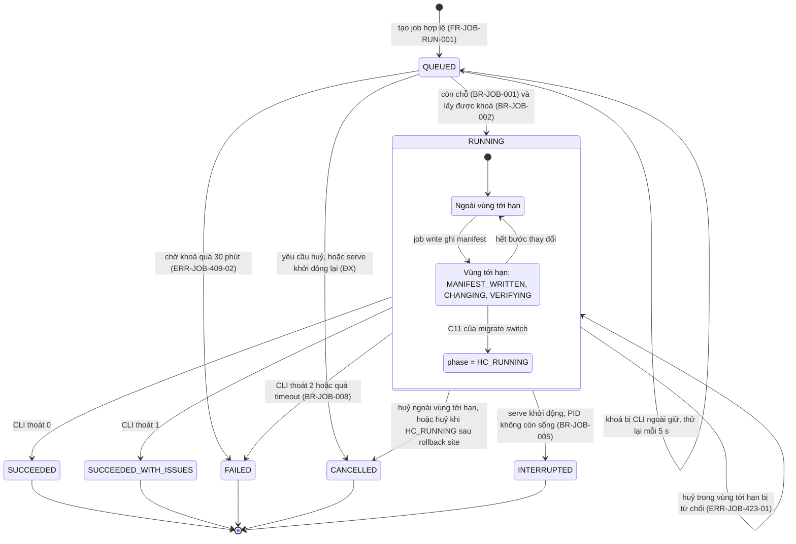
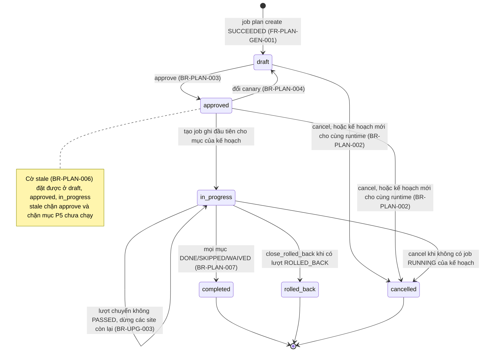
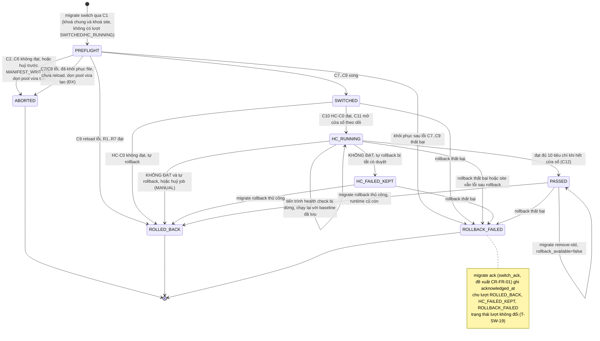
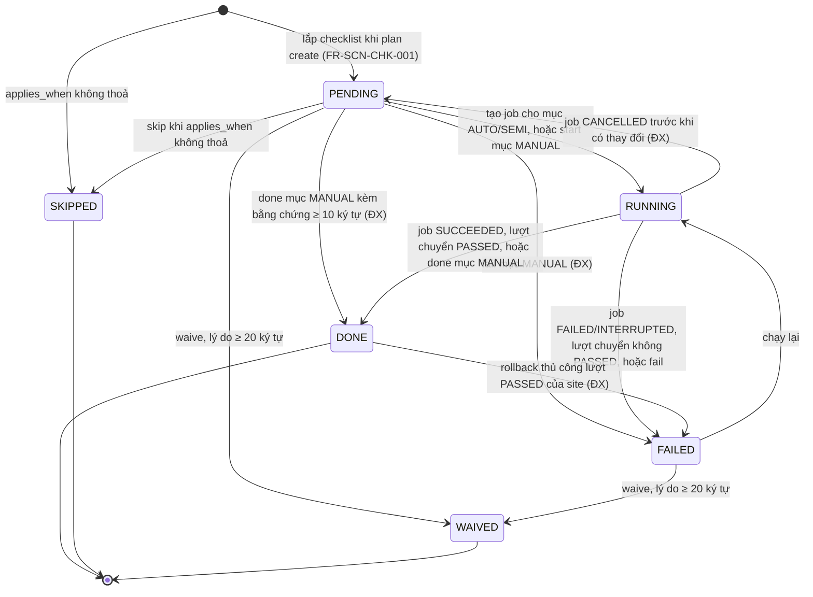
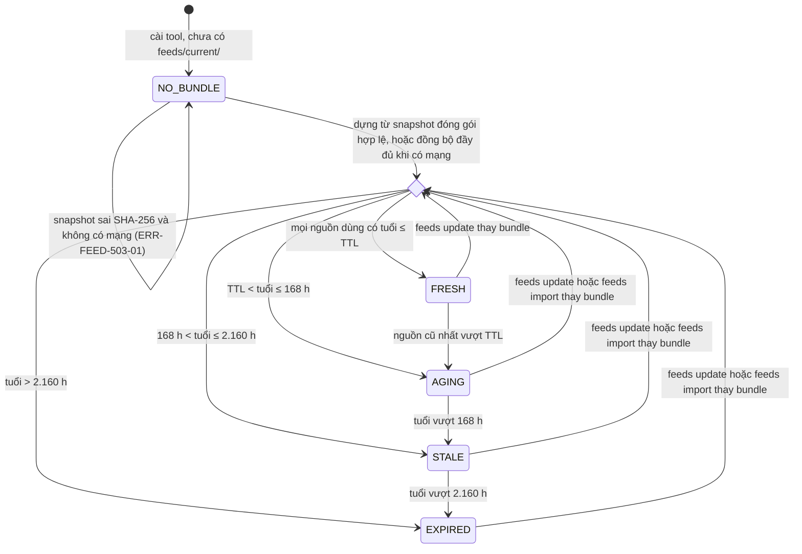
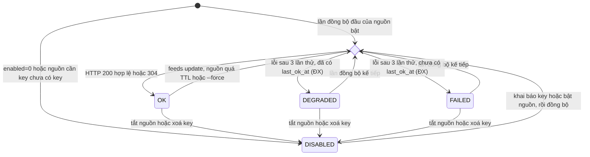
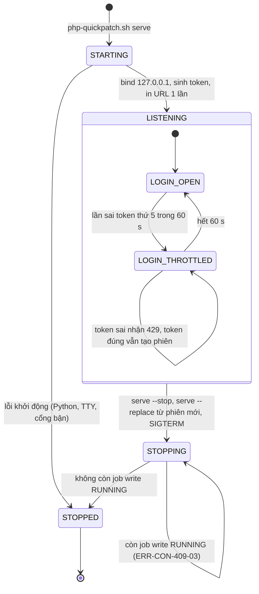
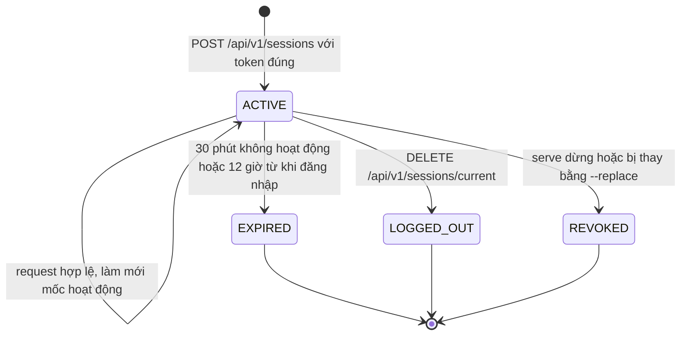

# Sơ đồ và ma trận chuyển trạng thái — php-quickpatch v2

## Lịch sử sửa đổi (Revision History)
| Phiên bản | Ngày | Người thực hiện | Tóm tắt thay đổi |
| :--- | :--- | :--- | :--- |
| 1.0.0 | 2026-10-22 | BA Agent | Khởi tạo theo skill `/state` (rules/12, template 19): 8 sơ đồ `stateDiagram-v2` và ma trận chuyển trạng thái cho 6 đối tượng — job, kế hoạch nâng cấp, lượt chuyển site, mục checklist, cache dữ liệu feed (bundle + nguồn), tiến trình `serve`/token và phiên console; bảng liên kết giữa các máy trạng thái; 13 điểm SRS chưa quy định kèm đề xuất (`ĐX`) chờ duyệt |
| 1.0.1 | 2026-10-22 | BA Agent | Sửa theo review: 3 sơ đồ chi tiết đổi sang mã mới DIAG-STATE-QP-JOB-002, DIAG-STATE-QP-PLAN-002, DIAG-STATE-QP-ENV-003 để mỗi mã chỉ có 1 định nghĩa (sơ đồ gốc DIAG-STATE-QP-JOB-001, -PLAN-001 ở spec.md §4.1.1–4.1.2 và DIAG-STATE-QP-ENV-002 ở environment-playbooks-healthcheck.md §6.5 giữ mã); thêm §1.5 đối chiếu chuyển trạng thái gốc ↔ chi tiết; §9.1 thêm `I-ST-07` liệt kê tham chiếu cần cập nhật ở tài liệu khác; ghi vai trò thực hiện cho `T-FD-01`, `T-FD-05..07`, `T-SES-07` và điều kiện bảo vệ cho `T-SES-07`; §1.2 quy ước ô điều kiện bảo vệ `—` |
| 1.0.2 | 2026-10-22 | BA Agent | Sửa theo review lần 2, đồng bộ với business-rules.md 1.0.1, error-matrix.md 1.0.1/1.1.0, functional-requirements.md 1.0.1, environment-playbooks.md 1.0.1. (1) `BR-AUTH-003`: `T-CON-04`, `T-CON-05`, `T-SES-01`, `T-SES-02` chỉ chặn token sai khi `LOGIN_THROTTLED`, token đúng vẫn được cấp phiên (vẫn áp tối đa 5 phiên); thêm `T-CON-09` và chuyển tương ứng trên DIAG-STATE-QP-CON-001. (2) Xác nhận lượt chuyển lỗi: `T-SW-02` dùng `ERR-UPG-409-03`; `T-SW-19` áp cho `ROLLED_BACK`/`HC_FAILED_KEPT`/`ROLLBACK_FAILED` với `migrate ack`/`switch_ack` (`FR-UPG-ACK-001`, `ERR-UPG-409-04`, đề xuất `CR-FR-01`); `T-SW-01`, `T-PLN-08`, §1.5, §8 và `Q-ST-07` cập nhật theo. (3) Khoá site và nhánh `ABORTED`: `T-SW-01` lấy khoá site từ C1 (`BR-ENV-013`), `T-SW-03`/`T-SW-04`/`T-SW-05` dọn pool đích vừa tạo và reload FPM đích, `T-SW-03` thêm lỗi dung lượng ở C3, `T-SW-06` manifest ghi từ C3, `T-SW-09` và §4.3 ghi khoá site giữ từ C1. Đánh số PATCH (rules/19) vì nhãn 1.0.1 đã dùng cho lần sửa trước |

## 1. Giới thiệu

### 1.1 Mục đích và phạm vi
Tài liệu đặc tả vòng đời của 6 đối tượng có trạng thái trong php-quickpatch v2, để Dev cài đặt kiểm tra chuyển trạng thái và QA thiết kế test case chuyển trạng thái (mỗi mã `T-*` ≥ 1 test case, rules/14). Mọi trạng thái, sự kiện, điều kiện và mã lỗi lấy từ bộ SRS (DOC-SRS-QP-001 và các phụ lục); tài liệu này **không** định nghĩa lại FR/BR/ERR. Khi tài liệu này lệch với SRS, áp `BR-DATA-004`: SRS chính và 4 file chi tiết được ưu tiên; điểm lệch được liệt kê ở §9.

Ngoài phạm vi: trạng thái Phase 2 (`FR-FLT-*`: đợt chạy từ xa, server `TIMEOUT`), trạng thái vòng đời runtime (`lifecycle_status`, tính theo ngày — DOC-SRS-QP-SCN-000 §2.1), trạng thái vá runtime (`ok`/`ok-backport`/`vulnerable`/`eol` — kết quả tính lại mỗi lần `scan`, không có sự kiện chuyển).

### 1.2 Quy ước
- **Ma trận** (rules/12 §2, template 19): `Mã` | Trạng thái nguồn | Sự kiện kích hoạt | Điều kiện bảo vệ (guard) | Trạng thái đích | Vai trò thực hiện | Hành động kèm theo (side effect) | Truy vết.
- **Mã chuyển** `T-<ĐỐI TƯỢNG>-NN` (`JOB`, `PLN`, `SW`, `CHK`, `FD`, `SRC`, `CON`, `SES`) là mã cục bộ của tài liệu, dùng để truy vết test case; không phải mã FR/BR/ERR.
- `[*]` = trạng thái giả khởi đầu/kết thúc của Mermaid. Dòng có đích "— (không tạo)" là yêu cầu bị từ chối trước khi đối tượng được tạo. Ô "Điều kiện bảo vệ" ghi `—` = không có điều kiện nào ngoài sự kiện kích hoạt; ô "Vai trò thực hiện" luôn ghi tác nhân cụ thể.
- **Mã sơ đồ**: mỗi mã ở cột "Mã sơ đồ" của §1.3 được định nghĩa duy nhất tại tài liệu này. Ba sơ đồ chi tiết có thêm chuyển trạng thái so với sơ đồ đã phát hành nên mang mã mới (DIAG-STATE-QP-JOB-002, DIAG-STATE-QP-PLAN-002, DIAG-STATE-QP-ENV-003); sơ đồ gốc giữ mã cũ tại nơi định nghĩa gốc. Đối chiếu ở §1.5.
- **`ĐX`** = chuyển trạng thái hoặc điều kiện SRS chưa quy định, BA đề xuất để máy trạng thái đầy đủ; chờ duyệt tại §9 (mã `Q-ST-*`). Trên sơ đồ, nhãn có hậu tố `(ĐX)`.
- **Vai trò** (rules/17, DOC-SRS-QP-001 §2.3): Phase 1 không có tài khoản; "Người vận hành" = người giữ phiên console hoặc chạy CLI trên máy chủ (`PER-01`, `PER-02`, `PER-03`), quyền thực thi bằng quyền tiến trình `serve`/CLI (`BR-CON-010`, `BR-CLI-005`); `PER-04` chỉ xem và xuất báo cáo; "Hệ thống" = `qp-console.py`, CLI `php-quickpatch.sh` hoặc `qp-feeds.py`; `SYS-01` = cron/systemd timer.
- Thời lượng và ngưỡng ghi bằng giây (s), phút, giờ (h), ngày, theo đúng giá trị ở BR nguồn.

### 1.3 Danh mục máy trạng thái
| § | Đối tượng | Mã sơ đồ | Nơi lưu trạng thái | Trạng thái đầu | Trạng thái kết thúc | FR chính |
| :--- | :--- | :--- | :--- | :--- | :--- | :--- |
| 2 | Job console | DIAG-STATE-QP-JOB-002 (chi tiết hoá DIAG-STATE-QP-JOB-001 của spec §4.1.2, §1.5) | `STATE_DIR/jobs/<job_id>/job.json` trường `state`; vùng tới hạn ở file `phase` | `QUEUED` | `SUCCEEDED`, `SUCCEEDED_WITH_ISSUES`, `FAILED`, `CANCELLED`, `INTERRUPTED` | `FR-JOB-RUN-001..004`, `FR-CON-JOB-002` |
| 3 | Kế hoạch nâng cấp của 1 runtime | DIAG-STATE-QP-PLAN-002 (chi tiết hoá DIAG-STATE-QP-PLAN-001 của spec §4.1.1, §1.5) | `STATE_DIR/plans/<plan_id>/plan.json` trường `status`, cờ `stale` | `draft` | `completed`, `rolled_back`, `cancelled` | `FR-PLAN-GEN-001`, `FR-PLAN-STS-001` |
| 4 | Lượt chuyển 1 site (`switch_record`) | DIAG-STATE-QP-ENV-003 (chi tiết hoá DIAG-STATE-QP-ENV-002 của DOC-SRS-QP-ENV-002 §6.5, §1.5) | `STATE_DIR/switches/index.tsv`, `backups/<run_id>/switch.json` trường `status` | `PREFLIGHT` | `ABORTED`, `ROLLED_BACK`, `ROLLBACK_FAILED` | `FR-UPG-SWT-001..003`, `FR-UPG-HC-*`, `FR-UPG-RBK-001..002` |
| 5 | Mục checklist của kế hoạch | DIAG-STATE-QP-CHK-001 | `plans/<plan_id>/items.json` trường `item_status` theo site | `PENDING` (hoặc `SKIPPED`) | `DONE`, `SKIPPED`, `WAIVED` | `FR-SCN-CHK-001`, `FR-PLAN-CHK-001..002` |
| 6.1 | Bundle dữ liệu feed (`feeds/current/`) | DIAG-STATE-QP-FEED-001 | Tính từ `manifest.json` (`fetched_at` từng nguồn) tại thời điểm đọc | `NO_BUNDLE` | Không có (đối tượng tồn tại suốt thời gian cài tool) | `FR-FEED-SYNC-001`, `FR-FEED-AGE-001`, `FR-FEED-SNAP-001..003` |
| 6.2 | Trạng thái 1 nguồn dữ liệu (`feed_source`) | DIAG-STATE-QP-FEED-002 | `feeds.db` bảng `feed_source.status`, `manifest.json` | `DISABLED` hoặc kết quả lần đồng bộ đầu | Không có | `FR-FEED-SYNC-001`, `FR-FEED-CMD-002` |
| 7.1 | Tiến trình `serve` và token | DIAG-STATE-QP-CON-001 | Bộ nhớ `qp-console.py`, `console/serve.pid` | `STARTING` | `STOPPED` | `FR-CON-AUTH-001..002` |
| 7.2 | Phiên trình duyệt (`qp_session`) | DIAG-STATE-QP-AUTH-001 | Bộ nhớ `qp-console.py` (không ghi đĩa) | `ACTIVE` | `EXPIRED`, `LOGGED_OUT`, `REVOKED` | `FR-CON-AUTH-003..004` |

### 1.4 Đối chiếu tên trạng thái trong yêu cầu giao việc với SRS
Yêu cầu giao việc nêu một số tên trạng thái minh hoạ. Theo `BR-DATA-004`, tài liệu dùng giá trị enum đã phát hành trong SRS; tên minh hoạ chỉ là nhãn tham chiếu, không trở thành giá trị lưu trữ.

| Đối tượng | Tên minh hoạ | Trạng thái SRS tương ứng | Ghi chú |
| :--- | :--- | :--- | :--- |
| Job | `ROLLED_BACK` | Không có trạng thái job này | Rollback là 1 job riêng (`rollback_run`, `migrate_rollback`). `migrate switch` kết thúc với lượt `ROLLED_BACK` → CLI thoát 1 (`BR-CLI-004`) → job `SUCCEEDED_WITH_ISSUES`; trạng thái rollback nằm ở lượt chuyển (§4) |
| Lượt chuyển site | `PENDING` | Chưa có `switch_record` hiệu lực | Site trong `site_order[]` chưa có lượt, hoặc lượt gần nhất `ABORTED`; hiển thị là mục P5 `PENDING` (§5) |
| Lượt chuyển site | `SWITCHING` | `PREFLIGHT` → `SWITCHED` | `PREFLIGHT` = bước C1–C6; `SWITCHED` = đã qua C7–C9, chờ C10 |
| Lượt chuyển site | `HEALTH_CHECK` | `HC_RUNNING` | Cửa sổ 600 s (`hc_mode=skip`: 120 s) |
| Lượt chuyển site | `LIVE_ON_TARGET` | `PASSED` | |
| Lượt chuyển site | `AUTO_ROLLED_BACK` | `ROLLED_BACK` với `rollback_reason` ∈ {`HC-C0`..`HC-C9`} | Phân biệt bằng trường `rollback_reason`, không tách trạng thái |
| Lượt chuyển site | `ROLLED_BACK` | `ROLLED_BACK` với `rollback_reason = MANUAL` | |
| Lượt chuyển site | `FINALIZED` | `PASSED` + `rollback_available=false` | Sau `migrate remove-old` (`FR-UPG-RMV-001`); kế hoạch `completed` là mốc đóng ở cấp kế hoạch (§3) |
| Cache feed | `FRESH`, `STALE` | `FRESH`, `AGING`, `STALE`, `EXPIRED` (`BR-FEED-005`) | 4 mức theo tuổi dữ liệu |
| Cache feed | `OFFLINE_SNAPSHOT` | `data_origin = SNAPSHOT`, `manifest.base.type = snapshot` | Nguồn gốc dữ liệu, không phải mức độ tươi; mức độ tươi vẫn tính theo tuổi snapshot |
| Cache feed | `ERROR` | Nguồn `FAILED`/`DEGRADED` (§6.2) hoặc bundle `NO_BUNDLE` (§6.1) | |

### 1.5 Đối chiếu sơ đồ chi tiết với sơ đồ gốc
Tập giá trị trạng thái (enum) của sơ đồ chi tiết và sơ đồ gốc giống nhau; tham chiếu chỉ dùng tập giá trị (cột `state`/`status`, hậu điều kiện) đúng với cả 2 mã. Tham chiếu dùng chuyển trạng thái, trạng thái con hoặc mã `T-*` dẫn tới mã chi tiết (`I-ST-07`). Chuyển gắn `ĐX` chưa có hiệu lực tới khi được duyệt (spec.md §1.3.1).

| Sơ đồ chi tiết (định nghĩa tại đây) | Sơ đồ gốc (giữ mã, nơi định nghĩa) | Chuyển có trên sơ đồ gốc | Chuyển chỉ có ở sơ đồ chi tiết (căn cứ) |
| :--- | :--- | :--- | :--- |
| DIAG-STATE-QP-JOB-002 (§2) | DIAG-STATE-QP-JOB-001, spec.md §4.1.2 (rút gọn) | `T-JOB-01`, `T-JOB-03`, `T-JOB-05`, `T-JOB-06`, `T-JOB-08`..`T-JOB-13`, `T-JOB-16` | Trạng thái con của `RUNNING`, `T-JOB-14`, `T-JOB-15` (`BR-JOB-004`); `T-JOB-04` chờ khoá (`FR-JOB-RUN-002`); `T-JOB-17` (`BR-JOB-005`); `T-JOB-07` (`ĐX`, `Q-ST-01`); `T-JOB-02` từ chối tạo (§2.3) |
| DIAG-STATE-QP-PLAN-002 (§3) | DIAG-STATE-QP-PLAN-001, spec.md §4.1.1 (rút gọn) | `T-PLN-01`, `T-PLN-03`, `T-PLN-04` (nguồn `draft`), `T-PLN-05`, `T-PLN-06`, `T-PLN-07`, `T-PLN-09`..`T-PLN-11` | `T-PLN-04` nguồn `approved` (`BR-PLAN-002`); `T-PLN-08` (`BR-UPG-003`); cờ `stale` `T-PLN-12` (`BR-PLAN-006`); `T-PLN-02`, `T-PLN-13` (từ chối, không đổi trạng thái); guard "không có job `RUNNING`" của `T-PLN-10` (`ĐX`) |
| DIAG-STATE-QP-ENV-003 (§4) | DIAG-STATE-QP-ENV-002, environment-playbooks-healthcheck.md §6.5 | `T-SW-01`, `T-SW-03` (C2–C5), `T-SW-06`, `T-SW-09`..`T-SW-15` (`T-SW-11` nhánh tự rollback), `T-SW-18` (nguồn `HC_RUNNING`) | `T-SW-03` thêm C6 (`ERR-ENV-507-01`); `T-SW-04` (`BR-JOB-004`); `T-SW-05` (`ĐX`, `Q-ST-04`); `T-SW-07` (DOC-SRS-QP-ENV-001 §5.1 C9); `T-SW-08` (DOC-SRS-QP-ENV-002 §6.4); `T-SW-11` nhánh huỷ job `MANUAL` (`BR-JOB-004`); `T-SW-16`, `T-SW-17` (`BR-SCN-014`, `FR-UPG-RMV-001`); `T-SW-18` nguồn `PREFLIGHT`, `SWITCHED`, `HC_FAILED_KEPT`, `PASSED` (`Q-ST-05`); `T-SW-19` (`FR-UPG-ACK-001`, đề xuất `CR-FR-01`, `Q-ST-07`); `ABORTED`, `ROLLBACK_FAILED` là trạng thái kết thúc (`I-ST-02`) |

## 2. Job console (DIAG-STATE-QP-JOB-002)
Đối tượng: 1 lần console chạy CLI dưới dạng tiến trình con (`job_id` = `JOB-YYYYmmdd-HHMMSS-XXXX`). Loại job `read`/`write`/`data` theo `BR-JOB-003`; job `--dry-run` là job `read`. Trạng thái con của `RUNNING` chỉ áp dụng cho job `write` và được xác định bằng file `jobs/<job_id>/phase` (`BR-JOB-004`).

### 2.1 Sơ đồ

### 2.2 Ma trận chuyển trạng thái
| Mã | Trạng thái nguồn | Sự kiện kích hoạt | Điều kiện bảo vệ (guard) | Trạng thái đích | Vai trò thực hiện | Hành động kèm theo (side effect) | Truy vết |
| :--- | :--- | :--- | :--- | :--- | :--- | :--- | :--- |
| `T-JOB-01` | `[*]` | `POST /api/v1/jobs` hoặc endpoint sinh job: `POST /api/v1/plans`, `POST /api/v1/plans/{plan_id}/checklist-items/{chk_id}/runs`, `POST /api/v1/rollbacks`, `POST /api/v1/reports`, `POST /api/v1/feed-snapshots` | Request qua kiểm Host, phiên, CSRF (`FR-CON-AUTH-004..006`); `action` thuộc danh sách trắng, mọi tham số khớp regex/enum (`BR-CON-008`); job `write`: `confirm_dry_run_job_id` trỏ tới job dry-run `SUCCEEDED`, cùng tham số chuẩn hoá, cùng phiên, tạo ≤ 15 phút trước, `bundle_id` và `scan_fingerprint` không đổi (`BR-CON-005`) và đã xác nhận kép với hành động thuộc `BR-CON-006`; số job `QUEUED` < 20; không có job cùng `action` và cùng đối tượng ở `QUEUED`/`RUNNING`; console không ở `STOPPING` | `QUEUED` | Job `read`: người giữ phiên (`PER-01..04`); job `write`/`data`: người vận hành `PER-01/02/03` khi tiến trình `serve` đủ quyền (`BR-CON-010`) | Tạo `jobs/<job_id>/` quyền `0700`, `job.json` quyền `0600` với `state=QUEUED`, `kind`, `created_at`, `argv` đã che (`BR-SEC-006`); trả HTTP 202 + `job_id`, P95 ≤ 1.500 ms | `FR-JOB-RUN-001`, `FR-CON-SAFE-001`, `FR-CON-SAFE-003`, `BR-JOB-001`, `BR-JOB-003`, `NFR-PERF-002` |
| `T-JOB-02` | `[*]` | Như `T-JOB-01` | Vi phạm 1 điều kiện ở bảng §2.3 | — (không tạo) | Như `T-JOB-01` | Trả mã lỗi ở §2.3; không ghi `jobs/` | §2.3 |
| `T-JOB-03` | `QUEUED` | Bộ lập lịch duyệt hàng đợi FIFO theo `created_at` | Còn chỗ theo loại (`BR-JOB-001`): job `write` khi 0 job `write` đang `RUNNING`; job `read` khi ≤ 1 job `read` đang `RUNNING`; job `data` khi 0 job `data` đang `RUNNING`; thử khoá không chặn thành công: `write` → `flock -x -n STATE_DIR/.lock`, `read` → `flock -s -n STATE_DIR/.lock`, `data` → `feeds/.lock` (`BR-JOB-002`) | `RUNNING` | Hệ thống (`qp-console.py`) | `subprocess.Popen(argv, shell=False, stdin=DEVNULL, close_fds=True, start_new_session=True, env=<danh sách trắng>, cwd=STATE_DIR)`; ghi `started_at`, PID; phát SSE `status`; CLI của job `write` ghi audit "intent" trước thay đổi đầu tiên (`BR-AUD-004`) | `FR-JOB-RUN-001`, `FR-JOB-RUN-002`, `FR-CON-SAFE-003`, `NFR-REL-002`, `NFR-REL-004` |
| `T-JOB-04` | `QUEUED` | Thử khoá thất bại: khoá `STATE_DIR/.lock` bị lượt CLI ngoài console giữ, hoặc khoá chia sẻ của job `read` đang chạy chặn khoá độc quyền của job `write` | Thời gian chờ khoá do CLI ngoài giữ, tính từ lần thử đầu, < 30 phút | `QUEUED` | Hệ thống | Thử lại mỗi 5 s; SSE `status` kèm lý do chờ khoá | `FR-JOB-RUN-002`, `BR-JOB-002` |
| `T-JOB-05` | `QUEUED` | Lần thử khoá tại phút thứ 30 vẫn thất bại | — | `FAILED` | Hệ thống | `result.errors[]` = `ERR-JOB-409-02`; ghi `ended_at`; SSE `end` | `FR-JOB-RUN-002`, `ERR-JOB-409-02` |
| `T-JOB-06` | `QUEUED` | `POST /api/v1/jobs/{job_id}/cancellations` | Không có | `CANCELLED` | Người vận hành `PER-01/02` | Rút khỏi hàng đợi, không tạo tiến trình; mục checklist liên kết về `PENDING` (`T-CHK-08`); ghi audit với job `write` | `FR-JOB-RUN-003`, `FR-CON-JOB-002`, `BR-JOB-004` |
| `T-JOB-07` | `QUEUED` | `serve` khởi động và đọc thấy `job.json` ở `QUEUED` | Không có | `CANCELLED` (lý do `CONSOLE_RESTART`) | Hệ thống | Không tự chạy job; người vận hành tạo lại job và dry-run mới | `ĐX` (`Q-ST-01`), `NFR-REL-003` |
| `T-JOB-08` | `RUNNING` | Tiến trình CLI kết thúc, mã thoát 0 | — | `SUCCEEDED` | Hệ thống | Ghi `result.json`, `exit_code`, `ended_at`; SSE `end` rồi đóng luồng; job dry-run thành công trở thành căn cứ xác nhận trong 15 phút (`BR-CON-005`); mục checklist liên kết → `DONE` (`T-CHK-05`) | `BR-JOB-008`, `FR-JOB-LOG-001`, `FR-PLAN-CHK-002` |
| `T-JOB-09` | `RUNNING` | Mã thoát 1 | — | `SUCCEEDED_WITH_ISSUES` | Hệ thống | Như `T-JOB-08`; ví dụ `scan` còn runtime `vulnerable`, `migrate switch` kết thúc `ROLLED_BACK` (`BR-CLI-004`); mục checklist liên kết xử lý theo `T-CHK-06` | `BR-JOB-008`, `BR-CLI-004` |
| `T-JOB-10` | `RUNNING` | Mã thoát 2 | — | `FAILED` | Hệ thống | `errors[]` gồm `ERR-JOB-500-01` và mã `ERR-*` do CLI trả (vd `ERR-AUD-500-01`, `ERR-CLI-403-01`, `ERR-UPG-409-02`); mục checklist liên kết → `FAILED` | `BR-JOB-008`, `ERR-JOB-500-01` |
| `T-JOB-11` | `RUNNING` | Hết timeout theo hành động: `scan`, `assess`, `plan create` 1.800 s; `fix`, `migrate install` 3.600 s; `migrate switch` 1.200 s; `migrate rollback` 300 s; `feeds update` 960 s; hành động khác 600 s | — | `FAILED` | Hệ thống | `ERR-JOB-504-01`; job `read`/`data`: `os.killpg(pgid, SIGTERM)`, SIGKILL sau 10 s; job `write` đang ở vùng tới hạn: cách dừng chưa được SRS quy định | `BR-JOB-008`, `ERR-JOB-504-01`, `Q-ST-02` |
| `T-JOB-12` | `RUNNING` (`read`, `data`) | `POST /api/v1/jobs/{job_id}/cancellations` | Không có | `CANCELLED` | Người vận hành `PER-01/02` | SIGTERM nhóm tiến trình, SIGKILL sau 10 s nếu còn sống; job `data`: `staging/` bị xoá, `current/` giữ nguyên (`BR-FEED-051`) | `BR-JOB-004`, `FR-JOB-RUN-003`; job `data` áp như `read`: `ĐX` (`Q-ST-03`) |
| `T-JOB-13` | `RUNNING` (`write`, ngoài vùng tới hạn) | Yêu cầu huỷ | `phase` ∉ {`MANIFEST_WRITTEN`, `CHANGING`, `VERIFYING`, `HC_RUNNING`} | `CANCELLED` | Người vận hành `PER-01/02` | SIGTERM nhóm tiến trình; chưa có thay đổi nào cần hoàn tác; audit "result" = `cancelled` | `BR-JOB-004`, `FR-JOB-RUN-003` |
| `T-JOB-14` | `RUNNING` (`write`, vùng tới hạn) | Yêu cầu huỷ | `phase` ∈ {`MANIFEST_WRITTEN`, `CHANGING`, `VERIFYING`} (bước C6–C10, R1–R6, cài gói) | `RUNNING` (không đổi) | Người vận hành `PER-01/02` | Trả HTTP 423 `ERR-JOB-423-01` kèm `phase`; không gửi tín hiệu tới tiến trình | `BR-JOB-004`, `ERR-JOB-423-01` |
| `T-JOB-15` | `RUNNING` (`write`, `phase = HC_RUNNING`) | Yêu cầu huỷ | Job `migrate_switch` đang trong cửa sổ health check | `CANCELLED` (khi CLI kết thúc rollback) | Người vận hành `PER-01/02` | Dừng health check; rollback site R1–R7 với `rollback_reason = MANUAL`, R1–R6 ≤ 60 s P95; lượt chuyển → `ROLLED_BACK` (`T-SW-11`); `result.json` ghi trạng thái lượt | `BR-JOB-004`, `FR-JOB-RUN-003`, `FR-UPG-RBK-001`, `NFR-ENV-02` |
| `T-JOB-16` | `RUNNING` | `serve` khởi động; PID trong `job.json` không còn sống | — | `INTERRUPTED` | Hệ thống | `ERR-JOB-500-02`; đối soát xong ≤ 5 s sau khi `serve` chạy; không chạy lại job ghi; job `migrate_switch` có lượt `HC_RUNNING` → `T-SW-08` | `BR-JOB-005`, `FR-JOB-RUN-004`, `NFR-REL-003` |
| `T-JOB-17` | `RUNNING` | `serve` khởi động; PID còn sống (CLI tiếp tục chạy sau khi console bị dừng cưỡng bức) | `/proc/<pid>/cmdline` khớp `argv` đã lưu (`ĐX`, chống trùng PID tái sử dụng) | `RUNNING` | Hệ thống | Nối lại đọc `output.log` từ byte offset cuối; tiếp tục SSE | `BR-JOB-005`, `ERR-CON-409-03`, `Q-ST-01` |

### 2.3 Yêu cầu tạo job bị từ chối (`T-JOB-02`)
| Điều kiện vi phạm | Mã lỗi | HTTP | Căn cứ |
| :--- | :--- | :---: | :--- |
| Header `Host` không thuộc danh sách cho phép | `ERR-CON-421-01` | 421 | `BR-CON-003` |
| Không có cookie phiên/Bearer hợp lệ; phiên hết hạn | `ERR-AUTH-401-01`, `ERR-AUTH-401-02` | 401 | `BR-AUTH-004`, `BR-AUTH-005` |
| Request ghi bằng cookie thiếu/sai `X-QP-CSRF`; `Origin` sai; thiếu `Content-Type: application/json` | `ERR-AUTH-403-01`, `ERR-AUTH-403-02`, `ERR-CON-415-01` | 403, 415 | `BR-CON-004` |
| Body > 64 KiB (upload snapshot > 20 MiB) | `ERR-CON-413-01` | 413 | `BR-CON-009` |
| `action` ngoài danh sách trắng, tham số sai regex/enum hoặc bắt đầu bằng `-` | `ERR-CON-422-01` | 422 | `BR-CON-008` |
| Job `write` không kèm dry-run hợp lệ | `ERR-JOB-428-01` | 428 | `BR-CON-005` |
| Đã có job cùng `action` và đối tượng ở `QUEUED`/`RUNNING` | `ERR-JOB-409-01` | 409 | `FR-JOB-RUN-001` |
| Hàng đợi đã có 20 job `QUEUED` | `ERR-JOB-429-01` | 429 | `BR-JOB-001` |
| Console ở `STOPPING` (§7.1) | `ERR-CON-503-01` | 503 | `FR-CON-API-001` |

### 2.4 Ghi chú
- Trạng thái kết thúc được lưu vĩnh viễn trong `job.json` tới khi hết hạn lưu giữ: `output.log` giữ 30 ngày (sau đó `GET /api/v1/jobs/{job_id}/log` trả `ERR-JOB-410-01`), `job.json` và `result.json` của job `write` giữ ≥ 365 ngày (`BR-JOB-006`, `FR-JOB-LOG-003`).
- Ánh xạ `phase` ↔ bước (suy ra từ `BR-JOB-004`, cần Dev xác nhận khi cài đặt): `MANIFEST_WRITTEN` = C6 hoặc ghi manifest trước thay đổi đầu tiên của `fix`; `CHANGING` = C7–C9, R4–R5, cài/nâng gói; `VERIFYING` = C10, R6; `HC_RUNNING` = C11.
- Khoá: tiến trình CLI giữ khoá, không phải `qp-console.py`; console chỉ thử khoá không chặn trước khi khởi chạy (`FR-JOB-RUN-002`). Không có 2 job `write` cùng `RUNNING` trên 1 máy chủ, kể cả lượt CLI ngoài console (`NFR-REL-004`).

## 3. Kế hoạch nâng cấp của một runtime (DIAG-STATE-QP-PLAN-002)
Đối tượng: kế hoạch `plan_id` = `PLN-YYYYmmdd-HHMMSS-XXXX` cho 1 `runtime_id` tới 1 nhánh đích, chế độ `same_branch` (chỉ vá) hoặc `cross_branch` (cài song song → chuyển từng site → dọn dẹp) (`FR-PLAN-GEN-001`). Toàn bộ quá trình nâng cấp của runtime (P1 chuẩn bị … P7 gỡ runtime cũ) diễn ra trong trạng thái `in_progress`; tiến độ chi tiết nằm ở mục checklist (§5) và lượt chuyển từng site (§4). `stale` là cờ, không phải trạng thái (`BR-PLAN-006`).

### 3.1 Sơ đồ

### 3.2 Ma trận chuyển trạng thái
| Mã | Trạng thái nguồn | Sự kiện kích hoạt | Điều kiện bảo vệ (guard) | Trạng thái đích | Vai trò thực hiện | Hành động kèm theo (side effect) | Truy vết |
| :--- | :--- | :--- | :--- | :--- | :--- | :--- | :--- |
| `T-PLN-01` | `[*]` | `plan create --runtime-id ID --target X.Y` (CLI) hoặc `POST /api/v1/plans` → job `plan_create` kết thúc `SUCCEEDED`/`SUCCEEDED_WITH_ISSUES` | Ứng viên đích `selectable=true` (`BR-ASMT-002`); đích không phải `EOL`, `PRE_RELEASE`, `UNKNOWN`, "6.x" (`BR-UPG-004`); site production không nhận nhánh trung gian hoặc Node.js `CURRENT` trước ngày `lts` (`BR-SCN-007`); đích khác `RECOMMENDED` có lý do ≥ 20 ký tự (`BR-PLAN-001`); runtime không có kế hoạch `in_progress` (`BR-PLAN-002`); `cross_branch` cần dữ liệu không ở mức `EXPIRED` (`BR-FEED-005`) | `draft` | Người vận hành `PER-01/02` | Sinh `plan_id`; lắp checklist (`T-CHK-01`, `T-CHK-02`); quét tương thích theo site (`FR-CMPT-*`); `site_order[]` + canary (`FR-PLAN-GEN-002`); hạn duyệt (`FR-PLAN-DL-001`); lưu `bundle_id`, `catalog_version`, `scan_fingerprint`; ghi `plans/<plan_id>/` bằng ghi tạm + `rename`; kế hoạch `draft`/`approved` cũ của runtime → `cancelled` (`T-PLN-04`); ghi audit khi có lý do đích khác đề xuất | `FR-PLAN-TGT-001`, `FR-PLAN-GEN-001`, `FR-PLAN-GEN-002`, `FR-CON-PLAN-001`, `NFR-REL-006` |
| `T-PLN-02` | `[*]` | Như `T-PLN-01` | Vi phạm 1 guard của `T-PLN-01` | — (không tạo) | Như `T-PLN-01` | `ERR-PLAN-409-01` (runtime đã có kế hoạch `in_progress`); `ERR-SCN-409-01` (không có nhánh đích thoả framework/loader/`engines`); `ERR-SCN-409-02` (đích `EOL`/`PRE_RELEASE`/`CURRENT` cho production); `ERR-SCN-409-03` (loader mã hoá); `ERR-PLAN-422-01` (lý do < 20 ký tự); `ERR-SCN-503-01` (dữ liệu > 90 ngày, chỉ cho `same_branch`) | `FR-PLAN-TGT-001`, `BR-PLAN-002` |
| `T-PLN-03` | `draft` | `plan approve ID` hoặc `PATCH /api/v1/plans/{plan_id}` `status=approved` | `stale=false`; kết quả quét tương thích phần chạy được trước khi cài có cho 100% site; mọi mục P1 `AUTO` ở `DONE`; tiền điều kiện `FR-UPG-PRE-001` đã kiểm; người duyệt có quyền thực thi theo DOC-SRS-QP-001 §2.3 (`BR-PLAN-003`) | `approved` | Người vận hành `PER-01/02` | Ghi `approved_at`, `approved_by`; ghi audit "duyệt kế hoạch" (`BR-AUD-001`); xoá cảnh báo hạn duyệt trên SCR-002 | `FR-PLAN-STS-001`, `FR-CON-PLAN-002`, `BR-PLAN-003` |
| `T-PLN-04` | `draft`, `approved` | Tạo kế hoạch mới cho cùng `runtime_id` (`T-PLN-01`) | Kế hoạch mới tạo thành công | `cancelled` | Hệ thống | Ghi audit "huỷ kế hoạch" với lý do `superseded` + `plan_id` mới | `BR-PLAN-002` |
| `T-PLN-05` | `draft`, `approved` | `plan cancel ID` hoặc `PATCH` `status=cancelled` | Không có job của kế hoạch ở `RUNNING` (`BR-PLAN-007`) | `cancelled` | Người vận hành `PER-01/02` | Ghi audit "huỷ kế hoạch"; mục checklist giữ nguyên trạng thái (chỉ đọc) | `FR-PLAN-STS-001`, `BR-PLAN-007` |
| `T-PLN-06` | `approved` | `PATCH /api/v1/plans/{plan_id}` đổi `canary_site_id` | Kế hoạch có ≥ 2 site; site mới thuộc `site_order[]` | `draft` | Người vận hành `PER-01/02` | Ghi audit "đổi canary" (`BR-AUD-001`); xoá `approved_at`; cần duyệt lại (`T-PLN-03`) | `FR-PLAN-GEN-002`, `BR-PLAN-004` |
| `T-PLN-07` | `approved` | Tạo job ghi đầu tiên cho 1 mục của kế hoạch (`plan run`, `migrate install`, `migrate switch --plan`) | Guard của mục (`T-CHK-03`) đạt | `in_progress` | Hệ thống | Ghi `started_at` vào `plan.json`, sự kiện `events.jsonl` | `FR-PLAN-STS-001` (hành động `start`), DOC-SRS-QP-001 §4.1.1 |
| `T-PLN-08` | `in_progress` | Lượt chuyển của 1 site trong kế hoạch kết thúc `ROLLED_BACK`, `HC_FAILED_KEPT` hoặc `ROLLBACK_FAILED` | — | `in_progress` (không đổi) | Hệ thống | Không mở lượt chuyển cho site kế tiếp của `site_order[]` tới khi người vận hành xác nhận đã xử lý bằng `migrate ack RUN_ID --reason TEXT` hoặc hành động `switch_ack` trên console (`T-SW-19`, `FR-UPG-ACK-001`, đề xuất `CR-FR-01`, `BR-UPG-003`); trong lúc chờ: chuyển site kế tiếp → `ERR-UPG-409-03` (lượt `ROLLED_BACK`/`HC_FAILED_KEPT`), mọi lệnh chuyển site → `ERR-UPG-423-01` (lượt `ROLLBACK_FAILED`); sau xác nhận được chuyển lại chính site đó bằng lượt mới hoặc chuyển site kế tiếp, mục P5 của site lỗi giữ `FAILED` tới khi chạy lại `DONE` hoặc `WAIVED` (`FR-UPG-SEQ-001`); dải cảnh báo đầu SCR-002 với `HC_FAILED_KEPT`/`ROLLBACK_FAILED` | `FR-UPG-SEQ-001`, `FR-UPG-ACK-001`, `BR-UPG-003`, `FR-CON-OVW-001`, `ERR-UPG-409-03`, `ERR-UPG-423-01` |
| `T-PLN-09` | `in_progress` | Mục checklist cuối cùng chuyển sang `DONE`/`SKIPPED`/`WAIVED`, hoặc hành động `complete` | 100% mục của kế hoạch ở `DONE`, `SKIPPED` hoặc `WAIVED` (`BR-PLAN-007`) | `completed` | Hệ thống (tự đánh giá sau mỗi lần cập nhật mục) hoặc người vận hành | Ghi `completed_at`, `events.jsonl`; kế hoạch rời danh sách hạn duyệt (`FR-PLAN-DL-001`) | `FR-PLAN-STS-001`, `BR-PLAN-007` |
| `T-PLN-10` | `in_progress` | Hành động `close_rolled_back` (`PATCH` `status=rolled_back`) | Có ≥ 1 lượt chuyển của kế hoạch ở `ROLLED_BACK` (`BR-PLAN-007`); không có job của kế hoạch ở `RUNNING` (`ĐX`, cùng điều kiện với `cancel`) | `rolled_back` | Người vận hành `PER-01/02` | Ghi audit; site đã `PASSED` giữ nguyên trên runtime đích (không tự rollback) | `FR-PLAN-STS-001`, `BR-PLAN-007` |
| `T-PLN-11` | `in_progress` | `plan cancel ID` | Không có job của kế hoạch ở `RUNNING` | `cancelled` | Người vận hành `PER-01/02` | Ghi audit; site đã `PASSED` giữ nguyên; muốn đưa site về runtime cũ thì chạy `migrate rollback` riêng | `FR-PLAN-STS-001`, `BR-PLAN-007` |
| `T-PLN-12` | `draft`, `approved`, `in_progress` | Mở hoặc chạy mục của kế hoạch | Một điều kiện lỗi thời đúng: `scan_fingerprint` đổi; nhánh đích có advisory KEV mới hoặc `R` của đích tăng ≥ 20; `catalog_version` đổi ở kịch bản liên quan; nhánh đích chuyển `EOL` (`BR-PLAN-006`) | Giữ trạng thái, `stale=true` | Hệ thống | Ghi `stale_reasons[]`; chặn `approve` và mục P5 chưa chạy (`ERR-PLAN-410-01`); giữ mục đã `DONE` | `FR-PLAN-STS-001`, `BR-PLAN-006`, `Q-ST-08` |
| `T-PLN-13` | Mọi trạng thái | Hành động không có trong bảng này cho trạng thái nguồn (vd `approve` kế hoạch `completed`, `cancel` khi có job `RUNNING`) | — | Không đổi | Người vận hành | `ERR-PLAN-409-02` | `FR-PLAN-STS-001`, `ERR-PLAN-409-02` |

### 3.3 Ghi chú
- `plan_id` không tồn tại → `ERR-PLAN-404-01`. Kế hoạch `completed`, `rolled_back`, `cancelled` chỉ đọc; mọi hành động trên mục của chúng trả `ERR-PLAN-409-02`.
- Kế hoạch `cross_branch` có mục P7 gỡ runtime cũ chỉ được đề xuất sau 14 ngày liên tục không có site/tiến trình dùng runtime cũ (`BR-SCN-014`), nên kế hoạch có thể ở `in_progress` ≥ 14 ngày sau site cuối cùng `PASSED`; người vận hành miễn trừ mục P7 (lý do ≥ 20 ký tự) để đóng kế hoạch trước mốc 14 ngày.
- Kế hoạch `same_branch` (vá cùng nhánh) đi cùng vòng đời; mục P2 vá cùng nhánh đứng trước mục cài song song khi runtime `vulnerable` còn hỗ trợ (`BR-UPG-006`).

## 4. Lượt chuyển site (DIAG-STATE-QP-ENV-003)
Đối tượng: `switch_record` — 1 lượt chuyển 1 site (`site_id`, gồm `app:`/`svc:` cho Node.js và Compose) từ `from_branch` sang `to_branch`, mã `run_id` = `YYYYmmdd-HHMMSS` trùng thư mục `STATE_DIR/backups/<run_id>` (DOC-SRS-QP-ENV-001 §4.3). Bước C1–C12 và R1–R7: DOC-SRS-QP-ENV-001 §5.1, §5.2; tiêu chí `HC-C0`..`HC-C9`: DOC-SRS-QP-ENV-002 §6.2. `--dry-run` không ghi manifest (`FR-PTCH-RBK-001`) và 0 thay đổi (`BR-CLI-003`); tài liệu này coi lượt dry-run không tạo `switch_record`. Thuộc tính phụ: `rollback_reason` (`HC-C0`..`HC-C9` hoặc `MANUAL`), `rollback_available` (`FR-UPG-RMV-001`).

### 4.1 Sơ đồ

`PASSED` và `HC_FAILED_KEPT` là trạng thái dừng có thể rời đi (rollback thủ công); `ABORTED`, `ROLLED_BACK`, `ROLLBACK_FAILED` là trạng thái kết thúc của lượt. Chuyển site lần nữa sau khi kết thúc = lượt mới với `run_id` mới. Xác nhận đã xử lý (`T-SW-19`) chỉ ghi thêm `acknowledged_at`, `acknowledged_by`, `ack_reason`, không đổi trạng thái.

### 4.2 Ma trận chuyển trạng thái
| Mã | Trạng thái nguồn | Sự kiện kích hoạt | Điều kiện bảo vệ (guard) | Trạng thái đích | Vai trò thực hiện | Hành động kèm theo (side effect) | Truy vết |
| :--- | :--- | :--- | :--- | :--- | :--- | :--- | :--- |
| `T-SW-01` | `[*]` | `migrate switch <site_id> --target X.Y\|N --plan <plan_id>` (console: job `migrate_switch`, không `--dry-run`) | Kế hoạch `approved`/`in_progress` chứa site (`BR-UPG-005`), trừ CLI `--no-plan --reason` ≥ 20 ký tự; không có lượt `ROLLBACK_FAILED` chưa được xác nhận trên máy chủ (`FR-UPG-ACK-001`); site là site kế tiếp của `site_order[]`, site đầu là canary (`BR-ENV-003`): mỗi site đứng trước đã `PASSED` hoặc có lượt `ROLLED_BACK`/`HC_FAILED_KEPT`/`ROLLBACK_FAILED` đã được xác nhận; site có lượt lỗi đã xác nhận được chuyển lại bằng lượt mới (`FR-UPG-SEQ-001`); console: dry-run hợp lệ (`BR-CON-005`); CLI: xác nhận TTY hoặc `--yes` (`BR-CLI-003`); tiến trình root, trừ PB-016/PB-018 của chính user; C1: lấy được `flock -x -n STATE_DIR/.lock`, không có lượt `SWITCHED`/`HC_RUNNING` và không có file `STATE_DIR/switches/*.lock` nào đang bị giữ, rồi lấy được `flock -x -n STATE_DIR/switches/<site_id>.lock` khi còn giữ `STATE_DIR/.lock` (`BR-ENV-003`, `BR-ENV-013`) | `PREFLIGHT` | Người vận hành `PER-01/02` (`PER-03` với `app:`/`svc:`) | Ghi `switch_record` (`run_id`, `t_start`, `actor`); giữ khoá site tới hết C12, R7 hoặc nhánh `ABORTED`; job `phase` ngoài vùng tới hạn | `FR-UPG-SWT-001`, `FR-UPG-SEQ-001`, `BR-UPG-005`, `BR-ENV-003`, `BR-ENV-013` |
| `T-SW-02` | `[*]` | Như `T-SW-01` | Vi phạm guard của `T-SW-01`; kiểm theo thứ tự của `FR-UPG-SEQ-001` | — (không tạo) | Như `T-SW-01` | Kiểm lần lượt: (1) `ERR-UPG-423-01` (máy chủ có lượt `ROLLBACK_FAILED` chưa được xác nhận); (2) `ERR-UPG-409-03` (site không phải site kế tiếp của `site_order[]`, hoặc lượt trước của kế hoạch ở `ROLLED_BACK`/`HC_FAILED_KEPT` chưa được xác nhận theo `FR-UPG-ACK-001`); (3) các kiểm còn lại: `ERR-UPG-409-02` (không thuộc kế hoạch hợp lệ), `ERR-ENV-409-01` (đang có lượt `SWITCHED`/`HC_RUNNING`, `STATE_DIR/.lock` bận hoặc khoá site `switches/*.lock` đang bị giữ, `BR-ENV-013`), `ERR-JOB-428-01`, `ERR-CLI-428-01`, `ERR-CLI-403-01`; nhả khoá đã lấy, không tạo `switch_record`, không ghi manifest | `FR-UPG-SEQ-001`, `FR-UPG-ACK-001`, `BR-ENV-013`, `ERR-UPG-409-03`, `ERR-UPG-423-01` |
| `T-SW-03` | `PREFLIGHT` | Bước C2–C6 không đạt | C2: mục P3/P4 chưa `DONE`/`WAIVED` (`ERR-SCN-424-01`), kết luận tương thích ≠ `PASS` (`ERR-UPG-409-01`), đích vi phạm `BR-SCN-007` (`ERR-SCN-409-02`), `$NEW_BIN` không chạy (`ERR-ENV-412-01`); C3: < 50 MB trống tại `STATE_DIR` khi `ensure_backup_dir` (`ERR-ENV-507-01`), pool/handler đích sai cú pháp hoặc FPM đích không `active` sau 15 s (`ERR-ENV-500-01`); C4: FastCGI probe không đạt (`ERR-HC-424-01`); C5: không có nguồn log (`ERR-HC-412-01`), không có host trang chủ (`ERR-HC-412-03`), 5 mẫu baseline trên `$OLD` có mã HTTP khác nhau hoặc có 5xx (`ERR-HC-412-02`); C6: < 50 MB trống tại `STATE_DIR` (`ERR-ENV-507-01`) | `ABORTED` | Hệ thống (CLI) | Nhánh `ABORTED` (DOC-SRS-QP-ENV-001 §5.1, ≤ 15 s): manifest của lượt có dòng `created` (lỗi sau khi C3 ghi bước hoàn tác) → phát lại ngược chỉ các dòng `created` và `reload … purge-only` của lượt: xoá file pool/handler đích vừa tạo, chạy `php-fpm<X.Y> -t` (hoặc lệnh kiểm tra của panel); exit 0 → graceful reload riêng FPM đích, exit ≠ 0 → không reload, `ERR-ENV-500-03`; 0 reload web server; site giữ nguyên trên `$OLD`; 0 file pool/handler của lượt còn lại (`NFR-ENV-05`); ghi `switch_record` `ABORTED`, audit; nhả khoá site `switches/<site_id>.lock` và `STATE_DIR/.lock`; CLI thoát khác 0 kèm mã lỗi của bước → job kết thúc `FAILED`/`SUCCEEDED_WITH_ISSUES` → mục P5 `FAILED` (`T-CHK-06`, `T-CHK-07`) | DOC-SRS-QP-ENV-001 §5.1 (C2–C6, nhánh `ABORTED`), `BR-UPG-002`, `BR-HC-003`, `BR-SCN-017`, `NFR-ENV-05` |
| `T-SW-04` | `PREFLIGHT` | Yêu cầu huỷ job | `phase` chưa tới `MANIFEST_WRITTEN` (`BR-JOB-004`) | `ABORTED` | Người vận hành `PER-01/02` | Như `T-SW-03`: dừng ở bước hiện tại rồi chạy nhánh `ABORTED` (xoá pool đích vừa tạo nếu manifest đã có dòng `created`, `php-fpm<X.Y> -t`, reload FPM đích hoặc `ERR-ENV-500-03`; 0 reload web server; ghi `switch_record` `ABORTED`, audit; nhả khoá site và `STATE_DIR/.lock`); job `CANCELLED` (`T-JOB-13`) | `BR-JOB-004`, DOC-SRS-QP-ENV-001 §5.1 (nhánh `ABORTED`), `NFR-ENV-05` |
| `T-SW-05` | `PREFLIGHT` | C7 đổi lớp gán lỗi (file hoặc API/CLI panel trả lỗi, giá trị đọc lại khác mong muốn) hoặc C8 kiểm tra cú pháp web server lỗi | Khôi phục file/lời gọi ngược panel theo manifest thành công, chưa reload (`BR-ENV-005`) | `ABORTED` (`ĐX`) | Hệ thống (CLI) | `ERR-ENV-500-02` (C8) hoặc `ERR-ENV-502-01` (panel, `BR-ENV-012`); khôi phục ≤ 5 s; sau đó dọn pool đích vừa tạo, kiểm cú pháp và reload FPM đích, ghi `ABORTED`, nhả khoá như `T-SW-03`; manifest của lượt được giữ để đối chiếu | DOC-SRS-QP-ENV-001 §5.1 (C7, C8, nhánh `ABORTED` bước 1–3), `NFR-ENV-05`, `Q-ST-04` |
| `T-SW-06` | `PREFLIGHT` | C9 graceful reload hoàn tất | Manifest có dòng `switch` và bước hoàn tác của pool/handler đích (`reload … purge-only` + `created`, hoặc `copy` với file đã có) ghi từ C3 trước khi tạo/sửa pool, cùng dòng khôi phục lớp gán (`copy`/`panel`/`systemd`/`pm2`/`compose`) ghi ở C6 trước C7 (`NFR-ENV-05`, `BR-SCN-017`); C7, C8 đạt | `SWITCHED` | Hệ thống (CLI) | Ghi `t_switched`; đoạn C6–C10 ≤ 30 s P95 (`NFR-ENV-01`); reload gây 0 phản hồi 5xx (`NFR-ENV-04`); job `phase` = `CHANGING` | `FR-UPG-SWT-001`, `FR-UPG-SWT-002`, `BR-ENV-006` |
| `T-SW-07` | `PREFLIGHT` | C9 reload lỗi | Rollback R1–R7 thành công | `ROLLED_BACK` | Hệ thống (CLI) | Phát lại manifest ngược; `rollback_reason` = mã bước; dừng các site còn lại của kế hoạch (`BR-UPG-003`) | DOC-SRS-QP-ENV-001 §5.1 (C9 "Rollback (e)"); bổ sung so với DIAG-STATE-QP-ENV-002 bản gốc |
| `T-SW-08` | `HC_RUNNING` | Lần chạy tool kế tiếp (bất kỳ lệnh nào) hoặc `serve` đối soát thấy lượt `HC_RUNNING` chưa có kết luận | `t_C9` cách hiện tại > `hc.window_s` + 300 s (mặc định 900 s) | `HC_RUNNING` | Hệ thống | Chạy lại health check đầy đủ với `baseline.json` đã lưu; không rollback khi chưa có bằng chứng vi phạm | DOC-SRS-QP-ENV-002 §6.4, `FR-JOB-RUN-004` |
| `T-SW-09` | `SWITCHED` | C10 xác minh gán có hiệu lực | `HC-C0` đạt trong ≤ 10 s | `HC_RUNNING` | Hệ thống (CLI) | C11: giải phóng `STATE_DIR/.lock`, tiếp tục giữ khoá site `switches/<site_id>.lock` đã lấy từ C1, nên mọi lệnh ghi khác trả `ERR-ENV-409-01` trong cửa sổ (`BR-ENV-013`); mở cửa sổ 600 s, 10 vòng × 60 s (`hc_mode=skip`: 120 s, 4 vòng, chỉ `HC-C0..C2`); job `phase` = `HC_RUNNING` | `FR-UPG-HC-004`, `BR-JOB-002`, `BR-ENV-013` |
| `T-SW-10` | `SWITCHED` | C10 xác minh gán | `HC-C0` không đạt; tự rollback bật | `ROLLED_BACK` | Hệ thống (CLI) | `rollback_reason = HC-C0`; R1–R7 với khoá site; `ERR-SCN-500-01`; dừng các site còn lại | `FR-UPG-RBK-002`, `BR-HC-010` |
| `T-SW-11` | `HC_RUNNING` | (a) Vi phạm 1 tiêu chí fail-fast (`HC-C1`, `C2`, `C3`, `C5`, `C7`, `C8`, `C9`) hoặc tại cuối cửa sổ vi phạm `HC-C4`/`HC-C6`, tự rollback bật; (b) yêu cầu huỷ job (`T-JOB-15`) | Rollback R1–R6 đạt và vòng thăm dò sau rollback trên `$OLD` trả mã HTTP = `code_b(u)` cho mọi URL | `ROLLED_BACK` | (a) Hệ thống (CLI); (b) Người vận hành `PER-01/02` | Rollback bắt đầu ≤ 5 s, hoàn tất ≤ 60 s từ lúc phát hiện (`NFR-ENV-03`); `rollback_reason` = mã `HC-C*` (a) hoặc `MANUAL` (b); (a) phát `ERR-SCN-500-01` kèm danh sách tiêu chí vi phạm; mục P5 của site → `FAILED` (`BR-SCN-010`); dừng các site còn lại (`BR-UPG-003`); lưu `hc.json` + ≤ 50 dòng log vi phạm (`BR-HC-011`) | `FR-UPG-HC-005`, `FR-UPG-RBK-002`, `BR-HC-010`, `BR-SCN-010`, `BR-JOB-004` |
| `T-SW-12` | `HC_RUNNING` | Kết luận KHÔNG ĐẠT | Lượt chạy với `--no-auto-rollback` đã duyệt và xác nhận kép (`BR-SCN-010`, `BR-CON-006`) | `HC_FAILED_KEPT` | Hệ thống (CLI) | `ERR-HC-500-01` (Critical); dải cảnh báo + nút rollback đầu SCR-002 tới khi xử lý; site vẫn chạy `$NEW`; dừng các site còn lại | `FR-UPG-HC-005`, `FR-CON-OVW-001` |
| `T-SW-13` | `HC_RUNNING` | Hết cửa sổ theo dõi | Cả 10 tiêu chí đạt (`hc_mode=skip`: `HC-C0..C2` đạt) | `PASSED` | Hệ thống (CLI) | C12: ghi `t_hc_end`, `switch_record`, audit; mục P5/P6 của site → `DONE`; mở lượt cho site kế tiếp của `site_order[]`; giữ `$OLD` và pool cũ (`BR-ENV-008`) | `FR-UPG-HC-004`, `FR-UPG-HC-005`, `BR-ENV-003`, `BR-ENV-008` |
| `T-SW-14` | `HC_FAILED_KEPT` | `migrate rollback <site_id> [<run_id>]` (console: job `migrate_rollback` sau dry-run) | Binary `$OLD` còn (`BR-SCN-014`); R1 tìm thấy lượt | `ROLLED_BACK` | Người vận hành `PER-01/02` | `rollback_reason = MANUAL`; R1–R7; `--purge-pool` mới xoá pool đích (`created`) | `FR-UPG-RBK-001`, `FR-CON-RBK-001`, `Q-ST-05` |
| `T-SW-15` | `PASSED` | `migrate rollback <site_id> [<run_id>]` hoặc `rollback <run_id>` của lượt có dòng `switch` | `rollback_available = true`; binary `$OLD` còn | `ROLLED_BACK` | Người vận hành `PER-01/02` | `rollback_reason = MANUAL`; R1–R7 ≤ 60 s P95 (`NFR-ENV-02`); mục P5/P6 của site → `FAILED` (`T-CHK-13`, `ĐX`) | `FR-UPG-RBK-001`, `FR-PTCH-RBK-002`, `BR-PTCH-008` |
| `T-SW-16` | `PASSED` | Rollback thủ công | `$OLD` đã bị gỡ | `PASSED` (không đổi) | Người vận hành | `ERR-ENV-410-01`; console hiển thị "runtime cũ đã gỡ" trước nút rollback | `BR-SCN-014`, `ERR-ENV-410-01` |
| `T-SW-17` | `PASSED` | `migrate remove-old --runtime-id <ID>` của runtime `$OLD` thành công | 14 ngày liên tục không có site/tiến trình dùng `$OLD`; xác nhận kép (`BR-CON-006`) | `PASSED`, `rollback_available=false` | Người vận hành `PER-01/02` | Mọi `switch_record` dùng `$OLD` được đánh dấu `rollback_available=false`; còn sử dụng trong 14 ngày → `ERR-UPG-412-01`, không đổi | `FR-UPG-RMV-001`, `BR-SCN-014` |
| `T-SW-18` | `PREFLIGHT` (sau lỗi C7–C9), `SWITCHED`, `HC_RUNNING`, `HC_FAILED_KEPT`, `PASSED` | Rollback/khôi phục thất bại: kiểm tra cú pháp sau khôi phục lỗi (`ERR-ENV-500-03`), `$OLD` đã bị gỡ khi tự rollback (`ERR-ENV-410-01`), panel lỗi (`ERR-ENV-502-01`), hoặc vòng thăm dò sau rollback khác mã baseline | — | `ROLLBACK_FAILED` | Hệ thống (CLI) | `ERR-HC-500-02` (Critical); khoá mọi lệnh chuyển site trên máy chủ (`ERR-UPG-423-01`) tới khi người vận hành xử lý thủ công theo manifest và xác nhận bằng `migrate ack` (`T-SW-19`); dải cảnh báo SCR-002 | DOC-SRS-QP-ENV-002 §6.4, `BR-UPG-003`, `FR-UPG-SEQ-001`; nguồn khác `HC_RUNNING` bổ sung so với DIAG gốc (`Q-ST-05`) |
| `T-SW-19` | `ROLLED_BACK`, `HC_FAILED_KEPT`, `ROLLBACK_FAILED` | `migrate ack RUN_ID --reason TEXT [--json]` (CLI) hoặc `POST /api/v1/switches/{run_id}/acknowledgements` `{"reason": "..."}` từ SCR-009/SCR-007 → hành động danh sách trắng `switch_ack` (loại `control`, không cần `--dry-run`/`--yes`) | Lấy được `flock -x -n STATE_DIR/.lock` (`BR-JOB-002`); `run_id` có trong `switches/index.tsv`; lượt chưa có `acknowledged_at`; lý do 20–500 ký tự, không chứa ký tự điều khiển | Không đổi | Người vận hành `PER-01/02` (`PER-03` với `app:`/`svc:`) | Ghi audit "intent" (`actor`, `run_id`, `site_id`, `plan_id`, `status`, lý do đã che theo `BR-SEC-006`); đọc lại lớp gán hiện tại của site (`FR-SCAN-MAP-001`) làm bằng chứng; nối 1 dòng vào `switches/index.tsv`, ghi `acknowledged_at` (UTC), `acknowledged_by`, `ack_reason` vào `backups/<run_id>/switch.json` bằng ghi tạm + `rename`; lượt `ROLLBACK_FAILED` → gỡ khoá `ERR-UPG-423-01` khi máy chủ không còn lượt `ROLLBACK_FAILED` nào chưa xác nhận; lượt thuộc kế hoạch → mở lại chuyển site theo `FR-UPG-SEQ-001` (`T-PLN-08`, `T-SW-01`); ghi audit "result"; không đổi gói, dịch vụ, cấu hình web server hay site. Vi phạm guard (lượt không thay đổi): lượt ở trạng thái khác 3 trạng thái nguồn (vd `PASSED`) hoặc đã có `acknowledged_at` → `ERR-UPG-409-04`; `RUN_ID` không tồn tại hoặc lý do sai độ dài → `ERR-CLI-400-01` (CLI), `ERR-CON-404-01`/`ERR-CON-422-01` (console) | `FR-UPG-ACK-001` (đề xuất `CR-FR-01`), `FR-CLI-CMD-003`, `BR-UPG-003`, `BR-AUD-001`, `ERR-UPG-409-04`, `Q-ST-07` |

### 4.3 Ghi chú
- Tại một thời điểm, trên 1 máy chủ chỉ có ≤ 1 lượt ở `SWITCHED`/`HC_RUNNING` (`BR-ENV-003`); vì vậy `T-SW-01` kiểm điều kiện này tại C1.
- Khoá site `STATE_DIR/switches/<site_id>.lock` được lấy ở C1 khi lượt còn giữ `STATE_DIR/.lock` và giữ tới hết C12, R7 hoặc nhánh `ABORTED`; trong khoảng đó mọi lệnh ghi khác (`fix`, `rollback [ID]`, `migrate *`, mục checklist `AUTO`/`SEMI` thay đổi hệ thống) trả `ERR-ENV-409-01`, `--dry-run` vẫn chạy (`BR-ENV-013`).
- Từ C3, manifest có dòng `switch` và bước hoàn tác của pool/handler đích trước khi pool được tạo; vì vậy mọi lượt rời `PREFLIGHT` sang `ABORTED` (`T-SW-03`..`T-SW-05`) dọn được pool vừa tạo, và tiến trình bị kill trong khoảng C3–C9 được dọn bằng `rollback <run_id>` (DOC-SRS-QP-ENV-001 §5.1, `NFR-ENV-05`).
- Khi tự rollback trong cửa sổ health check, R3 dùng khoá site đang giữ, không chờ khoá chung (DOC-SRS-QP-ENV-001 §5.2).
- Trạng thái lượt được ghi vào `switches/index.tsv` (chỉ ghi nối) và `backups/<run_id>/switch.json`; SQLite của console chỉ đọc lại 2 file này.

## 5. Mục checklist (DIAG-STATE-QP-CHK-001)
Đối tượng: 1 mục `chk_id` của checklist hiệu lực trong 1 kế hoạch, lưu theo từng site (DOC-SRS-QP-SCN-000 §5.2). Giá trị `item_status` theo DOC-SRS-QP-SCN-000 §3.3 và `BR-PLAN-005`: `PENDING`, `RUNNING`, `DONE`, `FAILED`, `SKIPPED`, `WAIVED`. Nhãn "blocked" trên console không phải trạng thái: = `PENDING` có phụ thuộc chưa đạt hoặc `FAILED` (`BR-PLAN-005`). Loại mục `AUTO`/`SEMI`/`MANUAL` theo DOC-SRS-QP-SCN-000 §3.2.

### 5.1 Sơ đồ

### 5.2 Ma trận chuyển trạng thái
| Mã | Trạng thái nguồn | Sự kiện kích hoạt | Điều kiện bảo vệ (guard) | Trạng thái đích | Vai trò thực hiện | Hành động kèm theo (side effect) | Truy vết |
| :--- | :--- | :--- | :--- | :--- | :--- | :--- | :--- |
| `T-CHK-01` | `[*]` | Sinh kế hoạch (`T-PLN-01`) | Mục thuộc checklist hiệu lực (kịch bản `VERSION` + `OVERLAY`, `BR-SCN-001`); `applies_when` thoả hoặc chưa xác định | `PENDING` | Hệ thống (`qp-feeds.py`) | Ghi `items.json` theo site; mục `OVERLAY` cùng giai đoạn đứng trước mục `VERSION` | `FR-SCN-CHK-001`, `FR-PLAN-GEN-001` |
| `T-CHK-02` | `[*]` | Sinh kế hoạch | `applies_when` không thoả (vd `framework=wordpress` khi site không dùng WordPress); extension có `usage_hits = 0` | `SKIPPED` | Hệ thống | Ghi lý do bỏ qua | DOC-SRS-QP-SCN-000 §3.3, `FR-CMPT-EXT-001` |
| `T-CHK-03` | `PENDING` | Mục `AUTO`/`SEMI`: `plan run <plan_id> <chk_id>` hoặc `POST .../checklist-items/{chk_id}/runs` tạo job (không `--dry-run`) | Mục phụ thuộc ở `DONE`/`WAIVED`, mục P5 cần mọi mục P3/P4 bắt buộc của cùng site ở `DONE`/`WAIVED` (`BR-SCN-018`); mục thay đổi hệ thống: kế hoạch `approved`/`in_progress` và dry-run + xác nhận (`BR-CON-005`, `BR-CLI-003`); mục P5: kế hoạch không `stale`; `cli_action` thuộc danh sách trắng; mục `AUTO` có lệnh `verified=true` (`BR-ENV-010`); runtime không bị khoá do `UNKNOWN`/`PRE_RELEASE` (`BR-SCN-013`) | `RUNNING` | Người vận hành `PER-01/02` | Gắn `job_id` vào mục; sự kiện SSE `plan_item`; kế hoạch `approved` → `in_progress` nếu là job ghi đầu tiên (`T-PLN-07`) | `FR-PLAN-CHK-002`, `FR-CON-PLAN-002`, `BR-SCN-008`, `BR-SCN-018` |
| `T-CHK-04` | `PENDING` | Như `T-CHK-03` | Vi phạm guard | `PENDING` (không đổi) | Người vận hành | `ERR-SCN-424-01` (phụ thuộc); `ERR-PLAN-410-01` (`stale`); `ERR-JOB-428-01` (thiếu dry-run); `ERR-PLAN-409-02` (kế hoạch `draft` hoặc đã kết thúc); `ERR-SCN-422-01` (runtime bị khoá); `ERR-UPG-409-02` (chuyển site không thuộc kế hoạch hợp lệ) | `FR-PLAN-CHK-001`, `FR-PLAN-CHK-002` |
| `T-CHK-05` | `RUNNING` | Job của mục kết thúc `SUCCEEDED`; với mục P5/P6 chuyển site: lượt chuyển `PASSED` (C12) | `done_criteria` đo được của mục được đáp ứng bởi `result.json` | `DONE` | Hệ thống | Ghi `done_at`, `job_id`, `events.jsonl`; đánh giá `T-PLN-09` | `FR-PLAN-CHK-002`, DOC-SRS-QP-ENV-001 §5.1 C12 |
| `T-CHK-06` | `RUNNING` | Job của mục kết thúc `SUCCEEDED_WITH_ISSUES` | Mục chuyển site có lượt `ROLLED_BACK`/`HC_FAILED_KEPT`/`ROLLBACK_FAILED` → `FAILED`; mục khác: `done_criteria` đạt → `DONE`, không đạt → `FAILED` | `DONE` hoặc `FAILED` (`ĐX`) | Hệ thống | Ghi kết quả đánh giá `done_criteria` | `BR-SCN-010`, `Q-ST-06` |
| `T-CHK-07` | `RUNNING` | Job của mục kết thúc `FAILED` hoặc `INTERRUPTED`; health check vi phạm và tự rollback (`T-SW-10`, `T-SW-11`) | — | `FAILED` | Hệ thống | Ghi `job_id`, mã lỗi; console hiển thị nhãn "blocked" cho mục phụ thuộc vào mục này; `INTERRUPTED` → `FAILED` là `ĐX` | `FR-PLAN-CHK-002`, `BR-SCN-010`, `Q-ST-06` |
| `T-CHK-08` | `RUNNING` | Job của mục kết thúc `CANCELLED` | Job bị huỷ ở `QUEUED` hoặc ngoài vùng tới hạn, chưa có thay đổi; huỷ ở `phase = HC_RUNNING` → áp `T-CHK-07` | `PENDING` (`ĐX`) | Hệ thống | Gỡ liên kết `job_id` | `BR-JOB-004`, `Q-ST-06` |
| `T-CHK-09` | `PENDING`, `RUNNING` | Mục `MANUAL`: `plan item ID CHK --set done` hoặc `PATCH .../checklist-items/{chk_id}` `status=DONE` | Bằng chứng ≥ 10 ký tự đối chiếu `done_criteria`; phụ thuộc đạt (`BR-SCN-018`) | `DONE` | Người vận hành `PER-01/02` | Lưu bằng chứng, ghi `events.jsonl` và audit; nguồn `PENDING` là `ĐX` (API cho đặt `DONE` trực tiếp, DOC-SRS-QP-SCN-000 §3.3 chỉ vẽ qua `RUNNING`) | `FR-PLAN-CHK-001`, `BR-PLAN-005`, `ERR-PLAN-422-01`, `Q-ST-09` |
| `T-CHK-10` | `PENDING` | Mục `MANUAL`: hành động `start` | Phụ thuộc đạt (`BR-SCN-018`) | `RUNNING` | Người vận hành `PER-01/02` | Ghi `started_at`; CLI `plan item --set` và API `PATCH` chưa có giá trị `start`/`RUNNING` | `FR-PLAN-CHK-001`, `Q-ST-09` |
| `T-CHK-11` | `PENDING`, `RUNNING` | Mục `MANUAL`: `--set fail` hoặc `PATCH` `status=FAILED` | Không có | `FAILED` | Người vận hành `PER-01/02` | Ghi lý do; nguồn `PENDING` là `ĐX` | `FR-PLAN-CHK-001`, `Q-ST-09` |
| `T-CHK-12` | `FAILED` | Chạy lại mục (`plan run`, `POST .../runs`) | Như `T-CHK-03` | `RUNNING` | Người vận hành `PER-01/02` | Gắn `job_id` mới; giữ lịch sử lần chạy trước trong `events.jsonl` | DOC-SRS-QP-SCN-000 §3.3 |
| `T-CHK-13` | `DONE` (mục P5/P6 của 1 site) | Lượt chuyển `PASSED` của site bị rollback thủ công (`T-SW-15`) | Kế hoạch ở `in_progress` | `FAILED` (`ĐX`) | Hệ thống | Ghi lý do `site_rolled_back` + `run_id`; ngăn `T-PLN-09` đóng kế hoạch khi site đã về `$OLD` | `BR-PLAN-007`, `Q-ST-10` |
| `T-CHK-14` | `PENDING`, `FAILED` | `--set waive --reason TEXT` hoặc `PATCH` `status=WAIVED` | Lý do ≥ 20 ký tự; người miễn trừ có quyền thực thi (DOC-SRS-QP-001 §2.3) | `WAIVED` | Người vận hành `PER-01/02` | Ghi audit "miễn trừ" (`BR-AUD-001`); mục phụ thuộc được mở khoá | `FR-PLAN-CHK-001`, `BR-PLAN-005`, `ERR-PLAN-422-01`, `ERR-SCN-424-01` (hành động khuyến nghị) |
| `T-CHK-15` | `PENDING` | `--set skip` hoặc `PATCH` `status=SKIPPED` | `applies_when` đánh giá lại là không thoả; nếu thoả → từ chối `ERR-PLAN-409-02`, người vận hành dùng `waive` | `SKIPPED` | Người vận hành `PER-01/02` | Ghi lý do | DOC-SRS-QP-SCN-000 §3.3, `FR-PLAN-CHK-001` |
| `T-CHK-16` | `DONE`, `SKIPPED`, `WAIVED`; hoặc mục của kế hoạch `completed`/`rolled_back`/`cancelled` | Hành động bất kỳ khác `T-CHK-13` | — | Không đổi | Người vận hành | `ERR-PLAN-409-02`; `chk_id` không tồn tại → `ERR-PLAN-404-01` | `FR-PLAN-CHK-001`, `ERR-PLAN-409-02` |

## 6. Cache dữ liệu feed
Đối tượng gồm 2 lớp: (1) **bundle** chuẩn hoá `feeds/current/` mà mọi kết quả đánh giá dùng, phân mức độ tươi theo `BR-FEED-005`; (2) **trạng thái từng nguồn** `SRC-001..016` ghi ở `feed_source.status`. Mức độ tươi được tính tại thời điểm đọc từ `fetched_at`/`last_ok_at` (không lưu cứng), nên chuyển FRESH → AGING → STALE → EXPIRED do thời gian trôi, không cần tiến trình chạy. Nguồn gốc dữ liệu (`data_origin` ∈ {`PRIMARY`, `MIRROR`, `CROSS:<SRC>`, `CACHE`, `SNAPSHOT`}, `BR-FEED-006`) là thuộc tính, không phải trạng thái.

### 6.1 Bundle và mức độ tươi (DIAG-STATE-QP-FEED-001)
`data_age_h` = tuổi của nguồn cũ nhất được dùng cho kết quả, bỏ qua nguồn tuỳ chọn đang tắt (`FR-FEED-AGE-001`). TTL theo nguồn: 6 h hoặc 24 h (DOC-SRS-QP-FEED-001 §3.1).

Bundle không có trạng thái kết thúc nghiệp vụ: `feeds/current/` tồn tại suốt thời gian cài tool; `previous/` giữ đúng 1 bản trước (`BR-FEED-051`).

| Mã | Trạng thái nguồn | Sự kiện kích hoạt | Điều kiện bảo vệ (guard) | Trạng thái đích | Vai trò thực hiện | Hành động kèm theo (side effect) | Truy vết |
| :--- | :--- | :--- | :--- | :--- | :--- | :--- | :--- |
| `T-FD-01` | `[*]` | Cài đặt tool | Chưa có `feeds/current/` | `NO_BUNDLE` | Người vận hành cài tool trên máy chủ (`PER-01`, `PER-02`, `PER-03`) | Không tạo `feeds/current/`; bundle được dựng ở lệnh đầu tiên cần dữ liệu (`T-FD-02`..`T-FD-04`) | `BR-FEED-053` |
| `T-FD-02` | `NO_BUNDLE` | Lệnh đầu tiên cần dữ liệu (`scan`, `fix`, `assess`, `feeds update`) | `sha256sum feeds-snapshot.tar.gz` = `QP_SNAPSHOT_SHA256`, mọi dòng `SHA256SUMS` khớp, giải nén không chứa đường dẫn tuyệt đối/`..`/symlink, ≤ 50 MB (`BR-FEED-010`) | Mức theo tuổi snapshot (thường `AGING`: snapshot ≤ 7 ngày khi phát hành, `BR-FEED-058`) | Hệ thống (CLI) | Giải nén vào `staging/` rồi `rename` thành `current/` trong ≤ 10 s; `data_origin = SNAPSHOT`; sau đó đồng bộ tăng dần từ `generated_at` − 1 ngày khi có mạng (`BR-FEED-002`) | `FR-FEED-SNAP-001`, `BR-FEED-053` |
| `T-FD-03` | `NO_BUNDLE` | Như `T-FD-02` | Snapshot sai SHA-256 (`ERR-FEED-422-02`) và có mạng | Mức theo tuổi dữ liệu vừa lấy (thường `FRESH`) | Hệ thống | Đồng bộ đầy đủ, ngân sách 900 s (`NFR-FEED-001`) | `BR-FEED-053` (ngoại lệ) |
| `T-FD-04` | `NO_BUNDLE` | Như `T-FD-02` | Snapshot sai SHA-256 và không có mạng | `NO_BUNDLE` | Hệ thống | Mọi runtime `UNKNOWN`; `scan` thoát 2 với `ERR-FEED-503-01`; `feeds status` thoát 2 | DOC-SRS-QP-FEED-003 §4.5 bước 3 |
| `T-FD-05` | `FRESH` | Thời gian trôi | `now − fetched_at` của 1 nguồn được dùng > TTL của nguồn đó | `AGING` | Hệ thống: thành phần đọc bundle (CLI `php-quickpatch.sh`, `qp-feeds.py`, `qp-console.py`) tính mức từ `manifest.json` tại thời điểm đọc; không có tác nhân kích hoạt | Kết quả hiển thị "Dữ liệu cũ N giờ"; lệnh `scan`/`fix`/`assess` kế tiếp tự lấy lại nguồn quá TTL, chờ ≤ 120 s (`BR-FEED-001`, `NFR-FEED-002`) | `BR-FEED-005` |
| `T-FD-06` | `AGING` | Thời gian trôi | `data_age_h` > 168 | `STALE` | Hệ thống (như `T-FD-05`, tính khi đọc `manifest.json`) | Mọi kết quả (CLI, `--json`, console, báo cáo) kèm `ERR-FEED-412-01`; dòng `[i]` đổi thành `[WARN]` | `BR-FEED-005`, `BR-DATA-001` |
| `T-FD-07` | `STALE` | Thời gian trôi | `data_age_h` > 2.160 (90 ngày) | `EXPIRED` | Hệ thống (như `T-FD-05`, tính khi đọc `manifest.json`) | `ERR-SCN-503-01`; chỉ cho phép vá cùng nhánh, tạm ngừng đề xuất nâng nhánh; `feeds status` thoát 2 | `BR-FEED-005`, `BR-DATA-001` |
| `T-FD-08` | `FRESH`, `AGING`, `STALE`, `EXPIRED` | `feeds update` (thủ công, lịch `SYS-01`, hoặc tự gọi khi quá TTL) | Lấy được `feeds/.lock` trong ≤ 30 s; ≥ 100 MB trống; có `python3` ≥ 3.6; chuẩn hoá xong trong ngân sách 900 s (đầy đủ) / 180 s (tăng dần); `staging/` qua kiểm `SHA256SUMS`, đủ 9 file TSV + `feeds.db` | Mức theo tuổi bundle mới | `PER-01/02`, `SYS-01`, Hệ thống | `rename current → previous`, `staging → current`; `bundle_id` mới; nguồn lỗi giữ dữ liệu cũ theo chuỗi dự phòng (`BR-FEED-006`), thoát 1; kế hoạch được kiểm lỗi thời ở lần mở kế tiếp (`T-PLN-12`) | `FR-FEED-SYNC-001`, `FR-FEED-CACH-002`, `BR-FEED-051`, `NFR-FEED-001` |
| `T-FD-09` | `FRESH`, `AGING`, `STALE`, `EXPIRED` | `feeds update` | Vi phạm guard của `T-FD-08`: khoá bận (`ERR-FEED-423-01`), < 100 MB (`ERR-FEED-507-01`), thiếu Python (`ERR-FEED-424-01`, chỉ tải raw, `BR-FEED-012`), vượt ngân sách (`ERR-FEED-504-01`), lỗi chuẩn hoá (`ERR-FEED-422-02`) | Không đổi | Hệ thống | Xoá `staging/`, `current/` giữ nguyên (`BR-FEED-051`); phản hồi sai schema/biến động bất thường không ghi đè (`BR-FEED-007`, `BR-FEED-009`) | `BR-FEED-007`, `BR-FEED-015`, `BR-FEED-051` |
| `T-FD-10` | `FRESH`, `AGING`, `STALE`, `EXPIRED` | `feeds import FILE --sha256 HEX` (console: `POST /api/v1/feed-snapshots`, job `feeds_import`) | SHA-256 cả gói = `--sha256`; khớp `SHA256SUMS`; `schema` cùng major; `generated_at` ≤ hiện tại + 1 giờ; không cũ hơn `current/` trừ `--force` | Mức theo tuổi snapshot | `PER-01/02` | Bundle mới `data_origin = SNAPSHOT`; ghi audit (người chạy, SHA-256, `generated_at`); vi phạm → `ERR-FEED-422-02` hoặc `ERR-FEED-409-02`, không đổi | `FR-FEED-SNAP-003`, `FR-CON-FEED-002`, `BR-FEED-055` |
| `T-FD-11` | `FRESH`, `AGING`, `STALE`, `EXPIRED` | Tool khởi động sau nâng cấp phiên bản | `generated_at` của snapshot đóng gói > `generated_at` của `current/` | Mức theo tuổi snapshot | Hệ thống | Dựng lại bundle từ snapshot rồi đồng bộ tăng dần | `BR-FEED-054` |
| `T-FD-12` | `FRESH`, `AGING`, `STALE`, `EXPIRED` | `feeds verify` phát hiện file `current/` lệch `SHA256SUMS` | — | Mức theo tuổi bundle dựng lại | `PER-01/04`, Hệ thống | `ERR-FEED-422-02`; tự dựng lại bundle từ `raw/` | `FR-FEED-CMD-003` |

### 6.2 Trạng thái từng nguồn dữ liệu (DIAG-STATE-QP-FEED-002)
Giá trị `feed_source.status` ∈ {`OK`, `DEGRADED`, `FAILED`, `DISABLED`} (DOC-SRS-QP-FEED-002 §2.2). Mỗi lần đồng bộ, 1 nguồn được gọi khi quá TTL hoặc khi có `--force`; lỗi được tính sau 3 lần thử (`BR-FEED-003`).

Nguồn không có trạng thái kết thúc; mọi trạng thái tồn tại tới lần đồng bộ hoặc thay đổi cấu hình kế tiếp.

| Mã | Trạng thái nguồn | Sự kiện kích hoạt | Điều kiện bảo vệ (guard) | Trạng thái đích | Vai trò thực hiện | Hành động kèm theo (side effect) | Truy vết |
| :--- | :--- | :--- | :--- | :--- | :--- | :--- | :--- |
| `T-SRC-01` | `[*]`, `OK`, `DEGRADED`, `FAILED` | Cấu hình `enabled=0`, hoặc nguồn cần key (`SRC-013`) không có key trong `feeds.conf` quyền `0600`/biến `QP_*` | — | `DISABLED` | `PER-01/02` (sửa cấu hình) | Nguồn không được gọi, không tính vào `data_age_h`; `feeds.conf` quyền rộng hơn `0600` → bỏ qua mọi key, in cảnh báo (`BR-FEED-011`) | `FR-FEED-WCVE-002`, `BR-FEED-005`, `BR-FEED-011` |
| `T-SRC-02` | `[*]`, `OK`, `DEGRADED`, `FAILED`, `DISABLED` (sau khi bật) | Nguồn được gọi trong `feeds update` | HTTP 200, JSON hợp lệ, đúng schema tối thiểu, không vi phạm `BR-FEED-009` (số bản ghi giảm > 20%, KEV giảm > 5 bản ghi, phiên bản lùi); hoặc HTTP 304 | `OK` | `SYS-01`, `PER-01/02`, Hệ thống | Ghi `raw/SRC-xxx` + `.meta.json` (SHA-256), cập nhật `last_ok_at`, xoá `last_error`, `data_origin = PRIMARY`; nguồn chính lỗi nhưng bản sao trả dữ liệu hợp lệ → áp `T-SRC-03` với `data_origin = MIRROR` | `FR-FEED-CACH-001`, `FR-FEED-SYNC-001` |
| `T-SRC-03` | Như `T-SRC-02` | Như `T-SRC-02` | Lỗi sau 3 lần thử: không kết nối (`ERR-FEED-503-01`), timeout (`ERR-FEED-504-01`), giới hạn tốc độ (`ERR-FEED-429-01`), key bị từ chối (`ERR-FEED-401-01`), phản hồi không phải JSON (`ERR-FEED-502-01`), sai schema/biến động bất thường (`ERR-FEED-502-02`); `last_ok_at` khác `null` | `DEGRADED` (`ĐX`) | Hệ thống | Giữ raw + dữ liệu cũ; dùng chuỗi dự phòng mirror → nguồn chéo → cache → snapshot (`BR-FEED-006`); lưu phản hồi lỗi vào `raw/<SRC>/rejected/` (≤ 3 file); `feeds update` thoát 1 | `BR-FEED-006`, `BR-FEED-007`, `BR-FEED-008`, `Q-ST-11` |
| `T-SRC-04` | Như `T-SRC-02` | Như `T-SRC-02` | Lỗi như `T-SRC-03`; `last_ok_at = null` | `FAILED` (`ĐX`) | Hệ thống | Như `T-SRC-03`; không có dữ liệu cho 1 runtime ở mọi tầng dự phòng → runtime `UNKNOWN`, `feeds update` thoát 2 | `BR-FEED-008`, `Q-ST-11` |
| `T-SRC-05` | `DEGRADED`, `FAILED` | `feeds update --force --accept-shrink` | Phản hồi chỉ vi phạm `BR-FEED-009`; xác nhận kép (`BR-CON-006`) | `OK` | `PER-01/02` | Ghi audit `--accept-shrink` (`BR-AUD-001`) | `BR-FEED-009`, `BR-CON-006` |

### 6.3 Ghi chú
- Kết quả OSV theo lockfile (`FR-FEED-OSV-001`) là cache riêng theo SHA-256 lockfile, TTL 6 h, không thuộc bundle: OSV không truy cập được và không có kết quả cache ≤ 7 ngày → `ERR-FEED-503-02` cho dự án đó; không tạo trạng thái nguồn mới.
- `scan`/`fix --offline` không gọi `feeds update`: chỉ đọc `current/`, không có `current/` thì dùng snapshot đóng gói (`T-FD-02`).

## 7. Console: tiến trình `serve`, token và phiên

### 7.1 Tiến trình `serve` và token (DIAG-STATE-QP-CON-001)
Token `serve` gắn với 1 lần chạy `serve`: sinh khi vào `LISTENING`, chỉ tồn tại trong bộ nhớ dưới dạng SHA-256, mất hiệu lực khi tiến trình rời `LISTENING` (`BR-AUTH-001`). Trạng thái con `LOGIN_THROTTLED` áp cho toàn console vì mọi kết nối đều tới từ `127.0.0.1` (`BR-AUTH-003`). Theo `BR-AUTH-003` bản 1.0.1, token luôn được so trước (`BR-AUTH-002`); `LOGIN_THROTTLED` chỉ làm request mang token sai nhận 429, request mang token đúng vẫn được cấp phiên (vẫn áp tối đa 5 phiên), nên tiến trình cục bộ gửi token sai liên tục không khoá được người vận hành khỏi console.

| Mã | Trạng thái nguồn | Sự kiện kích hoạt | Điều kiện bảo vệ (guard) | Trạng thái đích | Vai trò thực hiện | Hành động kèm theo (side effect) | Truy vết |
| :--- | :--- | :--- | :--- | :--- | :--- | :--- | :--- |
| `T-CON-01` | `[*]` | `php-quickpatch.sh serve [--port N] [--allow-local-port N] [--replace] [--token-file PATH]` | — | `STARTING` | Người vận hành `PER-01/02/03` (terminal SSH trên máy chủ) | Đọc `console/serve.pid` | `FR-CON-AUTH-001` |
| `T-CON-02` | `STARTING` | Kiểm tra khởi động thất bại | Python < 3.6 hoặc không có (`ERR-CON-424-01`); không có TTY và không có `--token-file` (`ERR-CON-412-01`); cổng bị phiên `serve` cũ của tool chiếm và không có `--replace` (`ERR-CON-409-01`); cổng bị tiến trình khác chiếm (`ERR-CON-409-02`); `--port` ngoài 1024–32767 (`ERR-CLI-400-01`) | `STOPPED` | Hệ thống | Thoát 2; không bao giờ tự chọn cổng khác (`BR-CON-002`); không sinh token | `FR-CON-AUTH-001`, `BR-CON-002` |
| `T-CON-03` | `STARTING` | Kiểm tra khởi động đạt | Như trên đều đạt; có `--replace` và cổng bị phiên cũ chiếm → phiên cũ chuyển `STOPPING` (`T-CON-06`): SIGTERM, chờ 10 s, SIGKILL; bind duy nhất `127.0.0.1` (`BR-CON-001`) | `LISTENING` (`LOGIN_OPEN`) | Hệ thống | Token `secrets.token_urlsafe(32)`, giữ SHA-256 trong bộ nhớ; in 1 lần URL `http://127.0.0.1:<port>/#t=<token>` + lệnh `ssh -N -L`; `--token-file` → ghi file `0600`; ghi PID file `0600`; audit "token issued" không kèm token; đối soát job ≤ 5 s (`T-JOB-07`, `T-JOB-16`, `T-JOB-17`); dọn log job (`FR-JOB-LOG-003`); khởi động ≤ 3 s, RSS rảnh ≤ 100 MB | `FR-CON-AUTH-001`, `FR-CON-AUTH-002`, `BR-AUTH-001`, `NFR-PERF-006`, `NFR-SEC-001`, `NFR-SEC-002` |
| `T-CON-04` | `LOGIN_OPEN` | `POST /api/v1/sessions` với token sai | Lần sai thứ 5 trong cửa sổ 60 s (lần sai thứ 1–4 nhận `ERR-AUTH-401-01`, không đổi trạng thái, `T-SES-02`) | `LOGIN_THROTTLED` | Người dùng trình duyệt hoặc tiến trình cục bộ khác (`A-SRS-02`) | Lần sai thứ 5 và mọi lần sai trong 60 s kể từ lần đó nhận HTTP 429 `ERR-AUTH-429-01` kèm `Retry-After` (1–60 s); máy chủ không chèn trễ (`sleep`); chỉ request mang token sai nhận 429, token đúng vẫn đi theo `T-SES-01` (vẫn áp tối đa 5 phiên, `T-CON-09`); audit gộp theo phút (≤ 1 bản ghi/phút); tích luỹ 50 lần sai trong 1 phiên `serve` → in cảnh báo ra terminal của `serve` | `BR-AUTH-003`, `ERR-AUTH-429-01` |
| `T-CON-05` | `LOGIN_THROTTLED` | Hết 60 s kể từ lần sai thứ 5 (lúc vào trạng thái) | — | `LOGIN_OPEN` | Hệ thống | Token sai kế tiếp được đếm và trả mã theo `T-CON-04`/`T-SES-02`; đăng nhập bằng token đúng không bị ảnh hưởng ở cả 2 trạng thái con | `BR-AUTH-003` |
| `T-CON-09` | `LOGIN_THROTTLED` | `POST /api/v1/sessions` với token đúng | Host hợp lệ (`BR-CON-003`); `hmac.compare_digest(sha256(token nhập), sha256 lưu)` đúng (`BR-AUTH-002`); số phiên hiệu lực < 5 (`BR-AUTH-004`) | `LOGIN_THROTTLED` (không đổi; mốc hết 60 s giữ nguyên) | Người vận hành `PER-01..04` | Tạo phiên theo `T-SES-01` (HTTP 200, không trả 429); đã có 5 phiên hiệu lực → `ERR-AUTH-409-01` (`T-SES-02`) | `BR-AUTH-003`, `FR-CON-AUTH-003`, `ERR-AUTH-409-01` |
| `T-CON-06` | `LISTENING` | `serve --stop`, SIGTERM tới tiến trình, hoặc `serve --replace` của phiên mới | — | `STOPPING` | Người vận hành `PER-01/02/03` | Request mới nhận `ERR-CON-503-01`; token mất hiệu lực; mọi phiên → `REVOKED` (`T-SES-05`); đóng luồng SSE | `FR-CON-AUTH-001`, `FR-CON-AUTH-004`, `ERR-CON-503-01` |
| `T-CON-07` | `STOPPING` | Kiểm tra job đang chạy | Có job `write` ở `RUNNING` | `STOPPING` | Hệ thống | Lệnh dừng in `ERR-CON-409-03` kèm `job_id`, `phase`; chờ job kết thúc; job `QUEUED` → `CANCELLED` (`ĐX`, cùng lý do `T-JOB-07`); job `read`/`data` đang chạy → huỷ như `T-JOB-12` (`ĐX`) | `FR-CON-AUTH-001`, `ERR-CON-409-03`, `Q-ST-01` |
| `T-CON-08` | `STOPPING` | Job `write` cuối cùng kết thúc, hoặc không có job `write` | — | `STOPPED` | Hệ thống | Xoá `--token-file`, PID file; giải phóng cổng. Console bị dừng cưỡng bức (SIGKILL) khi còn job → CLI vẫn chạy, đối soát ở lần `serve` kế tiếp (`T-JOB-17`) | `BR-AUTH-001`, `ERR-CON-409-03` |

### 7.2 Phiên trình duyệt (DIAG-STATE-QP-AUTH-001)
Phiên (`session_id` 32 byte, cookie `qp_session` `HttpOnly`, `SameSite=Strict`, `Path=/`) và CSRF token 32 byte của phiên chỉ tồn tại trong bộ nhớ `qp-console.py` (`BR-AUTH-004`). Client dùng `Authorization: Bearer <token>` (`BR-AUTH-005`) không tạo phiên; mỗi request được kiểm token trực tiếp khi `serve` ở `LISTENING`.

| Mã | Trạng thái nguồn | Sự kiện kích hoạt | Điều kiện bảo vệ (guard) | Trạng thái đích | Vai trò thực hiện | Hành động kèm theo (side effect) | Truy vết |
| :--- | :--- | :--- | :--- | :--- | :--- | :--- | :--- |
| `T-SES-01` | `[*]` | `POST /api/v1/sessions` `{"token": "..."}` (JS đọc fragment `#t=` rồi `history.replaceState`, hoặc dán token ở SCR-001) | Host hợp lệ (`BR-CON-003`); console ở `LOGIN_OPEN` hoặc `LOGIN_THROTTLED` (token đúng không bị giới hạn thử sai, `BR-AUTH-003`, `T-CON-09`); `hmac.compare_digest(sha256(token nhập), sha256 lưu)` đúng (`BR-AUTH-002`); số phiên hiệu lực < 5 | `ACTIVE` | Người vận hành `PER-01..04` | Sinh `session_id`, CSRF token; `Set-Cookie: qp_session`; trả `{session_expires_at, csrf_token}`; ghi audit đăng nhập thành công; JS giữ CSRF token trong biến bộ nhớ, không `localStorage` (`BR-AUTH-005`) | `FR-CON-AUTH-003`, `BR-AUTH-004`, `BR-AUTH-006`, `NFR-SEC-002` |
| `T-SES-02` | `[*]` | Như `T-SES-01` | Token sai: lần sai thứ 1–4 trong 60 s → `ERR-AUTH-401-01` (đếm vào `T-CON-04`), lần sai thứ 5 và mọi lần sai trong 60 s kể từ lần đó → `ERR-AUTH-429-01` kèm `Retry-After` (1–60 s); token đúng nhưng đã có 5 phiên hiệu lực → `ERR-AUTH-409-01` (ở cả `LOGIN_OPEN` và `LOGIN_THROTTLED`); Host sai (`ERR-CON-421-01`). `LOGIN_THROTTLED` không phải lý do từ chối token đúng (`BR-AUTH-003`) | — (không tạo) | Như `T-SES-01` | Ghi audit đăng nhập thất bại (gộp theo phút) | `FR-CON-AUTH-003`, `BR-AUTH-003` |
| `T-SES-03` | `ACTIVE` | Request có cookie `qp_session` hợp lệ | Chưa quá 30 phút từ request trước và chưa quá 12 giờ từ đăng nhập; request ghi: `X-QP-CSRF` khớp, `Origin` thuộc danh sách cho phép, `Content-Type: application/json` (`BR-CON-004`) | `ACTIVE` | Người giữ phiên | Cập nhật `last_activity_at`; xử lý request; request ghi sai CSRF/Origin → `ERR-AUTH-403-01`/`ERR-AUTH-403-02`, phiên giữ nguyên | `FR-CON-AUTH-004`, `FR-CON-AUTH-006`, `NFR-SEC-003`, `NFR-SEC-005`, `Q-ST-12` |
| `T-SES-04` | `ACTIVE` | Request kế tiếp hoặc lượt dọn phiên định kỳ | > 30 phút không hoạt động, hoặc > 12 giờ từ đăng nhập | `EXPIRED` | Hệ thống | Xoá phiên khỏi bộ nhớ; request trả `ERR-AUTH-401-02` (`reason=idle\|absolute`); console chuyển về SCR-001; đóng luồng SSE của phiên (`ĐX`) | `FR-CON-AUTH-004`, `BR-AUTH-004`, `ERR-AUTH-401-02` |
| `T-SES-05` | `ACTIVE` | `serve` chuyển `STOPPING` (`T-CON-06`) | — | `REVOKED` | Hệ thống | Mọi phiên và CSRF token mất hiệu lực cùng lúc | `BR-AUTH-004`, `FR-CON-AUTH-004` |
| `T-SES-06` | `ACTIVE` | `DELETE /api/v1/sessions/current` | Request ghi qua kiểm CSRF (`BR-CON-004`) | `LOGGED_OUT` | Người giữ phiên | Xoá phiên; trả cookie hết hạn | `FR-CON-AUTH-004` |
| `T-SES-07` | `EXPIRED`, `LOGGED_OUT`, `REVOKED` | Request bất kỳ dùng cookie cũ | `serve` ở `LISTENING` (khi `STOPPING`, request nhận `ERR-CON-503-01` theo `T-CON-06`); giá trị cookie `qp_session` không có trong bảng phiên trong bộ nhớ `qp-console.py` (phiên đã bị xoá ở `T-SES-04..06`, hoặc thuộc lần chạy `serve` trước) | Không đổi | Client giữ cookie cũ: trình duyệt của người giữ phiên trước (`PER-01..04`) hoặc tiến trình cục bộ khác gửi lại cookie (`A-SRS-02`) | `ERR-AUTH-401-01` (phiên không tồn tại); không tạo phiên, không làm mới mốc hoạt động | `FR-CON-AUTH-004`, `NFR-SEC-003` |

## 8. Liên kết giữa các máy trạng thái
Bảng dưới liệt kê sự kiện ở 1 máy trạng thái gây chuyển trạng thái ở máy khác; Dev cài đặt các liên kết này trong cùng thao tác ghi (ghi tạm + `rename`, `NFR-REL-006`) để 2 trạng thái không lệch nhau khi tiến trình bị dừng giữa chừng.

| Sự kiện nguồn | Máy nguồn | Tác động | Máy đích | Căn cứ |
| :--- | :--- | :--- | :--- | :--- |
| Tạo job ghi đầu tiên cho mục của kế hoạch `approved` | Job (`T-JOB-01`) / Mục (`T-CHK-03`) | `approved` → `in_progress` | Kế hoạch (`T-PLN-07`) | DOC-SRS-QP-001 §4.1.1 |
| Job của mục kết thúc `SUCCEEDED` / `SUCCEEDED_WITH_ISSUES` / `FAILED`, `INTERRUPTED` / `CANCELLED` | Job (`T-JOB-08..13`, `T-JOB-16`) | Mục → `DONE` / `DONE` hoặc `FAILED` / `FAILED` / `PENDING` | Mục (`T-CHK-05..08`) | `FR-PLAN-CHK-002` |
| Mục cuối cùng của kế hoạch vào `DONE`/`SKIPPED`/`WAIVED` | Mục | `in_progress` → `completed` | Kế hoạch (`T-PLN-09`) | `BR-PLAN-007` |
| Lượt chuyển `PASSED` (C12) | Lượt chuyển (`T-SW-13`) | Mục P5/P6 của site → `DONE`; mở lượt cho site kế tiếp | Mục (`T-CHK-05`), Lượt chuyển (`T-SW-01`) | DOC-SRS-QP-ENV-001 §5.1, `BR-ENV-003` |
| Lượt chuyển `ROLLED_BACK` / `HC_FAILED_KEPT` / `ROLLBACK_FAILED` | Lượt chuyển (`T-SW-07`, `T-SW-10..12`, `T-SW-18`) | Mục P5 của site → `FAILED`; kế hoạch giữ `in_progress`, dừng site còn lại; tới khi xác nhận: `ROLLED_BACK`/`HC_FAILED_KEPT` chặn site kế tiếp (`ERR-UPG-409-03`), `ROLLBACK_FAILED` khoá mọi lượt chuyển mới (`ERR-UPG-423-01`) | Mục (`T-CHK-07`), Kế hoạch (`T-PLN-08`), Lượt chuyển (`T-SW-02`) | `BR-SCN-010`, `BR-UPG-003`, `FR-UPG-SEQ-001` |
| Xác nhận đã xử lý lượt lỗi (`migrate ack`, `switch_ack`) | Lượt chuyển (`T-SW-19`) | Gỡ chặn `ERR-UPG-409-03` của kế hoạch; gỡ khoá `ERR-UPG-423-01` khi không còn lượt `ROLLBACK_FAILED` chưa xác nhận; cho chuyển lại site lỗi bằng lượt mới hoặc chuyển site kế tiếp | Lượt chuyển (`T-SW-01`), Kế hoạch (`T-PLN-08`) | `FR-UPG-ACK-001` (đề xuất `CR-FR-01`), `FR-UPG-SEQ-001` |
| Rollback thủ công lượt `PASSED` | Lượt chuyển (`T-SW-15`) | Mục P5/P6 của site `DONE` → `FAILED` (`ĐX`) | Mục (`T-CHK-13`) | `BR-PLAN-007`, `Q-ST-10` |
| Huỷ job `migrate_switch` khi `phase = HC_RUNNING` | Job (`T-JOB-15`) | `HC_RUNNING` → `ROLLED_BACK` (`MANUAL`) | Lượt chuyển (`T-SW-11`) | `BR-JOB-004` |
| `serve` khởi động | Console (`T-CON-03`) | Job `RUNNING` có PID chết → `INTERRUPTED`; PID sống → tiếp tục; job `QUEUED` → `CANCELLED` (`ĐX`); lượt `HC_RUNNING` quá hạn → chạy lại health check | Job (`T-JOB-07`, `T-JOB-16`, `T-JOB-17`), Lượt chuyển (`T-SW-08`) | `BR-JOB-005`, DOC-SRS-QP-ENV-002 §6.4 |
| `serve` vào `STOPPING` | Console (`T-CON-06`) | Mọi phiên → `REVOKED`; token mất hiệu lực | Phiên (`T-SES-05`) | `BR-AUTH-004` |
| `migrate remove-old` thành công | Lượt chuyển (`T-SW-17`) | Mọi lượt dùng runtime cũ: `rollback_available=false`; rollback thủ công sau đó → `ERR-ENV-410-01` | Lượt chuyển (`T-SW-16`) | `FR-UPG-RMV-001`, `BR-SCN-014` |
| Bundle mới (`bundle_id` đổi) có KEV mới cho nhánh đích, `R` đích tăng ≥ 20, hoặc nhánh đích chuyển `EOL` | Bundle (`T-FD-08`, `T-FD-10`) | Cờ `stale=true` ở lần mở kế hoạch kế tiếp | Kế hoạch (`T-PLN-12`) | `BR-PLAN-006` |
| Bundle chuyển `EXPIRED` | Bundle (`T-FD-07`) | Chặn sinh kế hoạch `cross_branch` (`ERR-SCN-503-01`); chỉ cho vá cùng nhánh | Kế hoạch (`T-PLN-02`) | `BR-FEED-005` |
| Dry-run `SUCCEEDED` | Job (`T-JOB-08`) | Căn cứ xác nhận job ghi trong ≤ 15 phút nếu `bundle_id` và `scan_fingerprint` không đổi | Job (`T-JOB-01`) | `BR-CON-005` |

## 9. Điểm SRS chưa quy định, mâu thuẫn và đề xuất (chờ duyệt)

### 9.1 Mâu thuẫn hoặc thiếu sót giữa các tài liệu SRS
| Mã | Nội dung | Tài liệu liên quan | Đề xuất xử lý |
| :--- | :--- | :--- | :--- |
| `I-ST-01` | DIAG-STATE-QP-ENV-002 cho phép `HC_FAILED_KEPT` → `ROLLED_BACK` bằng rollback thủ công, nhưng bước R1 (DOC-SRS-QP-ENV-001 §5.2) chỉ tìm lượt ở `SWITCHED`/`HC_RUNNING`/`PASSED` | DOC-SRS-QP-ENV-001 §5.2, DOC-SRS-QP-ENV-002 §6.5 | CR bản 1.0.1 của DOC-SRS-QP-ENV-001: thêm `HC_FAILED_KEPT` vào R1 (`Q-ST-05`) |
| `I-ST-02` | DIAG-STATE-QP-ENV-002 chỉ vẽ `HC_RUNNING` → `ROLLBACK_FAILED`; §5.1 (C9 lỗi → rollback) và rollback thủ công từ `PASSED`/`HC_FAILED_KEPT` cũng có thể thất bại; C9 lỗi → `ROLLED_BACK` không có trên sơ đồ | DOC-SRS-QP-ENV-002 §6.5 | Sơ đồ §4.1 của tài liệu này là bản chi tiết với mã DIAG-STATE-QP-ENV-003 (`I-ST-07`); DIAG-STATE-QP-ENV-002 giữ nguyên tới khi CR cập nhật DOC-SRS-QP-ENV-002 được duyệt |
| `I-ST-03` | `ABORTED` được định nghĩa "dừng trước bước C7"; trường hợp C7/C8 lỗi đã khôi phục file và chưa reload chưa có trạng thái | DOC-SRS-QP-ENV-001 §4.3 | `ABORTED` (`T-SW-05`, `Q-ST-04`) |
| `I-ST-04` | Trình tự đồng bộ (DOC-SRS-QP-FEED-003 §5.1) ghi `FAILED` cho mọi lỗi sau 3 lần thử; bảng mã thoát và `feeds status` dùng `DEGRADED` cho "lỗi đã dùng dự phòng"; chưa có tiêu chí phân biệt | DOC-SRS-QP-FEED-003 §5.1, §6.3, §6.4 | Tiêu chí `last_ok_at` (`T-SRC-03`, `T-SRC-04`, `Q-ST-11`) |
| `I-ST-05` | `FR-PLAN-CHK-001` có hành động `start`; CLI `plan item --set` và API `PATCH .../checklist-items/{chk_id}` chỉ có `DONE`/`FAILED`/`SKIPPED`/`WAIVED` | DOC-SRS-QP-FR-001 §5, DOC-SRS-QP-001 §3.3.2–3.3.3 | `Q-ST-09` |
| `I-ST-06` | `BR-PLAN-006` yêu cầu "sinh lại" kế hoạch `stale` và giữ mục `DONE`; `BR-PLAN-002` từ chối tạo kế hoạch mới khi runtime có kế hoạch `in_progress`; lệnh `plan` không có hành động sinh lại | DOC-SRS-QP-BR-001 §4.4, `FR-CLI-CMD-002` | `Q-ST-08` |
| `I-ST-07` | Bản 1.0.0 dùng lại mã DIAG-STATE-QP-JOB-001, DIAG-STATE-QP-PLAN-001, DIAG-STATE-QP-ENV-002 cho sơ đồ chi tiết có thêm chuyển trạng thái so với sơ đồ gốc (§1.5), nên 1 mã trỏ tới 2 máy trạng thái khác nhau | spec.md §4.1.1, §4.1.2, §4.1.5; environment-playbooks-healthcheck.md §6.5 | Bản 1.0.1 đặt mã mới DIAG-STATE-QP-JOB-002, DIAG-STATE-QP-PLAN-002, DIAG-STATE-QP-ENV-003 cho sơ đồ chi tiết, cùng cách spec.md đã làm với DIAG-SEQ-QP-AUTH-001 → DIAG-SEQ-QP-AUTH-002. CR cho tài liệu khác (chủ tài liệu thực hiện): (1) spec.md §4.1.5 thêm 3 dòng mã mới, cột nơi định nghĩa của 3 mã gốc chỉ còn nơi gốc; §4.1.1–4.1.2 dẫn bản chi tiết tới mã mới; (2) erd-console-ops.md §9 đổi "DIAG-STATE-QP-ENV-002 (bản chi tiết DOC-SRS-QP-STATE-001 §4)" thành DIAG-STATE-QP-ENV-003; (3) api-spec.md §2.13.2 và api-spec-plans.md §2.3 (`allowed_actions[]`) dẫn tới DIAG-STATE-QP-JOB-002, DIAG-STATE-QP-PLAN-002 vì dùng chuyển trạng thái chi tiết; (4) erd-console-ops.md §6 và flows.md §4.1 chỉ dùng tập giá trị trạng thái, đúng với cả 2 mã; (5) tài liệu truy vết mã `T-*` thêm mã mới vào `related_diagrams` |

### 9.2 Câu hỏi mở
| Mã | Câu hỏi | Đề xuất của BA | Người quyết định |
| :--- | :--- | :--- | :--- |
| `Q-ST-01` | Job `QUEUED` và job `read`/`data` đang chạy khi `serve` dừng hoặc khởi động lại xử lý thế nào? | `QUEUED` → `CANCELLED` lý do `CONSOLE_RESTART` (`T-JOB-07`); khi `STOPPING`, job `read`/`data` bị huỷ như `T-JOB-12`; kiểm `/proc/<pid>/cmdline` trước khi coi PID còn sống (`T-JOB-17`) | PO + Dev |
| `Q-ST-02` | Job `write` vượt timeout khi đang ở vùng tới hạn: dừng ngay hay chờ hết bước? | Không gửi tín hiệu trong vùng tới hạn; đánh dấu `FAILED` khi CLI kết thúc bước hiện tại, tối đa thêm 120 s, sau đó SIGTERM | PO + Dev |
| `Q-ST-03` | Huỷ job `data` (`feeds update`) áp quy tắc `read` hay `write`? | Áp `read` vì `BR-FEED-051` giữ nguyên `current/` khi dừng giữa chừng | Dev |
| `Q-ST-04` | Lượt có C7/C8 lỗi và đã khôi phục file: `ABORTED` hay `ROLLED_BACK`? | `ABORTED` vì chưa reload, site chưa nhận traffic trên `$NEW`; manifest giữ lại để đối chiếu | PO |
| `Q-ST-05` | Bổ sung nguồn `SWITCHED`, `PASSED`, `HC_FAILED_KEPT`, `PREFLIGHT` (sau C9) cho `ROLLBACK_FAILED` và `HC_FAILED_KEPT` cho R1 | Chấp nhận (`T-SW-14`, `T-SW-18`) | BA |
| `Q-ST-06` | Ánh xạ job `SUCCEEDED_WITH_ISSUES`, `CANCELLED`, `INTERRUPTED` sang trạng thái mục checklist | `T-CHK-06` (theo `done_criteria`), `T-CHK-08` (`PENDING` khi chưa có thay đổi), `T-CHK-07` (`INTERRUPTED` → `FAILED`) | PO |
| `Q-ST-07` | Cơ chế "người vận hành xác nhận đã xử lý" sau `ROLLED_BACK`/`HC_FAILED_KEPT`/`ROLLBACK_FAILED` (`BR-UPG-003`) chưa có lệnh, API, mã lỗi khi chưa xác nhận | **Đề xuất `CR-FR-01`, chờ PO duyệt** (DOC-SRS-QP-FR-001 §15.2): `FR-UPG-ACK-001`, lệnh `migrate ack RUN_ID --reason TEXT` (lý do 20–500 ký tự), `POST /api/v1/switches/{run_id}/acknowledgements`, hành động `switch_ack` (`control`), `ERR-UPG-409-04` khi xác nhận lượt sai trạng thái hoặc đã xác nhận (`T-SW-19`). Mã chặn lượt chuyển kế tiếp khi chưa xác nhận đã định nghĩa: `ERR-UPG-409-03` (error-matrix.md 1.0.1, `T-SW-02`). Điểm còn chờ PO: có yêu cầu xác nhận kép (`BR-CON-006`) khi lượt lỗi là site canary không | PO (duyệt `CR-FR-01`) |
| `Q-ST-08` | Cách "sinh lại" kế hoạch `in_progress` bị `stale` | Hành động sinh lại tại chỗ giữ `plan_id`, giữ mục `DONE`/`WAIVED`, tính lại mục còn lại và `site_order[]` chưa chuyển | PO + BA |
| `Q-ST-09` | Mục `MANUAL` có bắt buộc qua `RUNNING` không; CLI/API có cần giá trị `start` | Cho phép `PENDING` → `DONE`/`FAILED` trực tiếp với mục `MANUAL` (`T-CHK-09`, `T-CHK-11`); `start` là tuỳ chọn, bổ sung giá trị `RUNNING` vào `PATCH` | BA |
| `Q-ST-10` | Mục P5/P6 `DONE` khi site đã `PASSED` bị rollback thủ công | Chuyển `FAILED` (`T-CHK-13`) để kế hoạch không `completed` khi site đã về runtime cũ | PO |
| `Q-ST-11` | Tiêu chí `DEGRADED` và `FAILED` của nguồn | `DEGRADED` khi lần lấy gần nhất lỗi (hoặc chỉ bản sao thành công) và nguồn đã có `last_ok_at`; `FAILED` khi lỗi và `last_ok_at = null` | BA + Dev |
| `Q-ST-12` | Kết nối SSE và heartbeat 15 s có làm mới mốc hoạt động 30 phút của phiên không | Chỉ request do client gửi (kể cả lúc mở luồng SSE) làm mới; heartbeat do máy chủ gửi không làm mới; giới hạn 12 giờ giữ nguyên | PO + kỹ sư bảo mật |
| `Q-ST-13` | Giá trị `freshness` trong `feeds status --json` và `scan --json` khi chưa có bundle | Không thêm enum; trả `freshness: null`, `bundle_id: null` kèm `ERR-FEED-503-01` | BA |

## 10. Tài liệu tham chiếu (References)
Truy cập ngày 2026-10-22 (UTC).

| Nguồn | URL / đường dẫn | Dùng cho | Trạng thái |
| :--- | :--- | :--- | :--- |
| OpenBA-Kit `/state` | `luongkam/openba-kit/skills/state/SKILL.md`, `_templates/19-state-diagram.md`, `rules/12-state-transition-rules.md`, `rules/16`, `rules/17`, `rules/18`, `rules/19` | Khung tài liệu, cột ma trận, metadata | Đã áp dụng |
| SRS chính | [spec.md](spec.md) §1.3, §2.1, §3.3, §4.1 (DIAG-STATE-QP-PLAN-001, DIAG-STATE-QP-JOB-001, DIAG-SEQ-QP-AUTH-001) | Trạng thái gốc job/kế hoạch, API, danh sách trắng | Đã đọc |
| FR, BR, ERR, NFR | [functional-requirements.md](functional-requirements.md), [business-rules.md](business-rules.md), [error-matrix.md](error-matrix.md), [nfr.md](nfr.md) | Sự kiện, guard, mã lỗi, chỉ tiêu | Đã đọc |
| Đồng bộ bản 1.0.2 | [business-rules.md](business-rules.md) 1.0.1 `BR-AUTH-003`, §6 mục 4; [functional-requirements.md](functional-requirements.md) 1.0.1 `FR-UPG-ACK-001`, `FR-UPG-SEQ-001`, `FR-CLI-CMD-003`, §15.1–15.2 (`CR-FR-01`); [error-matrix.md](error-matrix.md) 1.1.0 `ERR-UPG-409-03` (định nghĩa từ 1.0.1), `ERR-UPG-409-04` (đề xuất); [environment-playbooks.md](environment-playbooks.md) 1.0.1 §5.1 (C1, C3, C6, C11, nhánh `ABORTED`), `BR-ENV-013`, `NFR-ENV-05`, §11 mục 7 | `T-CON-04`, `T-CON-05`, `T-CON-09`, `T-SES-01`, `T-SES-02`; `T-SW-01`..`T-SW-06`, `T-SW-09`, `T-SW-18`, `T-SW-19`, `T-PLN-08`, `Q-ST-07` | Đã đọc 2026-10-22 |
| Kịch bản | [version-scenarios-common.md](version-scenarios-common.md) §3.3, §4, §5.2 | `item_status`, `BR-SCN-*` | Đã đọc |
| Playbook, health check | [environment-playbooks.md](environment-playbooks.md) §4.3, §5; [environment-playbooks-healthcheck.md](environment-playbooks-healthcheck.md) §6 | `switch_record`, C1–C12, R1–R7, `HC-C0..C9`, DIAG-STATE-QP-ENV-002 | Đã đọc |
| Nguồn dữ liệu | [data-sources.md](data-sources.md) §5; [data-sources-merge-risk.md](data-sources-merge-risk.md) §2.2; [data-sources-cache-cli.md](data-sources-cache-cli.md) §3–§6 | `BR-FEED-005`, `feed_source.status`, snapshot, mã thoát `feeds` | Đã đọc |
| Biên bản làm rõ | `docs/php-quickpatch/brainstorms/quickpatch-v2-console.md` (DOC-BRS-QP-001) | Quyết định token + `127.0.0.1`, cài song song, rollback 1 lệnh | Đã đọc |
| php-quickpatch v0.1.0 | `/home/user/php-quickpatch/php-quickpatch.sh` dòng 130–146 (manifest), 807–822 (`do_rollback` phát lại bằng `tac`), 857 (`flock -n 9`, thoát 2 khi khoá bận) | Hành vi kế thừa của khoá và rollback | Đã đọc |
| `flock(1)` | https://man7.org/linux/man-pages/man1/flock.1.html | `-s` khoá chia sẻ, `-x` khoá độc quyền (mặc định), `-n` thất bại thay vì chờ, mã thoát mặc định 1 khi không lấy được khoá | Kiểm chứng (WebFetch) |
| Python `subprocess` | https://docs.python.org/3/library/subprocess.html | `start_new_session=True` gọi `setsid()` trong tiến trình con (thêm từ 3.2, chỉ POSIX); `terminate()` gửi SIGTERM, `kill()` gửi SIGKILL | Kiểm chứng (WebFetch) |
| Python `os.killpg` | Thư viện chuẩn Python | Gửi tín hiệu tới nhóm tiến trình (cần cho "SIGTERM nhóm tiến trình" của `BR-JOB-004`) | Chạy thử `os.killpg.__doc__` trên Python 3.13.16 |
| Mermaid state diagram | https://mermaid.js.org/syntax/stateDiagram.html | `stateDiagram-v2`, trạng thái lồng `state X { }`, `<<choice>>`, `note right of` | Kiểm chứng (WebFetch); 8 sơ đồ của tài liệu parse không lỗi bằng `mermaid@11.4.1` (chạy thử 2026-10-22) |
