# Danh mục Use Case — php-quickpatch v2

## Lịch sử sửa đổi (Revision History)
| Phiên bản | Ngày | Người thực hiện | Tóm tắt thay đổi |
| :--- | :--- | :--- | :--- |
| 1.0.0 | 2026-10-22 | BA Agent | Khởi tạo danh mục 35 use case chuẩn Cockburn (31 Phase 1, 4 Phase 2) theo `skills/usecase`, template 26, rules 06, 16, 17, 18, 19; sơ đồ use case DIAG-UC-QP-001 (đã kiểm cú pháp bằng `mermaid.parse`, Mermaid 11.4.1); ma trận RBAC theo 5 nhóm actor; độ phủ 167/167 FR |
| 1.0.1 | 2026-10-22 | BA Agent | Sửa theo review, đồng bộ với PRD 1.0.1, SRS (DOC-SRS-QP-001 1.1.0, error-matrix 1.1.0, business-rules 1.0.1, functional-requirements 1.0.1): §2.1 đổi Auditor (`PER-04`) sang Primary (chỉ đọc, xuất báo cáo), Secondary khi chỉ nhận báo cáo; §6.1 UC-FEED-003 cho Auditor, Operator không root và job runner chạy `feeds_verify`; §7.2 thêm cột trạng thái: mục 4, 5 đã xử lý ở spec §3.3.4, mục 8 đã quyết theo `BR-CON-005` 1.0.1, mục 9 ghi đề xuất `FR-UPG-ACK-001` (`CR-FR-01`), mục 2, 3 ghi đề xuất `CR-FR-03`, `CR-FR-04`; §8 bỏ `ERR-UPG-409-03`, `ERR-JOB-429-02`, `ERR-FLT-422-03` (đã định nghĩa ở error-matrix.md từ 1.0.1); §3, §7.1 cập nhật số FR của UC-UPG-002 (12) và độ phủ 168/168 FR theo UC-UPG-002 1.0.1 |

## 1. Giới thiệu

### 1.1 Mục đích và phạm vi
Tài liệu là điểm vào của bộ đặc tả use case php-quickpatch v2: danh mục, sơ đồ use case (actor → UC), quan hệ `<<include>>`/`<<extend>>`, ma trận phân quyền theo rule 17 và độ phủ truy vết FR. Mỗi use case được đặc tả đầy đủ theo chuẩn Cockburn (rule 06: tác nhân, cấp độ, các bên liên quan & kỳ vọng, tiền/hậu điều kiện, kích hoạt, luồng chính đánh số, luồng nhánh `Na`/`Nb` có mã `ERR-*`, BR, FR) trong 1 file riêng `UC-<MODULE>-<SEQ>.md` cùng thư mục.

Nguồn mã: registry của SRS (DOC-SRS-QP-001 §4.1.4 và 4 file chi tiết FR/BR/ERR/NFR). Chỉ dùng mã đã có; mã đề xuất mới liệt kê ở §8.

### 1.2 Quy ước
| Mục | Quy ước |
| :--- | :--- |
| Mã use case | `UC-[MODULE]-[SEQ]` (rule 06); module trùng tiền tố FR của SRS (`SCAN`, `FEED`, `ASMT`, `PLAN`, `PTCH`, `UPG`, `CON`, `JOB`, `CLI`, `RPT`, `FLT`) |
| Mã tài liệu | `DOC-UC-QP-<MODULE>-<SEQ>` cho file use case, `DOC-UC-QP-000` cho tài liệu này (rule 18) |
| Cấp độ (Level) | Sea Level = mục tiêu người dùng; Fish Level = sub-function được include; Kite Level = quy trình tổ chức |
| Luồng nhánh | Đánh số theo bước của luồng chính: `3a` = rẽ nhánh tại bước 3; bước con `3a1`, `3a2` |
| "Chưa kiểm chứng" | Lệnh/số liệu chưa chạy thử hoặc chưa đối chiếu tài liệu chính thức (theo cột KC của phụ lục playbook) |
| "Đề xuất" (ĐX) | Đề xuất của BA/thiết kế API, chờ PO hoặc Dev duyệt |
| Phase | Phase 1 = triển khai cục bộ trên máy chủ được quản lý; Phase 2 = máy trung tâm nhiều server qua SSH (chỉ đặc tả) |

## 2. Danh mục actor (rule 17)

### 2.1 Actor và nhóm quyền
Phase 1 không có tài khoản người dùng: quyền = có token phiên `serve` hay không × tiến trình CLI/`serve` chạy root hay không (spec §2.3, `BR-CON-010`). 5 nhóm actor của ma trận RBAC (§6) ánh xạ từ persona PRD như sau.

| Nhóm actor (RBAC) | Loại (rule 17) | Persona / thành phần | Điều kiện kỹ thuật | Ghi chú |
| :--- | :--- | :--- | :--- | :--- |
| Operator root | Primary | `PER-01` VPS, `PER-02` hosting có panel, `PER-03` DevOps Docker | CLI chạy `EUID = 0`, hoặc console có token phiên của `serve` chạy root; Docker: root hoặc nhóm `docker` | Thực hiện mọi thao tác hệ thống (vá runtime, cài song song, chuyển site, gỡ runtime) |
| Operator không root / shared hosting | Primary | `PER-01..03` chạy không root; người dùng hosting chia sẻ | CLI `EUID ≠ 0` hoặc `serve` không root | Chỉ cấp dự án trong thư mục user sở hữu, Node.js trong `$HOME`/nvm/pm2 của chính mình; lệnh v0.1 ghi issue "needs root", lệnh mới trả `ERR-CLI-403-01` |
| Auditor (chỉ xem) | Primary (chỉ đọc, xuất báo cáo) | `PER-04` kỹ sư bảo mật / kiểm toán viên | Đọc kết quả, audit, báo cáo; quyền Export; chạy hành động đọc `audit_verify`, `feeds_verify` | Actor chính duy nhất của UC-JOB-003, UC-RPT-001, UC-RPT-002 và đồng actor chính của UC-FEED-003, UC-ASMT-001, UC-CON-002, UC-JOB-001 (§3), theo DOC-PRD-QP-001 1.0.1 §2.1. Vai trò Secondary khi không có quyền shell/console và chỉ nhận báo cáo do `PER-01`/`PER-02` xuất. Phase 1: không có vai trò kỹ thuật riêng (xem §7.2 mục 1); Phase 2: vai trò Viewer |
| System: Feed sync | System | `SYS-01` cron hoặc systemd timer | Chạy `feeds update --quiet` với quyền người cài lịch | Không vá tự động ở Phase 1 (`Q-07`) |
| System: Job runner | System | Thành phần job runner của `qp-console.py` (`FR-JOB-RUN-*`) | Kế thừa quyền tiến trình `serve`; chạy CLI bằng `subprocess` argv cố định, `shell=False` | Chỉ chạy hành động trong danh sách trắng `BR-CON-008`; job ghi cần dry-run hợp lệ |

### 2.2 Actor hỗ trợ khác
| Mã | Actor | Loại | Use case tham gia |
| :--- | :--- | :--- | :--- |
| `SYS-02` | Nguồn dữ liệu online `SRC-001..016` (NVD, CISA KEV, OSV, php.net, nodejs.org, endoflife.date, wordpress.org, Packagist, npm registry…) | System (Secondary) | UC-FEED-001, UC-FEED-002, UC-FEED-005, UC-ASMT-001, UC-ASMT-002, UC-PLAN-001, UC-PTCH-001, UC-PTCH-002, UC-UPG-001, UC-UPG-005, UC-FLT-004 |
| `SYS-03` | Hạ tầng đích: package manager, panel, Docker daemon, systemd/pm2, web server, PHP-FPM | System (Secondary) | UC-SCAN-001, UC-ASMT-001, UC-PTCH-001..003, UC-UPG-001..007 |
| `SYS-04` | Kết nối SSH từ máy trung tâm (Phase 2) | System (Secondary) | UC-FLT-001, UC-FLT-002, UC-FLT-004 |
| `SYS-05` | Pipeline phát hành tool | System (Primary của UC-FEED-005) | UC-FEED-005 |
| Admin / Operator / Viewer | Vai trò tài khoản Phase 2 trên máy trung tâm (`BR-FLT-008`) | Primary (Phase 2) | UC-FLT-001..004 |

## 3. Danh mục use case
| Mã UC | Tên use case | Actor chính | Cấp độ | Phase | Số FR | Màn hình | File |
| :--- | :--- | :--- | :--- | :---: | :---: | :--- | :--- |
| `UC-SCAN-001` | Quét máy chủ và kiểm kê runtime, site, dự án | PER-01, PER-02, PER-03 | Sea | 1 | 21 | SCR-002, SCR-009 | [UC-SCAN-001.md](UC-SCAN-001.md) |
| `UC-FEED-001` | Đồng bộ dữ liệu CVE/vòng đời thủ công | PER-01, PER-02 | Sea | 1 | 21 | SCR-008, SCR-002 | [UC-FEED-001.md](UC-FEED-001.md) |
| `UC-FEED-002` | Đồng bộ dữ liệu theo lịch | SYS-01 | Sea (cài lịch) / Fish (mỗi lần chạy) | 1 | 3 | SCR-008 | [UC-FEED-002.md](UC-FEED-002.md) |
| `UC-FEED-003` | Xem trạng thái và kiểm tra toàn vẹn nguồn dữ liệu | PER-04, PER-01 | Sea | 1 | 4 | SCR-008 | [UC-FEED-003.md](UC-FEED-003.md) |
| `UC-FEED-004` | Xuất/nhập snapshot cho máy chủ không ra Internet | PER-01, PER-02 | Sea | 1 | 6 | SCR-008 | [UC-FEED-004.md](UC-FEED-004.md) |
| `UC-FEED-005` | Dựng snapshot khi phát hành tool | SYS-05 | Kite | 1 | 1 | — | [UC-FEED-005.md](UC-FEED-005.md) |
| `UC-ASMT-001` | Đánh giá runtime và so sánh phiên bản ứng viên | PER-01, PER-02, PER-04 | Sea | 1 | 9 | SCR-003 | [UC-ASMT-001.md](UC-ASMT-001.md) |
| `UC-ASMT-002` | Xem findings thư viện và WordPress | PER-01, PER-03 | Sea | 1 | 4 | SCR-005 | [UC-ASMT-002.md](UC-ASMT-002.md) |
| `UC-PLAN-001` | Chọn phiên bản đích và sinh kế hoạch nâng cấp | PER-01, PER-02 | Sea | 1 | 21 | SCR-003, SCR-004 | [UC-PLAN-001.md](UC-PLAN-001.md) |
| `UC-PLAN-002` | Duyệt kế hoạch nâng cấp | PER-01, PER-02 | Sea | 1 | 2 | SCR-004 | [UC-PLAN-002.md](UC-PLAN-002.md) |
| `UC-PLAN-003` | Thực hiện và cập nhật checklist | PER-01, PER-02 | Sea | 1 | 5 | SCR-004, SCR-011 | [UC-PLAN-003.md](UC-PLAN-003.md) |
| `UC-PTCH-001` | Vá runtime PHP/Node.js cùng nhánh | PER-01, PER-02 | Sea | 1 | 9 | SCR-003, SCR-011, SCR-006 | [UC-PTCH-001.md](UC-PTCH-001.md) |
| `UC-PTCH-002` | Vá dependency dự án (Composer, npm, WordPress) | PER-01, PER-02, PER-03 | Sea | 1 | 5 | SCR-005, SCR-011 | [UC-PTCH-002.md](UC-PTCH-002.md) |
| `UC-PTCH-003` | Vá image/container Docker cùng nhánh | PER-03 | Sea | 1 | 2 | SCR-011, SCR-006 | [UC-PTCH-003.md](UC-PTCH-003.md) |
| `UC-PTCH-004` | Rollback một lượt chạy | PER-01, PER-02 | Sea | 1 | 2 | SCR-007 | [UC-PTCH-004.md](UC-PTCH-004.md) |
| `UC-UPG-001` | Cài runtime đích song song | PER-01, PER-02 | Sea | 1 | 5 | SCR-004, SCR-011 | [UC-UPG-001.md](UC-UPG-001.md) |
| `UC-UPG-002` | Chuyển 1 site sang runtime mới và health check | PER-01, PER-02 | Sea | 1 | 12 | SCR-009, SCR-004, SCR-006 | [UC-UPG-002.md](UC-UPG-002.md) |
| `UC-UPG-003` | Chuyển Apache `mod_php` sang PHP-FPM | PER-01 | Sea | 1 | 1 | SCR-004, SCR-011 | [UC-UPG-003.md](UC-UPG-003.md) |
| `UC-UPG-004` | Rollback 1 site bằng 1 lệnh | PER-01, PER-02 | Sea | 1 | 2 | SCR-007, SCR-002 | [UC-UPG-004.md](UC-UPG-004.md) |
| `UC-UPG-005` | Chuyển ứng dụng Node.js sang major mới | PER-01, PER-03 | Sea | 1 | 2 | SCR-004, SCR-009 | [UC-UPG-005.md](UC-UPG-005.md) |
| `UC-UPG-006` | Đổi major base image Docker | PER-03 | Sea | 1 | 1 | SCR-004, SCR-009 | [UC-UPG-006.md](UC-UPG-006.md) |
| `UC-UPG-007` | Gỡ runtime cũ không còn sử dụng | PER-01, PER-02 | Sea | 1 | 1 | SCR-004, SCR-011 | [UC-UPG-007.md](UC-UPG-007.md) |
| `UC-CON-001` | Mở console và đăng nhập bằng token | PER-01, PER-02, PER-03 | Sea | 1 | 8 | SCR-001 | [UC-CON-001.md](UC-CON-001.md) |
| `UC-CON-002` | Xem tổng quan máy chủ | PER-01, PER-02, PER-03, PER-04 | Sea | 1 | 3 | SCR-002 | [UC-CON-002.md](UC-CON-002.md) |
| `UC-CON-003` | Xem trước dry-run và xác nhận thao tác thay đổi | PER-01, PER-02, PER-03 | Fish | 1 | 2 | SCR-011 | [UC-CON-003.md](UC-CON-003.md) |
| `UC-JOB-001` | Theo dõi job và log trực tiếp | PER-01, PER-02, PER-03, PER-04 | Sea | 1 | 8 | SCR-006 | [UC-JOB-001.md](UC-JOB-001.md) |
| `UC-JOB-002` | Huỷ job | PER-01, PER-02 | Sea | 1 | 2 | SCR-006 | [UC-JOB-002.md](UC-JOB-002.md) |
| `UC-JOB-003` | Tra cứu và kiểm tra toàn vẹn audit | PER-04 | Sea | 1 | 4 | SCR-010 | [UC-JOB-003.md](UC-JOB-003.md) |
| `UC-CLI-001` | Tích hợp CI đọc kết quả `--json` | PER-03 | Sea | 1 | 4 | — (CLI) | [UC-CLI-001.md](UC-CLI-001.md) |
| `UC-RPT-001` | Xuất báo cáo đánh giá | PER-04 | Sea | 1 | 2 | SCR-010 | [UC-RPT-001.md](UC-RPT-001.md) |
| `UC-RPT-002` | Xuất báo cáo bằng chứng thay đổi | PER-04 | Sea | 1 | 2 | SCR-010 | [UC-RPT-002.md](UC-RPT-002.md) |
| `UC-FLT-001` | Quản lý danh mục server và tài khoản (Phase 2) | Admin (PER-01, PER-02) | Sea | 2 | 3 | SCR-020 | [UC-FLT-001.md](UC-FLT-001.md) |
| `UC-FLT-002` | Chạy lệnh từ xa theo đợt (Phase 2) | Operator (PER-01, PER-02), SYS-04 | Sea | 2 | 2 | SCR-022 | [UC-FLT-002.md](UC-FLT-002.md) |
| `UC-FLT-003` | Xem dashboard tổng hợp nhiều server (Phase 2) | Viewer (PER-04), Operator | Sea | 2 | 3 | SCR-021 | [UC-FLT-003.md](UC-FLT-003.md) |
| `UC-FLT-004` | Phân phối snapshot từ máy trung tâm (Phase 2) | Operator, SYS-04 | Sea | 2 | 1 | SCR-022 | [UC-FLT-004.md](UC-FLT-004.md) |

## 4. Sơ đồ use case (DIAG-UC-QP-001)

```mermaid
flowchart LR
  OPR["Operator root<br/>PER-01, PER-02, PER-03 (EUID 0)"]
  OPN["Operator không root /<br/>shared hosting"]
  AUD["Auditor (chỉ xem)<br/>PER-04"]
  SYNC["System: Feed sync<br/>SYS-01 cron/systemd timer"]
  RUN["System: Job runner<br/>qp-console.py"]
  REL["SYS-05<br/>Pipeline phát hành"]
  SRC["SYS-02<br/>Nguồn dữ liệu online"]
  INF["SYS-03<br/>Hạ tầng đích"]
  ADM["Admin (Phase 2)"]
  OP2["Operator (Phase 2)"]
  VIE["Viewer (Phase 2)"]
  SSH["SYS-04<br/>Kết nối SSH"]

  subgraph P1["Máy chủ được quản lý (Phase 1)"]
    subgraph G_DATA["Dữ liệu và kiểm kê"]
      SCAN001(["UC-SCAN-001<br/>Quét và kiểm kê"])
      FEED001(["UC-FEED-001<br/>Đồng bộ thủ công"])
      FEED002(["UC-FEED-002<br/>Đồng bộ theo lịch"])
      FEED003(["UC-FEED-003<br/>Trạng thái, toàn vẹn nguồn"])
      FEED004(["UC-FEED-004<br/>Xuất/nhập snapshot"])
      FEED005(["UC-FEED-005<br/>Dựng snapshot phát hành"])
    end
    subgraph G_ASMT["Đánh giá và kế hoạch"]
      ASMT001(["UC-ASMT-001<br/>Đánh giá, so sánh ứng viên"])
      ASMT002(["UC-ASMT-002<br/>Findings thư viện, WordPress"])
      PLAN001(["UC-PLAN-001<br/>Chọn đích, sinh kế hoạch"])
      PLAN002(["UC-PLAN-002<br/>Duyệt kế hoạch"])
      PLAN003(["UC-PLAN-003<br/>Thực hiện checklist"])
    end
    subgraph G_PTCH["Vá cùng nhánh"]
      PTCH001(["UC-PTCH-001<br/>Vá runtime cùng nhánh"])
      PTCH002(["UC-PTCH-002<br/>Vá Composer, npm, WordPress"])
      PTCH003(["UC-PTCH-003<br/>Vá image/container"])
      PTCH004(["UC-PTCH-004<br/>Rollback lượt chạy"])
    end
    subgraph G_UPG["Nâng cấp khác nhánh"]
      UPG001(["UC-UPG-001<br/>Cài runtime song song"])
      UPG002(["UC-UPG-002<br/>Chuyển site + health check"])
      UPG003(["UC-UPG-003<br/>mod_php sang PHP-FPM"])
      UPG004(["UC-UPG-004<br/>Rollback 1 site"])
      UPG005(["UC-UPG-005<br/>Chuyển ứng dụng Node.js"])
      UPG006(["UC-UPG-006<br/>Đổi major base image"])
      UPG007(["UC-UPG-007<br/>Gỡ runtime cũ"])
    end
    subgraph G_CON["Console, job, audit, báo cáo"]
      CON001(["UC-CON-001<br/>Mở console, đăng nhập token"])
      CON002(["UC-CON-002<br/>Xem tổng quan"])
      CON003(["UC-CON-003<br/>Dry-run và xác nhận"])
      JOB001(["UC-JOB-001<br/>Theo dõi job, log"])
      JOB002(["UC-JOB-002<br/>Huỷ job"])
      JOB003(["UC-JOB-003<br/>Tra cứu, kiểm toàn vẹn audit"])
      CLI001(["UC-CLI-001<br/>CI đọc --json"])
      RPT001(["UC-RPT-001<br/>Báo cáo đánh giá"])
      RPT002(["UC-RPT-002<br/>Báo cáo bằng chứng"])
    end
  end

  subgraph P2["Máy trung tâm (Phase 2, chỉ đặc tả)"]
    FLT001(["UC-FLT-001<br/>Danh mục server, tài khoản"])
    FLT002(["UC-FLT-002<br/>Chạy từ xa theo đợt"])
    FLT003(["UC-FLT-003<br/>Dashboard nhiều server"])
    FLT004(["UC-FLT-004<br/>Phân phối snapshot"])
  end

  OPR --> SCAN001 & FEED001 & FEED002 & FEED004 & ASMT001 & ASMT002 & PLAN001 & PLAN002 & PLAN003
  OPR --> PTCH001 & PTCH002 & PTCH003 & PTCH004
  OPR --> UPG001 & UPG002 & UPG003 & UPG004 & UPG005 & UPG006 & UPG007
  OPR --> CON001 & CON002 & CON003 & JOB001 & JOB002 & CLI001
  OPN --> SCAN001 & FEED001 & FEED002 & FEED004 & ASMT001 & ASMT002 & PLAN001 & PLAN003
  OPN --> PTCH002 & PTCH004 & UPG005 & CON001 & CON002 & CON003 & JOB001 & JOB002 & CLI001
  AUD --> FEED003 & ASMT001 & ASMT002 & CON002 & JOB001 & JOB003 & RPT001 & RPT002
  SYNC --> FEED002
  REL --> FEED005
  RUN -.-> CON003 & JOB001 & JOB002
  SCAN001 -.-> INF
  PTCH001 -.-> INF
  UPG001 -.-> INF
  UPG002 -.-> INF
  FEED001 -.-> SRC
  FEED005 -.-> SRC
  ASMT002 -.-> SRC
  ADM --> FLT001
  OP2 --> FLT002 & FLT003 & FLT004
  VIE --> FLT003
  FLT001 -.-> SSH
  FLT002 -.-> SSH
  FLT004 -.-> SSH

  classDef actor fill:#eef3fb,stroke:#3b5b92,color:#102040
  classDef sys fill:#f4f4f4,stroke:#666666,color:#222222
  class OPR,OPN,AUD,ADM,OP2,VIE actor
  class SYNC,RUN,REL,SRC,INF,SSH sys
```

Ký hiệu: hình chữ nhật = actor; hình viên thuốc = use case; nét liền = actor chính khởi tạo; nét đứt = actor hỗ trợ/hệ thống tham gia. Quan hệ `<<include>>`/`<<extend>>` ở §5 để sơ đồ không quá tải. Ranh giới hệ thống: "Máy chủ được quản lý (Phase 1)" và "Máy trung tâm (Phase 2)".

## 5. Quan hệ giữa các use case
| Use case nguồn | Quan hệ | Use case đích | Điểm/điều kiện |
| :--- | :--- | :--- | :--- |
| UC-SCAN-001 | `<<include>>` | UC-ASMT-002 | Bước 11, khi `--only` có `composer`, `npm`, `wp` |
| UC-ASMT-001 | `<<include>>` | UC-SCAN-001 | Kết quả scan cũ > 24 giờ hoặc chưa có |
| UC-PTCH-001 | `<<extend>>` | UC-ASMT-001 | Nút "Vá cùng nhánh" trên SCR-003 |
| UC-PLAN-001 | `<<extend>>` | UC-ASMT-001 | Nút "Lập kế hoạch" trên SCR-003 |
| UC-PTCH-002 | `<<extend>>` | UC-ASMT-002 | Nút "Vá dự án" trên SCR-005 |
| UC-FEED-002 | `<<include>>` | UC-FEED-001 | Mỗi lần chạy theo lịch dùng luồng đồng bộ từ bước 2 |
| UC-FEED-005 | `<<include>>` | UC-FEED-001 | Đồng bộ đầy đủ trên máy build |
| UC-FEED-001 | `<<extend>>` | UC-FEED-003 | Nút "Đồng bộ ngay" trên SCR-008 |
| UC-PTCH-001..004, UC-PLAN-003, UC-UPG-001..007, UC-FEED-002 | `<<include>>` | UC-CON-003 | Mọi thao tác ghi từ console |
| Mọi use case tạo job từ console | `<<include>>` | UC-JOB-001 | Hàng đợi, khoá, SSE |
| UC-JOB-002 | `<<extend>>` | UC-JOB-001 | Nút "Huỷ" trên SCR-006 |
| UC-UPG-005 | `<<include>>` | UC-UPG-001 | Cài Node.js major đích song song |
| UC-UPG-004 | `<<extend>>` | UC-UPG-002 | Rollback thủ công sau `PASSED`/`HC_FAILED_KEPT` |
| UC-UPG-002 (tự rollback), UC-PTCH-004 (lượt có `switch`), UC-JOB-002 (huỷ trong `HC_RUNNING`) | dùng luồng R1–R7 | UC-UPG-004 | — |
| UC-UPG-003 | tiền đề | UC-UPG-002 | Site chạy `mod_php` (`BR-SCN-047`) |
| UC-RPT-002 | `<<include>>` | UC-JOB-003 | Kiểm chuỗi hash audit trong khoảng báo cáo |
| UC-FLT-004 | `<<include>>` | UC-FEED-001, UC-FEED-004, UC-FLT-002 | Trên máy trung tâm + cơ chế đợt chạy |
| UC-CON-001 | tiền đề | Mọi use case trên console | Phiên hợp lệ |

## 6. Ma trận phân quyền (RBAC Matrix — rule 17)

### 6.1 Phase 1 theo use case
Giá trị: `View` = xem; `Create`/`Edit` = tạo/sửa dữ liệu kế hoạch, cấu hình của tool; `Execute` = chạy thao tác; `Export` = xuất báo cáo; `Full` = toàn quyền trên thành phần; `-` = không có quyền. Quyền console = quyền tiến trình `serve` (`BR-CON-010`); thao tác cần root khi `serve` không root → nút vô hiệu kèm lý do, API trả `ERR-CLI-403-01`.

| Use case / Chức năng | Operator root | Operator không root / shared hosting | Auditor (chỉ xem) | System: Feed sync (SYS-01) | System: Job runner |
| :--- | :---: | :---: | :---: | :---: | :---: |
| UC-SCAN-001 Quét và kiểm kê | Execute | Execute (không đọc được cấu hình hệ thống, issue "needs root") | View (kết quả) | - (tuỳ chọn `scan --json` nếu Operator tự cài, `Q-07`) | Execute (job `scan`, read) |
| UC-FEED-001 Đồng bộ thủ công | Execute | Execute (cache riêng của user) | View | Execute (qua UC-FEED-002) | Execute (job `feeds_update`, data) |
| UC-FEED-002 Lịch đồng bộ | Create / Delete (systemd, `/etc/cron.d`) | Create / Delete (`crontab` của user) | View | Execute (`feeds update --quiet`) | Execute (job `feeds_schedule`, write) |
| UC-FEED-003 Trạng thái, toàn vẹn nguồn | View + Execute (`feeds_verify`) | View + Execute (`feeds_verify`, cache riêng) | View + Execute (`feeds_verify`) | - | Execute (job `feeds_verify`, read) |
| UC-FEED-004 Xuất/nhập snapshot | Execute | Execute (cache riêng) | - | - | Execute (job `feeds_import`, write) |
| UC-FEED-005 Dựng snapshot phát hành | - | - | - | - | - (chỉ `SYS-05`) |
| UC-ASMT-001 Đánh giá, so sánh | Execute + View | Execute + View | View | - | Execute (job `assess`, read) |
| UC-ASMT-002 Findings thư viện | View | View | View | - | Execute (job `scan --only`, read) |
| UC-PLAN-001 Sinh kế hoạch | Create | Create | View | - | Execute (job `plan_create`, read) |
| UC-PLAN-002 Duyệt/huỷ kế hoạch, đổi canary | Edit | Edit (chỉ kế hoạch mà mọi mục thuộc phạm vi user, `BR-PLAN-003`) | View | - | - (thao tác đồng bộ, không qua hàng đợi) |
| UC-PLAN-003 Thực hiện checklist | Edit + Execute | Edit (mục `MANUAL`, miễn trừ) + Execute (mục cấp dự án) | View | - | Execute (job `plan_run_item`) |
| UC-PTCH-001 Vá runtime cùng nhánh | Execute | - (issue "needs root"); Execute với Node.js trong `$HOME` | View (kết quả) | - | Execute (job `fix`, write) |
| UC-PTCH-002 Vá Composer/npm/WordPress | Execute | Execute (thư mục user sở hữu) | View | - | Execute (job `fix`, write) |
| UC-PTCH-003 Vá image/container | Execute (root hoặc nhóm `docker`) | - | View | - | Execute (job `fix --only docker`) |
| UC-PTCH-004 Rollback lượt chạy | Execute | Execute (chỉ thay đổi do user tạo) | View (lịch sử) | - | Execute (job `rollback_run`) |
| UC-UPG-001 Cài runtime song song | Execute | - (`ERR-CLI-403-01`); Execute với nvm PB-016 của user | View | - | Execute (job `migrate_install`) |
| UC-UPG-002 Chuyển site + health check | Execute | - | View (báo cáo health check) | - | Execute (job `migrate_switch`, tự rollback) |
| UC-UPG-003 `mod_php` → PHP-FPM | Execute (xác nhận kép) | - | View | - | Execute (job `plan_run_item`) |
| UC-UPG-004 Rollback 1 site | Execute | Execute (chỉ PB-016/PB-018 của user) | View | - | Execute (job `migrate_rollback`) |
| UC-UPG-005 Chuyển ứng dụng Node.js | Execute (unit systemd hệ thống) | Execute (pm2/nvm của user) | View | - | Execute (job `migrate_switch`) |
| UC-UPG-006 Đổi major base image | Execute (root hoặc nhóm `docker`) | - | View | - | Execute (job `migrate_switch`) |
| UC-UPG-007 Gỡ runtime cũ | Execute (xác nhận kép) | - | View | - | Execute (job `migrate_remove_old`) |
| UC-CON-001 Mở console, đăng nhập | Execute (`serve` root) | Execute (`serve` không root, nút thao tác root vô hiệu) | View (bằng phiên do Operator mở; không có tài khoản riêng) | - | Execute (đối soát job khi `serve` khởi động) |
| UC-CON-002 Tổng quan | View | View | View | - | - |
| UC-CON-003 Dry-run và xác nhận | Execute | Execute (hành động không cần root) | - | - | Execute (job dry-run) |
| UC-JOB-001 Job và log | View | View (job của `serve` user) | View | - | Full (hàng đợi, khoá, SSE, lưu giữ) |
| UC-JOB-002 Huỷ job | Execute | Execute (job của `serve` user) | - | - | Execute (gửi tín hiệu) |
| UC-JOB-003 Audit | View + Execute (`audit verify`) | View (audit của user) | View + Execute (`audit verify`) | - | Execute (job `audit_verify`, read) |
| Sửa/xoá bản ghi audit | - | - | - | - | - (không có lệnh/API, `BR-AUD-002`) |
| UC-CLI-001 CI đọc `--json` | Execute | Execute | View (artifact JSON) | - | - |
| UC-RPT-001 Báo cáo đánh giá | Export | Export | Export | - | Execute (job `report`, read) |
| UC-RPT-002 Báo cáo bằng chứng | Export | Export | Export | - | Execute (job `report`, read) |

### 6.2 Phase 2 (máy trung tâm, `BR-FLT-008`)
| Use case / Chức năng | Viewer | Operator | Admin |
| :--- | :---: | :---: | :---: |
| UC-FLT-001 Quản lý server, khoá SSH, kiểm kết nối | - | - | Full |
| UC-FLT-001 Tạo tài khoản, gán vai trò | - | - | Full |
| UC-FLT-002 Chạy lệnh từ xa theo đợt | - | Execute | Full |
| UC-FLT-003 Dashboard, đi sâu, audit trung tâm | View | View | Full |
| UC-FLT-004 Phân phối snapshot | - | Execute | Full |
| Chức năng Phase 1 đọc (tổng quan, đánh giá, findings, log, audit) | View | View | Full |
| Xuất báo cáo | Export | Export | Full |
| Chức năng Phase 1 ghi (đồng bộ, sinh kế hoạch, vá, cài song song, chuyển site, rollback) | - | Execute | Full |

Vai trò không đủ → 403 `ERR-FLT-403-02`.

## 7. Độ phủ truy vết và phát hiện

### 7.1 Độ phủ
| Chỉ số | Giá trị | Cách đo |
| :--- | :---: | :--- |
| Số use case | 35 (31 Phase 1, 4 Phase 2) | Registry SRS §4.1.4 |
| FR thuộc ≥ 1 use case | 168/168 (167 FR đã duyệt + `FR-UPG-ACK-001` đề xuất, `CR-FR-01`, ở UC-UPG-002) | Đối chiếu bảng FR của từng file với `functional-requirements.md` 1.0.1 (script kiểm, 2026-10-22) |
| Lượt gán FR → UC | 183 (1 FR có thể thuộc ≥ 2 UC, vd `FR-CON-RBK-001`) | Tổng cột "Số FR" |
| Mã FR/BR/ERR/NFR/SCR/UC tham chiếu không có trong SRS | 0. `ERR-UPG-409-03`, `ERR-JOB-429-02`, `ERR-FLT-422-03` định nghĩa ở [error-matrix.md](../srs/error-matrix.md) §3.11, §3.3, §3.13 (từ bản 1.0.1); `FR-UPG-ACK-001`, `ERR-UPG-409-04` có trong SRS ở trạng thái đề xuất (`CR-FR-01`, chờ PO) | Script kiểm mọi file trong thư mục với bảng mã của `srs/*.md` (2026-10-22) |
| File vượt 800 dòng | 0 | `wc -l` |

### 7.2 Phát hiện khi viết use case (chờ PO/BA/Dev)
| STT | Phát hiện | Use case | Đề xuất | Người quyết định | Trạng thái (2026-10-22) |
| :---: | :--- | :--- | :--- | :--- | :--- |
| 1 | Phase 1 không có vai trò kỹ thuật cho Auditor: ai giữ token `serve` đều có quyền thao tác như tiến trình `serve`; "chỉ xem" chỉ là quy ước vận hành | UC-CON-001, UC-CON-002, UC-JOB-001 | Auditor nhận báo cáo xuất (UC-RPT-*) hoặc dùng Phase 2 vai trò Viewer; cân nhắc tuỳ chọn `serve --read-only` (cần FR mới qua CR) | PO + kỹ sư bảo mật | Mở (PRD 1.0.1 §2.1 giữ quy ước vận hành) |
| 2 | v0.1 chỉ sao lưu `wp-includes/version.php` trước `wp core update`; `rollback` không khôi phục được file core khác | UC-PTCH-002, UC-PTCH-004 | SCR-011 ghi rõ "không hoàn tác được bằng rollback" ở mục khả năng hoàn tác | PO | Đề xuất xử lý: `FR-PTCH-WP-001` 1.0.1 sao lưu tar core + plugin, `reversible = partial` (`CR-FR-03`, chờ PO) |
| 3 | v0.1 ghi mitigation trong container không có dòng manifest; `rollback` không gỡ được | UC-PTCH-003 | Ghi dòng `note` kèm lệnh gỡ thủ công | BA + Dev | Đề xuất xử lý: `FR-PTCH-DKR-002` 1.0.1 ghi dòng manifest `docker-created` (`CR-FR-04`, chờ PO) |
| 4 | Danh sách trắng `BR-CON-008` thiếu `feeds_verify`; Auditor không kiểm toàn vẹn feed được từ console | UC-FEED-003 | Bổ sung hành động đọc `feeds_verify` | BA + Dev | Đã xử lý: DOC-SRS-QP-001 §3.3.4 (từ bản 1.0.1, `CR-SRS-10`) có `feeds_verify` loại `read`; §6.1 đã cập nhật. DOC-API-QP-001 §2.14 và ghi chú lệch của UC-FEED-003 chờ đồng bộ theo `CR-SRS-10` |
| 5 | Danh sách trắng thiếu hành động điều khiển kế hoạch (`plan_approve`, `plan_cancel`, `plan_set_canary`, `plan_item_set`, `plan_waive_hits`, `site_set_hc_urls`) | UC-PLAN-002, UC-PLAN-003, UC-UPG-002 | Theo DOC-API-QP-001 §2.14 | BA + Dev | Đã xử lý: DOC-SRS-QP-001 §3.3.4 (từ bản 1.0.1) thêm nhóm `control` gồm 8 hành động (6 hành động trên, `plan_complete`, `plan_close_rolled_back`; bản 1.1.0 thêm `switch_ack` đề xuất); không qua hàng đợi, timeout 30 s, không cần dry-run (`BR-CON-005` 1.0.1 ngoại lệ 3) |
| 6 | Chưa có ngưỡng thời gian gián đoạn khi restart Apache ở PB-006 bước 1 | UC-UPG-003 | QA đo trên máy 2 vCPU / 2 GB RAM, 50 vhost rồi PO chốt | QA + PO | Mở |
| 7 | `BR-FLT-005` chưa nêu ngoại lệ dry-run/canary cho lệnh đọc; thiết kế API cho lệnh đọc chạy song song ≤ 10 kết nối | UC-FLT-002 | PO xác nhận ngoại lệ, bổ sung vào `BR-FLT-005` | PO | Mở (`BR-FLT-005` 1.0.1 chưa có ngoại lệ) |
| 8 | `feeds_import` là job ghi không có dry-run (trái `BR-CON-005`) | UC-FEED-004, UC-CON-003 | Đề xuất ban đầu (ghi ngoại lệ vào `BR-CON-005`, DOC-API-QP-001 §6.2 mục 1) không được áp dụng | PO + Dev | Đã quyết: `BR-CON-005` 1.0.1 giữ bắt buộc dry-run cho `feeds_import` (job dry-run `feeds import <file> --sha256 <hex> --dry-run`, xác nhận bằng cùng SHA-256); argv có `[--dry-run]` ở DOC-SRS-QP-001 §3.3.4 |
| 9 | Chưa có cơ chế xác nhận "đã xử lý" sau `ROLLED_BACK`/`HC_FAILED_KEPT`/`ROLLBACK_FAILED` | UC-UPG-002, UC-UPG-004 | FR mới qua CR (`Q-ST-07`) | PO + BA | Đề xuất `FR-UPG-ACK-001` (`CR-FR-01`, DOC-SRS-QP-FR-001 §15.2, chờ PO): `migrate ack <run_id> --reason <text>`, `POST /api/v1/switches/{run_id}/acknowledgements`, hành động `switch_ack` (`control`), `ERR-UPG-409-04`. UC-UPG-002 1.0.1 đã đặc tả luồng; UC-UPG-004 chưa thêm FR này vào bảng FR dù DOC-SRS-QP-001 §4.1.4 đã ánh xạ |

## 8. Mã đề xuất mới (chưa có trong registry SRS)
| Mã | Loại | Lý do | Dùng tại |
| :--- | :--- | :--- | :--- |
| `DOC-UC-QP-000` | Mã tài liệu | Frontmatter rule 18 của tài liệu danh mục này | index.md |
| `DOC-UC-QP-<MODULE>-<SEQ>` (35 mã, 1:1 với `UC-*`) | Mã tài liệu | Frontmatter rule 18 của từng file use case | 35 file `UC-*.md` |
| `DIAG-UC-QP-001` | Mã sơ đồ | Sơ đồ use case Mermaid flowchart (actor → UC) | §4 |

Ghi chú: `ERR-UPG-409-03` (UC-UPG-002), `ERR-JOB-429-02` (UC-JOB-001), `ERR-FLT-422-03` (UC-FLT-002, UC-FLT-004) không còn là mã đề xuất: [error-matrix.md](../srs/error-matrix.md) định nghĩa chuẩn từ bản 1.0.1 (§3.11, §3.3, §3.13). `FR-UPG-ACK-001` và `ERR-UPG-409-04` là mã đề xuất của SRS (`CR-FR-01`), không phải của tài liệu này; nơi dùng ghi nhãn "đề xuất".

## 9. Tài liệu tham chiếu
| Nguồn | Đường dẫn | Dùng cho |
| :--- | :--- | :--- |
| OpenBA-Kit | `luongkam/openba-kit/skills/usecase/SKILL.md`, `_templates/26-usecase-cockburn.md`, `rules/06`, `16`, `17`, `18`, `19` | Cấu trúc Cockburn, ma trận RBAC, metadata, versioning |
| Biên bản brainstorm | [../brainstorms/quickpatch-v2-console.md](../brainstorms/quickpatch-v2-console.md) | Scope, quyết định PO |
| PRD | [../01-prd.md](../01-prd.md) | Persona, phân loại `PER-04` (bản 1.0.1 §2.1), RBAC gốc, KR |
| SRS | [../srs/spec.md](../srs/spec.md), [functional-requirements.md](../srs/functional-requirements.md), [business-rules.md](../srs/business-rules.md), [error-matrix.md](../srs/error-matrix.md), [nfr.md](../srs/nfr.md) | Registry mã, actor, danh mục UC |
| Sơ đồ tuần tự / trạng thái | [../srs/flows.md](../srs/flows.md), [flows-upgrade.md](../srs/flows-upgrade.md), [flows-console-fleet.md](../srs/flows-console-fleet.md), [states.md](../srs/states.md) | Thứ tự bước, nhánh lỗi |
| Thiết kế API | [../api/api-spec.md](../api/api-spec.md) và 5 file tách | Ánh xạ UC → API, quyết định ĐX |
| Baseline v0.1.0 | `/home/user/php-quickpatch/php-quickpatch.sh` (881 dòng, đọc 2026-10-22) | Hành vi kế thừa `scan`/`fix`/`rollback`, manifest, khoá, thông điệp |
| systemd.timer(5) | https://www.freedesktop.org/software/systemd/man/latest/systemd.timer.html | `Persistent=`, `RandomizedDelaySec=` (UC-FEED-002), WebFetch 2026-10-22 |
| anacron(8) | https://man7.org/linux/man-pages/man8/anacron.8.html | cron giả định máy chạy liên tục (UC-FEED-002), WebFetch 2026-10-22 |
